# THESIS3 Chapter 6 Study Guide: the Blackhole and Wormhole Results, Made Simple

- **What this covers:** everything Chapter 6 says about the **blackhole** and the **wormhole**: whether each attack worked, the EDA (exploratory data analysis), the clustering, every graph (what it shows, how to read it, why it looks like that), and the honest limits. The benign runs appear only where they are the control.
- **Source:** the final paper, `Plan/Paper-Editing/1-Working-Copy/NIS16-Full_Thesis_Document.docx`, Chapter 6. Every number is copied from its tables and text. The few lines marked *(our reading)* are explanations we added that the paper does not state.
- **How to use it:** read Part 1 (the whole chapter on one page) first. Then Part 2 (the words), then the attack you present. Part 7 is the panel questions; Part 8 is the numbers to memorise.
- **Figures** are the paper's own, from `images/`: 27 of the 31 are here. The four left out (6.13 to 6.16) are about the benign runs only; their one finding that matters for the attacks (signal strength differs 7 to 8 dB between captures of the same cell) is in Section 6.2.

---

## Contents

1. [The whole chapter on one page](#1-the-whole-chapter-on-one-page)
2. [The words you need](#2-the-words-you-need)
3. [The dataset in one table](#3-the-dataset-in-one-table)
4. [Blackhole results](#4-blackhole-results)
5. [Wormhole results](#5-wormhole-results)
6. [Both attacks together: pooled clustering, the published studies, and what it all means](#6-both-attacks-together-pooled-clustering-the-published-studies-and-what-it-all-means)
7. [Panel questions with spoken answers](#7-panel-questions-with-spoken-answers)
8. [Numbers to memorise](#8-numbers-to-memorise)

---

## 1. The whole chapter on one page

**Both attacks worked in every run.** The verifier confirmed all 36 blackhole runs and all 36 wormhole runs.

| | Blackhole | Wormhole |
|---|---|---|
| **What it does** | The attacker receives the probes of the boards behind it and throws them away | End B sends its probes normally **and** copies them over a wire to end A, which sends them on, so the root gets every probe of B **twice** |
| **The proof** | Attacker forwards **0.0% to 0.7%** in the attack (100% before); victims' PDR **0.998 → 0.000** | **99.86%** of B's probes reach the root twice in the attack, **none** in the baseline |
| **Which normal features change (EDA)** | **Only PDR of the victims** (d = −29.71). Everything else \|d\| < 0.1 | **None.** \|d\| ≤ 0.07. Only the tunnel counters move, and those exist only on the attacking boards |
| **Does clustering find it?** | **Yes, but only through PDR.** ARI 0.514 on all non-attacker nodes (the best possible is 0.515) and 0.996 on victims alone. **Without PDR: ARI ≈ 0** | **No.** ARI ≈ 0 with every algorithm. Only when a tunnel counter is added does DBSCAN find it (0.827), and that counter is not allowed as an input |

**The big lesson (6.5.1, Table 6.33):** the proposal expected the attacks to leave traces in **several layers** (signal, MAC, routing) at once. They did not. Each attack shows up **only in the data plane**: missing probes (blackhole) and duplicated probes (wormhole). Signal strength, retries, hops and parents stay the same.

**Why:** both attacks are **emulated at the application layer** (deviation **D-20**). They act on our probes, not on the mesh's routing. The mesh never knows anything is wrong, so its radio links and routes stay as they were. This is a result about **our emulated attacks and our features**, not a claim that cross-layer detection fails in general.

---

## 2. The words you need

**The boards and the run**

| Word | Meaning |
|---|---|
| **Run** | One recording of 8 boards (1 root + 7 children) in one topology, site and scenario |
| **Root** | The board that receives every probe and logs the arrivals |
| **Probe** | A small packet each child sends to the root, about 1 per second (4 per second in highload) |
| **Window** | **One second of one board's data** (up to 10 samples). Every count in Chapter 6 counts windows |
| **Phases** | 60 s formation (not analysed) → **300 s baseline** → **180 s attack** → **120 s cooldown** |
| **Normal** | Baseline + cooldown windows (label 0). Attack windows are label 1 (blackhole) or 2 (wormhole) |
| **Attacker** (blackhole) | The child that drops what it should relay |
| **Victim** | A non-attacker whose path to the root **passes through** the attacker |
| **Bystander** | A non-attacker **not** behind the attacker. Untouched, **but still labelled "attack"** in the attack phase |
| **End B (entry)** | The **deeper** tunnel end: sends its own probes normally and also copies them into the wire |
| **End A (exit)** | The **shallower** tunnel end: takes the copies from the wire and sends them on to the root |
| **Non-attacker nodes** | Blackhole: the 6 children that are not the attacker. Wormhole: the 5 children that are not A or B |

**The features you will hear most**

| Feature | Plain meaning |
|---|---|
| **PDR** | Share of a board's probes that reached the root (0 to 1) |
| **ForwardingRatio** | Packets a board forwarded ÷ packets it received (1 = relays everything, 0 = relays nothing) |
| **TunnelIntensity / TunnelBytes** | Tunnel messages per second / bytes per window (30 bytes per message). Exist only on A and B |
| **TunnelLatency** | Gap in arrival time between the two copies of one probe at the root (ms). Only on B, only in the attack |
| **RSSI_mean / RSSI_var** | Average / variance of the signal strength to the parent |
| **RSSI_Hop_Diff** | This board's signal minus the usual signal at its depth (dB) |
| **LatencyHopRatio** | One-way delay of a probe ÷ its hops (ms per hop) |
| **RetryRate** | Share of send attempts that failed (from our own application counters, D-15; **not** the radio's real retry count) |
| **ParentSwitchRate, HopChangeCount** | How often a board changed parent / depth |

**The statistics**

| Word | Plain meaning | How to read it |
|---|---|---|
| **3-sigma test** | Is the attack value at least **3 baseline standard deviations** away from the baseline mean, in the expected direction? | Pass at z ≥ 3. **z = ∞** when the baseline never moved (sd = 0) |
| **Primary / support check** | Primary checks decide the verdict; support checks only add evidence | |
| **Cohen's d** | How far the mean moved, in units of spread | \|d\| < 0.2 negligible · 0.5 medium · ≥ 0.8 large. Negative = lower in the attack. Used as **a size, not a significance test** (windows are not independent) |
| **Majority rate** | Accuracy of always guessing "normal": about **70%**, because 70% of windows are normal | A feature at 70% tells you **nothing** |
| **ARI** (adjusted Rand index) | How well the clusters match the true labels | **1** = perfect, **0** = no better than chance |
| **Purity** | Share of windows that carry their cluster's majority label | 0.702 here = no separation |
| **Silhouette** | How tight and separate the clusters are (−1 to 1, higher = better) | Describes the **shape**, **not** whether it matches the attack |
| **Davies–Bouldin** | Cluster overlap (0 and up, lower = better) | Also shape only |
| **Leakage guard** | A list in the code of features that may **not** be clustering inputs, because they give the answer away | Relay counters, RetryRate, tunnel features |

---

## 3. The dataset in one table

| Fact | Value (Table) |
|---|---|
| Runs | **80 of 80 captured**: 36 blackhole + 36 wormhole + 8 benign (6.1) |
| Design | 4 topologies (linear, star, tree, partial mesh) × 3 sites (G402, DLSU Library, Yuchengco) × 3 scenarios (stationary, burst, highload) = 36 cells per attack, **one run per cell** |
| Boards | 8 per run, except benign star/Yuchengco/highload (6) and blackhole tree/G402/highload (7, board B768 recorded nothing) |
| Windows | **456,195** recorded; **369,678 analysed** = 266,491 normal + 103,187 attack (6.2) |
| Features | 16 in the dataset; **8 may enter the clustering** of non-attacker nodes (6.7) |

---

## 4. Blackhole results

### 4.1 What the blackhole does (so the graphs make sense)

- The attacker **receives** the probes of the boards behind it and **does not forward them**.
- It still **acknowledges every frame at the radio level**, so the senders' radios never notice anything wrong.
- It does not touch routing: no board changes parent (D-20).
- **So:** delivery of the victims collapses; nothing else should move. That is exactly what the data show.

### 4.2 Did it work? The verifier (6.2.1, Table 6.9)

| Check | Role | Passed | What it means |
|---|---|---|---|
| **ForwardingRatio of the attacker** | Primary | **36 of 36** | Baseline 1.000 to 1.004 → attack **0.000 to 0.007** |
| **PDR of all non-attacker nodes** | Primary | **35 of 36** | One run excluded: partial mesh/Yuchengco/stationary had an **unstable baseline** (0.930 ± 0.253). It is confirmed by the attacker's forwarding ratio instead |
| ConsistencyScore | Support | 31 of 36 | The 5 misses still moved (z 1.4 to 2.7), just less than 3 |
| IngressEgressDelta | Support | 31 of 36 | The 5 misses: z 0.4 to 2.9 |
| NeighbourForwardingRatio | Support | 32 of 36 | 4 runs had no attack-phase values; **no run failed** |

- **The z-scores:** in 21 runs z is finite, at least **22.9** (median **111**). In 15 runs the baseline never moved, so z = ∞.
- **Verdict:** **CONFIRMED in all 36** = **4 strong, 27 good, 5 minor gaps**.
- **The 5 minor gaps** (Table 6.6) are small data problems (a board with too few windows in one phase, or the burst not applied in the attack phase). In each one the impact check shows **the verdict does not change** (D-32, D-34).

**How fast? (Table 6.10)**
- In the 123 victim boards, PDR fell **below 0.5 in the first second** of the attack (121 in the first window, 2 within 1 s).
- After the attack it was back **above 0.5 within 3 s (median 2 s)** in the 122 boards still reporting. One board went silent (tree/G402/stationary), so it has no recovery time.
- Mean victim PDR is **0.998 in baseline → 0.000 in attack** in every run. **Every one of the 123 victims has an attack-phase mean of exactly 0.**
- **Bystanders: 0.996 → 1.000.** Not affected.

### 4.3 The blackhole graphs

#### Figure 6.1: Mean PDR of the victims in the attack, for each run

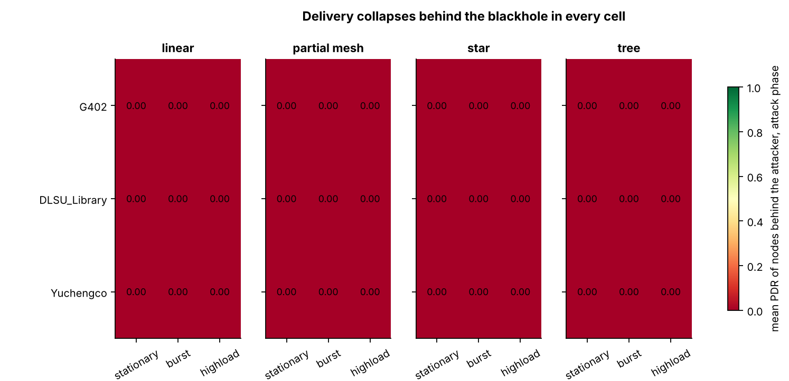

- **How to read it:** each rectangle is **one run**. Panels = topology, rows = site, columns = scenario. The number is the victims' mean PDR during the attack.
- **What it shows:** **0.00 in all 36 runs.** No victim probe reached the root during any attack.
- **Why:** the attacker sits on the victims' path, so **every** victim probe passes through it, and it drops all of them.

#### Figure 6.2: PDR of victims and bystanders over the run, by topology

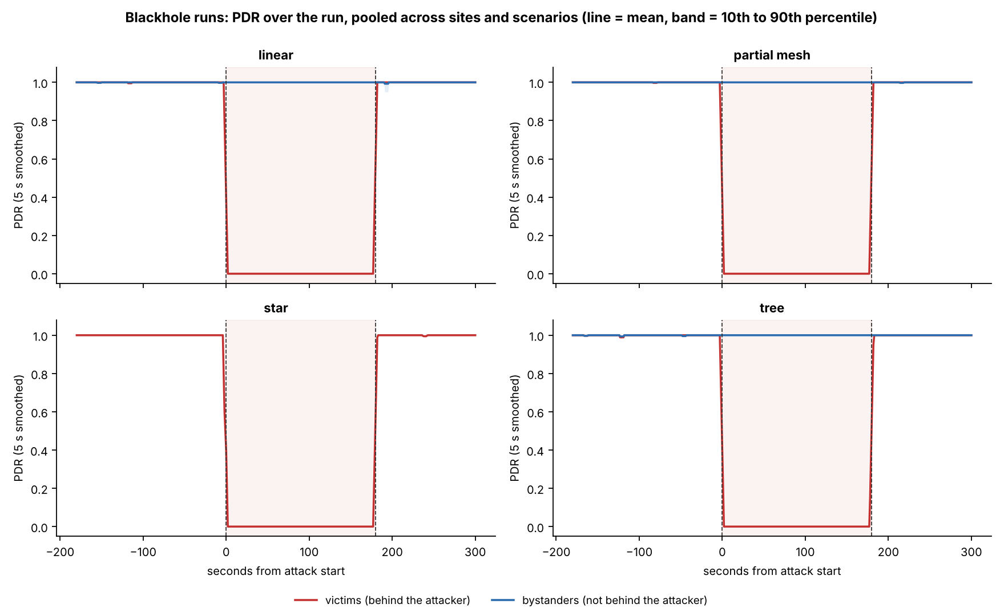

- **How to read it:** x = seconds from the attack start (0 = start, 180 = end, negative = baseline). y = PDR, 5 s moving average. **Red = victims**, **blue = bystanders**, with a 10th-to-90th percentile band. The shaded area is the attack.
- **What it shows:** red drops **straight from 1 to 0** at 0 s, stays at 0 for 180 s, and jumps back to 1. Blue stays at 1 the whole time. **The star has no blue line**, because in the star the attacker is the hub and all 6 boards are behind it.
- **Why the edges are so sharp:** *(our reading)* the attack is switched on and off by the root's phase message, and the attacker obeys at once.

#### Figure 6.3: The attacker's forwarding ratio

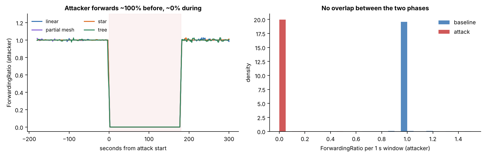

- **Left:** ForwardingRatio over time, one line per topology. About **1** before, **0** during the attack, about **1** after. All four topologies lie on top of each other.
- **Right:** a histogram of every one-second window. **Red (attack) is all at 0; blue (baseline) is all at 1.** The two phases **do not overlap at all**.
- **Why values slightly above 1 (up to 1.004):** *(our reading)* a packet received at the end of one window can be forwarded in the next, so one window can forward slightly more than it received.
- **Why it matters:** this is the **direct record** of the attack. It is the attacker's own counter, so it is a primary check, but it is **not** a clustering input (it would give the answer away).

### 4.4 Can one feature alone find the blackhole? The single-feature audit (6.2.3, Table 6.13, Figure 6.7)

**The idea:** for each feature, find the **one best cut-off** that sorts windows into normal or attack, and measure the accuracy. Compare it with the **majority rate (about 70%)**. If one feature alone does the job, clustering would be pointless. It also catches **artefacts** (Arp et al. [80]: a feature that "wins" because of how the data were made).

| Feature | All boards but the root | Non-attacker nodes | **Victims only** |
|---|---|---|---|
| **PDR** | 86.9% | 86.9% | **99.9%** |
| LatencyHopRatio | 84.3%† | 84.3%† | 100.0%† (but see below) |
| ForwardingRatio, ConsistencyScore | 80.4%† | 71.7%† | 70.0%† |
| RetryRate | 73.1% | 70.0% | 70.1% |
| All RSSI, parent and hop features | 70.0% | 70.0% | 70.1% |
| Aligned run clock (not a feature) | 80.0% | 80.0% | 80.0% |
| **Majority rate** | 70.0% | 70.0% | 70.1% |

† = the feature is missing in more than 5% of windows, so the accuracy is measured only where it exists.

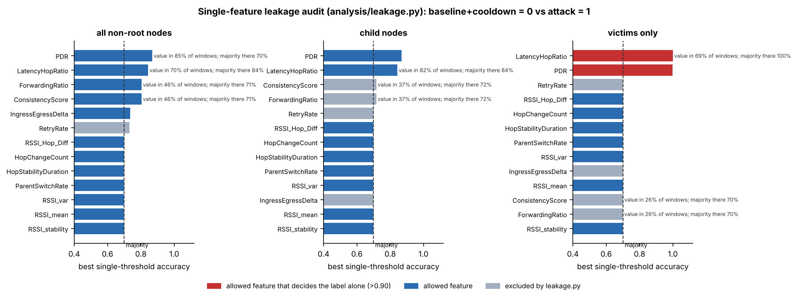

- **How to read Figure 6.7:** each bar is one feature's best accuracy. **Dashed line = majority rate (about 70%).** A bar ending at the line = useless alone. **Red bars** decide the label alone (above 90%), **blue** = other allowed features, **grey** = features the leakage guard bans in that group. Left = all boards but the root, middle = non-attacker nodes, right = victims.
- **On the victims, PDR alone gets 99.9%.** Expected: a blackhole drops everything, so the collapse is separable by design.
- **LatencyHopRatio's 100% is a trap.** It only exists when a probe arrives (a dropped probe has no delay). Its windows are almost all normal, so the cut-off itself carries nothing. **The information is in the blank:** "is the value missing?" predicts the label with **99.2%** on victims (missing in 100% of their attack windows). **That is why LatencyHopRatio is kept out of the clustering.**
- **The run clock gets 80%** because every run follows the same schedule, so one cut can remove the end of the run. It cannot pick out a window in the middle, and it is not a model input. It shows how much the fixed schedule gives away.
- **Why PDR is only 86.9% on all non-attacker nodes:** the **bystanders** are labelled "attack" but behave normally, so no cut on PDR can catch them.
- **ForwardingRatio reaches 80.4% only when the attacker is included** (its own ratio drops to 0). On non-attacker nodes it sits at the majority rate of its windows: no information.

### 4.5 What the proposal predicted that did not happen (6.2.4)

**Prediction (Table 3.4): victims would retransmit more.**
- **Not observed.** Victims' RetryRate was **0.0000 → 0.0004 → 0.0000** (baseline, attack, cooldown): a failed send in only **9 of 21,742** attack windows. Bystanders: 0 in every phase.
- **Why:** the attacker still **ACKs every frame at the radio level** (3.3.1.2), so the sender never sees a failure.
- **Parent changes:** victims' ParentSwitchRate **0.00000 → 0.00009** (d = 0.01). Practically none.
- **Extra evidence, the sniffer:** the real 802.11 retry rate (**MacRetryRate**) was captured in **7 of 36** blackhole runs. Victims 0.295 → 0.364 → 0.323; bystanders 0.355 → 0.342 → 0.354. But the change **differs in sign between runs** (victims: 3 runs up, 4 down). So there is **no consistent rise**. With only 7 runs, a small effect can't be ruled out. It is **supplementary**, not one of the 16 features (boards cannot measure it, D-15).
- **Table 3.4 is left as written at proposal time.** The result: an application-layer blackhole **removes delivery and leaves the link layer and the routing tree as they were**.

### 4.6 The blackhole EDA (6.3.1)

**Table 6.18: baseline vs attack, with Cohen's d** (victims and bystanders; the attacker is not included)

| Feature | Victims: baseline → attack | Victims: d | Bystanders: baseline → attack | Bystanders: d |
|---|---|---|---|---|
| **PDR** | **0.9977 → 0.0000** | **−29.71** | 0.9963 → 1.0000 | 0.09 |
| RetryRate | 0.0000 → 0.0004 | 0.03 | 0 → 0 | n/a |
| IngressEgressDelta | 0.019 → 0.013 | −0.01 | 0.031 → 0.018 | −0.03 |
| RSSI_mean (dBm) | −74.72 → −74.95 | −0.03 | −72.24 → −72.53 | −0.04 |
| RSSI_var | 0.412 → 0.311 | −0.07 | 0.332 → 0.199 | −0.09 |
| RSSI_stability | 0.894 → 0.896 | 0.04 | 0.895 → 0.898 | 0.07 |
| RSSI_Hop_Diff | 3.18 → 3.28 | 0.02 | 4.07 → 3.99 | −0.01 |
| ParentSwitchRate | 0.00000 → 0.00009 | 0.01 | 0 → 0 | n/a |
| HopChangeCount | 0.00000 → 0.00009 | 0.01 | 0 → 0 | n/a |
| HopStabilityDuration | 0.9998 → 0.9998 | 0.01 | 0.9999 → 0.9999 | 0.00 |

**How to read it:**
- **Only one number is big: victims' PDR, d = −29.71.** Every other feature in both groups moves by **less than 0.1** standard deviations. The largest of the rest is RSSI_var of the bystanders (d = −0.09).
- **"The collapse of the victims' PDR is the whole of the effect"** of the blackhole on the non-attacker nodes.

**Three things a panelist may point at:**
1. **Victims have weaker signal (−74.7 vs −72.2 dBm).** This is true **already in the baseline**. Victims are the deeper boards, so the gap is where they sit, not the attack.
2. **RSSI_var drops a little in the attack in both groups** (d −0.07 and −0.09). Bystanders are untouched, so a change this small **cannot be blamed on the attack**.
3. **Bystanders' LatencyHopRatio falls 4.26 → 3.15 → 2.46 ms per hop** (baseline, attack, cooldown). It **keeps falling after the attack ends** and also falls in **all 8 benign runs**. So it follows the course of the run, not the attack. (For victims it can't be followed at all: a dropped probe has no delay.)

#### Figure 6.9: Box plots of ten features by phase (bystanders and victims)

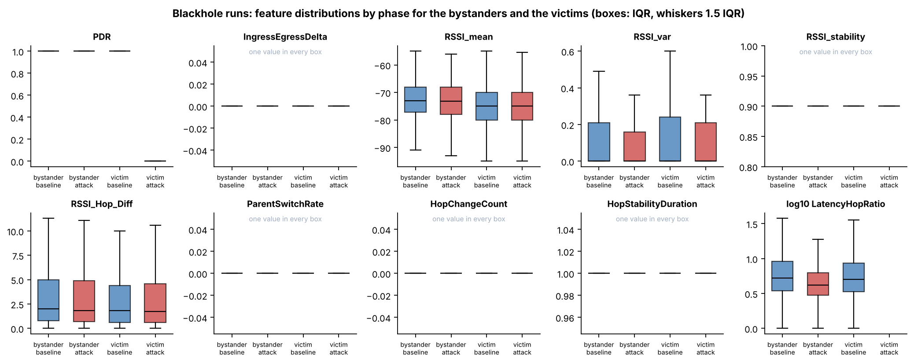

- **How to read it:** one panel per feature. Each box = one group in one phase (**blue = baseline, red = attack**). The box is the middle half of the windows; the line is the median; the whiskers reach 1.5× the box.
- **What it shows:** **only the PDR panel changes:** the victims' attack box sits at 0, all others at 1. The RSSI boxes overlap between phases. Several panels (IngressEgressDelta, RSSI_stability, ParentSwitchRate, HopChangeCount, HopStabilityDuration) are a **single value in every box**, because those features almost never change. In the LatencyHopRatio panel the **victims' attack box is missing**: they have no value then.

#### Figure 6.10: Correlations between features (child nodes, blackhole runs)

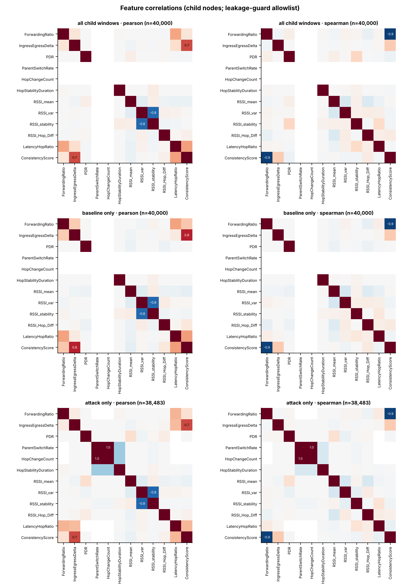

- **How to read it:** each square is the correlation between two features (blue = −1, red = +1); values of 0.5 or more are printed. **Left = Pearson** (straight-line relation), **right = Spearman** (rank relation). Rows = all windows, baseline windows, attack windows. Blank row = the feature never changes there.
- **The four strong pairs, and why:**
  - **ConsistencyScore and ForwardingRatio:** Spearman −0.94 but Pearson only 0.12, because ConsistencyScore = |ForwardingRatio − 1|, a V shape, not a straight line.
  - **IngressEgressDelta and ConsistencyScore:** Pearson 0.65 (0.78 in baseline). Both are built from the same relay counters.
  - **RSSI_var and RSSI_stability:** Pearson −0.79 but Spearman only 0.05. A few extreme windows (high variance, short stable interval) create it; there is no general relation.
  - **ParentSwitchRate and HopChangeCount:** 1.00 in the attack windows, because they are non-zero in exactly the same windows. In the baseline both are constant, so there is no coefficient.
- **Everything else** among the 8 FULL features is below |0.4| (largest 0.36). **The structure is the same in baseline and attack.**

### 4.7 Blackhole clustering (6.4.1 to 6.4.5)

**What clustering asks:** do the windows fall into groups **by themselves**, from their feature values alone, and do those groups match the attack? **The label is never given to the algorithm.** It is only used afterwards to score the clusters.

**Setup in five lines:**
- **5 algorithms:** K-Means, Ward (hierarchical), GMM (Gaussian mixture), DBSCAN (density-based, picks its own number of clusters), Spectral.
- **k = 2 to 8** clusters, **3 seeds** (42, 7, 123). Each seed draws a new sample of **6,000 windows** from 127,372 non-attacker windows.
- **DBSCAN's eps** (neighbourhood radius) is set at the **knee of the k-distance graph** (Figure 6.17): 0.79 FULL, 0.73 REDUCED, 0.56 without PDR.
- **Two populations:** all non-attacker nodes (victims + bystanders), and victims only (72,687 windows).
- **Results are means over the three seeds, at k = 2.**

**The three feature sets (Table 6.24)**

| Set | Features | Why it exists |
|---|---|---|
| **FULL** (8) | PDR, ParentSwitchRate, HopChangeCount, HopStabilityDuration, RSSI_mean, RSSI_var, RSSI_stability, RSSI_Hop_Diff | Everything allowed in |
| **REDUCED** (4) | PDR, RSSI_mean, RSSI_var, RSSI_Hop_Diff | FULL after the **low-variance filter** removed the four features where over 90% of windows hold one value (ParentSwitchRate 100%, HopChangeCount 100%, HopStabilityDuration 99.8%, RSSI_stability 98.5%). The correlation filter removed none (largest \|r\| 0.11) |
| **Without PDR** (3) | RSSI_mean, RSSI_var, RSSI_Hop_Diff | **The control:** does anything other than PDR separate the windows? |

**Why only 8 of 16 features can be clustered:** the relay features (ForwardingRatio, IngressEgressDelta, ConsistencyScore), RetryRate and the 3 tunnel features are banned by the leakage guard; LatencyHopRatio is out because **its blanks alone predict the label in 86% of windows**.

**Table 6.25: the main result (k = 2, means over 3 seeds)**

| Set | Algorithm | Silhouette | ARI, all non-attacker nodes | ARI, victims only |
|---|---|---|---|---|
| **REDUCED** | **K-Means** | 0.489 | **0.514** | **0.996** |
| REDUCED | Ward | 0.478 | 0.503 | 0.891 |
| REDUCED | GMM | 0.489 | 0.514 | 0.659 |
| REDUCED | DBSCAN | 0.510 | 0.485 | 0.940 |
| REDUCED | Spectral | 0.157 | −0.001 | 0.008 |
| FULL | K-Means | **0.773** | 0.172 | −0.001 |
| FULL | Ward | **0.905** | 0.000 | −0.002 |
| FULL | DBSCAN | 0.524 | 0.476 | 0.929 |
| **Without PDR** | **every algorithm, every k** | | **−0.016 to 0.002** | **≈ 0** |

**The four things to understand:**

1. **With PDR, clustering finds the attack windows. Without PDR, it finds nothing.** K-Means on REDUCED gets **0.514** (all nodes) and **0.996** (victims). Remove PDR and every algorithm at every k scores about 0. **The blackhole does not show in the signal-strength features.**

2. **Why 0.514 and not 1: the ceiling is 0.515 because of the bystanders (6.4.3).** **43.2%** of the attack-labelled non-attacker windows (16,499 of 38,232) are bystanders. They are labelled "attack" but behave normally, so **no method that reads only the features can group them with the attack.** A **perfect** split of the windows where the attack is actually felt scores 0.515. K-Means gets 0.514 (sd 0.014). So it is essentially **perfect**, and that's why the victims-only figure (0.996) is reported beside it.

3. **A high silhouette does not mean it found the attack.** FULL has the **best** silhouette (K-Means 0.77, Ward 0.90) but a bad ARI. On FULL at k = 2, K-Means split off **odd windows instead of the attack**:
   - **seed 42** split off the victims' attack windows (ARI 0.515);
   - **seed 7** split off **44 windows** with very high RSSI variance (ARI 0.000);
   - **seed 123** split off **a single window** where a board changed parent (ARI 0.000).

   It only recovers the attack at **k = 4** (ARI 0.505). **Lesson:** pick k using the elbow, the silhouette **and** whether the clusters make sense, never the silhouette alone.

4. **Some algorithms are unstable.** GMM is stable on all nodes (0.520 / 0.524 / 0.498) but jumps around on victims (mean 0.659, sd 0.58). **Spectral finds nothing at k = 2** and finds the attack on one seed but not the others for k = 3 to 6. It is reported, **not relied on**. DBSCAN, which picks its own k, agrees with K-Means (ARI 0.485, 5 to 9 clusters, 1.3% noise).

#### Figure 6.17: DBSCAN k-distance graphs

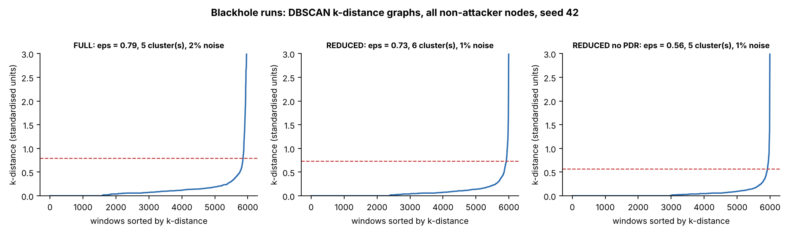

- **How to read it:** the 6,000 windows sorted by the distance to their k-th nearest neighbour. **The dashed line is eps**, placed at the **knee**, where the curve turns sharply upward. Windows beyond it are isolated and count as noise.
- **Why it's there:** it shows eps was chosen by a rule, not by trial and error.

#### Figure 6.18: ARI against k (the key clustering graph)

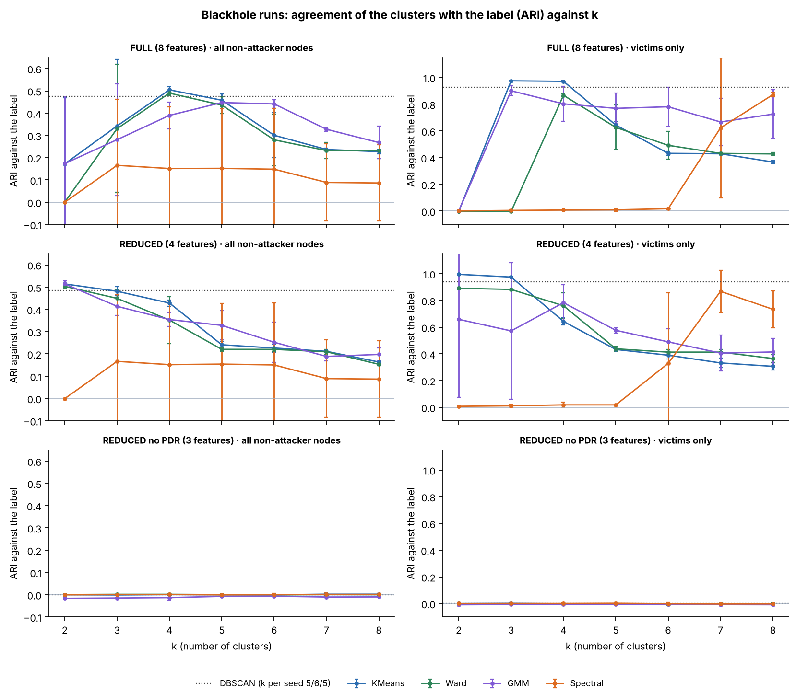

- **How to read it:** x = k (number of clusters), y = ARI. **Rows = feature sets** (FULL, REDUCED, without PDR). **Left = all non-attacker nodes, right = victims only.** Lines: **blue K-Means, green Ward, purple GMM, orange Spectral**; **dotted = DBSCAN** (its own k). Error bars = ±1 sd over the three seeds.
- **What to point at:**
  - **REDUCED, left:** K-Means, Ward and GMM start at about **0.51 at k = 2** and **fall as k grows**, because more clusters cut the attack group into pieces.
  - **REDUCED, right:** K-Means about **1.0 at k = 2**.
  - **FULL, left:** low at k = 2 (the odd-window splits), **peaks at k = 4** (about 0.5).
  - **Bottom row (without PDR):** **flat at 0 for every algorithm**, drawn on the same scale, so the emptiness is real.
  - **Orange Spectral:** huge error bars, because it finds the attack on one seed only.

#### Figures 6.19 and 6.20: Silhouette and Davies–Bouldin against k

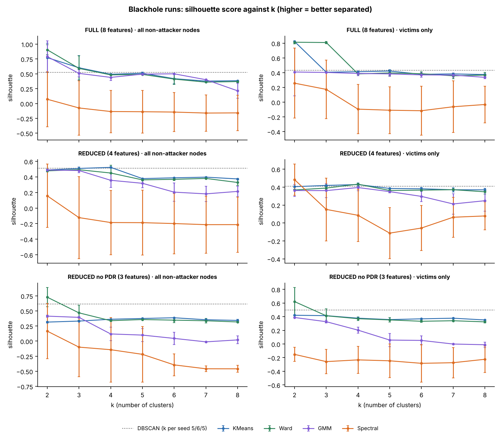

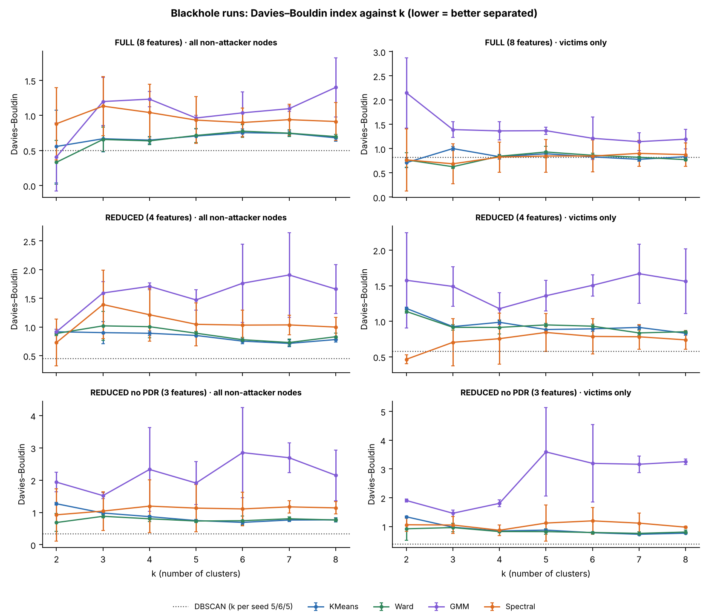

- **Same layout as 6.18.** Silhouette: higher = tighter clusters. Davies–Bouldin: lower = better separated.
- **Why they're there:** to show that **cluster shape and agreement with the attack are different questions.** FULL and "without PDR" can have **good** silhouette values while their ARI is 0. Good-looking clusters, wrong groups.

#### Figure 6.21 and Table 6.26: What is inside each cluster

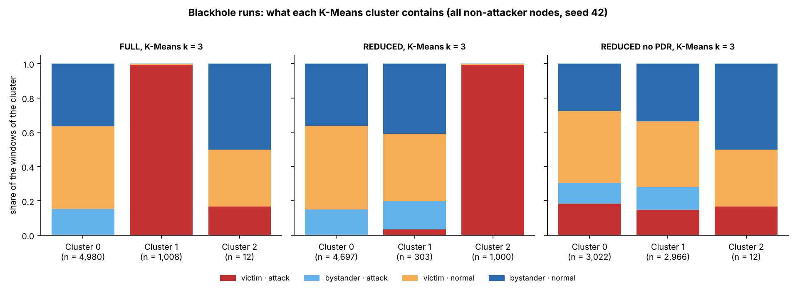

- **How to read Figure 6.21:** each bar = one K-Means cluster at k = 3 (n = its size), split into four colours:
  - **red** = victim attack windows;
  - **light blue** = bystander attack windows;
  - **orange** = victim normal windows;
  - **dark blue** = bystander normal windows.
- **With PDR (left, centre):** one cluster (about 1,000 windows) is **almost entirely red** (99.4% attack). The third cluster is a **small group of extreme windows**: 12 windows with huge RSSI variance (FULL), or 303 windows with RSSI_Hop_Diff about 20 dB (REDUCED).
- **Without PDR (right):** **every cluster is a mix** of all four colours, with an attack share of 28% to 31%, the same as the sample (29%).

**Table 6.26: the two K-Means clusters (k = 2, REDUCED, seed 42)**

| | Cluster A (delivery fine) | Cluster B (delivery lost) |
|---|---|---|
| Windows | 4,990 | 1,010 |
| Attack-phase windows | 15.2% (these are the bystanders) | **99.4%** |
| From victims | 48.2% | **99.7%** |
| **Mean PDR** | **1.000** | **0.000** |
| Mean RSSI_mean | −73.6 dBm | −74.9 dBm |
| Mean RSSI_var | 0.315 | 0.322 |
| Mean RSSI_Hop_Diff | 3.65 dB | 3.33 dB |

**The point:** the clusters differ in **PDR and almost nothing else**. Cluster B is "delivery lost".

### 4.8 Is the result solid? Robustness (6.4.4, Table 6.27)

| Subgroup | Best possible ARI | REDUCED K-Means | Without PDR |
|---|---|---|---|
| G402 | 0.531 | 0.516 | 0.002 |
| DLSU Library | 0.572 | 0.574 | 0.002 |
| Yuchengco | 0.445 | 0.420 | −0.006 |
| Linear | 0.560 | 0.565 | −0.001 |
| Partial mesh | 0.286 | 0.277 | −0.001 |
| **Star** | **1.000** | **0.999** | −0.003 |
| Tree | 0.279 | 0.278 | 0.000 |

- **Within 0.03 of the best possible in every site and topology**; about 0 without PDR in all of them.
- **The star gets 0.999** because the star has **no bystanders**, so the ceiling is 1.
- K-Means can **slightly beat** the "best possible" (linear: 0.565 vs 0.560), because "best possible" is the ARI of one particular partition, not a true maximum.
- **Dropping the cooldown from "normal"** gives the same pattern (purity 0.836 vs majority 0.628 with PDR; equal to the majority without it).
- **Run-level check (the honest error bar):** the seeds only change the sample, not the runs, and **36 runs** are the real number of independent observations. One K-Means model applied to every window gives **ARI 0.511**. Resampling the 36 runs 300 times gives a **95% interval of 0.41 to 0.63**, much wider than the seed spread (sd 0.014) but **still far from 0**.
- **Per run:** within 0.05 of the best possible in **35 of 36 runs.** The exception is partial mesh/Yuchengco/stationary (0.066 vs 0.139), **the same run with the unstable baseline**.

### 4.9 The projections (6.4.5): Figures 6.22 and 6.23

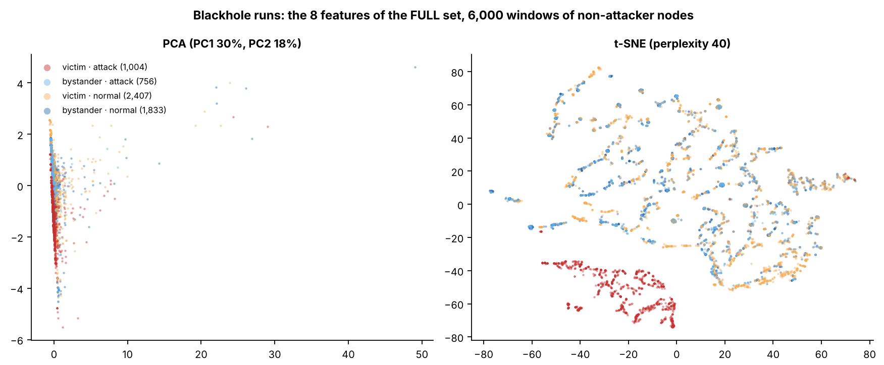

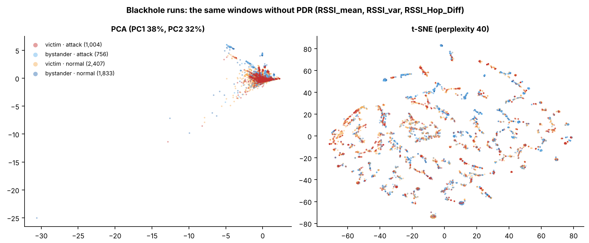

- **What they are:** each of 6,000 windows squeezed from 8 (or 3) numbers down to 2, so it can be drawn as a dot.
  - **PCA** uses the two directions with the most spread: PC1 30%, PC2 18% of the variance in 6.22.
  - **t-SNE** puts similar windows close together. **Its axes have no units; only distance between dots means anything.**
- **Colours:** red = victim attack, orange = victim normal, light blue = bystander attack, dark blue = bystander normal.
- **Figure 6.22 (FULL):**
  - In **t-SNE**, the **red dots form their own group** at the bottom.
  - **Light blue (bystander attack) sits among the normal dots**: they look normal because they are normal.
  - In **PCA**, a few extreme-RSSI-variance windows squash most dots into a narrow column, with red along its lower part.
- **Figure 6.23 (without PDR):** **all four colours lie on top of each other.** No structure. The same story as the ARI ≈ 0.
- **"Group" vs "cluster":** a group is dots that look close in the picture; a cluster is what an algorithm outputs.

### 4.10 What the blackhole results mean (6.5.1)

- **The testbed works:** the attacker did exactly what it was designed to do in all 36 runs.
- **The separation rests on one feature, PDR.** That PDR is **also what the verifier uses** to confirm the attack (Table 6.9). So the clustering **finds the effect the verifier measured**, which is good: the dataset is consistent and usable.
- **But it is not independent evidence that cross-layer features detect the blackhole.** Without PDR the cross-layer features find nothing. **Say this before a panelist does.**

---

## 5. Wormhole results

### 5.1 What the wormhole does (so the graphs make sense)

- **End B** (deeper) sends each of its own probes to the root **normally**, and **also** writes a copy into a **UART wire** to end A.
- **End A** (shallower) sends that copy on into the mesh from its own position.
- **So the root receives every probe of B twice**, by two routes, with slightly different delays.
- **Only B's probes are tunnelled.** The other 5 boards are **not touched**, and **no node is a victim**.
- The mesh **does not know the wire exists**, so routing, parents and radio links stay as they were (D-20).

**Three kinds of evidence were expected:** (1) tunnel messages on the two ends, none in the baseline; (2) duplicates of B's probes at the root; (3) **B deeper than A**, so the tunnel skips hops (D-17).

### 5.2 Did it work? The verifier (6.2.2, Table 6.11)

| Check | Role | Passed | What it means |
|---|---|---|---|
| **DuplicateRate of end B** | Primary | **36 of 36** | Baseline **0** in every run → attack **0.986 to 1.000** (median 1.000) |
| **TunnelIntensity of the ends** | Primary | **36 of 36** | Baseline at most 0.001 messages/s → attack **0.994 to 4.0** messages/s |
| TunnelBytes of the ends | Support | 36 of 36 | Baseline at most 0.035 bytes per window → attack median **30**, max 120 |

- **DuplicateRate is not a dataset feature.** The verifier computes it from the root's log as the share of B's probes that arrive twice in a window.
- **Why TunnelIntensity is 1 or 4:** it equals **B's probe rate**. That's about 1 per second in stationary and burst, and 4 per second in highload. One run (partial mesh/Yuchengco/highload) shows 1.0, because B sent about 1 probe/s instead of 4 (Table 6.6).
- **Setup checks:** scenario and tunnel OK in all 36. **Topology OK in 27; the 9 partial-mesh runs get a warning**, because every node was seen under a single parent, so the "partial mesh" is really a **plain tree** (6.5.4).
- **Verdict:** **CONFIRMED in all 36 = 21 strong, 15 good.** The 15 good runs are the 9 partial-mesh runs (plain-tree note) plus 6 runs with **no saved root run log**, where a forced start can't be ruled out. **No wormhole cell has a gap.**

### 5.3 How the tunnel behaved (Table 6.12)

| Group | Hops skipped: min to max (median) | Exit end received (% of sent) | Median spread between copies (ms) |
|---|---|---|---|
| Linear | 2 to 5 (4) | 99 to 101 | 5.4 (2.8 to 9.9) |
| Partial mesh | 1 to 2 (1) | 99 to 101 | 4.0 (2.4 to 6.4) |
| Star | 1 (1) | 99 to 101 | 3.7 (3.0 to 4.6) |
| Tree | 1 to 2 (1) | 100 to 101 | 3.3 (2.0 to 4.3) |
| **All 36** | **1 to 5 (1)** | **99 to 101** | **3.7 (2.0 to 9.9)** |

- **In every run B was deeper than A, and neither end changed depth** for the whole run.
- **The star skips exactly 1 hop** because the **exit end A is the hub** (D-28).
- **The wire worked:** A received **99% to 101%** of what B sent. Over 100% is possible *(our reading)* because the counts are cut at window and phase edges.
- **Duplicates:** **6,468 of 6,469** attack windows of B hold a duplicate (99.98%); **none** in baseline or cooldown.
- **At the level of single probes (root's log):** **12,448 of 12,465** of B's probes in the attack reached the root **twice (99.86%)**. **None** of the other 5 boards' probes did.
- **The two copies don't arrive together.** The gap (TunnelLatency) is median **3.9 ms**, 90th percentile **12.1 ms**, 99th percentile **417 ms**. The tail is long: 84 windows have a gap above 200 ms.
- **The gap does not grow with hops skipped:** Spearman 0.25 (p = 0.14); 0.29 with the 90th percentile (p = 0.09). **No relation can be claimed** from 36 runs.
- **Out of order:** because the copies take different routes, **232 of 24,913** arrivals (0.93%) came after a probe with a higher sequence number. That's rare, and concentrated in 3 highload runs (tree/G402 94, partial/G402 55, partial/DLSU 47).

### 5.4 The wormhole graphs

#### Figure 6.4: Hops skipped and median spread, for each run

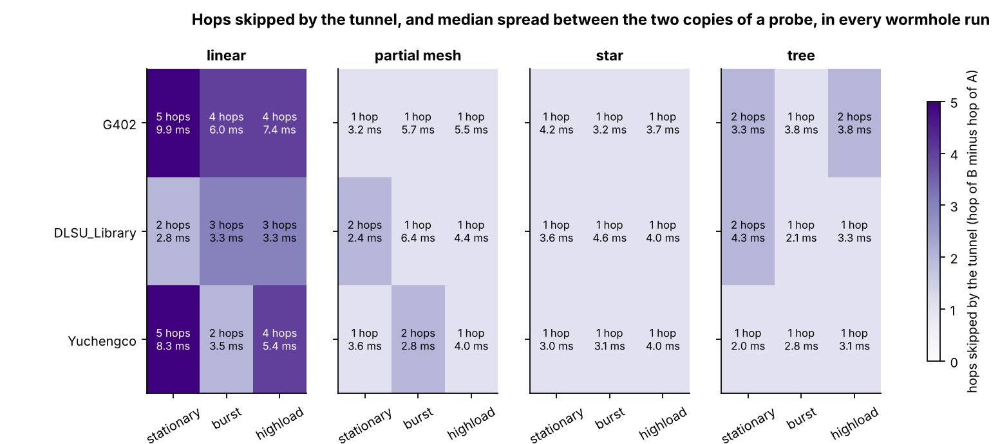

- **How to read it:** like Figure 6.1, one rectangle per run (panels = topology, rows = site, columns = scenario). **Shade = hops skipped (1 to 5)**; the **second number = the median gap between the two copies (ms)**.
- **What it shows:** the **linear** panel is darkest (2 to 5 hops, because it's a long chain). Star, tree and partial mesh mostly skip 1 hop. The gap is a few ms everywhere.

#### Figure 6.5: Tunnel traffic, duplicates and spread over time

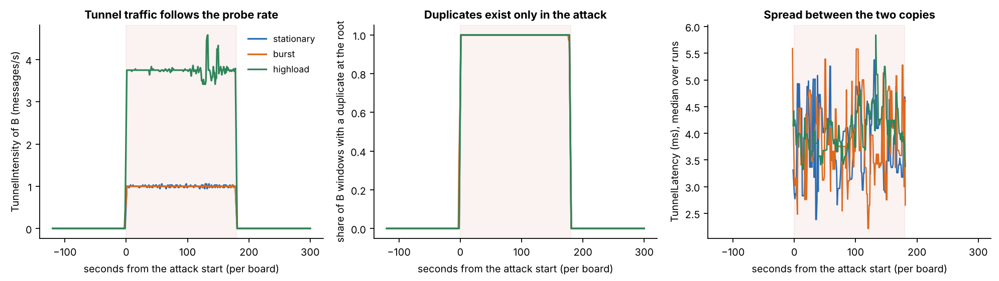

- **How to read it:** x = seconds from the attack start (per board); one line per scenario (mean of its 12 runs); shaded = attack.
- **Left, TunnelIntensity of B:** **0 before and after**, a flat step to **about 1** (stationary, burst) or **about 3.8** (highload) during. **Why the two heights:** the tunnel carries B's probes, and highload sends 4 per second.
- **Middle, share of B's windows with a duplicate:** a clean **0 → 1 → 0** box. Duplicates exist **only** in the attack.
- **Right, median spread:** wobbles between about **2 and 6 ms** during the attack and **does not exist outside it**: no tunnel, no second copy, no gap.

#### Figure 6.6: Spread by topology and against hops skipped

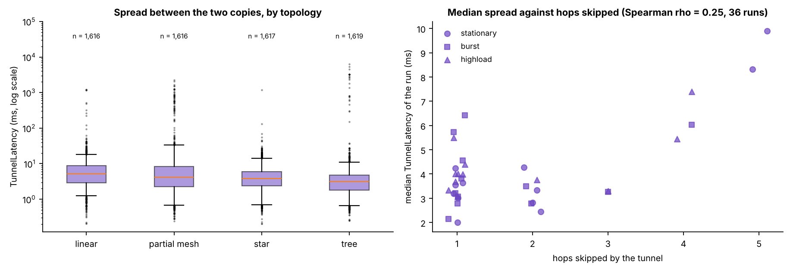

- **Left:** box plot of the gap per topology on a **log scale**. The box is the middle half; the whiskers are the 5th and 95th percentiles. Typical values are a few ms in every topology.
- **Right:** one dot per run at (hops skipped, median gap), with the marker = scenario. **No upward trend:** skipping more hops does not make the gap bigger (rho 0.25, not significant).

### 5.5 Can one feature alone find the wormhole? (6.2.3, Table 6.14, Figure 6.8)

| Feature | Non-attacker nodes | Ends A and B | End B only |
|---|---|---|---|
| **TunnelIntensity, TunnelBytes** | no value | **99.7%** | **99.7%** |
| TunnelLatency | no value | 100.0%† | 100.0%† |
| RetryRate | 70.0% | 76.9%† | **100.0%** (artefact, see below) |
| PDR | 70.0% | no value | no value |
| Every RSSI, hop, parent, relay feature | **70.0%** | 70.0% | 70.0% |
| Aligned run clock | 80.0% | 80.0% | 80.0% |
| **Majority rate** | 70.0% | 70.0% | 70.0% |

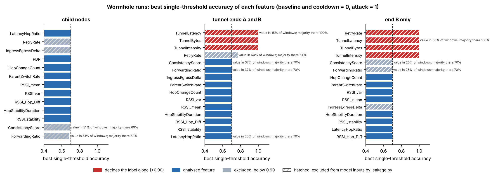

- **Same layout as Figure 6.7:** left = non-attacker nodes, middle = both ends, right = end B. A **hatched** bar = banned by the leakage list.
- **On the ends, the tunnel features decide the label alone (99.7%).** Expected: the tunnel only carries messages during the attack.
- **TunnelLatency exists only on B and only in the attack**, so **its mere presence** is the label (100%). That's why all three tunnel features are banned as inputs.
- **RetryRate gets 100% on B, but it's not a retry rate.** On B, the counter that RetryRate reads **holds the frames sent through the tunnel** (D-15), so it records the attack by construction. Banned.
- **On the non-attacker nodes, no feature gets more than 0.01 percentage points above 70%.** **The wormhole leaves no trace on them** that a single feature can use.

### 5.6 What the proposal predicted vs what was measured (6.2.4, Table 6.16)

| Indicator (Table 3.5) | Measured | Seen? |
|---|---|---|
| Hop count consistency | Hop of A and B constant in all 36 runs; **0** hop-change windows on any board, any phase | **No** |
| Parent-child validity | **0** parent-change windows on any board, any phase | **No** |
| Routing table entries | Firmware does not log the routing table | **Not measured** |
| RSSI-hop correlation | RSSI_Hop_Diff A 2.79 → 2.76 dB; B 5.41 → 5.68 dB | **No** |
| RSSI variance | RSSI_var A 0.390 → 0.343 (d −0.03); B 0.366 → 0.278 (d −0.07) | **No** |
| **Frame arrival pattern** | B's probes twice: baseline **0 of 20,717**, attack **12,448 of 12,465**; out of order 0.93% | **Yes** (duplicates); out-of-order rare |
| Retransmission count | B's RetryRate 0 → 0.50, but it counts **tunnelled frames**, not retries; other boards 0.000 in every phase; no sniffer data for wormhole runs | **Not measurable on the ends; none on the children** |
| **Duplicate arrivals** | 6,468 of 6,469 attack windows of B; 0 baseline | **Yes** |
| **Latency mismatch** | Gap median 3.9 ms, p90 12.1 ms, p99 417 ms | **Yes** |

- **The pattern: 3 of 9 seen, and all 3 are properties of the traffic the tunnel creates** (duplicates, arrival pattern, latency gap).
- **The 4 routing/radio indicators are not seen** (hop, parent, RSSI-hop, RSSI variance).
- **Why:** the tunnel works at the application layer. **The mesh doesn't see it, so routing and radio stay as they were, and only the data plane carries the signature** (D-20).
- Table 3.5 is left as written at proposal time.

### 5.7 The wormhole EDA (6.3.2, Table 6.19)

| Feature | End A: baseline → attack (d) | End B: baseline → attack (d) | Non-attacker nodes (d) |
|---|---|---|---|
| **TunnelIntensity** | **0.000 → 1.916 (1.83)** | **0.000 → 1.916 (1.83)** | no value |
| **TunnelBytes** | **0.0 → 57.5 (1.83)** | **0.0 → 57.5 (1.83)** | no value |
| TunnelLatency | no value | **none → 21.1 ms** (mean; median 3.9) | no value |
| RetryRate | none → 0.000 | **0.000 → 0.500 (42.99)**, an artefact | 0.000 → 0.000 |
| PDR | no value | no value | **0.9999 → 0.9999 (0.00)** |
| RSSI_mean | −65.63 → −65.82 (−0.02) | −62.47 → −62.35 (0.01) | −69.18 → −69.13 (0.01) |
| RSSI_var | 0.390 → 0.343 (−0.03) | 0.366 → 0.278 (−0.07) | 0.451 → 0.331 (−0.06) |
| RSSI_Hop_Diff | 2.79 → 2.76 (−0.01) | 5.41 → 5.68 (0.04) | 2.65 → 2.72 (0.02) |
| LatencyHopRatio | no value | 12.0 → 11.2 (−0.01) | 11.3 → 9.9 (−0.03) |
| Hop / parent features | unchanged | unchanged | unchanged |

**How to read it:**
- **Only the tunnel features change**, and they exist only on the ends.
- **Why d is "only" 1.83 for TunnelIntensity, although it separates perfectly:** the baseline never varies (always 0), but the **attack values spread from 1 to 4** depending on the scenario. That spread enlarges the pooled standard deviation and caps d. The separation is still total.
- **Why TunnelLatency's mean (21.1 ms) is so much bigger than its median (3.9 ms):** a few windows with very long gaps pull the mean up.
- **RetryRate of B, d = 42.99, is the biggest number in the table and means nothing about retries.** It counts tunnel frames (D-15).
- **Everything else stays put.** The largest shift on the ends is RSSI_var of B (−0.07); on the non-attacker nodes, RSSI_var (−0.06).
- **B's RSSI_Hop_Diff is higher (5.4 dB vs about 2.7 elsewhere)**, but it is **just as high before the attack**, so it reflects **where B sits**, not the attack.
- **Conclusion: the wormhole leaves delivery, signal strength and position in the mesh unchanged.** That is what an application-layer attack should do (D-20).

#### Figure 6.11: PDR of wormhole non-attacker nodes vs blackhole victims

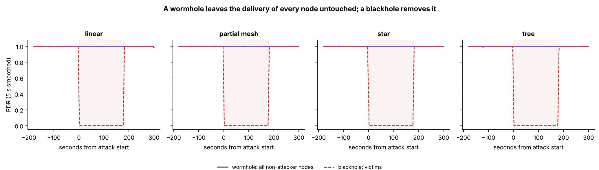

- **How to read it:** x = seconds from the attack start, y = PDR (5 s moving average), one panel per topology. **Solid purple = wormhole non-attacker nodes; dashed red = blackhole victims.**
- **What it shows:** **purple never leaves 1; red drops to 0** for the whole attack. It is the cleanest picture of the difference: **the blackhole removes probes, the wormhole adds copies, and the other boards' delivery is untouched.**

#### Figure 6.12: Box plots of ten features by phase (wormhole)

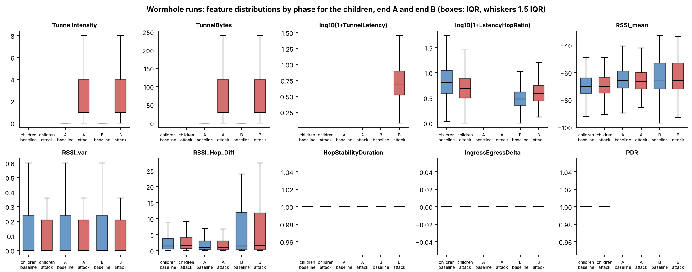

- **How to read it:** like Figure 6.9, with groups = non-attacker nodes, end A, end B; **blue = baseline, red = attack**.
- **What it shows:**
  - The **tunnel features** have values **only in the attack and only on the ends** (TunnelLatency only on B, log scale).
  - The **RSSI boxes coincide** between phases for every group.
  - **LatencyHopRatio boxes differ between groups** (different depths) but shift only slightly between phases.
  - HopStabilityDuration and IngressEgressDelta are a single value in every box.
  - PDR has no value on the ends.

### 5.8 Wormhole clustering (6.4.6, Tables 6.28 and 6.29)

**Three populations:**
1. **The 5 non-attacker boards** (107,405 windows) with FULL / REDUCED / without PDR. They are not touched, so **no agreement is expected**.
2. **End A**, with the three signal features.
3. **End B**, with the signal features, then with LatencyHopRatio added.

**Diagnostic:** each end again **with TunnelIntensity added**. This counter is banned as an input; the point is only to check whether the data contain a tunnel signal an algorithm can find at all. The wormhole windows are 30% of each end's windows.

| Population and features | K-Means k=2 | K-Means k=3 | GMM k=2 | DBSCAN |
|---|---|---|---|---|
| Non-attacker boards, FULL / REDUCED / no PDR | **≈ 0** (−0.005 to 0.000) | ≈ 0 | ≈ 0 | ≈ 0 |
| End A, signal features | −0.001 | −0.002 | −0.008 | −0.002 |
| End B, signal features (± LatencyHopRatio) | 0.000 | ≈ 0 | ≈ 0 | ≈ 0 |
| End A **+ TunnelIntensity** | −0.003 | 0.207 | 0.080 | 0.300 |
| End B **+ TunnelIntensity** | **0.000** | 0.141 | 0.161 | **0.827** |

- **Without a tunnel feature, no algorithm finds the wormhole.** ARI between **−0.012 and 0.009** everywhere, and purity equals the majority rate. The run-level check agrees: ARI −0.001 (95% interval −0.008 to 0.009).
- **This matches Table 3.5:** the wormhole leaves the other boards as they are, and its real trace (duplicates at the root) **is not one of the cross-layer features**.
- **With TunnelIntensity added, it depends on the algorithm:**
  - **K-Means at k = 2 still fails (0.000) on B.** It splits B's windows by **signal level**, not by tunnel. One cluster averages −67.6 dBm and the other −47.1 dBm, with almost the same TunnelIntensity (0.56 vs 0.64). *(Our reading: the gap in signal level between runs is bigger than the tunnel step, so K-Means cuts there first.)*
  - **K-Means at k = 3** finds a third cluster of **540 windows that are 100% wormhole**, all with TunnelIntensity about 4.04: **the highload runs only** (ARI 0.141).
  - **DBSCAN finds 9 to 12 small clusters, nearly all pure: ARI 0.827** on B (purity 0.991, 1.4% noise). On A, DBSCAN reaches 0.300.
- **Meaning:** a tunnel signal **exists** in the data, but it lives in a counter kept **by the attacking boards** (TunnelIntensity), **not** in the cross-layer features.

**Table 6.29: K-Means on end B with TunnelIntensity (seed 42)**

| k | Cluster | Windows | % wormhole | Mean RSSI_mean | Mean TunnelIntensity |
|---|---|---|---|---|---|
| 2 | 0 | 4,523 | 30.4 | −67.6 | 0.56 |
| 2 | 1 | 1,477 | 32.1 | −47.1 | 0.64 |
| 3 | 0 | 4,139 | 24.0 | −67.7 | 0.24 |
| 3 | 1 | 1,321 | 24.1 | −47.5 | 0.24 |
| 3 | **2** | **540** | **100.0** | −60.1 | **4.04** |

#### Figure 6.24: ARI against k in the wormhole runs

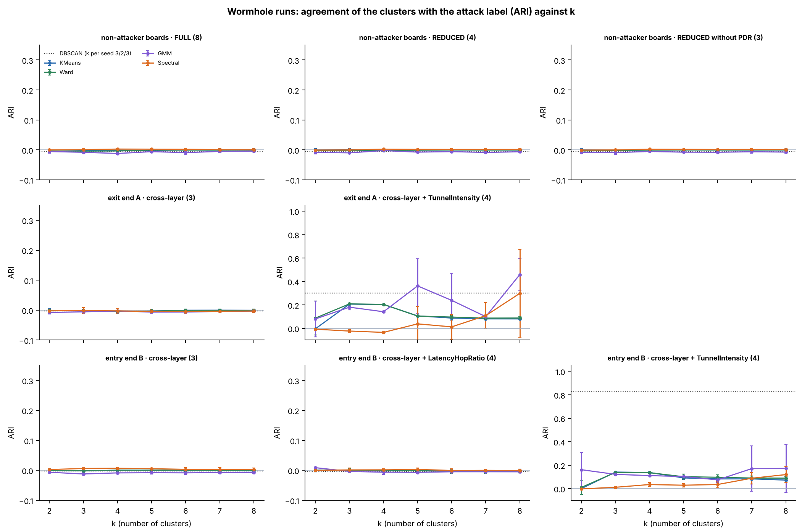

- **How to read it:** like 6.18. **Top row = non-attacker boards, middle = end A, bottom = end B.** The two panels with TunnelIntensity have a **taller y-scale**, so DBSCAN's about 0.83 fits.
- **What it shows:** **every panel without TunnelIntensity is flat at 0.** Only the "+ TunnelIntensity" panels rise, mainly the DBSCAN line on end B.

#### Figure 6.25: PCA and t-SNE of the wormhole runs, coloured by phase

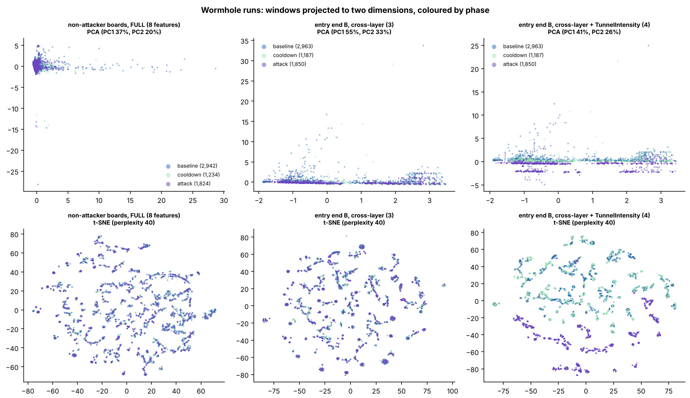

- **Colours:** **blue = baseline, light green = cooldown, purple = attack.** Top row = PCA, bottom = t-SNE.
- **Left (non-attacker boards, FULL)** and **centre (end B, signal features):** **the colours overlap completely.**
- **Right (end B + TunnelIntensity):** the **purple windows form separate groups** (t-SNE) and a separate band (PCA), because TunnelIntensity is exactly 0 in every normal window.

---

## 6. Both attacks together: pooled clustering, the published studies, and what it all means

### 6.1 Pooling all 80 runs with three labels (6.4.7)

**The question:** throw the non-attacker windows of **all 80 runs** together (257,258 windows) and ask whether three groups appear: **normal (0), blackhole (1), wormhole (2)**. It is run twice: with the 8 benign runs, and without them (72 attack runs).

**Table 6.30: what goes into the pool**

| Group | Label | Windows | Share |
|---|---|---|---|
| Normal, benign runs | 0 | 22,481 | 8.7% |
| Normal, blackhole runs | 0 | 89,140 | 34.7% |
| Normal, wormhole runs | 0 | 75,211 | 29.2% |
| **Blackhole attack, victims** | 1 | 21,733 | 8.4% |
| Blackhole attack, bystanders | 1 | 16,499 | 6.4% |
| Wormhole attack, other boards | 2 | 32,194 | 12.5% |

- **The ceiling:** only the **victim** windows actually look different. Bystanders and wormhole boards look normal. So the best a features-only method can score against three labels is **0.334** (80 runs) or **0.317** (72 runs).
- **The result:** K-Means at k = 2 on REDUCED gets **0.333** and **0.315**, so it hits the ceiling. **It finds the blackhole victims and nothing else.**
- At k = 3 the third cluster is again a small set of extreme-RSSI-variance windows (ARI 0.272), not the wormhole.
- **Without PDR: ARI −0.023 to 0.005**, nothing.
- **Benign runs don't change the answer** (ARI differs by 0.017 with or without them).
- **The wormhole windows never form their own cluster.** They are 12.5% of the sample and **never more than 16.3%** of any cluster of 100+ windows.

**Used as a detector (Table 6.32):** one K-Means model (k = 2, REDUCED) applied to **every** window.

| Group | Windows that land in the "victim" cluster |
|---|---|
| **Blackhole victims (attack)** | **21,733 of 21,733 (100.00%)** |
| **Benign runs** | **0 of 22,481 (0.00%)**: no false alarm |
| Blackhole normal windows | 183 of 89,140 (0.21%) |
| Wormhole normal windows | 5 of 75,211 (0.01%) |
| Bystanders (attack) | 0 of 16,499 |
| **Wormhole attack, other boards** | **3 of 32,194 (0.01%)**, so not detected, as expected |

**The benign runs are the control:** same testbed, same traffic, no attack, and **none** of their windows fall in the victim cluster. So the cluster picks up **the delivery collapse, not something about the traffic**.

#### Figures 6.26 to 6.31 (pooled)

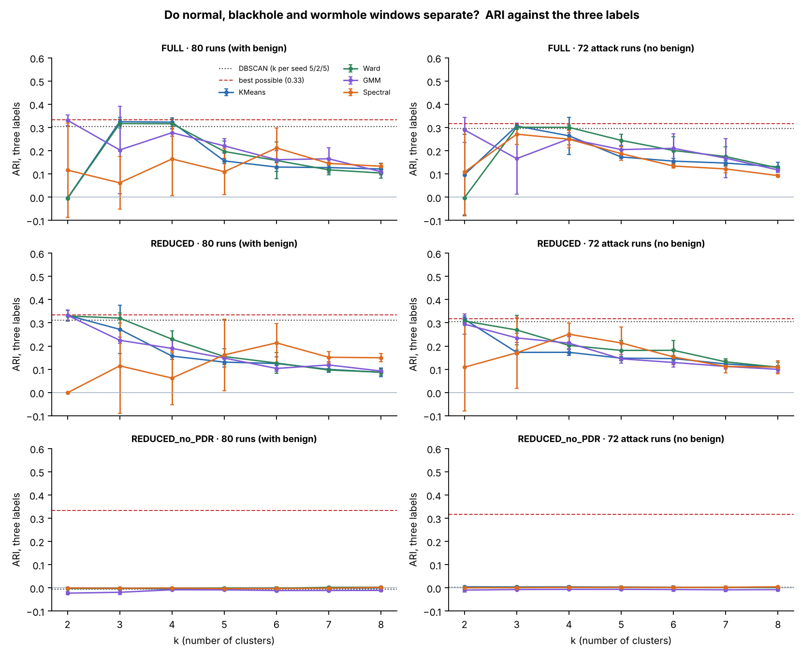

- **6.26:** ARI vs k against three labels, like 6.18. **Dashed red line = the ceiling (0.334 / 0.317).** With PDR, the lines touch it; without PDR, they are flat at 0.

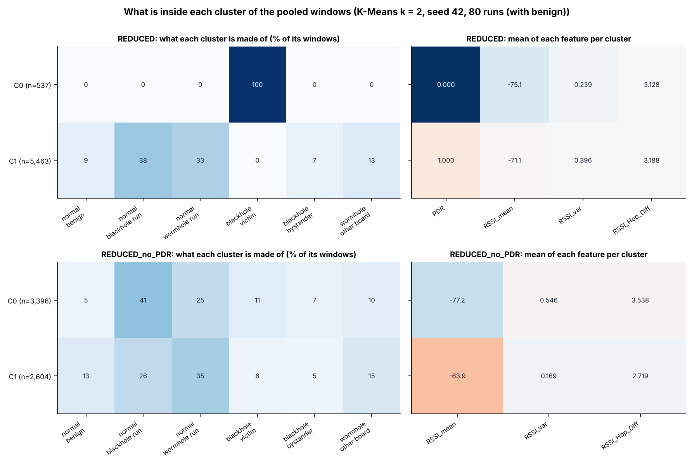

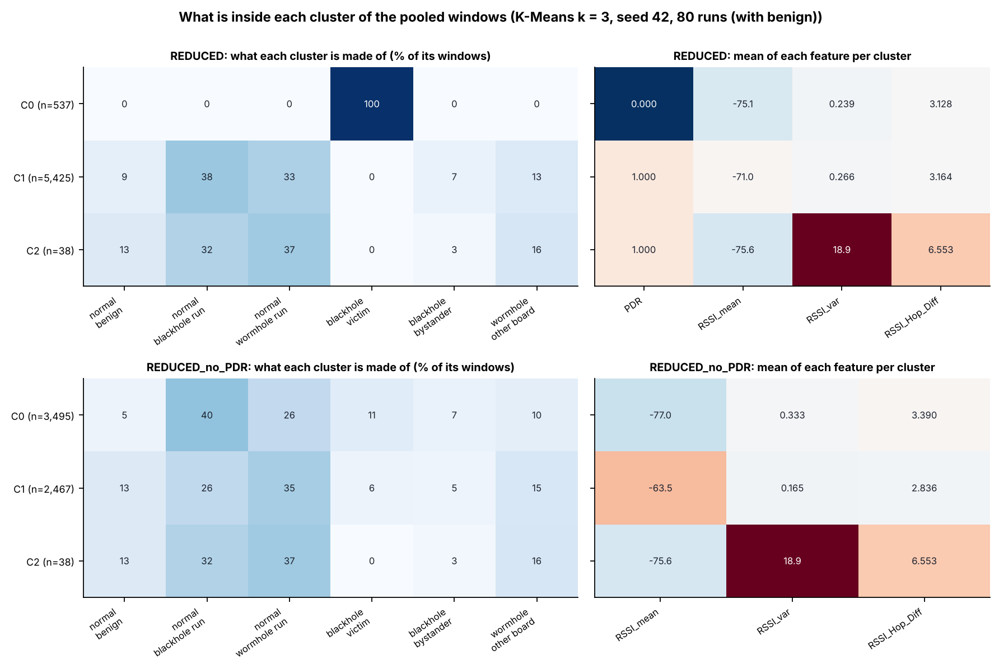

- **6.27 (k = 2) and 6.28 (k = 3):** left panels = **what kinds of window are in each cluster**; right panels = **feature means**, coloured by how far from the sample mean.
  - With PDR, **one cluster (537 windows) is victim attack windows only**, defined by PDR = 0.
  - **Without PDR**, the two clusters split by **signal level** (−77.2 vs −63.9 dBm) and each holds **all six kinds** of window.
  - At k = 3 the extra cluster is **38 extreme windows** (RSSI_var 18.9), not the wormhole.

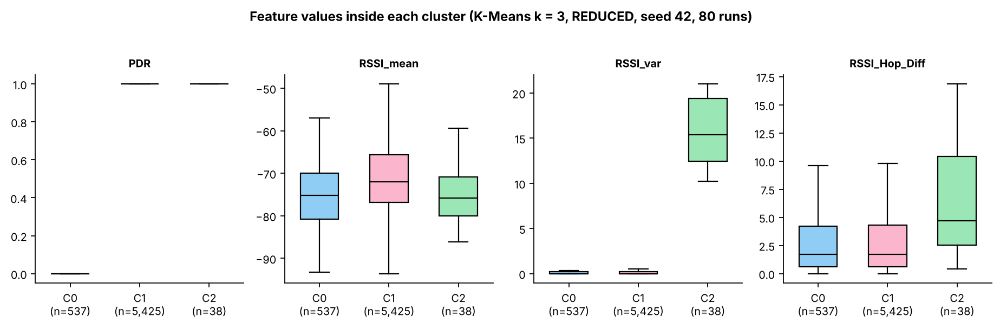

- **6.29:** box plots of each feature inside each k = 3 cluster. **PDR separates C0 (0) from the others (1)**, RSSI_mean and RSSI_Hop_Diff overlap, and RSSI_var is huge only in the tiny extreme cluster C2.

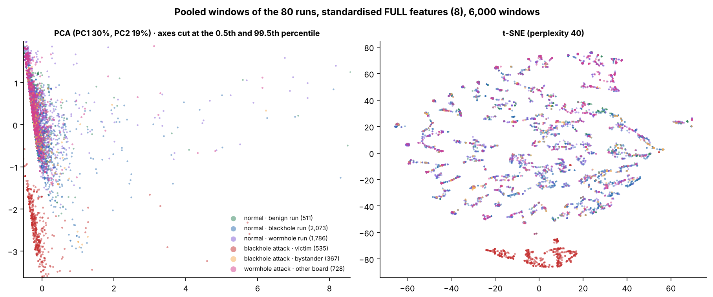

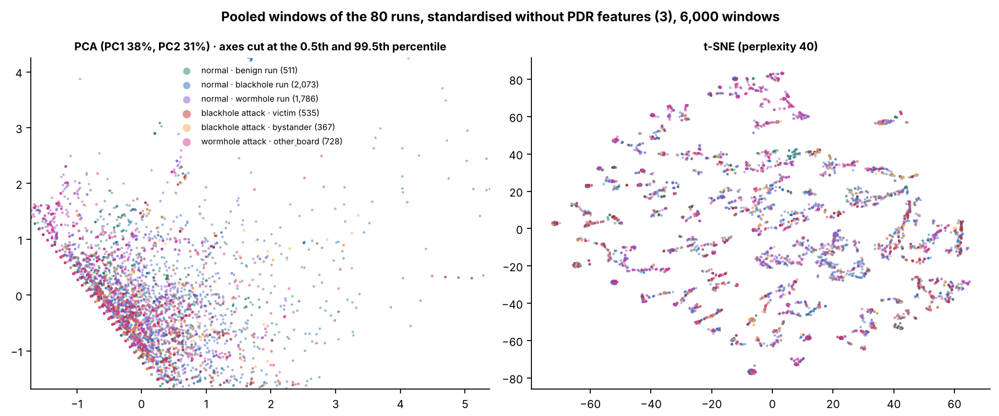

- **6.30 (FULL) and 6.31 (without PDR):** projections of the pooled windows. Colours:
  - green = benign;
  - blue = blackhole normal;
  - purple = wormhole normal;
  - **red = victims**;
  - orange = bystanders;
  - pink = wormhole attack.

  **In 6.30 only red sits apart; in 6.31 everything overlaps, red included.**

### 6.2 Is the signal strength trustworthy? (from the benign comparison, 6.3.3)

This matters for **both** attacks, because RSSI is in every feature set.
- The **same cell** (same topology, site and scenario) recorded on two different occasions differs in baseline RSSI_mean by **8.1 dB** (benign vs blackhole run) and **7.1 dB** (benign vs wormhole run) on average, **in both directions** (Table 6.23, Figure 6.16). PDR differs by at most 0.0001.
- **Why:** each run is a fresh set-up. Signal strength depends on exactly where the boards stand and what's around them.
- **So RSSI_mean separates runs by their set-up, not attack from normal.** That is why "without PDR" clusters split by signal level (−77 vs −64 dBm) and catch no attack.

### 6.3 Compared with published studies (6.5.2, Table 6.34)

| What | Ours | Published | Why different |
|---|---|---|---|
| Blackhole, baseline PDR | 0.998 (victims), 0.996 (bystanders) | **> 0.97** per node, ESP-MESH on ESP32 (Khan et al. [22]) | Same platform; sizes agree. Counting differs (1 package per 1 to 2 min over 5 days vs probes per second), so not claimed equal |
| Blackhole, attack PDR | **0.000** | **25% to 40% delivery** (60% to 75% loss), RPL, 14 Telos-B motes (Airehrour et al. [70]) | There, loss depends on which motes **choose** the attacker as parent. Here the attacker **is placed on** the victims' path, so all is lost. **Direction agrees, size doesn't** |
| Blackhole, parent changes | 0.00000 → 0.00009 /s | 16 to 246 **rank changes** per mote [70] | Different metric and mechanism: their attack acts inside routing; ours doesn't touch routing (D-20) |
| Wormhole, hop count | Constant in 36 of 36 | **4 hops → 3 hops**, ZigBee, two Raspberry Pis over GSM (Zhukabayeva et al. [71]) | Their tunnel is a shorter route ZigBee **chooses**; ours is an application relay the mesh never sees |
| Wormhole, delay | B's LatencyHopRatio 12.0 → 11.2 ms/hop; gap between copies median 3.9 ms | 80 to 100 ms **→ 120 to 200 ms** [71] | Different measure: their route delay vs our per-hop delay and copy gap |
| Wormhole, others' delivery | 0.9999 → 0.9999 | Loss increased (no value given) [71] | Only B is tunnelled here and nothing is dropped on purpose |
| **Wormhole, duplicates** | **99.86%** of B's probes twice | **Two source-routing packets per data packet** (Ramírez Gómez et al. [72], ZigBee) | **Same kind of evidence**, different layer: duplicated routing packets there, duplicated data probes here |
| RSSI and the other features | \|d\| < 0.1 in both attacks | No comparable value in [22], [70], [71], [72] | Nothing to compare with |

- **Also from [71]:** they mark anomalies with the **3-sigma rule**, the same rule our verifier uses.
- **[72]'s other signatures** (beacon requests without a join, link-status and neighbour tables) **can't be tested**: our firmware doesn't log routing or neighbour tables.

### 6.4 What it all means: Table 6.33 and the honest limits

**Table 6.33: what each kind of run leaves in the data**

| Kind of run | Direct record | Cross-layer features that change | Clustering |
|---|---|---|---|
| **Blackhole** | Attacker forwards 0.000 to 0.007 (was 1.000 to 1.004); victims' PDR 0.998 → 0.000 | **PDR of the victims only** (d = −29.7); everything else \|d\| < 0.1 | ARI 0.514 (ceiling 0.515), 0.996 on victims; ≈ 0 without PDR |
| **Wormhole** | B's probes twice (99.86%); TunnelIntensity 0 → 1.92 | **None** (\|d\| ≤ 0.07; hop and parent unchanged; others' PDR 0.9999 → 0.9999) | ≈ 0 without a tunnel feature; DBSCAN 0.827 on B with TunnelIntensity |
| **Benign** | 0 of 21 signature checks passed; PDR 0.9994 to 1.0000 | Cooldown within 0.5 sd of baseline in 24 of 24 comparisons | 0 of 22,481 windows in the victim cluster |

**What follows for anyone using the dataset (6.5.3):**
1. Results describe **what this kind of attack does to the traffic and features**, not what an attack **inside** the routing protocol would do.
2. A detector tested on our blackhole windows is really tested on **loss of delivery**. One tested on our wormhole windows is tested on **duplication**. **Both signals are available at the root, without any cross-layer features.**
3. **Whether cross-layer features add anything is still open.** Answering it needs a dataset of attacks that act on routing (future work, 6.6).

**The limits to state before a panelist does (6.5.4):**
- **One run per cell**, no repeats, so site differences can't be separated from run-to-run noise (RSSI differs about 7 to 8 dB between captures of the same cell).
- **Windows are not independent.** The true sample size is closer to **80 runs** than to 456,195 windows. That's why the run-level interval (0.41 to 0.63) is much wider than the seed spread (sd 0.014), and why d is a size, not a significance test.
- **Partial mesh behaved as a plain tree** in all 9 runs of each attack, so it tests a branched tree with at most 2 children, not a mesh with backup parents.
- **The mesh's shape differs within a topology** (Table 6.35). For example, attack star runs have a **hub one hop below the root** with 6 boards behind it, while the 3 benign star runs are **flat**.
- **The label marks bystanders as "attack"**, which caps the blackhole ARI at 0.515 and the pooled ARI at 0.334.
- **Only 8 benign runs (54 boards).** They show no false alarm on 8 runs, but **they can't give a false-alarm rate.**
- **Board limits:** no routing table log, no MAC retry count (D-15), and B's RetryRate counts tunnel frames. The sniffer's retry rate exists for only 7 blackhole runs.
- **The feature sets were fixed on the blackhole windows** and kept for the wormhole and pooled analyses. On pooled windows the low-variance rule would have **removed PDR** (91.5% of windows have PDR = 1).
- **Scope:** 8 ESP32 boards, 3 sites, 3 traffic scenarios. Not claimed for bigger meshes or other devices.

---

## 7. Panel questions with spoken answers

**About the blackhole**

- **Q: Did your blackhole actually work?** "Yes, in all 36 runs. The attacker forwarded 0 to 0.7% of what it received during the attack, against 100% before, and every one of the 123 victims had an attack-phase delivery of exactly zero. The verifier confirmed all 36: 4 strong, 27 good, 5 with minor gaps that don't change the verdict."
- **Q: Why is the victims' PDR exactly 0, when published blackholes lose 60 to 75%?** "Because we place the attacker on the victims' path, so every one of their probes passes through it. In Airehrour's RPL study, loss depends on which nodes choose the attacker as parent through the routing protocol. The direction agrees; the size reflects the design."
- **Q: Why didn't retries go up?** "The attacker still acknowledges every frame at the radio level, so the sender never sees a failure. Retries were 0.0004 in the attack: 9 failed sends in about 21,700 windows. The sniffer's real retry rate, in 7 runs, went up in some runs and down in others: no consistent rise."
- **Q: Your clustering gets 0.514. Isn't that weak?** "It's essentially perfect. 43% of the attack-labelled windows are bystanders, which are labelled attack but behave normally, so no method reading the features can group them with the attack. The best possible score is 0.515. On victims alone, K-Means gets 0.996."
- **Q: So the clustering just finds PDR?** "Yes, and we say so. PDR is also what the verifier checks, so the clustering confirms the effect the verifier measured. It's not independent evidence that cross-layer features detect the blackhole: without PDR, the ARI is about zero for every algorithm."
- **Q: FULL has the best silhouette. Why not use it?** "Silhouette measures how tidy the clusters are, not whether they match the attack. On FULL at k = 2, K-Means split off 44 windows of odd signal variance on one seed and a single parent-change window on another. That's why we choose k with the elbow, the silhouette and interpretation together."
- **Q: Why is LatencyHopRatio not clustered?** "A dropped probe has no delay, so the feature is blank exactly when a victim is under attack. The blank alone predicts the label 99% of the time on victims. Feeding it in would leak the answer."
- **Q: Victims have weaker signal. Is that the attack?** "No. It's weaker by the same amount in the baseline. Victims are the deeper boards, so it's where they sit."

**About the wormhole**

- **Q: How do you know the wormhole worked?** "The root received 12,448 of the 12,465 probes of end B twice during the attack, 99.86%, and none in the baseline. The tunnel counters went from 0 to B's probe rate, the wire delivered 99 to 101% of messages, and B was deeper than A in every run. All three checks passed in all 36 runs."
- **Q: Why does nothing else change in the wormhole runs?** "The tunnel is an application-layer relay over a wire. The mesh doesn't know it exists, so routes, parents and radio links stay the same. Only the data plane carries the signature: the duplicates and the gap between the two copies."
- **Q: Only 3 of your 9 predicted indicators appeared. Isn't that a failure?** "It's the expected pattern for our design. The three we see are all properties of the traffic the tunnel creates. The four that don't appear depend on the routing being fooled, which our emulation doesn't do (D-20). One wasn't logged, and one can't be measured on the ends."
- **Q: RetryRate of B jumps with d = 43. Isn't that a wormhole signature?** "No. On B, that counter holds the frames sent into the tunnel, so it records the attack by construction. That's why it's excluded from the model inputs."
- **Q: Why can't clustering find the wormhole?** "Because none of the features it is allowed to use change. The trace is at the root, in the duplicates, and in counters on the attacking boards. When we add TunnelIntensity as a diagnostic, DBSCAN finds it with an ARI of 0.83, so the signal exists, but not in the cross-layer features."
- **Q: Why does the gap between copies not grow when the tunnel skips more hops?** "We tested it: the correlation is 0.25 with p = 0.14 over 36 runs, so no relation can be claimed. The typical gap is a few milliseconds in every topology."
- **Q: Why does the star skip only one hop?** "In the star, the exit end A is the hub, one hop below the root, and B is one of the boards under it."

**About the big picture**

- **Q: Did cross-layer features help at all?** "For these two emulated attacks, no. Each shows up in the data plane only. That's a finding about application-layer attacks and our feature set, not a claim that cross-layer detection fails. Testing that needs attacks that act on routing, which is our recommendation for future work."
- **Q: How do you know your clusters aren't just finding traffic patterns?** "The 8 benign runs use the same testbed and traffic scenarios with no attack, and none of their 22,481 windows fall in the victim cluster."
- **Q: Your sample is 456,000 windows. Why so cautious?** "Windows of one board in one phase aren't independent, so the real sample is closer to the 80 runs. The run-level 95% interval for the blackhole ARI is 0.41 to 0.63: wide, but far from zero."
- **Q: Why use signal strength at all if it differs 8 dB between runs?** "It's part of the cross-layer design we set out to test. The benign comparison is exactly what showed that RSSI separates set-ups, not attacks, which is why the without-PDR control finds nothing."

---

## 8. Numbers to memorise

| Number | What it is |
|---|---|
| **80 / 36 / 36 / 8** | Runs: total / blackhole / wormhole / benign |
| **60 / 300 / 180 / 120 s** | Formation / baseline / attack / cooldown |
| **456,195 / 369,678** | Windows recorded / analysed |
| **0.0% to 0.7%** | What the blackhole attacker forwarded in the attack (100% before) |
| **4 / 27 / 5** | Blackhole grades: strong / good / minor gaps |
| **0.998 → 0.000** | Victims' PDR, baseline → attack (d = −29.71) |
| **123 victims, < 1 s, median 2 s** | Victims, collapse time, recovery time |
| **9 of 21,742** | Victim attack windows with a failed send |
| **0.514 / 0.515 / 0.996** | Blackhole ARI: K-Means all nodes / ceiling / victims only |
| **43.2%** | Share of attack-labelled windows that are bystanders |
| **0.41 to 0.63** | Run-level 95% interval of the blackhole ARI |
| **99.86% (12,448 of 12,465)** | B's probes that reached the root twice in the attack |
| **21 / 15** | Wormhole grades: strong / good |
| **1 to 5 hops (median 1)** | Hops skipped by the tunnel (linear median 4) |
| **3.9 / 12.1 / 417 ms** | Gap between the two copies: median / p90 / p99 |
| **0.93%** | Out-of-order arrivals of B |
| **3 of 9** | Wormhole indicators observed (all traffic-level) |
| **\|d\| ≤ 0.07** | Largest shift of any normal feature in the wormhole runs |
| **≈ 0 (−0.012 to 0.009)** | Wormhole ARI without a tunnel feature |
| **0.827** | DBSCAN ARI on end B **with** TunnelIntensity (diagnostic only) |
| **0.333 / 0.334** | Pooled K-Means ARI / ceiling (80 runs) |
| **21,733 of 21,733 · 0 of 22,481 · 3 of 32,194** | Detector: victims caught · benign false alarms · wormhole windows caught |
| **8.1 / 7.1 dB** | RSSI difference between two captures of the same cell |
| **~70%** | Majority rate: a feature at 70% says nothing |
