# THESIS3 Defense Study Guide: Cross-Layer Dataset Design and Exploratory Analysis of an ESP32-Based ESP-WIFI-MESH Network

- **Source:** the final paper, [NIS16-Full_Thesis_Document.docx](../../Plan/Paper-Editing/1-Working-Copy/NIS16-Full_Thesis_Document.docx). Every number in this guide is taken from it, and the feature formulas were checked against `ESP32-Environment/analysis/features.py`. Two exceptions are marked where they appear: the 1,077 probes of the worked example in Part 3 (from the repository's verification log, not printed in the paper) and the all-window pooled ceilings in Part 7 (our own recomputation). 
- **Defense weight:** the adviser wants the focus on **Chapters 5 to 7**, with Chapter 4 possibly included. Chapters 1 to 3 should be brief. This guide follows that split: Parts 1 to 2 are short, Parts 3 to 8 are the deep ones.
- **How to use it:** read Part 0 first (the whole thesis in one page), then the part for the chapter you present. Parts 1 to 14 each end with a self-test question whose answer is folded away.
- **How it is laid out:** Parts 0 to 8 follow the paper, chapter by chapter. Parts 9 to 14 are deep dives, one topic each. Parts 15 and 16 are the last read before the defense: the panel question bank and the weak spots in the submitted paper. The formula summary closes the guide.
- **Sections with an "a"** (1.1a, 3.1a, 3.3a, 3.5a, 7.1a) are the in-depth version of the section just before them. Read the plain one first.
- **Preprocessing is explained at three depths:** 3.1 is the list to say out loud, 3.1a explains every step with an example, and Part 10 defends the whole pipeline for the panel, including how the features were prepared for clustering.

## Parts

- **The paper, chapter by chapter.** Read these in order.
  - [Part 0: The whole thesis on one page](#part-0-the-whole-thesis-on-one-page)
  - [Part 1: Chapters 1 to 3, brief](#part-1-chapters-1-to-3-brief)
  - [Part 2: How the testbed works (Chapter 4.1 to 4.2.3)](#part-2-how-the-testbed-works-chapter-41-to-423)
  - [Part 3: From raw rows to the dataset (Chapter 4.2.4)](#part-3-from-raw-rows-to-the-dataset-chapter-424)
  - [Part 4: How every run is validated (Chapter 4.2.7)](#part-4-how-every-run-is-validated-chapter-427)
  - [Part 5: Chapter 5, Methodological Deviations](#part-5-chapter-5-methodological-deviations)
  - [Part 6: Chapter 6, Results (dataset, attack validation, EDA)](#part-6-chapter-6-results-dataset-attack-validation-eda)
  - [Part 7: Chapter 6.4 to 6.5, Clustering and Discussion](#part-7-chapter-64-to-65-clustering-and-discussion)
  - [Part 8: Chapter 7, Conclusion](#part-8-chapter-7-conclusion)
- **Deep dives.** One topic each. Read the one a panelist is likely to push on.
  - [Part 9: The dataset itself: what is in it, why some cells are blank, and how to prove it is real](#part-9-the-dataset-itself-what-is-in-it-why-some-cells-are-blank-and-how-to-prove-it-is-real)
  - [Part 10: Preprocessing, explained step by step for the panel](#part-10-preprocessing-explained-step-by-step-for-the-panel)
  - [Part 11: Wireshark and the sniffer: reading a capture and proving a run is real](#part-11-wireshark-and-the-sniffer-reading-a-capture-and-proving-a-run-is-real)
  - [Part 12: The reference studies: what each one says and on which page](#part-12-the-reference-studies-what-each-one-says-and-on-which-page)
  - [Part 13: Why each source matters to our thesis](#part-13-why-each-source-matters-to-our-thesis)
  - [Part 14: Our wormhole and our protocol, compared with the sources](#part-14-our-wormhole-and-our-protocol-compared-with-the-sources)
- **Panel prep.** The last read before the defense.
  - [Part 15: Panel question bank](#part-15-panel-question-bank)
  - [Part 16: Weak spots in the submitted paper](#part-16-weak-spots-in-the-submitted-paper)
- **Reference.**
  - [Formula summary](#formula-summary)

## Coverage map

| Paper section | Covered in |
|---|---|
| Ch 1 Introduction (1.1 to 1.6) | Part 1 (the gap slide, flow datasets and Khan et al. on slide 4 in 1.1a) |
| Ch 2 Review of Related References (2.1 to 2.10) | Part 1 (only what the defense needs) |
| Ch 3 Theoretical Framework (3.1 to 3.5), Tables 3.4, 3.5, 3.7 | Part 1 |
| 4.1 Architectural Design, Figure 4.1 | Part 2 |
| 4.2.1 Attack implementation, Figures 4.2 to 4.15, Tables 4.1 to 4.5 | Part 2 (Figures 4.2 and 4.3, the phase message, in depth in 2.3; Figures 4.9 and 4.14, the wormhole, in depth in 2.6) |
| 4.2.2 Topologies, sites, scenarios, Figures 4.16 to 4.23, Tables 4.6, 4.7 | Part 2 |
| 4.2.3 Data collection, Tables 4.8 to 4.15 | Part 2 |
| 4.2.4 Feature extraction, Equations 4.1 to 4.18, Tables 4.16 to 4.18 | Part 3 (a real attack run, row by row, in 3.5; every column label of its feature table in 3.5a); the panel version of the whole pipeline in Part 10 |
| 4.2.5 Clustering algorithms and metrics, Figures 4.29 to 4.47, Equations 4.21 to 4.24 | Part 7 |
| 4.2.6 EDA plan | Part 6 |
| 4.2.7 Attack validation, Figures 4.55 to 4.59, Table 4.24 | Part 4 |
| 4.3 Theoretical Analysis (4.3.2: why clustering and not supervised classification; also 3.5.6), 4.4 Cluster Visualization | Parts 3 and 7 (summarized; supervised vs. unsupervised in 7.1a) |
| 5.1 to 5.7 Methodological Deviations, Tables 5.1 to 5.7 | Part 5 |
| 6.1 Dataset Collected, Tables 6.1 to 6.8 | Part 6 |
| 6.2 Attack Validation Results, Tables 6.9 to 6.17, Figures 6.1 to 6.8 | Part 6 (Figure 6.7 read bar by bar in 6.5) |
| 6.3 Exploratory Data Analysis, Tables 6.18 to 6.23, Figures 6.9 to 6.16 | Part 6 |
| 6.4 Clustering Results, Tables 6.24 to 6.32, Figures 6.17 to 6.31 | Part 7 |
| 6.5 Discussion, Tables 6.33 to 6.35 | Part 7 |
| 7.1 to 7.7 Conclusion and Recommendations | Part 8 |
| Appendix C Deviations Log | Part 5 (through Table 5.2) |
| Sniffer and Wireshark: 1.6.1, 1.6.2, 4.2.3.3, D-14, D-15, 6.2.4, Appendix B | Part 11 |
| Reference studies [70], [71], [72] (4.2.7.6, Tables 4.4, 4.5, 4.20, 4.21, 4.23, Figures 4.48, 4.54, Table 6.34); deck slides 13 and 14 | Part 12 |
| Every reference [1] to [81] (Appendix A): why it is cited, where, and the risky ones | Part 13 |
| The dataset files: 4.2.3, 4.2.3.7, 6.1 (Tables 6.1, 6.2, 6.5, 6.6, 6.8), 7.3; why cells are blank; proof the data is real | Part 9 |
| Our wormhole against [46], [71], [72] and the simulated studies; ESP-WIFI-MESH against RPL, AODV and ZigBee (2.1 to 2.8, 3.1 to 3.3, D-20, Table 6.34) | Part 14 |
| Preprocessing in depth: 4.2.4, D-1, D-2, D-8, D-9, D-25, Table 6.2, 6.2.3 (leakage guard), 6.4.1 and Table 6.24 (clustering preparation) | Part 10 |

---

## Part 0: The whole thesis on one page

### The elevator pitch

- We built a small Wi-Fi mesh network out of 8 cheap ESP32 boards, attacked it on purpose in two ways, and recorded everything every board saw, second by second.
- The result is a labelled dataset (normal vs. attack) taken from **real hardware**, which is rare because most attack datasets come from simulators.
- Then we asked: can the data tell normal from attack on its own, without being told the answer?

### The story in seven sentences

1. **Problem:** attack datasets for mesh networks are almost all simulated or come from ordinary IP networks, so nobody knows what a blackhole or wormhole looks like on real ESP32 mesh hardware.
2. **What we built:** an ESP32 ESP-WIFI-MESH testbed (1 root + 7 child boards), at 3 DLSU sites, in 4 topologies, under 3 traffic scenarios.
3. **Two attacks, emulated at the application layer:** a **blackhole** (a relay board silently drops the probes it should forward) and a **wormhole** (two boards joined by a UART wire, so one board's probes reach the root twice).
4. **Data:** every board logs at 10 Hz to flash and a microSD card; the logs become one-second windows with 16 features and a label.
5. **Result 1 (validation):** both attacks did exactly what they were designed to do in **all 72 attack runs**, and the **8 benign runs** showed no attack signature.
6. **Result 2 (separability):** the blackhole is visible almost only through **PDR** (delivery collapses), and the wormhole almost only through **duplicate arrivals at the root**. The radio and routing (cross-layer) features did **not** change.
7. **Conclusion:** the attacks live in the **data plane**, not across layers, because an application-layer emulation never touches the radio or the routing. The paper reports this as a finding, not a failure.

> [!tip] Takeaway
> If you remember one sentence: *"Both attacks left a clear, verified mark on the traffic, delivery loss for the blackhole and duplicate probes for the wormhole, but not on the radio or routing features, because the attacks were emulated at the application layer."*

### The 25 numbers to know cold

| Number | What it is | Where |
|---|---|---|
| **8** | boards per run: 1 root + 7 children | Table 6.1 |
| **80** | runs in total: 36 blackhole + 36 wormhole + 8 benign | Table 6.1 |
| **72** | attack runs = 4 topologies x 2 attacks x 3 sites x 3 scenarios | 6.1 |
| **4 / 3 / 3** | topologies (linear, star, tree, partial mesh) / sites (G402, DLSU Library, Yuchengco) / scenarios (stationary, burst, highload) | 4.2.2 |
| **60 / 300 / 180 / 120 s** | formation / baseline / attack / cooldown | Table 4.1 |
| **10 Hz** | sampling rate of every board (1 sample per 0.1 s) | D-1 |
| **1 s windows, 8 of 10** | window length, and the minimum samples to keep a window | D-9 |
| **456,195** | one-second windows recorded in total | Table 6.2 |
| **369,678** | windows analysed (266,491 normal + 103,187 attack) | Table 6.2 |
| **0.30%** | windows discarded for too few samples (1,372 of 457,568) | 4.2.3.7 |
| **637** | telemetry files, none empty | 4.2.3.7 |
| **16** | features defined; **8** may enter the clustering | Tables 4.17, 6.24 |
| **123 / 92** | blackhole victim boards / bystander boards | Table 6.4 |
| **1.000 to 1.004 -> 0.000 to 0.007** | attacker ForwardingRatio, baseline -> attack | Table 6.9 |
| **0.998 -> 0.000** | victim PDR, baseline -> attack (Cohen's d = -29.71) | Table 6.18 |
| **121 of 123** | victims whose PDR fell below 0.5 in the first one-second window of the attack (the other 2 one window later); median recovery 2 s | 6.2.1, Table 6.10 |
| **12,448 of 12,465 (99.86%)** | probes of wormhole end B that reached the root twice | 6.2.2 |
| **6,468 of 6,469 (99.98%)** | attack windows of end B with a duplicate; 0 in baseline/cooldown | 6.2.2 |
| **1 to 5 hops** | hops skipped by the tunnel (linear 2 to 5, star 1, tree and partial 1 to 2) | Table 6.12 |
| **3.9 ms** | median spread between the two copies of a probe | 6.2.2 |
| **~70%** | majority rate: always guessing "normal" (420 normal s of 600 s) | 6.2.3 |
| **0.514 vs 0.515** | K-Means ARI with PDR vs the best possible on all non-attacker nodes | Table 6.25 |
| **0.996** | same, on victims only | Table 6.25 |
| **-0.016 to 0.002** | ARI of every algorithm without PDR (blackhole) | 6.4.2 |
| **0.333 vs 0.334** | pooled 80 runs, 3 labels: K-Means ARI vs best possible | 6.4.7 |

### The three research objectives and their answers

| Objective (Section 1.3.2) | Answer (Section 7.4) |
|---|---|
| 1. Build an ESP32 mesh testbed with multi-hop traffic under normal and controlled attack conditions | **Achieved.** 80 of 80 runs captured; verifier confirmed both attacks in all 72 attack runs and normal operation in all 8 benign runs. Qualifiers: attacks are application-layer emulations; partial-mesh runs behaved as branched trees. |
| 2. Collect PHY, MAC and network features into a labelled, documented dataset | **Achieved.** 16 features with units, labels recorded during capture, every change documented (D-1 to D-37). Qualifier: no MAC retry count on the boards (D-15). |
| 3. Evaluate the dataset with EDA and unsupervised methods: are normal and attack separable? | **Differs by attack.** Blackhole: separable, but only through PDR (ARI 0.514 vs ceiling 0.515). Wormhole: not separable with cross-layer features (ARI -0.012 to 0.009); visible only through the tunnel counters and duplicate arrivals. |

---

## Part 1: Chapters 1 to 3, brief

> [!note] Keep this short on stage
> The adviser asked for Chapters 1 to 3 to be brief. You need to be able to say each idea in one or two sentences, and to know where it reappears later (especially Tables 3.4 and 3.5, which Chapter 6 tests).

### 1.1 The problem (Chapter 1)

- **Wireless mesh networks (WMNs)** are networks where every node is both a host and a router, so data hops node to node until it reaches the destination.
  - Why they matter: no central infrastructure is needed, so they suit IoT monitoring, smart campuses and disaster areas.
  - Why they are vulnerable: every node forwards for others, so a misbehaving node can quietly break delivery for everyone behind it.
- **ESP32** is a cheap microcontroller with built-in Wi-Fi, and **ESP-WIFI-MESH** is Espressif's mesh protocol for it.
- **The gap:** almost all intrusion-detection datasets come from simulators or IP networks (KDD, NSL-KDD and similar). Ring et al. [31] surveyed such datasets and they are packet- or flow-based, not cross-layer and not microcontroller mesh.
  - So nobody had recorded what a blackhole or wormhole actually looks like on real ESP32 mesh hardware, across the radio, link and network layers at once.
- **The scenario:** a smart campus (indoor environmental monitoring at DLSU), following Khan et al. [22], who deployed an ESP32 mesh on a college campus with delivery about 97% or higher (above 97% at every node except one outdoor node). They measured normal operation only.
- How to say the three gaps safely, and what the panel can push on: **1.1a**.

### 1.1a The gap slide, defended (deck slide 4)

> [!warning] Two traps in the old slide 4 wording
> - **"Three, real attacks"** sounds like "three real attacks" when spoken. We have **two** attacks (blackhole, wormhole). "Three" counts the **gaps**.
> - **"On real ESP32 boards it is undocumented"** is an absolute claim. One paper disproves it, and our own references [70], [71], [72] ran attacks on real hardware (other platforms). Say **"we found no labelled attack dataset from ESP-WIFI-MESH"**. That describes our own search, so it cannot be disproved by one paper.

#### The three gaps, in safe wording

| Gap | Say this | Backed by |
|---|---|---|
| 1. Simulated data | Most IDS datasets, like KDD and NSL-KDD, come from simulators or ordinary IP networks, not from mesh hardware | [29], Ring et al. [31] |
| 2. Missing layers | Existing datasets record IP traffic, packet by packet or as summarised conversations called flows, so they lose the radio, MAC and mesh-routing signals of a microcontroller mesh | Ring et al. [31] |
| 3. Attacks on real ESP32 hardware | Blackhole and wormhole attacks have been studied in simulation and on ZigBee or RPL testbeds, but we found no labelled attack dataset from an ESP-WIFI-MESH network | [3], [13], [18], [20] (simulation / NSL-KDD); [70], [71], [72] (other hardware) |

Suggested slide text for gap 3: *"Attacks on real ESP32 hardware: studied in simulation and on ZigBee/RPL testbeds; no labelled attack dataset from ESP-WIFI-MESH found."*

#### Packet dataset vs. flow dataset

| Type | One row is | Example |
|---|---|---|
| **Packet dataset** | One captured packet: headers and payload, as in a Wireshark `.pcap` | Raw captures |
| **Flow dataset** | One summarised conversation between two endpoints (same source and destination IP, ports, protocol), with totals such as packet count, bytes and duration | CICIDS2017 (CICFlowMeter); KDD/NSL-KDD use similar per-connection records |

- The formal definition is in the IPFIX standard, [RFC 7011](https://www.rfc-editor.org/rfc/rfc7011): a flow is a set of IP packets passing an observation point during a time interval that share common properties.
- **Why this is our gap 2:** both types start at the IP layer. Neither keeps what our rows keep: RSSI (physical), retries (MAC), parent, layer and hop count (mesh routing).

#### Khan et al. [22] on this slide: what is true and what to say carefully

- **True: they deployed on a college campus.** Abstract (p. 1): "Each sensor node is deployed at a different location on the college campus". Section 5.3 "Campus Deployment" (p. 18): "a college campus of a 100 m by 80 m area … (seven nodes)", five days, one 64-byte package every 2 minutes. Map: their Figure 19 (p. 17).
- **Careful 1: "above 97%" is not every node.** "More than 97% RPD, except for node H" (p. 18). Node H was outdoors, 100 m from the root across more than four buildings, about 96.5% in their Figure 20a (p. 19). Safe: "about 97% or higher".
- **Careful 2: not the same software stack.** Their Section 4.3 (p. 13): "the PainlessMesh library was used". PainlessMesh is an Arduino mesh library, not Espressif's ESP-WIFI-MESH in ESP-IDF, which we use. They call their protocol "ESP-MESH" and describe Espressif's design in Section 2. Safe: "an ESP32 Wi-Fi mesh", not "the same stack as ours". What exactly differs: the next section.
- **Careful 3: they ran no attacks.** Only delivery, loss, error rate and self-healing time under normal operation. That is exactly why Khan supports gap 3 instead of contradicting it.
- Source: <https://doi.org/10.3390/su142416630> (MDPI page <https://www.mdpi.com/2071-1050/14/24/16630>); all pages in Part 12.5.

#### painlessMesh (Khan et al.) vs. ESP-WIFI-MESH (ours)

Both run on ESP32 boards and both build a Wi-Fi mesh, but they are two different pieces of software. Each row below comes from that software's own documentation, or from Khan's paper where it says what they did. Our paper never mentions painlessMesh, so everything here is background for a panelist's question, not a claim of the paper.

> [!warning] The trap in Khan's paper
> Khan's **Section 2** (pp. 3 to 6) describes **Espressif's** ESP-MESH: the root is elected by a vote on router signal strength, set with `esp_mesh_set_attempts()` and `esp_mesh_set_vote_percentage()`. But their **Section 4.3** (p. 13) says the code used **the painlessMesh library**. A panelist who read only Section 2 will think they ran the same stack as ours. They did not.

| | painlessMesh (Khan et al.) | ESP-WIFI-MESH (ours) |
|---|---|---|
| **What it is** | An open-source library "for creating mesh networks with ESP8266 and ESP32 devices", made to be used with Arduino | Espressif's own mesh protocol, "built atop the Wi-Fi protocol", part of the official ESP-IDF framework |
| **Who makes it** | A community project on GitLab (GPLv3 licence) | Espressif, the maker of the ESP32. The mesh library itself is closed source (1.4, D-20) |
| **How you program it** | An Arduino sketch: callbacks for "message received" and "new connection", and `mesh.update()` called in `loop()` (Khan p. 13, Figure 10) | ESP-IDF in C, with FreeRTOS tasks; our firmware sends with `esp_mesh_send()` |
| **Shape of the network** | "A true ad-hoc network, meaning that no-planning, central controller, or router is required"; any group of nodes "will self-organize into fully functional mesh" | Always a **tree** with **exactly one root**. A joining node picks the parent on the **shallowest layer**, then the one with the **fewest children** (see 2.7) |
| **Root** | None needed | One root, either elected (vote on router signal strength) or fixed by the user. In our testbed one board is flashed as the root |
| **How nodes are named** | A 32-bit chip ID. It "does not create a TCP/IP network of nodes"; each node runs a small mesh server on a TCP port, 5555 by default (Khan used 5555, p. 13) | MAC addresses. No TCP/IP inside the mesh: Espressif says a TCP/IP layer is needed only on the root, and only to reach an outside IP network |
| **Who forwards** | The library "handles routing and network management automatically" | The mesh layer forwards by routing table, below the application. We added our own relay on top so forwarding could be counted (D-12) |
| **Message format** | "JSON objects for all its messaging". Khan broadcast each node's JSON readings to every other node with `sendBroadcast()` (pp. 13 to 14) | Binary packets. Our probe is 22 bytes (magic, sequence number, send time, MAC), sent up to the root (2.4) |
| **Clock** | A shared mesh time base: "Nodes try to keep a common time base synchronizing to each other using an SNTP based protocol" (`getNodeTime()`). Khan's code listened for its time-adjusted event (Figure 10) | Espressif's guide mentions no time synchronisation. Our boards share no clock, which is why each board is anchored on the phase change and delivery is joined on the sequence number (3.1a, D-2, D-3) |
| **Traffic in the test** | Campus test: one 64-byte package every 2 minutes, for 5 days (p. 18) | One probe a second per board (four a second in highload), runs of about 11 minutes |

**Why the difference matters for our thesis**

1. **Platform yes, stack no.** Khan shows that ESP32 boards can run a reliable Wi-Fi mesh on a campus. That is the job [22] does for us: the platform and a healthy baseline. It is not evidence about ESP-WIFI-MESH itself.
2. **The two PDRs cannot be called equal.** Different software, a different message (a JSON broadcast to every node against a probe sent to the root), a different rate (every 2 minutes against every second) and a different way of counting. That is why Table 6.34 says the two baselines "agree in size" and does not claim they are equal.
3. **Our attacks rest on ESP-WIFI-MESH's design.** The tree with one root is what lets us place the blackhole on the victims' path. Forwarding below the application is why every node needed our own relay (D-12). And an API that reads routes but cannot write them is why both attacks are emulations (D-20). None of this carries over to painlessMesh automatically.
4. **The clock.** painlessMesh keeps a mesh-wide clock. Our stack gave the boards none, so the whole preprocessing design avoids comparing clocks between boards (3.1a).

> [!warning] Things not to say
> - Do not say "Khan used the same protocol as us". Say "Khan used an ESP32 Wi-Fi mesh built with the painlessMesh library".
> - Do not say painlessMesh would have allowed a real routing attack, or that it is better or worse. We never tested it, and the paper says nothing about it.
> - Do not give a reason why the team chose ESP-WIFI-MESH over painlessMesh: the paper does not compare the two. Say what is true: the thesis studies Espressif's own protocol, ESP-WIFI-MESH, which is in its title.

**Panel questions on the two stacks**

| Question | Spoken answer |
|---|---|
| "Khan's paper is about ESP-MESH. Isn't that your protocol?" | "Their Section 2 describes Espressif's ESP-MESH, but their Section 4.3 says the software was built with the painlessMesh library, an open-source Arduino library. We use Espressif's ESP-WIFI-MESH in ESP-IDF. So we cite them for the platform and a healthy baseline, not as the same stack." |
| "What is the difference, in one sentence?" | "painlessMesh is an Arduino library where nodes join with no root, every message is JSON and the nodes keep a shared clock; ESP-WIFI-MESH is Espressif's own protocol that always builds a tree under one root, forwards inside the mesh layer, and gives the boards no shared clock." |
| "Then why compare your PDR with theirs at all?" | "Only to show that both baselines are healthy: theirs about 97% or higher, ours 0.996 to 0.998. Table 6.34 says they agree in size, not that they are equal, because the software, the message and the rate all differ." |
| "Why didn't you use painlessMesh? It even syncs the clocks." | "Our study is about ESP-WIFI-MESH, Espressif's own protocol for the ESP32, which is in our title. Without a shared clock we anchor each board on the phase change it hears from the root and match delivery by sequence number, so we never need to compare clocks." |

- Sources: painlessMesh README, <https://gitlab.com/painlessMesh/painlessMesh>. ESP-WIFI-MESH guide (Espressif), <https://docs.espressif.com/projects/esp-idf/en/stable/esp32/api-guides/esp-wifi-mesh.html>. Khan et al., pp. 3 to 6, 13 to 14 and 18.

#### Panel questions on slide 4

- **"Khan et al. already ran an ESP32 mesh on a campus. Why do you say it is undocumented?"**
  - "Khan et al. show that an ESP32 mesh works on a campus, with delivery around 97 percent or higher, so we use them as our platform and baseline reference. But they measured normal operation only. They ran no attacks and released no labelled data. That is the part our study adds."
- **"Real-hardware attacks are documented. You cite three of them."**
  - "Yes, on other platforms: Airehrour et al. on Telos-B with RPL, Zhukabayeva et al. and Ramírez Gómez et al. on ZigBee. They route differently from ESP-WIFI-MESH, so we use them for the attack signatures and the verification method, not as evidence about ESP32."
- **"Did Khan use the same mesh as you?"**
  - "Same board family and the same idea of a self-organising Wi-Fi mesh, but their software used the PainlessMesh library (their p. 13). We use Espressif's ESP-WIFI-MESH. So we cite them for the platform and a healthy baseline, and the paper compares the two PDRs only in size, not as equal (Table 6.34)."
- **"What does flow-based mean?"**
  - "A flow is a summary of one conversation between two IP endpoints: how many packets, how many bytes, how long. It starts at the IP layer, so it has no signal strength, no MAC retries and no mesh parent or hop count. Those are the layers our dataset keeps."

### 1.2 Objectives and scope (Chapter 1)

- **General objective:** design, generate and analyse a cross-layer dataset from an ESP32 mesh, to explore how normal operation differs from controlled attacks.
- **Specific objectives:** see the table in Part 0 (testbed, dataset, evaluation with EDA and clustering).
- **Scope, as stated in 1.4:**
  - Two attacks only: blackhole and wormhole, both **emulated at the application layer** on real hardware.
  - 8 boards, 3 indoor sites, isolated mesh (never connected to the campus network).
  - The product is a **dataset and its exploratory analysis**, not an intrusion detection system.
  - Limits stated up front: small testbed, two attacks, indoor only, exploratory (no detection accuracy claims).

### 1.3 What the literature said (Chapter 2)

- **Attacks:** blackhole and wormhole detection is mature in simulation, weaker on real systems.
- **Datasets:** existing ones lack ESP-WIFI-MESH behaviour, cross-layer metrics, real-hardware attacks and several topologies.
- **Platform:** ESP32 mesh is proven in the field (Khan et al. [22], delivery above 97%).
- **Method:** labelled attack data is scarce in IoT, which motivates **EDA and unsupervised clustering** (methods that do not need labels to find structure).

### 1.4 The theory the dataset rests on (Chapter 3)

#### Normal behaviour = relationships that hold

Table 3.7 lists relationships that should hold in a healthy mesh:

| Relationship | Normal expectation |
|---|---|
| Reception and forwarding | Packets received ≈ packets forwarded (ratio ≈ 1.0) |
| Hop count and RSSI | Signal tends to weaken as hop count grows |
| Parent and child layer | Parent layer < child layer |
| Physical and logical topology | The tree reflects who can hear whom |
| Transmission and acknowledgment | Sent frames get acknowledged |

#### An attack = a broken relationship

- **Blackhole** breaks *reception -> forwarding*: the node receives but does not forward.
- **Wormhole** breaks *physical placement -> logical topology*: a tunnel makes far nodes look close.
- The features in Chapter 4 are designed to **measure each break**.

#### The predictions (Tables 3.4 and 3.5), written before any data

- **Table 3.4 (blackhole):** ForwardingRatio < 1 at the attacker; IngressEgressDelta > 0; PDR falls for victims; **retransmissions rise for victims**; RSSI stable at the attacker.
- **Table 3.5 (wormhole):** unexpectedly low hop counts, impossible parent-child links, odd routing entries, high RSSI from far nodes, abnormal RSSI variance, duplicate or out-of-order frames, more retransmissions near the ends, **duplicate arrivals at the root**, **latency mismatch between the two copies**.

> [!warning] Why these two tables matter at the defense
> Chapter 6 tests every row. The **retransmission** prediction (blackhole) and **all topology and RSSI** predictions (wormhole) were **not observed**. Only the traffic-level rows (duplicates, latency mismatch) were. The tables were deliberately kept as written at proposal time, so the panel can see what was predicted vs. found. Saying "we kept the predictions unchanged and report which failed" is a strength, not a weakness.

#### Why emulation (Section 3.5.3)

- The ESP32 Wi-Fi stack is closed source. ESP-WIFI-MESH lets an app **read** its routing table but documents **no way to write** one.
- So a "real" blackhole (advertise a false short route to attract traffic) or a "real" wormhole (make the routing protocol adopt a false shortcut) cannot be built with standard APIs.
- The study therefore reproduces the **observable effects** of each attack on traffic:
  - blackhole -> a placed relay drops what it should forward;
  - wormhole -> a wire carries copies of one node's probes to a node near the root.
- Cost of that choice: route attraction and false neighbours are not in the data. This is deviation **D-20**, the most important limitation in the whole thesis.

### Check-in (Part 1)

- **Q:** In one sentence each, what relationship does each attack break, and which Chapter 3 prediction for the blackhole was *not* observed?
- **Your answer:** *(pending)*

> [!question]- Answer (click to reveal)
> - **Blackhole:** breaks reception -> forwarding (receives but does not forward).
> - **Wormhole:** breaks physical placement -> logical topology (a tunnel makes distant nodes look adjacent).
> - **Not observed:** victims retransmitting more (Table 3.4). The attacker still acknowledges every frame at the link layer, so a victim's radio never sees a failure.
>
> 📖 **Review it:** Sections 3.4.4 and 3.5.2, and Section 6.2.4 in the [paper](../../Plan/Paper-Editing/1-Working-Copy/NIS16-Full_Thesis_Document.docx)

---

## Part 2: How the testbed works (Chapter 4.1 to 4.2.3)

### 2.1 The big picture (Figure 4.1)

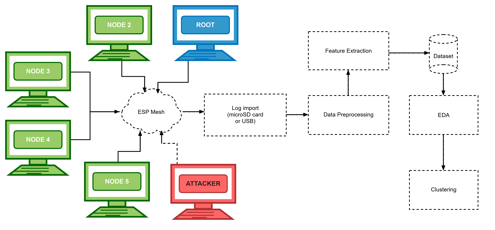

*Read it left to right: boards -> logs -> import -> preprocessing -> features -> dataset -> EDA and clustering. Note that the "Data Collector" is a file import after the run, not live streaming.*

- **Boards:** 8 ESP32s form one ESP-WIFI-MESH network: 1 **root** + 7 **children**. Some children play attack roles.
- **Logging:** every board samples at **10 Hz** and writes each row to its own **internal flash** and a **microSD card**.
- **Import:** after the run, the cards are pulled and read on a laptop (main route), or logs are streamed over USB.
- **Sniffer (optional):** a separate laptop listens to the Wi-Fi channel. It is outside the mesh, so it is an **independent witness**. How to read its captures and what they prove: Part 11.
- **Pipeline:** preprocessing (align, window), feature extraction, then the dataset, then EDA and clustering.

> [!tip] Takeaway
> Nothing is streamed over the mesh during a run. That is deliberate: an attack that drops packets cannot also destroy its own evidence.

### 2.2 Who is who in a run

| Role | What it does | How many |
|---|---|---|
| **Root** | Receives every probe, logs every arrival, drives the phases. It is the **referee**. | 1 |
| **Child** | Sends its own probes up to its parent and relays the probes of the boards below it. | 7 (minus attack roles) |
| **Blackhole attacker** | A child that relays normally, then drops everything during the attack phase. | 1 in a blackhole run |
| **Wormhole end A (exit)** | The **shallower** end. Receives tunnelled probes from the wire and re-injects them toward the root. | 1 in a wormhole run |
| **Wormhole end B (entry)** | The **deeper** end. Sends its own probes normally and also writes copies into the wire. | 1 in a wormhole run |

- **Victim** (blackhole only): a non-attacker board whose path to the root **passes through the attacker**.
- **Bystander:** a non-attacker board whose path does **not** pass through the attacker.
- In a **wormhole** run there are **no victims**: only B's own probes are tunnelled, so the other 5 boards are untouched.
- **Hop vs. layer:** ESP-WIFI-MESH numbers the root as **layer 1**. The thesis uses **hop = layer - 1**, so the root is hop 0 and its direct child is hop 1 (D-11).

### 2.3 The run timeline (Table 4.1)

| Phase ID | Label | Duration | Name | What happens |
|---|---|---|---|---|
| 254 | 255 | at least 60 s | Formation | Mesh forms. The boards' own logs say 255 (no phase heard yet); the final table has **no Label** for these windows; **excluded** |
| 0 | 0 | 300 s | Baseline | Normal operation |
| 1 | 1 | 180 s | Blackhole | Forwarding suppression on |
| 2 | 2 | 180 s | Wormhole | Tunnel on |
| 3 | 0 | 120 s | Cooldown | Attack off, network recovers |
| 4 | none | — | Terminate | Logs ready |

- A run uses **either** phase 1 **or** phase 2, never both.
- **A benign run has no attack phase.** It goes from phase 0 straight to phase 3: 300 s baseline, then 120 s cooldown. (Checked in the benign linear / DLSU Library / stationary feature table: phase IDs 255, 0 and 3 only.) An attack run has 255, 0, 1 (or 2) and 3; 3.5 walks through one.
- **254 is the message, 255 is what the rows say** (why 255 and not 5 or 0: the next part). During formation the root sends PREPARE (254), but a board that hears it keeps writing **255** in its rows. So in the CSVs, formation rows show `phase_id` = 255, never 254.

#### Why 255? Why not 5, or 0?

- **What 255 means:** "this board has not heard any phase from the root yet". It is not a phase the root ever announces. A board writes it from power-on until the first phase message arrives, and again if a new root session starts. The analysis also sets a board's rows to 255 when that board's phases disagree with the root's (`preprocess.py`), so they are excluded like formation rows.
- **Where the numbers stand** (`mesh_config.h`):
  - **0 to 4** are real phases: baseline, blackhole, wormhole, cooldown, terminate.
  - **254** marks the root's "a run is being set up" message (PREPARE), which is never written to a row.
  - **255** marks "no phase heard yet".
  - So **5 to 253 are left free** for real phases, if the team ever adds one.

**Why not 0, the first idea?** The firmware originally did exactly that: a board that had not heard the root logged phase 0, which is baseline.

- On a blackhole / linear / G402 capture the root restarted and joined the mesh 100 to 551 s **after** the victims. The victims were already probing and logging.
- Every one of those rows was recorded as ordinary baseline: 2,945 of 7,704 windows (38%), boards probing a mesh with no root in it, so their PDR was 0.
- Those windows went into the baseline that the 3-sigma test measures the attack against. The result was a false "attack NOT CONFIRMED" on a capture where the attack had worked perfectly. (Source: the comment above `PHASE_ID_UNSET` in `mesh_config.h`; the figures are from that comment.)
- So "not heard yet" needs a value of its own that can never be a real phase.

**Why not 5?** It is the next free number, so it looks like a real phase.

- A reader of the CSV who does not know about it sees a plausible phase and may treat it as data.
- If a fifth phase were ever added, it would be 5, and the two meanings would collide.
- The code comment gives the reason for 255: it keeps the column one byte (uint8, the largest value is 255), and "any reader that does not know about this value gets an obviously-invalid phase rather than a plausible wrong one".

**The analogy: lockers.** Lockers 0 to 4 are in use. Marking "nobody here yet" as locker 0 makes it look like someone is in it. Marking it locker 5 makes it look like a real locker that exists. A sign saying "NOT A LOCKER" (255) cannot be mistaken for either.

**Would 5 work if we started over?** Yes, **if every place that knows the number were changed together**. The number is not what makes the value safe; the separate value, handled by name, is. 255 is the safer convention because it fails safe in code written without knowing about it. But the number itself is written in six files of this repository:

| Place | How it holds the value | With 5 instead of 255 |
|---|---|---|
| `mesh_config.h` (firmware) | `#define PHASE_ID_UNSET 255` | Change it here first |
| `preprocess.py` | Its own copy, `PHASE_ID_UNSET = 255`, commented "Must match" the firmware. The row handling uses this name | Must be edited by hand to match |
| `features.py` | Another copy, `PHASE_UNSET = 255` | Must be edited by hand to match |
| `tools/verify_topology.py`, `tools/run_summary.py`, `tools/pcap_retry.py` | The bare number (`phase != 255`, `phases.pop(255, None)`, a `255` name entry and default) | **Break silently**: they would treat 5 as a real phase |
| `csv_logger.c` (`phase_id <= PHASE_ID_COOLDOWN`) and the list `(0, 1, 2, 3)` in `preprocess.py` | Ask "is this a real phase, 0 to 3?" | Still work: 5 is not in that range |

- The list `(0, 1, 2, 3)` in `preprocess.py` only answers "does this **file** have any real experiment row?". The rows themselves are handled by the name `PHASE_ID_UNSET`, which is why the copy in that file matters.
- Neither choice removes the need to handle the value explicitly. `preprocess.py` explains it for 255: because 255 is not zero, an anchor rule "the first non-zero phase is the exit from phase 0" would take a board's very first window as its exit and shift every `t_anchor_s`. The same would happen with 5.
- *(This comparison is our reading of the code. Nobody has built or run a version with 5.)*

> [!warning] Exam trap: 255 is in the data, but not in the Label column
> Three columns, three different things (checked in the 79 feature tables of this checkout, 86,087 pre-baseline windows):
>
> | File and column | What formation rows show |
> |---|---|
> | A board's own `*_telem.csv`: `phase_id` and `gt_label` | **255** in both (checked on a sample of 80 of the 1,072 raw files: 74,828 rows, `phase_id` and `gt_label` are 255 on exactly the same rows) |
> | `feature_table.csv`: `window_phase_id` | **255** in 70,217 of the 86,087 windows; **0** in 13,664 (phase 0 more than 300 s before the baseline); **1, 2 or 3** in 2,206 (five runs where a board's file also holds an earlier root session; those old phases are treated as pre-baseline) |
> | `feature_table.csv`: `Label` and `window_label` | **Blank** in all 86,087 |
>
> So a panelist who opens the table **will** see 255, in the phase column. The Label is blank because these windows belong to the `pre_baseline` segment, which never gets a label (Label is also blank in the 1,139 transition windows and filled in every baseline, attack and cooldown window). A second rule in `preprocess.py` turns any 255 label into blank as a safety net, so 255 can never become a class. Say "255 marks the phase, and the Label stays empty", not "255 is the label".

**Spoken answer:** "Phases 0 to 4 are real phases. We needed a value that means 'this board has not heard the root yet' and can never be mistaken for one. Our first version used 0, which silently labelled pre-root rows as baseline and gave a false 'attack not confirmed'. So we chose 255, an obviously invalid value, and the analysis excludes it by value."

- **Labels never come from a feature threshold.** They come from the phase the root announced. That is why the labels are honest ground truth.
- Formation lasts until the **pre-run gates** pass and the operator types **START** (D-22): every child joined; in a tree blackhole run the attacker has a child; in a wormhole run there is exactly one A and one B, the UART works both ways, and A is shallower than B.

#### How the root tells everyone the phase (Figures 4.2 and 4.3)

- The root sends each phase change as an **individual peer-to-peer message** to every node in its routing table.
- It sends it in **5 rounds, 100 ms apart**, all with the **same sequence number**, so a node that gets several copies applies it once.
- It **repeats the current phase every 10 s**, so a board that rejoins mid-run catches up.
  - In the data: the root's `tx_count` rises by exactly **5** at each phase change and does **not** count the 10 s repeats (3.5).
- A **session ID** drawn at root boot lets a node tell a restarted root (new run) from a repeated message.
- Each node keeps `current_phase` and `ground_truth_label` and stamps them on **every row it logs**.

**The same thing in more detail** (checked against `phase_listener.c`, `phase_listener.h` and `mesh_config.h`):

1. **What one message holds.** Five fields, 21 bytes: a magic value ("PHSE"), the **phase ID**, a **sequence number**, the **root's timestamp**, and the **session ID**. Nothing else. A node never has to work out the phase from a clock, because the boards share no clock (D-2, D-3). It is **told**.
2. **Why "to every node in the routing table".** ESP-WIFI-MESH has **no single call that sends to all nodes**. So one *round* is two steps: a copy to the **root itself** (so the root's own phase stays in step), then **one separate message to each node** in the routing table. The table is read **fresh on every round**, so a board that joined a moment ago is included.
3. **The five rounds.** The first round goes out at once, and the next four follow at 100 ms gaps, so the whole send takes about **0.5 s**. All five rounds carry the **same sequence number**. Their only job is to survive a lost message: if copy 1 is lost, copy 2 to 5 usually arrive.
4. **What a node does with each copy**, in this order:
   - **New session ID?** The root has restarted, so this is a different run. The node forgets the old sequence number and **goes back to 255** until the new root announces Phase 0. (A node that already finished its own run ignores the new session.)
   - **Sequence number not higher than the last one?** It is a copy or an old message, so it is **ignored**. This is why five copies apply the phase only once.
   - **Is it PREPARE (254)?** It only tells the node to start logging. The node **stays at 255**, so the stabilisation rows are logged but never labelled as baseline.
   - **Otherwise** the node sets its phase and label and restarts its phase timer. Every row from then on carries them.
5. **The 10 s repeat is one round, not five.** The root re-sends the **current** phase with its **old sequence number**. A board that already has it ignores it. A board that **rebooted mid-phase** has no sequence number yet, accepts it, and **starts logging again**; before this was added, it logged nothing until the next phase began. The repeats **stop after TERMINATE**; the root sends TERMINATE on its own schedule.
6. **PREPARE is sent differently.** During formation the root sends one round every **5 s**, with no repeats. It shares the sequence counter with the real phases, so Phase 0 always outranks every PREPARE, and a late PREPARE can never be taken after it.

| Safety layer | What it covers | If it fails |
|---|---|---|
| 5 rounds, 100 ms apart | One or a few lost messages | The node waits for the next layer |
| Repeat every 10 s | A node that missed all five rounds, or rebooted mid-phase | The node keeps the **previous** phase label until the next repeat |
| Session ID | The root restarting during a run | Without it, a node would carry the dead run's phase on (it happened once, in a home test run) |
| Local end-of-run timer | A node that never heard TERMINATE, or lost the root | **In cooldown:** the node ends its own run 120 s + 60 s grace after cooldown began. **Before cooldown** (baseline or attack, no message heard since): the node **keeps logging** for the longest the rest of the run could take, plus the 60 s grace, then closes its files and marks the run "root lost". The disconnection stays in the data, which is what a blackhole capture needs |

> [!warning] What the root does *not* know
> There is **no acknowledgement** in this code. The root counts failed *send calls* (it logs "N failed sends"), but it never receives a receipt from a node. So delivery is made very likely, not proven for each node.

#### Phase ID, sequence number, session ID: three different jobs

| Field | Question it answers | Example | Who uses it |
|---|---|---|---|
| **Phase ID** | **What** is the network doing now? | 0 baseline, 1 blackhole, 2 wormhole, 3 cooldown, 4 terminate | Every node, to set its phase and its label |
| **Sequence number** | **Which** message is this, and is it newer than the last one I accepted? | 13, 14, 15 ... | Every node, to ignore copies and old messages |
| **Session ID** | **Which root boot** sent it, and is this still the same run? | A random 32-bit number, never 0 | Every node, to detect a restarted root |

- **The phase ID is the announcement, not the sequence number.** "The attack starts now" is phase ID 1 (blackhole) or 2 (wormhole). The sequence number says nothing about the attack. It is a counter that goes up by **1 each time the root announces something new**, so Phase 0 is usually #13 (after 12 PREPAREs, per the code comment) and the attack #14. The 5 rounds and the 10 s repeats do **not** raise it.
- **The rule a node applies:** a number **higher** than the last accepted one is **new** and is applied. An **equal** one is a copy and is ignored. A **lower** one is old and is ignored. (The code ignores anything *not higher*.)
- **Why the rule is needed.** (1) Without it, the five copies would count as five events. (2) A message delayed on the way could arrive **after** a newer one, for example "baseline" after "attack", and put the node back in the wrong phase and label. With the rule, the late message has the lower number and loses. The phase ID alone cannot do this job: the same phase ID is **legitimately sent again** every 10 s, and a stale message has no way to show it is stale.
- **Why the session ID is also needed.** The sequence number only works while **one root keeps counting**. The root keeps its counter in memory, so when the root **reboots or is reflashed, the counter starts again at 1**. The boards do not reboot with it. They still remember the last number they accepted from the **old** root. The session ID fixes that mismatch.

  **A worked example** (the numbers are illustrative):

  1. The root has been running and has reached message **#14**. Every board has stored "last accepted = 14" and is in some phase.
  2. The root reboots. It is a **new run**, but its counter starts at **#1** again.
  3. The new root sends #1, #2, #3 ... Each one looks **older** than the board's remembered 14, so the board **ignores them all**.

  | | Without a session ID | With a session ID |
  |---|---|---|
  | What the board sees | New messages numbered 1 to 14 | New messages with a **different session ID** |
  | What the board concludes | "These are old, ignore them" | "This is a **different root boot**, so a new run" |
  | What the board does | Keeps the **dead run's phase**, possibly for minutes | **Forgets the old counter**, goes back to **255**, and takes the new root's Phase 0 |
  | Effect on the data | Rows labelled with the wrong phase | Rows stay 255 and are excluded until the real Phase 0 |

  **What the session ID is:** a random 32-bit number the root draws **once per boot** (never 0) and puts in **every** phase message. It has no order and no meaning. It is only a **tag for "which boot sent this"**, so all that matters is whether it is the same or different from the one the board stored. This is not hypothetical. In one home test run, the root board first booted its old firmware and announced Phase 0, and was then reflashed. The children kept the old boot's Phase 0 and logged **129 s of "baseline"** before the real root's Phase 0 arrived (code comment in `phase_listener.c`). The session ID was added to stop exactly that.
- **PREPARE shares the same counter**, so Phase 0 always has a higher number than every PREPARE sent before it.
- **Do not mix it up with the probe sequence number.** Probes have their **own, separate** sequence numbers (Part 2.4). The root joins on those to check which probes arrived, which is how PDR is computed. The name is the same; the purpose and the counter are different.

> [!tip] One sentence to say
> "The phase ID tells a node what to do, the sequence number tells it whether this message is new, and the session ID tells it whether it is still the same run."

#### Words to use and avoid

- Say "the root **sends the phase to every node**", not "broadcasts". The function is called `broadcast`, but each node gets its own unicast message, and a panelist who hears "broadcast" may ask whether the mesh is flooded.
- Say "five copies so a lost one is not fatal", not "guaranteed delivery".
- Say a node that misses everything is **at worst about 10 s late**, not "can never be wrong". Out of a 180 s or 300 s phase that is a small share, but it is not zero. The guide has no count of how often it happened in the 80 runs, so do not quote one.

#### Panel questions on the phase message

- **Q: What if a board misses the phase change?** *Spoken answer:* "The root sends it five times, 100 ms apart, so one lost message does not matter. If a board misses all five, the root repeats the current phase every 10 seconds, so it catches up. In the worst case that board's rows carry the previous phase for about 10 seconds of a phase that lasts 180 or 300."
- **Q: Why not have the nodes acknowledge it?** *Spoken answer:* "Five identical copies need nothing sent back, so the mesh carries no extra control traffic while we measure it. The apply-once rule makes the copies harmless." *(This reason is our reading of the design. The code comment only says repeats add reliability. Do not present it as something the paper states.)*
- **Q: Why is formation labelled 255? Why not simply 0 for baseline, 1 for attack, and 5 for formation?** *Spoken answer:* "Phases 0 to 4 are real phases, and our first version logged 'no phase heard yet' as 0. On one capture that labelled 38% of the windows as normal baseline, boards probing a mesh with no root in it, and gave a false 'attack not confirmed'. So 'not heard yet' got a value of its own, 255, which is obviously not a phase. A 5 would also work if the code handled it, but it looks like a real next phase, so 255 is the safer sentinel. In the finished table you see 255 in the phase column, and the Label column stays empty for those rows." *(See 2.3. The 38% is from the firmware comment.)*
- **Q: What happens if the root restarts mid-run?** *Spoken answer:* "Each root boot draws a new random session ID. A board that sees a new ID knows it is a different run, forgets the old sequence number, and goes back to 'no phase yet', 255, until the new root announces Phase 0. Those rows are excluded. A restart also shows up in the sniffer check: the capture tool refuses a log in which Phase 0 started twice (Part 11)."
- **Q: Do these messages disturb the probe measurements?** *Spoken answer:* "They are tiny and rare next to the probes: one message per board every 10 seconds, against 1 to 4 probes per second. They carry their own magic value and are read before the probe handler, so they are never counted as probes."
- **Q: What is the sequence number for? Is it the phase ID?** *Spoken answer:* "No. The phase ID says what is happening, the sequence number says whether the message is new. The root sends every phase five times, so a node compares the number with the last one it accepted: higher is applied, the same or lower is ignored. That makes five copies count once and stops a late old message from undoing a newer phase."
  - **Follow-up: Why does the root send it five times?** *Spoken answer:* "Because the messages are not acknowledged. One lost message would leave a board in the wrong phase, so we send five copies 100 ms apart, and every 10 seconds the root repeats the current phase for any board that still missed it."
- **Q: Why not just ignore a message whose phase ID is the same as the current one?** *Spoken answer:* "That would catch duplicates, but not an old message arriving late. Say a late 'baseline' message shows up after the board is already in the attack phase. Its phase ID is different from the current one, so that rule would apply it and put the board back in baseline with the wrong label. The sequence number tells us the message is older, not just different, so we throw it away. It also makes the 10 second repeat harmless, because that repeat carries the old number."
  - **Follow-up: Does that actually happen? Have you seen a late message?** *Spoken answer:* "It is a safeguard. The mesh does not guarantee the order of messages, so we designed for it. We have not counted how often it happens." *(Be honest here: the guide has no recorded case of a late old message, so do not claim one.)*
- **Q: Why does the sequence number exist at all? What went wrong without it?** *Spoken answer:* "The root sends every announcement five times and repeats it every 10 seconds. The sequence number lets a board apply each announcement once, and ignore a late or old copy that would otherwise put it back in the wrong phase. It only works while one root keeps counting, though. In one test run the root was reflashed, its counter started again at 1, and boards that had joined the earlier boot rejected the new root's messages and logged 129 seconds as baseline before the real Phase 0. That is why we added the session ID: a new one tells a board it is a new run, so it resets its counter and starts again." *(Source: the comment in `phase_listener.c`. The 129 s is from that comment; check it before quoting it as a measured figure.)*
- **Q: Why does the label come from a message and not from the time?** *Spoken answer:* "The boards share no clock, so a time-based label would drift. A label from the phase the root announced is ground truth by construction, and it is never derived from a feature."

### 2.4 Probes and the relay: the traffic everything is measured on

- A **probe** is a tiny application packet a board sends toward the root: magic value, **sequence number**, send timestamp, source MAC.
  - Every **1000 ms** (stationary, burst) or every **250 ms** (highload).
- **Every node relays** (D-12): it sends its own probes to its **parent**, and when it receives a probe from below it passes it **one hop up**.
  - It counts **received**, **forwarded** and **dropped**, with the rule received = forwarded + dropped.
  - Why this matters: before D-12, the mesh stack relayed traffic invisibly and only the attacker could count transit packets. So the relay features existed **only on the attacker**, and an empty column gave the label away. D-12 put the counters on **every** node.
- The **root** logs one row per arriving probe: sender, sequence number, send time, arrival time, phase. Delivery is computed by **joining on the sequence number**, never on time, because the boards share no clock.

### 2.5 The blackhole: forwarding suppression (4.2.1.2)

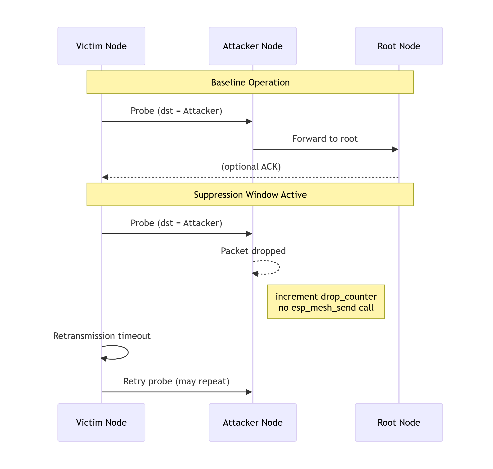

*Top: baseline, probes flow Victim -> Attacker -> Root. Bottom: attack, the attacker receives but never sends on. Look at the link-layer ACK: it still goes back to the victim.*

- The attacker runs **the same relay code** as everyone. The only difference is one decision hook: during phase 1, `forward_decision()` returns false, so the probe is **dropped by omission** (no `esp_mesh_send()` call).
- It stays a fully legitimate mesh node: keeps its parent, answers control messages, keeps logging.
- **Why the victims see nothing wrong:** the attacker's radio still **acknowledges every frame at the link layer**. The victim's Wi-Fi thinks delivery succeeded, so it never retries and never changes parent. This one fact explains the "retransmissions not observed" result in Chapter 6.
- **How traffic reaches the attacker:** by **placement** in the tree, not by a false route. In the **star**, the attacker is the **hub** and the root sits one hop behind it (D-16), because the root cannot be the attacker: it is the destination *and* the referee.

| Counter | Meaning |
|---|---|
| `recv_counter` | probes received for relay |
| `forward_counter` | probes forwarded to the parent |
| `drop_counter` | probes dropped (on purpose, or a failed send) |
| `self_packet_counter` / `retry_count` | failed `esp_mesh_send()` calls |

**Conformance check (Table 4.4, against Airehrour et al. [70]), 5 of 6 criteria met:**

1. Sits on the forwarding path ✓
2. Receives the packets rather than jamming ✓
3. Drops instead of forwarding ✓
4. Stays protocol-compliant, so the node looks alive ✓
5. Delivery collapses while the node stays reachable ✓
6. **Attracts traffic by advertising a false route ✗**

### 2.6 The wormhole: tunnel replay (4.2.1.3)

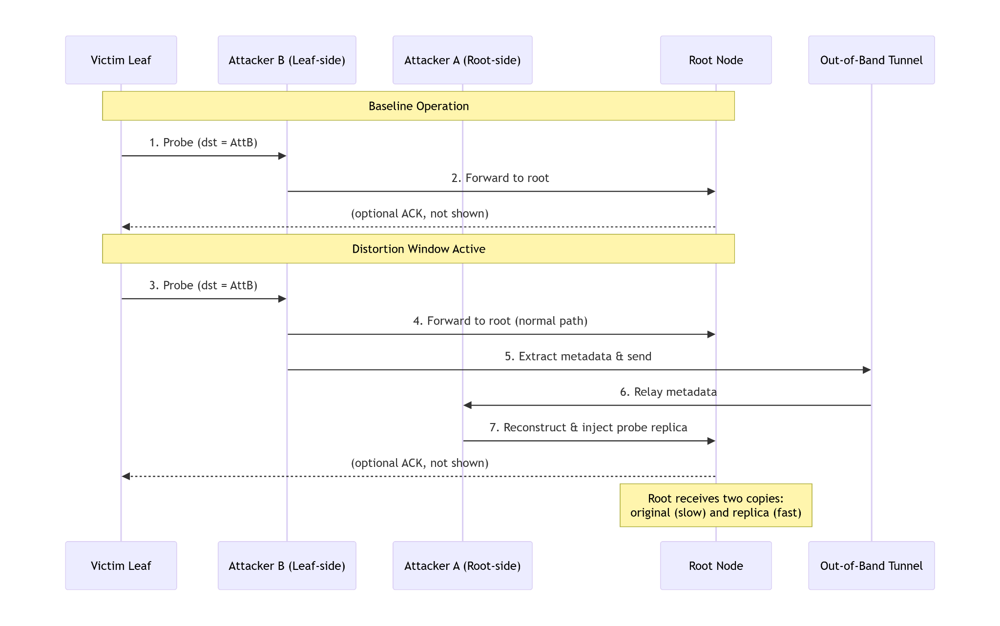

*Top: baseline, B's probes climb the mesh normally. Bottom: attack, each probe also goes through the wire to A, and A sends a copy from higher up. The root ends up with two copies of every B probe.*

- **The tunnel** is a physical **UART wire** at **115200 baud** (TX GPIO 17 of one board to RX GPIO 16 of the other). This plays the role of the GSM link in Zhukabayeva et al. [71].
- **Tunnel frame (Figure 4.9), 30 bytes:** tunnel magic "TNL1" (4 B) + the probe copied verbatim (22 B: magic, sequence number, send timestamp, source MAC) + **CRC32** (4 B).
- **Node B (entry, deeper):** every phase, sends each own probe to its parent (the normal copy). In phase 2, it **also writes the same probe into the wire**.
- **Node A (exit, shallower):** reads the wire, checks magic and CRC (and resyncs byte by byte on a bad frame), changes the magic to **"PROW"** and sends the probe toward the root. It keeps B's **sequence number, timestamp and source MAC**.
  - Why change the magic: so the root logs it as a second arrival instead of discarding a duplicate. Every relay between A and the root also forwards "PROW".
- **Who is A and who is B is decided at run time** (D-17): the two boards exchange a **HELLO** frame over the wire every second carrying their mesh layer. The **deeper** board becomes B, the shallower A (tie: lower MAC is A). Roles **lock at the first phase** and are written in every row.
  - Why: the mesh decides who lands near the root. A fixed assignment once gave B at hop 1 and A at hop 6, so the "shortcut" went the wrong way.
- **Extra rules for depth** (D-30, D-36): in tree and partial-mesh builds, B never takes the root as parent and must sit deeper than A, and both ends join as **leaf nodes** (nobody can attach below them).
- **Star wormhole** (D-28): in a flat star both ends are at hop 1 and nothing would be skipped, so **A is made the hub**, the root sits behind it, and B joins A. Normal copy: B -> A -> root (2 hops). Tunnel copy: B -> wire -> A -> root (1 hop). A one-hop shortcut.

**What the wormhole creates:** two copies of every B probe at the root, with **different delays**. **What it does not create:** a false neighbour or a route change, because the mesh never routes over the wire (D-20).

**Conformance check (Table 4.5, against Hu, Perrig and Johnson [46]):** two colluding endpoints ✓, out-of-band channel ✓, captured at one end and replayed at the other ✓, no keys or hosts compromised ✓, **creates a false neighbour ✗**.

#### An analogy first: the office building and the secret tube

Read this before the detailed part. Every technical piece below has a counterpart in the story.

**The setting.** The mesh is a **tall office building**. The **mailroom is on the ground floor** (the root). Every worker passes mail **down to the person directly below them**, who passes it down again, floor by floor, until it reaches the mailroom. Nobody skips a floor. A worker who is higher up has **more floors to go** (a deeper board).

**The two plotters.** Two workers have secretly agreed to cheat. **B** works on a **high floor** (deep). **A** works on a **lower floor**, closer to the mailroom (shallow).

**An ordinary day (baseline).** Once a second, B writes a numbered letter ("letter #7 from B") and sends it down the normal chain. The mailroom files it.

**The attack day (phase 2).** B still sends every letter down the normal chain. But B **also makes a photocopy** and drops it into a **private pneumatic tube that runs straight to A's desk**. The tube is not part of the building's mail system. A takes the copy, **stamps it in red**, and puts it into the normal mail chain **from A's lower floor**. Because A is closer to the mailroom, the copy has **fewer floors to travel** and usually **arrives first**.

**What the mailroom sees.** "Letter #7 from B" arrives **twice**, at two different times. That double arrival is the proof of the attack.

| In the story | In the system | Why it matters |
|---|---|---|
| The building, floor by floor | The mesh, hop by hop | The normal copy has to climb through every hop |
| Mailroom clerk | The root | The only place that sees and logs arrivals |
| B (high floor) and A (low floor) | Wormhole end B (deep) and end A (shallow) | A must be closer to the mailroom, or the copy has no head start |
| The numbered letter | A probe (source MAC and sequence number) | The number is how the clerk knows two letters are the same one |
| The pneumatic tube | The UART wire | It is **outside** the building's mail system |
| The photocopy | The tunnel frame ("TNL1") | The probe copied word for word |
| The seal on the envelope | The CRC32 | A damaged copy is rejected and not passed on |
| Red stamp "PROW" | The magic changed to "PROW" | It tells the mailroom to keep this copy |
| Mailroom rule: "throw away a repeat of a letter I already filed" | The root's duplicate check | The postal service sometimes delivers a letter twice, so the rule is sensible |
| The red stamp overrides the rule | "PROW" skips the duplicate check | Without the stamp, the mailroom would throw the copy away and the attack would leave no trace |
| Workers on the floors in between | The relays between A and the root | They must pass red-stamped letters on too, or the copy dies on the way |

**Why the copy is only *sometimes* first.** If the plotters swap floors, so that A is **higher** than B, the copy now has **farther** to travel and arrives **later**. There is no head start, so there is no shortcut. That happened on 7 October. It is why the two workers now **call each other on the tube every second ("HELLO") to compare floors**, and the **one on the higher floor becomes B**.

**The rest of the details, in the same story**
- **Locking the roles.** Once the working day starts, **nobody swaps desks**. A swap in the middle of the day would make the record confusing.
- **Same floor, or can't tell.** If both sit on the same floor, the worker with the **lower badge number** is A, so the two are always opposite.
- **Reboots mid-day.** A worker who walks in late takes the **opposite** of what the other already has.
- **No answer on the tube.** If the tube is broken, each worker does what their job card says, and the day is marked "not clean".
- **Reading the tube byte by byte.** The tube delivers one long continuous strip of text with **no gaps between letters**. The receiver reads a 30-character piece. If it doesn't look like a letter, it **slides along one character** and tries again, until a real letter lines up.
- **The test dummy.** Before the day starts, B sends a **blank test letter** through the tube. The mailroom confirms the whole route works, then **throws it away** without filing it, so it never counts.
- **Why there is no "false neighbour".** In a real wormhole, the **building directory itself is changed** so that people believe the 6th and 1st floors are next to each other and route mail through the tube on purpose. Here the directory is **not touched**. The building has no idea the tube exists, and nobody is told that A and B are neighbours. We only get the **effect on the mail**: a letter arrives twice.
- **Why a listener outside can't hear the tube itself.** A person outside the building listening to the **radio chatter** hears the normal mail trucks, but the tube is a **pipe**, not radio, so the tube is invisible. What the listener **can** notice is **A's side**: from the attack on, A sends the extra red-stamped letters up the normal chain, so A's radio gets busier while its neighbours stay the same. The mailroom's log is still the proof.
- **Why there are no victims.** Only **B's letters** are copied. Everyone else's mail is untouched, so nobody loses anything.

> [!warning] Where the analogy stops being true
> It is a **teaching story**, not a model. In a real wormhole the directory is tampered with (we do not do that, D-20), and the numbers in the story are made up. The facts to quote are in the detailed part below and the paper, not in this story.

> [!tip] One sentence to say
> "B sends each probe the normal way, and also copies it through a private wire to A, who is closer to the root and puts it back into the mesh, so the root sees every one of B's probes twice, at two different times."

**The same thing in more detail** (checked against `wormhole_victim.c`, `probe_relay.h`, `mesh_config.h` and `root_main.c`):

#### One probe's journey, step by step

1. **B makes a probe** once a second. It starts only after B's role is **locked** (Phase 0). Rows before that are pre-baseline and are excluded anyway.
2. **B always sends the normal copy first**, hop by hop up the mesh to the root. This happens in **every** phase, attack or not.
3. **Only in phase 2, B also writes the probe into the wire** as a 30-byte tunnel frame. At 115200 baud with 8 data bits and 1 stop bit (10 bits per byte), 30 bytes take about **2.6 ms** on the wire. *(Arithmetic from the baud rate, not a measured figure.)*
4. **A reads the frame**, checks the magic and the CRC, and puts the probe in a queue.
5. **A changes the magic from "PROB" to "PROW" and sends it up from its own position**, to its own parent, hop by hop. The sequence number, send time and source MAC stay **B's**.
6. **Every relay between A and the root forwards "PROW"** like a normal probe. The code warns that a relay which only knew "PROB" would silently drop the tunnel copy, the duplicates would never reach the root, and the run would look clean.
7. **The root logs both.** A normal probe is checked against a table of the highest sequence number seen per source, and a repeat is dropped. A "PROW" probe **skips that check**, so the same (source MAC, sequence number) appears **twice**, each with its own arrival time and latency.

> [!tip] Why the tunnel copy is the *fast* one
> It is fast only because A sits **shallower** than B, so the copy starts its climb from higher up and skips hops. If A were deeper, the tunnel copy would arrive **later** and there would be no shortcut. That is exactly what happened on 7 October (B at hop 1, A at hop 6), and why the ends are now chosen from the mesh depth. From the repository's verification log (not the paper), for the linear G402 stationary run checked in verifications #29 and #40: the tunnel copy arrived first by about **13 ms**, and the two copies were a median **9.9 ms** apart.

#### The frames on the wire

| Frame | Magic | Where it travels | What it is for |
|---|---|---|---|
| **Tunnel frame** | "TNL1" | The UART wire only | Carries a copy of B's probe from B to A |
| **HELLO frame** | "HELL" | The UART wire only | Lets the two ends exchange depth and role (see below) |
| **Normal probe** | "PROB" | The mesh | An ordinary probe |
| **Wormhole copy** | "PROW" | The mesh (from A up) | The re-injected tunnel copy, kept as a second arrival |
| **Tunnel test** | "PROT" | Wire, then mesh | A test probe before the run; never counted and never logged |

- **Tunnel frame, 30 bytes:** "TNL1" (4) + the probe (22: magic 4, sequence 4, send time 8, MAC 6) + CRC32 (4).
- **HELLO frame is also exactly 30 bytes:** "HELL" (4), sender MAC (6), mesh layer (2), role (1), locked flag (1), "I hear my peer" flag (1), padding (11), CRC32 (4). The code checks at build time that the two sizes are equal.
- **Why the same size:** the wire is a raw stream of bytes with no frame boundaries. The receiver reads a 30-byte window and checks the magic and CRC. If they do not match, it **drops the oldest byte, slides along by one, and tries again** until a frame lines up. With equal sizes, one rule handles both frame types.
- **Why a CRC at all:** a UART wire can flip a bit. The CRC32 makes a corrupted frame get rejected instead of being re-injected as a wrong probe.

#### How the two ends choose A and B (D-17)

1. **Until Phase 0, the role is provisional.** Each board sends a HELLO once a second. The **deeper** board becomes **B**, the shallower becomes **A**, so the tunnel always points toward the root.
2. **Same depth, or depth not known yet:** the board with the **lower MAC is A**, so the two ends are always opposite.
3. **At the first real phase the role locks** for the whole run. It never follows the mesh afterwards, because a swap mid-run would corrupt the capture. The role is written in every row.
4. **A board that reboots into a run already in progress** takes the **opposite** of its peer's locked role.
5. **Both ends locked the same role** (depth changed between two HELLOs): the board with the **higher MAC flips, once**, and logs it. Rows before the flip carry the wrong role, so the run is flagged.
6. **No HELLO ever heard** (cable fault): each board falls back to the role it was flashed with, and the run is flagged as not clean.
7. **The wire's health is checked and reported to the root:** nothing heard, heard before but now silent, one-way (a loose jumper), or its **own** HELLO heard back (TX bridged to RX). The one-way case once made both ends pick the same role.

#### What each end counts

| | `probes_count` | `tx_count` | `retry_count` |
|---|---|---|---|
| **End B** | Probes it generated (about 1 per second) | Normal copies sent to the root (climbs the **whole** run) | Probes also tunnelled to A (0 in baseline, climbs in the attack); also counts wire failures |
| **End A** | Tunnelled probes **received** over the wire (0 until the attack) | Tunnel copies **re-injected** toward the root (0 until the attack) | Re-injection send failures |

These columns are reused for the wormhole, the same way the blackhole reuses `retry_count` for drops. That is where **TunnelIntensity** comes from (tunnel messages per second, counted by the ends). **DuplicateRate** is different: the root measures it, so it is independent of the attackers (D-21).

#### Before the run: the tunnel test

During stabilisation, B sends one "PROT" test probe every 10 s. It goes wire, then A, then the mesh, then the root. The root prints "TUNTEST OK" when it arrives. That proves the **whole** path works **before** Phase 0. A test probe is never counted by a relay and never written to the arrivals log, so it cannot touch ForwardingRatio or the dataset.

#### Why "creates a false neighbour ✗" (Table 4.5)

- In a real wormhole, the two endpoints make **distant nodes believe they are neighbours**, so the routing protocol itself routes over the tunnel.
- **Ours does not.** The wire is **outside the mesh**. ESP-WIFI-MESH does not know it exists, so it never routes over it and never records A and B as neighbours. The mesh also gives us no way to write routes (D-20).
- So the wormhole is a **real out-of-band link with real captured and replayed traffic**, but the routing is not fooled. What the data shows is the traffic effect: **two copies at the root with different delays**.
- For the same reason, a **sniffer cannot see the tunnel itself**: it is a wire, not radio. It **can** see the effect. In the wormhole capture the team chose for the defense, end A's uplink goes from 0.70 to 5.75 to 3.46 frames per second (baseline, attack, cooldown) while its parent and the other relays stay flat (repository verification #90, not the paper). Say "the sniffer shows end A suddenly transmitting B's re-injected traffic", not "the sniffer shows the tunnel or the duplicates". The evidence is still the root's arrival log (see Part 11).

#### Words to use and avoid (wormhole)

- Say "the tunnel is **outside the mesh**" and "the root receives **two copies** of B's probes". Do not say "the mesh routes through the tunnel" or "the wormhole changed the routes".
- Say "there are **no victims** by design". Only B's own probes are tunnelled.
- Say the tunnel copy "**can** arrive first because A is shallower". Do not say it is always faster, because the placement decides that.
- Do not quote the 13 ms and 9.9 ms as paper results. They are from the repository's verification log.

#### Panel questions on the wormhole mechanism

- **Q: Why does A change the magic to "PROW"? Why not just send the probe as it is?** *Spoken answer:* "The root throws away a second probe with the same source and sequence number, because the mesh's own retries can deliver one probe twice. The tunnel copy has exactly the same source and sequence number, so it would be thrown away as a duplicate. The 'PROW' tag tells the root to keep it. That second arrival, with a different delay, is the wormhole signature."
- **Q: How do you know the tunnel copy is the faster one?** *Spoken answer:* "We don't assume it. It is faster only when end A is shallower than end B, so the ends are chosen at run time from the mesh depth and then locked. We learned this on 7 October, when B was next to the root and A was six hops down, and the tunnel copy arrived later. The root also checks the depth, and a run with both ends at the same depth is flagged."
- **Q: Why a wire and not Wi-Fi?** *Spoken answer:* "A wormhole's defining feature is an out-of-band channel. A second Wi-Fi link would still be inside the radio medium the mesh uses. A wire is genuinely outside it, and it plays the role of the GSM link in Zhukabayeva et al."
- **Q: What if the wire is faulty or a byte is lost?** *Spoken answer:* "Every frame has a CRC32, and the receiver slides along one byte at a time until a frame lines up, so a bad byte costs a frame, not the whole stream. The ends also exchange a HELLO every second and report the wire's health to the root, so a dead, one-way or looped-back wire is flagged and the run is not counted as clean."
- **Q: If it creates no false neighbour, is it really a wormhole?** *Spoken answer:* "It meets four of the five criteria in Table 4.5: two colluding endpoints, an out-of-band channel, capture at one end and replay at the other, and no keys compromised. It does not make the routing believe in a false neighbour, because ESP-WIFI-MESH gives us no way to write routes (D-20). We reproduce the traffic effect of a wormhole, two copies with different delays, and we say so."
- **Q: Can the sniffer show the wormhole?** *Spoken answer:* "Not the tunnel itself, because that is a wire and nothing about it is on the radio. But it shows the effect: end A starts transmitting B's re-injected traffic at the attack start and becomes about eight times busier, while its parent and the other relays stay flat. The proof is still the root's log, where 180 of B's probes arrive twice, in the attack phase only." *(The 8x and the 180 are for the chosen capture, from the repository's verification #90, not the paper.)*

> [!warning] Exam trap: "victims" in a wormhole run
> A wormhole run has **no victims**. Only B's own probes are tunnelled, and the other 5 boards' traffic is untouched. If a panelist asks "what happened to the victims in the wormhole?", the answer is "there are none by design; the attack is the duplication of B's probes."

### 2.7 The four topologies (4.2.2)

- ESP-WIFI-MESH **always builds a tree by itself**: each node picks the shallowest parent it can hear, then the one with fewest children.
- So a "topology" here = **board placement + an ESP-IDF topology option** (depth cap, children limit). The structure that actually formed is **checked after every run** from the logged parent addresses.

| Topology | How it is built | What formed (Table 6.35) |
|---|---|---|
| **Linear** | Chain option, 1 child per node, boards 3 to 5 m apart | Chain, deepest hop 7 |
| **Star** | Depth capped. In attack runs the **attacker or end A is the hub** with the root behind it (D-16, D-28) | Attack runs: root has 1 child, the hub has 6. Benign: flat, 5 to 7 boards on the root |
| **Tree** | Default self-organisation, with "sticky" parents (thresholds 6 dB lower, 3x longer watch; D-26) and a per-build children limit (D-37) | Root has 2 to 5 children; deepest hop 2 to 4 |
| **Partial mesh** | Boards placed to hear several parents; **at most 2 children** per node (D-29) | Behaved as a **plain branched tree**: no board ever used a second parent |

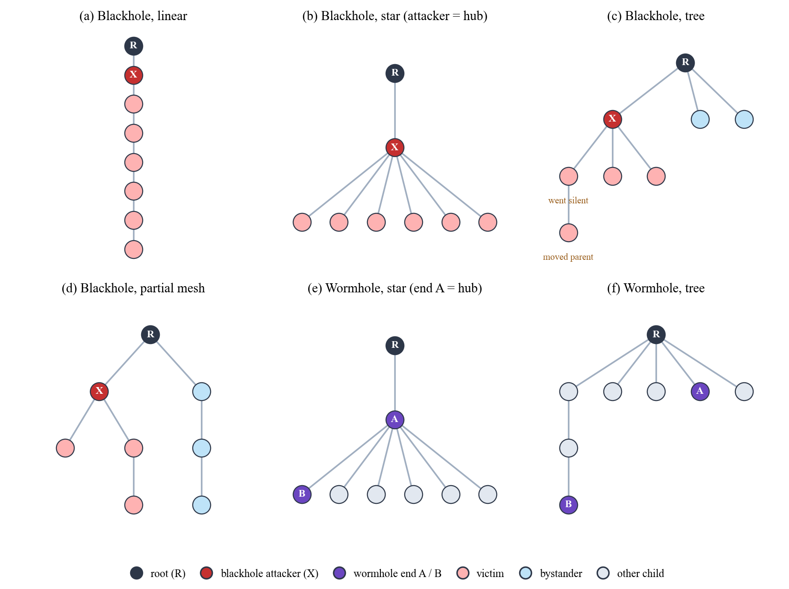

*This is the best single picture of the topologies as they really formed. X = blackhole attacker, A/B = wormhole ends, red = victims, blue = bystanders, grey = untouched boards. Notice the star has no bystanders (every board is behind the hub), and in (f) B sits deeper than A.*

### 2.8 Sites and scenarios (4.2.2.5)

| Site | Description |
|---|---|
| Room G402 (GCCS) | Controlled classroom |
| DLSU Library | Small part of a busy library, heavy Wi-Fi |
| Yuchengco Building | Area within the building |

| Scenario | What changes | Why |
|---|---|---|
| **Stationary** | Each child probes once per second | The reference |
| **Burst** | One child sends 300 probes back to back, 60 s into the attack window | Tests that a legitimate burst is not mistaken for an attack |
| **Highload** | Every child probes every 250 ms (4 per second) for the whole run | Pushes the testbed to its limit |

- **Design:** 4 topologies x 2 attacks x 3 sites x 3 scenarios = **72 attack runs**, one per cell, plus **8 benign runs** = **80**.
- **No repeats:** each cell is run once, so the three sites act as the repeats. Site differences and run-to-run noise cannot be separated (a stated limit).
- The scenarios exist so that **traffic volume alone cannot reveal an attack**.

### 2.9 What each board records (4.2.3)

| Layer | Field | Notes |
|---|---|---|
| PHY | `rssi` (10 Hz) | Signal strength of the link to the parent, from `esp_wifi_sta_get_rssi()` |
| MAC | `retry_count`, `tx_count` | **Application counters** (failed sends, frames accepted), **not** MAC retransmissions (D-15) |
| MAC | MacRetryRate | Real 802.11 retry bit, **from the sniffer only** (7 of 36 blackhole runs) |
| Network | `layer`, `parent_mac` | From `esp_mesh_get_layer()`, `esp_mesh_get_parent_bssid()` |
| Network | `probes_count`, `recv_count`, `forward_count`, `drop_count` | Relay counters |
| Tunnel | tunnel frames sent (B), received and re-injected (A), `role` | Wormhole runs only |
| Labels | `phase_id`, `gt_label` | On every row |

- **Storage:** CSV on internal flash (SPIFFS) and mirrored to a microSD card (FAT). The card is **fsync'ed about every 5 s** and at phase changes (D-13), so a crash loses only the last few seconds instead of leaving a 0-row file.
- **Radio fixed at 20 MHz (HT20)** (D-14): the sniffer can only decode 20 MHz frames. At the ESP32 default of 40 MHz it heard 3 of 1,848 data frames from one child.
- **Highload root fix:** the root writes arrivals to the card only, in 4 KB batches, because the double write once lost 3,151 rows.
- **Completeness checks:** expected samples (300 s x 10 Hz = 3,000 in baseline, 95% floor), row count vs. the card's `runs.csv` manifest, run inventory vs. the plan, `validate_integrity.py` and `verify_topology.py` on every capture.

### Check-in (Part 2)

- **Q:** A panelist asks: "Why didn't the blackhole victims switch to another parent or retry, if their packets were being dropped?" Answer in two sentences.
- **Your answer:** *(pending)*

> [!question]- Answer (click to reveal)
> The attacker still acknowledges every frame at the link layer, so from the victim's radio every send succeeded and there was no failure to retry or react to. The drop happens one layer up, in the application relay, which the victim cannot see. That is why the delivery loss is only visible at the root (PDR) and at the attacker's own counters (ForwardingRatio).
>
> 📖 **Review it:** Section 4.2.1.2 (G. Explanation of Key Behaviors) and Section 6.2.4

---

## Part 3: From raw rows to the dataset (Chapter 4.2.4)

### 3.1 Preprocessing, step by step

1. **Align time.** Boards share no clock (each counts from its own boot). So each board's timeline is anchored to **its own first exit from phase 0**, the one event every board sees through the root's broadcast. The last 300 s before that anchor = baseline.
2. **Put samples on a 10 Hz grid.** Each sample takes the **earliest free 0.1 s tick**, at most 300 ms late, never early (D-25).
   - Why: the logger sometimes writes late samples back to back (gaps like 258 ms, 1 ms, 41 ms). The old "nearest tick" rule made two samples fight for one tick and threw away healthy windows.
3. **Cut into one-second windows.** Non-overlapping. A window needs **at least 8 of its 10 samples**, otherwise it is discarded (D-9).
4. **Fill tiny gaps.** Gaps of 1 to 2 samples inside a kept window: RSSI is linearly interpolated, counters are forward-filled.
5. **Turn counters into deltas.** Counters only grow, so each window uses (value at end) - (value at start).
6. **Join delivery on the sequence number.** PDR and latency join the root's arrival log to each node's probes by sequence number, never by time.

- **One row = one board x one second.** That is the unit of the whole dataset (the "node-window").
  - Why node-level and not network-level: the attacker's forwarding falls while the nodes behind it lose delivery. A network average would blur both.
- Result: 457,568 windows formed, **1,372 discarded (0.30%)**, no run lost more than 1%, mean samples per window at least 9.97 in every run.

> [!note] Why 1 s windows of 10 samples and not 5 s windows of 5 (D-1, D-9)
> With 5 samples, one lost sample costs 20% of a window. The panel also asked for about 10,000 rows per run. At 10 Hz with 1 s windows, a window holds 10 samples, the 80% rule (8 of 10) is kept, and a clean baseline went from 577 to 2,894 rows. Side effect: a probe is sent about once a second (four a second in the highload runs), so one window's PDR is close to 0 or 1. PDR is read as a mean over many windows.

### 3.1a Preprocessing in detail: every step with an example

The list above is the version to say out loud. This section is the version to understand. Part 10 is the panel version of the whole pipeline, up to the clustering input. Each step gets: what goes wrong without it, what the step does, a small example with numbers, and the reason behind the rule. Every rule was checked against the code (`analysis/preprocess.py` for steps 1 to 5, `analysis/features.py` for step 6). The example numbers are made up to be easy to follow unless a source is named.

#### What preprocessing starts with and what it must produce

- **Input, from each child board:** one `*_telem.csv` file with **10 rows per second**. Each row holds:
  - a timestamp from the board's **own** clock,
  - the RSSI to its parent (signal strength, dBm),
  - its **counters** (received, forwarded, sent, retries, probes),
  - its layer, its parent, the current phase and the label.
- **Input, from the root:** one `*_arrivals.csv` with **one row per probe that reached the root**, holding the sender's MAC and the probe's **sequence number**.
- **Output:** one tidy row per board per second (the **node-window**), with the 16 features of 3.2.

Between the two, five things are messy. Each step fixes one of them:

| What is messy in the raw files | Fixed by |
|---|---|
| Every board has its own clock, so "time 500 s" means a different moment on each board | Step 1: align time |
| Samples sometimes come late and bunched together instead of every 100 ms | Step 2: 10 Hz grid |
| The data is a long stream, but the dataset needs equal-sized pieces | Step 3: one-second windows |
| A few samples are missing here and there | Step 4: fill tiny gaps |
| Counters are running totals since boot, which say nothing about this second | Step 5: deltas |
| What a board sent and what the root received are in two different files with two different clocks | Step 6: join on the sequence number |

#### An analogy: eight CCTV cameras whose clocks were never set

Picture a building with eight CCTV cameras. Nobody ever set their clocks: each camera counts from the moment it was switched on. You must build one spreadsheet that says, for every camera and every second, what it saw.

| In the story | In the testbed |
|---|---|
| Each camera's clock counts from when it was switched on | Each board's clock (`esp_timer`) counts from its own boot |
| A fire alarm that every camera recorded | The root's phase broadcast, which every board writes into its rows |
| "10 seconds before the alarm" means the same moment on every camera | "10 s before the phase change" means the same moment on every board |
| A camera that froze for a moment, then saved three frames in a rush | The logger task held up, then taking the missed samples back to back |
| Putting each frame back into the slot it belonged to | Step 2, the earliest-free-tick rule |
| A turnstile's total count since opening day | A board's counter since boot |
| Parcels matched by tracking number, not by the time on each clock | Probes matched by sequence number, not by time |

- **Where the story stops being true:** the fire alarm is heard by every camera at the same instant. The phase message has to travel through the mesh, so a board deeper in the tree hears it slightly later. The anchor is therefore "the same moment" only to within that delivery time, which is tiny next to the minutes the clocks disagree by.

#### Step 1. Align time: one shared event as "zero"

**The problem.**

- A board's timestamp is the time **since that board booted**. Boards are switched on at different moments, and on powerbanks they can reboot, which restarts the count.
- So "t = 500 s" on one board and "t = 500 s" on another are different moments.
- How far apart, for real: on one G402 linear blackhole run the three victims' clocks sat **−56 s, +359 s and +361 s** from the root's clock (repository, `features.py`; not printed in the paper).
- The mesh has no internet, so there is no time server to sync the clocks to.

**What the step does.**

- Each board writes the current **phase** (0 baseline, 1 or 2 attack, 3 cooldown) into every row. The phase comes from the root's broadcast, so every board changes phase at (almost) the same real moment.
- For each board, the code finds the **first one-second window where most samples show a phase other than 0**. That moment is the board's **anchor**, its new "t = 0".
- Every time on that board is rewritten as "seconds from my anchor" (`t_anchor_s`): negative before, zero at the anchor, positive after.

**Example.**

- Board X leaves phase 0 at **812 s** on its own clock. Board Y leaves phase 0 at **455 s** on its own clock.
- After anchoring, both moments become **t = 0**.
- X's baseline is its own 512 s to 812 s (812 − 300 = 512).
- Y's baseline is its own 155 s to 455 s (455 − 300 = 155).
- The raw clocks are 357 s apart, but "t = −10 s" now means the same real moment on both boards.

**How each part of the timeline is labelled** (rules from `preprocess.py`, `assign_segments`):

| Where a window sits | Segment | Label |
|---|---|---|
| Phase 255 (no phase heard yet, or formation) | pre-baseline | none, never analysed |
| Phase 0, more than 300 s before the anchor | pre-baseline | none, never analysed |
| Phase 0, in the last 300 s before the anchor | **baseline** | **0** (normal) |
| Phase 1 or 2 | **attack** | **1** (blackhole) or **2** (wormhole) |
| Phase 3 | **cooldown** | **0** (normal) |
| Two real phases inside the same second (the phase changed mid-window) | transition | none, never analysed |
| Phase 0 again after the anchor | late repeat of phase 0 | none, never analysed |
| The board never left phase 0 | no phase seen | none, never analysed |

- **In a benign run** there is no attack, so the anchor is the **start of the cooldown** (the first non-zero phase is 3).
- **Why a board has 299 or 300 baseline windows, not always 300.** The second in which the phase changed holds rows of two phases, so its counters mix both. It becomes a **transition** window and is left out. Whether that second falls inside the baseline depends on where the change landed. In the benign linear / DLSU Library / stationary feature table, every board has 299 baseline windows, 1 transition window and 120 cooldown windows. The same happens at the attack → cooldown change, so attack segments hold 179 or 180 windows. In the blackhole linear / DLSU Library / burst table (3.5): baseline 299 or 300, transition 1 or 2, attack 180 and cooldown 119 or 120 per board. The paper counts **1,082** transition windows in all (Table 6.2).

**Why only the last 300 s count as baseline.**

- In **older firmware**, phase 0 meant three different things:
  - the real baseline,
  - the time the root spends settling the mesh,
  - "I have not heard from the root yet" (a board's default before any message arrived).
- The firmware used for the 80 runs fixes most of this. A board writes **255** until it hears the root's Phase 0, and PREPARE (254) keeps it at 255 during formation. So most pre-baseline windows are **phase 255**. In the benign linear / DLSU Library / stationary table, 941 of the 949 pre-baseline windows are 255; the other 8 (one per board) are the first second of phase 0, just over 300 s before the anchor. In the blackhole linear / DLSU Library / burst table, 515 of the 516 are 255.
- The 300 s rule stays as the safety net: only the last 300 s before the anchor are guaranteed to be the real baseline (the firmware's baseline lasts 300 s, `PHASE_BASELINE_S`).
- Everything before that is kept in the files but gets no label: **85,435 windows (18.7%)**, mostly formation and boards that were switched on early.

> [!tip] Takeaway (Step 1)
> We do not sync the clocks. We give each board its own "zero": the moment it heard the attack start (in a benign run, the cooldown start). That works because the root's phase broadcast is the one event every board records.

#### Step 2. Put the samples on a 10 Hz grid (D-25)

**What a grid is.**

- Think of every second as **10 seats**: 0.0 s, 0.1 s, 0.2 s and so on up to 0.9 s. Each seat is a **tick**.
- Every sample must sit in exactly one seat. Then two questions become easy to answer: how many seats in this second are filled, and where the empty ones are.

**Why samples do not land neatly on the seats.**

- The firmware takes a sample every 100 ms with a FreeRTOS timer call (`xTaskDelayUntil`).
- Sometimes the logging task is held up (the board is busy with something else). When it gets the CPU back, it takes **every missed sample at once**, back to back.
- So no sample is lost. The samples are just **bunched**. The gaps measured on one real board (repository, `preprocess.py`): **258 ms, then 1 ms, then 41 ms, then 100 ms**. Normal spacing is 100 ms.
- Across the data, 99% of hold-ups were shorter than **278 ms**.

**The old rule: "nearest seat", and why it failed.**

Example: one second in which the task was held up once. Sample times in milliseconds from the start of the second:

| Sample | 1 | 2 | 3 | 4 | 5 | 6 | 7 | 8 | 9 | 10 |
|---|---|---|---|---|---|---|---|---|---|---|
| Taken at (ms) | 0 | 100 | 200 | 300 | **558** | **559** | **600** | 700 | 800 | 900 |
| Nearest seat | 0 | 1 | 2 | 3 | **6** | **6** | **6** | 7 | 8 | 9 |

- Samples 5, 6 and 7 were meant for seats 4, 5 and 6, but all three are nearest to seat 6.
- One seat can hold one sample, so **two real samples are thrown away**, and seats 4 and 5 are left **empty**.
- Result: the board logged all 10 samples, but the window shows only **8 of 10**, right on the edge of being discarded.
- If the task was held up **twice** in the same second (samples at 0, 100, 358, 359, 400, 500, 600, 858, 859, 900), the nearest seats are 0, 1, 4, 4, 4, 5, 6, 9, 9, 9. Only **6 different seats** are filled, so the window is **discarded**, although the board was perfectly healthy.
- Measured on a real board: the old rule threw away **up to 59%** of a healthy board's windows (repository, `preprocess.py`).

**The new rule: "earliest free seat, at most 300 ms back".**

- A late sample may move **back** to an earlier empty seat, because it really belongs to that earlier slot.
- It may move back by **at most 3 seats (300 ms)**. That covers the 278 ms hold-ups seen. A sample later than that is treated as a real gap: "beyond it a hole is a hole".
- It takes the **earliest free** seat in that range, so samples keep their order and never share a seat.

The same first second with the new rule:

| Sample | Taken at (ms) | Earliest seat allowed (taken at − 300 ms, rounded up) | Seats already taken | Seat given |
|---|---|---|---|---|
| 5 | 558 | 2.58 → seat 3 | 0, 1, 2, 3 | **4** |
| 6 | 559 | 2.59 → seat 3 | 0 to 4 | **5** |
| 7 | 600 | seat 3 | 0 to 5 | **6** |
| 8 to 10 | 700, 800, 900 | | | 7, 8, 9 |

- All **10 seats filled, 10 of 10**, nothing thrown away. The window is kept with only real data.
- The rule **never creates** a sample, **never counts one twice**, and **never moves one later** than where it could have been scheduled.

> [!note] A detail if someone reads the code
> The code applies this rule to a board's whole timeline at once, so the exact seat numbers can sit a constant few tenths of a second off the neat example above. What the code guarantees is the important part: no real sample is deleted for sharing a seat, and none is counted twice. The 59% and 0.30% figures come from the code as it runs.

#### Step 3. Cut the grid into one-second windows (D-9)

**What it does.**

- Every 10 seats in a row become one **window**: seats 0.0 to 0.9 s are window 0, seats 1.0 to 1.9 s are window 1, and so on. Windows do **not overlap**.
- A window is **kept** only if both hold:
  1. at least **8 of its 10 seats** hold a **real** sample (filled values from Step 4 do not count),
  2. no more than **2 empty seats in a row**.
- Otherwise the whole window is **discarded**.

**Examples** (✓ = real sample, · = empty seat):

| Seats 0 to 9 | Real samples | Longest empty run | Kept? |
|---|---|---|---|
| ✓✓✓✓✓✓✓✓✓✓ | 10 | 0 | Yes |
| ✓✓✓·✓✓✓·✓✓ | 8 | 1 | Yes |
| ✓✓✓··✓✓✓✓✓ | 8 | 2 | Yes |
| ✓✓·✓✓·✓✓·✓ | 7 | 1 | **No**, fewer than 8 |
| ✓✓···✓✓✓✓✓ | 7 | 3 | **No**, fewer than 8 and a 3-seat hole |

**Why these rules.**

- **8 of 10 = 80%.** The original plan used 5-second windows at one sample a second with "4 of 5". 8 of 10 keeps the same 80% bar.
- **At most 2 empty in a row.** Step 4 is only allowed to fill gaps of 1 or 2 samples (0.2 s). A longer hole could hide a real event, so the window is not trusted.
- **Why 1-second windows at all:** see the note above (D-1, D-9). A one-second window at 10 samples a second loses only 10% per missing sample, and gives about ten thousand rows per run.

#### Step 4. Fill only the tiny gaps

The code fills small holes **before** cutting windows, but Step 3 counts only real samples, so a filled value can never help a bad window pass.

**RSSI (a measurement that changes smoothly): linear interpolation.**

- "Linear interpolation" means drawing a straight line between the real reading before the gap and the real reading after it, and reading the missing values off that line.
- Example: seats hold −63, (empty), (empty), −65 dBm.
  - The line goes from −63 to −65 in 3 steps, so each step is −2 ÷ 3 ≈ −0.67 dB.
  - Filled values: **−63.67** and **−64.33** dBm.
- Allowed only for gaps of **1 to 2 seats** and only **between two real readings**. A gap at the very start or end of a board's data, with no real reading on one side, is not filled.

**Counters (running totals): forward fill.**

- "Forward fill" means copying the last real value into the empty seats: "no new reading, so assume nothing changed".
- Example: received counter 40, 40, (empty), (empty), 41 becomes 40, 40, **40, 40**, 41.
- **Why not draw a line for counters too?** A counter counts whole packets, so "40.33 packets" means nothing. And nothing is lost: the step from 40 to 41 still shows up at the next real reading, so the change over the window stays correct.
- Also limited to **2 seats**.

**Gaps longer than 2 seats** stay empty, and Step 3 throws that window away.

> [!tip] Takeaway (Step 4)
> The most made-up data any kept window can hold is 0.2 s of RSSI. We patch blips, never real outages.

#### Step 5. Counters → per-window changes (Equation 4.1)

**The problem.**

- A counter is a **running total since boot**: "this board has received 1,203 packets since it switched on". That number mostly says how long the board has been on.
- What the features need is **what happened in this one second**: how many packets came in, how many went out.

**What the step does.**

- For each counter: **change = value at the end of the window − value at the start of the window**. This is written Δ ("delta"), for example Δreceived and Δforwarded.

**Example: the blackhole attacker during the attack.**

| | End of window 41 | End of window 42 | Change in window 42 |
|---|---|---|---|
| received counter | 1,203 | 1,207 | **Δreceived = 4** |
| forwarded counter | 1,180 | 1,180 | **Δforwarded = 0** |

- In window 42 the attacker received 4 probes and forwarded none, so ForwardingRatio = 0 ÷ 4 = **0**. That is the blackhole written down in one row.

**Two details that matter.**

- **Where "the start" comes from.** The start value is the **last value of the previous window**, not this window's own first sample. Otherwise a packet counted between the last sample of window 41 and the first sample of window 42 would belong to neither window. Before this was fixed, earlier home runs lost **up to 15%** of their counts that way (repository, `preprocess.py`).
  - If the previous window was **discarded**, its last value is not used. Whatever happened across that hole would otherwise be dumped into this one window.
- **Reboots.** A counter never goes down, except when the board reboots and restarts from 0. A counter that goes down is caught as a reset (`_reset_detected` = True), and the change is never allowed to be negative. A reboot **inside** a window sets its change to 0; a reboot **between** two windows counts the change from the new window's own first reading. Both rows are flagged (3.5a, Block 4).

#### Step 6. Join delivery on the sequence number, never on time

**The problem.**

- PDR (packet delivery ratio) asks: of the probes this board sent in this second, how many reached the root?
- "Sent" is in the **board's** file. "Reached" is in the **root's** `arrivals.csv`. The two files have **different clocks**.
- Matching them by time pairs the wrong probes. Real case (repository, `features.py`): on a G402 run whose true baseline PDR was **0.94 to 1.00**, a time-based match gave a baseline PDR of **0.079**, because it compared each victim's probes with a slice of the root's log minutes away.

**What the step does.**

- Every probe carries a **sequence number**: 1 for the first probe a board tries to send, 2 for the next, and so on. The root writes down the sender's MAC and this number for every probe it gets.
- A sequence number has **no clock in it**, so it means the same thing on both sides.
- The board's file does not store the sequence number directly, but it can be rebuilt from two counters: **sequence number = probes sent + failed send attempts** (`probes_count + retry_count`) at any moment. So a window's probes are the sequence numbers between the value at its start and the value at its end.

**Example.**

| | probes sent | failed attempts | sequence number |
|---|---|---|---|
| Start of the window | 700 | 3 | 703 |
| End of the window | 704 | 3 | 707 |

- So this window's probes are numbers **704, 705, 706 and 707**, and the board sent 4 (Δprobes = 704 − 700 = 4).
- The root's log for this board's MAC contains 704, 705 and 707. Number 706 never arrived.
- **PDR = 3 ÷ 4 = 0.75.**
- In a blackhole, the attacker drops them all, the root logs none of the four, and **PDR = 0 ÷ 4 = 0**.

**When a window gets no PDR at all (blank, not 0) (D-8).** A window gets a PDR only if:

1. the board is an **ordinary child**, a victim or a bystander (the attacker sends no probes of its own, it only relays, so it has nothing to deliver in any phase; the root and the wormhole ends are left out too),
2. it actually **sent** probes in that window (0 ÷ 0 is not a number; writing 0 would fake a blackhole),
3. it was **attached** to the mesh (it had a parent),
4. its counters did **not reset** in that window (a reboot restarts the numbering),
5. the root was **logging** in that phase.

- **Latency uses the same matching:** the probe's send time (sender's clock) and its arrival time (root's clock) are paired by sequence number. Because the clocks differ, the delay can only be used in relative form (LatencyHopRatio, 3.2).

> [!warning] Exam trap
> "PDR was computed per window by time" is wrong. The window is decided on the **sender's** side; the match with the root is by **sequence number**. Time never crosses from one board to another.

#### Putting it together: one board, one second

```text
board's telem.csv (10 rows/s, own clock)
   │  Step 2  each sample → its own 0.1 s seat (late ones move back ≤ 300 ms)
   │  Step 4  fill holes of 1–2 seats (RSSI: line, counters: copy)
   │  Step 3  every 10 seats = 1 window; keep if ≥ 8 real and no 3-seat hole
   │  Step 5  counters → change in this window
   │  Step 1  anchor on the board's own phase change → t_anchor_s, segment, label
   ▼
one row: this board, this second
   │  Step 6  + root's arrivals.csv, matched by sequence number → PDR, latency
   ▼
the node-window, ready for the 16 features (3.2)
```

- **The code runs the steps in a different order from the list.** It fills the grid before cutting it, and it finds the anchor **after** the windows exist (from each window's majority phase). The paper and the list above use the order that is easiest to explain. The result is the same: Step 3 counts only real samples, and the anchor only adds labels to windows that are already built.

#### Panel questions on these steps

| Question | Answer |
|---|---|
| "Your boards have different clocks. How do you know two rows are the same moment?" | "We don't compare the clocks. Each board is anchored to the moment it heard the root announce the attack phase, so t = 0 is the same event on every board." |
| "Why not use NTP or a shared timer?" | "The mesh is isolated, so there is no time server, and the boards reboot on powerbanks, so no clock survives a run anyway." |
| "Why would two samples land on the same tick?" | "When the logging task is held up, the firmware takes the missed samples back to back. The old nearest-tick rule then put two or three on one tick and deleted the extras. Now each late sample goes back to the earliest free tick, at most 300 ms." |
| "Isn't moving samples back changing the data?" | "Only the slot they are filed under, by at most 300 ms, which is where they were scheduled. The values are untouched, nothing is created and nothing is counted twice." |
| "What is the difference between interpolating and forward-filling?" | "RSSI is a smooth measurement, so a 1 or 2 sample gap is bridged with a straight line. A counter is a whole-number total, so we copy the last value; its increase still shows at the next real reading." |
| "How do you match what a board sent with what the root got?" | "By sequence number. Every probe carries one, the root logs it, and the board's counters tell us which numbers belong to each window." |

### 3.2 The 16 features

#### An analogy first: every worker's logbook in the office building

This is the same building as the wormhole story in 2.6. The mesh is a tall office building and the **mailroom on the ground floor** is the root. Every worker hands mail to the **person directly below them** (their parent), floor by floor, until it reaches the mailroom.

**The logbook (what a "window" is).** Every worker keeps a logbook with **one page per second**. Each page has 16 boxes, one per feature, filled in from what happened **during that one second only**.

| In the story | In the thesis | Why it matters |
|---|---|---|
| One logbook page | One **node-window** (one board, one second) | It is one row of the dataset |
| The 16 boxes on a page | The 16 features | Every box is filled from that second alone |
| Glancing at the desk 10 times per second to fill the page | The 10 Hz grid: 10 samples per window | A page with fewer than 8 of the 10 glances is torn out (the keep rule) |
| A tally clicker that is never reset ("letters received since I started work") | A board's counter since boot | The page only writes **how many clicks happened this second** (the Δ) |
| The parts of the day: an ordinary morning, then the trouble, then a quiet afternoon | The phases: baseline (300 s), attack, cooldown | A whole part of the day fills **hundreds of pages** |
| Every page is stamped with the part of the day it was written in | Every window gets the **label** of its segment (0 normal, 1 blackhole, 2 wormhole) | The stamp does not change how the boxes are filled. It only says which part of the day the page belongs to |

**The 16 boxes, in the same story**

| Feature | The question the box answers, in the building |
|---|---|
| **ForwardingRatio** | "Of the letters that came down to me from upstairs this second, what share did I pass on?" A blackhole worker drops them in the shredder, so 0. |
| **IngressEgressDelta** | "How many letters disappeared at my desk this second?" |
| **ConsistencyScore** | "How far am I from passing on everything?" 0 = passed on all of it. |
| **RetryRate** | "How often did I try to hand a letter down and the hand-off failed?" ⚠️ Plotter B uses this same tally to count letters dropped into the secret tube, so on B it counts the attack. |
| **PDR** | "Of the letters **I wrote** this second, what share did the mailroom file?" Only filled in if I wrote something, I was in the mail chain, and the mailroom was open. |
| **ParentSwitchRate** | "How often did I change the person I hand my mail to?" |
| **HopChangeCount** | "How often did my floor number change?" |
| **HopStabilityDuration** | "What was the longest stretch this second with the same floor and the same person below me?" At most 1 s, because the page covers 1 s. |
| **RSSI_mean** | "How loud does the person below me sound, on average?" |
| **RSSI_var** | "How much the signal strength varied during that second" |
| **RSSI_stability** | "What was the longest stretch where the loudness stayed within ±3 dBm of this page's average?" A fully steady page scores 0.9 s, not 1 s (see the formula below). |
| **RSSI_Hop_Diff** | "Does that loudness fit my floor?" From the normal parts of the day (the ordinary morning and the quiet afternoon), the mailroom learns how loud people on each floor usually sound. A worker on floor 5 who sounds as loud as someone on floor 1 does not fit. |
| **LatencyHopRatio** | "How long did my letters take to reach the mailroom, per floor travelled?" Every worker's watch is off by a fixed amount, so it is measured against **my own fastest letter of the day**, not as an absolute time. |
| **TunnelIntensity** | "How many letters went into the secret tube this second?" Only the two plotters have this box. |
| **TunnelBytes** | The same count, times the size of one tube letter (30 bytes). |
| **TunnelLatency** | "When one of B's letters arrived twice, how far apart were the two arrivals?" Both times come from the mailroom's own clock, so the wrong watches do not matter. |

**One more fact the story explains.** When a blackhole worker takes a letter, they still say "got it" to the person upstairs (the link-layer ACK, 2.5). The person upstairs never sees a failed hand-off, so they never resend and never look for someone else to hand mail to. That is why the victims' RetryRate and topology boxes stay flat even during the attack.

> [!warning] Where the analogy stops being true
> - In a real building nobody changes floors. In the mesh, a board's "floor" (layer) is just **how many hand-offs it is from the root**. If it picks a different parent, its layer can change. That is what the topology boxes watch for.
> - Workers do not choose who sits below them. The mesh picks each board's parent from the radio signal.
> - The "loudness" is the **radio signal strength** to the parent, which depends on distance, walls and antenna angle, not on a voice.

**The formulas, group by group**

**Forwarding group (network layer)**

- **ForwardingRatio** = Δforwarded / Δreceived, defined only when the node received something in the window.
  - ≈ 1 normal relay; ≈ 0 blackhole.
  - It is the **direct record of the blackhole at the attacker**.
  - In the CSV a perfect relay shows a value like **0.9999997**, not 1 (the exact digits depend on Δreceived: 6 received gives 0.9999998). The code divides by Δreceived + 0.000001 so it can never divide by zero (`EPSILON`, Equation 4.2).
  - One window can go **above 1**: a probe received at the very end of one second may be forwarded in the next, so that second forwards more than it received. In the benign linear / DLSU Library / stationary table, 18 of 3,276 relay windows are above 1 (up to 2.2). In the attack run of 3.5, 6 of 2,513 normal relay windows are above 1, and each comes right after one below 1 (5 in, 4 out, then 4 in, 5 out). Averaged over many windows it is about 1.000.
- **IngressEgressDelta** = |Δreceived - Δforwarded| (packets absorbed in the window).
- **ConsistencyScore** = |ForwardingRatio - 1| (distance from perfect forwarding; 0 = perfect, near 1 = full suppression). It can exceed 1 in the rare windows where ForwardingRatio does.

**Link reliability**

- **RetryRate** = Δretry / (Δtx + Δretry), from **application counters** (failed sends). Kept as a column only; not a model input (D-15).
  - ⚠️ On wormhole end **B**, `retry_count` holds the **frames sent into the tunnel**, so on B this "RetryRate" records the attack, not retries.
- **PDR** (packet delivery ratio) = probes from this node that reached the root / probes this node sent, per window.
  - Gets a value (even 0) only if the node **sent** in the window, was **attached** to the mesh, and the root was **logging** (D-8).

**Topology stability**

- **ParentSwitchRate** = parent changes in the window / 1 s.
- **HopChangeCount** = number of hop (depth) changes in the window.
- **HopStabilityDuration** = longest stretch in the window with the same layer and parent (seconds).

**Physical layer**

- **RSSI_mean** = mean signal strength to the parent in the window (dBm).
- **RSSI_var** = variance of the RSSI samples (dBm²).
- **RSSI_stability** = longest stretch in the window with RSSI within ±3 dBm of the window mean (seconds).
  - The code measures a stretch as **time of its last sample minus time of its first**. Ten steady samples at 0.0 to 0.9 s give **0.9 s**, so 0.9 s is the maximum. (HopStabilityDuration counts samples × 0.1 s instead, so its maximum is 1.0 s.)

**Cross-layer**

- **RSSI_Hop_Diff** = |observed RSSI - median RSSI of the normal windows at the node's layer, same run| (dB).
  - The "expected" RSSI is learned from the run's own normal windows, so it adapts to each room.
  - The paper says "baseline median". The code uses **every window labelled 0**, so baseline **and cooldown**. Attack windows are never in it.
  - Idea: above 10 dB = a node hears a signal that does not fit its depth (the wormhole mismatch).
- **LatencyHopRatio** = relative one-way delay / hop count (ms per hop) (D-2).
  - **Relative** because clocks are not synced: raw delay = true delay + a large constant offset (once −194 s). Subtracting the sender's **fastest** delay in the run cancels the constant.
  - Consequence: only the **shape** can be compared, not absolute values across nodes or runs.

**Tunnel (wormhole ends only)**

- **TunnelIntensity** = tunnel messages in the window / 1 s.
- **TunnelBytes** = messages x 30 bytes.
- **TunnelLatency** = latest minus earliest arrival of the two copies of one probe at the root (D-3). Both copies share one sender clock and one root clock, so the offset cancels **exactly**. It belongs to end B (whose probes were duplicated).

> [!warning] Small wording gap between paper and code
> The paper text describes IngressEgressDelta as "received minus forwarded" and RSSI_Hop_Diff as "observed minus baseline median". The code (`features.py`) takes the **absolute value** of both. If asked "can RSSI_Hop_Diff be negative?", the honest answer is no: it is an absolute difference in the dataset.
>
> Two more gaps: the paper takes RSSI_Hop_Diff's median from the **baseline** windows, but the code uses **all label-0 windows** (baseline and cooldown). And Table 6.7 gives ForwardingRatio as "0 to 1", but a single window can be above 1 (see the ForwardingRatio bullets above). Both are listed in Part 16.

### 3.3 The 16 features at a glance (Table 6.7)

| Feature | Unit | Used how in Chapter 6 |
|---|---|---|
| ForwardingRatio | ratio 0 to 1 (one window can exceed 1) | Direct record of the blackhole at the attacker; **not clustered** (leakage guard) |
| IngressEgressDelta | packets/window | Support check; not clustered |
| ConsistencyScore | ratio | Support check; not clustered |
| RetryRate | ratio | Means reported only; not clustered |
| PDR | ratio | Primary blackhole check; **in FULL and REDUCED sets** |
| ParentSwitchRate | changes/s | FULL only (constant, dropped from REDUCED) |
| HopChangeCount | count/window | FULL only |
| HopStabilityDuration | s | FULL only |
| RSSI_mean | dBm | Every feature set |
| RSSI_var | dBm² | Every feature set |
| RSSI_stability | s | FULL only |
| RSSI_Hop_Diff | dB | Every feature set |
| LatencyHopRatio | ms/hop | Not clustered (its *missing* values give the label away) |
| TunnelIntensity | msg/s | Primary wormhole check; ends only |
| TunnelBytes | bytes/window | Support check; ends only |
| TunnelLatency | ms | End B only; reported, not scored |

- Plus identifiers on every row (D-7, D-10): node_id, node_role, run_repeat, attack, topology, location, scenario, window_start, label.
- MacRetryRate and MacFramesHeard (sniffer) are extra columns, only for the 7 sniffer-covered blackhole runs.

### 3.3a The 16 features in detail: what each one is for and what it showed

3.2 says how each feature is computed. This section answers the questions behind it: **why** does the feature exist, **which attack** was it meant to catch, **what did the data show**, and **what job does it do in the thesis**. Formulas were checked against `analysis/features.py`. Results are from Chapter 6 (Parts 6 and 7 of this guide). Small examples with round numbers are illustrations unless a source is named.

#### Why measure 16 things at all

- **The thesis question** (Objective 3): when an attack happens on a real ESP32 mesh, does it leave traces at **several layers at once** (radio, links, routing, delivery)? That is what "cross-layer" means.
- **The theory behind it** (Chapter 3, Table 3.7): a healthy mesh keeps certain relationships. Packets in ≈ packets out. Signal gets weaker with depth. A child's parent sits one layer above it. An attack **breaks one of those relationships**.
- **So each feature is one question** asked of every board, every second, about one relationship. A feature is just a number per node-window that answers that question.
- **The features were chosen before any data existed**, together with predictions of which ones each attack would move (Tables 3.4 and 3.5). Chapter 6 then checks every prediction.

> [!tip] The one idea to hold on to
> The 16 features are a **test**, not a toolbox. They were picked to find out **which layers** an attack shows up in. The answer the data gave was "only the delivery layer". That answer only means something because the other layers were measured and stayed flat.

#### An analogy: a car's dashboard during sabotage

Picture a car with 16 gauges, each watching one part of it: speed, fuel, oil pressure, engine temperature, and so on. Every second you write down all 16. Then someone sabotages the car, and you check which gauges moved.

| In the story | In the thesis |
|---|---|
| The car | One ESP32 board |
| One gauge | One feature |
| Writing down all gauges every second | One node-window row |
| Gauges grouped by system (engine, brakes, electrics) | Features grouped by layer (forwarding, link, topology, radio, cross-layer, tunnel) |
| "If someone cuts the fuel line, fuel pressure and speed should drop" | Tables 3.4 and 3.5: the predictions |
| Some gauges exist only on some cars (a turbo gauge) | Some features exist only on some boards (forwarding only on relays, tunnel features only on the wormhole ends) |
| After the sabotage, only the speed gauge moved | After the blackhole, only victim PDR moved |
| A gauge that reads "sabotage switch ON" | ForwardingRatio and the tunnel features: they record the attack directly, so they cannot be used to "discover" it |

- **Where the story stops being true:** a car gauge never lies about the cause. Here, one gauge (RSSI_mean) changed **between captures** even with no attack, simply because the boards stood in slightly different spots. So a gauge that moves is not automatically evidence of an attack.

#### The six groups at a glance

| Group | Layer it watches | The relationship it checks | Meant to catch |
|---|---|---|---|
| Forwarding (3) | Network (relaying) | Packets in ≈ packets out | Blackhole, at the attacker |
| Link reliability (2) | Link and delivery | Sends succeed; probes reach the root | Blackhole, at the victims |
| Topology stability (3) | Network (routing tree) | Parent and depth stay put | Wormhole and route attraction |
| Physical (3) | Radio | Signal is steady | Wormhole (strange signals), instability |
| Cross-layer (2) | Two layers compared | Signal and delay fit the node's depth | Wormhole (a "short" path that does not fit) |
| Tunnel (3) | The attack's own wire | Only the ends, only the wormhole | Wormhole, at the ends |

#### Forwarding group: did the relay pass on what it got?

These three exist only for a board that **relays** traffic in that window. A board that relays nothing gets a blank (no relay = nothing to measure), never 0.

**1. ForwardingRatio**

- **Question it answers:** of the packets this relay received for others, what share did it pass on?
- **How:** Δforwarded ÷ Δreceived in the window.
  - Normal: received 4, forwarded 4 → 4 ÷ 4 = **1.0**.
  - Blackhole: received 4, forwarded 0 → 0 ÷ 4 = **0.0**.
- **Built to catch:** the blackhole, at the attacker (Table 3.4: ForwardingRatio < 1).
- **What we found:** attacker baseline **1.000 to 1.004**, attack **0.000 to 0.007**, in **36 of 36** runs. The baseline and attack values do not overlap at all (Figure 6.3).
  - A value just above 1 (1.004) happens when packets queued in one window leave in the next.
- **Its job in the thesis:**
  - The verifier's **primary check** that the blackhole really happened. It is the most direct proof in the whole dataset.
  - **Not a clustering input.** It is measured on the attacker, so it **is** the attack. Letting a clustering use it would only rediscover the switch we turned on (the leakage guard).

**2. IngressEgressDelta**

- **Question it answers:** how many packets did the relay swallow in this second?
- **How:** |Δreceived − Δforwarded|.
  - Normal: |4 − 4| = **0**. Blackhole: |4 − 0| = **4**.
- **Why have it next to ForwardingRatio:** a ratio hides the volume. Dropping 1 of 2 packets and dropping 50 of 100 both give a ratio of 0.5. This feature says how many packets were lost.
- **What we found:** support check passed in **31 of 36** runs (the misses were too small to reach the 3-sigma bar, z 0.4 to 2.9).
- **Its job:** a **support check** for the verifier. Not clustered (same leakage reason).

**3. ConsistencyScore**

- **Question it answers:** how far is this relay from perfect forwarding?
- **How:** |ForwardingRatio − 1|. 0 = perfect, near 1 = it forwards nothing.
  - Normal: |1.0 − 1| = **0**. Blackhole: |0.0 − 1| = **1**.
- **Why have it:** it turns "distance from normal" into a number that **rises** when something is wrong, like the other anomaly measures. It is ForwardingRatio flipped upside down, so it adds no new information.
- **What we found:** support check passed in **31 of 36** runs. Its Spearman correlation with ForwardingRatio is −0.94, because one is computed from the other.
- **Its job:** **support check**. Not clustered.

#### Link reliability: did the sends work and did the probes arrive?

**4. RetryRate**

- **Question it answers:** what share of this board's send attempts failed?
- **How:** Δretry ÷ (Δtx + Δretry).
  - Example: 1 successful send and 0 failed in the window → 0 ÷ (1 + 0) = **0**.
  - It counts **failed `esp_mesh_send` calls** in our firmware, not the radio's own retransmissions. ESP-IDF gives the application no MAC retry counter (D-15).
  - At about one probe a second, one window's value is almost always 0 or 1.
- **Built to catch:** both attacks. Table 3.4 predicted **victims would retransmit more** in a blackhole; Table 3.5 predicted more retransmissions near the wormhole ends.
- **What we found:**
  - Victims: 0.0000 → **0.0004** → 0.0000 (a failed send in only **9 of 21,742** attack windows). **Prediction not observed.**
  - The sniffer's real 802.11 retry bit (7 runs) went up in 3 runs and down in 4: no consistent rise.
  - Why no rise: the attacker still acknowledges every frame at the radio level, so the victim's radio thinks every send succeeded.
  - ⚠️ On wormhole end **B**, the counter holds the frames sent into the tunnel, so B's "RetryRate" jumps 0.00 → 0.50. That is the attack being counted, not retries.
- **Its job:** a **tested prediction that failed**, reported honestly. Kept as a column, excluded from clustering (an application counter, and on B it is the attack itself).

**5. PDR (packet delivery ratio)**

- **Question it answers:** of the probes this board sent this second, how many reached the root?
- **How:** probes the root logged ÷ probes the board sent, matched by sequence number (see 3.1a, Step 6).
  - Normal: sent 1, root got 1 → **1.0**. Blackhole victim: sent 1, root got 0 → **0.0**.
  - Blank (not 0) when the board sent nothing, was detached, rebooted, or the root was not logging (D-8).
- **Built to catch:** the blackhole, at the victims (Table 3.4: PDR falls for victims).
- **What we found:**
  - Victims: **0.998 → 0.000** in every blackhole run; all 123 victims cut off at once (Table 6.10). Cohen's d = **−29.71**, the largest effect in the thesis.
  - Bystanders: 0.996 → 1.000. Wormhole boards: 0.9999 → 0.9999 (the wormhole loses nothing). Benign runs: 0.9994 to 1.0000.
  - On its own it labels victims' windows correctly **99.9%** of the time (Table 6.13).
- **Its job in the thesis:** the most important feature.
  - The verifier's **primary check** at the victims (35 of 36 runs; one excluded for an unstable baseline).
  - The **only feature that separates the blackhole in clustering**: with PDR, K-Means reaches ARI **0.514** (the best possible is 0.515); without PDR, every algorithm scores about **0**.
  - Honest caveat the paper makes itself: the verifier also uses PDR, so the clustering result shows it finds the same effect, not independent proof.

#### Topology stability: did the routing tree change?

All three are computed from the 10 samples inside the window, because the window's summary row keeps only one parent and one layer.

**6. ParentSwitchRate**

- **Question it answers:** how often did this board change its parent this second?
- **How:** number of parent changes in the window ÷ 1 s. No change → **0**; one change → **1 per second**.
- **Built to catch:** attacks that change routes. A real blackhole attracts traffic by making nodes re-route through it (Airehrour et al. [70] counted 16 to 246 rank changes); a real wormhole creates new parent links.
- **What we found:** victims 0.00000 → **0.00009** in the blackhole (d = 0.01). **0** windows with a parent change in the wormhole. Benign runs: 1 parent change in all 8 runs together.
- **Why nothing moved:** our attacks were emulated at the application layer and never touched routing (D-20).
- **Its job:** in the **FULL** clustering set only. The low-variance filter dropped it from REDUCED, because **100%** of windows had the same value (0).

**7. HopChangeCount**

- **Question it answers:** how many times did this board's depth in the tree change this second?
- **How:** count of depth changes in the window. Normally **0**.
  - Renamed from LayerChangeCount because the panel read "layer" as an OSI layer (D-11). The value is the same.
- **Built to catch:** the wormhole. Table 3.5 predicted **unexpectedly low hop counts**: in Zhukabayeva et al. [71] a node went from 4 hops to 3 when the routing adopted the tunnel.
- **What we found:** **0** windows with a hop change for ends A and B, in any phase. **Not observed.** Our tunnel is a wire the mesh never knew about, so no board's depth changed.
- **Its job:** FULL set only; dropped from REDUCED (**100%** one value).

**8. HopStabilityDuration**

- **Question it answers:** within this second, how long did the board keep the same parent and depth without a break?
- **How:** the longest unbroken stretch, in seconds. A fully stable window scores the full second; a window with a switch in the middle scores less.
- **Built to catch:** the same route changes as the two above, seen as "how long did the route hold".
- **What we found:** nearly every window was fully stable (the full 1.0 s). **Not observed** to change.
- **Its job:** FULL set only; dropped from REDUCED (**99.8%** one value).

#### Physical layer: what did the radio hear?

**9. RSSI_mean**

- **Question it answers:** how strong was the signal from this board's parent, on average, this second?
- **How:** mean of the RSSI samples in the window, in dBm. Closer to 0 = stronger (−50 is strong, −85 is weak).
- **Built to catch:** the wormhole (Table 3.5: high RSSI from far nodes), and as a **control** for the blackhole (Table 3.4: RSSI stays stable at the attacker, because a blackhole does not change the radio).
- **What we found:**
  - **No attack moved it** (|d| < 0.1 in both attacks).
  - Victims are about 2.5 dB weaker than bystanders **already in the baseline** (−74.7 vs −72.2 dBm), because they sit deeper. Position, not attack.
  - **The capture effect:** two captures of the same cell differ by **8.1 dB** (blackhole) and **7.1 dB** (wormhole) on average, with no attack involved, because the boards never stand in exactly the same spot (Table 6.23). RSSI_mean tells **set-ups** apart, not attacks.
- **Its job:** in **every** clustering set. The paper warns it can make a clustering split windows by capture instead of by attack (6.3.3).

**10. RSSI_var**

- **Question it answers:** how much did the signal jump around this second?
- **How:** variance of the 10 RSSI samples, in dBm². Steady signal (−70, −70, −71, −70, …) → near **0**; jumpy signal → large.
- **Built to catch:** the wormhole (Table 3.5: abnormal RSSI variance).
- **What we found:** d = **−0.03** (A) and **−0.07** (B). **Not observed.**
- **Its job:** in **every** clustering set.

**11. RSSI_stability**

- **Question it answers:** within this second, how long did the signal stay steady?
- **How:** the longest stretch with every sample within ±3 dBm of the window's mean, in seconds.
- **Built to catch:** radio disturbance, the same idea as RSSI_var seen as a duration.
- **What we found:** no attack effect, and in the clustering data **98.5%** of windows shared one value (Table 6.24), so it barely varies. That value is **0.9 s**, the most the code can give (a fully steady window). In the benign linear / DLSU Library / stationary table, 99.2% of board windows sit at 0.9 s. Its strong Pearson correlation with RSSI_var (−0.79) comes from a few jumpy windows only (Spearman 0.05).
- **Its job:** FULL set only; dropped from REDUCED by the low-variance filter.

#### Cross-layer: does one layer agree with another?

These two are the heart of the "cross-layer" idea: each compares a measurement from one layer with what another layer says it should be.

**12. RSSI_Hop_Diff**

- **Question it answers:** is this board's signal what you would expect at its depth?
- **How:** |this window's RSSI_mean − the median RSSI of the normal windows at the same layer, in the same run|, in dB.
  - Example: in this run, layer-3 boards had a normal-window median of −72 dBm. A layer-3 window at −75.5 dBm → |−75.5 − (−72)| = **3.5 dB**.
  - The "expected" value is learned from the run itself, so it adapts to each room.
  - ⚠️ **Paper vs code:** the paper says the median comes from the **baseline** windows. The code (`features.py`) takes **every window labelled 0**, which is the baseline **and the cooldown**. Attack windows are never used, so the attack cannot leak into its own reference. Recomputing the benign linear / DLSU Library / stationary table both ways: only "baseline + cooldown" reproduces the stored values.
- **Built to catch:** the wormhole. If routing adopted a tunnel, a deep node would suddenly behave like a shallow one, and its signal would not fit its depth. The paper's idea: a gap above **10 dB** marks a mismatch.
- **What we found:** end A 2.79 → **2.76** dB, end B 5.41 → **5.68** dB. **Not observed.** B's value is higher than other boards' (2.7 to 2.8) **before** the attack too, so it reflects where B sits, not the tunnel.
- **Its job:** in **every** clustering set.

**13. LatencyHopRatio**

- **Question it answers:** is the delay per hop what you would expect for this board's path length?
- **How:** relative one-way delay ÷ hop count, in ms per hop (D-2).
  - The boards' clocks are not synced, so the raw delay includes a huge constant offset. Subtracting the board's **fastest** delay in the run cancels it.
  - Example: three probes from a hop-3 board have raw delays −194,012, −194,005 and −194,003 ms. The fastest is −194,012. Relative delays: **0, 7 and 9 ms**. Per hop: 0, 2.3 and 3.0 ms/hop.
- **Built to catch:** the wormhole. A probe that arrives faster than its path length allows would show the shortcut (timing layer vs routing layer).
- **What we found:**
  - Bystanders fall from 4.26 → 3.15 → 2.46 ms/hop through the run and keep falling after the attack; benign runs show the same drift. It follows the **course of a run**, not the attack.
  - End B's value did not change during the wormhole (Table 6.34).
  - **The blank is the giveaway:** it only has a value when a probe arrived. In a blackhole, victims' probes never arrive, so the feature is blank exactly in the attack. Whether it is blank predicts a victim's label 99.2% of the time.
- **Its job:** reported and analysed in the EDA, but **excluded from clustering**, because its blanks alone give away the label (86% of windows in the clustering population).

#### Tunnel features: the wormhole's own wire (ends A and B only)

These three exist only on the two wormhole ends. Every other board, and every blackhole or benign run, has a blank.

**14. TunnelIntensity**

- **Question it answers:** how many messages went through the tunnel this second?
- **How:** tunnel messages in the window ÷ 1 s. On B, the frames it sent into the wire; on A, the frames it received from the wire.
  - Baseline: **0**. Attack at one probe a second: about **1 msg/s**. Highload: about **4**.
- **Built to catch:** the wormhole, at the ends. It is the wormhole's counterpart to ForwardingRatio: the direct record of the attack.
- **What we found:** baseline at most **0.001** msg/s; attack **0.994 to 4.0** msg/s; mean 0 → **1.92** (d = 1.83). On its own it labels the ends' windows **99.7%** correctly.
- **Its job:** the verifier's **primary wormhole check** (**36 of 36**, together with the duplicate rate at the root). Not clustered: it exists only on the ends, so its mere presence reveals the run type.

**15. TunnelBytes**

- **Question it answers:** how much data went through the tunnel this second?
- **How:** messages × 30 bytes (one tunnel frame is 30 bytes). 1 message → **30 bytes**; 4 → **120 bytes**.
- **What we found:** attack median **30**, maximum **120** bytes per window; support check passed **36 of 36**.
- **Honest note:** the frame size is fixed, so TunnelBytes is always exactly 30 × the message count. It carries no information TunnelIntensity does not already have. It is the planned "volume" view of the same thing (Table 4.12) and serves as a support check.
- **Its job:** **support check**. Not clustered.

**16. TunnelLatency**

- **Question it answers:** how far apart did the two copies of one probe reach the root?
- **How:** later arrival minus earlier arrival of the **two copies** of the same probe (D-3). Both copies carry the same sender timestamp and are timed by the same root clock, so the clock offset cancels **exactly**; no estimate is involved.
  - The plan was to time a round trip through the tunnel with echo messages. The wire is one-way, so no echo exists; this spread replaced it.
  - It belongs to end **B**, whose probes were duplicated.
- **Built to catch:** the wormhole's "latency mismatch between the two copies" (Table 3.5).
- **What we found:** median **3.9 ms**, 90th percentile 12.1 ms, 99th percentile 417 ms. **Observed.** No provable link with hops skipped (Spearman 0.25, p = 0.14).
- **Its job:** **reported, not scored** by the verifier. It describes the attack; it does not test it.

#### The scorecard: what each feature told us

| Feature | Meant to catch | Moved in the attack? | Role in the thesis |
|---|---|---|---|
| ForwardingRatio | Blackhole (attacker) | **Yes**, 1.0 → 0.0 | Primary blackhole check |
| IngressEgressDelta | Blackhole (attacker) | **Yes** | Support check |
| ConsistencyScore | Blackhole (attacker) | **Yes** | Support check |
| RetryRate | Both (retransmissions) | **No** on victims (on B it counts the tunnel) | Failed prediction, reported |
| PDR | Blackhole (victims) | **Yes**, 0.998 → 0.000 | Primary check; the only feature that separates in clustering |
| ParentSwitchRate | Route changes | **No** | FULL set; dropped from REDUCED |
| HopChangeCount | Wormhole (hop count) | **No** | FULL set; dropped from REDUCED |
| HopStabilityDuration | Route changes | **No** | FULL set; dropped from REDUCED |
| RSSI_mean | Wormhole; blackhole control | **No** (but differs between captures) | Every clustering set |
| RSSI_var | Wormhole | **No** | Every clustering set |
| RSSI_stability | Radio disturbance | **No** | FULL set; dropped from REDUCED |
| RSSI_Hop_Diff | Wormhole (signal vs depth) | **No** | Every clustering set |
| LatencyHopRatio | Wormhole (delay vs depth) | **No** (follows the run); its blanks follow the blackhole | EDA only; excluded from clustering |
| TunnelIntensity | Wormhole (ends) | **Yes**, 0 → about 1 to 4 msg/s | Primary wormhole check |
| TunnelBytes | Wormhole (ends) | **Yes** | Support check |
| TunnelLatency | Wormhole (copies) | **Yes**, median 3.9 ms | Reported, not scored |

**How to read the scorecard:**

- **Everything that moved sits in the data plane:** whether packets were forwarded, delivered, or copied. The radio and routing features did not move in either attack.
- **That is the thesis's main finding** (Objective 3, Section 6.5): the expected "confluence of cross-layer evidence" was not found, because both attacks were emulated in the application and left the radio and routing untouched (D-20). The researchers treat this as a finding, not a failure.
- **The features that did not move are still the evidence.** You can only say "the blackhole leaves no trace on the radio or the tree" because RSSI, RSSI_var, RSSI_Hop_Diff and the three topology features were measured and stayed flat. Without them, the thesis could not make that claim.
- **The features that moved the most were kept out of clustering on purpose.** ForwardingRatio and the tunnel features record the attack itself. Clustering on them would prove nothing (the leakage guard, Arp et al. [80]).

> [!warning] Exam trap
> "The cross-layer features failed" is the wrong way to say it. Say: "they were **not affected by these emulated attacks**, which act on the application traffic only. Whether they help against attacks that change routing is open, and needs a dataset of such attacks (Recommendation 1)."

#### Panel questions on the features

| Question | Answer |
|---|---|
| "Why did you include features that showed nothing?" | "They were chosen before the data, to test where an attack shows up. Measuring them is what lets us say the blackhole and wormhole left the radio and the routing untouched. A dataset that only had PDR could not show that." |
| "If ForwardingRatio is your best blackhole feature, why not cluster on it?" | "Because it is measured at the attacker, so it is the attack. Clustering on it only rediscovers the switch we turned on. It is our proof the attack happened, not a detection result." |
| "What is the difference between ForwardingRatio and PDR?" | "ForwardingRatio is measured at the attacker: what came in vs what went out. PDR is measured at each victim, against the root's log: what was sent vs what arrived. The first proves the attacker dropped; the second shows who was harmed." |
| "Why is RetryRate not the radio's retry count?" | "ESP-IDF gives the application no MAC retry counter, so ours counts failed send calls. We checked the real retry bit with a sniffer on 7 runs: no consistent rise either (D-15)." |
| "What makes RSSI_Hop_Diff and LatencyHopRatio 'cross-layer'?" | "Each compares a measurement from one layer with what another layer says it should be: signal strength against depth in the tree, and delay against path length." |
| "Why did RSSI_mean not help the clustering?" | "Because it changes between captures by 7 to 8 dB on average with no attack, just from where the boards stood. It separates set-ups, not attacks." |
| "Isn't TunnelBytes redundant?" | "Yes: with a fixed 30-byte frame it is always 30 times the message count. It is the planned volume view of the tunnel and serves as a support check only." |

### 3.4 Worked example: computing ForwardingRatio and PDR

**Problem (Table 4.4 evidence run, G402 linear stationary):** during the 180 s attack the attacker received 1,077 probes and forwarded 1. What is its ForwardingRatio over the attack?

*Source note: the paper prints only the result (1.000 -> 0.001, Table 4.4). The 1,077 and the 1 come from the repository's verification log (`ESP32-Environment/docs/dataset-verification.md`), so do not say "as in the paper" for those two counts.*

**0. Given.**

- Δreceived = 1,077 probes
- Δforwarded = 1 probe
- Find: ForwardingRatio (ratio, 0 to 1)

**1. Write the definition.** ForwardingRatio compares what left with what came in.

$$\text{ForwardingRatio} = \frac{\Delta\text{forwarded}}{\Delta\text{received}}$$

**2. Substitute.**

$$\text{ForwardingRatio} = \frac{1}{1077}$$

$$\text{ForwardingRatio} \approx 0.00093$$

**3. Verify.** 0.00093 x 1,077 ≈ 1 forwarded probe, which matches. Rounded to three decimals it is 0.001, the value the paper reports.

**Answer:** about 0.001, down from 1.000 in the baseline.

**PDR in one window (illustrative):** in a highload window, a victim sends 4 probes. Before the attack the root logs all 4 (PDR = 4/4 = 1.0). During the attack the root logs 0 (PDR = 0/4 = 0.0). A window in which the node sent **nothing** gets **no** PDR (blank), never 0, because 0/0 would invent a fake blackhole (D-8).

### 3.5 A real attack run, row by row: blackhole / linear / DLSU Library / burst

- **Why this run.** The benign run used in 3.1a has **no attack phase** (255 → 0 → 3), so it cannot show what an attack does to the rows. This run has every part of the timeline: formation, baseline, the attack, a **burst** in the middle of the attack, and the cooldown.
- **Where it is:** `ESP32-Environment/datasets/analysis/blackhole/linear/DLSU_Library/burst/feature_table.csv`.
  - **5,322 rows** (one board × one second), 8 boards, 72 columns.
  - Column names below are the CSV's own, so you can open the file and find every number yourself.
- **The verifier's verdict on it:** **BLACKHOLE CONFIRMED**, 2 of 2 primary checks beyond 3-sigma, scenario "burst: applied", all 6 victims cut off.

#### The chain: who sits where

```
3218  root        hop 0
 └─ 1C38  attacker    hop 1   (exposure = attacker)
     └─ E618  victim   hop 2   (exposure = downstream)  ← sends the burst
         └─ D7B4  victim   hop 3
             └─ B768  victim   hop 4
                 └─ FE90  victim   hop 5
                     └─ ED80  victim   hop 6
                         └─ 0C80  victim   hop 7   (the leaf)
```

- Each board's `parent_mac` is the access-point address of the board above it (one higher than its station MAC, for example E618's parent is `20:50:0D:E7:1C:39` = 1C38's AP).
- **The attacker sits at hop 1, so every other child is behind it.** All 6 children have `exposure` = downstream. There is **no bystander** in this run.
  - Compare the tree / G402 / stationary run on the deck's "How to read the dataset" slide, where 0C80 hung straight off the root (exposure = upstream) and kept PDR 1.000 under attack.
  - So the 0.515 ARI ceiling (7.6) does not come from runs like this one. It comes from the topologies where some children are not behind the attacker.
- `hop` = `layer` − 1: the CSV gives 0C80 layer 8, hop 7.

#### The timeline in the rows

| Segment | Phase ID in the rows | Windows per board | Label | All 8 boards |
|---|---|---|---|---|
| pre-baseline | 255 (1 window is phase 0) | 60 to 66 | none | 516 |
| baseline | 0 | 299 or 300 | **0** | 2,398 |
| transition | two phases in one second | 1 or 2 | none | 11 |
| attack | **1** | 180 | **1** | 1,440 |
| cooldown | 3 | 119 or 120 | **0** | 957 |

- **Labels add up:** 2,398 + 957 = **3,355** normal windows, **1,440** attack windows, 516 + 11 = **527** without a label. 3,355 + 1,440 + 527 = 5,322, every row.
- **Label 1 is on every board in the attack**, the root and the attacker included. The label comes from the phase, never from a feature (2.3).
- **Anchor:** `t_anchor_s` = 0 is the moment each board first left phase 0, which in an attack run is the **attack start**. Here every board's `t_anchor_s` runs from about −365 (switched on) to +300 (end of cooldown).
- **The five phase rounds are visible in the root's own counter.** The root's `tx_count_delta` is **5** in exactly three windows: the start of the baseline (`t_anchor_s` −300), of the attack (+1) and of the cooldown (+181), and 0 everywhere else. One phase change = 5 rounds (2.3).
  - The 10 s repeats are **not** in `tx_count`. The root firmware adds 5 per phase broadcast (`root_main.c`, `s_broadcast_sends += PHASE_BROADCAST_REPEAT`), and the repeat task sends without counting. So you cannot use `tx_count` to prove the repeats. Only the code shows them.

#### Following the probes: the counters per phase

Sums over each segment, from the columns `probes_count_delta`, `recv_count_delta`, `forward_count_delta`, `drop_count_delta`:

| Board (hop) | What it is | Baseline: sent / received / forwarded | Attack: sent / received / forwarded / dropped | Cooldown: received / forwarded |
|---|---|---|---|---|
| 0C80 (7) | leaf victim | 299 / 0 / 0 | 180 / 0 / 0 / 0 | 0 / 0 |
| ED80 (6) | victim relay | 299 / 298 / 298 | 180 / 180 / 180 / 0 | 120 / 120 |
| FE90 (5) | victim relay | 300 / 599 / 599 | 180 / 360 / 360 / 0 | 240 / 240 |
| B768 (4) | victim relay | 299 / 897 / 897 | 180 / 540 / 540 / 0 | 357 / 357 |
| D7B4 (3) | victim relay | 300 / 1,199 / 1,199 | 180 / 720 / 720 / 0 | 479 / 479 |
| E618 (2) | victim relay, bursts | 300 / 1,500 / 1,500 | **476** / 900 / 900 / 0 | 594 / 594 |
| 1C38 (1) | **attacker** | (relays only) 1,800 / 1,800 | 1,376 / **0** / **1,376** | 713 / 713 |
| 3218 (0) | root, arrivals | 1,800 arrived | **0** arrived | 719 arrived |

How to read it:

- **Every board sends one probe a second** (stationary and burst builds): about 300 in the 300 s baseline, 180 in the attack, 120 in the cooldown.
- **A relay receives one probe a second from every board below it.** E618 has 5 boards below, so 5 × 300 = 1,500. The attacker has 6 below, so 6 × 300 = 1,800. Each step up the chain adds one board's traffic: 298, 599, 897, 1,199, 1,500, 1,800.
- **In the attack the honest relays still forward everything.** ED80 to E618 forward 180, 360, 540, 720, 900: they pass every probe up to the attacker, which throws all of it away. **A victim relay's ForwardingRatio stays 1.000** in all 900 of its attack windows. The victims cannot see the attack from their own counters.
- **The attacker's numbers, the whole attack:** received 1,376, forwarded 0, dropped 1,376. The root receives **0**.
- **After the attack everything comes back:** the attacker forwards 713 of 713 in the cooldown, and the root gets 719.
- On the attacker, `probes_count` means probes **received to relay**, not probes it made (legend: "blackhole = probes it RECEIVED"), and `tx_count` means probes **forwarded**. That is why its "sent" column is empty above and its `tx_count_delta` is 0 in the attack.

**Worked example: where do the attacker's 1,376 probes come from?**

**0. Given (attack segment, sums from the CSV).**

- E618 sent 476 (`probes_count_delta`), including the burst
- D7B4, B768, FE90, ED80 and 0C80 sent 180 each, one a second for 180 s
- The attacker received 1,376 (`recv_count_delta`)
- Find: does the attacker's received count match what the six boards below it sent?

**1. Add the five boards that sent normally.** Each sent 180.

$$5 \times 180 = 900$$

**2. Add E618's 476.**

$$900 + 476 = 1376$$

**3. Verify.** 1,376 equals the attacker's received count exactly, and its dropped count (1,376) as well. Every probe sent below the attacker in the attack reached the attacker and was thrown away. None were lost earlier on the chain.

**Answer:** 1,376 = 5 × 180 + 476. The attacker received every probe from below and dropped all of them.

#### The burst, second by second

- **Design (2.8):** one child sends **300 probes back to back, 60 s into the attack**. Here that child is E618.
- In the CSV, E618's `probes_count_delta` is 1 every second except five:

| `t_anchor_s` | E618 `probes_count_delta` | Attacker `recv_count_delta` | Attacker `drop_count_delta` |
|---|---|---|---|
| 59 | 1 | 6 | 6 |
| **60** | **30** | 34 | 34 |
| **61** | **86** | 92 | 91 |
| **62** | **88** | 92 | 92 |
| **63** | **91** | 96 | 97 |
| **64** | **6** | 12 | 12 |
| 65 | 1 | 6 | 6 |

- 30 + 86 + 88 + 91 + 6 = **301** probes in 5 s where 5 would be normal, so **296 extra**. The verifier reports exactly that: "burst APPLIED: E618 sent 296 extra probes within 10 s" (design 300).
- The attacker's received count jumps in the same seconds. Over the five seconds it received 34 + 92 + 92 + 96 + 12 = **326** = 301 from E618 + 5 × 5 from the other five boards. Second by second it is off by one either way (35 expected at second 60, 34 counted; 91 expected at 61, 92 counted): a window-edge effect, explained next.
- **The burst never reaches the root.** It fires inside the attack, so the attacker drops all of it. The root's arrivals stay at 0 the whole time. A burst in the **baseline** would show at the root. This one is only visible in the counters of E618 and the attacker.
- **Why the burst is in the design:** a legitimate traffic spike must not look like an attack. Here the spike changes `recv_count_delta` and IngressEgressDelta for 5 seconds but leaves the ratios alone. The attacker's ForwardingRatio is 0.000 before, during and after the spike. That is why the signatures are ratios, not raw counts (Table 3.7).

#### Per-window counters are off by one at window edges

- At second 61 the attacker received 92 and dropped 91. At second 63 it received 96 and dropped 97. The probe that arrived at the very end of second 61 was counted as dropped in second 63's window (or 62's).
- **Over the whole attack it balances exactly:** received 1,376, dropped 1,376.
- The same thing happens in normal time. In the baseline and cooldown windows of the six relays (the attacker included), **6 of 2,513** relay windows have ForwardingRatio above 1 and **6** below 1, and each above-1 window comes right after a below-1 one:
  - D7B4 at `t_anchor_s` −298: received 5, forwarded 4 (0.80).
  - D7B4 at −297: received 4, forwarded 5 (1.25).
  - Together: 9 in, 9 out. One probe crossed the edge between two seconds.
- So read ForwardingRatio as a mean over many windows, never one window alone. The benign run shows the same thing (3.2: 18 of 3,276).

#### What the features show

Means per window over each segment. "Victims" = the 6 downstream children.

| Feature | Attacker: baseline → attack → cooldown | Victims: baseline → attack → cooldown | What it tells you |
|---|---|---|---|
| `ForwardingRatio` | 1.000 → **0.000** → 1.001 | 1.000 → 1.000 → 1.000 | Only the attacker's own ratio moves |
| `IngressEgressDelta` | 0.000 → **7.644** → 0.017 | 0.004 → 0.000 → 0.006 | 7.644 = 1,376 / 180 probes absorbed a second |
| `ConsistencyScore` | 0.000 → **1.000** → 0.004 | 0.003 → 0.000 → 0.002 | 1 = full suppression |
| `NeighbourForwardingRatio` | 0.999 → **0.001** → 1.005 | 1.001 → 1.000 → 1.004 | The neighbours confirm it without the attacker's own counters |
| `PDR` | blank (never scored on the attacker) | 1.000 → **0.000** → 1.000 | Every one of the 1,080 victim attack windows is 0.000 |
| `RSSI_mean` (dBm) | −70.97 → −70.25 → −69.02 | −70.83 → −71.21 → −70.76 | Flat. The radio did not notice |
| `RetryRate` | 0 → **blank** → 0 | 0 → 0 → 0 | Blank on the attacker: it sent nothing, 0 / 0 |
| `LatencyHopRatio` | blank | 3.53 → **blank** → 3.39 | No probe arrived, so no delay exists |
| `HopChangeCount`, `ParentSwitchRate` | 0 → 0 → 0 | 0 → 0 → 0 | No routing change at all |
| `MacRetryRate`, `TunnelIntensity` | blank | blank | No sniffer on this run; no tunnel in a blackhole |

- **NeighbourForwardingRatio is the independent check.** Over the attack, the attacker's children handed it 1,376 probes (`NeighbourIn`), and the root received 1 from below it (`NeighbourOut`, a window-edge arrival). 1 / 1,376 ≈ 0.001. The attacker's own counters never enter this number, so a lying attacker could not hide.
- **IngressEgressDelta is |received − forwarded|, not received − forwarded − dropped.** At second 61: received 92, forwarded 0, so IED = **92**, even though the drop counter says 91.
- **Two blanks that are evidence, not missing data:**
  - The victims' LatencyHopRatio has a value in **0 of 1,080** attack windows. Delay needs an arrival, and nothing arrived.
  - The attacker's RetryRate is blank in the attack because it attempted no sends (`tx_count_delta` = 0). A rate with no attempts would be 0 / 0.
- **RSSI per victim moved by at most 1.6 dB** (FE90: −69.78 → −71.35). D7B4 moved by 0.01 dB. This is the D-20 cost in one run: an emulated blackhole drops packets but changes nothing on the radio or the routing (5.5, 6.6).

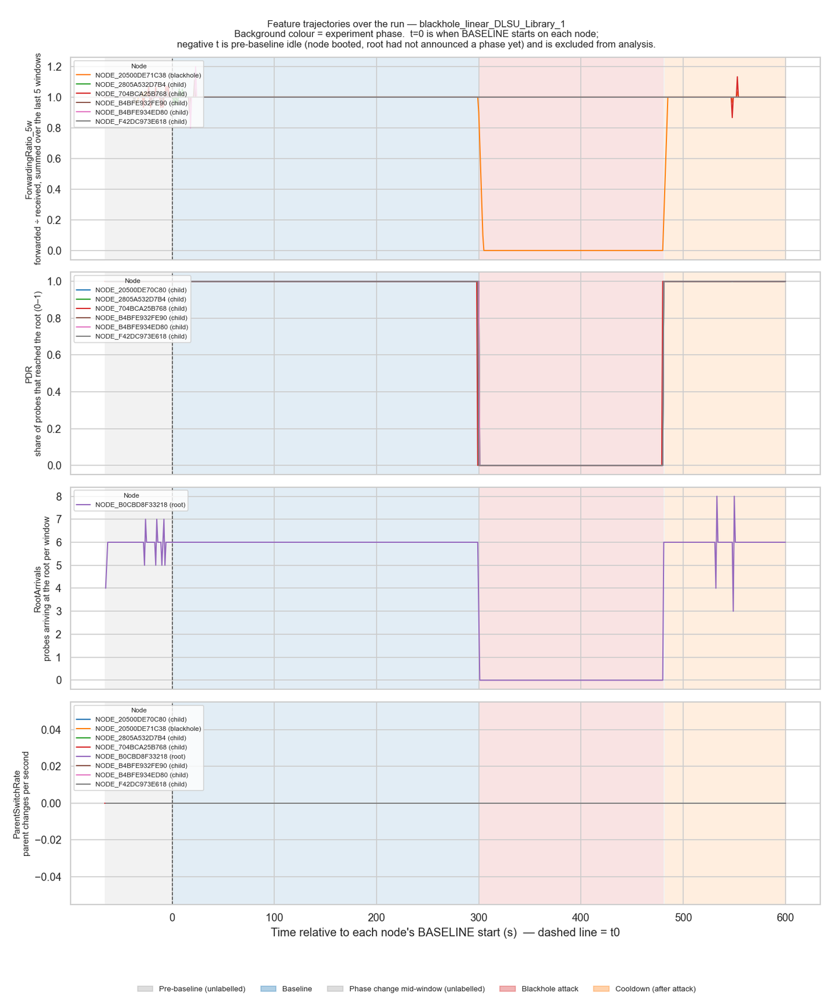

*Look at the shading: the red band is the attack. The attacker's ForwardingRatio (orange, top, summed over 5 windows) and every victim's PDR fall to 0 at once and come back at once, the root's arrivals go from 6 a second to 0, and ParentSwitchRate stays flat at 0 for every board. The x-axis of this plot counts from each board's **baseline start**, so x = 300 is `t_anchor_s` = 0.*

#### How the verifier scores this run

| Check | Normal → attack | Result |
|---|---|---|
| ForwardingRatio of the attacker (primary) | 1.000 ± 0.000 → 0.000 | PASS (SD 0, so any drop counts) |
| PDR of the victims (primary) | 1.000 ± 0.000 → 0.000 | PASS (SD 0) |
| ConsistencyScore (support) | 0.002 → 0.167 | z = 6.63 |
| IngressEgressDelta (support) | 0.004 → 0.950 | z = 23.41 |
| NeighbourForwardingRatio of the attacker (support) | 0.999 → 0.005 | z = −84.23 |

- **"Normal" here is 3,355 windows = baseline 2,398 + cooldown 957.** The verifier compares the attack with **every Label-0 window**, not with the baseline alone (`verify_attack.py`: `base_mask = lab == LABEL_BASELINE`, and label 0 covers both). See the note in 4.2.
- The support values are pooled over all six relays, so they are smaller than the attacker's own numbers.
- The verifier also reports the network-wide ForwardingRatio of all relays: **0.833** in the attack. That is the attacker's 0 averaged with five honest relays at 1: (0 + 5 × 1) / 6 = 0.833. It is never scored, because it is the attacker's own measurement counted a second time.

#### This run against the benign run of 3.1a

| | Benign linear / DLSU Library / stationary | Blackhole linear / DLSU Library / burst |
|---|---|---|
| Phase IDs in the rows | 255, 0, 3 | 255, 0, **1**, 3 |
| Anchor (`t_anchor_s` = 0) | cooldown start | **attack start** |
| Labels | 0 and none | 0, **1** and none |
| Root arrivals | steady the whole run | 1,800 → **0** → 719 |
| Relays' ForwardingRatio | about 1 all run | about 1, except the **attacker: 0.000** |
| Children's PDR | 1.000 | 1.000 → **0.000** → 1.000 |
| RSSI, retries, parent changes | flat | flat (the attack is invisible to them) |

> [!warning] Exam trap: "the victims' ForwardingRatio drops too"
> It does not. Every honest relay on the chain kept forwarding at 1.000 through the whole attack: they hand their probes up, and the attacker throws them away. Only **one** board's ForwardingRatio falls (the attacker's), and only the **victims' PDR**, measured at the root, shows the loss. That is why the blackhole needs both primaries: one at the attacker, one at the destination.

> [!tip] Takeaway
> In a real attack row nothing tells you "attack" except the phase. The counters show it only at the attacker (received 1,376, forwarded 0) and at the root (arrivals 0). Every victim still sends, every honest relay still forwards, and the radio and the routing stay flat.

#### Panel questions on this run

| Question | Spoken answer |
|---|---|
| "Show me one attack row and explain it." | "Take the attacker, 1C38, at `t_anchor_s` 120: `recv_count_delta` 6, `forward_count_delta` 0, `drop_count_delta` 6, so ForwardingRatio 0.000 and Label 1. In the baseline, at −100, the same board received 6 and forwarded 6: ratio 1.000, Label 0. Six, because six boards sit below it and each sends one probe a second." |
| "If the victims' probes are all dropped, why do their relays still show ForwardingRatio 1?" | "Because they really do forward. The loss happens one hop later, at the attacker. A victim cannot see that from its own counters, which is why we measure delivery at the root, by sequence number." |
| "Did the burst confuse your verifier?" | "No. The burst raised the raw counts for five seconds, 296 extra probes from E618, but every ratio stayed the same. The attacker's ForwardingRatio was 0 before, during and after it, and the verifier confirmed the scenario as applied." |
| "Why is LatencyHopRatio empty in the attack?" | "Delay is measured on arrivals. In the attack nothing from the victims arrived, so there is no delay to measure. Blank means 'no data', not 'zero delay'." |
| "Your root sends the phase every 10 seconds. Where is that in the data?" | "Not in the root's `tx_count`: that counter adds five per phase change, and you can see exactly 5, 5 and 5 at the three phase changes. The 10-second repeats are sent without being counted, so the firmware code is the evidence for them, not the CSV." |
| "Is there a bystander in this run?" | "No. In this linear run the attacker is the first hop, so all six children are behind it. Bystanders appear in the other topologies, where some children reach the root without passing the attacker." |
| "Why is the attacker's PDR blank, even in the baseline? Shouldn't it be 1?" | "PDR measures how many of a board's **own** probes reach the root. Our attacker sends none: it only relays the probes of the boards below it. With nothing sent there is nothing to measure, so the cell is blank in every phase, never 1 and never 0. Its health in the baseline is its ForwardingRatio: 1.000." |
| "Doesn't sending nothing of its own make the attacker obvious?" | "In the raw log, yes, but we never try to find the attacker from the data. We know which board it is because we flashed it. The question is whether the attack shows in the data, and the label comes from the phase. It also changes no measurement: if it sent probes of its own, its ForwardingRatio would still fall to 0 and the victims' PDR would still fall to 0." |

> [!note] Checked: the attacker really sends nothing (verification #94)
> - **Firmware:** `blackhole_victim.c` line 40 says "The attacker does NOT generate its own probes". It starts no probe-sending task; only the victim and wormhole firmware have one.
> - **Root's log:** of the 2,913 probe arrivals in this run, **0** are from 1C38. All come from the 6 victims (484 to 487 each).
> - **Its counters:** `probes_count` = `recv_count` in all 6,666 raw rows, so its "probes" counter holds only relayed traffic. The honest relay E618 shows the two equal in 0 of 6,669 rows (966 own, 3,335 relayed).
> - **Result:** PDR and LatencyHopRatio are blank in all 666 attacker windows, in every segment.
> - **Why it was built without probes** is not written down anywhere. Do not give a reason for it; say what it does.

#### Blank vs 0, in plain words (for anyone on the team who doesn't get it yet)

**0 means we measured and nothing got through. Blank means there was nothing to measure.**

| | A test at school | PDR in our data |
|---|---|---|
| **0** | The student **took** the test and got every question wrong: there is a score, and it is zero | Victim D7B4 **sent** its probes and **none** arrived (the attacker threw them away) |
| **blank** | The student was **absent**: there is no score at all | The attacker sent **no** probes of its own, so there is nothing to count |

- Writing 0 for the absent student says they failed, which is false. Writing 0 for the attacker would make it look like a blackhole **victim**. Blank is the only honest value.
- **Why it matters:** a 0 is the blackhole's fingerprint (sent, all lost). If boards that simply sent nothing (the attacker, a switched-off or disconnected board) got a 0, the data would show fake attacks. That is the D-8 rule: no probes sent, no PDR.

**The mail-carrier picture (who measures what):**

- The boards are people who each send one letter a second. The root is the post office at the end of the road, counting every letter that arrives.
- The attacker is a mail carrier in the middle of the road. People behind him hand him their letters to pass on. He writes **no letters of his own**.
- **PDR = "how many of MY letters reached the post office?"** For the carrier that question has no answer, so it is **blank**.
- **ForwardingRatio = letters passed on ÷ letters given to him.** That is how we check the carrier:

| Row on slide 13 | What happened | ForwardingRatio | PDR |
|---|---|---|---|
| 1, attacker, baseline | Given 3, passed on 3 | **1.000**: doing his job | blank |
| 2, attacker, attack | Given 3, threw away 3 | **0.000**: the blackhole | blank |
| 3, victim, attack | Sent its own, none arrived | blank (nothing came to it to relay) | **0.000** |
| 4, bystander, attack | Sent its own, all arrived (not behind the carrier) | blank | **1.000** |

> [!tip] One line to memorise
> "The attacker only carries other boards' messages and sends none of its own, so it has no delivery score. We check it by how much it passes on instead: everything in the baseline, nothing in the attack. 0 means measured and lost; blank means nothing to measure."

#### Defending the attacker's blank PDR, in layers

Start with the short answer. Go deeper only if the panel pushes.

**The 15-second answer:**

> "PDR measures how many of a board's **own** probes reach the root. Our attacker sends no probes of its own; it only relays the probes of the boards below it. With nothing sent, there is nothing to measure, so the cell is blank in every phase, not 1 and not 0. The attacker is measured by its ForwardingRatio instead: 1.000 in the baseline, 0.000 in the attack, rows 1 and 2."

**Likely follow-ups:**

| Panelist asks | You say |
|---|---|
| "Why not just write 1 for the baseline?" | "A 1 would claim everything it sent arrived. It sent nothing, so a 1 would be a made-up value. We never fill in a number we didn't measure." |
| "Why not 0?" | "0 means 'sent, and all were lost'. That is what a blackhole **victim** looks like, row 3. Writing 0 on the attacker would make it look like a victim of its own attack. An early version of our code did exactly that and got 298 fake zero rows in the baseline of one G402 run, so we fixed it." |
| "How do you know it really sends nothing?" | "Three independent checks. The firmware has no probe-sending task for the attacker. The root's log has 0 of 2,913 arrivals from it in the DLSU Library burst run. And its 'probes' counter equals its 'received for relay' counter in every one of 6,666 rows. Verification #94." |
| "So how do you know the attacker was behaving normally in the baseline?" | "ForwardingRatio: forwarded ÷ received. In row 1 it received 3 and forwarded 3, so 1.000. That is the attacker's own health number." |
| "Who does get a PDR?" | "Every ordinary board: victims **and** bystanders. That's why row 4, the bystander, has 1.000. The attacker, the root and the two wormhole ends don't." |

(The "obvious attacker" and "why blank" questions are in the panel table above.)

**If they say "show me":**

1. Open `ESP32-Environment/datasets/analysis/blackhole/linear/DLSU_Library/burst/feature_table.csv`. Filter `node_id` ending **1C38**: PDR is empty in all 666 rows, in every segment.
2. Open the root's `..._arrivals.csv` in `ESP32-Environment/datasets/exports/blackhole/linear/DLSU_Library/burst/` and sort by `src_mac`. Only the 6 victims appear; 1C38 is not there.

> [!warning] Traps to avoid
> - **Don't say "the root never logs the attacker's own probes".** That suggests it sends probes that get lost. Say "the attacker sends none".
> - **Don't say "PDR is victims only".** Bystanders have it too, and row 4 proves it on the same slide.
> - **Don't call blank a zero.** "Blank means not measured; 0 means measured and lost."

### 3.5a The 72 column labels in row 1, one by one (labels only, no values)

- **What this is.** Row 1 of `feature_table.csv` (same folder as 3.5) is not data. It is the **72 labels** that name the columns. The file next to it, `feature_table_legend.csv`, explains each label in five columns: `column` (the label), `group` (who produces it), `meaning`, `unit_or_values` and `notes`. This section turns that legend into plain words.
- **Easy picture.** One row of the table = **one board's report card for one second**. The labels are the boxes on the card: who the board is, what run it was in, what it counted, what the truth was, and what the features say about it.
- **The file is wide on purpose.** It keeps the raw counters, the one-second summaries and the features side by side, so every feature can be traced back to the counters it came from.

#### The five families (the legend's `group` column)

| Family (legend group) | Labels | Where it comes from | Easy version |
|---|---|---|---|
| **Raw (board)** | 3 | Copied unchanged from what the board logged | What the board told us about itself |
| **Windowed (preprocess)** | 44 | Made when raw rows are cut into one-second windows (3.1a, Part 10) | The report card's header, the counters and the truth label |
| **Feature (features.py)** | 22 | Computed from the window's counters | The numbers the analysis actually uses (3.2, 3.3a) |
| **Sniffer** | 2 | From the separate Wi-Fi sniffer capture, only on runs that had one | A second opinion from outside the mesh |
| **Unknown** | 1 | The legend has no line for it (`exposure`) | See the note at the end of this section |

3 + 44 + 22 + 2 + 1 = **72**, every label in row 1.

#### Reading order of row 1

The labels run left to right in six blocks. Learn the blocks and you can find any label.

| Block | Labels (in order) | Question it answers |
|---|---|---|
| 1. Identity | `window_start` to `node_role` (9) | Which board, which second, which run? |
| 2. Position | `layer`, `hop`, `parent_mac` | Where in the tree was the board? |
| 3. Window health and signal | `n_samples_present`, `n_samples_expected`, then four `rssi_dbm_*` | Was the window complete, and how strong was the link? |
| 4. The counters | six counters × four labels each (24) | What did the board count? |
| 5. Truth and timing | `window_label` to `segment` (5) | Which phase was it, and was it an attack? |
| 6. Features and extras | `ForwardingRatio` to `missing_firmware_fields` (25) | What do the numbers say? |

#### Block 1: Identity (who, which second, which run)

| Label | Easy meaning |
|---|---|
| `window_start` | When this one-second window starts, counted from the start of **that board's own log**. Not a clock time, and not shared between boards |
| `node_id` | Which board wrote the row (its Wi-Fi MAC, written `NODE_` plus 12 hex digits) |
| `source_file` | Which raw capture file this window was cut from |
| `attack` | The run's attack: baseline, blackhole or wormhole. Read from the **folder name** |
| `topology` | The mesh layout: linear, star, tree and so on. From the folder name |
| `location` | Where it was recorded (G402, DLSU Library, Yuchengco, home). "unrecorded" if the folder has none |
| `scenario` | The sub-scenario (here: burst). "stationary" when the folder gives none |
| `run_repeat` | Which repeat of the same setup (r1, r2, r3), from the file name |
| `node_role` | What the board's firmware was: victim, blackhole, wormhole_a, wormhole_b or root |

- **The five folder labels are copied onto every row** so any row can be sorted or grouped without opening the folder structure again (D-7, D-10).

#### Block 2: Position in the tree

| Label | Easy meaning |
|---|---|
| `layer` | Depth in the mesh tree as ESP-WIFI-MESH counts it: root = 1, its children = 2, and so on. **A tree depth, not an OSI layer.** -1 means "no parent" |
| `hop` | Number of hops from the root: **hop = layer − 1** (root = 0). **Use `hop` in the paper, not `layer`** (D-11) |
| `parent_mac` | The Wi-Fi address of the board above it. All zeros on the root, and whenever the board has no parent |

#### Block 3: Window health and signal

| Label | Easy meaning |
|---|---|
| `n_samples_present` | How many raw readings really landed in this second. The boards log 10 times a second, so 10 = a complete window |
| `n_samples_expected` | How many a complete window should have (10 = 10 Hz × 1 s). Present below expected = rows are missing (logging gap or reboot) |
| `rssi_dbm_mean` | Average signal strength to the parent in this second |
| `rssi_dbm_var` | How much that signal wobbled (variance) |
| `rssi_dbm_min` | The weakest reading in the second |
| `rssi_dbm_max` | The strongest reading in the second |

- **RSSI = signal strength in dBm.** A less negative number is a stronger link. Placeholder zeros are blanked before averaging, so a fake 0 never pulls the mean up.

#### Block 4: The counters (the biggest block, but one pattern)

The boards keep **running totals since boot**. A running total is useless in a one-second window, so each total is cut into four labels. Every counter follows the same four-label pattern:

| Suffix | Easy meaning |
|---|---|
| `_first` | The running total at the **start** of the window. In practice this is the **last reading of the previous second** (see the note below) |
| `_last` | The running total at the **end** of the window |
| `_delta` | `_last` − `_first`: **how much it grew in this one second.** This is the one the analysis uses |
| `_reset_detected` | True if the total went **down** (the board rebooted and the counter restarted at 0). The `_delta` of that row must not be trusted |

*Example with made-up numbers:* `recv_count_first` 100 and `recv_count_last` 106 give `recv_count_delta` 6. If `_last` were 3 and `_first` 100, the board rebooted inside that second: `_reset_detected` = True and the delta is set to 0.

> [!note] What a delta is, in depth
> **In one line:** a delta is **how much a running total grew during one window** (one second). The boards never write "messages this second". They only keep totals that keep rising from the moment they boot, so the count for one second has to be worked out by subtraction.
>
> **The picture: a car's odometer.** The odometer reads 52,310 km. That says nothing about today's drive. Read it when you leave (52,310) and when you arrive (52,347), subtract, and you drove **37 km**. `_first` is the reading when you leave, `_last` the reading when you arrive, and `_delta` the distance driven in that window.
>
> **Worked example (made-up numbers).** The blackhole attacker during one second of the attack:
>
> | Counter | `_first` (start of the second) | `_last` (end of the second) | `_delta` |
> |---|---|---|---|
> | `recv_count` (probes it received to pass on) | 1,200 | 1,203 | **3** |
> | `forward_count` (probes it passed on) | 1,200 | 1,200 | **0** |
> | `drop_count` (probes it threw away) | 0 | 3 | **3** |
>
> 1. Received this second: 1,203 − 1,200 = 3.
> 2. Forwarded this second: 1,200 − 1,200 = 0.
> 3. Dropped this second: 3 − 0 = 3.
> 4. **Check:** on a relay, received = forwarded + dropped, and 3 = 0 + 3.
> 5. The feature is built from the deltas: ForwardingRatio = forwarded ÷ received = 0 ÷ 3 = **0.000**. The real attack row in 3.5 shows the same pattern: 1C38 at `t_anchor_s` 120 has `recv_count_delta` 6, `forward_count_delta` 0 and `drop_count_delta` 6, so its ForwardingRatio is 0.000.
>
> **Why the analysis reads the delta and never the running total.**
>
> - **A running total mostly measures how long the board has been on.** A board switched on 10 minutes ago and one switched on 2 minutes ago show very different totals for the same behaviour. The delta compares fairly across boards and runs.
> - **The running total hides the attack.** When the blackhole starts, `forward_count` does not fall to zero; it just **stops growing**. Only the delta shows the change: from about 3 a second to 0.
> - **Every counter feature is built from deltas:** ForwardingRatio, IngressEgressDelta, ConsistencyScore and RetryRate (`analysis/features.py`, from line 191).
>
> **Where `_first` really comes from.** The boards take a reading 10 times a second. If `_first` were this second's own first reading, a probe counted between the last reading of one second and the first reading of the next would belong to **neither** second. So `_first` is the **previous second's last reading**, and consecutive windows join end to end with nothing in between (3.1a, Step 5).
>
> - An earlier version of the code used the window's own first reading and lost **up to 15%** of the counts in some home test runs.
> - If the previous second was **discarded** (too few samples), its last reading is not used, and `_first` falls back to this second's own first reading. Otherwise everything that happened across the hole would be dumped into one second.
> - The same edge values matter for PDR: a window owns the probe numbers **after** `probes_count_first` up to `probes_count_last`, so the windows tile with no probe left out (3.1a, Step 6).
>
> **The two reboot cases.** A counter never goes down, except when the board reboots and restarts from 0.
>
> | Where the reboot falls | What the code sees | `_delta` | `_reset_detected` |
> |---|---|---|---|
> | **Inside the second** | `_last` is smaller than `_first` (for example 3 after 100), so the subtraction is negative | Set to **0**, never negative | True |
> | **Between two seconds** | This second's first reading is smaller than the previous second's last | Counted from **this second's own first reading**, so it is usually **not** 0 | True |
>
> Either way the rule for the reader is the same: **a row with `_reset_detected` = True has a delta you do not trust.** Across the dataset this happened rarely: 10 counter resets in 637 files (9.2).
>
> *Checked against `analysis/preprocess.py`, lines 1129 to 1184.*
>
> **Spoken answer:** "The boards only keep running totals since boot. For each one-second window we take the total at the end of that second minus the total at the end of the previous second, which is what happened in that one second. If a board rebooted, its total restarts at zero, so we flag that window instead of trusting it."

There are six counters, so 6 × 4 = **24 labels**:

| Counter | Easy meaning (what it counts) |
|---|---|
| `retry_count` | Failed sends of the board's own probes (not 802.11 retries, D-15). On wormhole end B it counts frames sent into the tunnel instead |
| `tx_count` | **tx = transmit** (networking shorthand; rx = receive). Probes the board sent: counted only when the mesh **accepted** the send, a failed send goes to `retry_count` instead. On the blackhole attacker it counts probes it **forwarded**. On wormhole end B: the normal copy sent to the root. On end A: the copies it **re-injected** toward the root (0 until the attack) |
| `probes_count` | The board's own probes sent. On the blackhole attacker it counts probes it **received to relay**. On wormhole end A: the tunnelled probes it received from B over the wire (0 until the attack) |
| `recv_count` | Probes received from boards below, to pass on |
| `forward_count` | Probes it actually passed on |
| `drop_count` | Probes it received but did **not** pass on |

- **Same label, different meaning per role.** The legend says so for each counter ("see `retry_count` for what is being counted on each role"). That is why a blackhole attacker's `probes_count` is **not** "probes it made" (3.5).

#### Block 5: Truth and timing (the answer key)

| Label | Easy meaning |
|---|---|
| `window_label` | **The ground truth** for the window: 0 normal, 1 blackhole, 2 wormhole, empty = unlabelled. Empty outside the three real phases, so those windows never join a normal or attack group |
| `window_phase_id` | The phase most of the window's raw rows carried: 0 baseline, 1 blackhole, 2 wormhole, 3 cooldown, 4 terminate, 255 "not heard yet" |
| `window_phase_mixed` | True when the phase **changed inside** this second. That window gets segment `transition` and no label, because its counters mix two phases |
| `t_anchor_s` | Seconds relative to the moment **this board** first left phase 0 (the attack start as this board saw it). Negative = before. Lets boards be lined up **without shared clocks** |
| `segment` | Which part of the experiment: `pre_baseline`, `baseline`, `attack`, `cooldown`, `transition`, `baseline_rebroadcast`, `no_phase_seen`. `pre_baseline` is kept but unlabelled and left out of the analysis |

- **The label comes from the phase, never from a feature** (2.3). That is what makes it ground truth.

#### Block 6: The features and extras

The first table holds 22 labels (20 in the legend's "Feature" group plus the 2 sniffer ones). Sixteen are the features of Table 6.7 (3.3). The other six are helpers (marked **helper**). Details and formulas: 3.2 and 3.3a.

| Label | Easy meaning | Where it exists |
|---|---|---|
| `ForwardingRatio` | Share of relayed packets the board actually passed on (1 = everything) | Relaying boards |
| `IngressEgressDelta` | Packets received to relay **minus** packets forwarded, per window | Relaying boards |
| `ConsistencyScore` | How far `ForwardingRatio` is from 1: \|ratio − 1\|. 1 = full suppression | Relaying boards |
| `NeighbourIn` | **helper.** Traffic this board's **children** gave it to pass on. Reported by the children, not by this board | Not on leaves or root |
| `NeighbourOut` | **helper.** Of that traffic, how much this board's **parent** then received from it | Not on leaves or root |
| `NeighbourForwardingRatio` | **helper.** `NeighbourOut / NeighbourIn`: the forwarding ratio as the **neighbours** saw it. Never uses the board's own counters, so a lying attacker cannot hide | Relaying boards |
| `RetryRate` | Failed sends ÷ send attempts. Built from `retry_count`, so **not** a radio retransmission rate. Kept for completeness; not used in EDA, verification or models (D-15) | Every board |
| `RSSI_mean` | Same as `rssi_dbm_mean` | Every board |
| `RSSI_var` | Same as `rssi_dbm_var` | Every board |
| `RSSI_Hop_Diff` | How far the signal is from what is normal **for this depth**: \|RSSI − baseline median at this layer\| | Every board |
| `LatencyHopRatio` | Extra delivery delay per hop, compared with this victim's fastest delivery in the run. One-way and relative, not round trip | Victims, when probes arrive |
| `TunnelIntensity` | Messages per second sent through the wormhole tunnel | Wormhole ends only |
| `TunnelBytes` | Bytes sent through the tunnel per window | Wormhole ends only |
| `TunnelLatency` | Time gap between two copies of the same probe reaching the root (slow mesh path vs fast tunnel) | When duplicates arrive |
| `MacRetryRate` | **helper (sniffer).** The **real** 802.11 retry rate of the board's frames to its parent, from the Retry bit. Not a model input (D-15) | Runs with a sniffer capture |
| `MacFramesHeard` | **helper (sniffer).** How many of the board's frames the sniffer heard in the window; the support for `MacRetryRate` | Runs with a sniffer capture |
| `ParentSwitchRate` | How often the board changed parent, per second | Every board |
| `HopChangeCount` | How many times the board's tree depth changed in the window | Every board |
| `HopStabilityDuration` | Longest stretch with the **same parent and same depth** | Every board |
| `RSSI_stability` | Longest stretch where the signal stayed within ±3 dBm of its mean | Every board |
| `PDR` | Packet Delivery Ratio: share of the board's own probes the root received, matched by **sequence number**, not time | Ordinary children: victims **and** bystanders (the legend says "Victims only"); never the attacker, which sends none |
| `_pdr_clipped` | **helper.** True if PDR came out above 1 and was capped (duplicates such as wormhole copies) | Victims |

Then the last three labels of row 1:

| Label | Easy meaning |
|---|---|
| `Label` | The final ground-truth label used for analysis: a copy of `window_label` |
| `exposure` | **Not in the legend.** The victim / bystander tag from the topology: root, attacker, downstream (path to the root passes the attacker, so a victim), upstream (reaches the root without the attacker), unknown, or no_attacker / not_tunnelled in other run types. **Metadata, never a feature or model input** (`analysis/exposure.py`) |
| `missing_firmware_fields` | Which features exist only on relaying boards and may be empty here. The same text on every row, informational only |

#### Memory aids

- **"Windowed" labels describe the second; "Feature" labels describe the behaviour.** Windowed = what was counted. Feature = what it means.
- **Four suffixes, six counters.** `_first`, `_last`, `_delta`, `_reset_detected` × retry, tx, probes, recv, forward, drop = 24 labels. `_delta` is the one the analysis reads.
- **Two labels for the truth, two for position.** Truth: `window_label` and `Label`. Position: `layer` and `hop`. Each pair is a copy or a shifted-by-one version of the other.
- **Metadata, never model inputs:** the identity block, `exposure`, and the truth labels. They name or score a row; they must not feed the clustering (leakage guard, 6.2.3).
- **Blank is not zero.** The legend says it for each feature that is "only on relays", "victims only" or "ends only". A blank means the board has no such measurement.

#### Gaps in the legend file (say them before a panelist does)

| Label | Gap | Truth |
|---|---|---|
| `exposure` | Group "Unknown", meaning "no legend entry" | It is the topology tag above; the legend file simply lacks its line (9.7) |
| `RetryRate` | Sits in the feature group but is not a radio measure | It comes from `retry_count`. The real retry rate is `MacRetryRate`, from the sniffer |
| `layer` | Easy to read as a protocol layer | It is mesh **tree depth**; the legend's own note says "NOT an OSI layer" |

#### Panel questions on the labels

| Question | Spoken answer |
|---|---|
| "What is the difference between `window_label` and `Label`?" | "They hold the same value. `window_label` is made in preprocessing from the phase. `Label` is the copy the analysis uses. Neither comes from a feature." |
| "Why four columns for each counter?" | "The board keeps a running total since boot. We need the growth in one second, so `_delta` = `_last` − `_first`, where `_first` is the total at the end of the previous second. `_reset_detected` flags a reboot, where the total fell and the delta cannot be trusted." |
| "Why `hop` as well as `layer`?" | "`layer` is ESP-WIFI-MESH's own numbering, root = 1. `hop` = `layer` − 1, so the root is hop 0 and it matches how we count hops in the paper." |
| "Which labels are not features?" | "The identity block, `exposure`, `Label` and the truth labels. They name or score the row. Using them as inputs would let the model read the answer." |
| "Why is the sniffer in the same table?" | "It is a second, outside measurement of retries. It is only filled on runs that had a sniffer, and it is never a model input." |

> [!tip] Takeaway
> Row 1 is a map, not data. Block 1 and 2 say **who and where**, 3 and 4 say **what the board counted**, 5 says **what the truth was**, 6 says **what the numbers mean**. Every other column name follows from those six blocks.

### Check-in (Part 3)

- **Q:** Why is LatencyHopRatio computed from a *relative* delay, and what does that stop you from doing with it?
- **Your answer:** *(pending)*

> [!question]- Answer (click to reveal)
> The boards' clocks are not synchronised, so the raw delay is the true one-way delay plus a big constant offset between the sender's and the root's boot times. Subtracting the sender's fastest delay in the run cancels that constant. The price is that values can only be compared **within** one node and run (their shape), not in absolute terms between nodes or runs.
>
> 📖 **Review it:** Section 5.3 (D-2) and Section 4.2.4.2.5

- **Q2:** In one window, seats 0, 1, 2, 4, 5, 6, 8 and 9 hold real samples; seats 3 and 7 are empty. Is the window kept? What goes into seats 3 and 7 for RSSI, and what for the received counter?
- **Your answer:** *(pending)*

> [!question]- Answer (click to reveal)
> Kept: 8 of 10 seats hold real samples, and the longest empty run is 1 seat (the limit is 2). RSSI in seat 3 is the straight-line value between seats 2 and 4 (for example −62 and −64 give −63), and the same for seat 7. The received counter is copied forward: seat 3 gets seat 2's value and seat 7 gets seat 6's. The filled values do not count toward the 8; the window passed on its real samples alone.
>
> 📖 **Review it:** 3.1a, Steps 3 and 4 of this guide; paper 4.2.4.1, D-9

- **Q3:** A panelist asks: "ForwardingRatio and TunnelIntensity both separate the attack almost perfectly. Why are they not in your clustering, and what are they for then?"
- **Your answer:** *(pending)*

> [!question]- Answer (click to reveal)
> Both are measured on the attacking boards themselves (the blackhole attacker, the wormhole ends), so they record the attack directly: ForwardingRatio drops because the attacker drops, and the tunnel features exist only where the tunnel is. A clustering that used them would only rediscover the switch we turned on, so the leakage guard keeps them out (Arp et al. [80]). Their job is to **prove the attack happened**: they are the verifier's primary checks (ForwardingRatio 36 of 36 blackhole runs, TunnelIntensity 36 of 36 wormhole runs).
>
> 📖 **Review it:** 3.3a of this guide; paper 6.2.1, 6.2.2, 6.2.3

- **Q4:** In the blackhole linear / DLSU Library / burst run, D7B4 (hop 3) is a victim. During the attack its `recv_count_delta` sum is 720 and its `forward_count_delta` sum is 720. Its PDR is 0.000 in every attack window. How can a board forward everything and still lose everything, and which two columns prove the attack?
- **Your answer:** *(pending)*

> [!question]- Answer (click to reveal)
> D7B4 really does forward: it passes the probes of the 4 boards below it (4 × 180 = 720) and its own up to E618, and E618 passes everything to the attacker 1C38. The loss happens at 1C38, which received 1,376 and forwarded 0. D7B4's own counters cannot see that, so its ForwardingRatio stays 1.000. The two primary columns are the **attacker's ForwardingRatio** (1.000 → 0.000, measured at the attacker) and the **victims' PDR** (1.000 → 0.000, measured at the root by sequence number).
>
> 📖 **Review it:** 3.5 of this guide; paper 4.2.7 and 6.2.1

---

## Part 4: How every run is validated (Chapter 4.2.7)

### 4.1 The verifier in one picture (Figure 4.55)

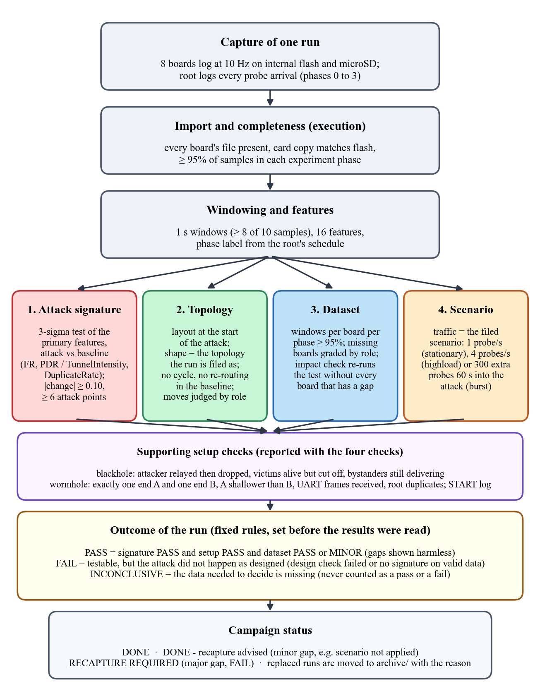

*Read top to bottom: import and window the run, apply four checks to the same windows (signature, topology, dataset, scenario), confirm the roles (setup check), combine by fixed rules, then decide keep or recapture.*

The **verifier** (`verify_attack.py`) answers four questions for every run, always in the same order:

1. **Attack signature:** did the attack feature really move?
2. **Topology:** did the boards form the topology the run is filed under?
3. **Dataset:** did every board record enough of each phase?
4. **Scenario:** did the traffic match the scenario (1/s, 4/s, burst at the right time)?

Plus a **setup check** (blackhole: attacker relayed then dropped, victims alive but cut off; wormhole: exactly one A and one B, A shallower, the wire delivered B's frames).

> [!tip] Key defense line
> "The verdict rules were fixed in the verifier **before** any result was read." The panel cannot accuse you of tuning the test to pass.

### 4.2 The 3-sigma test (Zhukabayeva et al. [71])

- Pool every **5 one-second windows** into one point. The 180 s attack gives 180 / 5 = **36 points**.
- Compute the **baseline mean** and **baseline standard deviation** of the feature.
  - ⚠️ **Precisely:** in an attack run the code's "baseline" is **every normal (Label 0) window, the baseline and the cooldown** (`verify_attack.py`, `base_mask = lab == LABEL_BASELINE`). In the run of 3.5 that is 3,355 windows = 2,398 baseline + 957 cooldown. The paper says "the normal phase" in one sentence and "baseline standard deviations" in the next. If asked: "the normal windows, baseline and cooldown; attack windows are never in the reference".
  - Benign runs are the exception: there the cooldown is **tested against** the baseline alone (4.5).
- A primary feature **passes** when all of these hold:
  - the attack mean is at least **3 baseline SDs** from the baseline mean, **in the expected direction**;
  - the absolute change is at least **0.10**;
  - there are at least **6 attack points**.
- If the baseline never varied (SD = 0), z is undefined/infinite and **any move in the expected direction is accepted**.
- A primary whose **baseline is broken** (mean below 0.90, or SD above 0.15 of the mean) is **excluded**, not failed.

**Worked example (illustrative numbers):** baseline ForwardingRatio mean = 1.000, SD = 0.002; attack mean = 0.003.

**0. Given.**

- $\mu_b$ = 1.000 (baseline mean)
- $\sigma_b$ = 0.002 (baseline SD)
- $\bar{x}_a$ = 0.003 (attack mean)
- Find: z, and whether it passes

**1. Write the z-score.** It measures how many baseline SDs the attack sits away from normal.

$$z = \frac{\bar{x}_a - \mu_b}{\sigma_b}$$

**2. Substitute.**

$$z = \frac{0.003 - 1.000}{0.002}$$

$$z = -498.5$$

**3. Check the three rules.** |z| = 498.5 ≥ 3 and the direction is down (expected for a blackhole) ✓. Change = 0.997 ≥ 0.10 ✓. 36 points ≥ 6 ✓.

**Answer:** passes. (Real runs: where z was finite in 21 blackhole runs, the attacker's ForwardingRatio sat at least 22.9 SDs away, median 111; in the other 15 runs the baseline never varied.)

### 4.3 Primary and support checks

| Attack | Primary (decide the verdict) | Support (reported only) |
|---|---|---|
| Blackhole | Attacker **ForwardingRatio**; **PDR** of non-attacker nodes | ConsistencyScore, IngressEgressDelta, NeighbourForwardingRatio (attacker's ratio as seen by its neighbours) |
| Wormhole | **TunnelIntensity** (counted by the ends); **DuplicateRate** (measured **at the root**) (D-21) | TunnelBytes |

- A run is **confirmed** when at least one primary passes.
- **Why two primaries for the wormhole (D-21):** TunnelIntensity is the attackers counting themselves (weak evidence). DuplicateRate is the root's independent view.
- **TunnelLatency and LatencyHopRatio are "reported, not scored":** TunnelLatency has no baseline (no tunnel exists then), and LatencyHopRatio's baseline is so spread out that |z| could never exceed 0.64. A test that can never pass is not evidence.

### 4.4 The other three checks (Figures 4.56 to 4.59)

- **Topology (Figure 4.57):** rebuilds the tree from logged parent addresses. Rules for moves:
  - Re-route **during the baseline** fails the topology gate (D-27).
  - A board changing parent **during the attack** is tolerated if it **keeps its class** (victim stays victim, bystander stays bystander). Flipping class for 3 s or more fails the run (D-23).
  - The **attacker** changing its own parent is tolerated only if no board changes class, at least one victim remains, and the attacker was without an uplink for at most 10% of the attack (D-31).
  - The rule reads only parent addresses, never PDR or ForwardingRatio, so it is **outcome-blind**.

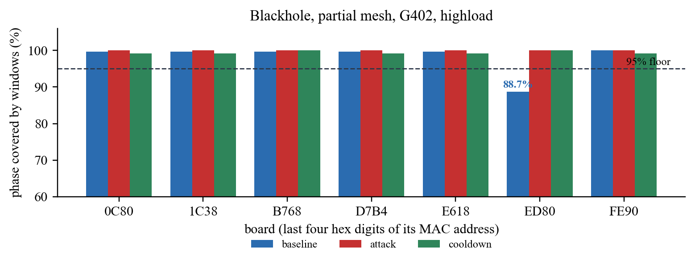

*Each board's coverage of each phase vs. the dashed 95% floor. Victim ED80 covered only 266 of 300 s of baseline (88.7%). The impact check reran the test without ED80, the attack was still confirmed, so the run is kept with a minor gap.*

- **Dataset:** every board must cover at least **95%** of each phase. Missing boards are graded **by role** (D-32): missing attacker or tunnel end = major; missing victim or bystander = minor while other boards of that role remain; unplaceable board = undetermined. An **impact check** reruns the test without the gappy boards.
- **Scenario:** stationary ≈ 1 probe/s per child; highload ≈ 4/s; burst = one spike of about 300 probes about 60 s into the attack. A scenario that was not applied = **minor gap** (D-34).

### 4.5 Outcome and grade (Table 4.24)

| Result | Meaning | What happens |
|---|---|---|
| **PASS** | signature + setup pass, data complete or minor gaps | Kept |
| **FAIL** | testable, but the attack did not happen as designed | Archived, recaptured |
| **INCONCLUSIVE** | data needed to decide are missing | Archived, recaptured |
| **STRONG / GOOD** | full data; GOOD = a note was added (e.g. plain tree, no run log) | Kept |
| **MINOR GAPS** | a gap the impact check shows does not change the result | Kept, footnoted |
| **MAJOR GAPS** | gap on data the result depends on | Not validated, recaptured |

- **Missing data never becomes a pass or a fail.**
- **Benign runs** are tested the other way round: the cooldown is tested against the baseline for both signatures, and **neither may move**. Delivery must stay healthy (PDR at least 0.90, every relay forwards at least 90%).
- **Robustness of the verifier itself:** moving every threshold by about ±50% changed **no verdict** in 53 runs over 14 settings. An absurd setting (1,000 SDs) changed 18 verdicts, which proves the test *can* fail. A **placebo** test (relabel the second half of each baseline as "attack") gave **0 false confirmations in 106 tests**. Section 4.6 explains each of the three tests.

### 4.6 Testing the verifier itself (Section 4.2.7, sensitivity and placebo)

Parts 4.1 to 4.5 test the **runs**. This part tests the **verifier**: can its verdicts be trusted at all? It answers three questions a panelist is likely to ask:

1. "Did you pick your thresholds so that the attacks would pass?"
2. "Can your test ever say no?"
3. "Would your test call normal traffic an attack?"

#### Why the question comes up: some thresholds have no paper behind them

The verdict rests on a few **thresholds**: cut-off numbers a run must clear. Some come from a study. Others the team had to set, because no study gives a value for an ESP32 mesh testbed like ours (values from `docs/attack-validation/GRADING-AND-THRESHOLDS.md`).

| Threshold | Value | Where the number comes from |
|---|---|---|
| How far the attack must move from the baseline | 3 standard deviations (3-sigma) | Zhukabayeva et al. [71] |
| A healthy baseline delivers at least | 0.90 (PDR and ForwardingRatio) | Khan et al. [22] (healthy ESP-MESH above 0.97); the floor is set below it |
| Smallest change that counts | 0.10 | **Set by the team** (engineering bound) |
| Minimum amount of attack evidence | 6 points (30 s) | **Set by the team** |
| The attacker counts as dropping below | 50% forwarded | **Set by the team** (the midpoint between an honest relay, about 100%, and a blackhole, about 0%) |
| A quiet baseline varies by at most | 0.15 (standard deviation ÷ mean) | **Set by the team** (a broken baseline measured 0.39) |

- **The weak spot:** a number the team chose could have been chosen *because* it made the attacks pass.
- **The accepted answer** has two parts: (1) the thresholds were **fixed before the results were looked at**, and (2) a **sensitivity analysis** shows the conclusions do not depend on the exact value. The three tests below are that analysis.

#### An analogy: testing a smoke detector before trusting it

You built a smoke detector and put it in 53 rooms. Some rooms had a real fire, some did not. Before you trust what it says, you test the detector itself.

| Smoke detector | Our verifier |
|---|---|
| A room | One run |
| A real fire | A real attack |
| The detector's verdict: "fire" / "no fire" | The verifier's verdict: attack confirmed / not confirmed |
| The trigger level (how much smoke sets it off) | A threshold (3-sigma, 0.10, 50% and so on) |
| **Test 1:** turn the trigger level a bit up and down; does any room's answer change? | Move each threshold about 50% down and up, re-run every run |
| **Test 2:** set the trigger so high that only a volcano would set it off; does it now miss fires? | Demand 1,000 standard deviations instead of 3 |
| **Test 3:** put it in a clean room with no fire at all; does it ever beep? | Run the verifier on normal traffic that is only *labelled* as an attack |

- **Where the story stops being true:** a smoke detector has one trigger level. The verifier has several thresholds, and test 1 moves them **one at a time**, not all together.

#### Test 1. Sensitivity: does the verdict depend on the exact number we picked?

- **What was done:** take **one** threshold, move it about **50% down**, re-run the verifier on every analysed run, then move it about **50% up** and re-run again. Put it back, and do the same with the next threshold. For example, "smallest change" goes from 0.10 to about 0.05 and to about 0.15. **14 settings** in all, on the **53 runs** that were analysed when the test was run.
- **Result:** **no verdict changed.**
- **Why that happens:** the real attacks are far bigger than any of the bars. Victim PDR falls from 0.998 to 0.000. In the worked example of 4.2, z = −498.5 against a bar of 3, and the change is 0.997 against a bar of 0.10. A signal that large clears the bar whether the bar is 0.05 or 0.15.
- **What it means:** the 0.10, the 50% and the other team-set numbers were **not tuned** to make the results come out. Any reasonable value gives the same verdicts.

#### Test 2. The absurd control: can the test fail at all?

- **What was done:** set the 3-sigma rule to an absurd **1,000 standard deviations**.
- **Result:** **18 verdicts changed** (confirmed runs became not confirmed).
- **Why this is the good outcome:** a test that passes no matter how you set it is not measuring anything. It is a smoke detector that always shows green. Watching verdicts flip under an absurd setting proves the verifier really reads the data and **can** say no. So test 1's "nothing changed" means "the result is stable", not "the test is blind".
- **Why only 18 runs flipped, not all of them** (our reading, not a sentence from the paper): when a run's baseline is almost perfectly flat, its standard deviation is close to 0. Dividing by that gives an enormous z, which clears even 1,000. That is the same σ ≈ 0 case that gives the huge z-scores in Part 4.2.

> [!warning] Exam trap
> "18 verdicts changed, so the verifier is fragile" is **wrong**. Test 2 is a deliberate control, and the flips are what it was looking for. Tests 1 and 2 only make sense together: **reasonable settings → nothing changes** (the result is stable), **absurd setting → things change** (the test is real). Either one alone proves less.

#### Test 3. The placebo: does the verifier ever call normal traffic an attack?

- **The idea:** in medicine, a **placebo** is a fake pill. If patients get better on it, the "effect" was never real. Here the fake pill is a **fake attack**.
- **What was done:** for each run, take its normal **baseline** only. Call the first half "baseline" and the second half "attack". Nothing happened in either half. Then run the **identical** verifier on it.
- **What a trustworthy verifier must do:** say "not confirmed" every time.
- **Result:** **0 false confirmations in 106 tests.**
- **What it means:** the verifier does not confirm an attack just because two stretches of time differ a little (noise, slow drift over a run, small changes in the radio).
- **A detail from the repository** (`GRADING-AND-THRESHOLDS.md`, not the paper): in one high-load run, the 3-sigma score **alone** passed on the placebo, because congestion had pushed the future attacker's forwarding down to 86% before any attack. The attacker check ("forwards less than 50%") stopped the false confirmation. That is why a verdict needs more than one check to pass.

#### The three tests together

| Test | The panel's worry | What was done | Result | What it proves |
|---|---|---|---|---|
| 1. Sensitivity | "You picked the numbers to make it pass" | Each threshold about ±50%, one at a time | 0 of the verdicts changed | The result does not depend on our exact choices |
| 2. Absurd control | "Your test can never fail" | 1,000 SDs instead of 3 | 18 verdicts changed | The test reads the data and can say no |
| 3. Placebo | "It would call anything an attack" | Second half of the baseline labelled as "attack" | 0 of 106 confirmed | No false alarms on normal traffic |

> [!tip] Takeaway
> Our thresholds are not fragile (test 1), the test is not blind (test 2), and it does not cry wolf (test 3).

> [!note] Quote the paper's numbers
> The paper gives 53 runs, 14 settings, 18 flipped verdicts and 106 placebo tests (Section 4.2.7). The repository's thresholds document has older counts from an earlier rerun: two absurd controls flipping 31 and 14 verdicts, and 104 placebo tests. Use the paper's numbers on stage.

#### Panel questions on testing the verifier

| Question | Spoken answer |
|---|---|
| "Some of your thresholds have no citation. Why should we trust them?" | "Where no published value exists, we fixed the threshold before looking at the results, and then tested whether it matters. Moving each one by about half, up and down, changed no verdict." |
| "If nothing changes when you move the thresholds, maybe your test can't fail?" | "We checked that too. With an absurd setting of 1,000 standard deviations instead of 3, 18 verdicts changed. So the test does read the data; the real attacks are just far above any reasonable bar." |
| "How do you know it doesn't flag normal traffic?" | "A placebo test. We took normal baseline data, labelled its second half as an attack, and ran the same verifier. It confirmed nothing in 106 tests." |
| "Why 53 runs and not all 80?" | "The sensitivity test was run when 53 runs had been analysed. The final verifier run on all captures then gave PASS for all 72 attack runs and confirmed all 8 benign runs as clean." |
| "What is a placebo test?" | "Feeding the test data where we know nothing happened, but labelling it as if something did. A good test must say 'nothing here' every time." |

### Check-in (Part 4)

- **Q:** Why does the wormhole need DuplicateRate as a primary check when TunnelIntensity already shows the tunnel working?
- **Your answer:** *(pending)*

> [!question]- Answer (click to reveal)
> TunnelIntensity is counted by the attacking boards themselves, so on its own it is self-reported evidence. DuplicateRate is measured at the root, which is independent of the attackers. Two independent primaries make the confirmation stronger (D-21). Both passed in all 36 wormhole runs.
>
> 📖 **Review it:** Sections 4.2.7.1, 5.6 (D-21) and Table 6.11

- **Q2:** Suppose the placebo test had confirmed an "attack" in 20 of the 106 tests. What would that say about the 72 real attack verdicts?
- **Your answer:** *(pending)*

> [!question]- Answer (click to reveal)
> It would mean the verifier sometimes confirms an attack where nothing happened, so a "confirmed" verdict could be a false alarm caused by noise or drift. We could no longer be sure the 72 attack runs were confirmed because of the attack. The real result was 0 of 106, which is why the verdicts can be trusted.
>
> 📖 **Review it:** Part 4.6, Test 3, and Section 4.2.7

---

## Part 5: Chapter 5, Methodological Deviations

### 5.1 The big idea

- Chapter 5 lists **every change from the approved proposal**: 37 entries, **D-1 to D-37**, each with what the proposal said, what is done instead, why, and what it costs (full text in Appendix C).
- **Modified** = replaces something the proposal specified (17 entries). **New** = adds a rule or procedure the proposal did not have (20 entries).
- The changes were **not planned in advance**: each was made when a capture or a review showed the plan could not be followed as written, or that following it would give untrustworthy data.

> [!tip] How to frame Chapter 5 on stage
> "Every deviation exists for one of three reasons: the platform could not measure what was planned, the plan would have leaked the label or failed to produce the attack, or a run needed a rule to count as one valid experiment." Then give one example of each (below).

### 5.2 The three recurring reasons, with one example each

| Reason | Example |
|---|---|
| **1. The platform could not measure it** | No MAC retry count exists in ESP-IDF (D-15); probes have no reply, so no round-trip time (D-2, D-3) |
| **2. The plan would have leaked the label or failed to make the attack** | Relay counters existed only on the attacker, so an empty column revealed it (D-12); wormhole ends at the same depth skip no hop (D-17, D-28, D-30) |
| **3. A run needed rules to be one valid experiment** | Pre-run gates and START (D-22), parent changes during the attack (D-23), missing boards graded by role (D-32) |

### 5.3 The five groups (Table 5.1)

| Group | Entries | Main change |
|---|---|---|
| Data collection and sampling | D-1, D-9, D-13, D-14, D-25 | 10 Hz logging, 1 s windows of 10 samples (was 5 s of 5); radio fixed at 20 MHz; card fsync |
| Feature definitions | D-2, D-3, D-7, D-8, D-10, D-11, D-15 | One-way latency; retry rate from app counters; run identifiers on every row |
| Implementation of the attacks | D-12, D-16, D-17, D-20, D-28, D-30, D-36 | Both attacks emulated at the application layer; every node relays; wormhole ends as leaves |
| Experimental design | D-5, D-6, D-18, D-19, D-26, D-29, D-33, D-35, D-37 | Baseline = phase 0 of each run; 8 benign runs added (80 total); 3 sites, 3 scenarios; tree rules |
| Run control and validation | D-4, D-21, D-22, D-23, D-24, D-27, D-31, D-32, D-34 | Pre-run gates, START lock, verifier grading of gaps, missing boards, unapplied scenarios |

### 5.4 All 37 in plain words (Table 5.2)

| ID | Topic | In plain words |
|---|---|---|
| D-1 | Sampling rate | Boards record 10 samples per second |
| D-2 | LatencyHopRatio | One-way delay per hop, not round trip |
| D-3 | TunnelLatency | Gap between a probe and its tunnelled copy at the root |
| D-4 | Topology check | Parent changes in the first 60 s count as formation |
| D-5 | Baseline control | First 300 s of each attack run is the baseline |
| D-6 | Repeats and parents | Topology type is fixed; which board sits where is left to the mesh |
| D-7 | run_repeat column | Every row says which repeat it belongs to |
| D-8 | PDR attribution | A window gets a PDR (even 0) if the node sent, was attached, and the root was logging |
| D-9 | Grid and window | 1 s windows, at least 8 of 10 samples |
| D-10 | Run columns | Every row records attack, topology, site, scenario |
| D-11 | Hop, not layer | Hop = layer - 1; HopChangeCount |
| D-12 | Application-layer relay | Every node relays probes itself so forwarding can be counted |
| D-13 | microSD mirror | Card copy forced to disk with fsync |
| D-14 | Radio width | Wi-Fi fixed at 20 MHz |
| D-15 | Application counters | Retry counts come from software, not the Wi-Fi hardware |
| D-16 | Star and blackhole | In the star, the attacker is the hub; the root sits behind it |
| D-17 | Wormhole ends | Ends chosen at run time from mesh depth, then locked |
| D-18 | Matched benign runs | Benign runs added as a control (final plan: 8) |
| D-19 | Sites | G402, DLSU Library, Yuchengco |
| D-20 | Attack emulation | Both attacks act on the study's own probes, not on routing |
| D-21 | Wormhole verification | Two independent checks: attackers' count and root's view |
| D-22 | Pre-run gates and START | Run starts only when checks pass and the operator types START |
| D-23 | Parent changes in the attack | Tolerated if the board stays victim or stays bystander |
| D-24 | START lock | A failed check blocks START unless a typed reason is logged |
| D-25 | Tick alignment | Each sample takes the earliest free tick, at most 300 ms late |
| D-26 | Sticky tree parents | Tree boards switch parent less readily |
| D-27 | Topology gate | Pass if attached at baseline start and no re-route during it |
| D-28 | Star wormhole | In the star, wormhole end A is the hub |
| D-29 | Partial mesh | Defined by placement and at most 2 children per node |
| D-30 | Wormhole end depth | In tree and partial mesh, B sits deeper than A |
| D-31 | Attacker re-parenting | Attacker may move only if no board changes class and its uplink was down at most 10% |
| D-32 | Missing boards | Graded by role, not by a plain board count |
| D-33 | Jitter scenario | Left out; three scenarios remain |
| D-34 | Scenario not applied | Graded as minor gaps |
| D-35 | Benign run plan | Benign runs spread over sites and scenarios; 8 remain |
| D-36 | Wormhole ends as leaves | In tree and partial mesh, the ends accept no children |
| D-37 | Tree fan-out | Number of children a tree board accepts is set per build |

### 5.5 The deviations you must be able to explain in depth

#### D-20: attack emulation (the most important one)

- **Proposal:** classical attacks that act on the **control plane** (a blackhole advertises a false route; a wormhole makes the routing adopt a false shortcut).
- **What we did:** only the **data-plane** behaviour. Blackhole = a placed relay that drops. Wormhole = a real wire that copies probes.
- **Why:** ESP-WIFI-MESH is a self-organising tree with no route request/reply messages to fake. Its routing tables live in Espressif's closed-source library; the API can **read** but not **write** routes. False routes would need forged management frames or reverse engineering, which is outside an exploratory data study.
- **Cost:** no route attraction, no false neighbours, no attacker-caused parent changes in the data. **This is why the cross-layer features stayed flat in Chapter 6.**

#### D-12: every node relays

- **Before:** honest nodes sent with `esp_mesh_send()` and the mesh stack relayed below the application, so only the attacker ever saw transit packets.
- **Problem:** the three relay features existed **only on the attacker**, so an empty column identified the attacker and the label. This is exactly the Thesis 2 panel's objection ("if one feature decides it, machine learning is unnecessary").
- **Fix:** a shared relay on every node: send to your parent, relay one hop up, count received/forwarded/dropped. The attacker differs by one decision.
- **Bug found and fixed along the way:** the relay first forwarded only normal probes, so A's "PROW" copies would have been dropped and no wormhole signature would ever reach the root.

#### D-15: no MAC retry count

- The proposal wanted `retry_count` and `tx_count` from ESP-IDF Wi-Fi statistics.
- Checked: the only statistics call (`esp_wifi_statis_dump()`) **prints** to the log and returns only a status. No number reaches the application.
- So both columns are **application counters**: failed `esp_mesh_send()` calls. RetryRate is not a model input.
- Real retries come only from the **sniffer** (802.11 Retry bit), in 7 of 36 blackhole runs.

#### D-2 and D-3: latency without synchronised clocks

- No probe ever gets a reply, so no round trip exists. Clocks are not synced.
- **LatencyHopRatio:** subtract the sender's fastest delay in the run to cancel the clock offset, then divide by hops.
- **TunnelLatency:** both copies of one probe share the sender's timestamp and the root's clock, so their arrival difference is an exact measurement.

#### D-8: when a window gets a PDR

- The first code gave a node no PDR at all if the root never heard from it, which hid exactly the most affected victims (PDR = 0 appeared in none of 446 rows).
- It also divided by (0 + a tiny constant), so a window with nothing sent became 0.0, a fake blackhole.
- Now: PDR exists (even 0) only if the node **sent**, was **attached**, and the root was **logging**. On that capture, windows with PDR = 0 went from 0 to 201.

#### D-16 and D-28: the star built one hop down

- The root cannot be the blackhole: it is the destination (nothing to forward to) and the referee (it would be grading itself).
- So in star **attack** runs, the hub is the attacker (blackhole) or end A (wormhole), and the root sits one hop behind it.
- For the wormhole star: normal copy B -> A -> root = 2 hops, tunnel copy = 1 hop, a one-hop shortcut. A flat star would give duplicates with no shortcut, "a replay, not a wormhole".
- Side effect to disclose: A also relays B's normal copy, and control boards are 2 hops from the root.

#### D-17, D-30, D-36: getting the wormhole ends right

- **D-17:** roles assigned at run time by depth through the HELLO handshake (deeper = B), locked at phase 0.
- **D-30:** in tree and partial mesh, the ends kept landing at the same depth because they hang off one short cable and the mesh joins the shallowest parent. So B is forced to a non-root parent (always hop 2 or deeper), and A takes the shallowest open parent.
- **D-36:** in tree and partial mesh, the ends join as **leaf nodes**. Reason: when end A restarted, its children re-parented during the attack and the run had to be recaptured; the telemetry stack was also nearly full (stack raised from 4096 to 6144 bytes).

#### D-5, D-18, D-33, D-35: baseline and benign runs

- **D-5:** the baseline is phase 0 of the same run, so firmware, roles, session and placement are identical; the attack is the only change. A separate baseline run would also change the number of probing boards (the attacker relays instead of probing).
- **D-18 -> D-33 -> D-35:** the benign plan went 12 -> 9 (jitter dropped) -> 12 (re-spread) -> **8** (4 never captured when the campaign ended were removed). Final: 4 stationary, 3 highload, 1 burst. G402 has 4, the Library 2, Yuchengco 2. Tree and partial mesh have one benign run each, both at G402.
- Cost: the benign runs are a **control**, not a counterpart for every cell; within a topology, benign scenario and site are confounded.

#### D-22 to D-34: making a run "one valid experiment"

- **D-22 / D-24:** the root holds phase 0 until gates pass and START is typed; a failed check **locks** START (override needs a typed reason of at least 15 characters plus the word OVERRIDE, logged and reported).
- **D-23 / D-31:** what matters is **whom the attack reaches** (class), not which address a board's parent has. Outcome-blind, symmetric, thresholds fixed in advance.
- **D-32:** two runs had a board the root heard but with no file (B768 tree/G402/highload blackhole, 2805 partial/G402/highload wormhole). Now found automatically and graded by role.

#### D-26, D-29, D-37: the tree and the partial mesh

- **D-26:** tree children re-parented on weak but working links (testbed links sat at -71 to -78 dBm). Thresholds made 6 dB weaker and the weak-link watch 3x longer, for keeping and switching only (first parent choice unchanged).
- **D-29:** no partial-mesh run ever showed a board under a second parent, so the partial mesh is reported as a **placement-defined branched tree with at most 2 children**, and adaptive switching is **not claimed**.
- **D-37:** with the stock limit of 10 children, a tree run came out flat like a star. The children limit is now a per-build setting, and the fan-out that formed is reported per run (Table 6.35: root has 2 to 5 children in tree runs).

### 5.6 What the changes mean for the results (Section 5.7)

Four changes **limit how Chapter 6 can be read**:

1. **D-20:** the data show the effect of emulated attacks on traffic, not traffic attraction by a routing protocol.
2. **D-15:** no MAC retry count; retransmissions come from app counters and, where available, the sniffer.
3. **D-18 as revised by D-35:** the 8 benign runs are a control, not a counterpart of every cell, and within one topology benign scenario and site are confounded.
4. **D-37:** tree runs do not share one fan-out (root has 2 to 5 children), which limits the tree vs. partial-mesh comparison in the wormhole runs.

### Check-in (Part 5)

- **Q:** A panelist says: "37 deviations sounds like you didn't follow your proposal." Give a two-part answer.
- **Your answer:** *(pending)*

> [!question]- Answer (click to reveal)
> 1. Each deviation was forced by evidence: the platform could not measure something (D-15, D-2), the plan would have leaked the label or failed to create the attack (D-12, D-17), or a run needed a rule to be a valid experiment (D-22, D-23, D-32). Several were scope decisions checked with the adviser (D-19, D-33, D-35).
> 2. Every one is documented with what the proposal said, what changed, why, and what it costs (Appendix C). Only four limit how the results are read (Section 5.7), and those four are stated openly as limits in Chapter 6.
>
> 📖 **Review it:** Sections 5.1 and 5.7

---

## Part 6: Chapter 6, Results (dataset, attack validation, EDA)

### 6.1 Terms used throughout Chapter 6

- **Window** = one second of one board (up to 10 samples). Every count is in windows.
- **Labels:** baseline and cooldown = **0 (normal)**; blackhole attack = **1**; wormhole attack = **2**.
- **The label is set for every board of the run**, including bystanders that the attack never touched. Remember this: it caps the clustering scores later.
- **Non-attacker nodes:** in a blackhole run, the 6 boards that are not the root or attacker (victims + bystanders). In a wormhole run, the 5 boards that are not the root or an end.

### 6.2 The dataset collected (Section 6.1)

- **80 of 80 runs captured** (Table 6.1): 36 blackhole, 36 wormhole, 8 benign. By topology: linear 21, partial mesh 19, star 21, tree 19. By site: G402 28, Library 26, Yuchengco 26.
- Every run has 8 boards except: benign star/Yuchengco/highload (6 boards) and blackhole tree/G402/highload (7, because B768 recorded nothing).

**Windows (Table 6.2)**

| Phase | Windows | Share |
|---|---|---|
| Before the baseline (not analysed) | 85,435 | 18.7% |
| Baseline (normal) | 190,423 | 41.7% |
| Attack | 103,187 | 22.6% |
| Cooldown (normal) | 76,068 | 16.7% |
| Phase boundary / no label (not analysed) | 1,082 | 0.2% |
| **All** | **456,195** | 100% |

- Analysed = 190,423 + 103,187 + 76,068 = **369,678** (266,491 normal + 103,187 attack).

**Boards by role (Table 6.4)**

| Topology | Blackhole victims | Blackhole bystanders | Wormhole non-attacker boards |
|---|---|---|---|
| Linear | 33 | 21 | 45 |
| Partial mesh | 18 | 36 | 45 |
| Star | **54** | **0** | 45 |
| Tree | 18 | 35 | 45 |
| **All** | **123** | **92** | **180** |

- **Star has no bystanders:** every board is behind the hub attacker.

**Replaced and noted runs (Tables 6.5, 6.6)**

- 15 earlier captures of 11 cells were **replaced** by newer ones and archived. Only the newest capture of a cell is analysed.
- 12 captures outside the plan (5 jitter, 7 at home) are **not** counted.
- 7 groups of runs carry a note but are **kept**. The ones to know:
  - linear/G402/burst blackhole: the burst fired **outside** the attack window (D-34, minor gap);
  - tree/G402/highload blackhole: B768 has no data but was a bystander (D-32);
  - all 9 partial-mesh runs of each attack: **plain trees**;
  - partial/Yuchengco/highload wormhole: end B and one child probed at 1/s instead of 4/s.

**Why some features are often blank (Table 6.8)**

- ForwardingRatio has a value in only 36.3% of non-attacker windows: it only exists when a node **received** something to relay, and leaves (end nodes) never do.
- PDR is 0% on the attacker and the tunnel ends: they are **not scored** on delivery.
- LatencyHopRatio is 0% on the blackhole attacker and end A, and is **missing for victims during the attack** (a dropped probe has no delay).
- Tunnel features exist only on the two ends.

### 6.3 Blackhole: did the attack work? (Section 6.2.1)

**Verifier checks (Table 6.9)**

| Check | Role | Passed |
|---|---|---|
| Attacker ForwardingRatio | Primary | **36 of 36** (baseline 1.000 to 1.004; attack 0.000 to 0.007) |
| PDR of all non-attacker nodes | Primary | **35 of 36** (one run excluded: unstable baseline 0.930 ± 0.253, partial/Yuchengco/stationary) |
| ConsistencyScore | Support | 31 of 36 (misses z 1.4 to 2.7) |
| IngressEgressDelta | Support | 31 of 36 (misses z 0.4 to 2.9) |
| NeighbourForwardingRatio | Support | 32 of 36 (4 runs had no attack values; none failed) |

- **Confirmed in all 36 runs.** Grades: 4 strong, 27 good, 5 minor gaps.
- **Speed:** all 123 victims fell below PDR 0.5 at once: 121 in the **first one-second window** of the attack, the other 2 within 1 s (Table 6.10: median 0 s, max 1 s). Recovery to above 0.5: within **3 s**, median **2 s** (122 boards; one went silent).
- Victim PDR: **0.998 -> 0.000** in every run; **every one of the 123 victims** has an attack-phase mean of exactly 0. Bystanders: 0.996 -> **1.000**.

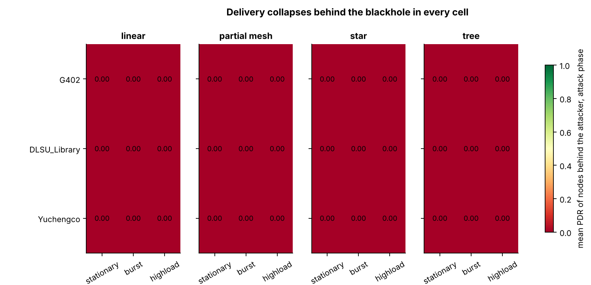

*Each rectangle is one run (panels = topologies, rows = sites, columns = scenarios). Look at the numbers: every single cell is 0.00, so no victim's probe reached the root during the attack, in any run.*

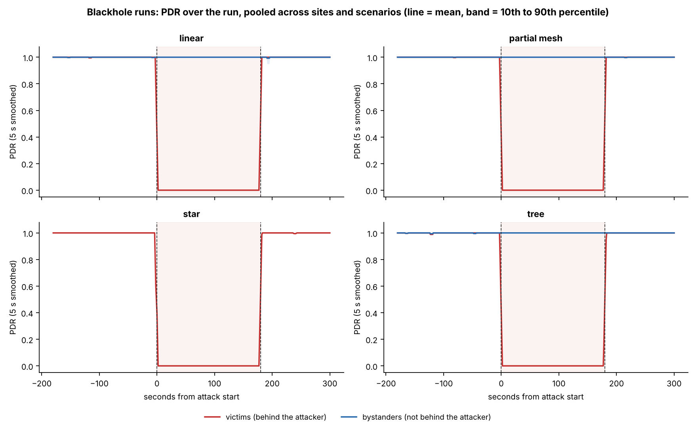

*x-axis: seconds from attack start (negative = baseline, shaded 0 to 180 = attack). Red = victims, blue = bystanders. The red line drops like a cliff at 0 and climbs back right after 180; the blue line never moves. The star panel has only a red line because it has no bystanders.*

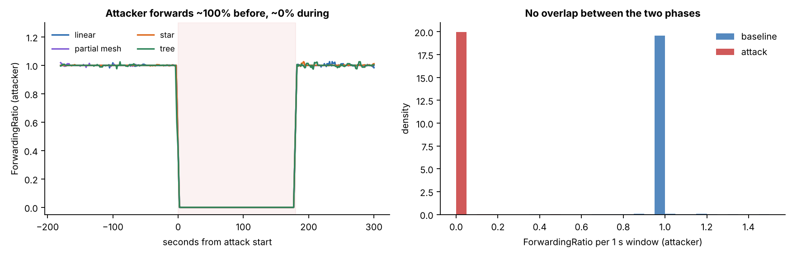

*Left: the attacker's ForwardingRatio over time, falling from about 1 to about 0 for exactly the attack window. Right: histograms of one-second windows; baseline and attack values do not overlap at all.*

### 6.4 Wormhole: did the attack work? (Section 6.2.2)

**Verifier checks (Table 6.11)**

| Check | Role | Passed |
|---|---|---|
| DuplicateRate of end B | Primary | **36 of 36** (baseline 0 in every run; attack 0.986 to 1.000, median 1.000) |
| TunnelIntensity of the ends | Primary | **36 of 36** (baseline at most 0.001 msg/s; attack 0.994 to 4.0 msg/s) |
| TunnelBytes | Support | 36 of 36 (attack median 30, max 120 bytes per window) |

- Grades: 21 strong, 15 good (9 partial-mesh plain-tree notes + 6 runs with no saved root run log).
- **In every run, B was deeper than A** and both ends kept the same hop for the whole run.
- **Hops skipped:** 1 to 5 overall. Linear 2 to 5 (median 4), partial mesh 1 to 2, **star 1** (A is the hub, D-28), tree 1 to 2.
- **The wire worked:** end A received 99% to 101% of what B sent, in all 36 runs.
- **Duplicates:** 12,448 of 12,465 B probes (**99.86%**) reached the root twice; 6,468 of 6,469 attack windows of B (**99.98%**) held a duplicate; **0** in baseline or cooldown; **0** probes of the other boards arrived twice.
- **Spread between the two copies (TunnelLatency):** median **3.9 ms**, 90th percentile 12.1 ms, 99th percentile 417 ms (long tail: 84 windows above 200 ms).
- **No provable link between spread and hops skipped:** Spearman 0.25 (p = 0.14), so no relation can be claimed from 36 runs. Careful: the runs with the deepest shortcuts (4 and 5 hops, all linear) do have the largest median gaps (6.0 to 9.9 ms), so say "no clear trend can be shown", never "the gap does not grow".
- **Out-of-order arrivals:** rare, 232 of 24,913 (0.93%), concentrated in 3 highload runs.

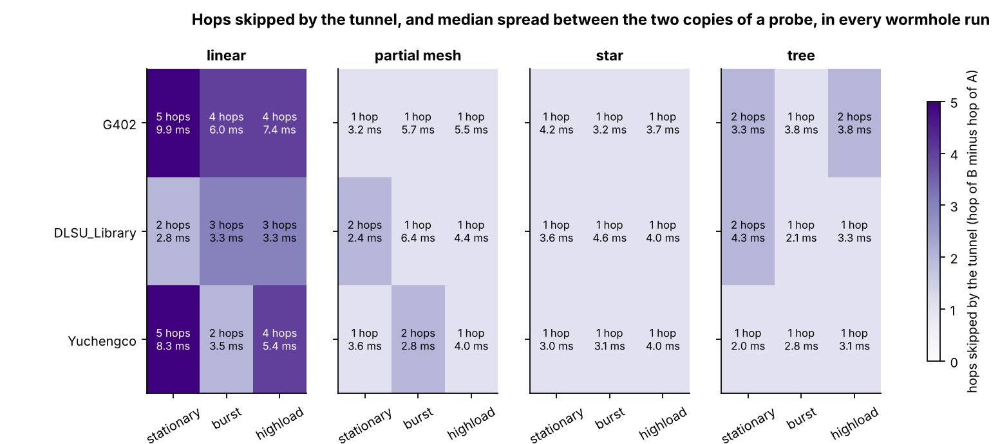

*Each cell is one run. Darker purple = more hops skipped. Linear is the only topology with deep shortcuts (2 to 5 hops); star is always 1. The second number in each cell is the median gap between the two copies in ms. The largest gaps (9.9 and 8.3 ms) sit in the two 5-hop linear cells, but with 36 runs the trend is not significant (Spearman 0.25, p = 0.14).*

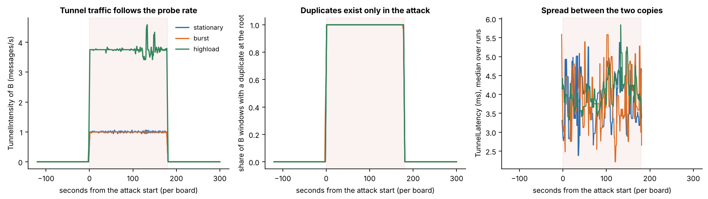

*Left: TunnelIntensity of B jumps from 0 to about 1 msg/s (4 in highload) only during the shaded attack. Middle: share of B's windows with a duplicate goes from 0 to 1 and back. Right: the spread between copies, only defined during the attack.*

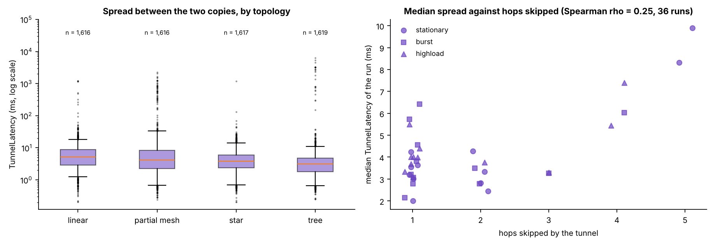

*Left: box plots on a log scale; the typical spread is a few ms in every topology. Right: one point per run. Most runs skip 1 or 2 hops and sit at 2 to 6 ms; the few 4- and 5-hop runs sit higher (5.4 to 9.9 ms), but too few runs exist to call it a trend (Spearman 0.25, p = 0.14).*

### 6.5 The single-feature audit (Section 6.2.3)

**The question:** if one feature alone already separates attack from normal, clustering adds nothing, or the feature is an artefact of how the data were made (Arp et al. [80], "spurious correlation"). So every feature is tested alone.

**Method:** pick the single best threshold on the feature (looking at the labels), count how many windows it labels correctly. Compare with the **majority rate** (always answer "normal").

**Worked example: why the majority rate is about 70%.**

**0. Given.**

- Normal time per run = baseline 300 s + cooldown 120 s = 420 s
- Attack time per run = 180 s
- Find: the accuracy of always answering "normal"

**1. Write the rule.** Always guessing the bigger class is right for every normal window.

$$\text{majority rate} = \frac{\text{normal seconds}}{\text{all labelled seconds}}$$

**2. Substitute.**

$$\text{majority rate} = \frac{420}{300 + 180 + 120} = \frac{420}{600}$$

$$\text{majority rate} = 0.70$$

**3. Verify.** The paper's measured majority rates are 70.0% and 70.1%, matching.

**Answer:** 70%. A feature at 70% knows nothing; a feature well above 70% separates the windows by itself.

**Blackhole results (Table 6.13)**

| Feature | All boards but root | Non-attacker nodes | Victims only |
|---|---|---|---|
| PDR | 86.9%† | 86.9% | **99.9%** |
| LatencyHopRatio | 84.3%† | 84.3%† | 100.0%† |
| ForwardingRatio / ConsistencyScore | 80.4%† | 71.7%† | 70.0%† |
| RSSI and topology features (best of 7) | 70.0% | 70.0% | 70.1% |
| Aligned run clock | 80.0% | 80.0% | 80.0% |
| Majority rate | 70.0% | 70.0% | 70.1% |

† = missing in more than 5% of windows, so judged only where it has a value.

- **PDR on victims = 99.9%:** a complete delivery collapse is separable **by construction**. Expected for a blackhole.
- **PDR on all non-attacker nodes only 86.9%:** because **bystanders carry the attack label but behave normally**.
- **LatencyHopRatio's 100% is fake information:** it only has a value when a probe was delivered, which is almost always a normal window. The real information is in **whether it is missing**: that alone predicts a victim's label with 99.2% accuracy. Hence it is **excluded from clustering**.
- **The run clock gives 80%:** every run follows the same schedule, so "where in the run" partly gives away the phase. It is kept out of the model inputs.
- **Every RSSI and topology feature stays at the majority rate:** the blackhole leaves no trace on them.

**Wormhole results (Table 6.14)**

| Feature | Non-attacker nodes | Ends A and B | End B only |
|---|---|---|---|
| TunnelIntensity / TunnelBytes | no value | **99.7%** | **99.7%** |
| TunnelLatency | no value | 100.0%† | 100.0%† |
| RetryRate | 70.0% | 76.9%† | **100.0%** |
| Every other feature | ≤ 70.0% | ≤ 70.0% | ≤ 70.0% |
| Majority rate | 70.0% | 70.0% | 70.0% |

- Tunnel features decide the label on the ends because the tunnel carries messages **only** in the attack.
- RetryRate reaches 100% on B **only because on B that counter holds the tunnelled frames**. It records the attack by construction, not retries.
- **On the non-attacker nodes no feature beats the majority rate by more than 0.01 points:** the wormhole leaves the other boards completely untouched.

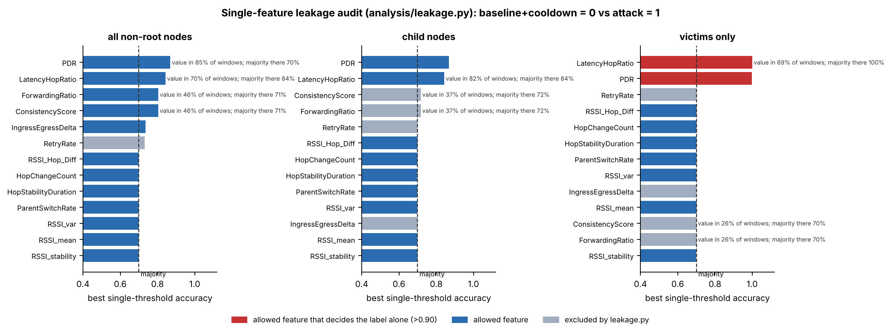

*Each bar = one feature's best accuracy; the dashed line = the ~70% majority rate. A bar ending at the line knows nothing. Red bars decide the label alone (above 90%), blue are other allowed features, grey are features the leakage guard excludes. Right panel: PDR and LatencyHopRatio both reach the top, but only PDR's rise is information. The bar-by-bar reading follows the leakage-guard note below.*

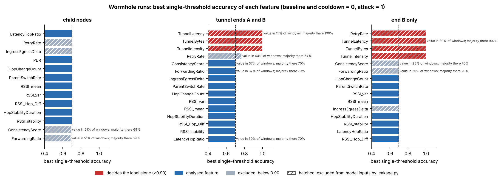

*Same layout. Left panel (non-attacker nodes): everything sits on the line. Middle and right (the ends): only tunnel features and B's RetryRate rise, and those are all excluded from model inputs. Here the fill colour gives the score and the hatching marks the exclusion: a hatched red bar decides the label alone and is still kept out of the models (Step 1b of the reading below).*

> [!note] The leakage guard
> A list in the analysis code of columns that may **never** be model inputs, with a reason for each: RetryRate (app counter, and the tunnel count on B), the three tunnel features (they exist only on the ends, so their presence reveals the run type), and the three relay features (excluded unless more than one kind of node reports them). LatencyHopRatio is **not** on that list. It is kept out by the hand-written FULL list of the clustering, because its missingness gives the label away.

#### Reading Figure 6.7 like a lawyer: why every bar sits where it does

Treat the figure as evidence and each bar as a claim. For every bar, this section gives three things:

- **The exhibit:** the exact window counts behind the bar.
- **The mechanism:** what the firmware and the feature code do that puts the bar there.
- **The cross-examination:** the question a panelist will ask, and the answer.

All counts below come from the 36 blackhole feature tables, recomputed with the audit's own function (`single_feature_decidability` in `analysis/leakage.py`). Every bar and every grey label beside a bar came out the same as in the figure, to the decimal.

##### Step 1: the rules of evidence (what one bar measures)

- **The unit is one window:** one board for one second, with a label.
  - Baseline and cooldown windows are label 0 ("normal"). Attack windows are label 1.
  - The stabilise and transition windows have no label and are left out (the figure's title says "baseline+cooldown = 0 vs attack = 1").
- **A bar is the best accuracy of one cut on one feature,** found while looking at the answers.
  - The code tries every cut between distinct values (up to 256 of them), in both directions ("attack if above" and "attack if below"), and keeps the best score.
  - It is deliberately the most generous test possible. If even a cut chosen with the answer key cannot beat the line, the feature holds no information about the label on its own.
- **Blank windows are dropped for that feature before the cut is searched.**
  - So a feature with many blanks is graded on a **different, smaller set of windows** than the dashed line is.
  - That is what the grey text beside a bar reports. "value in 82% of windows; majority there 84%" means the bar was scored on 82% of the windows, and on those windows always answering "normal" already scores 84%.
- **The dashed line** is the majority rate of the whole panel: 69.96% (left), 69.97% (middle) and 70.06% (right). Worked example above: 420 normal seconds out of 600.
- **The colours** come from `leakage.py`, **asked again for each panel's boards**:
  - grey = the guard flags the feature for this group of boards
  - red = not flagged, and above 90%
  - blue = not flagged, everything else
  - "Not flagged" does **not** mean "used in the clustering". This matters for two bars below (LatencyHopRatio and ForwardingRatio).
  - "Flagged" does **not** mean "left out of the thesis" either. Step 1b says exactly where an excluded feature is still used.

**The three panels**

| Panel | Boards in it | Labelled windows | Attack-labelled | Dashed line |
|---|---|---|---|---|
| Left: all non-root nodes | The attacker plus every child | 149,686 | 44,961 (30.04%) | 69.96% |
| Middle: child nodes (the paper's "non-attacker nodes") | Victims plus bystanders | 128,175 | 38,493 (30.03%) | 69.97% |
| Right: victims only | Children whose path to the root runs through the attacker (`exposure` = downstream) | 73,345 | 21,962 (29.94%) | 70.06% |

##### Step 1b: what "excluded" means, and what it does not mean

**"Excluded by leakage.py" means one thing only:** the feature may not be an **input** to a method that is supposed to find the attack **without being told**. That covers the clustering, PCA, t-SNE and the correlation heatmaps. It does **not** delete the column, and it does **not** remove the feature from the rest of the thesis. `leakage.py` says so in its own header: "It does not delete anything. Excluded columns stay in feature_table.csv … This module only decides what a MODEL is allowed to see."

**The analogy: the answer key printed on the exam.**

- The clustering is a student taking a test with no answer key: "group these windows, and we will see if your groups match normal vs. attack".
- An excluded feature is a column that **is** the answer, or names who the board is. ForwardingRatio = 0 on the attacker is the drop we switched on. A TunnelIntensity value exists only on the two tunnel ends.
- Giving that column to the student would be printing the answer on the question sheet. A perfect score would then prove nothing.
- The teacher still keeps the answer key and uses it to grade and to prove the exam took place. That is the verifier's job, and the excluded features are its main evidence.
- Where the analogy stops: a real answer key is written on purpose. Ours leaks by accident, through which boards have a value at all. That is why `leakage.py` writes a reason next to every entry.

**Where every excluded feature still goes**

| Stage of the thesis | Are the excluded features used? | Specifically |
|---|---|---|
| The dataset (`feature_table.csv`) | **Yes**, all 16 kept | Nothing is deleted. A team member or panelist can open every column |
| Attack validation (`tools/verify_attack.py`, Section 6.2) | **Yes**: they are the main evidence | Blackhole: the attacker's ForwardingRatio is a **primary** check, and ConsistencyScore and IngressEgressDelta are secondary. Wormhole: TunnelIntensity is a primary check, TunnelBytes is secondary and TunnelLatency is measured. RetryRate is the one exception: deliberately **not** a signature (D-15) |
| Descriptive statistics and time series (EDA, Section 6.3) | **Yes**, except RetryRate | `eda.py` lists 15 features for its statistics; only RetryRate is left out (dataset column only). The default time series plots ForwardingRatio (pooled over 5 windows) next to PDR |
| The single-feature audit (this figure) | **Yes**, all 16 tested | Testing them is the point: the audit is how a leak gets found |
| Correlation heatmaps, PCA and t-SNE | **No**, for whatever the guard flags in that dataset | `eda.py` runs the guard on each dataset before computing them. Paper, Figure 6.10: the twelve features "that the leakage guard allows in a group that holds the attacker" |
| Clustering (Section 6.4) | **No** | Only the FULL 8 features of `cluster_final.py`: PDR, the four RSSI features and the three topology features |
| Wormhole diagnostic clustering | TunnelIntensity only, labelled a diagnostic | It only asks "is there a tunnel signal a clusterer could find at all?". It is never reported as a result of the unsupervised method |

> [!warning] Exam trap: "excluded" ≠ "not analysed"
> A panelist who hears "we excluded ForwardingRatio" may conclude you threw away your best evidence. The opposite is true. ForwardingRatio is the verifier's primary proof that the blackhole ran. It is kept out of **only** the unsupervised models, because there it would rediscover the switch we flipped.

**What "the guard's list" is**

- `analysis/leakage.py` contains a written list called `LEAKING_COLUMNS`. It names **7 of the 16 features**, each with its reason written next to it. "On the guard's list" means "named in that list". "Not on the list" means the other 9.
- **4 features are on the list always:**
  - TunnelIntensity, TunnelBytes and TunnelLatency, because they exist only on the tunnel ends.
  - RetryRate, because it is an application send-failure counter that holds the attack's own frames on older captures (D-15).
- **3 features are on the list only conditionally:** ForwardingRatio, ConsistencyScore, IngressEgressDelta. The code strikes them off the list for a group of boards when 2 or more kinds of board report them (`relay_features_are_gated`). That is why their colour changes from panel to panel.
- **The 9 features never on the list:** PDR, LatencyHopRatio, ParentSwitchRate, HopChangeCount, HopStabilityDuration, RSSI_mean, RSSI_var, RSSI_stability, RSSI_Hop_Diff.
- **There is a second checkpoint after the guard:** the clustering's own hand-written list of 8 features (FULL in `cluster_final.py`). LatencyHopRatio passes the guard but is not on FULL, so it is never clustered either.

**The analogy: the security check at an exam room door.**

| Exam room | Our thesis |
|---|---|
| The student taking the exam | The clustering (and PCA, t-SNE, the correlations). It must sort the windows without being told the answer |
| The guard at the door, holding a printed **banned-items list** with the reason next to each item | `leakage.py` and its `LEAKING_COLUMNS` list |
| An item always banned: a phone with the answers saved on it | The tunnel features and RetryRate. They contain the attack itself |
| An item banned **only if one person in the room carries it**: a red name tag. If only one student wears one, the tag identifies them. If everyone wears one, it says nothing | The three relay features. If only the attacker has a ForwardingRatio, "this cell is filled" means "this is the attacker". If two or more kinds of board have one, a filled cell no longer gives anyone away |
| An item not on the banned list: a pencil | The 9 features never on the list |
| The teacher's own sheet for **this** exam: "you may use only these 8 things" | FULL, the clustering's list of 8 features |
| A calculator: the guard lets it through, but this exam's sheet does not include it | LatencyHopRatio: not banned by the guard, but not on FULL either, because its blanks give the label away |
| A confiscated item is not destroyed. It goes into the teacher's box and the teacher can still use it | The column stays in `feature_table.csv`, and the verifier still uses it to prove the attack ran |

- Where the analogy stops: a real guard looks at each student. Ours looks at each **group of boards** (each panel) and asks one question: how many kinds of board carry this feature here?

**The two legends, word by word**

Figure 6.7 (blackhole) uses one colour code:

| Legend entry | What it means exactly |
|---|---|
| Red: "allowed feature that decides the label alone (>0.90)" | Not on the guard's list for this panel's boards, **and** one cut scores above 90%. The blackhole figure has two: PDR and LatencyHopRatio |
| Blue: "allowed feature" | Not on the guard's list for this panel, and at or below 90% |
| Grey: "excluded by leakage.py" | On the guard's list for this panel's boards. The colour says nothing about the score: a grey bar can sit at the line or above it |

Figure 6.8 (wormhole) uses **two separate codes**: the fill colour for the score, and hatching for the exclusion.

| Legend entry | What it means exactly |
|---|---|
| Red: "decides the label alone (>0.90)" | One cut scores above 90%. **Here a red bar can be excluded**: every red bar in Figure 6.8 is hatched |
| Blue: "analysed feature" | Not on the guard's list, at or below 90%. Same meaning as "allowed" in Figure 6.7 |
| Grey: "excluded, below 0.90" | On the guard's list, at or below 90% |
| Hatched: "excluded from model inputs by leakage.py" | On the guard's list for this panel. Hatched red = it decides the label alone **and** is kept out of the models |

- **Do not read red the same way in both figures.** In Figure 6.7, red means allowed and above 90%. In Figure 6.8, red means only above 90%, and the hatching tells you it is excluded.

**Why each wormhole bar is hatched or not**

- **TunnelLatency, TunnelBytes, TunnelIntensity (hatched red, middle and right):** they exist only on the two tunnel ends, and only because the tunnel runs. Their presence alone names the board's role and the run type. So they are always on the guard's list, in every group.
- **RetryRate (hatched, every panel; red on end B):** on end B the counter holds the frames sent through the tunnel (D-15), so on B it counts the attack itself and scores 100%. On end A plus B it reaches only about 77% (on the 64% of windows that have a value, whose majority is 54%).
- **ForwardingRatio, ConsistencyScore, IngressEgressDelta (hatched on child nodes and on end B, blue on "tunnel ends A and B"):** this is the same per-group rule as in Figure 6.7.
  - The middle panel holds two kinds of board, `wormhole_a` and `wormhole_b`, and both report relay values (checked on wormhole/linear/DLSU_Library/burst: 759 and 684 windows with a ForwardingRatio). Two kinds, so the features are not flagged.
  - Child nodes alone, or end B alone, is one kind, so they are flagged.
  - The bars are at the majority rate anyway: the wormhole leaves the relay counters alone.
- **LatencyHopRatio (blue everywhere):** not on the guard's list. It sits on the line in all three wormhole panels. For the non-attacker boards it is still left out of the FULL clustering set. For end B it is one of the inputs of that end's own clustering (Section 6.4).

##### Step 2: the cast of windows

Every window in the figure belongs to one of six kinds. How each kind looks on the three features that matter explains almost every bar.

| Kind of window | Windows | PDR | LatencyHopRatio | ForwardingRatio |
|---|---|---|---|---|
| Attacker, normal | 15,043 | Blank (by design) | Blank | 1 (it relays) |
| Attacker, attack | 6,468 | Blank (by design) | Blank | **0** (it drops everything) |
| Victim, normal | 51,383 | 1 | Has a value | 1 if it relays, blank if it is a leaf |
| Victim, attack | 21,962 | **0** | **Blank** (nothing arrived to time) | 1 if it relays, blank if it is a leaf |
| Bystander, normal | 38,299 | 1 | Has a value | 1 if it relays, blank if it is a leaf |
| Bystander, attack | 16,531 | 1 | Has a value | 1 if it relays, blank if it is a leaf |

- **The single most important row is the last one.** A bystander's attack window looks exactly like a normal window on every feature, yet it carries label 1. The label comes from the phase schedule, not from what happened to the board. No feature can see an attack that never reached the board, so the bystanders cap the left and middle panels.
- **Why the attacker has no PDR in any phase:** the attacker sends no probes of its own (it only relays), so there is nothing of its own for the root to log, and `features.py` gives PDR only to the other children (attribution rule 1 of `compute_pdr_features`). Counting the attacker would put a fake "0" in every phase.

##### Step 3: the lift table (the one table to remember)

A bar's real information is **how far it rises above the majority of the windows it was graded on**, not how far it rises above the dashed line.

| Panel | Feature | Bar | Majority there | Real lift |
|---|---|---|---|---|
| Left | PDR | 86.90% | 69.98% | **+16.9 points** |
| Left | LatencyHopRatio | 84.34% | 84.34% | **0** |
| Left | ForwardingRatio / ConsistencyScore | 80.43% | 71.15% | **+9.3 points** (the attacker only) |
| Left | IngressEgressDelta | 73.66% | 69.96% | **+3.7 points** (the attacker only) |
| Left | RetryRate | 73.15% | 73.14% | **0** |
| Middle | PDR | 86.90% | 69.98% | **+16.9 points** |
| Middle | LatencyHopRatio | 84.34% | 84.34% | **0** |
| Middle | ForwardingRatio / ConsistencyScore | 71.70% | 71.70% | **0** |
| Right | PDR | 99.88% | 70.10% | **+29.8 points** |
| Right | LatencyHopRatio | 99.99% | 100.00% | **0** |
| All panels | The 7 RSSI and topology features | 69.90% to 70.07% | about 70% | **0** |

- Read it this way: **only PDR carries information for the honest boards**. ForwardingRatio and IngressEgressDelta carry it only because the attacker is in the left panel. LatencyHopRatio and RetryRate only **look** informative, because their blanks moved attack windows out of the set they were graded on.

> [!warning] Exam trap: a bar past the line is not automatically information
> Check the grey text beside the bar first. If the bar equals "majority there", the feature knows nothing. It is only being graded on a different set of windows than the dashed line. LatencyHopRatio's bars at 84% and 100% are exactly this.

##### Exhibit A: PDR (86.9%, 86.9%, 99.9% red)

**The rule the audit found:** attack if PDR < 1/3 (in practice: delivery collapsed to 0 means attack).

**Worked example: why PDR stops at 86.9% on the child nodes.**

**0. Given.**

- Child windows with a PDR value: 127,372
- Bystander attack windows with a PDR: 16,499. Their PDR is 1, but their label is attack.
- Normal windows that happened to have PDR < 1/3: 84 (victims) + 99 (bystanders) = 183
- Victim attack windows with a PDR: 21,733, all with PDR 0 (median 0). Every one of them is caught.
- Find: the accuracy of the rule

**1. Count the errors.** A window is wrong if the rule calls it the opposite of its label.

$$\text{errors} = 16{,}499 + 84 + 99 = 16{,}682$$

**2. Divide the correct windows by all graded windows.**

$$\text{accuracy} = \frac{127{,}372 - 16{,}682}{127{,}372} = \frac{110{,}690}{127{,}372}$$

$$\text{accuracy} = 0.8690$$

**3. Verify.** The figure and Table 6.13 both show 86.9%. Of the 16,682 errors, 98.9% are bystanders.

**Answer:** 86.9%. The ceiling is set by the bystanders, not by PDR. A perfect delivery detector would still score 86.9% here.

- **Why the left panel gives exactly the same 86.9%:** the attacker has no PDR in any phase, so adding it to the panel adds no windows to PDR's grading set. The same 127,372 windows give the same score. That is also why the left panel's grey text says "value in 85% of windows": the attacker's 21,511 windows (14.4% of the panel) plus 803 child blanks have no PDR.
- **Why the right panel jumps to 99.9%:** remove the bystanders and only the 84 victim normal windows are left as errors.

$$\text{accuracy} = \frac{72{,}687 - 84}{72{,}687} = 0.9988$$

- **Where the 84 misses are:** 82 in the baseline and 2 in the cooldown. 61 of them fall in the first 60 s of the baseline, and they come from only 5 runs. All of them happened outside the attack, so they are real delivery gaps in normal time, not attack windows bleeding over. **No victim attack window was missed.**
- **Why it is red, and why that is expected:** the blackhole drops 100% of the victims' probes for the whole attack phase. PDR = delivered ÷ sent, so it falls from 1 to 0. A collapse that complete is separable **by construction**. The red bar is not a lucky discovery. It is the proof that the attack ran, measured on the boards it was aimed at.

##### Exhibit B: LatencyHopRatio (84.3%, 84.3%, 100% red): the bar that misleads

**The mechanism:** LatencyHopRatio times a probe that **arrived** at the root. During the attack, none of a victim's probes arrive, so there is nothing to time and the cell is blank.

- All 21,962 victim attack windows are blank.
- The attacker is blank in every phase (it has no probes the root logs).

**Worked example: why the middle bar is 84.34% and still knows nothing.**

**0. Given.**

- Child windows with a LatencyHopRatio value: 105,357
- Attack-labelled windows among them: only the bystanders' 16,499 (the victims' attack windows are all blank)
- Find: the majority rate of the windows that have a value

**1. Compute the attack share of the graded windows.**

$$\text{attack share} = \frac{16{,}499}{105{,}357} = 0.1566$$

**2. The majority rate is the other side.**

$$\text{majority there} = 1 - 0.1566 = 0.8434$$

**3. Verify.** The bar is also 0.8434. The best cut found nothing better than "always normal": the bystanders' attack windows (median 3.15) and the normal windows (medians 3.56 and 3.66) overlap.

**Answer:** lift 0. The bar sits 14 points past the dashed line only because the blanks took the victims' attack windows out of its grading set.

- **The right panel's "100%" is the same effect at its extreme.** Among victims, the 50,813 windows with a value are **all** normal ("majority there 100%"). A cut that calls every window normal is 99.99% right. Its 3 misses are 3 normal windows with values above 3,300, against a median of 3.5. So the red bar means only "every graded window was normal", which is true by construction.
- **The real leak is the blank itself.** "Is LatencyHopRatio blank?" alone predicts a victim's label in 99.2% of windows, and a child's in 86.5%:

$$\frac{21{,}962\ \text{blank attack} + 50{,}813\ \text{valued normal}}{73{,}345} = 0.9922$$

- **That is why it is kept out of the clustering.** The clustering drops a window that has a blank in any chosen feature (C4 in Part 10). With LatencyHopRatio in the set, that rule would silently delete almost every victim attack window, and the clustering would never see the attack it is meant to find.
- **The colour trap:** the legend calls LatencyHopRatio "allowed" (red). That is literally true of `leakage.py`, whose list does not contain it. It is kept out by a **separate decision**: the hand-written FULL list of 8 features in `docs/thesis-figures/cluster_final.py`, made on this audit's evidence. The paper says the same in Section 6.4 ("kept out because the fact that it is missing alone predicts the label in 86% of the windows").

##### Exhibit C: ForwardingRatio and ConsistencyScore (80.4% blue, 71.7% grey, 70.0% grey)

- **Why the two bars are identical:** ConsistencyScore = |ForwardingRatio − 1|, computed from ForwardingRatio. The same cut separates the same windows.
- **Why so many blanks:** ForwardingRatio exists only in a second in which the board **received** something to relay. A leaf has no children, so its ForwardingRatio is always blank. The share with a value falls from 46% (left) to 37% (middle) to 26% (right), because victims relay less often: 26% of victim windows have a value, against 52% of bystander windows.
- **Left panel, the rule found:** attack if ForwardingRatio < 0.025.
  - The 68,938 windows with a value hold 19,889 attack windows (28.85%), so "majority there" is 71.15%.
  - The rule catches 6,448 of the attacker's 6,451 attack windows, where ForwardingRatio is 0.
  - It misses all 13,402 attack windows of the **honest relays**, because they keep forwarding at 1.000 straight through the attack (the same fact as Section 3.5's burst run).
  - The real lift, 9.3 points, is close to the attacker's share of those windows: 6,451 ÷ 68,938 = 9.4%.
- **Middle and right, no attacker:** every honest relay forwards at about 1 in every phase. No cut helps, so the bar equals "majority there" (71.7% and 70.0%).
- **Why blue on the left and grey in the middle and right:** `leakage.py` asks each group of boards how many kinds of node (`node_role`) report the relay features (`relay_features_are_gated`, cleared at 2 or more kinds).
  - Left: the attacker (`blackhole`) and the children (`child`) both report them. That is 2 kinds, so the feature is not flagged and is drawn blue.
  - Middle and right: only `child`. That is 1 kind, so the feature is flagged and drawn grey.
  - The clustering uses child boards only, so there these features are excluded. **Blue on the left does not mean they were clustered.** The paper explains this rule in Section 6.2.3.
- **Why the attacker's 0 must never enter a model:** it is the attacker's own record of the drop we switched on. A clustering that used it would only rediscover our own switch.

##### Exhibit D: IngressEgressDelta (73.7% blue, then at the line in grey)

- **It always has a value:** |received − forwarded| is 0 for a leaf, not blank. So it is graded on the whole panel, against the dashed line itself.
- **Left panel, the rule found:** attack if IngressEgressDelta > 0.5.
  - It catches 6,451 of the attacker's 6,468 attack windows (median 4 probes received and not forwarded per second).
  - It is wrong on 481 of the attacker's normal windows with a delta above 0: a probe received in one second and forwarded in the next. This is the window-edge effect of Section 3.5.
  - It misses almost every honest board's attack window (median delta 0).
- **The most it could ever score:** catching every attacker attack window adds at most their share of the panel.

$$69.96\% + \frac{6{,}468}{149{,}686} = 69.96\% + 4.32\% = 74.28\%$$

- **It reaches 73.66%,** short of that ceiling because of the edge-effect errors above.
- **Why its lift (3.7 points) is smaller than ForwardingRatio's (9.3):** it is the same attacker signal, but here it is spread over all 149,686 windows. ForwardingRatio drops the leaves as blanks, which concentrates the attacker's windows.
- Grey in the middle and right for the same per-group reason as ForwardingRatio.

##### Exhibit E: RetryRate (73.1% grey, then at the line)

- **The formula:** RetryRate = retry ÷ (tx + retry), blank when the board made no send attempts (`features.py`).
- **Why it sits right of the line on the left:** during the attack, the attacker forwards nothing, so it makes no attempts. RetryRate is blank in 6,465 of its 6,468 attack windows.
  - The windows that do have a value therefore hold fewer attack windows: majority there is 73.14%.
  - RetryRate itself is 0 in practically every window (the median is 0 in every kind of window). The bar, 73.15%, equals that majority: a lift of 0.01 points.
- **So again it is the blank that carries the attacker, not the value.** "Is RetryRate blank?" alone scores 74.1% on the left panel.
- **Grey in every panel:** it is always on the guard's list. It is an application-layer send-failure counter, no cited study backs it as an indicator, and it overloads with the attack's own counters on older captures (D-15).

##### Exhibit F: the seven RSSI and topology features (all on the line)

- **The bars:** RSSI_mean, RSSI_var, RSSI_stability, RSSI_Hop_Diff, ParentSwitchRate, HopChangeCount and HopStabilityDuration score between 69.90% and 70.07% in every panel.
- **Why:** the blackhole is a decision inside the attacker's firmware to throw away a probe **after** receiving it.
  - The radio link is untouched: the attacker still acknowledges every frame at the link layer.
  - It stays in the tree, so no board changes parent or hop.
  - The radio environment is the same room in every phase. In the burst run of Section 3.5 the largest change in a board's mean RSSI between phases was 1.6 dB.
  - With no difference between the phases, no cut can find one.
- **Why RSSI_stability sits a hair left of the line (69.90%):** 98.45% of child windows have the same value (0.9). The audit tries cuts only between distinct values, so it can never put every window on one side. Its best cut is a sliver worse than "always normal". It means nothing.
- **These flat bars are evidence, not failure.** They are the cross-layer symptoms the literature predicted (Table 3.4), measured and not found (Section 6.6).

##### The verdict

> [!tip] Takeaway
> On the honest boards, one feature carries the attack: PDR. It rises 16.9 points above the majority on all child boards and 29.8 points on victims. That is a complete delivery collapse, which a blackhole causes by construction. The other high bars are artefacts the audit was built to catch:
>
> - ForwardingRatio and IngressEgressDelta rise only because the attacker is in the left panel.
> - LatencyHopRatio and RetryRate rise only because their blanks removed attack windows from their grading set.
>
> The radio and topology features stay exactly on the line because the attack never touches the radio. That is why the relay, retry and tunnel features and LatencyHopRatio were kept out of the clustering, and why the REDUCED-without-PDR control set exists (Section 6.4).

##### Cross-examination: panel questions on Figure 6.7

| Question | Spoken answer |
|---|---|
| "LatencyHopRatio reaches 100% on victims. Isn't that your best feature?" | No. It has a value only in windows where a probe arrived, and among victims every one of those windows is normal, so 100% is just "always say normal" on a set with no attacks in it. The information is in the blank: no arrival means attack, 99.2% of the time. That is leakage, so we kept it out of the clustering. |
| "If PDR alone gets 99.9%, why do clustering at all?" | That is exactly the question this audit answers, and we report it openly. A blackhole drops every probe, so a delivery collapse is separable by construction. The clustering asks whether anything **beyond** that separates the windows, which is why we also ran a control set without PDR. |
| "Why is PDR 86.9% both with and without the attacker?" | The attacker has no PDR in any phase, because it sends no probes of its own: it only relays. Adding it to the panel adds no windows to PDR's score. |
| "Why is ForwardingRatio blue in one panel and grey in the others?" | The guard asks each group of boards how many kinds of node report the relay features. With the attacker in the group there are two kinds, so it is not flagged. Among children only there is one, so it is flagged. The clustering uses children only, so it was never a clustering input. |
| "You chose the cut while looking at the labels. Isn't that cheating?" | On purpose. It is the most generous single-feature test there is. A leak test should favour the feature: if even a cut chosen with the answer key cannot beat the majority rate, the feature cannot give the label away on its own. We do not report it as a detection accuracy. |
| "Why are the RSSI bars all exactly at 70%? Did the feature break?" | No. The values vary normally, for example by board and site. They just do not change between phases, because the blackhole drops probes in the firmware and leaves the radio link untouched. That is a finding: the predicted cross-layer symptoms did not appear. |
| "RetryRate is flat. Why is its bar above the line?" | Because it is blank in the attacker's attack windows (no sends, nothing to divide), so it is graded on a set with fewer attacks, whose own majority is 73.1%. The bar equals that majority. The value itself carries nothing. |
| "Why not drop the bystanders, so PDR is 99.9% everywhere?" | The label is defined by the phase for every board in the run, and we keep it that way on purpose. Relabelling by effect would put a feature into the label. We report the victims-only figure next to the all-children figure instead. |

### 6.6 Predictions tested and not observed (Section 6.2.4)

**Blackhole (Table 3.4):** victims were predicted to retransmit more.

- App-counter RetryRate of victims: 0.0000 -> **0.0004** -> 0.0000 (a failed send in only **9 of 21,742** attack windows).
- ParentSwitchRate of victims: 0.00000 -> 0.00009 (Cohen's d = 0.01).
- **Sniffer (real 802.11 retry bit)** in 7 runs: victims 0.295 -> 0.364 -> 0.323, but the change **differs in sign between runs** (3 up, 4 down). No consistent rise, though 7 runs are too few to rule out a small effect.
- **Why:** the attacker still ACKs every frame at the link layer.

**Wormhole (Table 3.5 vs. Table 6.16)**

| Indicator | Observed? | Measured |
|---|---|---|
| Hop count consistency | **No** | Hop of A and B constant; 0 windows with a hop change in any phase |
| Parent-child validity | **No** | 0 windows with a parent change |
| Routing table entries | Not measured | Firmware does not log the routing table |
| RSSI-hop correlation | **No** | RSSI_Hop_Diff A 2.79 -> 2.76 dB; B 5.41 -> 5.68 dB |
| RSSI variance | **No** | d = -0.03 (A), -0.07 (B) |
| Frame arrival pattern | **Yes** (duplicates); out-of-order rare | 99.86% duplicates; 0.93% out of order |
| Retransmission count | Not measurable on the ends | B's counter holds tunnel frames; others 0 |
| Duplicate arrivals | **Yes** | 6,468 of 6,469 attack windows |
| Latency mismatch | **Yes** | Median spread 3.9 ms |

- **Pattern:** the 3 indicators that belong to the **traffic** the tunnel creates are observed; the 4 that belong to **routing and radio** are not. Exactly what an application-layer tunnel implies.

### 6.7 Benign runs: no attack signature (Section 6.2.6)

- The benign run is tested with the same tests, pointed the other way: cooldown vs. baseline, and **no signature may pass**.
- All 8: **BENIGN CONFIRMED, strong**. 0 of 21 evaluable signature checks passed (43 others needed a tunnel or attacker, so had no data, as expected).
- Mean PDR per run 0.9994 to 1.0000. Only 4 of 54 child boards ever had a window below 1, all in linear/G402/highload (lowest 0.75).

### 6.8 Exploratory data analysis (Section 6.3)

#### Cohen's d, the effect size used everywhere

- **d** = (attack mean - baseline mean) / pooled standard deviation.
- Reading: |d| below 0.2 negligible, about 0.5 medium, 0.8 or more large. Negative = lower during the attack.
- **Not a significance test:** windows of one board follow each other and are not independent, so d only describes the **size** of a shift.

**Worked example: what d = -29.71 for victim PDR means.**

**0. Given.**

- Baseline mean PDR = 0.9977, attack mean = 0.0000, d = -29.71
- Find: the pooled SD this implies, and what the d says

**1. Rearrange the definition.**

$$s_{pooled} = \frac{\bar{x}_{attack} - \bar{x}_{baseline}}{d}$$

**2. Substitute.**

$$s_{pooled} = \frac{0.0000 - 0.9977}{-29.71}$$

$$s_{pooled} \approx 0.0336$$

**3. Interpret.** The means moved by almost 30 times the typical spread. For comparison, "large" starts at 0.8.

**Answer:** a gigantic shift. Every other feature of victims and bystanders moved by |d| < 0.1.

#### Blackhole EDA (Table 6.18)

- **Only victim PDR moves** (d = -29.71). Every other feature, for both groups: |d| < 0.1. Largest: RSSI_var of bystanders, d = -0.09.
- Victims' RSSI is about 2.5 dB weaker than bystanders' **already in the baseline** (-74.7 vs -72.2 dBm). That is because victims sit deeper, not because of the attack.
- LatencyHopRatio of bystanders falls 4.26 -> 3.15 -> 2.46 ms/hop through the run, and keeps falling **after** the attack; benign runs show the same decline. So it follows the **course of a run**, not the attack.

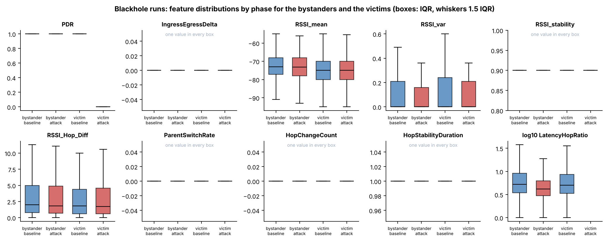

*One panel per feature; blue = baseline, red = attack. Only the PDR panel changes: the victims' attack box sits at 0. Every other panel overlaps between phases or holds one value only.*

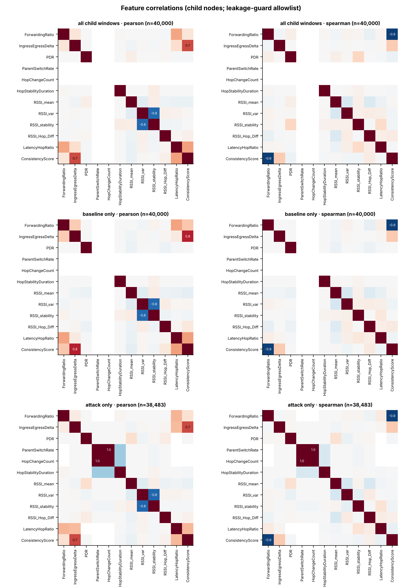

*Left column Pearson, right Spearman; rows = all, baseline, attack windows. Four pairs are strongly correlated, and none of them is a behaviour link the attack created:*

- *ForwardingRatio and ConsistencyScore: one is computed from the other (Spearman -0.94; Pearson only 0.12 because the link is not linear).*
- *IngressEgressDelta and ConsistencyScore: built from the same relay counters (Pearson 0.65; 0.78 in the baseline).*
- *RSSI_var and RSSI_stability: Pearson -0.79 but Spearman only 0.05, so the link comes from a few windows with high variance, not a general relation.*
- *ParentSwitchRate and HopChangeCount: 1.00 in the attack windows only, because both are non-zero in the same few windows and constant in the baseline.*

*No other pair among the 8 FULL-set features exceeds |0.4| (largest 0.36).*

#### Wormhole EDA (Table 6.19)

- On the ends, **only tunnel features change**: TunnelIntensity 0 -> 1.92 msg/s (d = 1.83), TunnelBytes 0 -> 57.5 bytes (30 bytes x 1.92).
- RetryRate of B 0.00 -> 0.50 (d = 42.99), but that is the tunnel counter, not retries.
- Non-attacker nodes: PDR 0.9999 -> 0.9999; RSSI_var d = -0.06 (largest). **Nothing moves.**
- RSSI_Hop_Diff is higher on B (5.4 dB) than elsewhere (2.7 to 2.8), but it is equally high **before** the attack, so it reflects where B sits.

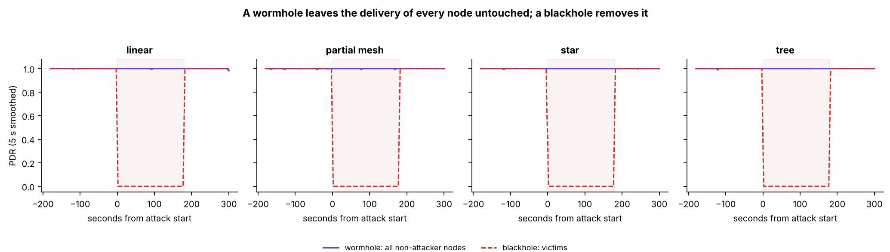

*Solid purple (wormhole boards) never leaves 1; dashed red (blackhole victims) falls to 0 for the whole attack. This is the one-picture contrast between the two attacks.*

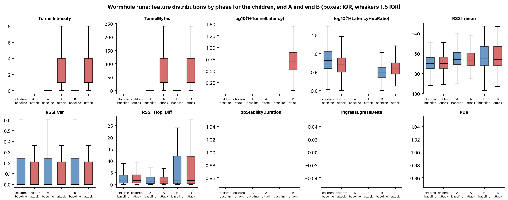

*Only the tunnel panels change, and only on the ends. RSSI boxes coincide between phases for every group.*

#### Benign runs and the "capture effect" (Section 6.3.3)

- Benign delivery is complete; no hop change in any run; 1 parent change in all 8 runs.
- The probe rate matches the scenario in both kinds of run (about 1.0, 1.1 and 3.9 per board per second).
- **The important finding (Tables 6.22 and 6.23):** the only big difference between benign and attack-run normal windows is **RSSI_mean** (d = 0.69 vs blackhole runs). Comparing each benign run with the baseline of the attack run **of the same cell**: RSSI_mean differs by **8.1 dB** (vs the blackhole run) and **7.1 dB** (vs the wormhole run) on average, in **both directions** (Table 6.23).
  - Meaning: every capture is a fresh set-up of the boards, and signal strength depends on exactly where they stand. **RSSI_mean separates captures, not attacks.** This matters for clustering: it can split windows by set-up instead of by attack.
- The benign cooldown stays within 0.5 baseline SDs of its baseline in **24 of 24** comparisons: no drift a detector could mistake for an attack.

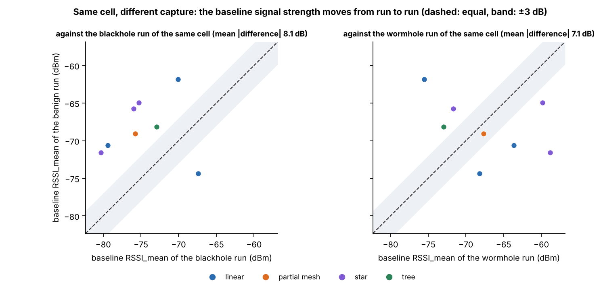

*Each point is one benign run; the dashed line means "equal" and the band is ±3 dB. Points fall on both sides and mostly outside the band: two captures of the same cell can differ by several dB with no attack involved.*

> [!note] The other benign figures
> Figure 6.13 (benign delivery over time: flat at 1, with tiny dips only in linear/G402/highload), Figure 6.14 (probe rate and PDR by scenario: same in benign and attack runs), Figure 6.15 (normal windows, benign vs. attack runs: only RSSI_mean differs). They are in `images/` as fig-6-13 to fig-6-15.

### Check-in (Part 6)

- **Q:** PDR separates victims at 99.9% but all non-attacker nodes at only 86.9%. Why the gap, and is it a flaw in the data?
- **Your answer:** *(pending)*

> [!question]- Answer (click to reveal)
> The label is set by phase for **every** board in the run, so bystanders' attack-phase windows carry label 1 even though nothing happened to their traffic (their PDR stays at 1.000). No feature of a bystander can reveal an attack that did not reach it, so any feature-based method misclassifies them. It is not a flaw in the data: it is how the labelling is defined, and the paper reports the victims-only figure next to the all-nodes figure for that reason.
>
> 📖 **Review it:** Section 6.2.3 and Section 6.4.3

- **Q2:** In Figure 6.7's right panel, LatencyHopRatio reaches 100%, higher than PDR. A panelist calls it your best blackhole feature. What do you answer, and which number on the figure proves it?
- **Your answer:** *(pending)*

> [!question]- Answer (click to reveal)
> The proof is the grey text beside the bar: "value in 69% of windows; majority there 100%". LatencyHopRatio has a value only where a probe arrived, and no victim probe arrives during the attack, so every graded window is normal. "Always say normal" is then 100% right, and the real lift is 0. The information is in the blank: blank means attack in 99.2% of victim windows, which is leakage, so the feature is kept out of the clustering. PDR's 99.9% is real: it is graded on 99% of the windows, whose own majority is 70.1%.
>
> 📖 **Review it:** Section 6.5 of this guide (Exhibit B), and Section 6.2.3 of the paper

---

## Part 7: Chapter 6.4 to 6.5, Clustering and Discussion

### 7.1 What clustering is asking

- **Clustering** groups windows **only by how similar their feature values are**. The algorithm is **never shown the label**.
- Afterwards, the label is used to **score** the groups: did the groups the algorithm found line up with normal vs. attack?
- Analogy: you dump 6,000 photos on a table and ask a friend who has never seen your albums to sort them into piles by look alone. Then you check whether the piles match your albums. The friend never saw the album names; you only use them to grade the piles.
  - Where the analogy breaks: the friend might sort by brightness (a property of the camera, not the subject). That is exactly what happens later with RSSI_mean, which sorts windows by **set-up**, not by attack.
- Section 7.1a puts this next to supervised learning and shows exactly where the label is and is not used.

### 7.1a Supervised vs. unsupervised: what we did and why

- **Supervised learning** is trained **with the answers**. Every training row comes with its label (normal or attack), and the model learns to predict the label of rows it has not seen.
- **Unsupervised learning** gets **no answers**. It only sees the features and has to find structure on its own, such as groups of similar rows.
- Our thesis is **unsupervised**: the clustering step never sees the label. The label is used **afterwards**, only to grade the groups.

| | Supervised | Unsupervised (what we did) |
|---|---|---|
| Training data | Rows **plus** a label for each | Rows only |
| Goal | Learn to predict the label of new rows | Find groups and structure |
| Example methods | Decision tree, random forest, neural-network classifier | K-Means, Ward, GMM, DBSCAN, spectral |
| Typical output | "This window is an attack" | "These windows look alike" |
| How it is scored | Accuracy, precision, recall on **held-out** data | Silhouette and Davies-Bouldin (shape only); ARI and purity against the label, **afterwards** |
| What it needs | Plenty of labelled attack data, split into training and test | Only the features |
| What it gives you | A detector | A picture of whether the data separate at all |

#### The analogy

- **Supervised** = flashcards with the name written on the back. The child studies cards, then you test them on new cards.
  - Mapping: card = one window, name on the back = the label, test cards = windows from runs the model never saw.
- **Unsupervised** = the photo piles of 7.1. A friend sorts 6,000 unlabelled photos by look alone, and only then do you compare the piles with your albums.
  - Mapping: photo = one window, pile = one cluster, album names = the label, used only to grade.
- Where the analogy stops: a child can be told "this is a cat". Our clusters have **no names**. Cluster 2 is only "the other group". We know it is the victims because we then compare it with the label.

#### Where the label is used in our pipeline, step by step

| Step | Does it use the label? | Note |
|---|---|---|
| Creating the label | It **is** the label | Comes from the phase schedule, never from a feature, so it cannot be circular |
| Single-feature audit and leakage guard | **Yes** | Checks whether one feature gives the label away (Arp et al. [80]); decides which features may enter. LatencyHopRatio is excluded this way |
| Low-variance and correlation filters | No | Look at the features only |
| K-Means, Ward, GMM, DBSCAN, spectral | **No** | The algorithm never sees the label |
| Choosing k and DBSCAN's eps | No | Elbow, silhouette and interpretability; eps at the knee of the k-distance graph |
| Silhouette and Davies-Bouldin | No | Shape only |
| Purity and ARI | **Yes, afterwards** | Grading only. They compare the finished clusters with the label |
| Colours in PCA and t-SNE | Yes, afterwards | The dot positions never use the label; the colour is added to the finished picture |

- **Why ARI needs the label even though the algorithm did not:** a cluster is an unnamed group. To say whether the groups match "normal vs. attack", you must compare them with the ground truth. The comparison happens after the algorithm has finished, so it cannot influence the groups.

#### Why we chose unsupervised (Sections 3.5.6 and 4.3.2)

| The paper's ground | In plain words |
|---|---|
| Unknown behavioural signatures | How these attacks show up on real ESP32 hardware was an open question, so the method should not assume the answer in advance |
| Natural separability hypothesis | If the attacks really distort the features, normal and attack windows should form separate groups without being told which is which. Clustering tests that |
| Anomaly discovery (DBSCAN noise) | DBSCAN marks odd windows as noise, which suits transitional or mixed windows |
| Avoiding overfitting | Supervised classification would split a limited dataset into training and test parts and could overfit to particular set-ups |
| Fit with the objectives | The aim is a dataset and its exploratory analysis, not a deployable classifier |

- Behind these sits one literature point: labelled attack data is scarce in IoT (Chatterjee and Ahmed [48], a survey of 64 studies). Methods that do not need labels are the usual response.
- **Our reading of the grounds:** the first, second and fifth are the strongest. The overfitting ground is the one a panelist can push on ("you could hold out whole runs"). The honest reply is that holding out whole runs is exactly what Recommendation 5 asks of any future detector.

> [!warning] Exam trap: "unsupervised, but it uses the labels"
> Both statements are true, about different steps. The **algorithm** never sees the label (unsupervised). The **grading** (ARI, purity) and the feature audit do use it. A panelist who says "so it is supervised" is mixing up "the label is used to judge" with "the label is used to learn".

> [!warning] Exam trap: ARI is not detection accuracy
> ARI 0.514 does not mean "51% of attacks were found". It measures how well unnamed groups agree with the label, corrected for chance. The study is a dataset and its exploratory analysis, not an intrusion detection system, and PDR is also the verifier's own check, so the clustering finds the effect the verifier already measured.

- **What a supervised model would probably do on this data:** the single-feature audit shows that PDR alone separates the blackhole victims at 99.9% (against about 70% for always guessing "normal"). A supervised model would mostly learn "PDR near 0 means attack". That is why Recommendation 5 says any future detector must beat a plain PDR baseline (and a duplicate-arrival baseline for the wormhole), and must be tested with the main attack feature removed.
- **Could it be done later?** Yes. The dataset has the label on every row, plus topology, site, scenario, role and phase, so whole runs can be held out. Doing so is future work, not a claim of this thesis.

> [!tip] Takeaway
> Supervised = learn from answers, to build a detector. Unsupervised = look for structure with no answers. We did the second because labelled attack data is scarce and the question was whether the data separate at all. The label only grades the groups afterwards.

#### Panel questions on supervised vs. unsupervised

| Question | Spoken answer |
|---|---|
| "Why not a supervised classifier?" | Our objective is a dataset and its exploratory analysis, not a detector. Labelled attack data on this hardware is scarce, and nobody knew in advance how these attacks show up on ESP32 radios, so we first asked whether the data separate at all. A supervised detector is the natural next step, with whole runs held out (Recommendation 5). |
| "You have labels, so isn't this supervised?" | The labels exist, but the algorithm never sees them. We use them only afterwards to grade the groups, the same way you check a sorted pile against the answer key. |
| "Does ARI 0.514 mean your detector is 51% accurate?" | No. ARI compares unnamed clusters with the label, corrected for chance, and 0.515 is the best possible value on these labels because 43.2% of the attack-labelled windows are bystanders. We make no detection-accuracy claim. |
| "Wouldn't a simple classifier do better?" | On the blackhole, probably yes, and PDR alone already separates the victims. That is exactly what the single-feature audit reports, and why we require any future model to beat a plain PDR threshold. |

- See also: the short answer "Why no supervised detector?" in Part 13.7, and the 7.3 table for how each score treats the label.

### 7.2 The five algorithms in plain words

| Algorithm | How it groups | Needs k? |
|---|---|---|
| **K-Means** | Picks k centres, puts every window with its nearest centre, moves centres, repeats | Yes |
| **Ward (hierarchical)** | Starts with every window alone, keeps merging the two groups whose merge adds the least spread | Yes (where to cut the tree) |
| **GMM (Gaussian mixture)** | Assumes the data are k overlapping bell curves; each window gets a probability of belonging to each | Yes |
| **DBSCAN** (primary in the plan) | Groups windows in dense regions; isolated windows are labelled **noise** | No (needs eps and min_samples) |
| **Spectral** | Builds a similarity graph and splits it using its eigenvectors; good for odd shapes | Yes |

- **Setup (6.4.1):** standardised features; k from 2 to 8; three seeds (**42, 7, 123**), each drawing a fresh sample of **6,000 windows** and restarting the algorithm. Results are means over seeds, with k = 2 unless stated.
- **DBSCAN settings:** min_samples between D+1 and 2D (D = number of features); **eps** at the knee of the k-distance graph (Figure 6.17); the setting with the best silhouette is kept.

### 7.3 The four scores

| Score | Range | Better | What it measures | Uses the label? |
|---|---|---|---|---|
| **Silhouette** | -1 to 1 | higher | how close a window is to its own cluster vs. the nearest other | No |
| **Davies-Bouldin** | 0 and up | lower | how compact and far apart the clusters are | No |
| **Purity** | 0 to 1 | higher | share of windows carrying their cluster's majority label | Yes (afterwards) |
| **ARI** (adjusted Rand index) | -1 to 1 | higher | agreement between clusters and labels, **corrected for chance**: 1 = exact, 0 = chance | Yes (afterwards) |

- Silhouette and Davies-Bouldin describe the **shape** of clusters. Purity and ARI describe **agreement with the label**. A high silhouette does **not** mean the clusters match the attack (see 7.6).
- **Purity trap:** purity 0.702 is just the majority rate of the sample, i.e. **no separation at all**. Always read purity against the majority rate.

### 7.4 The three feature sets (Table 6.24)

| Set | Features | Count | Why |
|---|---|---|---|
| **FULL** | PDR, ParentSwitchRate, HopChangeCount, HopStabilityDuration, RSSI_mean, RSSI_var, RSSI_stability, RSSI_Hop_Diff | 8 | Everything allowed after the leakage guard |
| **REDUCED** | PDR, RSSI_mean, RSSI_var, RSSI_Hop_Diff | 4 | FULL after the **low-variance filter** (drop if more than 90% of windows share one value) and the **correlation filter** (drop if \|r\| > 0.85) |
| **REDUCED without PDR** | RSSI_mean, RSSI_var, RSSI_Hop_Diff | 3 | **Control:** does anything other than PDR separate the attack? |

- Why 16 features shrink to 8: the relay features, RetryRate and the tunnel features are blocked by the leakage guard, and LatencyHopRatio is blocked because its missingness alone predicts the label in 86% of windows.
- The low-variance filter removed ParentSwitchRate (100% one value), HopChangeCount (100%), HopStabilityDuration (99.8%) and RSSI_stability (98.5%). The correlation filter removed nothing (largest |r| was 0.11).
- **Two populations:** all non-attacker nodes (127,372 windows), and victims only (72,687 windows).

### 7.5 Blackhole clustering results (Table 6.25, means over 3 seeds, k = 2)

| Set | Algorithm | ARI, all non-attacker | ARI, victims only |
|---|---|---|---|
| REDUCED | **K-Means** | **0.514** | **0.996** |
| REDUCED | Ward | 0.503 | 0.891 |
| REDUCED | GMM | 0.514 | 0.659 |
| REDUCED | DBSCAN (5 to 9 clusters) | 0.485 | 0.940 |
| REDUCED | Spectral | -0.001 | 0.008 |
| FULL | K-Means | 0.172 | -0.001 |
| FULL | DBSCAN | 0.476 | 0.929 |
| Without PDR | **every algorithm, every k (2 to 8)** | **-0.016 to 0.002** | about 0 |

**How to read it in three sentences:**

1. **With PDR**, K-Means at k = 2 on REDUCED reaches **0.514 on all non-attacker nodes** and **0.996 on victims**.
2. **Without PDR**, nothing works: ARI between -0.016 and 0.002 for every algorithm and every k, on both populations.
3. So the whole separation is carried by **one feature, PDR**. The blackhole leaves no mark on signal strength or topology.

### 7.6 Why 0.514 is actually "perfect" (the ceiling of 0.515)

- 43.2% of the attack-labelled non-attacker windows (16,499 of 38,232) are **bystander** windows: labelled attack, behaving normally.
- No method that reads only a window's features can put those with the attack. So the **best possible** clustering is: victim attack windows in one group, everything else in the other. Its ARI is the **ceiling**.

**Worked example: computing the ceiling from the paper's own window counts.**

**0. Given.**

- Victim attack windows = 21,733 (label attack)
- Bystander attack windows = 16,499 (label attack)
- Normal windows = 89,140 (label normal)
- Best partition: cluster 1 = the 21,733 victim attack windows; cluster 2 = the other 105,639
- Find: the ARI of that partition

**1. Build the contingency table** (rows = clusters, columns = labels).

| | Label attack | Label normal | Row total |
|---|---|---|---|
| Cluster 1 | 21,733 | 0 | 21,733 |
| Cluster 2 | 16,499 | 89,140 | 105,639 |
| Column total | 38,232 | 89,140 | N = 127,372 |

**2. Write the ARI.** It counts pairs of windows that are together in both the clustering and the labels, minus what chance would give, scaled so a perfect match is 1. With C(x, 2) = x(x - 1)/2:

$$\text{ARI} = \frac{\sum_{ij} C(n_{ij},2) - E}{\tfrac{1}{2}\left[\sum_i C(a_i,2) + \sum_j C(b_j,2)\right] - E}, \quad E = \frac{\sum_i C(a_i,2)\,\sum_j C(b_j,2)}{C(N,2)}$$

**3. Compute the pieces** (rounded).

$$\sum_{ij} C(n_{ij},2) = 4.3452\times10^{9}$$

$$\sum_i C(a_i,2) = 5.8159\times10^{9}, \quad \sum_j C(b_j,2) = 4.7037\times10^{9}, \quad C(N,2) = 8.1117\times10^{9}$$

$$E = \frac{5.8159\times10^{9}\times4.7037\times10^{9}}{8.1117\times10^{9}} = 3.3725\times10^{9}$$

$$\text{max} = \tfrac{1}{2}(5.8159 + 4.7037)\times10^{9} = 5.2598\times10^{9}$$

**4. Divide.**

$$\text{ARI} = \frac{4.3452 - 3.3725}{5.2598 - 3.3725} = \frac{0.9727}{1.8873}$$

$$\text{ARI} \approx 0.515$$

**5. Verify.** This is exactly the paper's best possible value (0.515), and the purity of this partition is (21,733 + 89,140) / 127,372 = 0.870, which is K-Means' purity in Table 6.25.

**Answer:** the ceiling is 0.515. K-Means' 0.514 means it found **essentially exactly** the windows in which the attack is felt.

> [!tip] Takeaway
> When a panelist says "ARI 0.514 is only moderate", answer: the maximum any feature-based method can reach on these labels is 0.515, because 43% of the attack-labelled windows are bystanders that the attack never touched. On victims alone the same method scores 0.996.

### 7.7 Why the silhouette picks the wrong answer (6.4.3)

- On the FULL set, K-Means and Ward have their **highest silhouette at k = 2** (0.77 and 0.90), yet the split is **not** the attack:
  - K-Means ARI per seed = 0.515, 0.000, 0.000 (mean 0.172). On seed 7 the small cluster was 44 windows with extreme RSSI variance; on seed 123 it was **one** window where a board changed parent.
- Lesson: choose k with the elbow, the silhouette **and interpretability** together, as Chapter 4 planned, never silhouette alone. The attack is recovered at k = 4 (K-Means 0.505).
- **Spectral** finds the attack on one seed and not the others (huge spread), so it is reported but not relied on. **DBSCAN** agrees with K-Means.

**K-Means clusters at k = 2 on REDUCED (Table 6.26, seed 42)**

| Measure | Cluster A (no delivery loss) | Cluster B (delivery lost) |
|---|---|---|
| Windows | 4,990 | 1,010 |
| Attack-phase windows | 15.2% | **99.4%** |
| From victims | 48.2% | 99.7% |
| Mean PDR | 1.000 | **0.000** |
| Mean RSSI_mean | -73.6 dBm | -74.9 dBm |
| Mean RSSI_var | 0.315 | 0.322 |

- Cluster B is the victims under attack, separated **by PDR alone**. The RSSI columns barely differ.

**Robustness (6.4.4):** inside every site and every topology, K-Means stays within 0.03 of that subgroup's ceiling (star: 0.999, because the star has no bystanders), and stays at 0 without PDR. **Run-level check:** one model applied to all windows gives ARI 0.511 with a 95% interval of **0.41 to 0.63** when the 36 runs are resampled. That is much wider than the seed spread (SD 0.014), because the windows come from only 36 runs.

### 7.8 The key figures of clustering

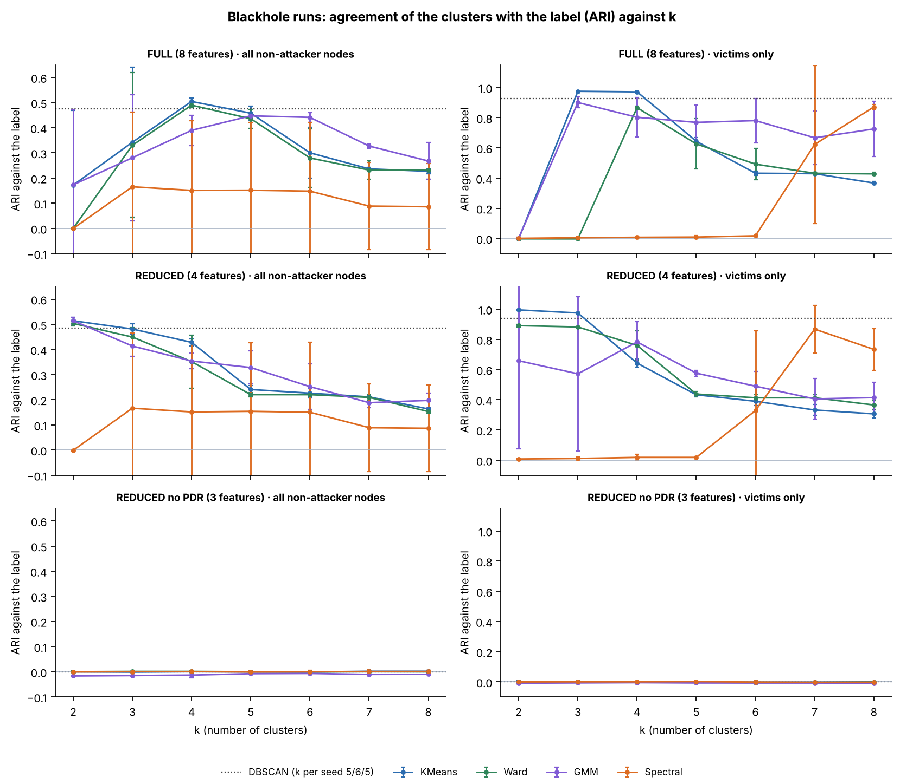

*Rows = feature sets (FULL, REDUCED, without PDR); left = all non-attacker nodes, right = victims only; each line = one algorithm with ±1 SD bars over seeds; dotted = DBSCAN. Look at the bottom row: flat at 0 for every algorithm and every k. That flat row is the whole argument that PDR carries the separation.*

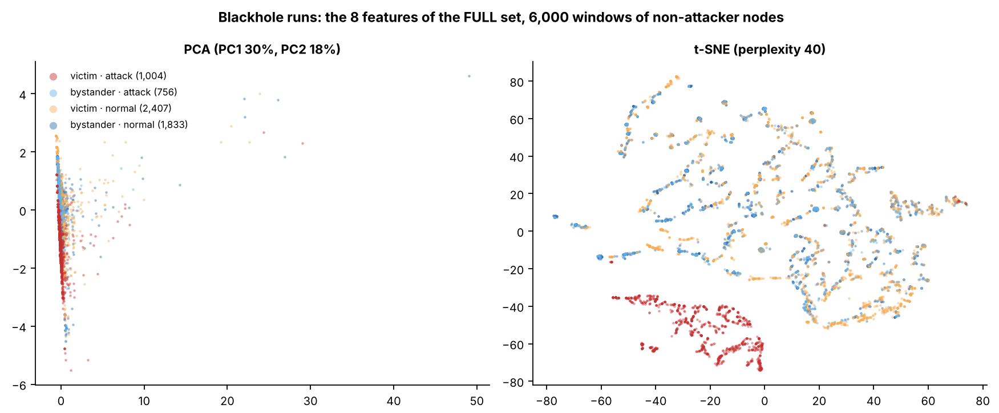

*Each dot = one window (6,000 sampled). Red = victim attack windows. In the t-SNE (right) the red windows form their own island at the bottom; the light-blue bystander attack windows sit among the normal ones. PCA (left) is squashed into a column because a few extreme RSSI-variance windows dominate the first component.*

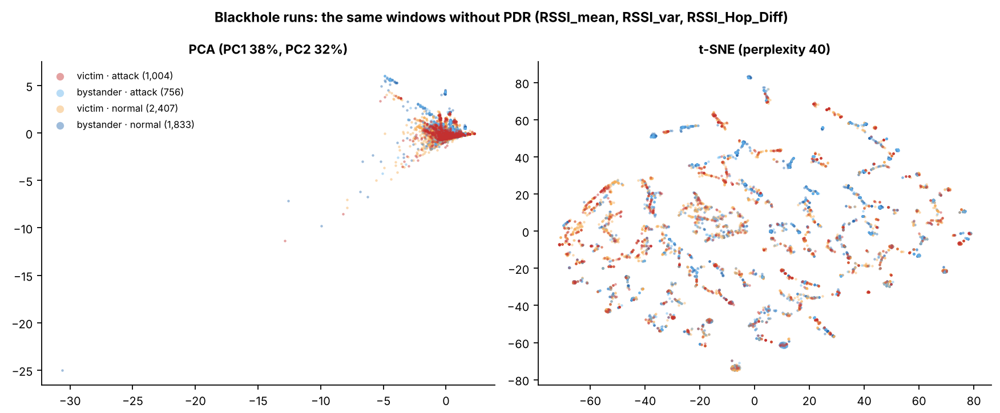

*Same plot with only the three RSSI features. All four colours sit on top of each other: without PDR there is no structure to find.*

> [!note] How to read PCA and t-SNE
> - **PCA** rotates the data so the first axis holds the most variance (here PC1 30%, PC2 18%). Axes are in standardised feature units.
> - **t-SNE** places windows with similar features near each other. Its **axes have no units**; only **nearness** means anything. Never read distances between far islands.
> - A "group" in a picture is not a cluster. A cluster is the output of an algorithm.

Other clustering figures in `images/`: Figure 6.17 (DBSCAN k-distance knees: eps 0.79, 0.73, 0.56), 6.19 (silhouette vs k), 6.20 (Davies-Bouldin vs k), 6.21 (cluster composition at k = 3: with PDR one cluster is entirely red).

### 7.9 Wormhole clustering (6.4.6, Table 6.28)

- **Non-attacker boards, all feature sets:** ARI -0.012 to 0.003 for every algorithm and k. Expected: the wormhole does not touch them.
- **The two ends with only the cross-layer RSSI features** (and LatencyHopRatio on B): ARI -0.012 to 0.009. **No separation.**
- **Diagnostic: add TunnelIntensity** (excluded from model inputs by the leakage guard, used only to ask "is there any tunnel signal a clusterer can find?"):
  - K-Means k = 2 on B: ARI **0.000**, because it splits by **signal level** (mean RSSI -67.6 vs -47.1 dBm, which varies between runs), not by tunnel activity.
  - K-Means k = 3: a third cluster of 540 windows, all wormhole, mean TunnelIntensity 4.04 (the highload runs); ARI 0.141.
  - **DBSCAN on B: ARI 0.827** (9 to 12 nearly pure clusters).
- Conclusion: a tunnel signal **exists** in the data, but it is carried by the attackers' **own counters**, not by the cross-layer features.

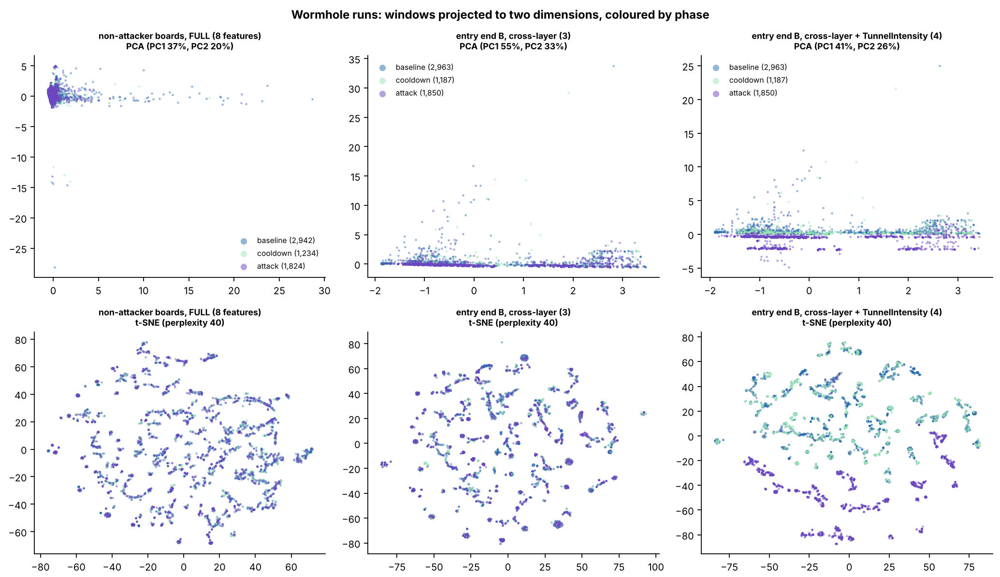

*Purple = attack. Left two columns (non-attacker boards; end B with cross-layer features): phases overlap completely. Right column (end B with TunnelIntensity added): the attack windows split off, because TunnelIntensity is exactly 0 in every normal window.*

### 7.10 Pooled: all 80 runs, three labels (6.4.7)

- Non-attacker boards of all 80 runs, **257,258 windows**, labels: normal 0, blackhole 1, wormhole 2.

| Group | Label | Windows |
|---|---|---|
| normal, benign run | 0 | 22,481 |
| normal, blackhole run | 0 | 89,140 |
| normal, wormhole run | 0 | 75,211 |
| blackhole attack, victim | 1 | 21,733 |
| blackhole attack, bystander | 1 | 16,499 |
| wormhole attack, other board | 2 | 32,194 |

- **Ceiling:** victim attack windows vs. everything else = **0.334** (80 runs) and **0.317** (72 attack runs), as the paper reports them. (Our own recomputation, not in the paper: these are the values on the 6,000-window samples; on all windows the same partition gives about 0.337 and 0.323, and the small difference is sampling.)
- **K-Means k = 2, REDUCED: 0.333 (80 runs) and 0.315 (72 runs)**, equal to the ceiling. It finds the blackhole victims and **nothing else**.
- Without PDR: -0.023 to 0.005. Nothing.
- **Used as a detector** (one model fitted on 6,000 windows, applied to all, Table 6.32):

| Group | In the "victim" cluster |
|---|---|
| Victim attack windows | **21,733 of 21,733 (100%)** |
| Benign windows | **0 of 22,481** (no false alarm) |
| Normal windows of blackhole runs | 183 of 89,140 (0.21%) |
| Wormhole attack windows | 3 of 32,194 (0.01%) |
| Bystander attack windows | 0 |

- The benign runs raise **no alarm**, and the **wormhole is not detected at all** by the non-attacker features. Adding or removing the benign runs changes K-Means' ARI by only 0.017.

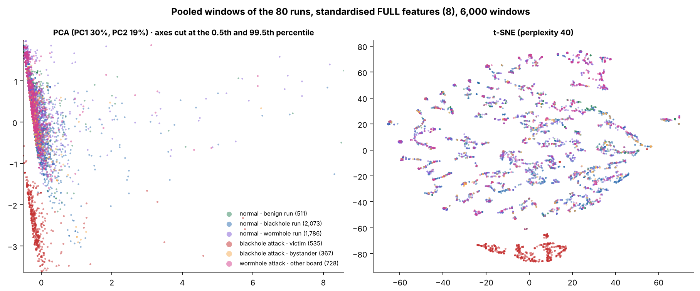

*Six colours = six groups of the table above. Only red (victim attack windows) stands apart; the other five overlap, including pink (wormhole attack).*

### 7.11 Discussion (6.5)

**What each kind of run leaves in the data (Table 6.33)**

| Kind | Direct record | Cross-layer features that change | Clustering |
|---|---|---|---|
| Blackhole | Attacker FR 1.000-1.004 -> 0.000-0.007; victim PDR 0.998 -> 0.000 | **PDR of victims only** (d = -29.7); all others \|d\| < 0.1 | 0.514 (ceiling 0.515); 0.996 victims; ~0 without PDR |
| Wormhole | B's probes reach the root twice (99.86%); TunnelIntensity 0 -> 1.92 | **None** (\|d\| ≤ 0.07; hop and parent unchanged) | ~0 without a tunnel feature; DBSCAN 0.827 on B with TunnelIntensity |
| Benign | 0 of 21 signature checks passed; PDR 0.9994 to 1.0000 | Cooldown within 0.5 SD of baseline in 24 of 24 | 0 of 22,481 in the victim cluster |

- **Main reading:** Chapter 4 expected a "confluence of cross-layer evidence". The data show the evidence sits in the **data plane**: delivery (blackhole) and duplication (wormhole). The PHY, MAC and network features stay where they were.
- **Honest qualifier the paper makes itself:** PDR is also what the verifier uses to confirm the blackhole, so the clustering's agreement shows it finds the effect the verifier measured. It is **not independent evidence** that cross-layer features detect the blackhole.

**Comparison with published studies (Table 6.34)**

| Feature | This study | Published | Reading |
|---|---|---|---|
| Baseline PDR | 0.998 (victims), 0.996 (bystanders), 0.9994 to 1.0000 (benign) | > 0.97, Khan et al. [22], same ESP32 platform | Agree in size; counting differs, so not claimed equal |
| PDR under blackhole | 0.000 | 25% to 40% delivery (60% to 75% loss), Airehrour et al. [70], RPL | Same direction; bigger here because our attacker sits on the victims' path by placement |
| Parent changes under blackhole | 0.00000 -> 0.00009 per s | 16 to 246 rank changes [70] | Differs: their attack acts on routing; ours does not (D-20) |
| Wormhole hop count | Constant | 4 hops -> 3 hops, Zhukabayeva et al. [71], ZigBee | Their tunnel is a route ZigBee adopts; ours is an app relay |
| Wormhole delay | Spread of 3.9 ms; LatencyHopRatio of B unchanged | 80-100 ms -> 120-200 ms (about +40%) [71] | Different measure |
| Duplicate arrivals | 99.86% of B's probes, 0 in baseline | Duplicated routing packets proposed as a signature, Ramírez Gómez et al. [72] | Same kind of evidence, different layer |

**What an emulation can and cannot show (6.5.3), three consequences:**

1. Results describe what **this kind** of attack does to traffic and features, not what a routing-protocol attack would do.
2. A detector tested on these blackhole windows is tested on **delivery loss**; on these wormhole windows, on **duplication**. Both are visible at the root without cross-layer features.
3. Whether cross-layer features add anything is **open**; it needs a dataset of attacks that act on routing.

**Limits (6.5.4):**

- One run per cell (no repeats); baseline RSSI_mean differs by 8.1 dB (blackhole) and 7.1 dB (wormhole) on average between captures of the same cell.
- Windows are not independent: the real sample size is closer to **80 runs** than to 456,195 windows.
- Partial mesh behaved as a plain tree (2-children limit), no adaptive parent switching.
- Tree fan-out differs between runs (root 2 to 5 children).
- The phase label marks bystanders as attack: ceilings 0.515 (blackhole) and 0.334 / 0.317 (pooled).
- Only 8 benign runs (54 child boards): they show no false alarm, but **cannot give a false-alarm rate**.
- No routing-table logging, no MAC retry count, sniffer on only 7 runs.
- Results are for 8 ESP32 boards at three indoor sites, not larger meshes.

### Check-in (Part 7)

- **Q:** Without PDR, every algorithm scores ARI ≈ 0 on the blackhole. Does that mean the cross-layer features are useless for detection? Answer the way the paper does.
- **Your answer:** *(pending)*

> [!question]- Answer (click to reveal)
> No, it means they are not affected by **these emulated** attacks. Both attacks act on the application-layer probes and leave the radio and the routing unchanged (D-20), so there is nothing for RSSI or topology features to detect. Whether cross-layer features help against attacks that **do** manipulate routing remains open and needs a different dataset (Section 6.5.3, and Recommendation 1 in Chapter 7).
>
> 📖 **Review it:** Sections 6.5.1 and 6.5.3

- **Q2:** K-Means scored ARI 0.514 on the blackhole data. Did K-Means use the attack label to find its groups? If not, why does the ARI need the label at all?
- **Your answer:** *(pending)*

> [!question]- Answer (click to reveal)
> No. K-Means only sees the features, so it is unsupervised. The label is used afterwards, as the answer key: a cluster is an unnamed group, and ARI compares the finished groups with the label (corrected for chance) to see whether they line up with normal vs. attack. Because the comparison happens after the algorithm has finished, it cannot influence the groups.
>
> 📖 **Review it:** Part 7.1a and Sections 3.5.6, 4.3.2 and 6.4.1

---

## Part 8: Chapter 7, Conclusion

### 8.1 Summary of the study (7.1, 7.2)

- 8 ESP32 boards (1 root, 7 children), normal operation plus two attacks emulated at the application layer, 4 topologies, 3 sites, 3 scenarios.
- **80 runs** (36 blackhole, 36 wormhole, 8 benign); each with 300 s baseline, 180 s attack (where applicable), 120 s cooldown.
- **456,195** windows generated, **369,678** analysed (266,491 normal, 103,187 attack); 16 features; 5 clustering algorithms.
- Quality: 1,372 windows (0.30%) dropped; no run lost more than 1%; 637 files, none empty; one board (B768, a bystander) with no data.

### 8.2 Evidence that the dataset is valid (7.3)

- **All 72 attack runs passed** the verifier (67 complete, 5 minor gaps); all 8 benign runs confirmed benign.
- **Blackhole:** ForwardingRatio 1.000-1.004 -> 0.000-0.007; PDR 0.998 -> 0.000; 121 of 123 victims cut off in the first second, the other 2 in the next; recovery within 3 s (median 2 s); bystanders 1.000.
- **Wormhole:** exit end received 99% to 101% of tunnel messages; 12,448 of 12,465 probes (99.86%) arrived twice; duplicates in 6,468 of 6,469 attack windows (99.98%), none outside the attack; 1 to 5 hops skipped; hop counts unchanged.

### 8.3 Answers to the research objectives (7.4)

- **Objective 1, testbed: achieved** (qualifiers: emulated attacks; partial mesh = branched trees).
- **Objective 2, labelled cross-layer dataset: achieved** (qualifier: no MAC retry count, D-15).
- **Objective 3, separability: differs by attack.**
  - Blackhole: only victim PDR moved (0.998 -> 0.000). With PDR, K-Means ARI 0.514 vs best possible 0.515. Without PDR, -0.016 to 0.002.
  - Wormhole: cross-layer features ARI -0.012 to 0.009. Visible only through the ends' counters and duplicate arrivals.
  - Pooled 80 runs, 3 labels: 0.333 vs best 0.334.
- **The expected cross-layer evidence from Chapter 4 was not found**, because both attacks left the radio and routing unchanged. **The researchers consider this an important finding, not a failure.**

### 8.4 Main findings, contributions, limitations (7.5)

**Four findings**

1. Blackhole -> clear delivery loss among victims; PDR is the strongest indicator.
2. Wormhole -> duplicate arrivals at the root, consistently, only during the attack.
3. Other expected changes (retransmissions, parent changes, hop counts, signal-to-hop) were **not** observed.
4. Clustering depends heavily on the features used; removing the main attack feature collapses performance.

**Three contributions**

1. An ESP32 mesh **testbed** for normal behaviour and two attacks under varied conditions.
2. A **dataset** of 80 runs with topology, site, scenario, role and phase on every row.
3. A **verification process** that separates real attack effects from missing data or broken runs. Firmware and tools are in the project repository [79].

**Six limitations**

1. Application-layer attacks only.
2. Only 8 boards.
3. Only 8 benign runs (no reliable false-alarm rate).
4. No direct MAC retry measurement; sniffer on some runs only.
5. Not enough repeats per condition.
6. Strong results depend on features tied to the attack implementation.

### 8.5 Recommendations (7.6)

| Recommendation | What it means in practice |
|---|---|
| **Test attacks that directly affect routing** | A routing implementation that can be modified, or radio-level tools (forged management frames), to see if parent, hop, retry and RSSI features then react |
| **Collect more normal data** | More benign runs in every topology, site and scenario, with repeats, to estimate a false-alarm rate |
| **Improve network measurements** | Sniffer on every run; compare Tables 3.4 and 3.5 with what the testbed can actually measure |
| **Test more wormhole scenarios** | Tunnel other nodes' traffic, not only B's own probes; other layouts and traffic |
| **Improve the evaluation of detection models** | Hold out whole runs as test data; compare against simple baselines (PDR for blackhole, duplicates for wormhole); test with the main attack feature removed |

### 8.6 Final conclusion (7.7), the line to end on

- Both attacks produced clear, measurable changes; the blackhole through delivery, the wormhole through duplicate arrivals.
- Detection depended on those features; the other cross-layer features did not separate the attacks in this setup.
- Because the attacks were application-layer, the results are not proof for routing-level attacks.
- The study gives a validated testbed, a documented dataset and a verification process as a **starting point** for ESP32 mesh attack research.

### Check-in (Part 8)

- **Q:** Name the three contributions and the single most important limitation.
- **Your answer:** *(pending)*

> [!question]- Answer (click to reveal)
> - **Contributions:** (1) the ESP32 mesh testbed, (2) the 80-run labelled dataset, (3) the verification process that confirms every run.
> - **Most important limitation:** the attacks are emulated at the application layer (D-20), so they never change routing or the radio, which is why the cross-layer features did not respond.
>
> 📖 **Review it:** Section 7.5

---

## Part 9: The dataset itself: what is in it, why some cells are blank, and how to prove it is real

> [!note] Where this sits in the paper, and where the numbers come from
> - The paper covers the dataset in **4.2.3** (what each board records), **4.2.4** (windows and features), **4.2.3.7** (completeness), **6.1** (Tables 6.1 to 6.8) and **7.3** (evidence that the dataset is valid).
> - Numbers marked **(repository)** are not printed in the paper. They come from our own recount over all 80 runs, read straight from the files in `ESP32-Environment/datasets/`. Say "from our dataset files" if you use them, never "as in the paper".
> - The recount first rebuilt the feature tables of the 9 cells that are not stored on GitHub, then counted all 80. It reproduced Table 6.2 **to the exact window** (9.5, Layer 4). That match is itself one of the strongest answers in this part.

### 9.1 The dataset in one table: the five folders

Everything lives in `ESP32-Environment/datasets/`. The folder path **is** the run's label: `<attack>/<topology>/<location>/<scenario>/`, for example `blackhole/linear/G402/stationary/`. Benign runs sit under `baseline/`.

| Folder | What is inside | Who writes it | On GitHub? |
|---|---|---|---|
| `exports/` | The **raw** files exactly as they came off the boards: one `*_telem.csv` per board (10 samples a second), plus the root's `*_arrivals.csv` (one row per probe that reached the root). A `trimmed/` subfolder holds a copy cut to this run only | The boards (flash + microSD), copied off by the export or the SD import | Yes |
| `analysis/` | What the code built from the raw files: `windowed_dataset.csv` (one row per board per second), `feature_table.csv` (the 16 features + labels), a `*_legend.csv` that explains every column, `analysis_info.json` (which code version and which laptop made it), and `eda_output/` (statistics and plots) | `analyze.ps1` (preprocess, features, EDA) | Yes, except 9 feature tables (9.7) |
| `archive/` | Captures that were **replaced** or failed, kept with a `REPLACED.txt` or `README.md` that says why | `archive.ps1`, by hand | Yes |
| `PCAP/` | Sniffer captures (`.pcap` + a `.json` of loss counts) | The sniffer board via `tools/sniff.py` | No (too big) |
| `run_logs/` | The serial log of every run: the root's live dashboard, each board's flash and monitor output (744 `.log` files, repository) | The wizard / GUI while the run is going | Yes |

- **Size (repository):** 80 runs, **637 telemetry files**, none empty, **4,570,906 raw rows** (one row = one board, 0.1 s).
- **One file per board per run.** 637 = 78 runs x 8 boards + 1 run of 6 boards (benign star/Yuchengco/highload) + 1 run of 7 (blackhole tree/G402/highload, B768 has no file), as in Table 6.1.

### 9.2 Reading one raw row

**A child board's row** (`exports/blackhole/linear/G402/stationary/victim_NODE-704BCA25B768_..._telem.csv`):

```text
timestamp_us,node_id,role,layer,parent_mac,rssi_dbm,retry_count,tx_count,probes_count,phase_id,gt_label,recv_count,forward_count,drop_count
1718789580,NODE_704BCA25B768,child,5,B4:BF:E9:32:FE:91,-72,1,1068,1068,3,0,3291,3284,7
```

| Field | Value | Read it as |
|---|---|---|
| `timestamp_us` | 1718789580 | 1,718.8 s since **this board** booted (microseconds, from `esp_timer_get_time()`). Not a date, not shared with other boards |
| `node_id` | NODE_704BCA25B768 | The board's own Wi-Fi MAC, read from the chip's eFuse |
| `role` | child | What the firmware is (child, root, blackhole, wormhole_a, wormhole_b) |
| `layer` | 5 | Depth in the mesh tree, root = layer 1, so this board is **hop 4** (hop = layer - 1, D-11) |
| `parent_mac` | B4:BF:E9:32:FE:91 | The parent's **SoftAP** address = the parent's STA MAC **+ 1** (parent is B4:BF:E9:32:FE:90) |
| `rssi_dbm` | -72 | Signal strength of the link to the parent only (one link, not the whole path) |
| `retry_count` | 1 | Failed sends of its own probes **since boot** (application counter, not 802.11 retries, D-15) |
| `tx_count`, `probes_count` | 1068, 1068 | Its own probes sent **since boot** (on a child these two are equal) |
| `phase_id`, `gt_label` | 3, 0 | Phase 3 = cooldown, label 0 = normal |
| `recv_count`, `forward_count`, `drop_count` | 3291, 3284, 7 | Probes it received from the boards below to relay, passed on, and did not pass on, **since boot** |

**A root arrival row** (`..._arrivals.csv`): the last four fields matter.

```text
timestamp_us,node_id,role,layer,parent_mac,rssi_dbm,retry_count,tx_count,probes_received,phase_id,gt_label,src_mac,seq_num,latency_us
6467740,NODE_B0CBD8F33218,root,1,00:00:00:00:00:00,0,0,0,3,255,255,70:4B:CA:25:B7:68,411,-1051121843
```

- `src_mac` = who sent the probe, `seq_num` = the probe's number on that sender, `latency_us` = root's clock minus the sender's clock stamp.
- **Delivery is joined on `seq_num`, never on time** (D-2): "probe 411 of board B768 arrived" is a fact that needs no shared clock.

**Things in the raw files that look wrong but are correct**

| What you see | Why it is correct | How many (repository) |
|---|---|---|
| `phase_id` and `gt_label` = **255** at the start of every file | The board was logging before it heard the root's first phase broadcast. 255 = "no phase yet, no ground truth". Those rows become the unlabelled `pre_baseline` windows | 85,435 windows (Table 6.2) |
| Root rows: `layer` 1, `parent_mac` 00:00:00:00:00:00, `rssi_dbm` 0 | The root has no parent, so there is no uplink to measure | Every root row |
| `parent_mac` never equals any `node_id` | The parent column holds the parent's SoftAP address, which is its STA MAC + 1. Subtract 1 and it matches | Resolves to a board of the same run in **3,955,479 of 3,955,480** rows with a parent |
| `timestamp_us` starts at a few seconds, not at a date | Microseconds since that board's own boot | Every file |
| Counters only grow | They are running totals since boot. The analysis uses the **change per window** (delta), never the raw total | Every file |
| `latency_us` is **negative** in most arrival rows | Two unsynchronised clocks: the number is "true delay + the gap between two boot times", and the gap can have either sign. Only the **relative** delay is used (D-2) | 367,125 of 536,736 arrivals (68.4%) |
| A timestamp or counter suddenly drops back to a small number | The board **rebooted** (power or crash), so its clock and counters restarted. The windows that span it are flagged `*_reset_detected`. A reboot inside a window sets its delta to 0; a reboot between two windows counts from the new window's first reading. Either way the flagged delta is not trusted | 6 clock restarts and 10 counter resets in 637 files; 21 to 23 flagged windows |
| The same `seq_num` twice in a wormhole root file | That **is** the wormhole: one copy by the mesh, one by the tunnel | 12,448 in the attack phase, 5 in cooldown (in-flight copies), 0 in baseline; 0 in every blackhole and benign run |
| Extra "duplicates" if you count the raw file naively | Before a run the root already logs probes from idle boards (phase 255). The boards are then reset, so their `seq_num` restarts and collides with those idle rows. The code drops every phase-255 arrival first, so these never count | About 3,600 such rows (repository) |
| On wormhole end B, `retry_count` keeps rising | On B that counter holds **frames sent into the tunnel**, not failures (Part 3.2) | Every B file |
| A line with blanks in the middle of the node ID, such as `NODE_2805A          2D7B4` | A damaged line (part of it overwritten when the row was written or exported; cause not proven). The code drops it: it cannot fill a window, and none of these IDs reaches any feature table | **5 lines in 4.57 million** |
| Two naming styles: `victim_NODE-<MAC>_...` and `child_node7_...` / `root_root_...` | Different export paths named files differently during the campaign. The identity is the `node_id` **inside** the file, and every `NODE-<MAC>` file name matches the `node_id` inside it | 0 mismatches |
| A `trimmed/` folder next to the raw files | `trim_run.py` copies only this run's rows into it. The raw file is never edited | Raw files untouched |

### 9.3 Why some values are blank: the full explanation

> [!important] The one rule behind every blank
> **A blank means "there was nothing to measure". A zero means "we measured, and the answer was zero".** The code never writes 0 for a blank. Example: a window where a board sent no probe gets **no** PDR. Writing 0/0 = 0 would invent a fake blackhole (D-8).

There are **six reasons** a cell is blank. Every blank in the dataset falls under one of them.

| # | Reason | Features blank | Gap or result? |
|---|---|---|---|
| 1 | **Role gate: the feature does not exist on this kind of board** | Tunnel features on every board except the two tunnel ends. PDR on the root, the blackhole attacker and both tunnel ends (not scored on delivery). RSSI on the root (no parent) | By design |
| 2 | **Ratio of nothing: the denominator is 0** | ForwardingRatio and ConsistencyScore on a board that received nothing to relay (every leaf). RetryRate in a window with no send attempt. PDR in a window where the board sent no probe. TunnelLatency in a window with no duplicated probe | By design; a value would be invented |
| 3 | **The attack worked** | LatencyHopRatio of blackhole victims during the attack: no probe arrived, so there is no delay to measure | **A result** |
| 4 | **Not measured** | MacRetryRate and MacFramesHeard outside the 7 sniffer-covered blackhole runs | Honest gap (paper says so, 6.2.4) |
| 5 | **Placeholder removed** | `rssi_dbm` = 0 is the firmware's "no parent link" code. A real 0 dBm would be a physically impossible perfect signal, so it is blanked before averaging | By design |
| 6 | **No label** | `window_label` / `Label` is empty in `pre_baseline` windows (before the experiment) and `transition` windows (a phase changed inside the second) | By design; kept, never analysed |

**How big each blank is (Table 6.8 of the paper, all windows recorded, including the unlabelled ones)**

| Feature | Blackhole attacker | Blackhole non-attacker | Wormhole end A | Wormhole end B | Wormhole non-attacker | Benign child |
|---|---|---|---|---|---|---|
| ForwardingRatio | 94.4 | 36.3 | 50.9 | 24.8 | 48.7 | 39.1 |
| RetryRate | 70.4 | 96.3 | 26.1 | 87.7 | 98.8 | 98.5 |
| PDR | 0.0 | 94.8 | 0.0 | 0.0 | 97.3 | 97.5 |
| RSSI_mean | 98.6 | 99.1 | 99.7 | 99.8 | 98.8 | 99.4 |
| RSSI_Hop_Diff | 97.8 | 98.7 | 99.6 | 99.7 | 98.5 | 99.1 |
| LatencyHopRatio | 0.0 | 66.3 | 0.0 | 88.4 | 83.8 | 73.6 |
| TunnelIntensity, TunnelBytes | 0.0 | 0.0 | 100.0 | 100.0 | 0.0 | 0.0 |
| TunnelLatency | 0.0 | 0.0 | 0.0 | 26.6 | 0.0 | 0.0 |
| IngressEgressDelta, ParentSwitchRate, HopChangeCount, HopStabilityDuration, RSSI_var, RSSI_stability | 100 | 100 | 100 | 100 | 100 | 100 |

*(% of windows with a value. ConsistencyScore has the same coverage as ForwardingRatio.)*

**Each blank, explained in one or two lines**

- **ForwardingRatio 36.3% on blackhole non-attackers.** It needs something received to relay. Leaves (end nodes) never relay, so they never have it. In the repository, all 146,117 non-attacker windows with nothing received have no ForwardingRatio, and every window that received something has one.
- **ForwardingRatio 94.4% on the attacker, not 100%.** The attacker has nothing to relay in the seconds before its children join and when a child drops out.
- **ForwardingRatio 24.8% on end B and 50.9% on end A.** These ends sit where the topology puts them; in many layouts they have no child below them.
- **RetryRate 70.4% on the attacker and 26.1% on end A.** RetryRate = failures / (sends + failures). During the attack the attacker forwards nothing (0 sends), and end A only re-injects during the attack. No attempt, no ratio.
- **PDR 0.0% on the attacker, end A and end B.** They are not scored on delivery: the attacker is the cause, and B's probes arrive twice on purpose, so a PDR there would read above 1 (only 1 window in the whole dataset was clipped, repository).
- **PDR 94.8% to 97.5% on the scored boards.** The missing part is mostly before the experiment (no root logging yet) plus windows where the board sent no probe (1,389 such labelled windows, repository, all blank).
- **PDR is NOT blank for victims in the attack.** In the repository, 99.0% of victim attack windows have a PDR, and **every one of them is 0.000**. Delivery was measured and it was zero. That is the blackhole.
- **LatencyHopRatio 66.3% on blackhole non-attackers.** Delay needs a delivered probe. For victims in the attack, the repository shows **0.0%** with a value, against 98.7% in baseline and 99.3% in cooldown. The blank **is** the attack.
- **LatencyHopRatio 0.0% on the attacker and end A.** They originate no probes of their own that the root scores, so there is no delay to compute.
- **TunnelLatency 26.6% on end B.** It exists only in a window where one of B's probes arrived twice, which happens only in the attack (180 of about 680 s of a run). Repository: 100% of B's attack windows have it, 0% of baseline and cooldown.
- **RSSI_mean 98.6% to 99.8%.** The blanks are the `rssi_dbm = 0` placeholders: 39,002 of 4,005,742 child rows (0.97%, repository), almost all from before the board joined the mesh. In labelled windows of child boards, RSSI_mean is present in practically every window.
- **MacRetryRate.** Only 7 of 36 blackhole runs have a usable sniffer capture (Part 11.9). Blank = not measured, never "no retries".

> [!warning] Blanks give the label away: that is why the leakage guard exists
> "Is this column blank?" alone tells you the board's role, and sometimes the phase (a victim's blank LatencyHopRatio = attack). So `analysis/leakage.py` keeps those columns out of every model input and writes the reason for each one: ForwardingRatio, IngressEgressDelta, ConsistencyScore, RetryRate and the three tunnel features (Section 6.2.3). LatencyHopRatio is not on that list: the hand-written FULL list of the clustering (`cluster_final.py`) leaves it out, on the audit's evidence. Safe line: "The blanks are honest, and because they are honest they leak the label, so we did not let the clustering see them."

### 9.4 Why some rows, windows and boards are missing

| What is missing | Size | Why | What we did |
|---|---|---|---|
| Windows with fewer than 8 of 10 samples | 1,372 of 457,568 (0.30%); no run above 1% | Late or lost samples (logger timing, a reboot) | Discarded (D-9). Repository: of the 369,678 analysed windows, **368,978 (99.81%) have all 10 samples**, 499 have 9, 201 have 8 |
| Pre-baseline windows | 85,435 (18.7%) | Boards log from boot, before the experiment starts | Kept, unlabelled, not analysed |
| Transition windows | 1,082 (0.2%) | The phase changed inside that second, so its counters mix two phases | Kept, unlabelled, not analysed |
| Board B768 in blackhole tree/G402/highload | 1 board | Recorded nothing | It was a **bystander**, so the run keeps its evidence (D-32) |
| Benign star/Yuchengco/highload | 6 boards instead of 8 | As recorded in Table 6.1 | Analysed with 6 boards |
| Sniffer data | 73 of 80 runs | No sniffer on the run, or the capture could not be paired with its run (Part 11.9) | Left blank, never zero |
| Earlier captures of the same cell | 15 captures of 11 cells | Replaced by a newer capture | Moved to `archive/` with the reason; **only the newest capture of a cell is analysed** (Table 6.5) |
| Captures outside the plan | 12 (5 jitter, 7 at home) | Not part of the 80-run plan | Kept on disk, not counted (Table 6.6) |

- **"Only the newest capture" is a rule, not a choice.** We did not pick the best-looking attempt. That matters for the cherry-picking question (9.5, Layer 5).

### 9.5 How do you know this dataset is real? Six layers of evidence

Think of it like a court case: no single piece proves it alone, but each layer would have to be faked **separately and consistently** with all the others.

**Layer 1: The boards are real ESP32 hardware**

- Every `node_id` is the chip's Wi-Fi MAC, read from its **eFuse** (`esp_read_mac(..., ESP_MAC_WIFI_STA)`). The USB bridge cannot be the source: it is a serial device with no MAC (REVIEWER-QUESTIONS §2).
- All 8 board MACs fall in **6 address blocks registered to Espressif Inc.** in the IEEE registry: 20:50:0D, 28:05:A5, 70:4B:CA, B0:CB:D8, B4:BF:E9, F4:2D:C9 (repository; anyone can check them in the public [IEEE Registration Authority listing](https://regauth.standards.ieee.org/standards-ra-web/pub/view.html#registries)).
- The SoftAP = STA + 1 rule is an ESP32 hardware convention. It holds in 3,955,479 of 3,955,480 parent rows. Someone inventing data would have to know that rule and apply it in four million rows.
- The sniffer, which is a separate board, hears the mesh frames with Espressif's vendor tag (OUI 0x18FE34) on channel 11 (Part 11.10).

**Layer 2: Physical fingerprints that are very hard to fake**

- **Each board's clock has its own error, and it stays the same for weeks.** Every quartz crystal runs slightly fast or slow. Plotting the fastest delivery delay of each 30 s against the root's clock gives a slope: how many microseconds per second the two clocks pull apart (parts per million, ppm). Against root B0:CB:D8:F3:32:18 (repository):

| Board | Runs measured | Median drift (ppm) | Middle half of the runs (ppm) |
|---|---|---|---|
| B4:BF:E9:32:FE:90 | 77 | -39.1 | -40.7 to -37.5 |
| 20:50:0D:E7:1C:38 | 52 | -35.0 | -36.1 to -34.4 |
| 70:4B:CA:25:B7:68 | 77 | -15.8 | -16.4 to -14.7 |
| 28:05:A5:32:D7:B4 | 77 | -4.9 | -5.8 to -4.2 |
| B4:BF:E9:34:ED:80 | 77 | -4.7 | -6.1 to -3.6 |
| F4:2D:C9:73:E6:18 | 49 | -1.3 | -2.5 to 0.4 |
| 20:50:0D:E7:0C:80 | 59 | +5.8 | +4.4 to +6.9 |

- **How to say it:** "Every board has its own clock error, like a fingerprint. The same board shows the same error in every run, across different days and three different buildings, and no two boards share it. A simulator would have to give each board its own crystal error and keep it consistent across thousands of probes and 80 runs. Nobody fakes that by accident."
- Small spread inside one board (1 to 3 ppm) is expected: crystal frequency shifts a little with temperature.
- **Real scheduling jitter.** The median gap between samples is **100.0 ms** and 98.2% of gaps fall between 90 and 110 ms (repository). But not all: the logger sometimes writes a late sample right after another (gaps such as 258 ms then 1 ms, D-25). That is what a real-time OS on a busy chip does. Invented 10 Hz data is usually perfectly even.
- **Real radio values.** RSSI readings run from **-97 to -24 dBm**, median -71, in 71 different whole-number levels (repository). Captures of the same cell differ by 8.1 dB (blackhole) and 7.1 dB (wormhole) on average because the boards were set up again each time (Part 15, "Why is RSSI so different").
- **Real hardware scars.** Reboots (6 clock restarts, 10 counter resets), 5 damaged lines, one board with no file, a board that crashed (PANIC) 152 s into an attack and had its pieces stitched from the card (`archive/.../REPLACED.txt`), and brownouts on powerbanks. A made-up dataset is usually too clean. Ours carries the marks of cheap boards on batteries.

**Layer 3: Independent recorders agree with each other**

The same event is recorded by **different boards, with different clocks**, joined only on sequence numbers.

| Event | Recorder 1 | Recorder 2 | Recorder 3 |
|---|---|---|---|
| Blackhole drop | The attacker's own counters: ForwardingRatio 1.000 to 1.004 -> 0.000 to 0.007 | The **root's** arrival log: victims' PDR 0.998 -> 0.000 | The **neighbours'** counters (NeighbourForwardingRatio): built only from the children's and parent's counts, so an attacker that lies about its own forwarding cannot hide |
| Who was hit | The live run log prints, **before the attack starts**, which boards are below the attacker ("not in the attack path - above the attacker, will be UNAFFECTED") | The data afterwards: bystanders' PDR 1.000 in the attack, victims' 0.000 | — |
| Wormhole tunnel | End B's tunnel counter | End A's received count (99% to 101% of what B sent) | The root: 12,448 of 12,465 of B's attack probes arrived twice (99.86%) |
| The attack from the air | Board counters | The **sniffer**, which never transmits: the attacker's uplink falls, the victims' does not (7 runs, Part 11.7) | — |
| Phase labels | Each node's phase at its own send time | The root's phase at that moment (`analysis/phase_sync.py`; a node out of step fails `validate_integrity.py` and is unlabelled) | — |

- **How to say it:** "The root never sees the attacker's counters, and the attacker never sees the root's log. They are separate boards with separate clocks. They still tell the same story, second for second, joined only by probe numbers."

**Layer 4: Anyone can rebuild every number from the raw files**

- The raw files are **never edited**. Trimming writes a copy; analysis writes new files.
- The pipeline is written to give the same output for the same input, and every analysed cell carries `analysis_info.json` with the **code version** and the **laptop** that made it.
- **Our recount (repository):** the 9 feature tables missing from GitHub were rebuilt from the raw files and pooled with the 71 stored ones. The result matched the paper exactly:

| Quantity | Paper (Table 6.2, 4.2.3.7, 6.2.2) | Rebuilt from raw files |
|---|---|---|
| All windows | 456,195 | 456,195 |
| Baseline / attack / cooldown | 190,423 / 103,187 / 76,068 | 190,423 / 103,187 / 76,068 |
| Pre-baseline / transition | 85,435 / 1,082 | 85,435 / 1,082 |
| Analysed (normal + attack) | 369,678 (266,491 + 103,187) | 369,678 (266,491 + 103,187) |
| Telemetry files, empty files | 637, none | 637, 0 |
| B's probes that arrived twice in the attack | 12,448 | 12,448 |

- **How to say it:** "You don't have to trust our tables. Take the raw CSVs, run the same code, and you get the same 456,195 windows. We did exactly that."

**Layer 5: The process left an audit trail, including the failures**

- **Git history:** 167 commits that add or change data, by three team members on three laptops (repository). Data arrived run by run during the campaign, not in one drop at the end.
- **Verification log:** `docs/dataset-verification.md` holds 68 dated verification blocks (numbered up to #87). The rule is that past blocks are never edited, only new ones added on top.
- **Failures are kept, with reasons:** 17 `REPLACED.txt` notes in the archives say what was wrong with each replaced capture (crash, reversed tunnel ends, two runs in one file). Failed runs were never labelled as data.
- **Every change is a deviation:** D-1 to D-37 in Chapter 5 and Appendix C record what changed from the plan and why.
- **Rules before results:** the predictions in Tables 3.4 and 3.5 were written before data collection; the verifier's thresholds come from the cited studies; a placebo test gave 0 false confirmations in 106 tries, and moving every threshold by ±50% changed no verdict (Part 4, Part 15).
- **No cherry-picking:** the newest capture of each cell is analysed, by rule. The sniffer pairing tool refused 32 of 44 captures on rules written beforehand (Part 11.9).

**Layer 6: The results behave like reality, not like a wish**

- **Predictions failed, and we reported them.** Victims' retries did not rise, hop counts did not change under the wormhole, and RSSI_Hop_Diff did not react (Section 6.2.4). If the data had been made up, the cross-layer features would have "worked", because that was the thesis' hope.
- **The attack hit exactly the boards physics says it should.** Victims behind the attacker lost delivery; bystanders above it did not (PDR 1.000 in the attack vs 0.996 in baseline).
- **Small imperfections a designer would not add:** 2 of 123 victims dropped one second late; 1 of 6,469 wormhole attack windows had no duplicate; partial-mesh runs behaved as branched trees; 5 of 72 attack runs have minor data gaps (7.3).

### 9.6 Panel questions on the dataset

- **"How do we know you didn't edit the CSVs?"**
  - The raw files are kept untouched next to the trimmed copies, they are in Git with their history, and the same code rebuilds the paper's tables from them to the exact window.
  - Then Layer 2: each board's clock error is the same in every run. Editing values by hand would break that pattern, and the parent addresses (STA + 1) and sequence numbers would stop matching.
- **"Why are there so many blank cells? Isn't that bad data?"**
  - Every blank has one of six causes (9.3), and none of them is a logging failure. Most are "this board cannot have this value" (a leaf cannot forward) or "nothing to divide by". The one that looks largest, LatencyHopRatio during the attack, is the blackhole itself: no probe arrived, so there is no delay.
- **"If nothing arrived, why is PDR 0 and not blank?"**
  - Because the board did send. PDR = arrived / sent = 0 / 4 = 0. It is blank only when the board sent nothing (0 / 0), and we never write that as 0.
- **"Your latency values are negative. Is the data broken?"**
  - No. The boards have no shared clock, so the raw value is the true delay plus the gap between two boot times. We only use the delay relative to each board's fastest delivery, which cancels that gap (D-2). TunnelLatency compares two copies of one probe on the same two clocks, so there the gap cancels exactly (D-3).
- **"Why does the root show RSSI 0 and parent 00:00:00:00:00:00?"**
  - The root has no parent, so there is no uplink signal to read. The code treats 0 dBm as "no link", not as a reading.
- **"Why does the parent address never match any board?"**
  - On the ESP32, the access-point address is the station address + 1. Subtract 1 and it matches a board of the same run in all but one of 3.96 million rows.
- **"Could this have come from a simulator?"**
  - A simulator would have to reproduce Espressif's registered MAC blocks, the STA + 1 rule, each board's own stable clock error, real-time scheduling jitter, reboots and damaged lines, and the sniffer's independent radio capture. And our results include the failed predictions a simulation built to prove the thesis would not produce.
- **"Did you throw away runs that didn't work?"**
  - Replaced runs are in `archive/` with the reason, and the rule was always "newest capture of the cell", not "best capture". Off-plan captures are kept and listed (Table 6.6). 5 attack runs with minor gaps are in the dataset and reported (7.3).
- **"Why are 18.7% of the windows not analysed?"**
  - They are the minutes before the experiment started (boards log from power-on). They have no label, so putting them in either group would be guessing.
- **"When exactly was each run captured? The boards have no clock."**
  - True: the boards only count time since boot, and they run on powerbanks, so no clock survives. The run's time comes from outside the boards: the export time in each file name (laptop clock), the saved run log, and the Git commit that added it.
- **"Your CSV has columns that are not in the paper (NeighbourIn, NeighbourOut, exposure, _pdr_clipped, missing_firmware_fields)."**
  - They are helper columns. NeighbourForwardingRatio is the support check that rebuilds the attacker's forwarding from its neighbours' counters. `exposure` is the victim / bystander / attacker tag derived from the tree, kept as metadata and never a model input. The other two are diagnostic flags.
- **"Why do some windows have 8 or 9 samples, not 10?"**
  - A sample was late or lost. The rule allows up to 2 missing (D-9) and fills them (RSSI interpolated, counters carried forward). Only 700 of 369,678 analysed windows are not complete.
- **"Show me the raw data of one run."** See 9.8.

### 9.7 Weak spots about the dataset (say them before the panel does)

| Where | What a panelist could notice | What to say |
|---|---|---|
| Table 6.8 vs other percentages | Table 6.8 counts **all** windows, including pre-baseline; percentages over analysed windows are higher | "Table 6.8 counts every window recorded, so it includes the minutes before the experiment. Over the analysed windows the coverage is higher." Never mix the two |
| `feature_table_legend.csv` | The `exposure` row says "Unknown (no legend entry)" | It is the victim / bystander tag from the topology (`analysis/exposure.py`); the legend file simply lacks its line |
| `feature_table_legend.csv` | ForwardingRatio note says "only defined on the blackhole attacker; empty elsewhere" | Out of date since D-12: honest relays count their forwarding too, which is why Table 6.8 shows 36.3% on non-attackers |
| `docs/panel-answers/REVIEWER-QUESTIONS.md` §9 | Its NaN table (89.8% blank ForwardingRatio, "attacker only") is from one early capture, before D-12 | Do not quote it; use Table 6.8 |
| Console output of the analysis | Prints "Windows discarded (<4 smp)" | Only the printed label is old; the code's rule is 8 of 10 (`MIN_VALID_SAMPLES = 8` in `preprocess.py`) |
| GitHub | 9 cells have no `feature_table.csv` on GitHub (6 tree wormhole cells and 3 benign cells) | They are rebuilt from the raw files with `analyze.ps1`, and the rebuild matches the paper exactly (9.5, Layer 4). Rebuild them on the presenting laptop before the defense if a panelist may ask to open one |
| `PCAP/` | Not on GitHub | Copy the 7 blackhole sniffer captures to the presenting laptop beforehand (Part 11.10) |
| `RetryRate` | Called a retry rate | It is application send failures, not 802.11 retransmissions (D-15). Not used in any model |

### 9.8 If a panelist says "show me the data" (live demo script)

1. Open `datasets/exports/blackhole/linear/G402/stationary/`. Show one file per board, named by its MAC, plus the root's arrivals file.
2. Open a victim's `*_telem.csv` in Excel. Show the header, the `255` rows at the top (before the experiment), then scroll to phase 0. Point at `parent_mac` (STA + 1) and the counters that only grow.
3. Open the matching `analysis/.../feature_table_legend.csv`. Every column has its meaning, unit and notes.
4. Open `feature_table.csv`, filter `node_role` = blackhole: ForwardingRatio near 1 in baseline, near 0 in attack.
5. Show the topology straight from the data: `run_wizard.ps1` -> **VERIFY** -> *Show TOPOLOGY STRUCTURE of a captured run*. It prints each board's hop, MAC, role and parent from the CSVs (REVIEWER-QUESTIONS §6).
6. Open the run's log in `datasets/run_logs/`: the live dashboard with the board list and the exposure lines printed before the attack.
7. Optional: open a sniffer capture (Part 11.10).

### Check-in (Part 9)

- **Q:** A panelist opens a blackhole victim's feature table and says: "During the attack, your LatencyHopRatio column is empty but your PDR column is full of zeros. Pick one. Either nothing was measured or zero was measured." Answer in three sentences.
- **Your answer:** *(pending)*

> [!question]- Answer (click to reveal)
> Both are right, because they measure different things. PDR divides what arrived by what the board sent: the victim kept sending (4 probes a second in highload) and none arrived, so PDR = 0 / 4 = 0, a real measurement of zero. LatencyHopRatio needs a probe that arrived to time it, and none did, so there is nothing to measure and the cell stays blank; the blank is the blackhole, which is also why the leakage guard keeps LatencyHopRatio out of the clustering.
>
> 📖 **Review it:** Part 9.3 of this guide; paper Table 6.8, Section 6.2.3 and D-8

---

## Part 10: Preprocessing, explained step by step for the panel

> [!note] Where this sits in the paper
> - **4.2.4** (preprocessing and feature extraction, Equations 4.1 to 4.18), **D-1, D-2, D-8, D-9, D-25** (Chapter 5), **6.1** (Table 6.2, the window counts), **6.2.3** (the leakage guard) and **6.4.1** (clustering setup, Table 6.24).
> - 3.1 has the list to say out loud and 3.1a every step with a worked example. This part is the panel version, so you can answer "why" for every step: each step with its reason, then how the features are computed (Stage B) and prepared for clustering (Stage C). Its Stage A steps follow 3.1a, except that Step 6 here is the labels; the join on the sequence number (3.1a, Step 6) is item 1 of Stage B. Every step was checked against the code: `analysis/preprocess.py` (Stage A), `analysis/features.py` (Stage B), `analysis/leakage.py` and `docs/thesis-figures/cluster_final.py` (Stage C).

### 10.1 The one-sentence version

> [!tip] Say it like this
> "We turned each board's raw log of 10 samples a second into one row per board per second, cleaned the small gaps, turned the counters into per-second changes, computed 16 features, and before clustering we removed every feature that would leak the answer and standardised the rest."

| Stage | Input → output | Code |
|---|---|---|
| A. Preprocessing (4.2.4) | Raw CSVs → clean 1-second windows | `preprocess.py` |
| B. Feature computation | Windows → 16 features per window | `features.py` |
| C. Preparing for clustering (6.4) | 16 features → 8 → 4, standardised | `leakage.py`, `cluster_final.py` |

### 10.2 Before Stage A: what comes off the boards

- **Each child board** writes one `*_telem.csv`: 10 samples a second with RSSI, the counters, layer, parent, phase and label.
- **The root** writes `*_arrivals.csv`: one row per probe that reached it.
- **Raw files are never edited.** `trim_run.py` copies only this run's rows into a `trimmed/` folder; analysis writes new files.
- **RSSI = 0 is "missing", not a reading.** The firmware leaves 0 when the board has no parent link (and on every root row), so the code treats it as a blank.
  - 39,002 of 4,005,742 child rows (0.97%), almost all from before the board joined the mesh (Part 9.3).

### 10.3 Stage A: raw rows → one-second windows

#### Stage A, Step 1. Align time, each board to its own anchor

- **What:** each board's timeline is anchored to **its own first exit from phase 0**. The 300 s before that anchor is the baseline.
- **Why:** the boards share no clock. Each counts from its own boot, and on powerbanks a reboot resets it. The phase change the root broadcasts is the one event every board sees.
- **Side effect:** everything before the last 300 s of phase 0 gets no label: the formation rows (phase 255, which is most of them), boards switched on early, and in older firmware the root's settle time. These windows **before the baseline** (85,435, 18.7%) are never analysed. The second in which a phase changes is a **transition** window and is also left out (1,082).

#### Stage A, Step 2. Put the samples on a 10 Hz grid (D-25)

- **What:** each sample takes the **earliest free 0.1 s tick**, at most 300 ms late, never early.
- **Why:** the logger sometimes writes late samples back to back (gaps like 258 ms, 1 ms, 41 ms). The old "nearest tick" rule put two samples on one tick, left a false hole next to it, and threw away healthy windows.

#### Stage A, Step 3. Cut into one-second windows (D-9)

- **What:** non-overlapping 1 s windows. A window needs **at least 8 of its 10 samples**, otherwise it is discarded.
- **Why 8 of 10:** it keeps the planned 80% completeness rule (the plan had 4 of 5).
- **Why 1 s and not 5 s (D-1, D-9):**
  - With 5 samples per window, one lost sample costs 20% of the window.
  - The panel asked for about 10,000 rows per run; a clean baseline went from 577 to 2,894 rows.

#### Stage A, Step 4. Fill only the tiny gaps

- **RSSI:** linear interpolation for gaps of **1 to 2 samples** (at most 0.2 s), only between two real readings. (The code fills the board's whole grid before cutting it into windows, but a filled value never counts toward the 8 of 10.)
- **Counters:** forward-filled (no new sample = counter assumed unchanged).
- **Longer gaps:** stay blank, so the window fails the 8-of-10 rule and is dropped.
- **Why so strict:** 0.2 s is the most "made-up" data any window can hold. We fill a blip, never a real outage.

#### Stage A, Step 5. Counters → per-window changes (Equation 4.1)

- **What:** the counters only grow, so each window uses (value at the end) − (value at the start): Δreceived, Δforwarded, Δretry and so on.
- **Why:** a running total says how long the board has been on; the change says what happened in that second.

#### Stage A, Step 6. Labels

- **What:** baseline and cooldown = **0 (normal)**, blackhole attack = **1**, wormhole attack = **2**.
- **Phase boundaries:** a window that straddles a phase change gets no label (1,082 windows, 0.2%) and is left out.
- **Every board of the run gets the run's label**, including bystanders the attack never touched. Honest, but it caps the clustering scores later (Part 6.1).

#### Result of Stage A

- **One row = one board × one second** (the node-window).
- 457,568 windows formed, **1,372 discarded (0.30%)**; no run lost more than 1%; mean samples per window at least 9.97 in every run.
- **Analysed: 369,678 windows** (266,491 normal + 103,187 attack, Table 6.2).
- **Why per board, not per network:** in a blackhole the attacker's forwarding falls while the boards behind it lose delivery. A network average would blur both.

### 10.4 Stage B: the three features that need special handling

1. **PDR joins on the sequence number, never on time.**
   - Each probe a board sent is matched to the root's arrival log by `seq_num`.
   - Why: the boards' clocks differ by minutes, so a time join would pair the wrong probes.
   - A window gets a PDR (even 0) only if the board **sent** in it, was **attached** to the mesh, and the root was **logging** (D-8).
2. **LatencyHopRatio uses relative delay (D-2).**
   - Raw delay = true delay + a large unknown clock offset (once −194 s).
   - Subtracting the sender's **fastest** delay in the run cancels the offset.
   - So only the **shape** can be compared, not absolute milliseconds across boards or runs.
3. **RSSI_Hop_Diff compares with the run's own baseline.**
   - The expected RSSI is the median of the run's normal windows (baseline and cooldown) at that board's layer, so it adapts to each room.

> [!warning] Blanks stay blank, never 0
> A blank means "could not be measured": a leaf relays nothing, so it has no ForwardingRatio. A victim's PDR in a blackhole is **measured and equals 0.000**. That 0 is the attack, not a blank (Part 9.3).

### 10.5 Stage C: preparing the features for clustering

#### C1. Which windows go in

- **Child boards only** (no root, attacker or wormhole ends), with a label, not straddling a phase change.
- **Two populations:** all non-attacker boards (127,372 windows) and victims only (72,687).
- **Why no attackers:** the attacker's own counters **are** the attack. Clustering them would only rediscover the switch we turned on.

#### C2. The leakage guard (Arp et al. [80]): 16 features → 8

`leakage.py` holds the list of columns that may never be model inputs, with the reason for each. LatencyHopRatio, the last row, is kept out by the FULL list in `cluster_final.py` instead:

| Excluded | Why |
|---|---|
| ForwardingRatio, IngressEgressDelta, ConsistencyScore | Relay counters; whether they are filled or blank reveals the board's role |
| RetryRate | An application counter, and on wormhole end B it counts tunnel frames, so it records the attack itself |
| TunnelIntensity, TunnelBytes, TunnelLatency | Exist only on the ends, so their presence reveals the run type |
| LatencyHopRatio | Not on `leakage.py`'s list. Its **blanks alone** predict the label in 86% of windows (no delivered probe = no delay = attack), so the FULL list leaves it out (Section 6.5, Exhibit B) |

> [!tip] Say it like this
> "The blanks are honest, and because they are honest they leak the label, so we did not let the clustering see them."

#### C3. Low-variance and correlation filters: FULL 8 → REDUCED 4

- **Low-variance filter:** drop a feature if more than 90% of windows share one value. It removed:
  - ParentSwitchRate (100% one value)
  - HopChangeCount (100%)
  - HopStabilityDuration (99.8%)
  - RSSI_stability (98.5%)
- **Correlation filter:** drop a feature if |r| > 0.85 with another. It removed nothing (largest |r| = 0.11).
- **REDUCED = PDR, RSSI_mean, RSSI_var, RSSI_Hop_Diff.**
- **Control set without PDR** (3 features): does anything other than PDR separate the attack?

#### C4. Missing values in clustering

- A window with a blank in any chosen feature is **dropped, not filled**. Clustering needs a complete table, and filling would invent behaviour.
- This is safe because the leakage guard already removed the columns whose blanks follow the label.

#### C5. Sampling and standardising

- **Sampling:** for each of three seeds (**42, 7, 123**), a fresh random sample of **6,000 windows**; results are means over the seeds.
- **Standardising (z-score):** each feature becomes (value − mean) / SD, fitted on that sample.
  - Why: RSSI is in dBm (about −40 to −90), PDR is 0 to 1, RSSI_var is in dBm². Without scaling, the feature with the biggest units would decide every distance.
- **Sources:** Aggarwal [36] and Han et al. [37] for standardising and checking correlation before clustering (Part 13).

### 10.6 Panel questions on preprocessing

| Question | Answer |
|---|---|
| "Why not synchronise the clocks?" | "The boards run on powerbanks and reboot, so no clock survives, and an isolated mesh has no internet time. We anchor each board to the phase change it hears from the root, and join delivery by sequence number." |
| "Isn't interpolation making up data?" | "At most 0.2 seconds, only for RSSI, and only inside a window that already has 8 of 10 real samples. Anything longer stays blank and the window is dropped." |
| "How much data did you throw away?" | "0.30% of windows in cleaning, and no run lost more than 1%." |
| "Why one-second windows?" | "At 10 samples a second a 1 s window holds 10 samples, keeps the 80% rule, and gives about ten thousand rows per run. With 5 s windows of 5 samples, one lost sample cost 20%." |
| "Why drop ForwardingRatio if it's your best blackhole feature?" | "Because it is measured at the attacker, it is the attack. Clustering on it proves nothing. We report it as the attack check, not as a model input." |
| "Why drop rows instead of imputing?" | "The blanks have causes: no relay, no delivered probe. Filling them would invent behaviour, and the columns whose blanks follow the label were already removed." |
| "Why standardise?" | "The features have different units: dBm, ratios, dBm². Without it, RSSI would dominate every distance." |
| "Why only 6,000 windows?" | "Three different random samples of 6,000, averaged, so the result does not hang on one draw." *(The paper gives the sample size only. If pushed on why not all 127,372: spectral clustering and the silhouette score compare every pair of windows, so their cost grows with the square of the sample. That reason is ours, not a sentence in the paper.)* |
| "Can RSSI_Hop_Diff be negative?" | "No, in the dataset it is an absolute difference." (The paper's text says "observed minus baseline median"; `features.py` takes the absolute value, Part 3.2.) |

### 10.7 If someone opens the code

- **The header comment of `preprocess.py` is out of date.** It still says "1 Hz samples", "5-second windows" and "4 of 5". The settings a few lines below are what run: 10 Hz grid, 1 s windows, 8 of 10. Say: "The header predates D-9; the settings below it are what run."
- **The PCA and t-SNE plots clip values at ±5 SD** so that a few parent-switch windows cannot take over an axis. **The clustering itself does not clip.** Do not mix the two up.
- **IngressEgressDelta** has the same absolute-value gap between paper and code as RSSI_Hop_Diff (Part 3.2).

### Check-in (Part 10)

- **Q:** A panelist says: "You dropped windows, interpolated values and removed half your features. How do we know you didn't shape the data to get your result?" Answer in three or four sentences.
- **Your answer:** *(pending)*

> [!question]- Answer (click to reveal)
> The cleaning removed only 0.30% of windows, no run lost more than 1%, and interpolation can fill at most 0.2 s of RSSI inside a window that already has 8 of 10 real samples. The features were removed for written reasons, before clustering: the leakage guard drops columns that would give the answer away, and the two filters drop features that do not vary or that repeat another. The raw files are never edited, so anyone can rerun the pipeline and get the same windows. And the result is not flattering: only PDR separates the blackhole and nothing in the cross-layer features separates the wormhole. A shaped dataset would not report that.
>
> 📖 **Review it:** Part 10 of this guide; paper 4.2.4, D-9, D-25, 6.2.3, 6.4.1 and Table 6.24

---

## Part 11: Wireshark and the sniffer: reading a capture and proving a run is real

> [!note] Where this sits in the paper
> - The sniffer is in **1.6.1** (hardware), Wireshark in **1.6.2** (software), the "independent observer" in **4.2.3.3**, the 20 MHz change in **D-14**, the missing MAC retry count in **D-15**, the retry result in **6.2.4**, and the listening-only rule in **Appendix B** (ethics).
> - The paper uses the sniffer for one measured result only: **MacRetryRate in 7 of the 36 blackhole runs** (6.2.4). Everything else in this part is how to read a capture and how to answer "how do you know it really happened?".
> - Numbers marked **(repository)** are not printed in the paper. They come from the dataset's own feature tables or the repository's verification log. Say "from our dataset tables" if you use them.

### 11.1 What the sniffer is

- **Hardware:** a **spare ESP32** flashed with the project's sniffer firmware. It listens on the mesh channel (**channel 11, 2462 MHz, 20 MHz wide**) and streams every frame it hears over its USB cable to a laptop.
- **Laptop side:** `tools/sniff.py` writes the frames into a **.pcap** file, the standard capture format every network tool reads. Next to it, a **.json** file records how complete the capture is.
- **Wireshark** is only the **viewer**. The evidence is the .pcap file.
- **It never joins the mesh and never transmits.** Proof you can show: the sniffer's own MAC address never appears in its own capture.
- **The analogy:** the boards' CSV logs are each person's own account of what they did. The sniffer is a **microphone in the middle of the room**: it records what was actually said in the air, by whom, to whom and when, no matter what anyone claims later.

> [!tip] Why it matters, in one sentence
> Without the sniffer, the only evidence that the blackhole dropped packets is the **attacker's own counter**: the node doing the attack is the witness to the attack. The sniffer is a second witness that does not depend on any board telling the truth (paper 4.2.3.3).

### 11.2 What a capture can and cannot show

| ✅ It shows | ❌ It does not show |
|---|---|
| **Who sent this hop** (transmitter address) | **The probe contents** (sequence number, send time). Only the first 64 bytes of each data frame are kept, and the probe starts at byte 62 |
| **Who this hop is for** (receiver address, the next hop) | **The wormhole tunnel.** It is a UART wire, not radio |
| **When**, to the microsecond (the sniffer radio's own timestamp) | **Which phase** a frame belongs to. Phases come from the root's run log |
| **Signal strength** as heard by the sniffer (RSSI) | **Frames it never decoded** (too far, collided). Unknowable, as with any sniffer |
| **The Retry bit**: set by the radio itself when a frame is a re-send | **40 MHz data frames.** That is why every board was fixed to 20 MHz (D-14) |
| **Joins and leaves** (association, authentication, deauthentication frames) | Anything about other networks. We filter them out (Appendix B) |

> [!warning] "Is the mesh traffic encrypted?" (the paper says yes; be precise)
> - The paper says the traffic is encrypted (1.6.1, 1.6.2, Appendix B). In our own captures, the mesh data frames have the **802.11 Protected bit = 0**, and the ESP-MESH header after the Espressif tag is readable (it even carries board MAC addresses in plain text).
> - The probe contents still are **not** in the capture, but because the sniffer keeps only **64 bytes** of each data frame. The first two bytes of the probe's "PROB" marker are the last bytes kept.
> - **Say:** "The capture keeps headers, timing and signal strength, not the probe contents, because the sniffer stores only the first 64 bytes of each data frame." Do not say "it's encrypted" if someone has a capture open in front of them.
> - The mesh password (`MESH_PASSWORD`) controls which boards may **join** the mesh. It does not mean the captured data frames are encrypted.

### 11.3 "What protocol does the ESP32 use?" (the three-layer answer)

| Layer | What it is | What you see in Wireshark |
|---|---|---|
| **Radio / MAC** | **IEEE 802.11** (Wi-Fi), 2.4 GHz, channel 11, fixed at **HT20** (20 MHz) | Every frame: beacons, RTS/CTS, ACKs, data |
| **Mesh** | **ESP-WIFI-MESH**, Espressif's own (proprietary) tree-mesh protocol. Every board is an access point **and** a client at the same time, so boards chain into a tree | Joins between boards, SSIDs like `ESPM_F33218` |
| **Application** | **Our own probe protocol** (the probe packet, relayed hop by hop) | The payload inside data frames tagged `OUI 0x18FE34` |

- **One-sentence answer:** "802.11 Wi-Fi at the radio layer, Espressif's ESP-WIFI-MESH on top of it to form a self-healing tree, and our own probe protocol as the payload."
- **It is not IP.** There are no IP addresses, no TCP and no ports. The filter `ip.addr` always returns nothing.

### 11.4 Reading the screen

#### The three panes

| Pane | What it is |
|---|---|
| Top (packet list) | One row per frame heard |
| Bottom left (details) | The selected frame split into layers. Click a row first, then expand here |
| Bottom right (hex) | The raw bytes. Ignore it |

- The filter bar is above the list. **Green = valid filter, red = typo.**

#### The columns that matter

| Column | Field | Meaning |
|---|---|---|
| **Time** | `frame.time_relative` | Seconds since the **first frame in the file**, not since the run started |
| **TA (sender)** | `wlan.ta` | Who physically sent **this one hop** |
| **RA (next hop)** | `wlan.ra` | Who receives this hop. **Not the final destination** |
| **Seq** | `wlan.seq` | The sender's own frame counter (0 to 4095). **A re-send keeps the same number** |
| **Retry** | `wlan.fc.retry` | 1 = this frame is a re-transmission. Set by the radio hardware, not by our code |
| **RSSI** | `radiotap.dbm_antsignal` | How loudly **the sniffer** heard the frame, in dBm. Not how loudly the receiver heard it |
| **Protocol** | | `802.11` = management or control frame. `LLC` = a data frame with a payload |

- To add a column: click a frame, right-click the field in the details pane, **Apply as Column**.
- Wireshark shows `Espressif_73:e6:18` instead of the full MAC. To see full MACs: **View → Name Resolution → untick Resolve Physical Addresses**.

#### What a capture is made of (a practice capture of an earlier home run, 281,356 frames)

| Frame | Share | Care? |
|---|---|---|
| RTS (Request to Send) | 40.3% | No. Reserves the air before sending |
| ACK (Acknowledgement) | 20.7% | No, but it is the reason the Retry bit exists |
| **QoS Data** | **20.6%** | **Yes. This is our traffic** |
| CTS (Clear to Send) | 12.4% | No. The reply to RTS |
| Beacon | 5.0% | Only for "who is alive" |
| Joins and leaves (auth, assoc, deauth, disassoc) | 61 frames (0.02%) | Yes, see 11.11 |

- **Three quarters of any capture is bookkeeping** (RTS, CTS, ACK). That is normal Wi-Fi overhead, not congestion.
- RTS and CTS solve the **hidden node problem**: two boards that both hear the parent but not each other.

#### Names you have to know

- **Every board has two MAC addresses, one apart.** The station (client) side is the base MAC, for example `20:50:0d:e7:1c:38`. The SoftAP (access point) side is the base **+1**: `…:1c:39`.
- **A child sends from its station MAC and addresses its parent's SoftAP MAC.** So "child to parent" is `TA = child's base MAC`, `RA = parent's MAC + 1`.
- **The SSID** is `ESPM_` plus the last 6 hex digits of the root's MAC. It changes when the root board changes.
- **`LLC → OUI 0x18FE34, PID 0xEEEE`** marks ESP-MESH data. 0x18FE34 is Espressif's IEEE vendor ID. The filter `llc.oui == 0x18fe34` keeps only our mesh data.
- **To DS / From DS:** To DS = 1 means uplink (child to parent, toward the root). Uplink outnumbers downlink about 7 to 1, as designed: probes flow up, only phase broadcasts flow down.
- **The flags string** `....R..T` means Retry set and To DS set: a re-sent uplink frame.
- **Radiotap** is a header the sniffer adds; it never travelled through the air. It must say **2462 MHz (channel 11)**. Do **not** quote its "noise" field: the ESP32 sniffer does not measure noise.
- **dBm is logarithmic.** -60 dBm is ten times stronger than -70 dBm. Rough guide: -30 very close, -60 good, -71 usable, below -85 barely heard.

### 11.5 The hop-wise trap (the one reading rule that matters most)

- ESP-WIFI-MESH forwards **hop by hop**. Each frame in the air carries only **this hop's** sender and receiver.
- So a filter like `wlan.ta == <attacker> && wlan.da == <root>` returns **zero frames, always**, even when nothing is wrong. On an I/O graph that looks like a **perfect blackhole that never happened**.
- **The correct filter is always "sender → its parent's SoftAP":** `wlan.ta == <attacker MAC> && wlan.ra == <parent MAC + 1>`.
- **Where the parent comes from:** the run's own CSV (`parent_mac` column), or the capture itself (the RA on the attacker's frames in the baseline). Roles and parents change from run to run, so **never reuse an old MAC table**.

> [!tip] If a panelist asks "how do you know your filter isn't fooling you?"
> We check that the **same filter shows traffic in the baseline and the cooldown**. A wrong filter shows nothing in every phase; a real blackhole shows traffic, then a gap for exactly the attack, then traffic again.

### 11.6 Filter cheat card

| I want | Filter |
|---|---|
| Our mesh data only | `llc.oui == 0x18fe34` |
| One board (both of its MACs) | `wlan.addr in {20:50:0d:e7:1c:38, 20:50:0d:e7:1c:39}` |
| A child's frames up to its parent | `wlan.ta == <child MAC> && wlan.ra == <parent MAC + 1>` |
| Real re-transmissions | `wlan.fc.retry == 1` |
| Re-transmitted mesh data only | `wlan.fc.retry == 1 && llc.oui == 0x18fe34` |
| Uplink only | `wlan.fc.tods == 1 && wlan.fc.fromds == 0` |
| Joins (association, reassociation request) | `wlan.fc.type_subtype in {0x00, 0x02}` |
| Leaves (disassociation, deauthentication) | `wlan.fc.type_subtype in {0x0a, 0x0c}` |
| Beacons only | `wlan.fc.type_subtype == 0x08` |
| Hide beacons and ACKs | `!(wlan.fc.type_subtype in {0x08, 0x1d})` |
| Weak links | `radiotap.dbm_antsignal < -80` |
| One stretch of time | `frame.time_relative >= <start> && frame.time_relative < <end>` |

- Sets need commas: `{a, b}`. Without commas Wireshark rejects the MAC set.

#### The menus worth knowing

| Menu | What it gives you |
|---|---|
| **Statistics → Capture File Properties** | Duration and frame count: is the whole run in the file? |
| **Statistics → Conversations → IEEE 802.11** | Who talked to whom, how many frames. Start here |
| **Statistics → I/O Graph** | Frames over time, one line per filter. **The blackhole picture** |
| **Statistics → WLAN Traffic** | Frames and retry percentage per board |

- **The status bar is a free calculator.** It shows `Displayed: N`. Type `llc.oui == 0x18fe34` and note N; add `&& wlan.fc.retry == 1` and note it again; divide. In the practice capture: 20,035 / 57,998 = **34.5%** of mesh data frames were re-sends.

### 11.7 The blackhole, seen from the air (our 7 sniffer runs)

#### What to look for

1. Filter the **attacker's uplink**: `wlan.ta == <attacker MAC> && wlan.ra == <its parent's MAC + 1>`.
2. Put that filter on **Statistics → I/O Graph**. The line should be steady in the baseline, **fall for the 180 s of the attack**, and come back in the cooldown.
3. Check the attacker is **still alive**: `wlan.addr == <attacker MAC>` shows traffic in every phase. A dead or crashed board goes silent everywhere; a blackhole keeps talking and only stops relaying.
4. Check the **victims still send to the attacker**: `wlan.ta == <victim MAC> && wlan.ra == <attacker MAC + 1>` stays steady in the attack.

#### What our 7 runs actually show (repository: the MacFramesHeard column of the dataset)

Frames per second heard by the sniffer, per board, averaged over each phase.

| Run (topology / site / scenario) | Attacker uplink: baseline | Attack | Cooldown | Each victim's uplink: baseline | Attack | Cooldown |
|---|---|---|---|---|---|---|
| linear / Yuchengco / stationary | 15.2 | **4.6** | 16.9 | 5.1 | 5.2 | 4.7 |
| partial mesh / G402 / burst | 4.3 | **1.2** | 4.4 | 1.9 | 1.9 | 2.4 |
| star / DLSU Library / burst | 1.2 | **0.1** | 3.0 | 1.1 | 1.7 | 1.0 |
| star / G402 / stationary | 23.5 | **6.0** | 20.3 | 2.1 | 2.2 | 2.1 |
| tree / G402 / burst | 1.2 | **0.2** | 0.4 | 1.0 | 1.9 | 2.7 |
| tree / G402 / highload | 8.4 | **1.1** | 8.5 | 5.0 | 5.2 | 6.4 |
| tree / G402 / stationary | 6.4 | **1.4** | 5.2 | 0.7 | 2.2 | 1.5 |

- **In all 7 runs the attacker's uplink falls in the attack, by 70% to 92%.** In 6 of 7 it comes back in the cooldown. (tree / G402 / burst stays low; there the sniffer heard the attacker at only about 1 frame per second to begin with.)
- **In all 7 runs the victims' uplink does not fall.** The victims keep sending to the attacker at the same rate or higher.
- **Read the two together:** frames keep arriving **into** the attacker, and fewer frames leave it **toward the root**. The probes are being dropped **inside** the attacker. That is the blackhole, witnessed from outside the attacker.
- **It does not fall to zero** because the attacker is still a working mesh member and keeps sending its own traffic upward. Only the relayed probes are gone.

#### The same event from both witnesses (repository, per second, attacker only)

| Run | Board's own counter: probes forwarded (baseline → attack → cooldown) | Sniffer: frames heard (baseline → attack → cooldown) |
|---|---|---|
| star / G402 / stationary | 5.98 → **0.00** → 5.97 | 23.5 → **6.0** → 20.3 |
| tree / G402 / highload | 3.99 → **0.00** → 4.00 | 8.4 → **1.1** → 8.5 |
| linear / Yuchengco / stationary | 5.01 → **0.00** → 4.99 | 15.2 → **4.6** → 16.9 |

- The sniffer's number is larger because it counts **every** data frame the attacker sends up (its own traffic, retries, mesh upkeep), not only relayed probes. What matters is that **both fall in the same window and both recover**.

> [!warning] The honest caveat: how the capture is lined up with the run
> - The boards' clocks lag real time by the flashing time (about 40 s), so the root's own timestamp cannot place the phases on the sniffer's clock exactly.
> - For a blackhole run, `tools/pcap_retry.py` therefore **finds the attack in the capture**: it looks for the 180 s stretch (the attack length from the root's log) where the attacker's uplink is lowest, and accepts it only if the rate falls to **half or less** of the 30 s on either side.
> - It searches only from the **earliest moment the root's log allows** to 10 minutes later. If no such drop exists, the tool **refuses** the capture instead of guessing.
> - So "the attacker's line drops in the attack window" is partly **how the window was found**. What is **independent** of the fit: the drop exists and lasts exactly as long as the root logged; the **victims' rate**, never used by the fit, stays steady; the **cooldown** comes back; and the boards' own counters show the same step.
> - **If asked "isn't that circular?":** "The position of the window is fitted, yes. But a capture with no 180-second drop would have been refused, and the victims' traffic, which the fit never looks at, shows they kept sending. Those two together are the evidence."

#### The retry result (paper 6.2.4)

- Table 3.4 predicted that victims would **retry more** under the blackhole. The sniffer measured the real 802.11 retry rate (MacRetryRate) in **7 of the 36 blackhole runs**, 17,204 windows with a value.
- Frame-weighted retry rate of the victims: **0.295** baseline, **0.364** attack, **0.323** cooldown. Bystanders: 0.355, 0.342, 0.354.
- The change for victims runs from **-0.10 to +0.33**: **up in 3 runs, down in 4**. No consistent rise.
- **Why no rise:** the attacker still **acknowledges every frame at the link layer**. A retry happens only when no ACK comes back. The drop happens one layer up, in the application relay, so the victim's radio never sees a failure (paper 3.3.1.2).
- **Retry rate tracks link quality, not attack state.** 30% to 40% is high-ish but normal for weak multi-hop links, and it is the same before and during the attack.
- **Limit:** 7 runs, some with few frames heard in the attack, are too few to rule out a small effect. The paper reports the column as supplementary and it is **not a model input** (the boards cannot measure it, D-15).

### 11.8 The wormhole, seen from the air: what it can and cannot show

> [!warning] Out of date: read verification #90 before the defense
> This part was written before the team chose a wormhole capture for the defense. Verification #90 (`ESP32-Environment/docs/dataset-verification.md`) found one that does line up with its run: the sniffer cannot see the tunnel itself, but it does see end A's traffic rise during the attack. So the lines below that say no wormhole capture could be aligned, and the "safe line", are out of date, and so is the Part 16 row on the note under Table 6.16. Use the answers in 2.6, which already match #90.

- **The tunnel is invisible to the sniffer.** It is a UART wire between ends A and B (115200 baud). The paper chose a wire partly because it **cannot interfere with the radio channel the mesh and the sniffer share** (4.2.1.3).
- **What a capture would show, in principle:**
  - End A's uplink rises during the attack, by about B's probe rate (A re-injects B's tunnelled probes).
  - End B's own air traffic does **not** drop: B sends its own probes normally **and** writes copies into the wire.
  - **No** association or reassociation frames during the attack: the topology does not change.
- **What we actually have:** captures were recorded during several wormhole sessions, but **none could be lined up with its run's phases**, so no wormhole capture entered the analysis and no wormhole run has a sniffer retry rate.
  - **Why:** the alignment in 11.7 works by finding the blackhole's traffic drop. A wormhole has **no drop** to find, and the root's clock lags real time, so the tool refuses rather than guess.
- **So the wormhole's evidence is on the boards and at the root**, not in the air: 12,448 of 12,465 of B's probes reached the root **twice** (99.86%), the tunnel counters, and no parent or hop change in any non-tunnel board (6.2.2, 6.2.4).
- **Safe line:** "The sniffer cannot see a wired tunnel, and our alignment method only works for the blackhole. The wormhole is proven by the duplicate arrivals at the root, which a single path cannot produce."

### 11.9 How do you know a run is real? The full checklist

The verifier (Part 4) decides whether the attack **worked**. These checks decide whether the run and its capture are **trustworthy** in the first place.

| Check | What it rules out | How it is checked |
|---|---|---|
| **Right channel** | A sniffer on another channel records an empty file that still looks healthy | Radiotap says **2462 MHz**; `tools/check_pcap.py` reports whether mesh beacons and mesh data were heard |
| **Capture complete** | Silent gaps | The .json counts frames written, frames lost on USB, frames dropped in the board's buffer, pauses and sniffer reboots. Example (a wormhole session): 83,539 frames written, 3 lost on USB, 0 dropped |
| **Only our boards** | Mixing in other people's Wi-Fi | Filter by the MACs in the run's own CSVs (both MACs per board). Other networks are ignored (Appendix B) |
| **20 MHz** | A sniffer that hears beacons but no data | All 80 runs were captured at 20 MHz (D-14). At 40 MHz the sniffer heard 0 data frames from the root and 3 of 1,848 from a child |
| **Capture belongs to this run** | Pairing a capture with the wrong attempt | Paired by the cell folder and a root run log that started within 20 minutes. A run is identified by its root log and export times, **not by the repeat number** (many attempts were all called r1) |
| **One clean run** | A root reboot or two runs in one log | Refused if phase 0 started twice, if the log has no attack or cooldown, or if there is no way to place the phases |
| **Mesh formed and stayed formed** | A run where the tree fell apart | Beacons from every board; joins only at the start; few leaves (11.11) |
| **Attack visible from outside** | A blackhole that exists only in the attacker's own counter | Attacker uplink falls, victims' uplink does not (11.7) |
| **The sniffer did not take part** | An observer that changed what it observed | It never transmits: its own MAC is absent from its own capture |

- **How strict the pairing is (repository, verification log):** in one full re-check of all captures, only **12 of 44** passed it; the rest were refused for the reasons above. In the final dataset, 7 runs (all blackhole) carry sniffer data.
- **That strictness is the answer to "could you have cherry-picked?":** the tool refuses on rules written before the results, and a refused capture stays a missing value, never a zero.

> [!warning] What the sniffer does not prove (say it before they do)
> - Only **7 of 36 blackhole runs**, and **no** wormhole or benign run, have sniffer data. The paper says so (6.2.4, 7.5) and recommends a sniffer on every run (7.6).
> - It cannot compute PDR: the sequence numbers are cut off by the 64-byte limit.
> - It cannot see frames it never decoded, so read the **frame counts**, not only the percentages.
> - The agreement with the boards' counters is clear **per phase**. Second by second it is only loose, because the sniffer also counts retries and mesh upkeep and misses some frames. Do not claim a per-second match.

### 11.10 If a panelist says "show me" (live demo script)

1. **Before the defense:** copy one blackhole capture of the 7 runs onto the presenting laptop. Captures are **not in git** (the PCAP folder is excluded), and Basti's laptop holds none of the 7.
2. Open it: `run_wizard.ps1` → **WIRESHARK** → *Open a capture in Wireshark*. It reads the board MACs from the capture and opens Wireshark with the TA, RA, Seq, Retry and RSSI columns and the I/O graph lines already set, without changing anyone's normal Wireshark settings.
3. **Statistics → Capture File Properties:** show the duration covers the run.
4. Click any data frame: show **Channel 2462 MHz** in Radiotap, and `OUI 0x18FE34` in LLC.
5. Filter the attacker's uplink to its parent's SoftAP (11.5). Open **Statistics → I/O Graph**: show the dip and the recovery.
6. Switch the filter to a victim's uplink to the attacker: show it does **not** dip.
7. Optional: the status-bar retry rate (11.6), to show where MacRetryRate comes from.

### 11.11 Things that look alarming but are fine

| What you see | What it means |
|---|---|
| RTS, CTS and ACK are about 73% of the file | Normal Wi-Fi overhead and hidden-node protection, not congestion |
| **Deauthentication** frames | Membership changes, not a deauth attack. In the practice capture: 26 in 11 minutes, which is churn, not a flood. We never implemented a deauth attack |
| Deauth **reason 5** | "AP unable to handle all associated stations": a parent was full and pushed a child away; the child re-parents |
| Deauth **reason 3 or 8** | A board left on purpose: reboot, reflash, end of run |
| Deauth **reason 6** | One side still thought the link existed after the other had forgotten it. Normal after a reboot |
| Retry rate of 30% to 40% | Link quality on weak multi-hop links. It does not rise in the attack (11.7) |
| The same Seq on several rows, all Retry = 1 | One frame re-sent because no ACK came back |
| "Malformed packet" | An effect of the 64-byte cut, not bad data |
| MACs not in our list | Other Wi-Fi networks on channel 11. Filtered out |
| "Cut short in the middle of a packet" | Only the last frame is partial (the file was closed mid-write). Everything else is fine |
| Authentication frames | Not a password check. Open System authentication is a two-frame formality the 802.11 standard requires before joining |

- **Disassociation vs deauthentication:** disassociation ends the association only; deauthentication ends authentication **and** association, so the board must redo the whole join (probe, authentication, association). Both are notifications: the receiver cannot refuse them.

### 11.12 Panel questions on Wireshark and the sniffer

- **"Why didn't you just use Wireshark on a laptop?"**
  - A normal Windows laptop's Wi-Fi card cannot listen in monitor mode, so it only sees its own traffic. A spare ESP32 hears every frame on the channel and costs nothing extra. A Mac in monitor mode also works and was allowed (Appendix B).
- **"Isn't the attacker's counter enough evidence?"**
  - No, because the attacker would be grading itself. The sniffer is a second witness outside the mesh, and in all 7 sniffer runs it agrees: the attacker's uplink falls in the attack while the victims keep sending.
- **"Your filter for attacker to root shows nothing. Isn't that suspicious?"**
  - That filter is always empty, in every phase, because each frame carries only this hop's receiver. The right filter is attacker to its parent's SoftAP (11.5).
- **"Why only 7 of 36 blackhole runs?"**
  - The sniffer was not on every run, and a capture enters the dataset only if it can be paired with exactly one clean run; most captures were refused (in one full re-check, only 12 of 44 passed). The paper states the coverage as a limit (7.5) and recommends a sniffer on every run (7.6).
- **"Why no sniffer data for the wormhole?"**
  - The tunnel is a wire, so the sniffer cannot see it. And the alignment works by finding the blackhole's traffic drop, which a wormhole does not have. The wormhole is proven by duplicate arrivals at the root (99.86% of B's probes).
- **"Did the victims retry more?"**
  - No consistent rise: up in 3 runs, down in 4, from -0.10 to +0.33. The attacker still ACKs every frame, so the victim's radio sees no failure.
- **"Is your traffic encrypted? Could you read the probes?"**
  - The capture keeps headers, timing and signal strength. The probe contents are not in it because the sniffer keeps only 64 bytes of each data frame. (The frames are not 802.11-encrypted; see 11.2.)
- **"Did the sniffer affect the network?"**
  - No. It never joins and never transmits; its own MAC never appears in its own captures. The tunnel is wired partly so that it cannot interfere with that channel either.
- **"Why 20 MHz?"**
  - The sniffer decodes 20 MHz only. At the ESP32's default 40 MHz it heard 0 data frames from the root and 3 of 1,848 from a child. All 80 runs were captured after the change (D-14).
- **"How do you know this capture belongs to that run?"**
  - The tool pairs it with the root's run log of the same cell that started within 20 minutes, takes the phase lengths from that log, and refuses it if the root rebooted, if the log is incomplete, or if the phases cannot be placed.
- **"Isn't fitting the attack window from the capture circular?"**
  - The window's position is fitted, yes. But the fit must find a drop of exactly the logged attack length, to half or less, inside a window the root's log allows; otherwise the capture is refused. The victims' traffic, which the fit never uses, shows they kept sending.
- **"What are all these deauthentication frames? Was there a second attack?"**
  - No. They are the mesh reorganising: reason 5 (parent full), 3 or 8 (a board left), 6 (stale link after a reboot). A few dozen in 11 minutes is churn, not a flood.
- **"Why is the retry rate so high, 30% or more?"**
  - It reflects weak links on a multi-hop chain indoors. It is the same before and during the attack, which is the point: retries track the link, not the attack.
- **"Why isn't MacRetryRate one of your 16 features?"**
  - The boards cannot measure it (ESP-IDF exposes no MAC retry counter, D-15). It exists only where a sniffer was present, so it is a supplementary column, never a model input, and missing values stay missing, never zero.
- **"What is the protocol?"**
  - 802.11 Wi-Fi, ESP-WIFI-MESH on top, our own probe protocol as the payload. Not IP (11.3).

### Check-in (Part 11)

- **Q:** A panelist opens a blackhole capture, types `wlan.ta == <attacker> && wlan.da == <root>`, sees zero frames in every phase, and says: "So your attacker never forwarded anything, even in the baseline. Your baseline is broken." What do you answer, and what do you show instead?
- **Your answer:** *(pending)*

> [!question]- Answer (click to reveal)
> The filter is wrong for a mesh, not the baseline: ESP-WIFI-MESH forwards hop by hop, so every frame's destination address is the next hop, never the root, and that filter is empty in every run and every phase. The correct view is the attacker's frames to its **parent's SoftAP** (`wlan.ta == <attacker MAC> && wlan.ra == <parent MAC + 1>`). On the I/O graph that line is steady in the baseline, falls for the 180 s of the attack and comes back in the cooldown, while a victim's frames to the attacker stay steady the whole time.
>
> 📖 **Review it:** Parts 11.5 and 11.7 of this guide; paper 4.2.3.3 and 6.2.4

---

## Part 12: The reference studies: what each one says and on which page

Deck slides 13 and 14 compare our attacks with three published studies. Each claim below was checked against the original PDF in `Resources/`. Page numbers are the **printed journal page numbers**, so they match a citation. A panelist who asks "where does it say that?" can be pointed to the exact page. For "how is this paper relevant to our thesis?", see [Part 13](#part-13-why-each-source-matters-to-our-thesis).

### 12.1 Why each attack has its own reference study

- No published study runs a blackhole **and** a wormhole on ESP-WIFI-MESH, so each comparison uses the closest real-hardware study:
  - **Blackhole:** Airehrour et al. [70], RPL on motes.
  - **Wormhole:** Zhukabayeva et al. [71] (ZigBee, GSM tunnel) and Ramírez Gómez et al. [72] (XBee, malicious node).
  - **Healthy baseline:** Khan et al. [22], an ESP32 mesh.
- We compare **direction and rough size**, never equal values: the platforms, scales and protocols differ (paper 6.5.2, Table 6.34).

### 12.2 Blackhole: Airehrour et al. [70]

- **Citation:** Airehrour, D., Gutierrez, J., & Ray, S. K. (2018). A trust-based defence scheme for mitigating blackhole and selective forwarding attacks in the RPL routing protocol. *Australian Journal of Telecommunications and the Digital Economy*, 6(1), 41–59.
- **Link:** <https://doi.org/10.18080/jtde.v6n1.138>
- **Local copy:** `Resources/A-Trust-based-Defence-Scheme-for-Mitigating-Blackhole-and-Selective-Forwarding-Attacks-in-the-RPL-Routing-Protocol.pdf` (PDF page = printed page − 40).

| What slide 13 says | What the paper says | Page |
|---|---|---|
| 14 real AS-XM1000 (Telos-B) motes | "fourteen AS-XM1000 motes … based on the Telos-B system were deployed in a research laboratory" | 48 |
| In a research lab, about 30 m × 30 m | Fourth floor, School of Engineering, Auckland University of Technology; "approximately 30 metres by 30 metres" | 48 |
| InstantContiki 3.0 | "The InstantContiki 3.0 platform … was used to carry out the experiment" | 48 |
| 1 sink, 12 senders, 2 blackhole motes | "one UDP sink mote; twelve UDP sender motes; and two Blackhole attacking motes" | 48 |
| The sink feeds a PC running Contiki/Cooja | "The sink mote was connected to a desktop PC running … the Contiki/Cooja emulation program" | 48–49 |
| Their set-up table (paper Table 4.21) | Table 2, Testbed Parameters. It lists "Contiki/Cooja 3.0" as the testbed tool and "Smart building" as the environment | 49 |
| Photo of the real motes | Figure 4, "Physical deployment of 14 XM1000 motes in the research lab" | 49 |
| RPL with MRHOF | Contiki uses MRHOF by default; the study compares MRHOF-RPL with their trust-based RPL | 47, 49 |
| Their attack: false good rank, attracts traffic, drops it | The blackhole node broadcasts "a false and low DIO rank value", neighbours choose it as parent, and it discards the packets | 45 |
| 16 to 246 rank changes | MRHOF-RPL "had a range between 16 – 246 mote Rank changes"; trust-based RPL 15–55 (Figure 8) | 51–52 |
| Throughput per mote | Network throughput in kbit/s per mote (Figure 9) | 52 |
| Loss 60–75%, under 28% with trust-based RPL | "the Trust-based RPL protocol maintained a packet loss rate of less than 28%, but MRHOF-RPL had 60 to 75% packet loss rates" (Figure 10) | 53 |
| Their loss chart (paper Figure 4.48) | Figure 10, packet loss per mote | 53 |

> [!warning] Two things to say correctly
> - **"Delivery 25–40%" is our arithmetic** (100% minus 60–75% loss). The paper reports loss, not delivery.
> - **It was not a simulation.** The motes were real hardware in a lab. Contiki/Cooja appears in their Table 2 only because it ran on the PC attached to the sink, as the data collection tool.

### 12.3 Wormhole: Zhukabayeva et al. [71]

- **Citation:** Zhukabayeva, T., Zholshiyeva, L., Mardenov, Y., Buja, A., Khan, S., & Alnazzawi, N. (2025). Real-time detection and response to wormhole and sinkhole attacks in wireless sensor networks. *Technologies*, 13(8), 348.
- **Link:** <https://doi.org/10.3390/technologies13080348>
- **Local copy:** `Resources/Real-Time-Detection-and-Response-to-Wormhole-and-Sinkhole-Attacks-in-Wireless-Sensor-Networks.pdf` (33 pages, numbered "x of 33"; PDF page = printed page).

| What slide 14 says | What the paper says | Page |
|---|---|---|
| ZigBee (XBee) nodes on Arduino | Nodes built on Arduino Uno, each with an XBee (Series 2) module in router API mode | 21–22 |
| A chain | The node layout R0 to R5 with coordinator C, described as the "chain" | 26 (their Table 6) |
| The tunnel is two Raspberry Pi nodes joined by GSM and a TCP/IP link | R4 and R5 have a Raspberry Pi (version 3 or higher) with a GSM/GPRS module (SIM800 or SIM900); the Pis open a TCP/IP connection over the mobile network and re-inject the ZigBee frames | 22–24 |
| 3-sigma rule | "The detection system uses the 3-sigma rule … any value which surpasses three standard deviations from the mean gets marked as questionable" | 14 (also 1, 9–10, 15) |
| Hop count 4 → 3 | Table 7: "data are routed in 3 hops instead of 4", old route R3 → R2 → R1 → R0 → C, new route R3 → R4 → R5 → C | 28 |
| Delay 80–100 → 120–200 ms | Table 7: "Before the attack: 4 hops, 80–100 ms delay … After the attack: 3 hops, 120–200 ms delay" | 28 |
| 20–30% data modified | Table 7: "20–30% of data modified by the attacker" | 28 |
| Their table (paper Table 4.23) | Table 7, rows "Route Changes During Attack" and "Comparative Traffic Analysis" | 28 |

> [!warning] The source is not fully consistent; say so if asked
> - The **abstract** (p. 1) gives "the average delay increased by 40%" and "false sensor readings … in over 30% of cases". Table 7 (p. 28) gives 20–30%.
> - The text under their Figure 19 (p. 28) says the hop count "increased slightly", which contradicts Table 7's 4 → 3.
> - **What we took** is the 3-sigma rule (p. 14) and the out-of-band tunnel idea. **Pooling 5 one-second windows per point is our own step**; they state only the 3-sigma rule.

### 12.4 Wormhole: Ramírez Gómez et al. [72]

- **Citation:** Ramírez Gómez, J., Vargas Montoya, H., & León Henao, Á. (2019). Implementing a wormhole attack on wireless sensor networks with XBee S2C devices. *Revista Colombiana de Computación*, 20(1), 41–58.
- **Link:** <https://doi.org/10.29375/25392115.3606>
- **Local copy:** `Resources/Implementing_a_Wormhole_Attack_on_Wireless_Sensor_.pdf` (PDF page = printed page − 40).

| What slide 14 says | What the paper says | Page |
|---|---|---|
| Their diagram (paper Figure 4.54) | Figure 2, "Wormhole attack with malicious node" | 43 |
| XBee S2C with source routing | Classic and "reverse" wormhole attacks "on XBee S2C devices with source routing enabled"; their Table 1 lists the node features | 44, 50 |
| The malicious node is a Raspberry Pi 3 with a USB radio dongle | Their Table 2: Raspberry Pi 3 Model B with an Atmel RZUSBSTICK running KillerBee firmware | 44, 50 |
| 1 coordinator and 2 routers | "two testing networks were built with a coordinator node and two router nodes" | 50 |
| Results are qualitative | The results are packet captures and modified route fields (their Figures 9 to 15). They give no delivery, loss or delay figures | 50–56 |
| Duplicated routing packets as a signature | Signature 1, "Routing packet duplication": the devices receive "two source routing packets per data packet" | 55 |

- **What we took:** duplicates as the wormhole signature, measured at the root as **DuplicateRate** (D-21).
- **Difference:** they duplicate **routing** packets; our tunnel duplicates **data** probes. Related evidence, not the same thing (paper 4.2.7.6).

### 12.5 The healthy baseline: Khan et al. [22]

- **Citation:** Khan, A. U., Khan, M. E., Hasan, M., Zakri, W., Alhazmi, W., & Islam, T. (2022). An efficient wireless sensor network based on the ESP-MESH protocol for indoor and outdoor air quality monitoring. *Sustainability*, 14(24), 16630.
- **Link:** <https://doi.org/10.3390/su142416630>
- **Local copy:** `Resources/An-Efficient-Wireless-Sensor-Network-Based-on-the-ESP-MESH-Protocol-for-Indoor-and-Outdoor-Air-Quality-Monitoring.pdf` (the publisher's PDF, 21 pages numbered "x of 21"; PDF page = printed page).

| What our slides and paper say | What Khan et al. say | Page |
|---|---|---|
| Delivery above 97% | "the ESP-MESH network accomplishes more than 97% RPD, except for node H" (their Figure 20a) | 18 |
| Loss and error below 1.8% | "the PER and PLR … for each active node are under the limit (less than 1.8%) except for node H" | 18 |
| Node H was outdoor and far away | Node H "was placed 100 m away from the root node (A) and across more than four buildings and walls"; "we suspect it might be due to its outdoor location" | 18 |
| 7 sensor nodes and a root, on a campus | "a college campus of a 100 m by 80 m area … (seven nodes)"; "All eight deployed nodes were continuously working for a duration of five days" | 18 |
| Campus test: one 64-byte package every 2 min for 5 days | "a 64 Byte package was transmitted for five days at two-minute intervals" | 18 |
| Open-area test: above 98% at every node | Stability test, "one 64 Bytes data package per minute for five days"; "All the nodes show greater than 98% of RPD" (their Figures 17, 18) | 15–16 |
| Self-healing about 4.2 s and 3.5 s | Their Table 6: network-building 17.32 s, healing after sink failure 4.18 s, after intermediate-node failure 3.46 s | 18 |
| Sensor readings every 2 min | Air-quality data "taken (every 2 min)" from nodes C and H for 72 min | 1, 14 |
| Deployed on a college campus | Abstract: "Each sensor node is deployed at a different location on the college campus" | 1 |
| Campus layout | Their Figure 19, "Establishment of the MESH network for the performance analysis of the campus-scale deployment" | 17 |
| Node H's delivery | About 96.5% in their Figure 20a (the only node under 97%) | 19 |
| Software stack (not in our slides; know it) | "the PainlessMesh library was used" (Section 4.3). PainlessMesh is an Arduino library, not Espressif's ESP-WIFI-MESH in ESP-IDF (the two compared row by row in 1.1a) | 13 |
| No attacks | The paper measures normal operation only (delivery, loss, error rate, healing time); no attacker, no labelled data | whole paper |

- **MDPI page:** <https://www.mdpi.com/2071-1050/14/24/16630>. How this source is used on slide 4: Part 1.1a.

### 12.6 The wormhole definition: Hu, Perrig and Johnson [46]

- **Citation:** Hu, Y.-C., Perrig, A., & Johnson, D. B. (2003). Packet leashes: A defense against wormhole attacks in wireless networks. *IEEE INFOCOM 2003*, 3, 1976–1986.
- **Link:** <https://doi.org/10.1109/INFCOM.2003.1209219>
- **Not checked against the original:** no copy could be opened (IEEE is paywalled; the mirrors failed or held a different paper). A search excerpt confirms the core definition: the attacker "records a packet … at one location in the network, tunnels the packet … to another location, and replays it there".
- **"4 of 5 criteria met" is our own count** in Table 4.5, not a claim of [46].
- Get the PDF through the DLSU library (IEEE Xplore) before the defense and check the page of the definition.

### 12.7 The submitted paper against these sources

Every sentence of the submitted paper that cites [22], [46], [70], [71] or [72] was compared with the originals. The reference-list DOIs all lead to the right articles. For [70], the PDF prints `10.18080/ajtde.v6n1.138` and the paper uses `10.18080/jtde.v6n1.138`; both resolve to the same article, and the publisher now lists the `jtde` form, so the paper is right. Everything matches except the points below. They are **not fixed in the paper**; know them in case a panelist has read the source.

| Paper location | What the paper says | What the source says | How serious |
|---|---|---|---|
| 4.2.7.6, the Khan paragraph | The delivery figures "come from a stability test that sent every 60 s over five days", then gives "above 97% … except node H" | Two tests. The **97% / node H** figures come from the **campus** test (64 bytes every **2 min**, 5 days, p. 18). The **60 s** open-area stability test gave **above 98%** at every node (pp. 15–16). The Table 6.34 note gets this right | Misattribution; say "the campus test, every 2 min" if asked |
| 2.7 (ESP32 literature) | "an ESP-MESH network of **seven** ESP32 nodes" | Seven **sensor** nodes plus root A: "All eight deployed nodes" (p. 18). Table 6.34 says "7 sensor nodes and a root", which is right | Minor |
| D-21 (5.6) and 6.2.2 | DuplicateRate is "measured at the root **as in** Ramírez Gómez et al. [72]" | [72] measured nothing at a root. It **proposes** routing-packet duplication as a signature (p. 55). The paper itself says so in 4.2.7.6 ("a proposed signature and not a measured result") | Wording; safe line: "following the signature proposed by [72]" |
| Reference [46] | `…Computer and Communications Societies*, *3*1976–1986` | Volume and pages need a comma: "3, 1976–1986" | Formatting |
| Reference [22] | `Sustainability, 14(24). https://doi…` | APA needs the article number: "14(24), 16630" | Formatting |
| 3.5 and 4.2.1.3, the [46] definition | "two colluding malicious nodes … low-latency out-of-band channel … the illusion that physically remote nodes are direct wireless neighbors [46]" | Not checked against the original (12.6). The record, tunnel and replay core is confirmed | Unverified |

### 12.8 Panel questions on the reference studies

- **"Was Airehrour's study a simulation?"**
  - No. Fourteen real AS-XM1000 motes were deployed in a lab at Auckland University of Technology (p. 48, photo in Figure 4 on p. 49). Contiki/Cooja ran on the PC attached to the sink.
- **"Their blackhole lost 60–75%, yours lost 100%. Why?"**
  - Theirs depends on which motes happen to pick the blackhole as parent through RPL routing (p. 45). Ours sits on the victims' path by placement (D-20), so every victim probe passes through it.
- **"They had 16 to 246 rank changes. Why do your parents barely change?"**
  - Their attacker lures children with a false rank (p. 45), so routes keep shifting (p. 51). Ours never advertises a false route, so there is nothing to re-route to: 0.00009 parent changes per second.
- **"Where did your 3-sigma rule come from?"**
  - Zhukabayeva et al. [71], p. 14. Pooling 5 one-second windows into one point is our own addition.
- **"Their wormhole shortened the route. Yours didn't. Is it really a wormhole?"**
  - Their tunnel became a route that ZigBee adopted (Table 7, p. 28). Ours is an application-layer relay the mesh does not route through (D-20). We reproduce the packet-level signature: duplicates, as Ramírez Gómez proposed (p. 55), and a latency mismatch.
- **"Why compare a GSM tunnel with a UART wire?"**
  - Both are out-of-band channels between two colluding ends. Their delays are not comparable, which is why the delay row of Table 6.34 reads "different measure".

### Check-in (Part 12)

- **Q:** A panelist says: "Airehrour et al. only ran Cooja simulations, and Zhukabayeva's 3-sigma test pooled 5-second windows just like yours. So your 'real hardware' comparison is weak and your verifier isn't original." What two corrections do you make, and which pages do you cite?
- **Your answer:** *(pending)*

> [!question]- Answer (click to reveal)
> First, Airehrour's testbed was real hardware: 14 AS-XM1000 (Telos-B) motes in a research lab at Auckland University of Technology (p. 48, with a photo in Figure 4 on p. 49). Contiki/Cooja only ran on the PC attached to the sink, which is why it appears in their Table 2. Second, Zhukabayeva et al. give only the 3-sigma rule (p. 14), with no pooling. Pooling 5 one-second windows into one point (60 baseline and 36 attack points per run) is our own step, described in paper 4.2.7.1.
>
> 📖 **Review it:** Part 12.2 and 12.3 of this guide; Part 4.2; paper 4.2.7.1 and 4.2.7.6

---

## Part 13: Why each source matters to our thesis

Part 12 shows **what** the reference studies say and on which page. This part answers the other question a panelist asks: **"How is this paper relevant to your thesis?"** Every one of the 81 sources in Appendix A is covered, starting with the ones a panelist is most likely to ask about.

> [!warning] How far the descriptions go
> Only [22], [70], [71] and [72] were checked against the original PDFs (Part 12). For every other source, the description below is **what our paper says about it** (the section is named), so your answer never goes beyond what we wrote. Where a source was not opened, the card says so.

### 13.1 The four-part answer (works for any source)

When a panelist names a source, answer in this order:

1. **What they did**, in one line.
2. **What job it does in our thesis** (the jobs are listed in 13.2).
3. **Where it appears in our paper** (section, table or figure).
4. **How we differ**, said before the panelist says it, and why the difference does not hurt the thesis.

Worked example, the panelist's question: *"How is Ramírez Gómez et al. relevant to your thesis?"*

> "Ramírez Gómez and colleagues built a real wormhole on XBee ZigBee devices, using a Raspberry Pi as the malicious node, and from their packet captures they proposed signatures for spotting a wormhole. The first one is routing-packet duplication: the devices receive two source-routing packets for every data packet.
>
> That signature is one of the two checks our verifier uses to prove that each wormhole run really happened. Our tunnel end counts its own tunnel messages, but a counter on the attacking board is weak evidence, so the root also checks independently whether the entry end's probes arrive twice. That is DuplicateRate, deviation D-21. It is also our comparison row for the wormhole in Table 6.34. In our runs, 99.86% of the entry end's probes reached the root twice during the attack, and none did in the baseline.
>
> The difference is that they duplicate routing packets inside ZigBee, and we duplicate data probes in ESP-WIFI-MESH. Also, their duplication is a proposed signature, not a measured rate. So we say the two agree in kind, not in value, which is how Section 4.2.7.6 and Table 6.34 put it."

### 13.2 The seven jobs a source can do in our thesis

| Job | What it gives the thesis | Sources |
|---|---|---|
| 1. Defines the problem and the gap | Mesh networks are useful but open to routing attacks, and attack data comes from simulators or IP networks, not from real microcontroller meshes | [1], [2], [3], [4], [5], [13], [18], [20], [24] to [31] |
| 2. Proves the platform works | ESP32 with ESP-WIFI-MESH is a real, documented, field-tested platform, and its documentation sets what we can and cannot change | [21], [22], [23], [75], [76] |
| 3. Defines the attacks | The textbook definition of a blackhole and a wormhole: the yardstick we hold our implementation against, including the parts we do not reproduce | [43], [44], [45], [46], [70], [81] |
| 4. Gives the validation method or a signature | How we prove each run was a real attack: the 3-sigma test, the duplicate signature, the leakage audit | [71], [72], [80], [81] |
| 5. Gives published numbers to compare with | The values our results are set beside in Table 6.34 | [22], [70], [71], [72] |
| 6. Justifies the features and the analysis | Why we picked cross-layer features, kept the set small, and used EDA and clustering instead of a detector | [5], [8], [9], [19], [32] to [38], [42], [48] to [52], [57], [58] |
| 7. Names the tools | Where the firmware, the board identity and the sniffer come from | [77], [78], [79] |

> [!tip] The one-line answer when you forget the details
> Every source does at least one of these jobs. If you remember only the job, say: "It is one of the sources that [defines the gap / proves the platform / defines the attack / gives our validation test / gives the number we compare with / justifies our features or method]," and name the section.

---

### 13.3 The reference studies and the platform (most likely to be asked)

#### Ramírez Gómez et al. [72]: the wormhole signature we measure

- **What they did:** a classic and a "reverse" wormhole on XBee S2C ZigBee devices with source routing. The malicious node was a Raspberry Pi 3 with a USB radio dongle running KillerBee, in two small networks of one coordinator and two routers. Their results are packet captures, not numbers, and they end with proposed detection signatures (Part 12.4, pp. 43 to 56).
- **Its jobs in our thesis:**
  1. **Validation signature (job 4).** "Routing packet duplication" (their p. 55) is the basis of **DuplicateRate**, one of the verifier's two primary wormhole checks (D-21, Section 5.6). The root measures it, so it is independent of the attacking boards' own counter (TunnelIntensity).
  2. **Comparison (job 5).** The duplicate-arrival row of Table 6.34: their two routing packets per data packet against our 99.86% of entry-end probes arriving twice.
  3. **Reference exhibit.** Their diagram is our Figure 4.54 (Section 4.2.7.6).
  4. **Support for dropping RetryRate as a check.** Section 5.3 (D-15) notes that none of the attack studies cited, [72] included, names a retry rate as a signature.
  5. **Precedent for real hardware.** A wormhole was built on cheap low-power devices, not only simulated, which is the same direction as our testbed.
- **Where in our paper:** 4.2.1.3, the 4.2.7 validation table ("Published behaviour"), 4.2.7.2, 4.2.7.6, 5.3, 5.6 (D-21), 6.5.2 and Table 6.34.
- **How we differ (say it first):** routing packets inside ZigBee against data probes counted at an ESP-WIFI-MESH root. Their duplication is proposed, ours is measured. Their malicious node changes route records, our tunnel does not change the topology.
- **If they push:** "So your DuplicateRate is not really from [72]?" → "The idea is from [72]: a wormhole shows up as the same packet arriving twice. The measurement is ours, at the root, on data probes. The safe wording is 'following the signature proposed by [72]'." (Part 12.7 notes that D-21 says "as in [72]", which overstates it.)

#### Zhukabayeva et al. [71]: our statistical test and our tunnel idea

- **What they did:** a ZigBee chain of Arduino nodes with XBee modules. The wormhole was two Raspberry Pi nodes joined by GSM/GPRS and a TCP/IP tunnel that re-injected the ZigBee frames. The route went from 4 hops to 3, and the delay rose from 80 to 100 ms to 120 to 200 ms. Detection used the **3-sigma rule** (Part 12.3, pp. 14, 21 to 28).
- **Its jobs in our thesis:**
  1. **The verifier's statistical test (job 4).** Every one of the 80 runs is judged by a 3-sigma test of attack windows against the baseline mean and standard deviation (Section 4.2.7.1, D-21). This is the most important borrowing in the whole thesis: it is how "all 72 attack runs PASS" is decided.
  2. **The out-of-band tunnel (job 3).** Their GSM link is the model for our UART wire: "plays the role of the out-of-band tunnel that Zhukabayeva et al. [71] built with a GSM/GPRS link" (4.2.1.3).
  3. **Comparison (job 5).** Three rows of Table 6.34: hop count, delay, delivery of the other boards.
  4. **Reference exhibits.** Figure 4.52, Table 4.23 and Figure 4.53 (4.2.7.6).
- **Where in our paper:** 4.2.1.3, 4.2.7 (statistical test row), 4.2.7.2, 4.2.7.6, 5.3, 5.6 (D-21), 6.5.2 and Table 6.34.
- **How we differ (say it first):**
  - Their tunnel became a shorter route that ZigBee chose. Ours is an application-layer relay that the mesh never routes through, so our hop count never changed (36 of 36 runs, D-20).
  - They report route delay, we report delay per hop and the spread between the two copies (median 3.9 ms). Different measures, so the delay row reads "different measure".
  - **Pooling 5 one-second windows into one point is our own step.** They give only the rule.
- **If they push:** "Your wormhole didn't shorten the route, so is it a wormhole?" → "Not in the full sense, which is why the method is called wormhole-inspired and Table 4.5 marks the false-neighbour criterion as not met. What we reproduce is the packet-level signature: the same packet arriving by a second path with a different delay."

#### Airehrour et al. [70]: the blackhole yardstick and comparison

- **What they did:** 14 real AS-XM1000 (Telos-B) motes running RPL in a 30 m by 30 m lab at Auckland University of Technology, with 2 blackhole motes. They compared standard RPL (MRHOF) with their trust-based RPL. Loss was 60 to 75% under standard RPL and under 28% with trust-based RPL; rank changes were 16 to 246 per mote (Part 12.2, pp. 45 to 53).
- **Its jobs in our thesis:**
  1. **Defines the blackhole we check against (job 3).** Table 4.4 checks our blackhole against [70] criterion by criterion: **5 of 6 met**. The one not met is "attracts traffic by advertising a false route", their false DIO rank (p. 45).
  2. **Comparison (job 5).** Two rows of Table 6.34: delivery in the attack (their 25 to 40% delivery, our 0.000) and parent changes (their 16 to 246 rank changes, our 0.00009 per second).
  3. **Evidence that a delivery collapse is a realistic blackhole result** on real hardware (4.2.7.2: "consistent with published hardware results").
  4. **Reference exhibits.** Table 4.21 and Figures 4.48 to 4.50 (4.2.7.6).
  5. **Support for dropping RetryRate as a check** (5.3), as with [72].
- **Where in our paper:** 4.2.1.2, 4.2.1.4 and Table 4.4, 4.2.7, 4.2.7.2, 4.2.7.6, 5.3, 6.5.2 and Table 6.34.
- **How we differ (say it first):** their attacker lures children with a false rank, so which motes lose packets depends on routing. Ours is placed on the path (D-20), so every victim loses everything. Same direction, different size, and the paper claims only the direction.
- **If they push:** "Why compare with an RPL paper at all?" → "No published study runs a blackhole on ESP-WIFI-MESH hardware. [70] is the closest: a real-hardware multi-hop testbed with a blackhole and measured loss, so it shows what direction of change to expect."

#### Khan et al. [22]: the platform proof and the healthy baseline

- **What they did:** an ESP-MESH network of ESP32 boards (7 sensor nodes and a root) on a 100 m by 80 m college campus for indoor and outdoor air-quality monitoring. Delivery was above 97% at every node except outdoor node H in the campus test, and above 98% at every node in the open-area test (Part 12.5, pp. 15 to 18).
- **Its jobs in our thesis:**
  1. **Proves the platform (job 2).** ESP-MESH on ESP32 works in a real campus deployment and can report delivery, loss and error rates (1.1, 2.7).
  2. **Gives our scenario.** Indoor environmental monitoring on a smart campus is why our sites are DLSU rooms (1.1, 4.2.2.5).
  3. **Healthy reference (job 5).** Their >97% is what a normal baseline should look like. Ours averaged about 0.998 for victims and 0.996 for bystanders, and 0.9994 to 1.0000 in the benign runs (4.2.4.2.2, Table 6.34). This is how we argue our baselines are normal, not already broken.
  4. **Reference exhibits.** Figure 4.51 and Table 4.22 (4.2.7.6).
- **Where in our paper:** 1.1, 2.7, 3.1.1, 4.2.2.5, 4.2.4.2.2, 4.2.7, 4.2.7.2, 4.2.7.6, 4.3.1.2, 6.5.2 and Table 6.34.
- **How we differ (say it first):** same device family and the same kind of self-organising Wi-Fi mesh, but not the same software: they used the PainlessMesh library (their p. 13), we use Espressif's ESP-WIFI-MESH (row-by-row comparison in 1.1a). They ran no attacks. And they sent one 64-byte package every 1 or 2 minutes for 5 days, and our boards send about one probe per second for an 11-minute run (60 + 300 + 180 + 120 s). So the paper does not claim the two PDRs are equal, only that both are healthy.
- **Watch out:** 4.2.7.6 ties the 97% and node H figures to "a stability test that sent every 60 s". They come from the campus test, every 2 minutes (Part 12.7).

#### Hu, Perrig and Johnson [46]: the wormhole definition, and our honest "no"

- **What they did:** the classic wormhole paper that also proposed "packet leashes" as a defence. Our paper uses their definition: two colluding nodes, a low-latency out-of-band channel, packets recorded at one place and replayed at another, making distant nodes look like neighbours (3.3.2).
- **Its jobs in our thesis:**
  1. **Defines the wormhole (job 3).** It is the theory behind Section 3.3.2.
  2. **The conformance table.** Table 4.5 checks our wormhole against [46]: **4 of 5 met**. The one not met is "creates a false neighbour relationship", because no parent or layer changed during the attack.
  3. **The reason for the name.** That missing criterion is why the method is called **"wormhole-inspired"** and why D-20 calls both attacks emulations (4.2.1.3).
- **How we differ (say it first):** the false-neighbour effect is the heart of their definition, and we do not reproduce it. We say so in Table 4.5 instead of hiding it.
- **Not checked against the original** (Part 12.6). The record, tunnel and replay core is confirmed from an excerpt.
- **If they push:** "Then why call it a wormhole?" → "Four of the five defining criteria hold, and the packet-level effect, a copy arriving by a second path, is real and measured. We call it wormhole-inspired and list the missing criterion ourselves."

#### Espressif [21], [75], [76]: why both attacks had to be emulated

- **What they are:** the official ESP-WIFI-MESH programming guide [21], its API reference [75] and the `esp_mesh.h` source header [76] (ESP-IDF v5.3).
- **Their jobs in our thesis:**
  1. **They justify the biggest deviation, D-20.** The documentation describes a way to **read** a node's routing table but none to **write** one (1.4.1, 4.2.1.2). So a board cannot advertise a false route, and the attacks had to act on our own application-layer probes. This is the source to name when a panelist asks "why didn't you do a real routing attack?"
  2. **They explain the network we measure.** Root, intermediate and leaf roles; parent selection by shallowest layer, then fewest children; self-healing; RSSI thresholds (3.1, 3.2).
  3. **They fix our hop numbering.** The API numbers the root as layer 1 [76], so hop = layer − 1 (3.1.2, 5.3).
  4. **They explain why the relay is explicit.** The mesh stack forwards below the application and hands it only packets "targeted to self" [75], so every node relays probes itself with `esp_mesh_send()` and counts them (3.1.3.2, D-12).
  5. **They explain the missing MAC retry count.** ESP-IDF exposes no 802.11 MAC statistics [75], so RetryRate is an application counter (D-15).
- **Say it in 30 seconds:** "Espressif's own documentation is why our attacks are emulations. You can read the mesh's routing table but not write it, so no board can lie about its route. We therefore put the attacks on our own probe traffic, and we say in D-20 and Tables 4.4 and 4.5 exactly which part of a textbook attack that leaves out."

---

### 13.4 The theory and method sources

#### Al-Anzi [5], Amouri et al. [8], Srinivasan [19]: the cross-layer premise we tested

- **What they did (per our paper):** [5] built a full cross-layer IDS for WMNs using forwarding rate, routing-table changes, packet drops and RSSI variance. [8] built a two-stage, anomaly-based cross-layer IDS for WSN and MANET. [19] combined physical, MAC and network-layer knowledge against blackhole and wormhole attacks (2.2, 2.6).
- **Their jobs in our thesis:**
  1. **The premise of the feature design (job 6).** A routing attack leaves correlated traces across PHY, MAC and network layers (4.3.1). That is why the dataset records RSSI, link and parent state, and forwarding counters together.
  2. **The source of the predictions in Tables 3.4 and 3.5,** which Section 6.2.4 tests and reports as **not observed**.
  3. **[5] also gives the cost argument:** full cross-layer IDSs are heavy for low-power nodes, so a smaller feature set is the pragmatic choice (2.6), with [9] and [42].
- **How we differ (say it first):** their attacks act on routing, ours were emulated at the application layer, so the radio and routing never changed. The missing cross-layer trace is a finding about application-layer attacks, not a contradiction of [5], [8] or [19]. The retransmission row of Table 3.4 is our own hypothesis, not their published result (6.2.4).
- **If they push:** "Your premise came from these papers and it failed. Isn't your feature design wrong?" → "The premise holds for routing attacks, which is what they studied. Our result shows where an application-layer attack leaves its mark: in the data plane only. The cross-layer features are what let us show that, because they stayed flat (|d| below 0.1)."

#### Karlof and Wagner [81]: measuring a silent attacker

- **What it is:** the classic 2003 survey of attacks on sensor-network routing (selective forwarding, sinkhole, wormhole and others).
- **Its job in our thesis:** it supports how the blackhole is measured (4.2.7.1). A blackhole node keeps participating, so the sender sees no failure. We therefore measure at the attacker (its ForwardingRatio, confirmed by its neighbours' counts) and at the root (the victims' sequence numbers), with bystander boards as a control group.
- **Not checked against the original.** In that paper, a blackhole is the extreme case of selective forwarding: a node that refuses to forward every packet. Read the passage before the defense if you plan to quote it.

#### Arp et al. [80]: the leakage audit

- **What it is:** a USENIX Security 2022 paper on common pitfalls of machine learning in security.
- **Its job in our thesis:** it is why Section 6.2.3 exists. One pitfall is **spurious correlation**: a feature that is an artefact of how the data were made decides the result. So we tested every feature alone against the majority rate (about 70%), and also the run clock.
- **What the audit found because of [80]:** PDR alone separates blackhole victims (99.9% against 70.1%), which is expected by construction. LatencyHopRatio carries its information in its missing values, and position in the run could reveal the phase, so both are kept out of the clustering.
- **Say it in 20 seconds:** "Arp and colleagues warn that a dataset can look learnable because of how it was made. We ran that check on our own data before clustering and removed the features that would have leaked the answer."

#### Kurosawa et al. [43], Baadache and Belmehdi [44]: the textbook blackhole

- **Per our paper:** both describe a blackhole as a node that attracts traffic by advertising a favourable route, then drops it (3.3.1).
- **Their job:** the canonical definition (job 3). It is the background for Table 4.4's one unmet criterion, and for why 4.2.1.2 says the "route-advertisement half" is not reproduced.

#### Khalil et al. [45], LiteWorp: the textbook wormhole

- **Per our paper:** a malicious node captures packets at one location and tunnels them to a distant colluder that replays them. Wormholes can stay out of routing tables and need no stolen keys (3.3.2.1).
- **Its job:** with [46], the definition behind Table 4.5. It is also cited for the physical-layer feature theory (4.3.1.4), and it backs the "no compromise of keys" criterion that our wormhole meets.

#### Ring et al. [31], Sommer and Paxson [30], Tavallaee et al. [29]: the dataset gap

- **Per our paper:**
  - [29] showed the weaknesses of KDD Cup 99 (redundancy, imbalance, unrealistic traffic).
  - [30] argued that detection results from simulated or small lab traffic often lack realism, and that representative data is rare.
  - [31] compared intrusion-detection datasets on 15 properties, including whether the traffic is **real, emulated or synthetic** (1.1, 2.9).
- **Their job:** they define the gap (job 1). Most datasets are simulated or IP-based, so nobody had recorded these attacks on a real microcontroller mesh.
- **How to use [31] on stage:** on Ring's axis, our dataset is **real traffic from real hardware, with emulated attacks**. Saying it that way is honest, and it answers "is it really real?" before it is asked.
- **Watch out:** [30] says small lab networks also lack realism, and ours is an 8-board indoor testbed. The answer: we never claim deployment realism, only real radio, real hardware and real mesh behaviour, and the scope (1.4) limits the claims.

#### The EDA and clustering sources: [35] to [38], [48] to [52], [57], [58]

| Source | Per our paper | Job in our thesis |
|---|---|---|
| Tukey [35] | Introduced EDA: discover structure and anomalies through plots and summaries, not confirmatory tests | Why Chapter 6.3 describes the data and states no detection result |
| Aggarwal [36], Han et al. [37] | Preprocessing before clustering (cleaning, normalising, correlation), and descriptive statistics and visualisation | Why we standardise features and show the correlation matrix before clustering |
| Jain [38] | 50 years of clustering: success depends on data structure, feature relevance and distance | Why three feature sets are compared (Table 6.24) instead of one |
| Chatterjee and Ahmed [48] | Survey of 64 IoT anomaly-detection studies; ground-truth labels are scarce | Why we use unsupervised methods that need no labels |
| Miguel-Diez et al. [49] | Review of unsupervised anomaly detection on network flows | Why we explore structure instead of claiming real-time detection |
| van der Maaten and Hinton [50], McInnes et al. [51] | t-SNE and UMAP preserve neighbourhoods but do not validate clusters on their own | Why the plots are backed by ARI, purity and silhouette scores |
| Jolliffe [52] | PCA finds the main sources of variance and redundant features | Used in 4.2.4.6 as an exploratory tool |
| Lloyd [58], Bishop [57] | The K-Means algorithm and its step-by-step view | The adapted K-Means figures (4.34, 4.35) |

- **The one-line answer for all of them:** "These are why the study explores the data and tests separability without labels, instead of training a detector. Labelled attack data on this kind of hardware does not exist yet, and producing it is what our dataset is for."

---

### 13.5 Every other source, one line each

The descriptions are what our paper says (Chapter 2 unless another section is named). These are unlikely to be asked one by one; know the job column.

| Ref | Source | What it is | Its job in our thesis |
|---|---|---|---|
| [1] | Akyildiz et al. (2005) | The classic WMN survey: self-organising, multi-hop, every node also routes | Background (1.1, 2.1). Its hop count and link-quality metrics motivate our topology features |
| [2] | Cilfone et al. (2019) | WMN technologies for IoT | Background and applications. Its link quality and PDR measures motivate recording RSSI and PDR |
| [3] | Hanif et al. (2022) | Review of AI-based wormhole detection in WSNs | Gap: detection work is mostly ML on simulated data |
| [4] | Bhatti et al. (2024) | Detecting wormholes by what attackers do afterwards | Gap, and the point that attackers stay protocol-compliant at PHY and link layers (1.1) |
| [6] | Ioulianou et al. (2022) | Trust-based IDS for RPL, rank plus blackhole attacks | IDS context: distributed designs need nodes to share information |
| [9] | Singh (2022) | Cross-layer feature selection for WSN IDS | Why a small feature set is enough (2.6) |
| [13] | Alshehri (2024) | SVM and DNN wormhole detection, tested in NS-3 | Gap: a simulation-only result |
| [18] | Vanlalhruaia et al. (2025) | Blackhole detection in AODV mesh via sequence numbers and hop counts | Gap: simulation-based |
| [20] | Bhonsle et al. (2025) | RNN/LSTM blackhole detection in WMNs | Gap: most studies use simulation or NSL-KDD (2.4) |
| [23] | Qian et al. (2024) | ESP-WIFI-MESH for lab instruments: forms in under 10 s, self-repairs in about 4.5 s | Platform proof: the mesh forms and heals by itself on ESP32-class hardware |
| [24] | Avina and Geetha (2025) | ResNeXt and autoencoder wormhole detection, simulated WSN | Dataset gap |
| [25] | Boiano et al. (2026) | Zigbee traffic dataset from 21 commercial devices | Dataset gap: real devices, but Zigbee, not ESP-WIFI-MESH |
| [26] | Das et al. (2023) | UNR-IDD, from an emulated software-defined network | Dataset gap, and a basis for forwarding features such as packet counters |
| [27] | Moustafa and Slay (2015) | UNSW-NB15, lab testbed with a traffic generator | Dataset gap: IP network |
| [28] | Miekkala et al. (2024) | NordicDat, 5G QoS measurements | Dataset gap: cellular, not mesh |
| [32] | García-Teodoro et al. (2009) | Anomaly-based intrusion detection | Good anomaly models need well-built datasets and features |
| [33] | Tsai et al. (2009) | ML for intrusion detection | Examine a dataset's features before modelling |
| [34] | Chandola et al. (2009) | The classic anomaly-detection survey | Deviation-based modelling when attack signatures are unknown |
| [39] | Pedroso et al. (2024) | Collaborative NIDS sharing rules directly, 99% detection | IDS context |
| [40] | Hernandez-Ramos et al. | Review of federated learning in IDS | IDS context |
| [41] | Rassam (2024) | Autoencoder anomaly detection in body-area networks, F1 about 0.96 | IDS context (also cited in 1.1 for separability, see 13.6) |
| [42] | Li et al. (2024) | Feature selection vs feature extraction for IoT IDS | Why a small feature set is enough (2.6) |
| [53] to [56] | Shameer, Soni, UpGrad, STHDA | Web tutorials on DBSCAN | Explain DBSCAN in the 4.2.5 figures |
| [59] to [62] | ResearchGate, UC R guide, Minitab, Singh | Web tutorials on hierarchical clustering | Explain hierarchical clustering in the 4.2.5 figures |
| [63] to [66] | VanderPlas, MathWorks, AI Learning Hub, ResearchGate | Web tutorials on Gaussian mixtures | Explain GMM in the 4.2.5 figures |
| [67], [69] | ResearchGate, StrataScratch | Spectral clustering figure, K-Means explanation | Explain the algorithms in the 4.2.5 figures |
| [77] | Espressif, MAC address API | How each board's MAC is read | Board identity in presets and logs (4.2.3.7) |
| [78] | Wireshark | The packet analyser | Reads the sniffer captures (Part 11) |
| [79] | Our own repository | Firmware, verifier and scripts | Reproducibility: every tool and the full set of figures (1.6.2, 4.2.6, 7.5) |

---

### 13.6 Sources a panelist could use against us

Checked against the submitted paper's text. None of these is fixed in the paper. Know the safe answer.

| Problem | Sources | What is wrong | Safe answer on stage |
|---|---|---|---|
| Listed but never cited | [7], [10], [11], [12], [14], [15], [16], [17], [47], [68], [73], [74] | 12 entries in Appendix A appear nowhere in the text, neither by number nor by author name. [73] (REAL-IoT) is even saved in `Resources/` | "They were read during the review and should have been removed from the final list or cited. They do not support any claim in the paper." |
| Wrong reference entry | [49] | Listed as IEEE Access 13, 45231–45259, DOI `10.1109/ACCESS.2025.1234567`. That DOI is a placeholder. The review by Miguel-Diez et al. is on arXiv (2503.08293) and in the *Logic Journal of the IGPL* (DOI 10.1093/jigpal/jzaf020) | "The citation details are wrong in our list; the review itself exists, and what we say about it in 2.10 is correct." |
| Wrong reference entry | [48] | Listed as "Chatterjee, S., et al. … Anomaly detection in IoT systems: A survey. *Internet of Things*, 18, 100508". The text says "Chatterjee and Ahmed", which is right: Chatterjee, A., & Ahmed, B. S. (2022). IoT anomaly detection methods and applications: A survey. *Internet of Things*, 19, 100568. https://doi.org/10.1016/j.iot.2022.100568. The 64 studies, January 2019 to July 2021, match the real survey | "The list entry has the wrong title and volume; the text describes the right survey." |
| Format slips | [40], [46], [22], [47] | [40] gives the year as "2022–2024". [47] has no venue. [46] and [22] are in Part 12.7 | Formatting only |
| Web tutorials as sources | [53] to [56], [59] to [67], [69] | Medium posts, vendor blogs and ResearchGate figure pages. A panelist may say they are not academic | "They are used only to illustrate how each algorithm works in Chapter 4. The algorithms themselves rest on Lloyd [58], Bishop [57] and Jain [38], and we use the standard scikit-learn implementations listed in the repository [79]." |
| Cited for a claim they do not make | [25], [26] in 1.1 | The sentence "implemented as application-layer emulations of blackhole and wormhole behavior [25, 26]" cites a Zigbee traffic dataset and an SDN dataset. Neither emulates attacks at the application layer | "Those two are examples of datasets built from real devices [25] and from an emulated network [26]. The application-layer emulation is our own design, D-20." |
| Weak support | [41] in 1.1 | "normal and malicious behaviors are separable based on observable network features [38, 41]": [41] is an autoencoder on patients' body-sensor data, not network attacks | "[41] shows unsupervised separation of normal and abnormal data in a wireless sensor setting. The network-attack question is exactly what our study tests." |
| Premise not observed | [5], [8], [19] | Tables 3.4 and 3.5 rest on them and were not observed (6.2.4) | See 13.4: their attacks are routing attacks, ours are application-layer emulations |
| Misattribution and wording | [22], [72] | See Part 12.7 | See Part 12.7 |

---

### 13.7 Panel drill: "How is this relevant to your thesis?"

- **"Why so many simulation papers in your related work?"**
  - Because that is the gap. [3], [13], [18] and [20] detect these attacks in simulation or on NSL-KDD. Our contribution is the same attacks on real ESP32 mesh hardware.
- **"Which source is your validation based on?"**
  - The 3-sigma rule of Zhukabayeva et al. [71] for every run, and the duplicate signature proposed by Ramírez Gómez et al. [72] as the second wormhole check. Pooling five windows per point is our own step.
- **"Which source tells you the baseline is healthy?"**
  - Khan et al. [22]: above 97% delivery on an ESP-MESH campus network. Our baselines are 0.996 to 0.998, and the benign runs 0.9994 to 1.0000.
- **"Is your blackhole a real blackhole?"**
  - It meets 5 of the 6 criteria of Table 4.4, against Airehrour et al. [70]. It does not attract traffic with a false route, because Espressif's documentation [21], [75] gives no way to write the routing table.
- **"Is your wormhole a real wormhole?"**
  - It meets 4 of the 5 criteria of Table 4.5, against Hu, Perrig and Johnson [46]. It does not create a false neighbour, so it is called wormhole-inspired.
- **"Why did you expect cross-layer traces?"**
  - Al-Anzi [5], Amouri et al. [8] and Srinivasan [19] find them for routing attacks. We tested the prediction and did not observe it, because our attacks do not touch the radio or the routing (6.2.4).
- **"Why no supervised detector?"**
  - Labelled attack data on this hardware is scarce (Chatterjee and Ahmed [48]), and EDA and clustering ask first whether the data separate at all (Tukey [35], Jain [38]). Arp et al. [80] is why we audited the features for leakage before clustering.
- **"How do you know your dataset is different from the existing ones?"**
  - On Ring et al.'s [31] properties: real traffic from real ESP32 hardware, cross-layer features, labelled phases, four topologies. KDD/NSL-KDD [29], UNSW-NB15 [27] and UNR-IDD [26] are IP or SDN traffic.
- **"What is reference [73]?"**
  - Honest answer: it is in the list but not cited in the text, so it supports no claim in the paper (13.6).

### Check-in (Part 13)

- **Q:** A panelist says: "You cite Zhukabayeva et al. and Ramírez Gómez et al., but neither did anything on ESP32, and Zhukabayeva's wormhole shortened the route while yours didn't. So how are these two papers relevant to your thesis at all?" Answer with the four-part answer of 13.1, covering both papers in under a minute.
- **Your answer:** *(pending)*

> [!question]- Answer (click to reveal)
> **What they did:** both built a real wormhole on ZigBee hardware. Zhukabayeva et al. joined two Raspberry Pi nodes with a GSM tunnel and detected the attack with a 3-sigma rule. Ramírez Gómez et al. used a Raspberry Pi with KillerBee and proposed duplicated routing packets as a signature.
> **Their jobs in our thesis:** they give our validation. Every run is judged with the 3-sigma test of [71] (4.2.7.1), and the second wormhole check, DuplicateRate at the root, follows the signature proposed by [72] (D-21). [71]'s GSM tunnel is also the model for our UART tunnel (4.2.1.3), and both give the comparison rows of Table 6.34.
> **Where:** 4.2.1.3, 4.2.7.1, 4.2.7.2, 4.2.7.6 (Figures 4.52 to 4.54, Table 4.23), D-21 and Table 6.34.
> **How we differ:** no study runs a wormhole on ESP-WIFI-MESH, so we took the closest real-hardware ones and compare direction, not values. Their tunnel became a route, ours is an application-layer relay, so our hop count stays the same, and Table 4.5 says so (false neighbour: not met). What we reproduce is the packet-level signature: a second copy arriving by another path, 99.86% of the entry end's probes in the attack and none in the baseline.
>
> 📖 **Review it:** Parts 13.1 and 13.3 of this guide; Parts 12.3 and 12.4; paper 4.2.7 and Table 6.34

---

## Part 14: Our wormhole and our protocol, compared with the sources

> [!note] Where this sits in the paper
> - The wormhole comparison draws on **3.3.2** (wormhole theory and its adaptation to ESP-WIFI-MESH), **4.2.1.3** (the tunnel), **Table 4.5** (conformance with [46]), **4.2.7.6** (the reference studies), **D-20**, **6.5.2** and **Table 6.34**.
> - The protocol comparison draws on **2.1**, **2.2**, **2.3**, **2.7**, **2.8**, **3.1** and **3.2** (how ESP-WIFI-MESH works) and **D-20** (why the attacks had to be emulated).
> - Page-by-page checks of [71] and [72] are in Part 12; this part puts everything into sentences you can say out loud.

### 14.1 Our wormhole compared with other wormholes

**Our wormhole in one paragraph.** Two of our boards are joined by a UART wire running at 115200 baud, and that wire is the out-of-band tunnel. During the attack, end B (the deeper board) sends each of its own probes up the mesh as usual and also writes a copy into the wire. End A (the shallower board) reads the copy, checks it, and sends it on toward the root with B's sequence number, timestamp and MAC unchanged. The root therefore receives each of B's probes twice, once by the normal multi-hop path and once through the shortcut, with a small difference in delay. In our runs, 12,448 of B's 12,465 attack probes arrived twice (99.86%), and none did in the baseline. Nothing else changes: no board changes parent or hop, and the other five boards' traffic is untouched, so a wormhole run has no victims.

**Against the definition of Hu, Perrig and Johnson [46].** In the classic definition, two colluding nodes record packets at one place, send them through a low-latency out-of-band channel, and replay them somewhere else. The routing protocol then believes that two distant nodes are neighbours, and traffic starts to flow through the tunnel. Our wormhole has the colluding pair, the out-of-band channel and the record-and-replay, and it needs no stolen keys, so it meets four of the five criteria in Table 4.5. It does not make distant nodes look like neighbours, because the mesh never uses the wire as a link. That missing criterion is the heart of the classic attack, and it is the reason the paper calls ours "wormhole-inspired" and lists the gap itself.

**Against Zhukabayeva et al. [71].** They built a wormhole on a ZigBee chain of Arduino nodes with XBee radios, and their tunnel was two Raspberry Pi nodes connected over GSM/GPRS and TCP/IP. ZigBee accepted the tunnel as a real route, so the path went from 4 hops to 3, the delay rose from 80 to 100 ms to 120 to 200 ms, and 20 to 30% of the data was modified. Our tunnel plays the same role as their GSM link, but the mesh does not route over it, so our hop count stayed the same in all 36 runs, no data was changed, and the copies are exact. They reported the delay of the route; we report the gap between the two copies of one probe (median 3.9 ms), which is a different measure. From them we took the 3-sigma rule that the verifier uses on every run. Grouping 5 one-second windows into one point before the test is our own step.

**Against Ramírez Gómez et al. [72].** They attacked XBee S2C ZigBee devices that use source routing, with a single malicious node (a Raspberry Pi 3 with a KillerBee USB dongle) that changed the route records inside the packets. Their results are packet captures, not numbers, and they propose "routing packet duplication" as a sign of a wormhole. We took that idea: a wormhole shows up as the same packet arriving twice. The difference is that they duplicate routing packets inside ZigBee and only propose the signature, while our tunnel duplicates data probes and we measure the duplicates at the root. The safe wording is "following the signature proposed by [72]", not "as in [72]".

**Against the simulated wormholes in Chapter 2.** Most of the wormhole studies the paper reviews are detection methods tested in simulators. For example, Alshehri [13] tested in NS-3.37, Srinivasan [19] in NS3, and the review by Hanif et al. [3] notes a scheme that was accurate in simulation but reached only 75% in a real-time system. In a simulator the tunnel is a few lines of code that the simulated routing protocol obeys. Ours is a physical wire between two real ESP32 boards, recorded second by second on real hardware. That is the gap the thesis fills (2.8). The price is that real ESP-WIFI-MESH routing cannot be steered (14.2), so we get the packet-level effect without the route change.

**What is ours alone.**
- **Roles by depth:** the two ends decide who is A and who is B at run time from their depth in the mesh, so the deeper board is always the entry and the tunnel always points toward the root (D-17).
- **Star layout:** in the star, end A is made the hub, so that a one-hop shortcut exists at all (D-28).
- **Linear layout:** the tunnel skips up to 5 hops.
- **Duplicate count at the root:** the root counts the duplicates, which is independent of the attacking boards' own tunnel counters.

**Why ours had to be different.** In every study above, the attack works on the routing itself: the tunnel becomes a route, or route records are rewritten. ESP-WIFI-MESH gives the application no way to do that. Espressif's documentation offers a call that reads a node's routing table and none that writes a route. The routing logic sits inside Espressif's closed-source mesh library. And there are no route request or reply messages to forge (D-20). So the only honest option was to act on our own probes, on the data plane. That is also why our radio and routing features stayed flat: a copy sent at the application layer never touches the radio or the routing.

> [!tip] Say it like this
> "The wormholes in the literature rewire the route: Zhukabayeva's tunnel became a 3-hop path, Ramírez Gómez's node rewrote route records. ESP-WIFI-MESH doesn't let a node write routes, so ours can't do that. What we reproduce is the packet-level signature, the same probe arriving twice by two paths, and we measured it in 99.86% of the entry end's attack probes and never in the baseline. That's why we call it wormhole-inspired, and we list the missing false-neighbour criterion ourselves."

### 14.2 ESP-WIFI-MESH compared with the protocols in the paper

**What ESP-WIFI-MESH is.** ESP-WIFI-MESH is Espressif's own mesh protocol for the ESP32, part of the official ESP-IDF framework, and it runs on ordinary 802.11 Wi-Fi (2.7, 3.1). It always builds a tree:
- **Root** at the top, which in our testbed is the sink for all probes.
- **Intermediate nodes** run as station and access point at the same time, so they can have a parent above and children below.
- **Leaf nodes** have no children.

A joining node picks its parent by the shallowest layer first and the fewest children second. RSSI is only used as a pass or fail threshold, never to rank parents (3.2.1). The network repairs itself when a node fails. Data moves hop by hop toward the root with best-effort delivery. Routing and forwarding happen inside the mesh stack, below the application, and the application only receives the packets addressed to itself (3.1.2, 3.1.3). Most importantly for our attacks, nobody checks that a relay really forwards, and the advertised layer and child count are taken on trust (3.1.3.2, 3.2.1.2).

**Compared with RPL (Airehrour et al. [70], Ioulianou et al. [6]).** RPL is the IPv6 routing protocol for low-power and lossy networks. In RPL, each node advertises a "rank" in DIO messages, and its neighbours choose a parent from those ranks. A blackhole in RPL broadcasts a false low rank, which attracts children to it, and then drops their packets. That is why Airehrour et al. saw 16 to 246 rank changes per mote. ESP-WIFI-MESH also advertises values a joining node cannot check (layer and child count, carried in the mesh beacons). But the public API gives the application no way to change what a node advertises, so our blackhole cannot lure anyone. It is placed on the path instead, and that is why our parent changes stayed near zero (0.00009 per second) where theirs were in the hundreds.

**Compared with AODV (Vanlalhruaia et al. [18], and the ad hoc networks of Srinivasan [19]).** AODV finds routes on demand. A node that needs a route floods a route request, and the route reply carries a destination sequence number that marks how fresh the route is. The classic AODV blackhole answers route requests with a fake, very fresh route, so traffic is sent to it, and Vanlalhruaia et al. detect it from those sequence numbers. ESP-WIFI-MESH has no route request or reply messages at all: the tree forms from beacons and parent selection, so there is nothing of that kind to forge (D-20).

**Compared with ZigBee / IEEE 802.15.4 (Zhukabayeva et al. [71], Ramírez Gómez et al. [72], Boiano et al. [25]).** ZigBee runs on a separate low-power radio standard (IEEE 802.15.4), with a coordinator and routers. In [72] the devices use source routing, so the route record travels inside the packet, and a malicious node can rewrite it. In [71] the ZigBee routing accepted the GSM tunnel as a shorter route. In ESP-WIFI-MESH the route is not written in the packet and is not open to the application: the mesh stack picks the next hop itself. Boiano et al. [25] show that a real-hardware ZigBee mesh dataset exists (21 commercial devices), which is the closest thing in Chapter 2 to ours, but it is on a different protocol and is meant for forensics, not for routing attacks.

**Compared with the other mesh technologies (Cilfone et al. [2]).** The paper mentions 802.11, Bluetooth, IEEE 802.15.4 and LoRa mesh only through the survey of Cilfone et al. [2], which places mesh networks at the centre of IoT and lists their open issues (interoperability, limited resources, mixed devices). The paper makes no detailed comparison with Bluetooth or LoRa mesh, so do not claim one.

**What they all share, and the one difference that matters.** Every protocol in the paper trusts its nodes: relays are expected to forward, and advertised values are believed. That is why a blackhole or wormhole works on all of them (2.2, 3.1.3.2). The difference is **where an attacker can reach**. In RPL, AODV and ZigBee, the routing messages (ranks, route replies, route records) are open to forgery or rewriting, so the studies attack the control plane. In ESP-WIFI-MESH the routing is closed inside Espressif's library, and its public interface can read routes but not write them. So our attacks act on the data plane: probes that vanish (blackhole) and probes that arrive twice (wormhole). That one difference explains both main results of the thesis: the attacks show up clearly in delivery and duplicates, but not in the routing or radio features (6.5.3).

> [!warning] Two things not to say
> - **Do not say ESP-WIFI-MESH is "more secure".** It is not. Forwarding is still not verified and the advertised values are still trusted (3.1.3.2). The routing is simply not open to our application. Someone who forged the mesh's management frames or reverse-engineered the library could probably attack it on the control plane, and the paper names that as outside an exploratory study (D-20).
> - **Do not say the mesh traffic is encrypted** as the reason the sniffer cannot read the probes. The data frames are not 802.11-encrypted; the sniffer only keeps the first 64 bytes of each frame (Part 16, Part 11.2).

> [!tip] Say it like this
> "RPL, AODV and ZigBee all let a node advertise or rewrite routes: a false rank, a fake route reply, a changed route record. That's how the attacks in those papers pull traffic in. ESP-WIFI-MESH builds its tree from beacons inside Espressif's closed library, and the API can read the routing table but not write it. So the same trust problem is there, but our boards could only attack the data, not the routes. That's why our attacks show up in delivery and duplicate arrivals, and not in the routing features."

### Check-in (Part 14)

- **Q:** A panelist says: "Airehrour's blackhole caused hundreds of rank changes, and Zhukabayeva's wormhole shortened the route. Yours caused almost no parent changes and no hop change. Isn't your testbed just broken?" Answer in three or four sentences.
- **Your answer:** *(pending)*

> [!question]- Answer (click to reveal)
> No, it's the protocol. In RPL and ZigBee the attacker can advertise a false rank or get its tunnel adopted as a route, so the routing reacts, and that's what those numbers measure. ESP-WIFI-MESH's public interface reads routes but cannot write them, so our blackhole is placed on the path and our tunnel is never used as a route (D-20). The attacks still did exactly what they were built to do, with delivery collapsing to 0.000 behind the blackhole and 99.86% of the entry end's probes arriving twice, and the paper reports the missing route effects openly, in Table 4.5 and Table 6.34.
>
> 📖 **Review it:** Parts 14.1 and 14.2 of this guide; paper 3.1, 3.3.2.2, D-20 and Table 6.34

---

## Part 15: Panel question bank

> [!note] How to use this bank
> The answers are **fact outlines**, not a script. Say them in your own words; the panel and the adviser want the team's own voice.

### About the attacks

- **"Your blackhole doesn't attract traffic. Is it really a blackhole?"**
  - It meets 5 of the 6 criteria of Airehrour et al. [70] (Table 4.4); it fails only "attracts traffic by advertising a false route".
  - ESP-WIFI-MESH has no API to write routes or fake advertisements (D-20); we made the attacker's **position** the experimental variable instead.
  - We call it "forwarding suppression (blackhole emulation)" and state the gap as the first limitation.
- **"Is your wormhole a wormhole if the topology never changes?"**
  - It has two colluding ends, an out-of-band channel, and capture-and-replay (Table 4.5, Hu, Perrig and Johnson [46]). It does not create a false neighbour.
  - It reproduces the **packet-level** signature: duplicate arrivals (Ramírez Gómez et al. [72]) and a latency mismatch.
- **"Why not just make the root the attacker in the star?"**
  - The root is the destination (nothing to forward to) and the referee (it logs arrivals and drives phases). A dropping root would be grading itself (D-16).
- **"Why does the wormhole have no victims?"**
  - Only B's own probes are tunnelled; the other 5 boards' traffic is untouched by design. The attack is the duplication.

### About the data

- **"Why one-second windows?"**
  - 10 Hz sampling gives 10 samples per window; the 80% rule (8 of 10) is kept; the panel wanted about 10,000 rows per run (D-1, D-9).
- **"Your boards' clocks aren't synchronised. How do you compute delay or delivery?"**
  - Delivery joins the root log to each node on **sequence number**, never time.
  - Each board is aligned to its own exit from phase 0.
  - Delay is **relative** to the sender's fastest delivery (D-2); TunnelLatency cancels the offset exactly (D-3).
- **"Where is the MAC layer in your cross-layer dataset?"**
  - ESP-IDF exposes no MAC retry count (D-15); app counters are kept but not modelled.
  - Real retries were measured from the sniffer's Retry bit in 7 blackhole runs: no consistent rise (3 up, 4 down).
  - The MAC-side claim rests on RSSI and the link/parent state.
- **"Are 8 benign runs enough?"**
  - As a control, yes: none triggered the verifier, none of their 22,481 windows fell in the victim cluster.
  - For a false-alarm rate, no. The paper says so and recommends more benign runs.
- **"How do you know a run is valid and not just noise?"**
  - Every run passes the verifier: 3-sigma signature, topology, dataset, scenario, setup. Rules fixed before reading results.
  - Placebo test: 0 false confirmations in 106. Sensitivity: ±50% thresholds changed no verdict.
- **Questions about Wireshark, the sniffer, or "prove this run really happened":** see Part 11.12.

### About the results

- **"ARI 0.514 is mediocre."**
  - The ceiling is 0.515 because 43.2% of attack-labelled windows are bystanders the attack never reached; victims alone score 0.996.
- **"So your cross-layer features failed?"**
  - They did not respond to **these** attacks because these attacks never touch the radio or routing. That is a finding about the emulation, and the open question (do they help against routing attacks?) is our first recommendation.
- **"If PDR alone detects the blackhole, why cluster at all?"**
  - That is exactly what the single-feature audit tests, and we report it openly.
  - The clustering confirms the dataset carries one clear, separable signal for the blackhole and none in the cross-layer features. Recommendation 5 says any future model must beat a plain PDR threshold.
- **"Why does the run clock give 80%?"**
  - Every run follows the same schedule, so position in the run partly reveals the phase. It is kept out of model inputs.
- **"Why did silhouette say k = 2 is best on FULL when that split isn't the attack?"**
  - Silhouette measures shape, not agreement with the label. It picked a split of a few extreme windows (one parent change, high RSSI variance). We choose k with elbow, silhouette **and** interpretability.
- **"Why is RSSI so different between runs of the same cell?"**
  - Each capture is a fresh set-up; RSSI depends on exact board placement. 8.1 dB (blackhole) and 7.1 dB (wormhole) on average between captures of the same cell, in both directions. It separates captures, not attacks.
- **"Do your results generalise?"**
  - No claim beyond 8 ESP32 boards, three indoor sites, three scenarios, and application-layer attacks (Section 6.5.4).

### About the topologies

- **"Is your partial mesh really a mesh?"**
  - No board ever used a second parent; we report it as a placement-defined branched tree with at most 2 children and claim no adaptive switching (D-29).
- **"Why does the tunnel skip only 1 hop in the star?"**
  - A flat star has every board at hop 1, so nothing could be skipped. Making end A the hub creates the smallest possible shortcut, 1 hop (D-28).

---

## Part 16: Weak spots in the submitted paper

> [!warning] Know these before the panel finds them
> These are sentences in the submitted paper that are out of date or inconsistent. If one comes up, acknowledge it calmly and give the correct fact from Chapter 6.

| Where | What the paper says | The correct fact |
|---|---|---|
| 4.2.2.1, under Figure 4.16 | "Figure 4.16 still shows the earlier flat star and is to be redrawn"; "the first hub-star captures are not yet usable"; "the hub-star design still needs the adviser's approval" | The figure **is** redrawn (A as hub), and all 9 star wormhole runs were captured and confirmed (Table 6.12) |
| 4.2.2.1, under Figure 4.17 | "Figure 4.17 must be redrawn with the attacker as the hub" | It already shows the attacker as the hub with the root behind it |
| 4.2.2.2 | Sticky tree parents "not yet confirmed on hardware" | Tree runs were captured; only 1 of 132 tree boards changed parent in the labelled phases (5.5) |
| 4.2.2.4 | Partial mesh "to be confirmed with the adviser" | Chapter 5 (D-29) states the final decision |
| Ch 4 intro | "While the remaining runs are captured..." | All 80 runs were captured |
| Table 4.4, row 1 | Evidence: "Victims address the attacker" | Since D-12, victims send to their own parent; the tree, not an address, routes them through the attacker |
| 4.2.7.1 vs 6.2 | 4.2.7.1: a zero-SD baseline gives an "undefined" z, "not reported as infinite". 6.2: "z is infinite" | Same situation, two words. Safe phrasing: "the baseline never varied, so any move in the expected direction passes" |
| 4.2.4.2 vs code | IngressEgressDelta "received minus forwarded"; RSSI_Hop_Diff "observed minus baseline median" | The code stores the **absolute** value of both |
| 4.2.4.2 vs code | RSSI_Hop_Diff's median comes "from the baseline windows of the same experimental run" | The code takes the median over **all label-0 windows**: baseline **and cooldown**. Attack windows are never in it. If asked: "the reference is the run's normal windows, baseline and cooldown; the attack never enters it" |
| 4.2.7.1 vs code | The 3-sigma test uses "three baseline standard deviations from the baseline mean" | In attack runs the reference is **every normal window: baseline and cooldown** (Label 0), for example 3,355 = 2,398 + 957 in blackhole linear / DLSU Library / burst. The same sentence block also says "compared with those of the normal phase". Safe phrasing: "the normal windows" (3.5, 4.2) |
| Table 6.7 | ForwardingRatio "ratio, 0 to 1" | Per window it can go **above 1**: a probe received at the end of one second can be forwarded in the next, so that window forwards more than it received. In the benign linear / DLSU Library / stationary table, 18 of 3,276 relay windows are above 1 (up to 2.2). Averages stay at about 1.000. ConsistencyScore can then exceed 1 too |
| 4.2.3.7 vs Table 6.2 | 457,568 windows formed minus 1,372 discarded = 456,196, but Table 6.2 totals 456,195 | Off by one window; a known open item, not yet traced in the analysis output. If asked, acknowledge it as a one-window bookkeeping difference that has not been traced; it changes no percentage or result (0.30% either way) |
| Ch 6 intro | "(repository snapshot THESIS3, commit 970fb15)" | A development reference left in the body text; drop it if the paper is revised |
| 6.5.3 (twice) | "(Section 6.6)" for route attraction and for the open question about cross-layer features | Section 6.6 no longer exists: future work moved to **Section 7.6** (Recommendations) |
| 6.2.2 | "The spread does not grow with the hops skipped" | Figures 6.4 and 6.6 show the 4- and 5-hop linear runs with the largest gaps. Safe phrasing: "no relation can be claimed from 36 runs (Spearman 0.25, p = 0.14)", which is the paper's own next clause |
| 6.3.3, Figure 6.15 paragraph | Whiskers "reach the 5th and 95th percentiles" | The plotting script for Figure 6.15 uses the default 1.5 × IQR whiskers (found while checking the deck's graph guides) |
| 7.3 | "he attack results were checked" (missing "T") | Typo |
| 7.6 | "directly\`" (stray backtick) | Typo |
| Figures 6.1 to 6.31 | Each carries a small footer with a repository commit and a build date | Crop the footer before putting a figure on a slide (the copies in this guide are already cropped) |
| 1.6.1, 1.6.2 and Appendix B (sniffer, Wireshark, ethics) | "The mesh traffic is encrypted", so the capture shows "not the contents of the probes" | The mesh data frames are **not** 802.11-encrypted: the Protected bit is 0 and the ESP-MESH header after the Espressif tag can be read. The probe contents are missing because the sniffer **keeps only the first 64 bytes** of each data frame, and the probe starts at byte 62. The conclusion (no probe contents in the capture) is right; the reason is wrong. Safe phrasing: "the capture keeps headers, timing and signal strength, not the probe contents". Details in Part 11.2 |
| Note under Table 6.16 | "the sniffer captured none of the wormhole runs" | Captures **were** recorded during wormhole sessions, but none could be lined up with its run's phases, so none entered the analysis (Part 11.8). Safe phrasing: "no wormhole capture could be aligned with its run, so no wormhole run has a sniffer retry rate" |

---

## Formula summary

| Quantity | Formula | Unit / range |
|---|---|---|
| Hop | layer - 1 (root = hop 0) | count |
| Counter delta | value at window end - value at window start | count |
| ForwardingRatio | Δforwarded / Δreceived (blank if Δreceived = 0) | 0 to 1 |
| IngressEgressDelta | \|Δreceived - Δforwarded\| | packets/window |
| ConsistencyScore | \|ForwardingRatio - 1\| | 0 to 1 |
| RetryRate | Δretry / (Δtx + Δretry), app counters | 0 to 1 |
| PDR | probes delivered to the root / probes sent, in the window | 0 to 1 |
| ParentSwitchRate | parent changes / 1 s | per s |
| HopChangeCount | hop changes in the window | count |
| HopStabilityDuration | longest run with the same (layer, parent) | s |
| RSSI_mean, RSSI_var | mean, variance of RSSI samples | dBm, dBm² |
| RSSI_stability | longest run within ±3 dBm of the window mean | s |
| RSSI_Hop_Diff | \|RSSI - baseline median RSSI at that layer\| | dB |
| LatencyHopRatio | (arrival - send - sender's minimum) / hops | ms/hop |
| TunnelIntensity | tunnel messages / 1 s | msg/s |
| TunnelBytes | tunnel messages x 30 | bytes/window |
| TunnelLatency | max - min arrival delay of the two copies of one probe | ms |
| 3-sigma z | (attack mean - baseline mean) / baseline SD | pass if \|z\| ≥ 3 in the expected direction, change ≥ 0.10, ≥ 6 points |
| Cohen's d | (attack mean - baseline mean) / pooled SD | 0.2 small, 0.5 medium, 0.8 large |
| Majority rate | normal s / labelled s = 420 / 600 | 0.70 |
| Silhouette | (b - a) / max(a, b) per point, averaged | -1 to 1, higher better |
| Davies-Bouldin | mean over clusters of max (σi + σj) / d(ci, cj) | 0 and up, lower better |
| Purity | (1/N) Σ over clusters of the largest label count | 0 to 1 (compare with the majority rate) |
| ARI | (Σ C(nij,2) - E) / (½[Σ C(ai,2) + Σ C(bj,2)] - E) | -1 to 1; 1 exact, 0 chance |
