# THESIS3 Defense Study Guide: Cross-Layer Dataset Design and Exploratory Analysis of an ESP32-Based ESP-WIFI-MESH Network

- **Source:** the final paper, [NIS16-Full_Thesis_Document.docx](../../Plan/Paper-Editing/1-Working-Copy/NIS16-Full_Thesis_Document.docx). Every number in this guide is taken from it, and the feature formulas were checked against `ESP32-Environment/analysis/features.py`. Two exceptions are marked where they appear: the 1,077 probes of the worked example in Part 3 (from the repository's verification log, not printed in the paper) and the all-window pooled ceilings in Part 7 (our own recomputation).
- **Version 2:** every claim was re-checked against the paper; the fixes are listed in [Corrections in version 2](#corrections-in-version-2) at the end.
- **Version 3:** adds [Part 11](#part-11-wireshark-and-the-sniffer-reading-a-capture-and-proving-a-run-is-real) on Wireshark and the sniffer (how to read a capture, how a capture proves a run is real, and the panel questions about it), plus two new weak spots in Part 10. See [Changes in version 3](#changes-in-version-3).
- **Version 4:** adds [Part 12](#part-12-the-reference-studies-what-each-one-says-and-on-which-page) on the reference studies behind deck slides 13 and 14 (Airehrour [70], Zhukabayeva [71], Ramírez Gómez [72], Khan [22]). Every claim was checked page by page against the original PDFs, and each comes with its link and printed page number. Part 12.7 compares the submitted paper with the same sources. See [Changes in version 4](#changes-in-version-4).
- **Version 5:** adds [Part 13](#part-13-why-each-source-matters-to-our-thesis), which answers "how is this source relevant to our thesis?" for every one of the 81 references: a four-part answer to use on stage, the job each source does in the thesis, full cards for the sources most likely to be asked (with a spoken answer for each), a one-line table for the rest, and the references a panelist could use against us. See [Changes in version 5](#changes-in-version-5).
- **Version 6:** adds [Part 14](#part-14-the-dataset-itself-what-is-in-it-why-some-cells-are-blank-and-how-to-prove-it-is-real) on the dataset files themselves: the five data folders, how to read a raw row, the six reasons a cell is blank (with Table 6.8), what is missing and why, six layers of evidence that the dataset is real, panel questions, weak spots and a live demo. Its repository numbers come from a recount over all 80 runs that reproduced Table 6.2 exactly. See [Changes in version 6](#changes-in-version-6).
- **Version 7:** adds [Part 15](#part-15-our-wormhole-and-our-protocol-compared-with-the-sources), written in plain sentences: how our wormhole differs from the definition [46], from [71], [72] and from the simulated wormholes of Chapter 2, and how ESP-WIFI-MESH differs from RPL, AODV and ZigBee as the paper describes them. See [Changes in version 7](#changes-in-version-7).
- **Version 8:** adds [Part 16](#part-16-preprocessing-explained-step-by-step-for-the-panel), a step-by-step explanation of preprocessing for the panel: the six cleaning steps and why each exists, the three features that need special handling, how the 16 features become 8 and then 4 before clustering, how blanks and scaling are handled, nine panel questions and what to say if someone opens the code. Every step was checked against the analysis code. See [Changes in version 8](#changes-in-version-8).
- **Defense weight:** the adviser wants the focus on **Chapters 5 to 7**, with Chapter 4 possibly included. Chapters 1 to 3 should be brief. This guide follows that split: Parts 1 to 2 are short, Parts 3 to 8 are the deep ones.
- **How to use it:** read Part 0 first (the whole thesis in one page), then the part for the chapter you present. Every part ends with a self-test question whose answer is folded away. Part 9 is a bank of likely panel questions.

## Parts

1. [Part 0: The whole thesis on one page](#part-0-the-whole-thesis-on-one-page)
2. [Part 1: Chapters 1 to 3, brief](#part-1-chapters-1-to-3-brief)
3. [Part 2: How the testbed works (Chapter 4.1 to 4.2.3)](#part-2-how-the-testbed-works-chapter-41-to-423)
4. [Part 3: From raw rows to the dataset (Chapter 4.2.4)](#part-3-from-raw-rows-to-the-dataset-chapter-424)
5. [Part 4: How every run is validated (Chapter 4.2.7)](#part-4-how-every-run-is-validated-chapter-427)
6. [Part 5: Chapter 5, Methodological Deviations](#part-5-chapter-5-methodological-deviations)
7. [Part 6: Chapter 6, Results (dataset, attack validation, EDA)](#part-6-chapter-6-results-dataset-attack-validation-eda)
8. [Part 7: Chapter 6.4 to 6.5, Clustering and Discussion](#part-7-chapter-64-to-65-clustering-and-discussion)
9. [Part 8: Chapter 7, Conclusion](#part-8-chapter-7-conclusion)
10. [Part 9: Panel question bank](#part-9-panel-question-bank)
11. [Part 10: Weak spots in the submitted paper](#part-10-weak-spots-in-the-submitted-paper)
12. [Part 11: Wireshark and the sniffer: reading a capture and proving a run is real](#part-11-wireshark-and-the-sniffer-reading-a-capture-and-proving-a-run-is-real)
13. [Part 12: The reference studies: what each one says and on which page](#part-12-the-reference-studies-what-each-one-says-and-on-which-page)
14. [Part 13: Why each source matters to our thesis](#part-13-why-each-source-matters-to-our-thesis)
15. [Part 14: The dataset itself: what is in it, why some cells are blank, and how to prove it is real](#part-14-the-dataset-itself-what-is-in-it-why-some-cells-are-blank-and-how-to-prove-it-is-real)
16. [Part 15: Our wormhole and our protocol, compared with the sources](#part-15-our-wormhole-and-our-protocol-compared-with-the-sources)
17. [Part 16: Preprocessing, explained step by step for the panel](#part-16-preprocessing-explained-step-by-step-for-the-panel)
17. [Formula summary](#formula-summary)
18. [Corrections in version 2](#corrections-in-version-2)
19. [Changes in version 3](#changes-in-version-3)
20. [Changes in version 4](#changes-in-version-4)
21. [Changes in version 5](#changes-in-version-5)
22. [Changes in version 6](#changes-in-version-6)
23. [Changes in version 7](#changes-in-version-7)

## Coverage map

| Paper section | Covered in |
|---|---|
| Ch 1 Introduction (1.1 to 1.6) | Part 1 |
| Ch 2 Review of Related References (2.1 to 2.10) | Part 1 (only what the defense needs) |
| Ch 3 Theoretical Framework (3.1 to 3.5), Tables 3.4, 3.5, 3.7 | Part 1 |
| 4.1 Architectural Design, Figure 4.1 | Part 2 |
| 4.2.1 Attack implementation, Figures 4.2 to 4.15, Tables 4.1 to 4.5 | Part 2 |
| 4.2.2 Topologies, sites, scenarios, Figures 4.16 to 4.23, Tables 4.6, 4.7 | Part 2 |
| 4.2.3 Data collection, Tables 4.8 to 4.15 | Part 2 |
| 4.2.4 Feature extraction, Equations 4.1 to 4.18, Tables 4.16 to 4.18 | Part 3 |
| 4.2.5 Clustering algorithms and metrics, Figures 4.29 to 4.47, Equations 4.21 to 4.24 | Part 7 |
| 4.2.6 EDA plan | Part 6 |
| 4.2.7 Attack validation, Figures 4.55 to 4.59, Table 4.24 | Part 4 |
| 4.3 Theoretical Analysis, 4.4 Cluster Visualization | Parts 3 and 7 (summarized) |
| 5.1 to 5.7 Methodological Deviations, Tables 5.1 to 5.7 | Part 5 |
| 6.1 Dataset Collected, Tables 6.1 to 6.8 | Part 6 |
| 6.2 Attack Validation Results, Tables 6.9 to 6.17, Figures 6.1 to 6.8 | Part 6 |
| 6.3 Exploratory Data Analysis, Tables 6.18 to 6.23, Figures 6.9 to 6.16 | Part 6 |
| 6.4 Clustering Results, Tables 6.24 to 6.32, Figures 6.17 to 6.31 | Part 7 |
| 6.5 Discussion, Tables 6.33 to 6.35 | Part 7 |
| 7.1 to 7.7 Conclusion and Recommendations | Part 8 |
| Appendix C Deviations Log | Part 5 (through Table 5.2) |
| Sniffer and Wireshark: 1.6.1, 1.6.2, 4.2.3.3, D-14, D-15, 6.2.4, Appendix B | Part 11 |
| Reference studies [70], [71], [72] (4.2.7.6, Tables 4.4, 4.5, 4.20, 4.21, 4.23, Figures 4.48, 4.54, Table 6.34); deck slides 13 and 14 | Part 12 |
| Every reference [1] to [81] (Appendix A): why it is cited, where, and the risky ones | Part 13 |
| The dataset files: 4.2.3, 4.2.3.7, 6.1 (Tables 6.1, 6.2, 6.5, 6.6, 6.8), 7.3; why cells are blank; proof the data is real | Part 14 |
| Our wormhole against [46], [71], [72] and the simulated studies; ESP-WIFI-MESH against RPL, AODV and ZigBee (2.1 to 2.8, 3.1 to 3.3, D-20, Table 6.34) | Part 15 |
| Preprocessing in depth: 4.2.4, D-1, D-2, D-8, D-9, D-25, Table 6.2, 6.2.3 (leakage guard), 6.4.1 and Table 6.24 (clustering preparation) | Part 16 |

---

## Part 0: The whole thesis on one page

### The elevator pitch

- We built a small Wi-Fi mesh network out of 8 cheap ESP32 boards, attacked it on purpose in two ways, and recorded everything every board saw, second by second.
- The result is a labelled dataset (normal vs. attack) taken from **real hardware**, which is rare because most attack datasets come from simulators.
- Then we asked: can the data tell normal from attack on its own, without being told the answer?

### The story in seven sentences

1. **Problem:** attack datasets for mesh networks are almost all simulated or come from ordinary IP networks, so nobody knows what a blackhole or wormhole looks like on real ESP32 mesh hardware.
2. **What we built:** an ESP32 ESP-WIFI-MESH testbed (1 root + 7 child boards), at 3 DLSU sites, in 4 topologies, under 3 traffic scenarios.
3. **Two attacks, emulated at the application layer:** a **blackhole** (a relay board silently drops the probes it should forward) and a **wormhole** (two boards joined by a UART wire, so one board's probes reach the root twice).
4. **Data:** every board logs at 10 Hz to flash and a microSD card; the logs become one-second windows with 16 features and a label.
5. **Result 1 (validation):** both attacks did exactly what they were designed to do in **all 72 attack runs**, and the **8 benign runs** showed no attack signature.
6. **Result 2 (separability):** the blackhole is visible almost only through **PDR** (delivery collapses), and the wormhole almost only through **duplicate arrivals at the root**. The radio and routing (cross-layer) features did **not** change.
7. **Conclusion:** the attacks live in the **data plane**, not across layers, because an application-layer emulation never touches the radio or the routing. The paper reports this as a finding, not a failure.

> [!tip] Takeaway
> If you remember one sentence: *"Both attacks left a clear, verified mark on the traffic, delivery loss for the blackhole and duplicate probes for the wormhole, but not on the radio or routing features, because the attacks were emulated at the application layer."*

### The 25 numbers to know cold

| Number | What it is | Where |
|---|---|---|
| **8** | boards per run: 1 root + 7 children | Table 6.1 |
| **80** | runs in total: 36 blackhole + 36 wormhole + 8 benign | Table 6.1 |
| **72** | attack runs = 4 topologies x 2 attacks x 3 sites x 3 scenarios | 6.1 |
| **4 / 3 / 3** | topologies (linear, star, tree, partial mesh) / sites (G402, DLSU Library, Yuchengco) / scenarios (stationary, burst, highload) | 4.2.2 |
| **60 / 300 / 180 / 120 s** | formation / baseline / attack / cooldown | Table 4.1 |
| **10 Hz** | sampling rate of every board (1 sample per 0.1 s) | D-1 |
| **1 s windows, 8 of 10** | window length, and the minimum samples to keep a window | D-9 |
| **456,195** | one-second windows recorded in total | Table 6.2 |
| **369,678** | windows analysed (266,491 normal + 103,187 attack) | Table 6.2 |
| **0.30%** | windows discarded for too few samples (1,372 of 457,568) | 4.2.3.7 |
| **637** | telemetry files, none empty | 4.2.3.7 |
| **16** | features defined; **8** may enter the clustering | Tables 4.17, 6.24 |
| **123 / 92** | blackhole victim boards / bystander boards | Table 6.4 |
| **1.000 to 1.004 -> 0.000 to 0.007** | attacker ForwardingRatio, baseline -> attack | Table 6.9 |
| **0.998 -> 0.000** | victim PDR, baseline -> attack (Cohen's d = -29.71) | Table 6.18 |
| **121 of 123** | victims whose PDR fell below 0.5 in the first one-second window of the attack (the other 2 one window later); median recovery 2 s | 6.2.1, Table 6.10 |
| **12,448 of 12,465 (99.86%)** | probes of wormhole end B that reached the root twice | 6.2.2 |
| **6,468 of 6,469 (99.98%)** | attack windows of end B with a duplicate; 0 in baseline/cooldown | 6.2.2 |
| **1 to 5 hops** | hops skipped by the tunnel (linear 2 to 5, star 1, tree and partial 1 to 2) | Table 6.12 |
| **3.9 ms** | median spread between the two copies of a probe | 6.2.2 |
| **~70%** | majority rate: always guessing "normal" (420 normal s of 600 s) | 6.2.3 |
| **0.514 vs 0.515** | K-Means ARI with PDR vs the best possible on all non-attacker nodes | Table 6.25 |
| **0.996** | same, on victims only | Table 6.25 |
| **-0.016 to 0.002** | ARI of every algorithm without PDR (blackhole) | 6.4.2 |
| **0.333 vs 0.334** | pooled 80 runs, 3 labels: K-Means ARI vs best possible | 6.4.7 |

### The three research objectives and their answers

| Objective (Section 1.3.2) | Answer (Section 7.4) |
|---|---|
| 1. Build an ESP32 mesh testbed with multi-hop traffic under normal and controlled attack conditions | **Achieved.** 80 of 80 runs captured; verifier confirmed both attacks in all 72 attack runs and normal operation in all 8 benign runs. Qualifiers: attacks are application-layer emulations; partial-mesh runs behaved as branched trees. |
| 2. Collect PHY, MAC and network features into a labelled, documented dataset | **Achieved.** 16 features with units, labels recorded during capture, every change documented (D-1 to D-37). Qualifier: no MAC retry count on the boards (D-15). |
| 3. Evaluate the dataset with EDA and unsupervised methods: are normal and attack separable? | **Differs by attack.** Blackhole: separable, but only through PDR (ARI 0.514 vs ceiling 0.515). Wormhole: not separable with cross-layer features (ARI -0.012 to 0.009); visible only through the tunnel counters and duplicate arrivals. |

---

## Part 1: Chapters 1 to 3, brief

> [!note] Keep this short on stage
> The adviser asked for Chapters 1 to 3 to be brief. You need to be able to say each idea in one or two sentences, and to know where it reappears later (especially Tables 3.4 and 3.5, which Chapter 6 tests).

### 1.1 The problem (Chapter 1)

- **Wireless mesh networks (WMNs)** are networks where every node is both a host and a router, so data hops node to node until it reaches the destination.
  - Why they matter: no central infrastructure is needed, so they suit IoT monitoring, smart campuses and disaster areas.
  - Why they are vulnerable: every node forwards for others, so a misbehaving node can quietly break delivery for everyone behind it.
- **ESP32** is a cheap microcontroller with built-in Wi-Fi, and **ESP-WIFI-MESH** is Espressif's mesh protocol for it.
- **The gap:** almost all intrusion-detection datasets come from simulators or IP networks (KDD, NSL-KDD and similar). Ring et al. [31] surveyed such datasets and they are packet- or flow-based, not cross-layer and not microcontroller mesh.
  - So nobody had recorded what a blackhole or wormhole actually looks like on real ESP32 mesh hardware, across the radio, link and network layers at once.
- **The scenario:** a smart campus (indoor environmental monitoring at DLSU), following Khan et al. [22], who deployed ESP-MESH on a campus with delivery above 97%.

### 1.2 Objectives and scope (Chapter 1)

- **General objective:** design, generate and analyse a cross-layer dataset from an ESP32 mesh, to explore how normal operation differs from controlled attacks.
- **Specific objectives:** see the table in Part 0 (testbed, dataset, evaluation with EDA and clustering).
- **Scope, as stated in 1.4:**
  - Two attacks only: blackhole and wormhole, both **emulated at the application layer** on real hardware.
  - 8 boards, 3 indoor sites, isolated mesh (never connected to the campus network).
  - The product is a **dataset and its exploratory analysis**, not an intrusion detection system.
  - Limits stated up front: small testbed, two attacks, indoor only, exploratory (no detection accuracy claims).

### 1.3 What the literature said (Chapter 2)

- **Attacks:** blackhole and wormhole detection is mature in simulation, weaker on real systems.
- **Datasets:** existing ones lack ESP-WIFI-MESH behaviour, cross-layer metrics, real-hardware attacks and several topologies.
- **Platform:** ESP32 mesh is proven in the field (Khan et al. [22], delivery above 97%).
- **Method:** labelled attack data is scarce in IoT, which motivates **EDA and unsupervised clustering** (methods that do not need labels to find structure).

### 1.4 The theory the dataset rests on (Chapter 3)

#### Normal behaviour = relationships that hold

Table 3.7 lists relationships that should hold in a healthy mesh:

| Relationship | Normal expectation |
|---|---|
| Reception and forwarding | Packets received ≈ packets forwarded (ratio ≈ 1.0) |
| Hop count and RSSI | Signal tends to weaken as hop count grows |
| Parent and child layer | Parent layer < child layer |
| Physical and logical topology | The tree reflects who can hear whom |
| Transmission and acknowledgment | Sent frames get acknowledged |

#### An attack = a broken relationship

- **Blackhole** breaks *reception -> forwarding*: the node receives but does not forward.
- **Wormhole** breaks *physical placement -> logical topology*: a tunnel makes far nodes look close.
- The features in Chapter 4 are designed to **measure each break**.

#### The predictions (Tables 3.4 and 3.5), written before any data

- **Table 3.4 (blackhole):** ForwardingRatio < 1 at the attacker; IngressEgressDelta > 0; PDR falls for victims; **retransmissions rise for victims**; RSSI stable at the attacker.
- **Table 3.5 (wormhole):** unexpectedly low hop counts, impossible parent-child links, odd routing entries, high RSSI from far nodes, abnormal RSSI variance, duplicate or out-of-order frames, more retransmissions near the ends, **duplicate arrivals at the root**, **latency mismatch between the two copies**.

> [!warning] Why these two tables matter at the defense
> Chapter 6 tests every row. The **retransmission** prediction (blackhole) and **all topology and RSSI** predictions (wormhole) were **not observed**. Only the traffic-level rows (duplicates, latency mismatch) were. The tables were deliberately kept as written at proposal time, so the panel can see what was predicted vs. found. Saying "we kept the predictions unchanged and report which failed" is a strength, not a weakness.

#### Why emulation (Section 3.5.3)

- The ESP32 Wi-Fi stack is closed source. ESP-WIFI-MESH lets an app **read** its routing table but documents **no way to write** one.
- So a "real" blackhole (advertise a false short route to attract traffic) or a "real" wormhole (make the routing protocol adopt a false shortcut) cannot be built with standard APIs.
- The study therefore reproduces the **observable effects** of each attack on traffic:
  - blackhole -> a placed relay drops what it should forward;
  - wormhole -> a wire carries copies of one node's probes to a node near the root.
- Cost of that choice: route attraction and false neighbours are not in the data. This is deviation **D-20**, the most important limitation in the whole thesis.

### Check-in (Part 1)

- **Q:** In one sentence each, what relationship does each attack break, and which Chapter 3 prediction for the blackhole was *not* observed?
- **Your answer:** *(pending)*

> [!question]- Answer (click to reveal)
> - **Blackhole:** breaks reception -> forwarding (receives but does not forward).
> - **Wormhole:** breaks physical placement -> logical topology (a tunnel makes distant nodes look adjacent).
> - **Not observed:** victims retransmitting more (Table 3.4). The attacker still acknowledges every frame at the link layer, so a victim's radio never sees a failure.
>
> 📖 **Review it:** Sections 3.4.4 and 3.5.2, and Section 6.2.4 in the [paper](../../Plan/Paper-Editing/1-Working-Copy/NIS16-Full_Thesis_Document.docx)

---

## Part 2: How the testbed works (Chapter 4.1 to 4.2.3)

### 2.1 The big picture (Figure 4.1)

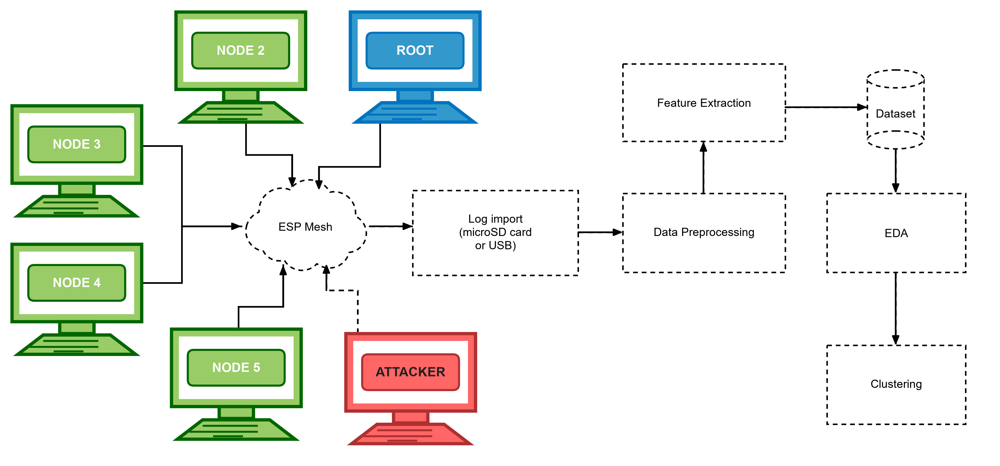

*Read it left to right: boards -> logs -> import -> preprocessing -> features -> dataset -> EDA and clustering. Note that the "Data Collector" is a file import after the run, not live streaming.*

- **Boards:** 8 ESP32s form one ESP-WIFI-MESH network: 1 **root** + 7 **children**. Some children play attack roles.
- **Logging:** every board samples at **10 Hz** and writes each row to its own **internal flash** and a **microSD card**.
- **Import:** after the run, the cards are pulled and read on a laptop (main route), or logs are streamed over USB.
- **Sniffer (optional):** a separate laptop listens to the Wi-Fi channel. It is outside the mesh, so it is an **independent witness**. How to read its captures and what they prove: Part 11.
- **Pipeline:** preprocessing (align, window), feature extraction, then the dataset, then EDA and clustering.

> [!tip] Takeaway
> Nothing is streamed over the mesh during a run. That is deliberate: an attack that drops packets cannot also destroy its own evidence.

### 2.2 Who is who in a run

| Role | What it does | How many |
|---|---|---|
| **Root** | Receives every probe, logs every arrival, drives the phases. It is the **referee**. | 1 |
| **Child** | Sends its own probes up to its parent and relays the probes of the boards below it. | 7 (minus attack roles) |
| **Blackhole attacker** | A child that relays normally, then drops everything during the attack phase. | 1 in a blackhole run |
| **Wormhole end A (exit)** | The **shallower** end. Receives tunnelled probes from the wire and re-injects them toward the root. | 1 in a wormhole run |
| **Wormhole end B (entry)** | The **deeper** end. Sends its own probes normally and also writes copies into the wire. | 1 in a wormhole run |

- **Victim** (blackhole only): a non-attacker board whose path to the root **passes through the attacker**.
- **Bystander:** a non-attacker board whose path does **not** pass through the attacker.
- In a **wormhole** run there are **no victims**: only B's own probes are tunnelled, so the other 5 boards are untouched.
- **Hop vs. layer:** ESP-WIFI-MESH numbers the root as **layer 1**. The thesis uses **hop = layer - 1**, so the root is hop 0 and its direct child is hop 1 (D-11).

### 2.3 The run timeline (Table 4.1)

| Phase ID | Label | Duration | Name | What happens |
|---|---|---|---|---|
| 254 | 255 | at least 60 s | Formation | Mesh forms; rows logged without a label; **excluded** |
| 0 | 0 | 300 s | Baseline | Normal operation |
| 1 | 1 | 180 s | Blackhole | Forwarding suppression on |
| 2 | 2 | 180 s | Wormhole | Tunnel on |
| 3 | 0 | 120 s | Cooldown | Attack off, network recovers |
| 4 | none | — | Terminate | Logs ready |

- A run uses **either** phase 1 **or** phase 2, never both.
- **Labels never come from a feature threshold.** They come from the phase the root announced. That is why the labels are honest ground truth.
- Formation lasts until the **pre-run gates** pass and the operator types **START** (D-22): every child joined; in a tree blackhole run the attacker has a child; in a wormhole run there is exactly one A and one B, the UART works both ways, and A is shallower than B.

#### How the root tells everyone the phase (Figures 4.2 and 4.3)

- The root sends each phase change as an **individual peer-to-peer message** to every node in its routing table.
- It sends it in **5 rounds, 100 ms apart**, all with the **same sequence number**, so a node that gets several copies applies it once.
- It **repeats the current phase every 10 s**, so a board that rejoins mid-run catches up.
- A **session ID** drawn at root boot lets a node tell a restarted root (new run) from a repeated message.
- Each node keeps `current_phase` and `ground_truth_label` and stamps them on **every row it logs**.

### 2.4 Probes and the relay: the traffic everything is measured on

- A **probe** is a tiny application packet a board sends toward the root: magic value, **sequence number**, send timestamp, source MAC.
  - Every **1000 ms** (stationary, burst) or every **250 ms** (highload).
- **Every node relays** (D-12): it sends its own probes to its **parent**, and when it receives a probe from below it passes it **one hop up**.
  - It counts **received**, **forwarded** and **dropped**, with the rule received = forwarded + dropped.
  - Why this matters: before D-12, the mesh stack relayed traffic invisibly and only the attacker could count transit packets. So the relay features existed **only on the attacker**, and an empty column gave the label away. D-12 put the counters on **every** node.
- The **root** logs one row per arriving probe: sender, sequence number, send time, arrival time, phase. Delivery is computed by **joining on the sequence number**, never on time, because the boards share no clock.

### 2.5 The blackhole: forwarding suppression (4.2.1.2)

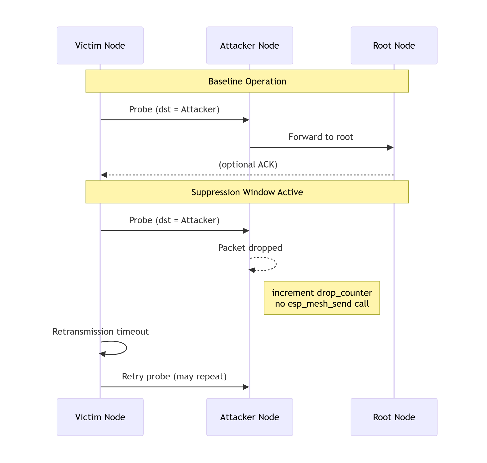

*Top: baseline, probes flow Victim -> Attacker -> Root. Bottom: attack, the attacker receives but never sends on. Look at the link-layer ACK: it still goes back to the victim.*

- The attacker runs **the same relay code** as everyone. The only difference is one decision hook: during phase 1, `forward_decision()` returns false, so the probe is **dropped by omission** (no `esp_mesh_send()` call).
- It stays a fully legitimate mesh node: keeps its parent, answers control messages, keeps logging.
- **Why the victims see nothing wrong:** the attacker's radio still **acknowledges every frame at the link layer**. The victim's Wi-Fi thinks delivery succeeded, so it never retries and never changes parent. This one fact explains the "retransmissions not observed" result in Chapter 6.
- **How traffic reaches the attacker:** by **placement** in the tree, not by a false route. In the **star**, the attacker is the **hub** and the root sits one hop behind it (D-16), because the root cannot be the attacker: it is the destination *and* the referee.

| Counter | Meaning |
|---|---|
| `recv_counter` | probes received for relay |
| `forward_counter` | probes forwarded to the parent |
| `drop_counter` | probes dropped (on purpose, or a failed send) |
| `self_packet_counter` / `retry_count` | failed `esp_mesh_send()` calls |

**Conformance check (Table 4.4, against Airehrour et al. [70]), 5 of 6 criteria met:**

1. Sits on the forwarding path ✓
2. Receives the packets rather than jamming ✓
3. Drops instead of forwarding ✓
4. Stays protocol-compliant, so the node looks alive ✓
5. Delivery collapses while the node stays reachable ✓
6. **Attracts traffic by advertising a false route ✗**

### 2.6 The wormhole: tunnel replay (4.2.1.3)

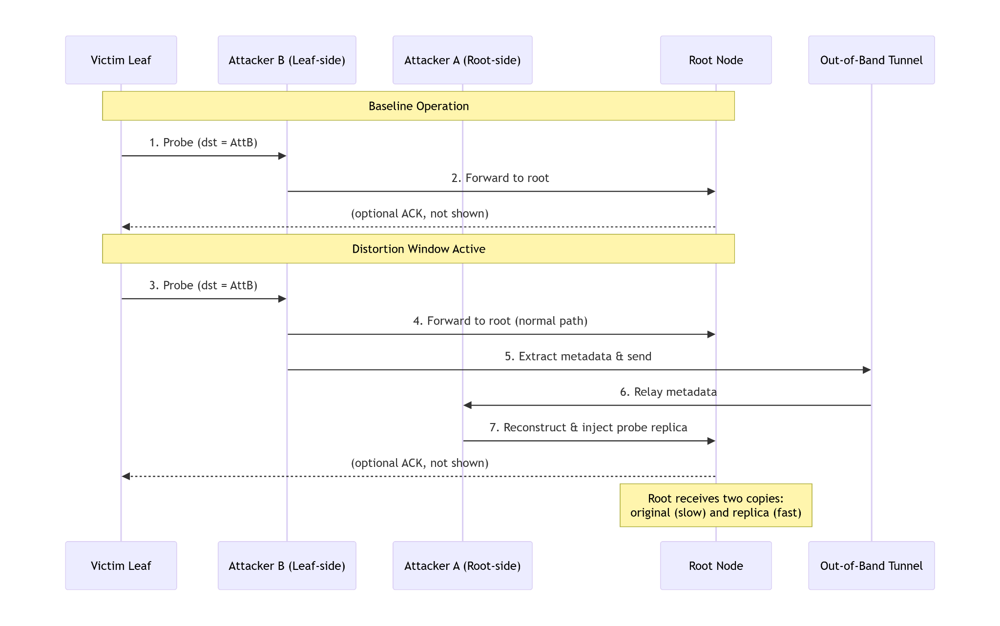

*Top: baseline, B's probes climb the mesh normally. Bottom: attack, each probe also goes through the wire to A, and A sends a copy from higher up. The root ends up with two copies of every B probe.*

- **The tunnel** is a physical **UART wire** at **115200 baud** (TX GPIO 17 of one board to RX GPIO 16 of the other). This plays the role of the GSM link in Zhukabayeva et al. [71].
- **Tunnel frame (Figure 4.9), 30 bytes:** tunnel magic "TNL1" (4 B) + the probe copied verbatim (22 B: magic, sequence number, send timestamp, source MAC) + **CRC32** (4 B).
- **Node B (entry, deeper):** every phase, sends each own probe to its parent (the normal copy). In phase 2, it **also writes the same probe into the wire**.
- **Node A (exit, shallower):** reads the wire, checks magic and CRC (and resyncs byte by byte on a bad frame), changes the magic to **"PROW"** and sends the probe toward the root. It keeps B's **sequence number, timestamp and source MAC**.
  - Why change the magic: so the root logs it as a second arrival instead of discarding a duplicate. Every relay between A and the root also forwards "PROW".
- **Who is A and who is B is decided at run time** (D-17): the two boards exchange a **HELLO** frame over the wire every second carrying their mesh layer. The **deeper** board becomes B, the shallower A (tie: lower MAC is A). Roles **lock at the first phase** and are written in every row.
  - Why: the mesh decides who lands near the root. A fixed assignment once gave B at hop 1 and A at hop 6, so the "shortcut" went the wrong way.
- **Extra rules for depth** (D-30, D-36): in tree and partial-mesh builds, B never takes the root as parent and must sit deeper than A, and both ends join as **leaf nodes** (nobody can attach below them).
- **Star wormhole** (D-28): in a flat star both ends are at hop 1 and nothing would be skipped, so **A is made the hub**, the root sits behind it, and B joins A. Normal copy: B -> A -> root (2 hops). Tunnel copy: B -> wire -> A -> root (1 hop). A one-hop shortcut.

**What the wormhole creates:** two copies of every B probe at the root, with **different delays**. **What it does not create:** a false neighbour or a route change, because the mesh never routes over the wire (D-20).

**Conformance check (Table 4.5, against Hu, Perrig and Johnson [46]):** two colluding endpoints ✓, out-of-band channel ✓, captured at one end and replayed at the other ✓, no keys or hosts compromised ✓, **creates a false neighbour ✗**.

> [!warning] Exam trap: "victims" in a wormhole run
> A wormhole run has **no victims**. Only B's own probes are tunnelled, and the other 5 boards' traffic is untouched. If a panelist asks "what happened to the victims in the wormhole?", the answer is "there are none by design; the attack is the duplication of B's probes."

### 2.7 The four topologies (4.2.2)

- ESP-WIFI-MESH **always builds a tree by itself**: each node picks the shallowest parent it can hear, then the one with fewest children.
- So a "topology" here = **board placement + an ESP-IDF topology option** (depth cap, children limit). The structure that actually formed is **checked after every run** from the logged parent addresses.

| Topology | How it is built | What formed (Table 6.35) |
|---|---|---|
| **Linear** | Chain option, 1 child per node, boards 3 to 5 m apart | Chain, deepest hop 7 |
| **Star** | Depth capped. In attack runs the **attacker or end A is the hub** with the root behind it (D-16, D-28) | Attack runs: root has 1 child, the hub has 6. Benign: flat, 5 to 7 boards on the root |
| **Tree** | Default self-organisation, with "sticky" parents (thresholds 6 dB lower, 3x longer watch; D-26) and a per-build children limit (D-37) | Root has 2 to 5 children; deepest hop 2 to 4 |
| **Partial mesh** | Boards placed to hear several parents; **at most 2 children** per node (D-29) | Behaved as a **plain branched tree**: no board ever used a second parent |

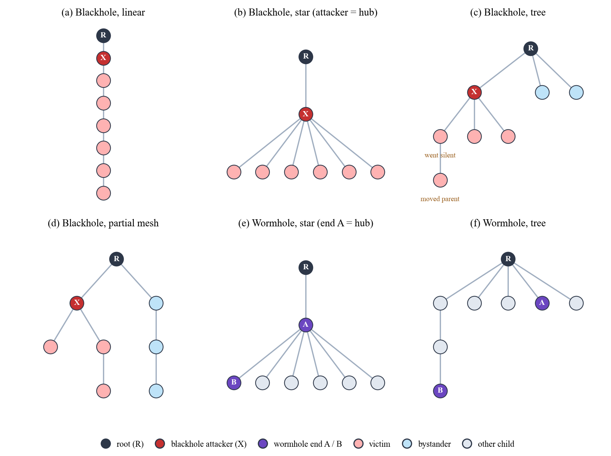

*This is the best single picture of the topologies as they really formed. X = blackhole attacker, A/B = wormhole ends, red = victims, blue = bystanders, grey = untouched boards. Notice the star has no bystanders (every board is behind the hub), and in (f) B sits deeper than A.*

### 2.8 Sites and scenarios (4.2.2.5)

| Site | Description |
|---|---|
| Room G402 (GCCS) | Controlled classroom |
| DLSU Library | Small part of a busy library, heavy Wi-Fi |
| Yuchengco Building | Area within the building |

| Scenario | What changes | Why |
|---|---|---|
| **Stationary** | Each child probes once per second | The reference |
| **Burst** | One child sends 300 probes back to back, 60 s into the attack window | Tests that a legitimate burst is not mistaken for an attack |
| **Highload** | Every child probes every 250 ms (4 per second) for the whole run | Pushes the testbed to its limit |

- **Design:** 4 topologies x 2 attacks x 3 sites x 3 scenarios = **72 attack runs**, one per cell, plus **8 benign runs** = **80**.
- **No repeats:** each cell is run once, so the three sites act as the repeats. Site differences and run-to-run noise cannot be separated (a stated limit).
- The scenarios exist so that **traffic volume alone cannot reveal an attack**.

### 2.9 What each board records (4.2.3)

| Layer | Field | Notes |
|---|---|---|
| PHY | `rssi` (10 Hz) | Signal strength of the link to the parent, from `esp_wifi_sta_get_rssi()` |
| MAC | `retry_count`, `tx_count` | **Application counters** (failed sends, frames accepted), **not** MAC retransmissions (D-15) |
| MAC | MacRetryRate | Real 802.11 retry bit, **from the sniffer only** (7 of 36 blackhole runs) |
| Network | `layer`, `parent_mac` | From `esp_mesh_get_layer()`, `esp_mesh_get_parent_bssid()` |
| Network | `probes_count`, `recv_count`, `forward_count`, `drop_count` | Relay counters |
| Tunnel | tunnel frames sent (B), received and re-injected (A), `role` | Wormhole runs only |
| Labels | `phase_id`, `gt_label` | On every row |

- **Storage:** CSV on internal flash (SPIFFS) and mirrored to a microSD card (FAT). The card is **fsync'ed about every 5 s** and at phase changes (D-13), so a crash loses only the last few seconds instead of leaving a 0-row file.
- **Radio fixed at 20 MHz (HT20)** (D-14): the sniffer can only decode 20 MHz frames. At the ESP32 default of 40 MHz it heard 3 of 1,848 data frames from one child.
- **Highload root fix:** the root writes arrivals to the card only, in 4 KB batches, because the double write once lost 3,151 rows.
- **Completeness checks:** expected samples (300 s x 10 Hz = 3,000 in baseline, 95% floor), row count vs. the card's `runs.csv` manifest, run inventory vs. the plan, `validate_integrity.py` and `verify_topology.py` on every capture.

### Check-in (Part 2)

- **Q:** A panelist asks: "Why didn't the blackhole victims switch to another parent or retry, if their packets were being dropped?" Answer in two sentences.
- **Your answer:** *(pending)*

> [!question]- Answer (click to reveal)
> The attacker still acknowledges every frame at the link layer, so from the victim's radio every send succeeded and there was no failure to retry or react to. The drop happens one layer up, in the application relay, which the victim cannot see. That is why the delivery loss is only visible at the root (PDR) and at the attacker's own counters (ForwardingRatio).
>
> 📖 **Review it:** Section 4.2.1.2 (G. Explanation of Key Behaviors) and Section 6.2.4

---

## Part 3: From raw rows to the dataset (Chapter 4.2.4)

### 3.1 Preprocessing, step by step

1. **Align time.** Boards share no clock (each counts from its own boot). So each board's timeline is anchored to **its own first exit from phase 0**, the one event every board sees through the root's broadcast. The last 300 s before that anchor = baseline.
2. **Put samples on a 10 Hz grid.** Each sample takes the **earliest free 0.1 s tick**, at most 300 ms late, never early (D-25).
   - Why: the logger sometimes writes late samples back to back (gaps like 258 ms, 1 ms, 41 ms). The old "nearest tick" rule made two samples fight for one tick and threw away healthy windows.
3. **Cut into one-second windows.** Non-overlapping. A window needs **at least 8 of its 10 samples**, otherwise it is discarded (D-9).
4. **Fill tiny gaps.** Gaps of 1 to 2 samples inside a kept window: RSSI is linearly interpolated, counters are forward-filled.
5. **Turn counters into deltas.** Counters only grow, so each window uses (value at end) - (value at start).
6. **Join delivery on the sequence number.** PDR and latency join the root's arrival log to each node's probes by sequence number, never by time.

- **One row = one board x one second.** That is the unit of the whole dataset (the "node-window").
  - Why node-level and not network-level: the attacker's forwarding falls while the nodes behind it lose delivery. A network average would blur both.
- Result: 457,568 windows formed, **1,372 discarded (0.30%)**, no run lost more than 1%, mean samples per window at least 9.97 in every run.

> [!note] Why 1 s windows of 10 samples and not 5 s windows of 5 (D-1, D-9)
> With 5 samples, one lost sample costs 20% of a window. The panel also asked for about 10,000 rows per run. At 10 Hz with 1 s windows, a window holds 10 samples, the 80% rule (8 of 10) is kept, and a clean baseline went from 577 to 2,894 rows. Side effect: a probe is sent about once a second, so one window's PDR is close to 0 or 1. PDR is read as a mean over many windows.

### 3.2 The 16 features

**Forwarding group (network layer)**

- **ForwardingRatio** = Δforwarded / Δreceived, defined only when the node received something in the window.
  - ≈ 1 normal relay; ≈ 0 blackhole.
  - It is the **direct record of the blackhole at the attacker**.
- **IngressEgressDelta** = |Δreceived - Δforwarded| (packets absorbed in the window).
- **ConsistencyScore** = |ForwardingRatio - 1| (distance from perfect forwarding; 0 = perfect, near 1 = full suppression).

**Link reliability**

- **RetryRate** = Δretry / (Δtx + Δretry), from **application counters** (failed sends). Kept as a column only; not a model input (D-15).
  - ⚠️ On wormhole end **B**, `retry_count` holds the **frames sent into the tunnel**, so on B this "RetryRate" records the attack, not retries.
- **PDR** (packet delivery ratio) = probes from this node that reached the root / probes this node sent, per window.
  - Gets a value (even 0) only if the node **sent** in the window, was **attached** to the mesh, and the root was **logging** (D-8).

**Topology stability**

- **ParentSwitchRate** = parent changes in the window / 1 s.
- **HopChangeCount** = number of hop (depth) changes in the window.
- **HopStabilityDuration** = longest stretch in the window with the same layer and parent (seconds).

**Physical layer**

- **RSSI_mean** = mean signal strength to the parent in the window (dBm).
- **RSSI_var** = variance of the RSSI samples (dBm²).
- **RSSI_stability** = longest stretch in the window with RSSI within ±3 dBm of the window mean (seconds).

**Cross-layer**

- **RSSI_Hop_Diff** = |observed RSSI - baseline median RSSI at the node's layer, same run| (dB).
  - The "expected" RSSI is learned from the run's own baseline, so it adapts to each room.
  - Idea: above 10 dB = a node hears a signal that does not fit its depth (the wormhole mismatch).
- **LatencyHopRatio** = relative one-way delay / hop count (ms per hop) (D-2).
  - **Relative** because clocks are not synced: raw delay = true delay + a large constant offset (once −194 s). Subtracting the sender's **fastest** delay in the run cancels the constant.
  - Consequence: only the **shape** can be compared, not absolute values across nodes or runs.

**Tunnel (wormhole ends only)**

- **TunnelIntensity** = tunnel messages in the window / 1 s.
- **TunnelBytes** = messages x 30 bytes.
- **TunnelLatency** = latest minus earliest arrival of the two copies of one probe at the root (D-3). Both copies share one sender clock and one root clock, so the offset cancels **exactly**. It belongs to end B (whose probes were duplicated).

> [!warning] Small wording gap between paper and code
> The paper text describes IngressEgressDelta as "received minus forwarded" and RSSI_Hop_Diff as "observed minus baseline median". The code (`features.py`) takes the **absolute value** of both. If asked "can RSSI_Hop_Diff be negative?", the honest answer is no: it is an absolute difference in the dataset.

### 3.3 The 16 features at a glance (Table 6.7)

| Feature | Unit | Used how in Chapter 6 |
|---|---|---|
| ForwardingRatio | ratio 0 to 1 | Direct record of the blackhole at the attacker; **not clustered** (leakage guard) |
| IngressEgressDelta | packets/window | Support check; not clustered |
| ConsistencyScore | ratio | Support check; not clustered |
| RetryRate | ratio | Means reported only; not clustered |
| PDR | ratio | Primary blackhole check; **in FULL and REDUCED sets** |
| ParentSwitchRate | changes/s | FULL only (constant, dropped from REDUCED) |
| HopChangeCount | count/window | FULL only |
| HopStabilityDuration | s | FULL only |
| RSSI_mean | dBm | Every feature set |
| RSSI_var | dBm² | Every feature set |
| RSSI_stability | s | FULL only |
| RSSI_Hop_Diff | dB | Every feature set |
| LatencyHopRatio | ms/hop | Not clustered (its *missing* values give the label away) |
| TunnelIntensity | msg/s | Primary wormhole check; ends only |
| TunnelBytes | bytes/window | Support check; ends only |
| TunnelLatency | ms | End B only; reported, not scored |

- Plus identifiers on every row (D-7, D-10): node_id, node_role, run_repeat, attack, topology, location, scenario, window_start, label.
- MacRetryRate and MacFramesHeard (sniffer) are extra columns, only for the 7 sniffer-covered blackhole runs.

### 3.4 Worked example: computing ForwardingRatio and PDR

**Problem (Table 4.4 evidence run, G402 linear stationary):** during the 180 s attack the attacker received 1,077 probes and forwarded 1. What is its ForwardingRatio over the attack?

*Source note: the paper prints only the result (1.000 -> 0.001, Table 4.4). The 1,077 and the 1 come from the repository's verification log (`ESP32-Environment/docs/dataset-verification.md`), so do not say "as in the paper" for those two counts.*

**0. Given.**

- Δreceived = 1,077 probes
- Δforwarded = 1 probe
- Find: ForwardingRatio (ratio, 0 to 1)

**1. Write the definition.** ForwardingRatio compares what left with what came in.

$$\text{ForwardingRatio} = \frac{\Delta\text{forwarded}}{\Delta\text{received}}$$

**2. Substitute.**

$$\text{ForwardingRatio} = \frac{1}{1077}$$

$$\text{ForwardingRatio} \approx 0.00093$$

**3. Verify.** 0.00093 x 1,077 ≈ 1 forwarded probe, which matches. Rounded to three decimals it is 0.001, the value the paper reports.

**Answer:** about 0.001, down from 1.000 in the baseline.

**PDR in one window (illustrative):** in a highload window, a victim sends 4 probes. Before the attack the root logs all 4 (PDR = 4/4 = 1.0). During the attack the root logs 0 (PDR = 0/4 = 0.0). A window in which the node sent **nothing** gets **no** PDR (blank), never 0, because 0/0 would invent a fake blackhole (D-8).

### Check-in (Part 3)

- **Q:** Why is LatencyHopRatio computed from a *relative* delay, and what does that stop you from doing with it?
- **Your answer:** *(pending)*

> [!question]- Answer (click to reveal)
> The boards' clocks are not synchronised, so the raw delay is the true one-way delay plus a big constant offset between the sender's and the root's boot times. Subtracting the sender's fastest delay in the run cancels that constant. The price is that values can only be compared **within** one node and run (their shape), not in absolute terms between nodes or runs.
>
> 📖 **Review it:** Section 5.3 (D-2) and Section 4.2.4.2.5

---

## Part 4: How every run is validated (Chapter 4.2.7)

### 4.1 The verifier in one picture (Figure 4.55)

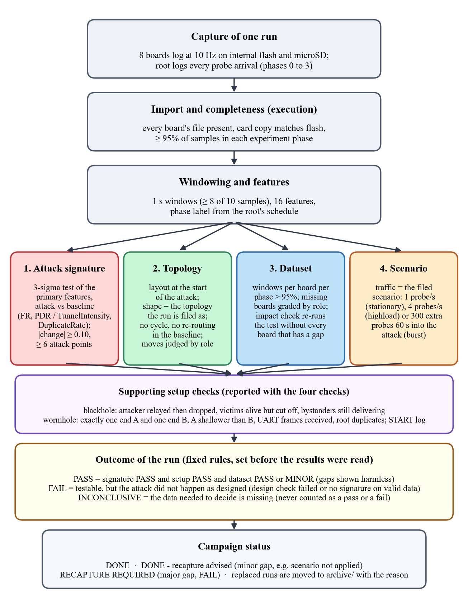

*Read top to bottom: import and window the run, apply four checks to the same windows (signature, topology, dataset, scenario), confirm the roles (setup check), combine by fixed rules, then decide keep or recapture.*

The **verifier** (`verify_attack.py`) answers four questions for every run, always in the same order:

1. **Attack signature:** did the attack feature really move?
2. **Topology:** did the boards form the topology the run is filed under?
3. **Dataset:** did every board record enough of each phase?
4. **Scenario:** did the traffic match the scenario (1/s, 4/s, burst at the right time)?

Plus a **setup check** (blackhole: attacker relayed then dropped, victims alive but cut off; wormhole: exactly one A and one B, A shallower, the wire delivered B's frames).

> [!tip] Key defense line
> "The verdict rules were fixed in the verifier **before** any result was read." The panel cannot accuse you of tuning the test to pass.

### 4.2 The 3-sigma test (Zhukabayeva et al. [71])

- Pool every **5 one-second windows** into one point. The 180 s attack gives 180 / 5 = **36 points**.
- Compute the **baseline mean** and **baseline standard deviation** of the feature.
- A primary feature **passes** when all of these hold:
  - the attack mean is at least **3 baseline SDs** from the baseline mean, **in the expected direction**;
  - the absolute change is at least **0.10**;
  - there are at least **6 attack points**.
- If the baseline never varied (SD = 0), z is undefined/infinite and **any move in the expected direction is accepted**.
- A primary whose **baseline is broken** (mean below 0.90, or SD above 0.15 of the mean) is **excluded**, not failed.

**Worked example (illustrative numbers):** baseline ForwardingRatio mean = 1.000, SD = 0.002; attack mean = 0.003.

**0. Given.**

- $\mu_b$ = 1.000 (baseline mean)
- $\sigma_b$ = 0.002 (baseline SD)
- $\bar{x}_a$ = 0.003 (attack mean)
- Find: z, and whether it passes

**1. Write the z-score.** It measures how many baseline SDs the attack sits away from normal.

$$z = \frac{\bar{x}_a - \mu_b}{\sigma_b}$$

**2. Substitute.**

$$z = \frac{0.003 - 1.000}{0.002}$$

$$z = -498.5$$

**3. Check the three rules.** |z| = 498.5 ≥ 3 and the direction is down (expected for a blackhole) ✓. Change = 0.997 ≥ 0.10 ✓. 36 points ≥ 6 ✓.

**Answer:** passes. (Real runs: where z was finite in 21 blackhole runs, the attacker's ForwardingRatio sat at least 22.9 SDs away, median 111; in the other 15 runs the baseline never varied.)

### 4.3 Primary and support checks

| Attack | Primary (decide the verdict) | Support (reported only) |
|---|---|---|
| Blackhole | Attacker **ForwardingRatio**; **PDR** of non-attacker nodes | ConsistencyScore, IngressEgressDelta, NeighbourForwardingRatio (attacker's ratio as seen by its neighbours) |
| Wormhole | **TunnelIntensity** (counted by the ends); **DuplicateRate** (measured **at the root**) (D-21) | TunnelBytes |

- A run is **confirmed** when at least one primary passes.
- **Why two primaries for the wormhole (D-21):** TunnelIntensity is the attackers counting themselves (weak evidence). DuplicateRate is the root's independent view.
- **TunnelLatency and LatencyHopRatio are "reported, not scored":** TunnelLatency has no baseline (no tunnel exists then), and LatencyHopRatio's baseline is so spread out that |z| could never exceed 0.64. A test that can never pass is not evidence.

### 4.4 The other three checks (Figures 4.56 to 4.59)

- **Topology (Figure 4.57):** rebuilds the tree from logged parent addresses. Rules for moves:
  - Re-route **during the baseline** fails the topology gate (D-27).
  - A board changing parent **during the attack** is tolerated if it **keeps its class** (victim stays victim, bystander stays bystander). Flipping class for 3 s or more fails the run (D-23).
  - The **attacker** changing its own parent is tolerated only if no board changes class, at least one victim remains, and the attacker was without an uplink for at most 10% of the attack (D-31).
  - The rule reads only parent addresses, never PDR or ForwardingRatio, so it is **outcome-blind**.

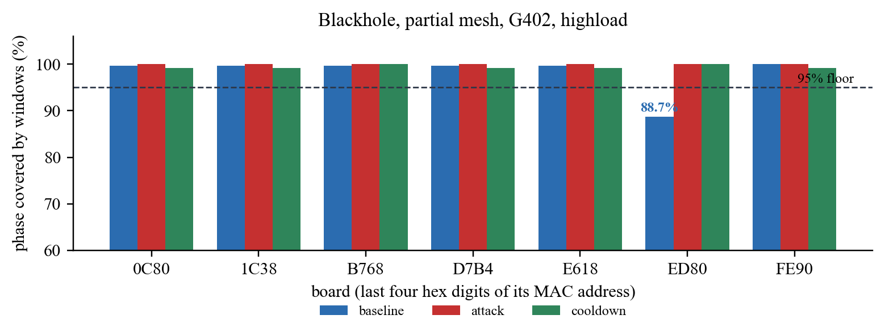

*Each board's coverage of each phase vs. the dashed 95% floor. Victim ED80 covered only 266 of 300 s of baseline (88.7%). The impact check reran the test without ED80, the attack was still confirmed, so the run is kept with a minor gap.*

- **Dataset:** every board must cover at least **95%** of each phase. Missing boards are graded **by role** (D-32): missing attacker or tunnel end = major; missing victim or bystander = minor while other boards of that role remain; unplaceable board = undetermined. An **impact check** reruns the test without the gappy boards.
- **Scenario:** stationary ≈ 1 probe/s per child; highload ≈ 4/s; burst = one spike of about 300 probes about 60 s into the attack. A scenario that was not applied = **minor gap** (D-34).

### 4.5 Outcome and grade (Table 4.24)

| Result | Meaning | What happens |
|---|---|---|
| **PASS** | signature + setup pass, data complete or minor gaps | Kept |
| **FAIL** | testable, but the attack did not happen as designed | Archived, recaptured |
| **INCONCLUSIVE** | data needed to decide are missing | Archived, recaptured |
| **STRONG / GOOD** | full data; GOOD = a note was added (e.g. plain tree, no run log) | Kept |
| **MINOR GAPS** | a gap the impact check shows does not change the result | Kept, footnoted |
| **MAJOR GAPS** | gap on data the result depends on | Not validated, recaptured |

- **Missing data never becomes a pass or a fail.**
- **Benign runs** are tested the other way round: the cooldown is tested against the baseline for both signatures, and **neither may move**. Delivery must stay healthy (PDR at least 0.90, every relay forwards at least 90%).
- **Robustness of the verifier itself:** moving every threshold by about ±50% changed **no verdict** in 53 runs over 14 settings. An absurd setting (1,000 SDs) changed 18 verdicts, which proves the test *can* fail. A **placebo** test (relabel the second half of each baseline as "attack") gave **0 false confirmations in 106 tests**.

### Check-in (Part 4)

- **Q:** Why does the wormhole need DuplicateRate as a primary check when TunnelIntensity already shows the tunnel working?
- **Your answer:** *(pending)*

> [!question]- Answer (click to reveal)
> TunnelIntensity is counted by the attacking boards themselves, so on its own it is self-reported evidence. DuplicateRate is measured at the root, which is independent of the attackers. Two independent primaries make the confirmation stronger (D-21). Both passed in all 36 wormhole runs.
>
> 📖 **Review it:** Sections 4.2.7.1, 5.6 (D-21) and Table 6.11

---

## Part 5: Chapter 5, Methodological Deviations

### 5.1 The big idea

- Chapter 5 lists **every change from the approved proposal**: 37 entries, **D-1 to D-37**, each with what the proposal said, what is done instead, why, and what it costs (full text in Appendix C).
- **Modified** = replaces something the proposal specified (17 entries). **New** = adds a rule or procedure the proposal did not have (20 entries).
- The changes were **not planned in advance**: each was made when a capture or a review showed the plan could not be followed as written, or that following it would give untrustworthy data.

> [!tip] How to frame Chapter 5 on stage
> "Every deviation exists for one of three reasons: the platform could not measure what was planned, the plan would have leaked the label or failed to produce the attack, or a run needed a rule to count as one valid experiment." Then give one example of each (below).

### 5.2 The three recurring reasons, with one example each

| Reason | Example |
|---|---|
| **1. The platform could not measure it** | No MAC retry count exists in ESP-IDF (D-15); probes have no reply, so no round-trip time (D-2, D-3) |
| **2. The plan would have leaked the label or failed to make the attack** | Relay counters existed only on the attacker, so an empty column revealed it (D-12); wormhole ends at the same depth skip no hop (D-17, D-28, D-30) |
| **3. A run needed rules to be one valid experiment** | Pre-run gates and START (D-22), parent changes during the attack (D-23), missing boards graded by role (D-32) |

### 5.3 The five groups (Table 5.1)

| Group | Entries | Main change |
|---|---|---|
| Data collection and sampling | D-1, D-9, D-13, D-14, D-25 | 10 Hz logging, 1 s windows of 10 samples (was 5 s of 5); radio fixed at 20 MHz; card fsync |
| Feature definitions | D-2, D-3, D-7, D-8, D-10, D-11, D-15 | One-way latency; retry rate from app counters; run identifiers on every row |
| Implementation of the attacks | D-12, D-16, D-17, D-20, D-28, D-30, D-36 | Both attacks emulated at the application layer; every node relays; wormhole ends as leaves |
| Experimental design | D-5, D-6, D-18, D-19, D-26, D-29, D-33, D-35, D-37 | Baseline = phase 0 of each run; 8 benign runs added (80 total); 3 sites, 3 scenarios; tree rules |
| Run control and validation | D-4, D-21, D-22, D-23, D-24, D-27, D-31, D-32, D-34 | Pre-run gates, START lock, verifier grading of gaps, missing boards, unapplied scenarios |

### 5.4 All 37 in plain words (Table 5.2)

| ID | Topic | In plain words |
|---|---|---|
| D-1 | Sampling rate | Boards record 10 samples per second |
| D-2 | LatencyHopRatio | One-way delay per hop, not round trip |
| D-3 | TunnelLatency | Gap between a probe and its tunnelled copy at the root |
| D-4 | Topology check | Parent changes in the first 60 s count as formation |
| D-5 | Baseline control | First 300 s of each attack run is the baseline |
| D-6 | Repeats and parents | Topology type is fixed; which board sits where is left to the mesh |
| D-7 | run_repeat column | Every row says which repeat it belongs to |
| D-8 | PDR attribution | A window gets a PDR (even 0) if the node sent, was attached, and the root was logging |
| D-9 | Grid and window | 1 s windows, at least 8 of 10 samples |
| D-10 | Run columns | Every row records attack, topology, site, scenario |
| D-11 | Hop, not layer | Hop = layer - 1; HopChangeCount |
| D-12 | Application-layer relay | Every node relays probes itself so forwarding can be counted |
| D-13 | microSD mirror | Card copy forced to disk with fsync |
| D-14 | Radio width | Wi-Fi fixed at 20 MHz |
| D-15 | Application counters | Retry counts come from software, not the Wi-Fi hardware |
| D-16 | Star and blackhole | In the star, the attacker is the hub; the root sits behind it |
| D-17 | Wormhole ends | Ends chosen at run time from mesh depth, then locked |
| D-18 | Matched benign runs | Benign runs added as a control (final plan: 8) |
| D-19 | Sites | G402, DLSU Library, Yuchengco |
| D-20 | Attack emulation | Both attacks act on the study's own probes, not on routing |
| D-21 | Wormhole verification | Two independent checks: attackers' count and root's view |
| D-22 | Pre-run gates and START | Run starts only when checks pass and the operator types START |
| D-23 | Parent changes in the attack | Tolerated if the board stays victim or stays bystander |
| D-24 | START lock | A failed check blocks START unless a typed reason is logged |
| D-25 | Tick alignment | Each sample takes the earliest free tick, at most 300 ms late |
| D-26 | Sticky tree parents | Tree boards switch parent less readily |
| D-27 | Topology gate | Pass if attached at baseline start and no re-route during it |
| D-28 | Star wormhole | In the star, wormhole end A is the hub |
| D-29 | Partial mesh | Defined by placement and at most 2 children per node |
| D-30 | Wormhole end depth | In tree and partial mesh, B sits deeper than A |
| D-31 | Attacker re-parenting | Attacker may move only if no board changes class and its uplink was down at most 10% |
| D-32 | Missing boards | Graded by role, not by a plain board count |
| D-33 | Jitter scenario | Left out; three scenarios remain |
| D-34 | Scenario not applied | Graded as minor gaps |
| D-35 | Benign run plan | Benign runs spread over sites and scenarios; 8 remain |
| D-36 | Wormhole ends as leaves | In tree and partial mesh, the ends accept no children |
| D-37 | Tree fan-out | Number of children a tree board accepts is set per build |

### 5.5 The deviations you must be able to explain in depth

#### D-20: attack emulation (the most important one)

- **Proposal:** classical attacks that act on the **control plane** (a blackhole advertises a false route; a wormhole makes the routing adopt a false shortcut).
- **What we did:** only the **data-plane** behaviour. Blackhole = a placed relay that drops. Wormhole = a real wire that copies probes.
- **Why:** ESP-WIFI-MESH is a self-organising tree with no route request/reply messages to fake. Its routing tables live in Espressif's closed-source library; the API can **read** but not **write** routes. False routes would need forged management frames or reverse engineering, which is outside an exploratory data study.
- **Cost:** no route attraction, no false neighbours, no attacker-caused parent changes in the data. **This is why the cross-layer features stayed flat in Chapter 6.**

#### D-12: every node relays

- **Before:** honest nodes sent with `esp_mesh_send()` and the mesh stack relayed below the application, so only the attacker ever saw transit packets.
- **Problem:** the three relay features existed **only on the attacker**, so an empty column identified the attacker and the label. This is exactly the Thesis 2 panel's objection ("if one feature decides it, machine learning is unnecessary").
- **Fix:** a shared relay on every node: send to your parent, relay one hop up, count received/forwarded/dropped. The attacker differs by one decision.
- **Bug found and fixed along the way:** the relay first forwarded only normal probes, so A's "PROW" copies would have been dropped and no wormhole signature would ever reach the root.

#### D-15: no MAC retry count

- The proposal wanted `retry_count` and `tx_count` from ESP-IDF Wi-Fi statistics.
- Checked: the only statistics call (`esp_wifi_statis_dump()`) **prints** to the log and returns only a status. No number reaches the application.
- So both columns are **application counters**: failed `esp_mesh_send()` calls. RetryRate is not a model input.
- Real retries come only from the **sniffer** (802.11 Retry bit), in 7 of 36 blackhole runs.

#### D-2 and D-3: latency without synchronised clocks

- No probe ever gets a reply, so no round trip exists. Clocks are not synced.
- **LatencyHopRatio:** subtract the sender's fastest delay in the run to cancel the clock offset, then divide by hops.
- **TunnelLatency:** both copies of one probe share the sender's timestamp and the root's clock, so their arrival difference is an exact measurement.

#### D-8: when a window gets a PDR

- The first code gave a node no PDR at all if the root never heard from it, which hid exactly the most affected victims (PDR = 0 appeared in none of 446 rows).
- It also divided by (0 + a tiny constant), so a window with nothing sent became 0.0, a fake blackhole.
- Now: PDR exists (even 0) only if the node **sent**, was **attached**, and the root was **logging**. On that capture, windows with PDR = 0 went from 0 to 201.

#### D-16 and D-28: the star built one hop down

- The root cannot be the blackhole: it is the destination (nothing to forward to) and the referee (it would be grading itself).
- So in star **attack** runs, the hub is the attacker (blackhole) or end A (wormhole), and the root sits one hop behind it.
- For the wormhole star: normal copy B -> A -> root = 2 hops, tunnel copy = 1 hop, a one-hop shortcut. A flat star would give duplicates with no shortcut, "a replay, not a wormhole".
- Side effect to disclose: A also relays B's normal copy, and control boards are 2 hops from the root.

#### D-17, D-30, D-36: getting the wormhole ends right

- **D-17:** roles assigned at run time by depth through the HELLO handshake (deeper = B), locked at phase 0.
- **D-30:** in tree and partial mesh, the ends kept landing at the same depth because they hang off one short cable and the mesh joins the shallowest parent. So B is forced to a non-root parent (always hop 2 or deeper), and A takes the shallowest open parent.
- **D-36:** in tree and partial mesh, the ends join as **leaf nodes**. Reason: when end A restarted, its children re-parented during the attack and the run had to be recaptured; the telemetry stack was also nearly full (stack raised from 4096 to 6144 bytes).

#### D-5, D-18, D-33, D-35: baseline and benign runs

- **D-5:** the baseline is phase 0 of the same run, so firmware, roles, session and placement are identical; the attack is the only change. A separate baseline run would also change the number of probing boards (the attacker relays instead of probing).
- **D-18 -> D-33 -> D-35:** the benign plan went 12 -> 9 (jitter dropped) -> 12 (re-spread) -> **8** (4 never captured when the campaign ended were removed). Final: 4 stationary, 3 highload, 1 burst. G402 has 4, the Library 2, Yuchengco 2. Tree and partial mesh have one benign run each, both at G402.
- Cost: the benign runs are a **control**, not a counterpart for every cell; within a topology, benign scenario and site are confounded.

#### D-22 to D-34: making a run "one valid experiment"

- **D-22 / D-24:** the root holds phase 0 until gates pass and START is typed; a failed check **locks** START (override needs a typed reason of at least 15 characters plus the word OVERRIDE, logged and reported).
- **D-23 / D-31:** what matters is **whom the attack reaches** (class), not which address a board's parent has. Outcome-blind, symmetric, thresholds fixed in advance.
- **D-32:** two runs had a board the root heard but with no file (B768 tree/G402/highload blackhole, 2805 partial/G402/highload wormhole). Now found automatically and graded by role.

#### D-26, D-29, D-37: the tree and the partial mesh

- **D-26:** tree children re-parented on weak but working links (testbed links sat at -71 to -78 dBm). Thresholds made 6 dB weaker and the weak-link watch 3x longer, for keeping and switching only (first parent choice unchanged).
- **D-29:** no partial-mesh run ever showed a board under a second parent, so the partial mesh is reported as a **placement-defined branched tree with at most 2 children**, and adaptive switching is **not claimed**.
- **D-37:** with the stock limit of 10 children, a tree run came out flat like a star. The children limit is now a per-build setting, and the fan-out that formed is reported per run (Table 6.35: root has 2 to 5 children in tree runs).

### 5.6 What the changes mean for the results (Section 5.7)

Four changes **limit how Chapter 6 can be read**:

1. **D-20:** the data show the effect of emulated attacks on traffic, not traffic attraction by a routing protocol.
2. **D-15:** no MAC retry count; retransmissions come from app counters and, where available, the sniffer.
3. **D-18 as revised by D-35:** the 8 benign runs are a control, not a counterpart of every cell, and within one topology benign scenario and site are confounded.
4. **D-37:** tree runs do not share one fan-out (root has 2 to 5 children), which limits the tree vs. partial-mesh comparison in the wormhole runs.

### Check-in (Part 5)

- **Q:** A panelist says: "37 deviations sounds like you didn't follow your proposal." Give a two-part answer.
- **Your answer:** *(pending)*

> [!question]- Answer (click to reveal)
> 1. Each deviation was forced by evidence: the platform could not measure something (D-15, D-2), the plan would have leaked the label or failed to create the attack (D-12, D-17), or a run needed a rule to be a valid experiment (D-22, D-23, D-32). Several were scope decisions checked with the adviser (D-19, D-33, D-35).
> 2. Every one is documented with what the proposal said, what changed, why, and what it costs (Appendix C). Only four limit how the results are read (Section 5.7), and those four are stated openly as limits in Chapter 6.
>
> 📖 **Review it:** Sections 5.1 and 5.7

---

## Part 6: Chapter 6, Results (dataset, attack validation, EDA)

### 6.1 Terms used throughout Chapter 6

- **Window** = one second of one board (up to 10 samples). Every count is in windows.
- **Labels:** baseline and cooldown = **0 (normal)**; blackhole attack = **1**; wormhole attack = **2**.
- **The label is set for every board of the run**, including bystanders that the attack never touched. Remember this: it caps the clustering scores later.
- **Non-attacker nodes:** in a blackhole run, the 6 boards that are not the root or attacker (victims + bystanders). In a wormhole run, the 5 boards that are not the root or an end.

### 6.2 The dataset collected (Section 6.1)

- **80 of 80 runs captured** (Table 6.1): 36 blackhole, 36 wormhole, 8 benign. By topology: linear 21, partial mesh 19, star 21, tree 19. By site: G402 28, Library 26, Yuchengco 26.
- Every run has 8 boards except: benign star/Yuchengco/highload (6 boards) and blackhole tree/G402/highload (7, because B768 recorded nothing).

**Windows (Table 6.2)**

| Phase | Windows | Share |
|---|---|---|
| Before the baseline (not analysed) | 85,435 | 18.7% |
| Baseline (normal) | 190,423 | 41.7% |
| Attack | 103,187 | 22.6% |
| Cooldown (normal) | 76,068 | 16.7% |
| Phase boundary / no label (not analysed) | 1,082 | 0.2% |
| **All** | **456,195** | 100% |

- Analysed = 190,423 + 103,187 + 76,068 = **369,678** (266,491 normal + 103,187 attack).

**Boards by role (Table 6.4)**

| Topology | Blackhole victims | Blackhole bystanders | Wormhole non-attacker boards |
|---|---|---|---|
| Linear | 33 | 21 | 45 |
| Partial mesh | 18 | 36 | 45 |
| Star | **54** | **0** | 45 |
| Tree | 18 | 35 | 45 |
| **All** | **123** | **92** | **180** |

- **Star has no bystanders:** every board is behind the hub attacker.

**Replaced and noted runs (Tables 6.5, 6.6)**

- 15 earlier captures of 11 cells were **replaced** by newer ones and archived. Only the newest capture of a cell is analysed.
- 12 captures outside the plan (5 jitter, 7 at home) are **not** counted.
- 7 groups of runs carry a note but are **kept**. The ones to know:
  - linear/G402/burst blackhole: the burst fired **outside** the attack window (D-34, minor gap);
  - tree/G402/highload blackhole: B768 has no data but was a bystander (D-32);
  - all 9 partial-mesh runs of each attack: **plain trees**;
  - partial/Yuchengco/highload wormhole: end B and one child probed at 1/s instead of 4/s.

**Why some features are often blank (Table 6.8)**

- ForwardingRatio has a value in only 36.3% of non-attacker windows: it only exists when a node **received** something to relay, and leaves (end nodes) never do.
- PDR is 0% on the attacker and the tunnel ends: they are **not scored** on delivery.
- LatencyHopRatio is 0% on the blackhole attacker and end A, and is **missing for victims during the attack** (a dropped probe has no delay).
- Tunnel features exist only on the two ends.

### 6.3 Blackhole: did the attack work? (Section 6.2.1)

**Verifier checks (Table 6.9)**

| Check | Role | Passed |
|---|---|---|
| Attacker ForwardingRatio | Primary | **36 of 36** (baseline 1.000 to 1.004; attack 0.000 to 0.007) |
| PDR of all non-attacker nodes | Primary | **35 of 36** (one run excluded: unstable baseline 0.930 ± 0.253, partial/Yuchengco/stationary) |
| ConsistencyScore | Support | 31 of 36 (misses z 1.4 to 2.7) |
| IngressEgressDelta | Support | 31 of 36 (misses z 0.4 to 2.9) |
| NeighbourForwardingRatio | Support | 32 of 36 (4 runs had no attack values; none failed) |

- **Confirmed in all 36 runs.** Grades: 4 strong, 27 good, 5 minor gaps.
- **Speed:** all 123 victims fell below PDR 0.5 at once: 121 in the **first one-second window** of the attack, the other 2 within 1 s (Table 6.10: median 0 s, max 1 s). Recovery to above 0.5: within **3 s**, median **2 s** (122 boards; one went silent).
- Victim PDR: **0.998 -> 0.000** in every run; **every one of the 123 victims** has an attack-phase mean of exactly 0. Bystanders: 0.996 -> **1.000**.

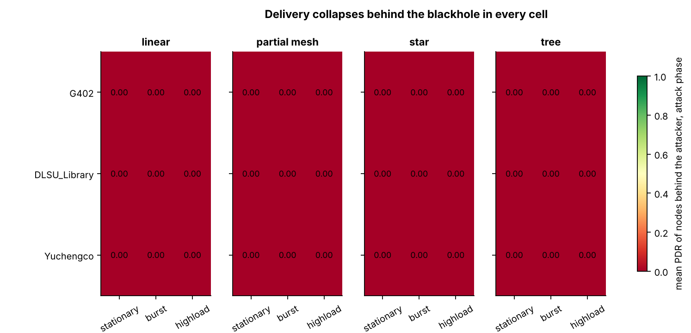

*Each rectangle is one run (panels = topologies, rows = sites, columns = scenarios). Look at the numbers: every single cell is 0.00, so no victim's probe reached the root during the attack, in any run.*

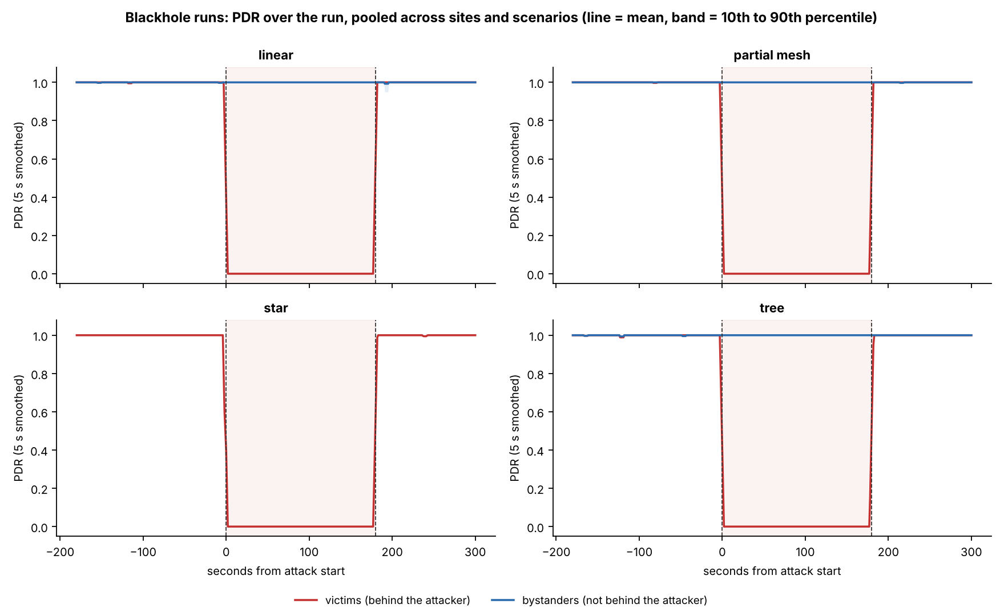

*x-axis: seconds from attack start (negative = baseline, shaded 0 to 180 = attack). Red = victims, blue = bystanders. The red line drops like a cliff at 0 and climbs back right after 180; the blue line never moves. The star panel has only a red line because it has no bystanders.*

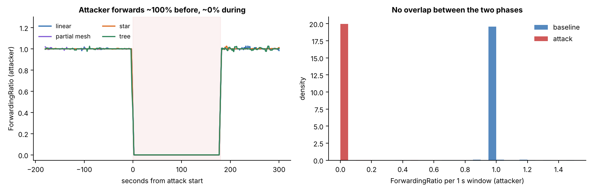

*Left: the attacker's ForwardingRatio over time, falling from about 1 to about 0 for exactly the attack window. Right: histograms of one-second windows; baseline and attack values do not overlap at all.*

### 6.4 Wormhole: did the attack work? (Section 6.2.2)

**Verifier checks (Table 6.11)**

| Check | Role | Passed |
|---|---|---|
| DuplicateRate of end B | Primary | **36 of 36** (baseline 0 in every run; attack 0.986 to 1.000, median 1.000) |
| TunnelIntensity of the ends | Primary | **36 of 36** (baseline at most 0.001 msg/s; attack 0.994 to 4.0 msg/s) |
| TunnelBytes | Support | 36 of 36 (attack median 30, max 120 bytes per window) |

- Grades: 21 strong, 15 good (9 partial-mesh plain-tree notes + 6 runs with no saved root run log).
- **In every run, B was deeper than A** and both ends kept the same hop for the whole run.
- **Hops skipped:** 1 to 5 overall. Linear 2 to 5 (median 4), partial mesh 1 to 2, **star 1** (A is the hub, D-28), tree 1 to 2.
- **The wire worked:** end A received 99% to 101% of what B sent, in all 36 runs.
- **Duplicates:** 12,448 of 12,465 B probes (**99.86%**) reached the root twice; 6,468 of 6,469 attack windows of B (**99.98%**) held a duplicate; **0** in baseline or cooldown; **0** probes of the other boards arrived twice.
- **Spread between the two copies (TunnelLatency):** median **3.9 ms**, 90th percentile 12.1 ms, 99th percentile 417 ms (long tail: 84 windows above 200 ms).
- **No provable link between spread and hops skipped:** Spearman 0.25 (p = 0.14), so no relation can be claimed from 36 runs. Careful: the runs with the deepest shortcuts (4 and 5 hops, all linear) do have the largest median gaps (6.0 to 9.9 ms), so say "no clear trend can be shown", never "the gap does not grow".
- **Out-of-order arrivals:** rare, 232 of 24,913 (0.93%), concentrated in 3 highload runs.

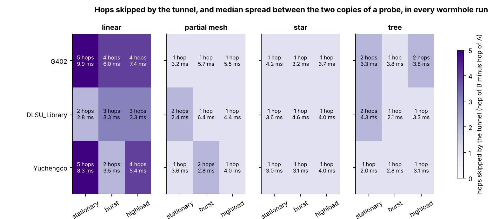

*Each cell is one run. Darker purple = more hops skipped. Linear is the only topology with deep shortcuts (2 to 5 hops); star is always 1. The second number in each cell is the median gap between the two copies in ms. The largest gaps (9.9 and 8.3 ms) sit in the two 5-hop linear cells, but with 36 runs the trend is not significant (Spearman 0.25, p = 0.14).*

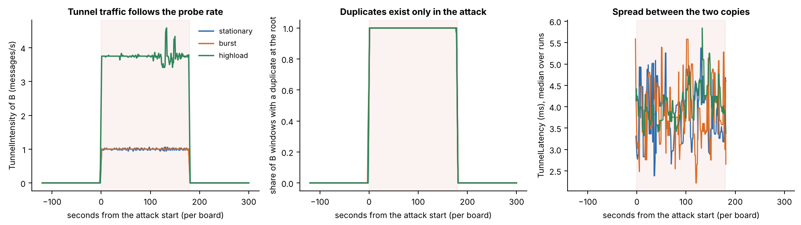

*Left: TunnelIntensity of B jumps from 0 to about 1 msg/s (4 in highload) only during the shaded attack. Middle: share of B's windows with a duplicate goes from 0 to 1 and back. Right: the spread between copies, only defined during the attack.*

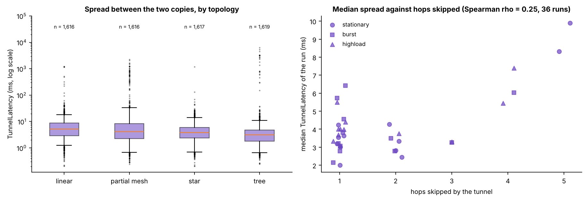

*Left: box plots on a log scale; the typical spread is a few ms in every topology. Right: one point per run. Most runs skip 1 or 2 hops and sit at 2 to 6 ms; the few 4- and 5-hop runs sit higher (5.4 to 9.9 ms), but too few runs exist to call it a trend (Spearman 0.25, p = 0.14).*

### 6.5 The single-feature audit (Section 6.2.3)

**The question:** if one feature alone already separates attack from normal, clustering adds nothing, or the feature is an artefact of how the data were made (Arp et al. [80], "spurious correlation"). So every feature is tested alone.

**Method:** pick the single best threshold on the feature (looking at the labels), count how many windows it labels correctly. Compare with the **majority rate** (always answer "normal").

**Worked example: why the majority rate is about 70%.**

**0. Given.**

- Normal time per run = baseline 300 s + cooldown 120 s = 420 s
- Attack time per run = 180 s
- Find: the accuracy of always answering "normal"

**1. Write the rule.** Always guessing the bigger class is right for every normal window.

$$\text{majority rate} = \frac{\text{normal seconds}}{\text{all labelled seconds}}$$

**2. Substitute.**

$$\text{majority rate} = \frac{420}{300 + 180 + 120} = \frac{420}{600}$$

$$\text{majority rate} = 0.70$$

**3. Verify.** The paper's measured majority rates are 70.0% and 70.1%, matching.

**Answer:** 70%. A feature at 70% knows nothing; a feature well above 70% separates the windows by itself.

**Blackhole results (Table 6.13)**

| Feature | All boards but root | Non-attacker nodes | Victims only |
|---|---|---|---|
| PDR | 86.9%† | 86.9% | **99.9%** |
| LatencyHopRatio | 84.3%† | 84.3%† | 100.0%† |
| ForwardingRatio / ConsistencyScore | 80.4%† | 71.7%† | 70.0%† |
| RSSI and topology features (best of 7) | 70.0% | 70.0% | 70.1% |
| Aligned run clock | 80.0% | 80.0% | 80.0% |
| Majority rate | 70.0% | 70.0% | 70.1% |

† = missing in more than 5% of windows, so judged only where it has a value.

- **PDR on victims = 99.9%:** a complete delivery collapse is separable **by construction**. Expected for a blackhole.
- **PDR on all non-attacker nodes only 86.9%:** because **bystanders carry the attack label but behave normally**.
- **LatencyHopRatio's 100% is fake information:** it only has a value when a probe was delivered, which is almost always a normal window. The real information is in **whether it is missing**: that alone predicts a victim's label with 99.2% accuracy. Hence it is **excluded from clustering**.
- **The run clock gives 80%:** every run follows the same schedule, so "where in the run" partly gives away the phase. It is kept out of the model inputs.
- **Every RSSI and topology feature stays at the majority rate:** the blackhole leaves no trace on them.

**Wormhole results (Table 6.14)**

| Feature | Non-attacker nodes | Ends A and B | End B only |
|---|---|---|---|
| TunnelIntensity / TunnelBytes | no value | **99.7%** | **99.7%** |
| TunnelLatency | no value | 100.0%† | 100.0%† |
| RetryRate | 70.0% | 76.9%† | **100.0%** |
| Every other feature | ≤ 70.0% | ≤ 70.0% | ≤ 70.0% |
| Majority rate | 70.0% | 70.0% | 70.0% |

- Tunnel features decide the label on the ends because the tunnel carries messages **only** in the attack.
- RetryRate reaches 100% on B **only because on B that counter holds the tunnelled frames**. It records the attack by construction, not retries.
- **On the non-attacker nodes no feature beats the majority rate by more than 0.01 points:** the wormhole leaves the other boards completely untouched.

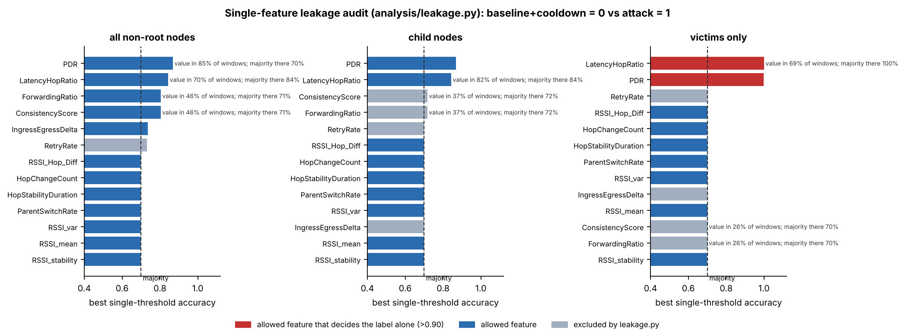

*Each bar = one feature's best accuracy; the dashed line = the ~70% majority rate. A bar ending at the line knows nothing. Red bars decide the label alone (above 90%), blue are other allowed features, grey are features the leakage guard excludes. Look at the right panel: only PDR shoots up.*

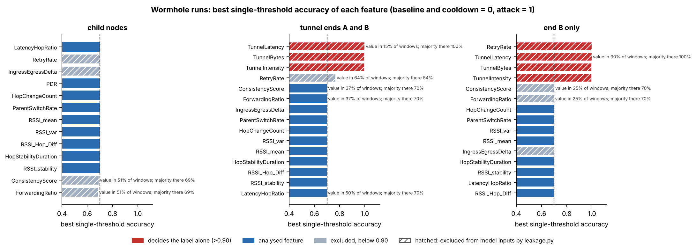

*Same layout. Left panel (non-attacker nodes): everything sits on the line. Middle and right (the ends): only tunnel features and B's RetryRate rise, and those are all excluded from model inputs.*

> [!note] The leakage guard
> A list in the analysis code of columns that may **never** be model inputs, with a reason for each: RetryRate (app counter, and the tunnel count on B), the three tunnel features (they exist only on the ends, so their presence reveals the run type), and the three relay features (excluded unless more than one kind of node reports them). LatencyHopRatio is also kept out because its missingness gives the label away.

### 6.6 Predictions tested and not observed (Section 6.2.4)

**Blackhole (Table 3.4):** victims were predicted to retransmit more.

- App-counter RetryRate of victims: 0.0000 -> **0.0004** -> 0.0000 (a failed send in only **9 of 21,742** attack windows).
- ParentSwitchRate of victims: 0.00000 -> 0.00009 (Cohen's d = 0.01).
- **Sniffer (real 802.11 retry bit)** in 7 runs: victims 0.295 -> 0.364 -> 0.323, but the change **differs in sign between runs** (3 up, 4 down). No consistent rise, though 7 runs are too few to rule out a small effect.
- **Why:** the attacker still ACKs every frame at the link layer.

**Wormhole (Table 3.5 vs. Table 6.16)**

| Indicator | Observed? | Measured |
|---|---|---|
| Hop count consistency | **No** | Hop of A and B constant; 0 windows with a hop change in any phase |
| Parent-child validity | **No** | 0 windows with a parent change |
| Routing table entries | Not measured | Firmware does not log the routing table |
| RSSI-hop correlation | **No** | RSSI_Hop_Diff A 2.79 -> 2.76 dB; B 5.41 -> 5.68 dB |
| RSSI variance | **No** | d = -0.03 (A), -0.07 (B) |
| Frame arrival pattern | **Yes** (duplicates); out-of-order rare | 99.86% duplicates; 0.93% out of order |
| Retransmission count | Not measurable on the ends | B's counter holds tunnel frames; others 0 |
| Duplicate arrivals | **Yes** | 6,468 of 6,469 attack windows |
| Latency mismatch | **Yes** | Median spread 3.9 ms |

- **Pattern:** the 3 indicators that belong to the **traffic** the tunnel creates are observed; the 4 that belong to **routing and radio** are not. Exactly what an application-layer tunnel implies.

### 6.7 Benign runs: no attack signature (Section 6.2.6)

- The benign run is tested with the same tests, pointed the other way: cooldown vs. baseline, and **no signature may pass**.
- All 8: **BENIGN CONFIRMED, strong**. 0 of 21 evaluable signature checks passed (43 others needed a tunnel or attacker, so had no data, as expected).
- Mean PDR per run 0.9994 to 1.0000. Only 4 of 54 child boards ever had a window below 1, all in linear/G402/highload (lowest 0.75).

### 6.8 Exploratory data analysis (Section 6.3)

#### Cohen's d, the effect size used everywhere

- **d** = (attack mean - baseline mean) / pooled standard deviation.
- Reading: |d| below 0.2 negligible, about 0.5 medium, 0.8 or more large. Negative = lower during the attack.
- **Not a significance test:** windows of one board follow each other and are not independent, so d only describes the **size** of a shift.

**Worked example: what d = -29.71 for victim PDR means.**

**0. Given.**

- Baseline mean PDR = 0.9977, attack mean = 0.0000, d = -29.71
- Find: the pooled SD this implies, and what the d says

**1. Rearrange the definition.**

$$s_{pooled} = \frac{\bar{x}_{attack} - \bar{x}_{baseline}}{d}$$

**2. Substitute.**

$$s_{pooled} = \frac{0.0000 - 0.9977}{-29.71}$$

$$s_{pooled} \approx 0.0336$$

**3. Interpret.** The means moved by almost 30 times the typical spread. For comparison, "large" starts at 0.8.

**Answer:** a gigantic shift. Every other feature of victims and bystanders moved by |d| < 0.1.

#### Blackhole EDA (Table 6.18)

- **Only victim PDR moves** (d = -29.71). Every other feature, for both groups: |d| < 0.1. Largest: RSSI_var of bystanders, d = -0.09.
- Victims' RSSI is about 2.5 dB weaker than bystanders' **already in the baseline** (-74.7 vs -72.2 dBm). That is because victims sit deeper, not because of the attack.
- LatencyHopRatio of bystanders falls 4.26 -> 3.15 -> 2.46 ms/hop through the run, and keeps falling **after** the attack; benign runs show the same decline. So it follows the **course of a run**, not the attack.

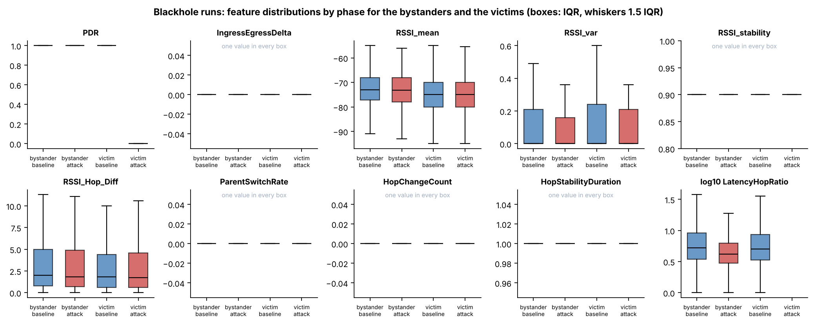

*One panel per feature; blue = baseline, red = attack. Only the PDR panel changes: the victims' attack box sits at 0. Every other panel overlaps between phases or holds one value only.*

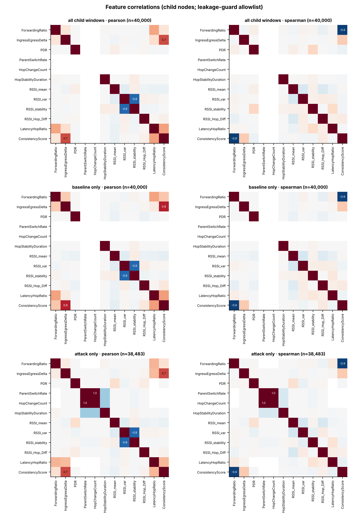

*Left column Pearson, right Spearman; rows = all, baseline, attack windows. Four pairs are strongly correlated, and none of them is a behaviour link the attack created:*

- *ForwardingRatio and ConsistencyScore: one is computed from the other (Spearman -0.94; Pearson only 0.12 because the link is not linear).*
- *IngressEgressDelta and ConsistencyScore: built from the same relay counters (Pearson 0.65; 0.78 in the baseline).*
- *RSSI_var and RSSI_stability: Pearson -0.79 but Spearman only 0.05, so the link comes from a few windows with high variance, not a general relation.*
- *ParentSwitchRate and HopChangeCount: 1.00 in the attack windows only, because both are non-zero in the same few windows and constant in the baseline.*

*No other pair among the 8 FULL-set features exceeds |0.4| (largest 0.36).*

#### Wormhole EDA (Table 6.19)

- On the ends, **only tunnel features change**: TunnelIntensity 0 -> 1.92 msg/s (d = 1.83), TunnelBytes 0 -> 57.5 bytes (30 bytes x 1.92).
- RetryRate of B 0.00 -> 0.50 (d = 42.99), but that is the tunnel counter, not retries.
- Non-attacker nodes: PDR 0.9999 -> 0.9999; RSSI_var d = -0.06 (largest). **Nothing moves.**
- RSSI_Hop_Diff is higher on B (5.4 dB) than elsewhere (2.7 to 2.8), but it is equally high **before** the attack, so it reflects where B sits.

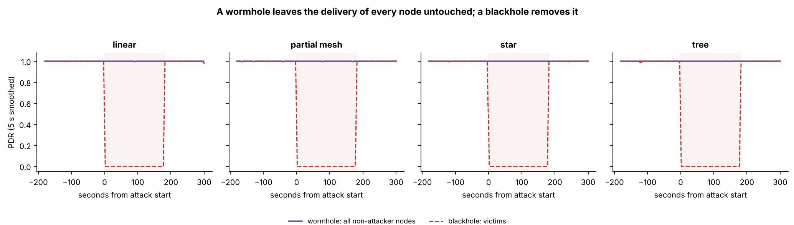

*Solid purple (wormhole boards) never leaves 1; dashed red (blackhole victims) falls to 0 for the whole attack. This is the one-picture contrast between the two attacks.*

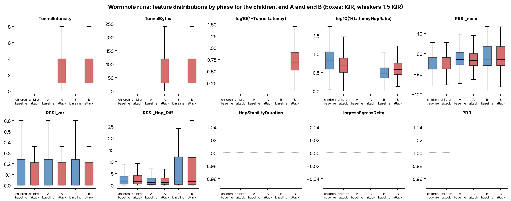

*Only the tunnel panels change, and only on the ends. RSSI boxes coincide between phases for every group.*

#### Benign runs and the "capture effect" (Section 6.3.3)

- Benign delivery is complete; no hop change in any run; 1 parent change in all 8 runs.
- The probe rate matches the scenario in both kinds of run (about 1.0, 1.1 and 3.9 per board per second).
- **The important finding (Tables 6.22 and 6.23):** the only big difference between benign and attack-run normal windows is **RSSI_mean** (d = 0.69 vs blackhole runs). Comparing each benign run with the baseline of the attack run **of the same cell**: RSSI_mean differs by **8.1 dB** (vs the blackhole run) and **7.1 dB** (vs the wormhole run) on average, in **both directions** (Table 6.23).
  - Meaning: every capture is a fresh set-up of the boards, and signal strength depends on exactly where they stand. **RSSI_mean separates captures, not attacks.** This matters for clustering: it can split windows by set-up instead of by attack.
- The benign cooldown stays within 0.5 baseline SDs of its baseline in **24 of 24** comparisons: no drift a detector could mistake for an attack.

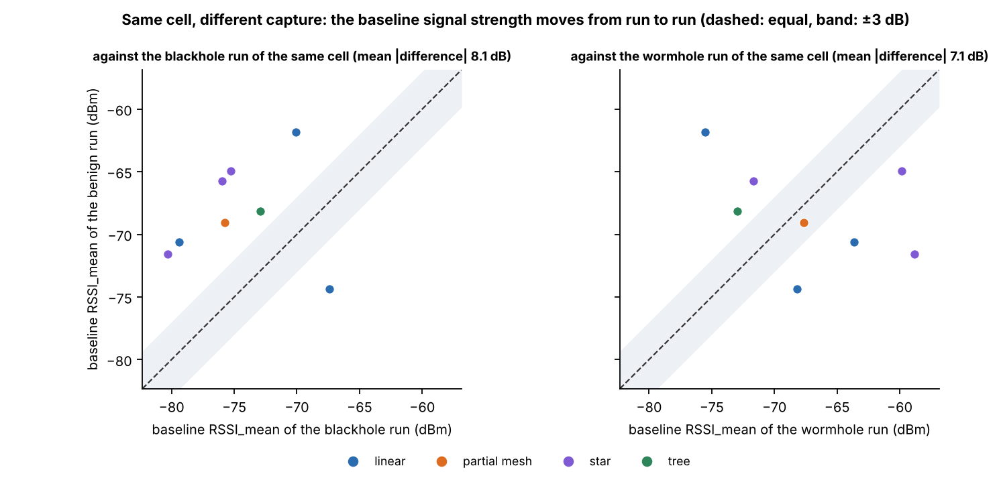

*Each point is one benign run; the dashed line means "equal" and the band is ±3 dB. Points fall on both sides and mostly outside the band: two captures of the same cell can differ by several dB with no attack involved.*

> [!note] The other benign figures
> Figure 6.13 (benign delivery over time: flat at 1, with tiny dips only in linear/G402/highload), Figure 6.14 (probe rate and PDR by scenario: same in benign and attack runs), Figure 6.15 (normal windows, benign vs. attack runs: only RSSI_mean differs). They are in `images/` as fig-6-13 to fig-6-15.

### Check-in (Part 6)

- **Q:** PDR separates victims at 99.9% but all non-attacker nodes at only 86.9%. Why the gap, and is it a flaw in the data?
- **Your answer:** *(pending)*

> [!question]- Answer (click to reveal)
> The label is set by phase for **every** board in the run, so bystanders' attack-phase windows carry label 1 even though nothing happened to their traffic (their PDR stays at 1.000). No feature of a bystander can reveal an attack that did not reach it, so any feature-based method misclassifies them. It is not a flaw in the data: it is how the labelling is defined, and the paper reports the victims-only figure next to the all-nodes figure for that reason.
>
> 📖 **Review it:** Section 6.2.3 and Section 6.4.3

---

## Part 7: Chapter 6.4 to 6.5, Clustering and Discussion

### 7.1 What clustering is asking

- **Clustering** groups windows **only by how similar their feature values are**. The algorithm is **never shown the label**.
- Afterwards, the label is used to **score** the groups: did the groups the algorithm found line up with normal vs. attack?
- Analogy: you dump 6,000 photos on a table and ask a friend who has never seen your albums to sort them into piles by look alone. Then you check whether the piles match your albums. The friend never saw the album names; you only use them to grade the piles.
  - Where the analogy breaks: the friend might sort by brightness (a property of the camera, not the subject). That is exactly what happens later with RSSI_mean, which sorts windows by **set-up**, not by attack.

### 7.2 The five algorithms in plain words

| Algorithm | How it groups | Needs k? |
|---|---|---|
| **K-Means** | Picks k centres, puts every window with its nearest centre, moves centres, repeats | Yes |
| **Ward (hierarchical)** | Starts with every window alone, keeps merging the two groups whose merge adds the least spread | Yes (where to cut the tree) |
| **GMM (Gaussian mixture)** | Assumes the data are k overlapping bell curves; each window gets a probability of belonging to each | Yes |
| **DBSCAN** (primary in the plan) | Groups windows in dense regions; isolated windows are labelled **noise** | No (needs eps and min_samples) |
| **Spectral** | Builds a similarity graph and splits it using its eigenvectors; good for odd shapes | Yes |

- **Setup (6.4.1):** standardised features; k from 2 to 8; three seeds (**42, 7, 123**), each drawing a fresh sample of **6,000 windows** and restarting the algorithm. Results are means over seeds, with k = 2 unless stated.
- **DBSCAN settings:** min_samples between D+1 and 2D (D = number of features); **eps** at the knee of the k-distance graph (Figure 6.17); the setting with the best silhouette is kept.

### 7.3 The four scores

| Score | Range | Better | What it measures | Uses the label? |
|---|---|---|---|---|
| **Silhouette** | -1 to 1 | higher | how close a window is to its own cluster vs. the nearest other | No |
| **Davies-Bouldin** | 0 and up | lower | how compact and far apart the clusters are | No |
| **Purity** | 0 to 1 | higher | share of windows carrying their cluster's majority label | Yes (afterwards) |
| **ARI** (adjusted Rand index) | -1 to 1 | higher | agreement between clusters and labels, **corrected for chance**: 1 = exact, 0 = chance | Yes (afterwards) |

- Silhouette and Davies-Bouldin describe the **shape** of clusters. Purity and ARI describe **agreement with the label**. A high silhouette does **not** mean the clusters match the attack (see 7.6).
- **Purity trap:** purity 0.702 is just the majority rate of the sample, i.e. **no separation at all**. Always read purity against the majority rate.

### 7.4 The three feature sets (Table 6.24)

| Set | Features | Count | Why |
|---|---|---|---|
| **FULL** | PDR, ParentSwitchRate, HopChangeCount, HopStabilityDuration, RSSI_mean, RSSI_var, RSSI_stability, RSSI_Hop_Diff | 8 | Everything allowed after the leakage guard |
| **REDUCED** | PDR, RSSI_mean, RSSI_var, RSSI_Hop_Diff | 4 | FULL after the **low-variance filter** (drop if more than 90% of windows share one value) and the **correlation filter** (drop if \|r\| > 0.85) |
| **REDUCED without PDR** | RSSI_mean, RSSI_var, RSSI_Hop_Diff | 3 | **Control:** does anything other than PDR separate the attack? |

- Why 16 features shrink to 8: the relay features, RetryRate and the tunnel features are blocked by the leakage guard, and LatencyHopRatio is blocked because its missingness alone predicts the label in 86% of windows.
- The low-variance filter removed ParentSwitchRate (100% one value), HopChangeCount (100%), HopStabilityDuration (99.8%) and RSSI_stability (98.5%). The correlation filter removed nothing (largest |r| was 0.11).
- **Two populations:** all non-attacker nodes (127,372 windows), and victims only (72,687 windows).

### 7.5 Blackhole clustering results (Table 6.25, means over 3 seeds, k = 2)

| Set | Algorithm | ARI, all non-attacker | ARI, victims only |
|---|---|---|---|
| REDUCED | **K-Means** | **0.514** | **0.996** |
| REDUCED | Ward | 0.503 | 0.891 |
| REDUCED | GMM | 0.514 | 0.659 |
| REDUCED | DBSCAN (5 to 9 clusters) | 0.485 | 0.940 |
| REDUCED | Spectral | -0.001 | 0.008 |
| FULL | K-Means | 0.172 | -0.001 |
| FULL | DBSCAN | 0.476 | 0.929 |
| Without PDR | **every algorithm, every k (2 to 8)** | **-0.016 to 0.002** | about 0 |

**How to read it in three sentences:**

1. **With PDR**, K-Means at k = 2 on REDUCED reaches **0.514 on all non-attacker nodes** and **0.996 on victims**.
2. **Without PDR**, nothing works: ARI between -0.016 and 0.002 for every algorithm and every k, on both populations.
3. So the whole separation is carried by **one feature, PDR**. The blackhole leaves no mark on signal strength or topology.

### 7.6 Why 0.514 is actually "perfect" (the ceiling of 0.515)

- 43.2% of the attack-labelled non-attacker windows (16,499 of 38,232) are **bystander** windows: labelled attack, behaving normally.
- No method that reads only a window's features can put those with the attack. So the **best possible** clustering is: victim attack windows in one group, everything else in the other. Its ARI is the **ceiling**.

**Worked example: computing the ceiling from the paper's own window counts.**

**0. Given.**

- Victim attack windows = 21,733 (label attack)
- Bystander attack windows = 16,499 (label attack)
- Normal windows = 89,140 (label normal)
- Best partition: cluster 1 = the 21,733 victim attack windows; cluster 2 = the other 105,639
- Find: the ARI of that partition

**1. Build the contingency table** (rows = clusters, columns = labels).

| | Label attack | Label normal | Row total |
|---|---|---|---|
| Cluster 1 | 21,733 | 0 | 21,733 |
| Cluster 2 | 16,499 | 89,140 | 105,639 |
| Column total | 38,232 | 89,140 | N = 127,372 |

**2. Write the ARI.** It counts pairs of windows that are together in both the clustering and the labels, minus what chance would give, scaled so a perfect match is 1. With C(x, 2) = x(x - 1)/2:

$$\text{ARI} = \frac{\sum_{ij} C(n_{ij},2) - E}{\tfrac{1}{2}\left[\sum_i C(a_i,2) + \sum_j C(b_j,2)\right] - E}, \quad E = \frac{\sum_i C(a_i,2)\,\sum_j C(b_j,2)}{C(N,2)}$$

**3. Compute the pieces** (rounded).

$$\sum_{ij} C(n_{ij},2) = 4.3452\times10^{9}$$

$$\sum_i C(a_i,2) = 5.8159\times10^{9}, \quad \sum_j C(b_j,2) = 4.7037\times10^{9}, \quad C(N,2) = 8.1117\times10^{9}$$

$$E = \frac{5.8159\times10^{9}\times4.7037\times10^{9}}{8.1117\times10^{9}} = 3.3725\times10^{9}$$

$$\text{max} = \tfrac{1}{2}(5.8159 + 4.7037)\times10^{9} = 5.2598\times10^{9}$$

**4. Divide.**

$$\text{ARI} = \frac{4.3452 - 3.3725}{5.2598 - 3.3725} = \frac{0.9727}{1.8873}$$

$$\text{ARI} \approx 0.515$$

**5. Verify.** This is exactly the paper's best possible value (0.515), and the purity of this partition is (21,733 + 89,140) / 127,372 = 0.870, which is K-Means' purity in Table 6.25.

**Answer:** the ceiling is 0.515. K-Means' 0.514 means it found **essentially exactly** the windows in which the attack is felt.

> [!tip] Takeaway
> When a panelist says "ARI 0.514 is only moderate", answer: the maximum any feature-based method can reach on these labels is 0.515, because 43% of the attack-labelled windows are bystanders that the attack never touched. On victims alone the same method scores 0.996.

### 7.7 Why the silhouette picks the wrong answer (6.4.3)

- On the FULL set, K-Means and Ward have their **highest silhouette at k = 2** (0.77 and 0.90), yet the split is **not** the attack:
  - K-Means ARI per seed = 0.515, 0.000, 0.000 (mean 0.172). On seed 7 the small cluster was 44 windows with extreme RSSI variance; on seed 123 it was **one** window where a board changed parent.
- Lesson: choose k with the elbow, the silhouette **and interpretability** together, as Chapter 4 planned, never silhouette alone. The attack is recovered at k = 4 (K-Means 0.505).
- **Spectral** finds the attack on one seed and not the others (huge spread), so it is reported but not relied on. **DBSCAN** agrees with K-Means.

**K-Means clusters at k = 2 on REDUCED (Table 6.26, seed 42)**

| Measure | Cluster A (no delivery loss) | Cluster B (delivery lost) |
|---|---|---|
| Windows | 4,990 | 1,010 |
| Attack-phase windows | 15.2% | **99.4%** |
| From victims | 48.2% | 99.7% |
| Mean PDR | 1.000 | **0.000** |
| Mean RSSI_mean | -73.6 dBm | -74.9 dBm |
| Mean RSSI_var | 0.315 | 0.322 |

- Cluster B is the victims under attack, separated **by PDR alone**. The RSSI columns barely differ.

**Robustness (6.4.4):** inside every site and every topology, K-Means stays within 0.03 of that subgroup's ceiling (star: 0.999, because the star has no bystanders), and stays at 0 without PDR. **Run-level check:** one model applied to all windows gives ARI 0.511 with a 95% interval of **0.41 to 0.63** when the 36 runs are resampled. That is much wider than the seed spread (SD 0.014), because the windows come from only 36 runs.

### 7.8 The key figures of clustering

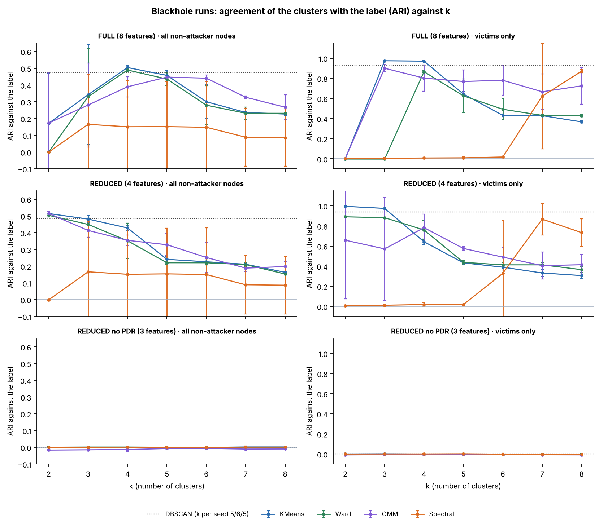

*Rows = feature sets (FULL, REDUCED, without PDR); left = all non-attacker nodes, right = victims only; each line = one algorithm with ±1 SD bars over seeds; dotted = DBSCAN. Look at the bottom row: flat at 0 for every algorithm and every k. That flat row is the whole argument that PDR carries the separation.*

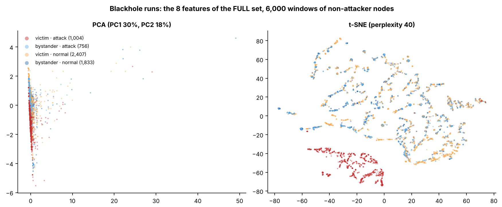

*Each dot = one window (6,000 sampled). Red = victim attack windows. In the t-SNE (right) the red windows form their own island at the bottom; the light-blue bystander attack windows sit among the normal ones. PCA (left) is squashed into a column because a few extreme RSSI-variance windows dominate the first component.*

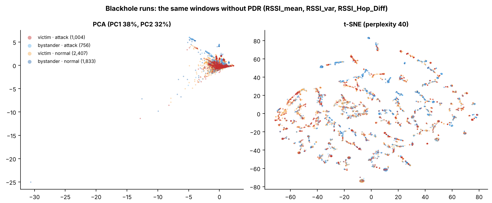

*Same plot with only the three RSSI features. All four colours sit on top of each other: without PDR there is no structure to find.*

> [!note] How to read PCA and t-SNE
> - **PCA** rotates the data so the first axis holds the most variance (here PC1 30%, PC2 18%). Axes are in standardised feature units.
> - **t-SNE** places windows with similar features near each other. Its **axes have no units**; only **nearness** means anything. Never read distances between far islands.
> - A "group" in a picture is not a cluster. A cluster is the output of an algorithm.

Other clustering figures in `images/`: Figure 6.17 (DBSCAN k-distance knees: eps 0.79, 0.73, 0.56), 6.19 (silhouette vs k), 6.20 (Davies-Bouldin vs k), 6.21 (cluster composition at k = 3: with PDR one cluster is entirely red).

### 7.9 Wormhole clustering (6.4.6, Table 6.28)

- **Non-attacker boards, all feature sets:** ARI -0.012 to 0.003 for every algorithm and k. Expected: the wormhole does not touch them.
- **The two ends with only the cross-layer RSSI features** (and LatencyHopRatio on B): ARI -0.012 to 0.009. **No separation.**
- **Diagnostic: add TunnelIntensity** (excluded from model inputs by the leakage guard, used only to ask "is there any tunnel signal a clusterer can find?"):
  - K-Means k = 2 on B: ARI **0.000**, because it splits by **signal level** (mean RSSI -67.6 vs -47.1 dBm, which varies between runs), not by tunnel activity.
  - K-Means k = 3: a third cluster of 540 windows, all wormhole, mean TunnelIntensity 4.04 (the highload runs); ARI 0.141.
  - **DBSCAN on B: ARI 0.827** (9 to 12 nearly pure clusters).
- Conclusion: a tunnel signal **exists** in the data, but it is carried by the attackers' **own counters**, not by the cross-layer features.

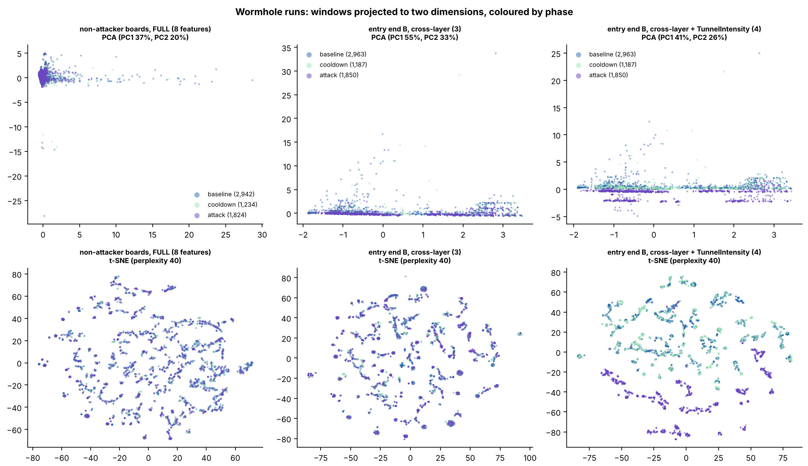

*Purple = attack. Left two columns (non-attacker boards; end B with cross-layer features): phases overlap completely. Right column (end B with TunnelIntensity added): the attack windows split off, because TunnelIntensity is exactly 0 in every normal window.*

### 7.10 Pooled: all 80 runs, three labels (6.4.7)

- Non-attacker boards of all 80 runs, **257,258 windows**, labels: normal 0, blackhole 1, wormhole 2.

| Group | Label | Windows |
|---|---|---|
| normal, benign run | 0 | 22,481 |
| normal, blackhole run | 0 | 89,140 |
| normal, wormhole run | 0 | 75,211 |
| blackhole attack, victim | 1 | 21,733 |
| blackhole attack, bystander | 1 | 16,499 |
| wormhole attack, other board | 2 | 32,194 |

- **Ceiling:** victim attack windows vs. everything else = **0.334** (80 runs) and **0.317** (72 attack runs), as the paper reports them. (Our own recomputation, not in the paper: these are the values on the 6,000-window samples; on all windows the same partition gives about 0.337 and 0.323, and the small difference is sampling.)
- **K-Means k = 2, REDUCED: 0.333 (80 runs) and 0.315 (72 runs)**, equal to the ceiling. It finds the blackhole victims and **nothing else**.
- Without PDR: -0.023 to 0.005. Nothing.
- **Used as a detector** (one model fitted on 6,000 windows, applied to all, Table 6.32):

| Group | In the "victim" cluster |
|---|---|
| Victim attack windows | **21,733 of 21,733 (100%)** |
| Benign windows | **0 of 22,481** (no false alarm) |
| Normal windows of blackhole runs | 183 of 89,140 (0.21%) |
| Wormhole attack windows | 3 of 32,194 (0.01%) |
| Bystander attack windows | 0 |

- The benign runs raise **no alarm**, and the **wormhole is not detected at all** by the non-attacker features. Adding or removing the benign runs changes K-Means' ARI by only 0.017.

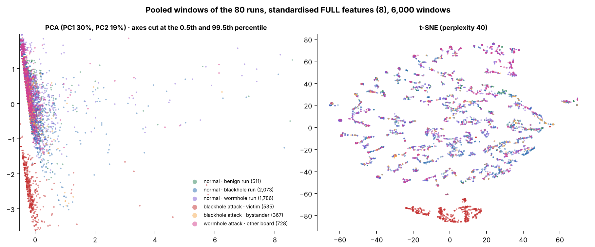

*Six colours = six groups of the table above. Only red (victim attack windows) stands apart; the other five overlap, including pink (wormhole attack).*

### 7.11 Discussion (6.5)

**What each kind of run leaves in the data (Table 6.33)**

| Kind | Direct record | Cross-layer features that change | Clustering |
|---|---|---|---|
| Blackhole | Attacker FR 1.000-1.004 -> 0.000-0.007; victim PDR 0.998 -> 0.000 | **PDR of victims only** (d = -29.7); all others \|d\| < 0.1 | 0.514 (ceiling 0.515); 0.996 victims; ~0 without PDR |
| Wormhole | B's probes reach the root twice (99.86%); TunnelIntensity 0 -> 1.92 | **None** (\|d\| ≤ 0.07; hop and parent unchanged) | ~0 without a tunnel feature; DBSCAN 0.827 on B with TunnelIntensity |
| Benign | 0 of 21 signature checks passed; PDR 0.9994 to 1.0000 | Cooldown within 0.5 SD of baseline in 24 of 24 | 0 of 22,481 in the victim cluster |

- **Main reading:** Chapter 4 expected a "confluence of cross-layer evidence". The data show the evidence sits in the **data plane**: delivery (blackhole) and duplication (wormhole). The PHY, MAC and network features stay where they were.
- **Honest qualifier the paper makes itself:** PDR is also what the verifier uses to confirm the blackhole, so the clustering's agreement shows it finds the effect the verifier measured. It is **not independent evidence** that cross-layer features detect the blackhole.

**Comparison with published studies (Table 6.34)**

| Feature | This study | Published | Reading |
|---|---|---|---|
| Baseline PDR | 0.998 (victims), 0.996 (bystanders), 0.9994 to 1.0000 (benign) | > 0.97, Khan et al. [22], same ESP32 platform | Agree in size; counting differs, so not claimed equal |
| PDR under blackhole | 0.000 | 25% to 40% delivery (60% to 75% loss), Airehrour et al. [70], RPL | Same direction; bigger here because our attacker sits on the victims' path by placement |
| Parent changes under blackhole | 0.00000 -> 0.00009 per s | 16 to 246 rank changes [70] | Differs: their attack acts on routing; ours does not (D-20) |
| Wormhole hop count | Constant | 4 hops -> 3 hops, Zhukabayeva et al. [71], ZigBee | Their tunnel is a route ZigBee adopts; ours is an app relay |
| Wormhole delay | Spread of 3.9 ms; LatencyHopRatio of B unchanged | 80-100 ms -> 120-200 ms (about +40%) [71] | Different measure |
| Duplicate arrivals | 99.86% of B's probes, 0 in baseline | Duplicated routing packets proposed as a signature, Ramírez Gómez et al. [72] | Same kind of evidence, different layer |

**What an emulation can and cannot show (6.5.3), three consequences:**

1. Results describe what **this kind** of attack does to traffic and features, not what a routing-protocol attack would do.
2. A detector tested on these blackhole windows is tested on **delivery loss**; on these wormhole windows, on **duplication**. Both are visible at the root without cross-layer features.
3. Whether cross-layer features add anything is **open**; it needs a dataset of attacks that act on routing.

**Limits (6.5.4):**

- One run per cell (no repeats); baseline RSSI_mean differs by 8.1 dB (blackhole) and 7.1 dB (wormhole) on average between captures of the same cell.
- Windows are not independent: the real sample size is closer to **80 runs** than to 456,195 windows.
- Partial mesh behaved as a plain tree (2-children limit), no adaptive parent switching.
- Tree fan-out differs between runs (root 2 to 5 children).
- The phase label marks bystanders as attack: ceilings 0.515 (blackhole) and 0.334 / 0.317 (pooled).
- Only 8 benign runs (54 child boards): they show no false alarm, but **cannot give a false-alarm rate**.
- No routing-table logging, no MAC retry count, sniffer on only 7 runs.
- Results are for 8 ESP32 boards at three indoor sites, not larger meshes.

### Check-in (Part 7)

- **Q:** Without PDR, every algorithm scores ARI ≈ 0 on the blackhole. Does that mean the cross-layer features are useless for detection? Answer the way the paper does.
- **Your answer:** *(pending)*

> [!question]- Answer (click to reveal)
> No, it means they are not affected by **these emulated** attacks. Both attacks act on the application-layer probes and leave the radio and the routing unchanged (D-20), so there is nothing for RSSI or topology features to detect. Whether cross-layer features help against attacks that **do** manipulate routing remains open and needs a different dataset (Section 6.5.3, and Recommendation 1 in Chapter 7).
>
> 📖 **Review it:** Sections 6.5.1 and 6.5.3

---

## Part 8: Chapter 7, Conclusion

### 8.1 Summary of the study (7.1, 7.2)

- 8 ESP32 boards (1 root, 7 children), normal operation plus two attacks emulated at the application layer, 4 topologies, 3 sites, 3 scenarios.
- **80 runs** (36 blackhole, 36 wormhole, 8 benign); each with 300 s baseline, 180 s attack (where applicable), 120 s cooldown.
- **456,195** windows generated, **369,678** analysed (266,491 normal, 103,187 attack); 16 features; 5 clustering algorithms.
- Quality: 1,372 windows (0.30%) dropped; no run lost more than 1%; 637 files, none empty; one board (B768, a bystander) with no data.

### 8.2 Evidence that the dataset is valid (7.3)

- **All 72 attack runs passed** the verifier (67 complete, 5 minor gaps); all 8 benign runs confirmed benign.
- **Blackhole:** ForwardingRatio 1.000-1.004 -> 0.000-0.007; PDR 0.998 -> 0.000; 121 of 123 victims cut off in the first second, the other 2 in the next; recovery within 3 s (median 2 s); bystanders 1.000.
- **Wormhole:** exit end received 99% to 101% of tunnel messages; 12,448 of 12,465 probes (99.86%) arrived twice; duplicates in 6,468 of 6,469 attack windows (99.98%), none outside the attack; 1 to 5 hops skipped; hop counts unchanged.

### 8.3 Answers to the research objectives (7.4)

- **Objective 1, testbed: achieved** (qualifiers: emulated attacks; partial mesh = branched trees).
- **Objective 2, labelled cross-layer dataset: achieved** (qualifier: no MAC retry count, D-15).
- **Objective 3, separability: differs by attack.**
  - Blackhole: only victim PDR moved (0.998 -> 0.000). With PDR, K-Means ARI 0.514 vs best possible 0.515. Without PDR, -0.016 to 0.002.
  - Wormhole: cross-layer features ARI -0.012 to 0.009. Visible only through the ends' counters and duplicate arrivals.
  - Pooled 80 runs, 3 labels: 0.333 vs best 0.334.
- **The expected cross-layer evidence from Chapter 4 was not found**, because both attacks left the radio and routing unchanged. **The researchers consider this an important finding, not a failure.**

### 8.4 Main findings, contributions, limitations (7.5)

**Four findings**

1. Blackhole -> clear delivery loss among victims; PDR is the strongest indicator.
2. Wormhole -> duplicate arrivals at the root, consistently, only during the attack.
3. Other expected changes (retransmissions, parent changes, hop counts, signal-to-hop) were **not** observed.
4. Clustering depends heavily on the features used; removing the main attack feature collapses performance.

**Three contributions**

1. An ESP32 mesh **testbed** for normal behaviour and two attacks under varied conditions.
2. A **dataset** of 80 runs with topology, site, scenario, role and phase on every row.
3. A **verification process** that separates real attack effects from missing data or broken runs. Firmware and tools are in the project repository [79].

**Six limitations**

1. Application-layer attacks only.
2. Only 8 boards.
3. Only 8 benign runs (no reliable false-alarm rate).
4. No direct MAC retry measurement; sniffer on some runs only.
5. Not enough repeats per condition.
6. Strong results depend on features tied to the attack implementation.

### 8.5 Recommendations (7.6)

| Recommendation | What it means in practice |
|---|---|
| **Test attacks that directly affect routing** | A routing implementation that can be modified, or radio-level tools (forged management frames), to see if parent, hop, retry and RSSI features then react |
| **Collect more normal data** | More benign runs in every topology, site and scenario, with repeats, to estimate a false-alarm rate |
| **Improve network measurements** | Sniffer on every run; compare Tables 3.4 and 3.5 with what the testbed can actually measure |
| **Test more wormhole scenarios** | Tunnel other nodes' traffic, not only B's own probes; other layouts and traffic |
| **Improve the evaluation of detection models** | Hold out whole runs as test data; compare against simple baselines (PDR for blackhole, duplicates for wormhole); test with the main attack feature removed |

### 8.6 Final conclusion (7.7), the line to end on

- Both attacks produced clear, measurable changes; the blackhole through delivery, the wormhole through duplicate arrivals.
- Detection depended on those features; the other cross-layer features did not separate the attacks in this setup.
- Because the attacks were application-layer, the results are not proof for routing-level attacks.
- The study gives a validated testbed, a documented dataset and a verification process as a **starting point** for ESP32 mesh attack research.

### Check-in (Part 8)

- **Q:** Name the three contributions and the single most important limitation.
- **Your answer:** *(pending)*

> [!question]- Answer (click to reveal)
> - **Contributions:** (1) the ESP32 mesh testbed, (2) the 80-run labelled dataset, (3) the verification process that confirms every run.
> - **Most important limitation:** the attacks are emulated at the application layer (D-20), so they never change routing or the radio, which is why the cross-layer features did not respond.
>
> 📖 **Review it:** Section 7.5

---

## Part 9: Panel question bank

> [!note] How to use this bank
> The answers are **fact outlines**, not a script. Say them in your own words; the panel and the adviser want the team's own voice.

### About the attacks

- **"Your blackhole doesn't attract traffic. Is it really a blackhole?"**
  - It meets 5 of the 6 criteria of Airehrour et al. [70] (Table 4.4); it fails only "attracts traffic by advertising a false route".
  - ESP-WIFI-MESH has no API to write routes or fake advertisements (D-20); we made the attacker's **position** the experimental variable instead.
  - We call it "forwarding suppression (blackhole emulation)" and state the gap as the first limitation.
- **"Is your wormhole a wormhole if the topology never changes?"**
  - It has two colluding ends, an out-of-band channel, and capture-and-replay (Table 4.5, Hu, Perrig and Johnson [46]). It does not create a false neighbour.
  - It reproduces the **packet-level** signature: duplicate arrivals (Ramírez Gómez et al. [72]) and a latency mismatch.
- **"Why not just make the root the attacker in the star?"**
  - The root is the destination (nothing to forward to) and the referee (it logs arrivals and drives phases). A dropping root would be grading itself (D-16).
- **"Why does the wormhole have no victims?"**
  - Only B's own probes are tunnelled; the other 5 boards' traffic is untouched by design. The attack is the duplication.

### About the data

- **"Why one-second windows?"**
  - 10 Hz sampling gives 10 samples per window; the 80% rule (8 of 10) is kept; the panel wanted about 10,000 rows per run (D-1, D-9).
- **"Your boards' clocks aren't synchronised. How do you compute delay or delivery?"**
  - Delivery joins the root log to each node on **sequence number**, never time.
  - Each board is aligned to its own exit from phase 0.
  - Delay is **relative** to the sender's fastest delivery (D-2); TunnelLatency cancels the offset exactly (D-3).
- **"Where is the MAC layer in your cross-layer dataset?"**
  - ESP-IDF exposes no MAC retry count (D-15); app counters are kept but not modelled.
  - Real retries were measured from the sniffer's Retry bit in 7 blackhole runs: no consistent rise (3 up, 4 down).
  - The MAC-side claim rests on RSSI and the link/parent state.
- **"Are 8 benign runs enough?"**
  - As a control, yes: none triggered the verifier, none of their 22,481 windows fell in the victim cluster.
  - For a false-alarm rate, no. The paper says so and recommends more benign runs.
- **"How do you know a run is valid and not just noise?"**
  - Every run passes the verifier: 3-sigma signature, topology, dataset, scenario, setup. Rules fixed before reading results.
  - Placebo test: 0 false confirmations in 106. Sensitivity: ±50% thresholds changed no verdict.
- **Questions about Wireshark, the sniffer, or "prove this run really happened":** see Part 11.12.

### About the results

- **"ARI 0.514 is mediocre."**
  - The ceiling is 0.515 because 43.2% of attack-labelled windows are bystanders the attack never reached; victims alone score 0.996.
- **"So your cross-layer features failed?"**
  - They did not respond to **these** attacks because these attacks never touch the radio or routing. That is a finding about the emulation, and the open question (do they help against routing attacks?) is our first recommendation.
- **"If PDR alone detects the blackhole, why cluster at all?"**
  - That is exactly what the single-feature audit tests, and we report it openly.
  - The clustering confirms the dataset carries one clear, separable signal for the blackhole and none in the cross-layer features. Recommendation 5 says any future model must beat a plain PDR threshold.
- **"Why does the run clock give 80%?"**
  - Every run follows the same schedule, so position in the run partly reveals the phase. It is kept out of model inputs.
- **"Why did silhouette say k = 2 is best on FULL when that split isn't the attack?"**
  - Silhouette measures shape, not agreement with the label. It picked a split of a few extreme windows (one parent change, high RSSI variance). We choose k with elbow, silhouette **and** interpretability.
- **"Why is RSSI so different between runs of the same cell?"**
  - Each capture is a fresh set-up; RSSI depends on exact board placement. 8.1 dB (blackhole) and 7.1 dB (wormhole) on average between captures of the same cell, in both directions. It separates captures, not attacks.
- **"Do your results generalise?"**
  - No claim beyond 8 ESP32 boards, three indoor sites, three scenarios, and application-layer attacks (Section 6.5.4).

### About the topologies

- **"Is your partial mesh really a mesh?"**
  - No board ever used a second parent; we report it as a placement-defined branched tree with at most 2 children and claim no adaptive switching (D-29).
- **"Why does the tunnel skip only 1 hop in the star?"**
  - A flat star has every board at hop 1, so nothing could be skipped. Making end A the hub creates the smallest possible shortcut, 1 hop (D-28).

---

## Part 10: Weak spots in the submitted paper

> [!warning] Know these before the panel finds them
> These are sentences in the submitted paper that are out of date or inconsistent. If one comes up, acknowledge it calmly and give the correct fact from Chapter 6.

| Where | What the paper says | The correct fact |
|---|---|---|
| 4.2.2.1, under Figure 4.16 | "Figure 4.16 still shows the earlier flat star and is to be redrawn"; "the first hub-star captures are not yet usable"; "the hub-star design still needs the adviser's approval" | The figure **is** redrawn (A as hub), and all 9 star wormhole runs were captured and confirmed (Table 6.12) |
| 4.2.2.1, under Figure 4.17 | "Figure 4.17 must be redrawn with the attacker as the hub" | It already shows the attacker as the hub with the root behind it |
| 4.2.2.2 | Sticky tree parents "not yet confirmed on hardware" | Tree runs were captured; only 1 of 132 tree boards changed parent in the labelled phases (5.5) |
| 4.2.2.4 | Partial mesh "to be confirmed with the adviser" | Chapter 5 (D-29) states the final decision |
| Ch 4 intro | "While the remaining runs are captured..." | All 80 runs were captured |
| Table 4.4, row 1 | Evidence: "Victims address the attacker" | Since D-12, victims send to their own parent; the tree, not an address, routes them through the attacker |
| 4.2.7.1 vs 6.2 | 4.2.7.1: a zero-SD baseline gives an "undefined" z, "not reported as infinite". 6.2: "z is infinite" | Same situation, two words. Safe phrasing: "the baseline never varied, so any move in the expected direction passes" |
| 4.2.4.2 vs code | IngressEgressDelta "received minus forwarded"; RSSI_Hop_Diff "observed minus baseline median" | The code stores the **absolute** value of both |
| 4.2.3.7 vs Table 6.2 | 457,568 windows formed minus 1,372 discarded = 456,196, but Table 6.2 totals 456,195 | Off by one window; a known open item, not yet traced in the analysis output. If asked, acknowledge it as a one-window bookkeeping difference that has not been traced; it changes no percentage or result (0.30% either way) |
| Ch 6 intro | "(repository snapshot THESIS3, commit 970fb15)" | A development reference left in the body text; drop it if the paper is revised |
| 6.5.3 (twice) | "(Section 6.6)" for route attraction and for the open question about cross-layer features | Section 6.6 no longer exists: future work moved to **Section 7.6** (Recommendations) |
| 6.2.2 | "The spread does not grow with the hops skipped" | Figures 6.4 and 6.6 show the 4- and 5-hop linear runs with the largest gaps. Safe phrasing: "no relation can be claimed from 36 runs (Spearman 0.25, p = 0.14)", which is the paper's own next clause |
| 6.3.3, Figure 6.15 paragraph | Whiskers "reach the 5th and 95th percentiles" | The plotting script for Figure 6.15 uses the default 1.5 × IQR whiskers (found while checking the deck's graph guides) |
| 7.3 | "he attack results were checked" (missing "T") | Typo |
| 7.6 | "directly\`" (stray backtick) | Typo |
| Figures 6.1 to 6.31 | Each carries a small footer with a repository commit and a build date | Crop the footer before putting a figure on a slide (the copies in this guide are already cropped) |
| 1.6.1, 1.6.2 and Appendix B (sniffer, Wireshark, ethics) | "The mesh traffic is encrypted", so the capture shows "not the contents of the probes" | The mesh data frames are **not** 802.11-encrypted: the Protected bit is 0 and the ESP-MESH header after the Espressif tag can be read. The probe contents are missing because the sniffer **keeps only the first 64 bytes** of each data frame, and the probe starts at byte 62. The conclusion (no probe contents in the capture) is right; the reason is wrong. Safe phrasing: "the capture keeps headers, timing and signal strength, not the probe contents". Details in Part 11.2 |
| Note under Table 6.16 | "the sniffer captured none of the wormhole runs" | Captures **were** recorded during wormhole sessions, but none could be lined up with its run's phases, so none entered the analysis (Part 11.8). Safe phrasing: "no wormhole capture could be aligned with its run, so no wormhole run has a sniffer retry rate" |

---

## Part 11: Wireshark and the sniffer: reading a capture and proving a run is real

> [!note] Where this sits in the paper
> - The sniffer is in **1.6.1** (hardware), Wireshark in **1.6.2** (software), the "independent observer" in **4.2.3.3**, the 20 MHz change in **D-14**, the missing MAC retry count in **D-15**, the retry result in **6.2.4**, and the listening-only rule in **Appendix B** (ethics).
> - The paper uses the sniffer for one measured result only: **MacRetryRate in 7 of the 36 blackhole runs** (6.2.4). Everything else in this part is how to read a capture and how to answer "how do you know it really happened?".
> - Numbers marked **(repository)** are not printed in the paper. They come from the dataset's own feature tables or the repository's verification log. Say "from our dataset tables" if you use them.

### 11.1 What the sniffer is

- **Hardware:** a **spare ESP32** flashed with the project's sniffer firmware. It listens on the mesh channel (**channel 11, 2462 MHz, 20 MHz wide**) and streams every frame it hears over its USB cable to a laptop.
- **Laptop side:** `tools/sniff.py` writes the frames into a **.pcap** file, the standard capture format every network tool reads. Next to it, a **.json** file records how complete the capture is.
- **Wireshark** is only the **viewer**. The evidence is the .pcap file.
- **It never joins the mesh and never transmits.** Proof you can show: the sniffer's own MAC address never appears in its own capture.
- **The analogy:** the boards' CSV logs are each person's own account of what they did. The sniffer is a **microphone in the middle of the room**: it records what was actually said in the air, by whom, to whom and when, no matter what anyone claims later.

> [!tip] Why it matters, in one sentence
> Without the sniffer, the only evidence that the blackhole dropped packets is the **attacker's own counter**: the node doing the attack is the witness to the attack. The sniffer is a second witness that does not depend on any board telling the truth (paper 4.2.3.3).

### 11.2 What a capture can and cannot show

| ✅ It shows | ❌ It does not show |
|---|---|
| **Who sent this hop** (transmitter address) | **The probe contents** (sequence number, send time). Only the first 64 bytes of each data frame are kept, and the probe starts at byte 62 |
| **Who this hop is for** (receiver address, the next hop) | **The wormhole tunnel.** It is a UART wire, not radio |
| **When**, to the microsecond (the sniffer radio's own timestamp) | **Which phase** a frame belongs to. Phases come from the root's run log |
| **Signal strength** as heard by the sniffer (RSSI) | **Frames it never decoded** (too far, collided). Unknowable, as with any sniffer |
| **The Retry bit**: set by the radio itself when a frame is a re-send | **40 MHz data frames.** That is why every board was fixed to 20 MHz (D-14) |
| **Joins and leaves** (association, authentication, deauthentication frames) | Anything about other networks. We filter them out (Appendix B) |

> [!warning] "Is the mesh traffic encrypted?" (the paper says yes; be precise)
> - The paper says the traffic is encrypted (1.6.1, 1.6.2, Appendix B). In our own captures, the mesh data frames have the **802.11 Protected bit = 0**, and the ESP-MESH header after the Espressif tag is readable (it even carries board MAC addresses in plain text).
> - The probe contents still are **not** in the capture, but because the sniffer keeps only **64 bytes** of each data frame. The first two bytes of the probe's "PROB" marker are the last bytes kept.
> - **Say:** "The capture keeps headers, timing and signal strength, not the probe contents, because the sniffer stores only the first 64 bytes of each data frame." Do not say "it's encrypted" if someone has a capture open in front of them.
> - The mesh password (`MESH_PASSWORD`) controls which boards may **join** the mesh. It does not mean the captured data frames are encrypted.

### 11.3 "What protocol does the ESP32 use?" (the three-layer answer)

| Layer | What it is | What you see in Wireshark |
|---|---|---|
| **Radio / MAC** | **IEEE 802.11** (Wi-Fi), 2.4 GHz, channel 11, fixed at **HT20** (20 MHz) | Every frame: beacons, RTS/CTS, ACKs, data |
| **Mesh** | **ESP-WIFI-MESH**, Espressif's own (proprietary) tree-mesh protocol. Every board is an access point **and** a client at the same time, so boards chain into a tree | Joins between boards, SSIDs like `ESPM_F33218` |
| **Application** | **Our own probe protocol** (the probe packet, relayed hop by hop) | The payload inside data frames tagged `OUI 0x18FE34` |

- **One-sentence answer:** "802.11 Wi-Fi at the radio layer, Espressif's ESP-WIFI-MESH on top of it to form a self-healing tree, and our own probe protocol as the payload."
- **It is not IP.** There are no IP addresses, no TCP and no ports. The filter `ip.addr` always returns nothing.

### 11.4 Reading the screen

#### The three panes

| Pane | What it is |
|---|---|
| Top (packet list) | One row per frame heard |
| Bottom left (details) | The selected frame split into layers. Click a row first, then expand here |
| Bottom right (hex) | The raw bytes. Ignore it |

- The filter bar is above the list. **Green = valid filter, red = typo.**

#### The columns that matter

| Column | Field | Meaning |
|---|---|---|
| **Time** | `frame.time_relative` | Seconds since the **first frame in the file**, not since the run started |
| **TA (sender)** | `wlan.ta` | Who physically sent **this one hop** |
| **RA (next hop)** | `wlan.ra` | Who receives this hop. **Not the final destination** |
| **Seq** | `wlan.seq` | The sender's own frame counter (0 to 4095). **A re-send keeps the same number** |
| **Retry** | `wlan.fc.retry` | 1 = this frame is a re-transmission. Set by the radio hardware, not by our code |
| **RSSI** | `radiotap.dbm_antsignal` | How loudly **the sniffer** heard the frame, in dBm. Not how loudly the receiver heard it |
| **Protocol** | | `802.11` = management or control frame. `LLC` = a data frame with a payload |

- To add a column: click a frame, right-click the field in the details pane, **Apply as Column**.
- Wireshark shows `Espressif_73:e6:18` instead of the full MAC. To see full MACs: **View → Name Resolution → untick Resolve Physical Addresses**.

#### What a capture is made of (a practice capture of an earlier home run, 281,356 frames)

| Frame | Share | Care? |
|---|---|---|
| RTS (Request to Send) | 40.3% | No. Reserves the air before sending |
| ACK (Acknowledgement) | 20.7% | No, but it is the reason the Retry bit exists |
| **QoS Data** | **20.6%** | **Yes. This is our traffic** |
| CTS (Clear to Send) | 12.4% | No. The reply to RTS |
| Beacon | 5.0% | Only for "who is alive" |
| Joins and leaves (auth, assoc, deauth, disassoc) | 61 frames (0.02%) | Yes, see 11.11 |

- **Three quarters of any capture is bookkeeping** (RTS, CTS, ACK). That is normal Wi-Fi overhead, not congestion.
- RTS and CTS solve the **hidden node problem**: two boards that both hear the parent but not each other.

#### Names you have to know

- **Every board has two MAC addresses, one apart.** The station (client) side is the base MAC, for example `20:50:0d:e7:1c:38`. The SoftAP (access point) side is the base **+1**: `…:1c:39`.
- **A child sends from its station MAC and addresses its parent's SoftAP MAC.** So "child to parent" is `TA = child's base MAC`, `RA = parent's MAC + 1`.
- **The SSID** is `ESPM_` plus the last 6 hex digits of the root's MAC. It changes when the root board changes.
- **`LLC → OUI 0x18FE34, PID 0xEEEE`** marks ESP-MESH data. 0x18FE34 is Espressif's IEEE vendor ID. The filter `llc.oui == 0x18fe34` keeps only our mesh data.
- **To DS / From DS:** To DS = 1 means uplink (child to parent, toward the root). Uplink outnumbers downlink about 7 to 1, as designed: probes flow up, only phase broadcasts flow down.
- **The flags string** `....R..T` means Retry set and To DS set: a re-sent uplink frame.
- **Radiotap** is a header the sniffer adds; it never travelled through the air. It must say **2462 MHz (channel 11)**. Do **not** quote its "noise" field: the ESP32 sniffer does not measure noise.
- **dBm is logarithmic.** -60 dBm is ten times stronger than -70 dBm. Rough guide: -30 very close, -60 good, -71 usable, below -85 barely heard.

### 11.5 The hop-wise trap (the one reading rule that matters most)

- ESP-WIFI-MESH forwards **hop by hop**. Each frame in the air carries only **this hop's** sender and receiver.
- So a filter like `wlan.ta == <attacker> && wlan.da == <root>` returns **zero frames, always**, even when nothing is wrong. On an I/O graph that looks like a **perfect blackhole that never happened**.
- **The correct filter is always "sender → its parent's SoftAP":** `wlan.ta == <attacker MAC> && wlan.ra == <parent MAC + 1>`.
- **Where the parent comes from:** the run's own CSV (`parent_mac` column), or the capture itself (the RA on the attacker's frames in the baseline). Roles and parents change from run to run, so **never reuse an old MAC table**.

> [!tip] If a panelist asks "how do you know your filter isn't fooling you?"
> We check that the **same filter shows traffic in the baseline and the cooldown**. A wrong filter shows nothing in every phase; a real blackhole shows traffic, then a gap for exactly the attack, then traffic again.

### 11.6 Filter cheat card

| I want | Filter |
|---|---|
| Our mesh data only | `llc.oui == 0x18fe34` |
| One board (both of its MACs) | `wlan.addr in {20:50:0d:e7:1c:38, 20:50:0d:e7:1c:39}` |
| A child's frames up to its parent | `wlan.ta == <child MAC> && wlan.ra == <parent MAC + 1>` |
| Real re-transmissions | `wlan.fc.retry == 1` |
| Re-transmitted mesh data only | `wlan.fc.retry == 1 && llc.oui == 0x18fe34` |
| Uplink only | `wlan.fc.tods == 1 && wlan.fc.fromds == 0` |
| Joins (association, reassociation request) | `wlan.fc.type_subtype in {0x00, 0x02}` |
| Leaves (disassociation, deauthentication) | `wlan.fc.type_subtype in {0x0a, 0x0c}` |
| Beacons only | `wlan.fc.type_subtype == 0x08` |
| Hide beacons and ACKs | `!(wlan.fc.type_subtype in {0x08, 0x1d})` |
| Weak links | `radiotap.dbm_antsignal < -80` |
| One stretch of time | `frame.time_relative >= <start> && frame.time_relative < <end>` |

- Sets need commas: `{a, b}`. Without commas Wireshark rejects the MAC set.

#### The menus worth knowing

| Menu | What it gives you |
|---|---|
| **Statistics → Capture File Properties** | Duration and frame count: is the whole run in the file? |
| **Statistics → Conversations → IEEE 802.11** | Who talked to whom, how many frames. Start here |
| **Statistics → I/O Graph** | Frames over time, one line per filter. **The blackhole picture** |
| **Statistics → WLAN Traffic** | Frames and retry percentage per board |

- **The status bar is a free calculator.** It shows `Displayed: N`. Type `llc.oui == 0x18fe34` and note N; add `&& wlan.fc.retry == 1` and note it again; divide. In the practice capture: 20,035 / 57,998 = **34.5%** of mesh data frames were re-sends.

### 11.7 The blackhole, seen from the air (our 7 sniffer runs)

#### What to look for

1. Filter the **attacker's uplink**: `wlan.ta == <attacker MAC> && wlan.ra == <its parent's MAC + 1>`.
2. Put that filter on **Statistics → I/O Graph**. The line should be steady in the baseline, **fall for the 180 s of the attack**, and come back in the cooldown.
3. Check the attacker is **still alive**: `wlan.addr == <attacker MAC>` shows traffic in every phase. A dead or crashed board goes silent everywhere; a blackhole keeps talking and only stops relaying.
4. Check the **victims still send to the attacker**: `wlan.ta == <victim MAC> && wlan.ra == <attacker MAC + 1>` stays steady in the attack.

#### What our 7 runs actually show (repository: the MacFramesHeard column of the dataset)

Frames per second heard by the sniffer, per board, averaged over each phase.

| Run (topology / site / scenario) | Attacker uplink: baseline | Attack | Cooldown | Each victim's uplink: baseline | Attack | Cooldown |
|---|---|---|---|---|---|---|
| linear / Yuchengco / stationary | 15.2 | **4.6** | 16.9 | 5.1 | 5.2 | 4.7 |
| partial mesh / G402 / burst | 4.3 | **1.2** | 4.4 | 1.9 | 1.9 | 2.4 |
| star / DLSU Library / burst | 1.2 | **0.1** | 3.0 | 1.1 | 1.7 | 1.0 |
| star / G402 / stationary | 23.5 | **6.0** | 20.3 | 2.1 | 2.2 | 2.1 |
| tree / G402 / burst | 1.2 | **0.2** | 0.4 | 1.0 | 1.9 | 2.7 |
| tree / G402 / highload | 8.4 | **1.1** | 8.5 | 5.0 | 5.2 | 6.4 |
| tree / G402 / stationary | 6.4 | **1.4** | 5.2 | 0.7 | 2.2 | 1.5 |

- **In all 7 runs the attacker's uplink falls in the attack, by 70% to 92%.** In 6 of 7 it comes back in the cooldown. (tree / G402 / burst stays low; there the sniffer heard the attacker at only about 1 frame per second to begin with.)
- **In all 7 runs the victims' uplink does not fall.** The victims keep sending to the attacker at the same rate or higher.
- **Read the two together:** frames keep arriving **into** the attacker, and fewer frames leave it **toward the root**. The probes are being dropped **inside** the attacker. That is the blackhole, witnessed from outside the attacker.
- **It does not fall to zero** because the attacker is still a working mesh member and keeps sending its own traffic upward. Only the relayed probes are gone.

#### The same event from both witnesses (repository, per second, attacker only)

| Run | Board's own counter: probes forwarded (baseline → attack → cooldown) | Sniffer: frames heard (baseline → attack → cooldown) |
|---|---|---|
| star / G402 / stationary | 5.98 → **0.00** → 5.97 | 23.5 → **6.0** → 20.3 |
| tree / G402 / highload | 3.99 → **0.00** → 4.00 | 8.4 → **1.1** → 8.5 |
| linear / Yuchengco / stationary | 5.01 → **0.00** → 4.99 | 15.2 → **4.6** → 16.9 |

- The sniffer's number is larger because it counts **every** data frame the attacker sends up (its own traffic, retries, mesh upkeep), not only relayed probes. What matters is that **both fall in the same window and both recover**.

> [!warning] The honest caveat: how the capture is lined up with the run
> - The boards' clocks lag real time by the flashing time (about 40 s), so the root's own timestamp cannot place the phases on the sniffer's clock exactly.
> - For a blackhole run, `tools/pcap_retry.py` therefore **finds the attack in the capture**: it looks for the 180 s stretch (the attack length from the root's log) where the attacker's uplink is lowest, and accepts it only if the rate falls to **half or less** of the 30 s on either side.
> - It searches only from the **earliest moment the root's log allows** to 10 minutes later. If no such drop exists, the tool **refuses** the capture instead of guessing.
> - So "the attacker's line drops in the attack window" is partly **how the window was found**. What is **independent** of the fit: the drop exists and lasts exactly as long as the root logged; the **victims' rate**, never used by the fit, stays steady; the **cooldown** comes back; and the boards' own counters show the same step.
> - **If asked "isn't that circular?":** "The position of the window is fitted, yes. But a capture with no 180-second drop would have been refused, and the victims' traffic, which the fit never looks at, shows they kept sending. Those two together are the evidence."

#### The retry result (paper 6.2.4)

- Table 3.4 predicted that victims would **retry more** under the blackhole. The sniffer measured the real 802.11 retry rate (MacRetryRate) in **7 of the 36 blackhole runs**, 17,204 windows with a value.
- Frame-weighted retry rate of the victims: **0.295** baseline, **0.364** attack, **0.323** cooldown. Bystanders: 0.355, 0.342, 0.354.
- The change for victims runs from **-0.10 to +0.33**: **up in 3 runs, down in 4**. No consistent rise.
- **Why no rise:** the attacker still **acknowledges every frame at the link layer**. A retry happens only when no ACK comes back. The drop happens one layer up, in the application relay, so the victim's radio never sees a failure (paper 3.3.1.2).
- **Retry rate tracks link quality, not attack state.** 30% to 40% is high-ish but normal for weak multi-hop links, and it is the same before and during the attack.
- **Limit:** 7 runs, some with few frames heard in the attack, are too few to rule out a small effect. The paper reports the column as supplementary and it is **not a model input** (the boards cannot measure it, D-15).

### 11.8 The wormhole, seen from the air: what it can and cannot show

- **The tunnel is invisible to the sniffer.** It is a UART wire between ends A and B (115200 baud). The paper chose a wire partly because it **cannot interfere with the radio channel the mesh and the sniffer share** (4.2.1.3).
- **What a capture would show, in principle:**
  - End A's uplink rises during the attack, by about B's probe rate (A re-injects B's tunnelled probes).
  - End B's own air traffic does **not** drop: B sends its own probes normally **and** writes copies into the wire.
  - **No** association or reassociation frames during the attack: the topology does not change.
- **What we actually have:** captures were recorded during several wormhole sessions, but **none could be lined up with its run's phases**, so no wormhole capture entered the analysis and no wormhole run has a sniffer retry rate.
  - **Why:** the alignment in 11.7 works by finding the blackhole's traffic drop. A wormhole has **no drop** to find, and the root's clock lags real time, so the tool refuses rather than guess.
- **So the wormhole's evidence is on the boards and at the root**, not in the air: 12,448 of 12,465 of B's probes reached the root **twice** (99.86%), the tunnel counters, and no parent or hop change in any non-tunnel board (6.2.2, 6.2.4).
- **Safe line:** "The sniffer cannot see a wired tunnel, and our alignment method only works for the blackhole. The wormhole is proven by the duplicate arrivals at the root, which a single path cannot produce."

### 11.9 How do you know a run is real? The full checklist

The verifier (Part 4) decides whether the attack **worked**. These checks decide whether the run and its capture are **trustworthy** in the first place.

| Check | What it rules out | How it is checked |
|---|---|---|
| **Right channel** | A sniffer on another channel records an empty file that still looks healthy | Radiotap says **2462 MHz**; `tools/check_pcap.py` reports whether mesh beacons and mesh data were heard |
| **Capture complete** | Silent gaps | The .json counts frames written, frames lost on USB, frames dropped in the board's buffer, pauses and sniffer reboots. Example (a wormhole session): 83,539 frames written, 3 lost on USB, 0 dropped |
| **Only our boards** | Mixing in other people's Wi-Fi | Filter by the MACs in the run's own CSVs (both MACs per board). Other networks are ignored (Appendix B) |
| **20 MHz** | A sniffer that hears beacons but no data | All 80 runs were captured at 20 MHz (D-14). At 40 MHz the sniffer heard 0 data frames from the root and 3 of 1,848 from a child |
| **Capture belongs to this run** | Pairing a capture with the wrong attempt | Paired by the cell folder and a root run log that started within 20 minutes. A run is identified by its root log and export times, **not by the repeat number** (many attempts were all called r1) |
| **One clean run** | A root reboot or two runs in one log | Refused if phase 0 started twice, if the log has no attack or cooldown, or if there is no way to place the phases |
| **Mesh formed and stayed formed** | A run where the tree fell apart | Beacons from every board; joins only at the start; few leaves (11.11) |
| **Attack visible from outside** | A blackhole that exists only in the attacker's own counter | Attacker uplink falls, victims' uplink does not (11.7) |
| **The sniffer did not take part** | An observer that changed what it observed | It never transmits: its own MAC is absent from its own capture |

- **How strict the pairing is (repository, verification log):** in one full re-check of all captures, only **12 of 44** passed it; the rest were refused for the reasons above. In the final dataset, 7 runs (all blackhole) carry sniffer data.
- **That strictness is the answer to "could you have cherry-picked?":** the tool refuses on rules written before the results, and a refused capture stays a missing value, never a zero.

> [!warning] What the sniffer does not prove (say it before they do)
> - Only **7 of 36 blackhole runs**, and **no** wormhole or benign run, have sniffer data. The paper says so (6.2.4, 7.5) and recommends a sniffer on every run (7.6).
> - It cannot compute PDR: the sequence numbers are cut off by the 64-byte limit.
> - It cannot see frames it never decoded, so read the **frame counts**, not only the percentages.
> - The agreement with the boards' counters is clear **per phase**. Second by second it is only loose, because the sniffer also counts retries and mesh upkeep and misses some frames. Do not claim a per-second match.

### 11.10 If a panelist says "show me" (live demo script)

1. **Before the defense:** copy one blackhole capture of the 7 runs onto the presenting laptop. Captures are **not in git** (the PCAP folder is excluded), and Basti's laptop holds none of the 7.
2. Open it: `run_wizard.ps1` → **WIRESHARK** → *Open a capture in Wireshark*. It reads the board MACs from the capture and opens Wireshark with the TA, RA, Seq, Retry and RSSI columns and the I/O graph lines already set, without changing anyone's normal Wireshark settings.
3. **Statistics → Capture File Properties:** show the duration covers the run.
4. Click any data frame: show **Channel 2462 MHz** in Radiotap, and `OUI 0x18FE34` in LLC.
5. Filter the attacker's uplink to its parent's SoftAP (11.5). Open **Statistics → I/O Graph**: show the dip and the recovery.
6. Switch the filter to a victim's uplink to the attacker: show it does **not** dip.
7. Optional: the status-bar retry rate (11.6), to show where MacRetryRate comes from.

### 11.11 Things that look alarming but are fine

| What you see | What it means |
|---|---|
| RTS, CTS and ACK are about 73% of the file | Normal Wi-Fi overhead and hidden-node protection, not congestion |
| **Deauthentication** frames | Membership changes, not a deauth attack. In the practice capture: 26 in 11 minutes, which is churn, not a flood. We never implemented a deauth attack |
| Deauth **reason 5** | "AP unable to handle all associated stations": a parent was full and pushed a child away; the child re-parents |
| Deauth **reason 3 or 8** | A board left on purpose: reboot, reflash, end of run |
| Deauth **reason 6** | One side still thought the link existed after the other had forgotten it. Normal after a reboot |
| Retry rate of 30% to 40% | Link quality on weak multi-hop links. It does not rise in the attack (11.7) |
| The same Seq on several rows, all Retry = 1 | One frame re-sent because no ACK came back |
| "Malformed packet" | An effect of the 64-byte cut, not bad data |
| MACs not in our list | Other Wi-Fi networks on channel 11. Filtered out |
| "Cut short in the middle of a packet" | Only the last frame is partial (the file was closed mid-write). Everything else is fine |
| Authentication frames | Not a password check. Open System authentication is a two-frame formality the 802.11 standard requires before joining |

- **Disassociation vs deauthentication:** disassociation ends the association only; deauthentication ends authentication **and** association, so the board must redo the whole join (probe, authentication, association). Both are notifications: the receiver cannot refuse them.

### 11.12 Panel questions on Wireshark and the sniffer

- **"Why didn't you just use Wireshark on a laptop?"**
  - A normal Windows laptop's Wi-Fi card cannot listen in monitor mode, so it only sees its own traffic. A spare ESP32 hears every frame on the channel and costs nothing extra. A Mac in monitor mode also works and was allowed (Appendix B).
- **"Isn't the attacker's counter enough evidence?"**
  - No, because the attacker would be grading itself. The sniffer is a second witness outside the mesh, and in all 7 sniffer runs it agrees: the attacker's uplink falls in the attack while the victims keep sending.
- **"Your filter for attacker to root shows nothing. Isn't that suspicious?"**
  - That filter is always empty, in every phase, because each frame carries only this hop's receiver. The right filter is attacker to its parent's SoftAP (11.5).
- **"Why only 7 of 36 blackhole runs?"**
  - The sniffer was not on every run, and a capture enters the dataset only if it can be paired with exactly one clean run; most captures were refused (in one full re-check, only 12 of 44 passed). The paper states the coverage as a limit (7.5) and recommends a sniffer on every run (7.6).
- **"Why no sniffer data for the wormhole?"**
  - The tunnel is a wire, so the sniffer cannot see it. And the alignment works by finding the blackhole's traffic drop, which a wormhole does not have. The wormhole is proven by duplicate arrivals at the root (99.86% of B's probes).
- **"Did the victims retry more?"**
  - No consistent rise: up in 3 runs, down in 4, from -0.10 to +0.33. The attacker still ACKs every frame, so the victim's radio sees no failure.
- **"Is your traffic encrypted? Could you read the probes?"**
  - The capture keeps headers, timing and signal strength. The probe contents are not in it because the sniffer keeps only 64 bytes of each data frame. (The frames are not 802.11-encrypted; see 11.2.)
- **"Did the sniffer affect the network?"**
  - No. It never joins and never transmits; its own MAC never appears in its own captures. The tunnel is wired partly so that it cannot interfere with that channel either.
- **"Why 20 MHz?"**
  - The sniffer decodes 20 MHz only. At the ESP32's default 40 MHz it heard 0 data frames from the root and 3 of 1,848 from a child. All 80 runs were captured after the change (D-14).
- **"How do you know this capture belongs to that run?"**
  - The tool pairs it with the root's run log of the same cell that started within 20 minutes, takes the phase lengths from that log, and refuses it if the root rebooted, if the log is incomplete, or if the phases cannot be placed.
- **"Isn't fitting the attack window from the capture circular?"**
  - The window's position is fitted, yes. But the fit must find a drop of exactly the logged attack length, to half or less, inside a window the root's log allows; otherwise the capture is refused. The victims' traffic, which the fit never uses, shows they kept sending.
- **"What are all these deauthentication frames? Was there a second attack?"**
  - No. They are the mesh reorganising: reason 5 (parent full), 3 or 8 (a board left), 6 (stale link after a reboot). A few dozen in 11 minutes is churn, not a flood.
- **"Why is the retry rate so high, 30% or more?"**
  - It reflects weak links on a multi-hop chain indoors. It is the same before and during the attack, which is the point: retries track the link, not the attack.
- **"Why isn't MacRetryRate one of your 16 features?"**
  - The boards cannot measure it (ESP-IDF exposes no MAC retry counter, D-15). It exists only where a sniffer was present, so it is a supplementary column, never a model input, and missing values stay missing, never zero.
- **"What is the protocol?"**
  - 802.11 Wi-Fi, ESP-WIFI-MESH on top, our own probe protocol as the payload. Not IP (11.3).

### Check-in (Part 11)

- **Q:** A panelist opens a blackhole capture, types `wlan.ta == <attacker> && wlan.da == <root>`, sees zero frames in every phase, and says: "So your attacker never forwarded anything, even in the baseline. Your baseline is broken." What do you answer, and what do you show instead?
- **Your answer:** *(pending)*

> [!question]- Answer (click to reveal)
> The filter is wrong for a mesh, not the baseline: ESP-WIFI-MESH forwards hop by hop, so every frame's destination address is the next hop, never the root, and that filter is empty in every run and every phase. The correct view is the attacker's frames to its **parent's SoftAP** (`wlan.ta == <attacker MAC> && wlan.ra == <parent MAC + 1>`). On the I/O graph that line is steady in the baseline, falls for the 180 s of the attack and comes back in the cooldown, while a victim's frames to the attacker stay steady the whole time.
>
> 📖 **Review it:** Parts 11.5 and 11.7 of this guide; paper 4.2.3.3 and 6.2.4

---

## Part 12: The reference studies: what each one says and on which page

Deck slides 13 and 14 compare our attacks with three published studies. Each claim below was checked against the original PDF in `Resources/`. Page numbers are the **printed journal page numbers**, so they match a citation. A panelist who asks "where does it say that?" can be pointed to the exact page. For "how is this paper relevant to our thesis?", see [Part 13](#part-13-why-each-source-matters-to-our-thesis).

### 12.1 Why each attack has its own reference study

- No published study runs a blackhole **and** a wormhole on ESP-WIFI-MESH, so each comparison uses the closest real-hardware study:
  - **Blackhole:** Airehrour et al. [70], RPL on motes.
  - **Wormhole:** Zhukabayeva et al. [71] (ZigBee, GSM tunnel) and Ramírez Gómez et al. [72] (XBee, malicious node).
  - **Healthy baseline:** Khan et al. [22], an ESP32 mesh.
- We compare **direction and rough size**, never equal values: the platforms, scales and protocols differ (paper 6.5.2, Table 6.34).

### 12.2 Blackhole: Airehrour et al. [70]

- **Citation:** Airehrour, D., Gutierrez, J., & Ray, S. K. (2018). A trust-based defence scheme for mitigating blackhole and selective forwarding attacks in the RPL routing protocol. *Australian Journal of Telecommunications and the Digital Economy*, 6(1), 41–59.
- **Link:** <https://doi.org/10.18080/jtde.v6n1.138>
- **Local copy:** `Resources/A-Trust-based-Defence-Scheme-for-Mitigating-Blackhole-and-Selective-Forwarding-Attacks-in-the-RPL-Routing-Protocol.pdf` (PDF page = printed page − 40).

| What slide 13 says | What the paper says | Page |
|---|---|---|
| 14 real AS-XM1000 (Telos-B) motes | "fourteen AS-XM1000 motes … based on the Telos-B system were deployed in a research laboratory" | 48 |
| In a research lab, about 30 m × 30 m | Fourth floor, School of Engineering, Auckland University of Technology; "approximately 30 metres by 30 metres" | 48 |
| InstantContiki 3.0 | "The InstantContiki 3.0 platform … was used to carry out the experiment" | 48 |
| 1 sink, 12 senders, 2 blackhole motes | "one UDP sink mote; twelve UDP sender motes; and two Blackhole attacking motes" | 48 |
| The sink feeds a PC running Contiki/Cooja | "The sink mote was connected to a desktop PC running … the Contiki/Cooja emulation program" | 48–49 |
| Their set-up table (paper Table 4.21) | Table 2, Testbed Parameters. It lists "Contiki/Cooja 3.0" as the testbed tool and "Smart building" as the environment | 49 |
| Photo of the real motes | Figure 4, "Physical deployment of 14 XM1000 motes in the research lab" | 49 |
| RPL with MRHOF | Contiki uses MRHOF by default; the study compares MRHOF-RPL with their trust-based RPL | 47, 49 |
| Their attack: false good rank, attracts traffic, drops it | The blackhole node broadcasts "a false and low DIO rank value", neighbours choose it as parent, and it discards the packets | 45 |
| 16 to 246 rank changes | MRHOF-RPL "had a range between 16 – 246 mote Rank changes"; trust-based RPL 15–55 (Figure 8) | 51–52 |
| Throughput per mote | Network throughput in kbit/s per mote (Figure 9) | 52 |
| Loss 60–75%, under 28% with trust-based RPL | "the Trust-based RPL protocol maintained a packet loss rate of less than 28%, but MRHOF-RPL had 60 to 75% packet loss rates" (Figure 10) | 53 |
| Their loss chart (paper Figure 4.48) | Figure 10, packet loss per mote | 53 |

> [!warning] Two things to say correctly
> - **"Delivery 25–40%" is our arithmetic** (100% minus 60–75% loss). The paper reports loss, not delivery.
> - **It was not a simulation.** The motes were real hardware in a lab. Contiki/Cooja appears in their Table 2 only because it ran on the PC attached to the sink, as the data collection tool.

### 12.3 Wormhole: Zhukabayeva et al. [71]

- **Citation:** Zhukabayeva, T., Zholshiyeva, L., Mardenov, Y., Buja, A., Khan, S., & Alnazzawi, N. (2025). Real-time detection and response to wormhole and sinkhole attacks in wireless sensor networks. *Technologies*, 13(8), 348.
- **Link:** <https://doi.org/10.3390/technologies13080348>
- **Local copy:** `Resources/Real-Time-Detection-and-Response-to-Wormhole-and-Sinkhole-Attacks-in-Wireless-Sensor-Networks.pdf` (33 pages, numbered "x of 33"; PDF page = printed page).

| What slide 14 says | What the paper says | Page |
|---|---|---|
| ZigBee (XBee) nodes on Arduino | Nodes built on Arduino Uno, each with an XBee (Series 2) module in router API mode | 21–22 |
| A chain | The node layout R0 to R5 with coordinator C, described as the "chain" | 26 (their Table 6) |
| The tunnel is two Raspberry Pi nodes joined by GSM and a TCP/IP link | R4 and R5 have a Raspberry Pi (version 3 or higher) with a GSM/GPRS module (SIM800 or SIM900); the Pis open a TCP/IP connection over the mobile network and re-inject the ZigBee frames | 22–24 |
| 3-sigma rule | "The detection system uses the 3-sigma rule … any value which surpasses three standard deviations from the mean gets marked as questionable" | 14 (also 1, 9–10, 15) |
| Hop count 4 → 3 | Table 7: "data are routed in 3 hops instead of 4", old route R3 → R2 → R1 → R0 → C, new route R3 → R4 → R5 → C | 28 |
| Delay 80–100 → 120–200 ms | Table 7: "Before the attack: 4 hops, 80–100 ms delay … After the attack: 3 hops, 120–200 ms delay" | 28 |
| 20–30% data modified | Table 7: "20–30% of data modified by the attacker" | 28 |
| Their table (paper Table 4.23) | Table 7, rows "Route Changes During Attack" and "Comparative Traffic Analysis" | 28 |

> [!warning] The source is not fully consistent; say so if asked
> - The **abstract** (p. 1) gives "the average delay increased by 40%" and "false sensor readings … in over 30% of cases". Table 7 (p. 28) gives 20–30%.
> - The text under their Figure 19 (p. 28) says the hop count "increased slightly", which contradicts Table 7's 4 → 3.
> - **What we took** is the 3-sigma rule (p. 14) and the out-of-band tunnel idea. **Pooling 5 one-second windows per point is our own step**; they state only the 3-sigma rule.

### 12.4 Wormhole: Ramírez Gómez et al. [72]

- **Citation:** Ramírez Gómez, J., Vargas Montoya, H., & León Henao, Á. (2019). Implementing a wormhole attack on wireless sensor networks with XBee S2C devices. *Revista Colombiana de Computación*, 20(1), 41–58.
- **Link:** <https://doi.org/10.29375/25392115.3606>
- **Local copy:** `Resources/Implementing_a_Wormhole_Attack_on_Wireless_Sensor_.pdf` (PDF page = printed page − 40).

| What slide 14 says | What the paper says | Page |
|---|---|---|
| Their diagram (paper Figure 4.54) | Figure 2, "Wormhole attack with malicious node" | 43 |
| XBee S2C with source routing | Classic and "reverse" wormhole attacks "on XBee S2C devices with source routing enabled"; their Table 1 lists the node features | 44, 50 |
| The malicious node is a Raspberry Pi 3 with a USB radio dongle | Their Table 2: Raspberry Pi 3 Model B with an Atmel RZUSBSTICK running KillerBee firmware | 44, 50 |
| 1 coordinator and 2 routers | "two testing networks were built with a coordinator node and two router nodes" | 50 |
| Results are qualitative | The results are packet captures and modified route fields (their Figures 9 to 15). They give no delivery, loss or delay figures | 50–56 |
| Duplicated routing packets as a signature | Signature 1, "Routing packet duplication": the devices receive "two source routing packets per data packet" | 55 |

- **What we took:** duplicates as the wormhole signature, measured at the root as **DuplicateRate** (D-21).
- **Difference:** they duplicate **routing** packets; our tunnel duplicates **data** probes. Related evidence, not the same thing (paper 4.2.7.6).

### 12.5 The healthy baseline: Khan et al. [22]

- **Citation:** Khan, A. U., Khan, M. E., Hasan, M., Zakri, W., Alhazmi, W., & Islam, T. (2022). An efficient wireless sensor network based on the ESP-MESH protocol for indoor and outdoor air quality monitoring. *Sustainability*, 14(24), 16630.
- **Link:** <https://doi.org/10.3390/su142416630>
- **Local copy:** `Resources/An-Efficient-Wireless-Sensor-Network-Based-on-the-ESP-MESH-Protocol-for-Indoor-and-Outdoor-Air-Quality-Monitoring.pdf` (the publisher's PDF, 21 pages numbered "x of 21"; PDF page = printed page).

| What our slides and paper say | What Khan et al. say | Page |
|---|---|---|
| Delivery above 97% | "the ESP-MESH network accomplishes more than 97% RPD, except for node H" (their Figure 20a) | 18 |
| Loss and error below 1.8% | "the PER and PLR … for each active node are under the limit (less than 1.8%) except for node H" | 18 |
| Node H was outdoor and far away | Node H "was placed 100 m away from the root node (A) and across more than four buildings and walls"; "we suspect it might be due to its outdoor location" | 18 |
| 7 sensor nodes and a root, on a campus | "a college campus of a 100 m by 80 m area … (seven nodes)"; "All eight deployed nodes were continuously working for a duration of five days" | 18 |
| Campus test: one 64-byte package every 2 min for 5 days | "a 64 Byte package was transmitted for five days at two-minute intervals" | 18 |
| Open-area test: above 98% at every node | Stability test, "one 64 Bytes data package per minute for five days"; "All the nodes show greater than 98% of RPD" (their Figures 17, 18) | 15–16 |
| Self-healing about 4.2 s and 3.5 s | Their Table 6: network-building 17.32 s, healing after sink failure 4.18 s, after intermediate-node failure 3.46 s | 18 |
| Sensor readings every 2 min | Air-quality data "taken (every 2 min)" from nodes C and H for 72 min | 1, 14 |

### 12.6 The wormhole definition: Hu, Perrig and Johnson [46]

- **Citation:** Hu, Y.-C., Perrig, A., & Johnson, D. B. (2003). Packet leashes: A defense against wormhole attacks in wireless networks. *IEEE INFOCOM 2003*, 3, 1976–1986.
- **Link:** <https://doi.org/10.1109/INFCOM.2003.1209219>
- **Not checked against the original:** no copy could be opened (IEEE is paywalled; the mirrors failed or held a different paper). A search excerpt confirms the core definition: the attacker "records a packet … at one location in the network, tunnels the packet … to another location, and replays it there".
- **"4 of 5 criteria met" is our own count** in Table 4.5, not a claim of [46].
- Get the PDF through the DLSU library (IEEE Xplore) before the defense and check the page of the definition.

### 12.7 The submitted paper against these sources

Every sentence of the submitted paper that cites [22], [46], [70], [71] or [72] was compared with the originals. The reference-list DOIs all lead to the right articles. For [70], the PDF prints `10.18080/ajtde.v6n1.138` and the paper uses `10.18080/jtde.v6n1.138`; both resolve to the same article, and the publisher now lists the `jtde` form, so the paper is right. Everything matches except the points below. They are **not fixed in the paper**; know them in case a panelist has read the source.

| Paper location | What the paper says | What the source says | How serious |
|---|---|---|---|
| 4.2.7.6, the Khan paragraph | The delivery figures "come from a stability test that sent every 60 s over five days", then gives "above 97% … except node H" | Two tests. The **97% / node H** figures come from the **campus** test (64 bytes every **2 min**, 5 days, p. 18). The **60 s** open-area stability test gave **above 98%** at every node (pp. 15–16). The Table 6.34 note gets this right | Misattribution; say "the campus test, every 2 min" if asked |
| 2.7 (ESP32 literature) | "an ESP-MESH network of **seven** ESP32 nodes" | Seven **sensor** nodes plus root A: "All eight deployed nodes" (p. 18). Table 6.34 says "7 sensor nodes and a root", which is right | Minor |
| D-21 (5.6) and 6.2.2 | DuplicateRate is "measured at the root **as in** Ramírez Gómez et al. [72]" | [72] measured nothing at a root. It **proposes** routing-packet duplication as a signature (p. 55). The paper itself says so in 4.2.7.6 ("a proposed signature and not a measured result") | Wording; safe line: "following the signature proposed by [72]" |
| Reference [46] | `…Computer and Communications Societies*, *3*1976–1986` | Volume and pages need a comma: "3, 1976–1986" | Formatting |
| Reference [22] | `Sustainability, 14(24). https://doi…` | APA needs the article number: "14(24), 16630" | Formatting |
| 3.5 and 4.2.1.3, the [46] definition | "two colluding malicious nodes … low-latency out-of-band channel … the illusion that physically remote nodes are direct wireless neighbors [46]" | Not checked against the original (12.6). The record, tunnel and replay core is confirmed | Unverified |

### 12.8 Panel questions on the reference studies

- **"Was Airehrour's study a simulation?"**
  - No. Fourteen real AS-XM1000 motes were deployed in a lab at Auckland University of Technology (p. 48, photo in Figure 4 on p. 49). Contiki/Cooja ran on the PC attached to the sink.
- **"Their blackhole lost 60–75%, yours lost 100%. Why?"**
  - Theirs depends on which motes happen to pick the blackhole as parent through RPL routing (p. 45). Ours sits on the victims' path by placement (D-20), so every victim probe passes through it.
- **"They had 16 to 246 rank changes. Why do your parents barely change?"**
  - Their attacker lures children with a false rank (p. 45), so routes keep shifting (p. 51). Ours never advertises a false route, so there is nothing to re-route to: 0.00009 parent changes per second.
- **"Where did your 3-sigma rule come from?"**
  - Zhukabayeva et al. [71], p. 14. Pooling 5 one-second windows into one point is our own addition.
- **"Their wormhole shortened the route. Yours didn't. Is it really a wormhole?"**
  - Their tunnel became a route that ZigBee adopted (Table 7, p. 28). Ours is an application-layer relay the mesh does not route through (D-20). We reproduce the packet-level signature: duplicates, as Ramírez Gómez proposed (p. 55), and a latency mismatch.
- **"Why compare a GSM tunnel with a UART wire?"**
  - Both are out-of-band channels between two colluding ends. Their delays are not comparable, which is why the delay row of Table 6.34 reads "different measure".

### Check-in (Part 12)

- **Q:** A panelist says: "Airehrour et al. only ran Cooja simulations, and Zhukabayeva's 3-sigma test pooled 5-second windows just like yours. So your 'real hardware' comparison is weak and your verifier isn't original." What two corrections do you make, and which pages do you cite?
- **Your answer:** *(pending)*

> [!question]- Answer (click to reveal)
> First, Airehrour's testbed was real hardware: 14 AS-XM1000 (Telos-B) motes in a research lab at Auckland University of Technology (p. 48, with a photo in Figure 4 on p. 49). Contiki/Cooja only ran on the PC attached to the sink, which is why it appears in their Table 2. Second, Zhukabayeva et al. give only the 3-sigma rule (p. 14), with no pooling. Pooling 5 one-second windows into one point (60 baseline and 36 attack points per run) is our own step, described in paper 4.2.7.1.
>
> 📖 **Review it:** Part 12.2 and 12.3 of this guide; Part 4.2; paper 4.2.7.1 and 4.2.7.6

---

## Part 13: Why each source matters to our thesis

Part 12 shows **what** the reference studies say and on which page. This part answers the other question a panelist asks: **"How is this paper relevant to your thesis?"** Every one of the 81 sources in Appendix A is covered, starting with the ones a panelist is most likely to ask about.

> [!warning] How far the descriptions go
> Only [22], [70], [71] and [72] were checked against the original PDFs (Part 12). For every other source, the description below is **what our paper says about it** (the section is named), so your answer never goes beyond what we wrote. Where a source was not opened, the card says so.

### 13.1 The four-part answer (works for any source)

When a panelist names a source, answer in this order:

1. **What they did**, in one line.
2. **What job it does in our thesis** (the jobs are listed in 13.2).
3. **Where it appears in our paper** (section, table or figure).
4. **How we differ**, said before the panelist says it, and why the difference does not hurt the thesis.

Worked example, the panelist's question: *"How is Ramírez Gómez et al. relevant to your thesis?"*

> "Ramírez Gómez and colleagues built a real wormhole on XBee ZigBee devices, using a Raspberry Pi as the malicious node, and from their packet captures they proposed signatures for spotting a wormhole. The first one is routing-packet duplication: the devices receive two source-routing packets for every data packet.
>
> That signature is one of the two checks our verifier uses to prove that each wormhole run really happened. Our tunnel end counts its own tunnel messages, but a counter on the attacking board is weak evidence, so the root also checks independently whether the entry end's probes arrive twice. That is DuplicateRate, deviation D-21. It is also our comparison row for the wormhole in Table 6.34. In our runs, 99.86% of the entry end's probes reached the root twice during the attack, and none did in the baseline.
>
> The difference is that they duplicate routing packets inside ZigBee, and we duplicate data probes in ESP-WIFI-MESH. Also, their duplication is a proposed signature, not a measured rate. So we say the two agree in kind, not in value, which is how Section 4.2.7.6 and Table 6.34 put it."

### 13.2 The seven jobs a source can do in our thesis

| Job | What it gives the thesis | Sources |
|---|---|---|
| 1. Defines the problem and the gap | Mesh networks are useful but open to routing attacks, and attack data comes from simulators or IP networks, not from real microcontroller meshes | [1], [2], [3], [4], [5], [13], [18], [20], [24] to [31] |
| 2. Proves the platform works | ESP32 with ESP-WIFI-MESH is a real, documented, field-tested platform, and its documentation sets what we can and cannot change | [21], [22], [23], [75], [76] |
| 3. Defines the attacks | The textbook definition of a blackhole and a wormhole: the yardstick we hold our implementation against, including the parts we do not reproduce | [43], [44], [45], [46], [70], [81] |
| 4. Gives the validation method or a signature | How we prove each run was a real attack: the 3-sigma test, the duplicate signature, the leakage audit | [71], [72], [80], [81] |
| 5. Gives published numbers to compare with | The values our results are set beside in Table 6.34 | [22], [70], [71], [72] |
| 6. Justifies the features and the analysis | Why we picked cross-layer features, kept the set small, and used EDA and clustering instead of a detector | [5], [8], [9], [19], [32] to [38], [42], [48] to [52], [57], [58] |
| 7. Names the tools | Where the firmware, the board identity and the sniffer come from | [77], [78], [79] |

> [!tip] The one-line answer when you forget the details
> Every source does at least one of these jobs. If you remember only the job, say: "It is one of the sources that [defines the gap / proves the platform / defines the attack / gives our validation test / gives the number we compare with / justifies our features or method]," and name the section.

---

### 13.3 The reference studies and the platform (most likely to be asked)

#### Ramírez Gómez et al. [72]: the wormhole signature we measure

- **What they did:** a classic and a "reverse" wormhole on XBee S2C ZigBee devices with source routing. The malicious node was a Raspberry Pi 3 with a USB radio dongle running KillerBee, in two small networks of one coordinator and two routers. Their results are packet captures, not numbers, and they end with proposed detection signatures (Part 12.4, pp. 43 to 56).
- **Its jobs in our thesis:**
  1. **Validation signature (job 4).** "Routing packet duplication" (their p. 55) is the basis of **DuplicateRate**, one of the verifier's two primary wormhole checks (D-21, Section 5.6). The root measures it, so it is independent of the attacking boards' own counter (TunnelIntensity).
  2. **Comparison (job 5).** The duplicate-arrival row of Table 6.34: their two routing packets per data packet against our 99.86% of entry-end probes arriving twice.
  3. **Reference exhibit.** Their diagram is our Figure 4.54 (Section 4.2.7.6).
  4. **Support for dropping RetryRate as a check.** Section 5.3 (D-15) notes that none of the attack studies cited, [72] included, names a retry rate as a signature.
  5. **Precedent for real hardware.** A wormhole was built on cheap low-power devices, not only simulated, which is the same direction as our testbed.
- **Where in our paper:** 4.2.1.3, the 4.2.7 validation table ("Published behaviour"), 4.2.7.2, 4.2.7.6, 5.3, 5.6 (D-21), 6.5.2 and Table 6.34.
- **How we differ (say it first):** routing packets inside ZigBee against data probes counted at an ESP-WIFI-MESH root. Their duplication is proposed, ours is measured. Their malicious node changes route records, our tunnel does not change the topology.
- **If they push:** "So your DuplicateRate is not really from [72]?" → "The idea is from [72]: a wormhole shows up as the same packet arriving twice. The measurement is ours, at the root, on data probes. The safe wording is 'following the signature proposed by [72]'." (Part 12.7 notes that D-21 says "as in [72]", which overstates it.)

#### Zhukabayeva et al. [71]: our statistical test and our tunnel idea

- **What they did:** a ZigBee chain of Arduino nodes with XBee modules. The wormhole was two Raspberry Pi nodes joined by GSM/GPRS and a TCP/IP tunnel that re-injected the ZigBee frames. The route went from 4 hops to 3, and the delay rose from 80 to 100 ms to 120 to 200 ms. Detection used the **3-sigma rule** (Part 12.3, pp. 14, 21 to 28).
- **Its jobs in our thesis:**
  1. **The verifier's statistical test (job 4).** Every one of the 80 runs is judged by a 3-sigma test of attack windows against the baseline mean and standard deviation (Section 4.2.7.1, D-21). This is the most important borrowing in the whole thesis: it is how "all 72 attack runs PASS" is decided.
  2. **The out-of-band tunnel (job 3).** Their GSM link is the model for our UART wire: "plays the role of the out-of-band tunnel that Zhukabayeva et al. [71] built with a GSM/GPRS link" (4.2.1.3).
  3. **Comparison (job 5).** Three rows of Table 6.34: hop count, delay, delivery of the other boards.
  4. **Reference exhibits.** Figure 4.52, Table 4.23 and Figure 4.53 (4.2.7.6).
- **Where in our paper:** 4.2.1.3, 4.2.7 (statistical test row), 4.2.7.2, 4.2.7.6, 5.3, 5.6 (D-21), 6.5.2 and Table 6.34.
- **How we differ (say it first):**
  - Their tunnel became a shorter route that ZigBee chose. Ours is an application-layer relay that the mesh never routes through, so our hop count never changed (36 of 36 runs, D-20).
  - They report route delay, we report delay per hop and the spread between the two copies (median 3.9 ms). Different measures, so the delay row reads "different measure".
  - **Pooling 5 one-second windows into one point is our own step.** They give only the rule.
- **If they push:** "Your wormhole didn't shorten the route, so is it a wormhole?" → "Not in the full sense, which is why the method is called wormhole-inspired and Table 4.5 marks the false-neighbour criterion as not met. What we reproduce is the packet-level signature: the same packet arriving by a second path with a different delay."

#### Airehrour et al. [70]: the blackhole yardstick and comparison

- **What they did:** 14 real AS-XM1000 (Telos-B) motes running RPL in a 30 m by 30 m lab at Auckland University of Technology, with 2 blackhole motes. They compared standard RPL (MRHOF) with their trust-based RPL. Loss was 60 to 75% under standard RPL and under 28% with trust-based RPL; rank changes were 16 to 246 per mote (Part 12.2, pp. 45 to 53).
- **Its jobs in our thesis:**
  1. **Defines the blackhole we check against (job 3).** Table 4.4 checks our blackhole against [70] criterion by criterion: **5 of 6 met**. The one not met is "attracts traffic by advertising a false route", their false DIO rank (p. 45).
  2. **Comparison (job 5).** Two rows of Table 6.34: delivery in the attack (their 25 to 40% delivery, our 0.000) and parent changes (their 16 to 246 rank changes, our 0.00009 per second).
  3. **Evidence that a delivery collapse is a realistic blackhole result** on real hardware (4.2.7.2: "consistent with published hardware results").
  4. **Reference exhibits.** Table 4.21 and Figures 4.48 to 4.50 (4.2.7.6).
  5. **Support for dropping RetryRate as a check** (5.3), as with [72].
- **Where in our paper:** 4.2.1.2, 4.2.1.4 and Table 4.4, 4.2.7, 4.2.7.2, 4.2.7.6, 5.3, 6.5.2 and Table 6.34.
- **How we differ (say it first):** their attacker lures children with a false rank, so which motes lose packets depends on routing. Ours is placed on the path (D-20), so every victim loses everything. Same direction, different size, and the paper claims only the direction.
- **If they push:** "Why compare with an RPL paper at all?" → "No published study runs a blackhole on ESP-WIFI-MESH hardware. [70] is the closest: a real-hardware multi-hop testbed with a blackhole and measured loss, so it shows what direction of change to expect."

#### Khan et al. [22]: the platform proof and the healthy baseline

- **What they did:** an ESP-MESH network of ESP32 boards (7 sensor nodes and a root) on a 100 m by 80 m college campus for indoor and outdoor air-quality monitoring. Delivery was above 97% at every node except outdoor node H in the campus test, and above 98% at every node in the open-area test (Part 12.5, pp. 15 to 18).
- **Its jobs in our thesis:**
  1. **Proves the platform (job 2).** ESP-MESH on ESP32 works in a real campus deployment and can report delivery, loss and error rates (1.1, 2.7).
  2. **Gives our scenario.** Indoor environmental monitoring on a smart campus is why our sites are DLSU rooms (1.1, 4.2.2.5).
  3. **Healthy reference (job 5).** Their >97% is what a normal baseline should look like. Ours averaged about 0.998 for victims and 0.996 for bystanders, and 0.9994 to 1.0000 in the benign runs (4.2.4.2.2, Table 6.34). This is how we argue our baselines are normal, not already broken.
  4. **Reference exhibits.** Figure 4.51 and Table 4.22 (4.2.7.6).
- **Where in our paper:** 1.1, 2.7, 3.1.1, 4.2.2.5, 4.2.4.2.2, 4.2.7, 4.2.7.2, 4.2.7.6, 4.3.1.2, 6.5.2 and Table 6.34.
- **How we differ (say it first):** same protocol and device family, but they sent one 64-byte package every 1 or 2 minutes for 5 days, and our boards send about one probe per second for an 11-minute run (60 + 300 + 180 + 120 s). So the paper does not claim the two PDRs are equal, only that both are healthy.
- **Watch out:** 4.2.7.6 ties the 97% and node H figures to "a stability test that sent every 60 s". They come from the campus test, every 2 minutes (Part 12.7).

#### Hu, Perrig and Johnson [46]: the wormhole definition, and our honest "no"

- **What they did:** the classic wormhole paper that also proposed "packet leashes" as a defence. Our paper uses their definition: two colluding nodes, a low-latency out-of-band channel, packets recorded at one place and replayed at another, making distant nodes look like neighbours (3.3.2).
- **Its jobs in our thesis:**
  1. **Defines the wormhole (job 3).** It is the theory behind Section 3.3.2.
  2. **The conformance table.** Table 4.5 checks our wormhole against [46]: **4 of 5 met**. The one not met is "creates a false neighbour relationship", because no parent or layer changed during the attack.
  3. **The reason for the name.** That missing criterion is why the method is called **"wormhole-inspired"** and why D-20 calls both attacks emulations (4.2.1.3).
- **How we differ (say it first):** the false-neighbour effect is the heart of their definition, and we do not reproduce it. We say so in Table 4.5 instead of hiding it.
- **Not checked against the original** (Part 12.6). The record, tunnel and replay core is confirmed from an excerpt.
- **If they push:** "Then why call it a wormhole?" → "Four of the five defining criteria hold, and the packet-level effect, a copy arriving by a second path, is real and measured. We call it wormhole-inspired and list the missing criterion ourselves."

#### Espressif [21], [75], [76]: why both attacks had to be emulated

- **What they are:** the official ESP-WIFI-MESH programming guide [21], its API reference [75] and the `esp_mesh.h` source header [76] (ESP-IDF v5.3).
- **Their jobs in our thesis:**
  1. **They justify the biggest deviation, D-20.** The documentation describes a way to **read** a node's routing table but none to **write** one (1.4.1, 4.2.1.2). So a board cannot advertise a false route, and the attacks had to act on our own application-layer probes. This is the source to name when a panelist asks "why didn't you do a real routing attack?"
  2. **They explain the network we measure.** Root, intermediate and leaf roles; parent selection by shallowest layer, then fewest children; self-healing; RSSI thresholds (3.1, 3.2).
  3. **They fix our hop numbering.** The API numbers the root as layer 1 [76], so hop = layer − 1 (3.1.2, 5.3).
  4. **They explain why the relay is explicit.** The mesh stack forwards below the application and hands it only packets "targeted to self" [75], so every node relays probes itself with `esp_mesh_send()` and counts them (3.1.3.2, D-12).
  5. **They explain the missing MAC retry count.** ESP-IDF exposes no 802.11 MAC statistics [75], so RetryRate is an application counter (D-15).
- **Say it in 30 seconds:** "Espressif's own documentation is why our attacks are emulations. You can read the mesh's routing table but not write it, so no board can lie about its route. We therefore put the attacks on our own probe traffic, and we say in D-20 and Tables 4.4 and 4.5 exactly which part of a textbook attack that leaves out."

---

### 13.4 The theory and method sources

#### Al-Anzi [5], Amouri et al. [8], Srinivasan [19]: the cross-layer premise we tested

- **What they did (per our paper):** [5] built a full cross-layer IDS for WMNs using forwarding rate, routing-table changes, packet drops and RSSI variance. [8] built a two-stage, anomaly-based cross-layer IDS for WSN and MANET. [19] combined physical, MAC and network-layer knowledge against blackhole and wormhole attacks (2.2, 2.6).
- **Their jobs in our thesis:**
  1. **The premise of the feature design (job 6).** A routing attack leaves correlated traces across PHY, MAC and network layers (4.3.1). That is why the dataset records RSSI, link and parent state, and forwarding counters together.
  2. **The source of the predictions in Tables 3.4 and 3.5,** which Section 6.2.4 tests and reports as **not observed**.
  3. **[5] also gives the cost argument:** full cross-layer IDSs are heavy for low-power nodes, so a smaller feature set is the pragmatic choice (2.6), with [9] and [42].
- **How we differ (say it first):** their attacks act on routing, ours were emulated at the application layer, so the radio and routing never changed. The missing cross-layer trace is a finding about application-layer attacks, not a contradiction of [5], [8] or [19]. The retransmission row of Table 3.4 is our own hypothesis, not their published result (6.2.4).
- **If they push:** "Your premise came from these papers and it failed. Isn't your feature design wrong?" → "The premise holds for routing attacks, which is what they studied. Our result shows where an application-layer attack leaves its mark: in the data plane only. The cross-layer features are what let us show that, because they stayed flat (|d| below 0.1)."

#### Karlof and Wagner [81]: measuring a silent attacker

- **What it is:** the classic 2003 survey of attacks on sensor-network routing (selective forwarding, sinkhole, wormhole and others).
- **Its job in our thesis:** it supports how the blackhole is measured (4.2.7.1). A blackhole node keeps participating, so the sender sees no failure. We therefore measure at the attacker (its ForwardingRatio, confirmed by its neighbours' counts) and at the root (the victims' sequence numbers), with bystander boards as a control group.
- **Not checked against the original.** In that paper, a blackhole is the extreme case of selective forwarding: a node that refuses to forward every packet. Read the passage before the defense if you plan to quote it.

#### Arp et al. [80]: the leakage audit

- **What it is:** a USENIX Security 2022 paper on common pitfalls of machine learning in security.
- **Its job in our thesis:** it is why Section 6.2.3 exists. One pitfall is **spurious correlation**: a feature that is an artefact of how the data were made decides the result. So we tested every feature alone against the majority rate (about 70%), and also the run clock.
- **What the audit found because of [80]:** PDR alone separates blackhole victims (99.9% against 70.1%), which is expected by construction. LatencyHopRatio carries its information in its missing values, and position in the run could reveal the phase, so both are kept out of the clustering.
- **Say it in 20 seconds:** "Arp and colleagues warn that a dataset can look learnable because of how it was made. We ran that check on our own data before clustering and removed the features that would have leaked the answer."

#### Kurosawa et al. [43], Baadache and Belmehdi [44]: the textbook blackhole

- **Per our paper:** both describe a blackhole as a node that attracts traffic by advertising a favourable route, then drops it (3.3.1).
- **Their job:** the canonical definition (job 3). It is the background for Table 4.4's one unmet criterion, and for why 4.2.1.2 says the "route-advertisement half" is not reproduced.

#### Khalil et al. [45], LiteWorp: the textbook wormhole

- **Per our paper:** a malicious node captures packets at one location and tunnels them to a distant colluder that replays them. Wormholes can stay out of routing tables and need no stolen keys (3.3.2.1).
- **Its job:** with [46], the definition behind Table 4.5. It is also cited for the physical-layer feature theory (4.3.1.4), and it backs the "no compromise of keys" criterion that our wormhole meets.

#### Ring et al. [31], Sommer and Paxson [30], Tavallaee et al. [29]: the dataset gap

- **Per our paper:**
  - [29] showed the weaknesses of KDD Cup 99 (redundancy, imbalance, unrealistic traffic).
  - [30] argued that detection results from simulated or small lab traffic often lack realism, and that representative data is rare.
  - [31] compared intrusion-detection datasets on 15 properties, including whether the traffic is **real, emulated or synthetic** (1.1, 2.9).
- **Their job:** they define the gap (job 1). Most datasets are simulated or IP-based, so nobody had recorded these attacks on a real microcontroller mesh.
- **How to use [31] on stage:** on Ring's axis, our dataset is **real traffic from real hardware, with emulated attacks**. Saying it that way is honest, and it answers "is it really real?" before it is asked.
- **Watch out:** [30] says small lab networks also lack realism, and ours is an 8-board indoor testbed. The answer: we never claim deployment realism, only real radio, real hardware and real mesh behaviour, and the scope (1.4) limits the claims.

#### The EDA and clustering sources: [35] to [38], [48] to [52], [57], [58]

| Source | Per our paper | Job in our thesis |
|---|---|---|
| Tukey [35] | Introduced EDA: discover structure and anomalies through plots and summaries, not confirmatory tests | Why Chapter 6.3 describes the data and states no detection result |
| Aggarwal [36], Han et al. [37] | Preprocessing before clustering (cleaning, normalising, correlation), and descriptive statistics and visualisation | Why we standardise features and show the correlation matrix before clustering |
| Jain [38] | 50 years of clustering: success depends on data structure, feature relevance and distance | Why three feature sets are compared (Table 6.24) instead of one |
| Chatterjee and Ahmed [48] | Survey of 64 IoT anomaly-detection studies; ground-truth labels are scarce | Why we use unsupervised methods that need no labels |
| Miguel-Diez et al. [49] | Review of unsupervised anomaly detection on network flows | Why we explore structure instead of claiming real-time detection |
| van der Maaten and Hinton [50], McInnes et al. [51] | t-SNE and UMAP preserve neighbourhoods but do not validate clusters on their own | Why the plots are backed by ARI, purity and silhouette scores |
| Jolliffe [52] | PCA finds the main sources of variance and redundant features | Used in 4.2.4.6 as an exploratory tool |
| Lloyd [58], Bishop [57] | The K-Means algorithm and its step-by-step view | The adapted K-Means figures (4.34, 4.35) |

- **The one-line answer for all of them:** "These are why the study explores the data and tests separability without labels, instead of training a detector. Labelled attack data on this kind of hardware does not exist yet, and producing it is what our dataset is for."

---

### 13.5 Every other source, one line each

The descriptions are what our paper says (Chapter 2 unless another section is named). These are unlikely to be asked one by one; know the job column.

| Ref | Source | What it is | Its job in our thesis |
|---|---|---|---|
| [1] | Akyildiz et al. (2005) | The classic WMN survey: self-organising, multi-hop, every node also routes | Background (1.1, 2.1). Its hop count and link-quality metrics motivate our topology features |
| [2] | Cilfone et al. (2019) | WMN technologies for IoT | Background and applications. Its link quality and PDR measures motivate recording RSSI and PDR |
| [3] | Hanif et al. (2022) | Review of AI-based wormhole detection in WSNs | Gap: detection work is mostly ML on simulated data |
| [4] | Bhatti et al. (2024) | Detecting wormholes by what attackers do afterwards | Gap, and the point that attackers stay protocol-compliant at PHY and link layers (1.1) |
| [6] | Ioulianou et al. (2022) | Trust-based IDS for RPL, rank plus blackhole attacks | IDS context: distributed designs need nodes to share information |
| [9] | Singh (2022) | Cross-layer feature selection for WSN IDS | Why a small feature set is enough (2.6) |
| [13] | Alshehri (2024) | SVM and DNN wormhole detection, tested in NS-3 | Gap: a simulation-only result |
| [18] | Vanlalhruaia et al. (2025) | Blackhole detection in AODV mesh via sequence numbers and hop counts | Gap: simulation-based |
| [20] | Bhonsle et al. (2025) | RNN/LSTM blackhole detection in WMNs | Gap: most studies use simulation or NSL-KDD (2.4) |
| [23] | Qian et al. (2024) | ESP-WIFI-MESH for lab instruments: forms in under 10 s, self-repairs in about 4.5 s | Platform proof: the mesh forms and heals by itself on ESP32-class hardware |
| [24] | Avina and Geetha (2025) | ResNeXt and autoencoder wormhole detection, simulated WSN | Dataset gap |
| [25] | Boiano et al. (2026) | Zigbee traffic dataset from 21 commercial devices | Dataset gap: real devices, but Zigbee, not ESP-WIFI-MESH |
| [26] | Das et al. (2023) | UNR-IDD, from an emulated software-defined network | Dataset gap, and a basis for forwarding features such as packet counters |
| [27] | Moustafa and Slay (2015) | UNSW-NB15, lab testbed with a traffic generator | Dataset gap: IP network |
| [28] | Miekkala et al. (2024) | NordicDat, 5G QoS measurements | Dataset gap: cellular, not mesh |
| [32] | García-Teodoro et al. (2009) | Anomaly-based intrusion detection | Good anomaly models need well-built datasets and features |
| [33] | Tsai et al. (2009) | ML for intrusion detection | Examine a dataset's features before modelling |
| [34] | Chandola et al. (2009) | The classic anomaly-detection survey | Deviation-based modelling when attack signatures are unknown |
| [39] | Pedroso et al. (2024) | Collaborative NIDS sharing rules directly, 99% detection | IDS context |
| [40] | Hernandez-Ramos et al. | Review of federated learning in IDS | IDS context |
| [41] | Rassam (2024) | Autoencoder anomaly detection in body-area networks, F1 about 0.96 | IDS context (also cited in 1.1 for separability, see 13.6) |
| [42] | Li et al. (2024) | Feature selection vs feature extraction for IoT IDS | Why a small feature set is enough (2.6) |
| [53] to [56] | Shameer, Soni, UpGrad, STHDA | Web tutorials on DBSCAN | Explain DBSCAN in the 4.2.5 figures |
| [59] to [62] | ResearchGate, UC R guide, Minitab, Singh | Web tutorials on hierarchical clustering | Explain hierarchical clustering in the 4.2.5 figures |
| [63] to [66] | VanderPlas, MathWorks, AI Learning Hub, ResearchGate | Web tutorials on Gaussian mixtures | Explain GMM in the 4.2.5 figures |
| [67], [69] | ResearchGate, StrataScratch | Spectral clustering figure, K-Means explanation | Explain the algorithms in the 4.2.5 figures |
| [77] | Espressif, MAC address API | How each board's MAC is read | Board identity in presets and logs (4.2.3.7) |
| [78] | Wireshark | The packet analyser | Reads the sniffer captures (Part 11) |
| [79] | Our own repository | Firmware, verifier and scripts | Reproducibility: every tool and the full set of figures (1.6.2, 4.2.6, 7.5) |

---

### 13.6 Sources a panelist could use against us

Checked against the submitted paper's text. None of these is fixed in the paper. Know the safe answer.

| Problem | Sources | What is wrong | Safe answer on stage |
|---|---|---|---|
| Listed but never cited | [7], [10], [11], [12], [14], [15], [16], [17], [47], [68], [73], [74] | 12 entries in Appendix A appear nowhere in the text, neither by number nor by author name. [73] (REAL-IoT) is even saved in `Resources/` | "They were read during the review and should have been removed from the final list or cited. They do not support any claim in the paper." |
| Wrong reference entry | [49] | Listed as IEEE Access 13, 45231–45259, DOI `10.1109/ACCESS.2025.1234567`. That DOI is a placeholder. The review by Miguel-Diez et al. is on arXiv (2503.08293) and in the *Logic Journal of the IGPL* (DOI 10.1093/jigpal/jzaf020) | "The citation details are wrong in our list; the review itself exists, and what we say about it in 2.10 is correct." |
| Wrong reference entry | [48] | Listed as "Chatterjee, S., et al. … Anomaly detection in IoT systems: A survey. *Internet of Things*, 18, 100508". The text says "Chatterjee and Ahmed", which is right: Chatterjee, A., & Ahmed, B. S. (2022). IoT anomaly detection methods and applications: A survey. *Internet of Things*, 19, 100568. https://doi.org/10.1016/j.iot.2022.100568. The 64 studies, January 2019 to July 2021, match the real survey | "The list entry has the wrong title and volume; the text describes the right survey." |
| Format slips | [40], [46], [22], [47] | [40] gives the year as "2022–2024". [47] has no venue. [46] and [22] are in Part 12.7 | Formatting only |
| Web tutorials as sources | [53] to [56], [59] to [67], [69] | Medium posts, vendor blogs and ResearchGate figure pages. A panelist may say they are not academic | "They are used only to illustrate how each algorithm works in Chapter 4. The algorithms themselves rest on Lloyd [58], Bishop [57] and Jain [38], and we use the standard scikit-learn implementations listed in the repository [79]." |
| Cited for a claim they do not make | [25], [26] in 1.1 | The sentence "implemented as application-layer emulations of blackhole and wormhole behavior [25, 26]" cites a Zigbee traffic dataset and an SDN dataset. Neither emulates attacks at the application layer | "Those two are examples of datasets built from real devices [25] and from an emulated network [26]. The application-layer emulation is our own design, D-20." |
| Weak support | [41] in 1.1 | "normal and malicious behaviors are separable based on observable network features [38, 41]": [41] is an autoencoder on patients' body-sensor data, not network attacks | "[41] shows unsupervised separation of normal and abnormal data in a wireless sensor setting. The network-attack question is exactly what our study tests." |
| Premise not observed | [5], [8], [19] | Tables 3.4 and 3.5 rest on them and were not observed (6.2.4) | See 13.4: their attacks are routing attacks, ours are application-layer emulations |
| Misattribution and wording | [22], [72] | See Part 12.7 | See Part 12.7 |

---

### 13.7 Panel drill: "How is this relevant to your thesis?"

- **"Why so many simulation papers in your related work?"**
  - Because that is the gap. [3], [13], [18] and [20] detect these attacks in simulation or on NSL-KDD. Our contribution is the same attacks on real ESP32 mesh hardware.
- **"Which source is your validation based on?"**
  - The 3-sigma rule of Zhukabayeva et al. [71] for every run, and the duplicate signature proposed by Ramírez Gómez et al. [72] as the second wormhole check. Pooling five windows per point is our own step.
- **"Which source tells you the baseline is healthy?"**
  - Khan et al. [22]: above 97% delivery on an ESP-MESH campus network. Our baselines are 0.996 to 0.998, and the benign runs 0.9994 to 1.0000.
- **"Is your blackhole a real blackhole?"**
  - It meets 5 of the 6 criteria of Table 4.4, against Airehrour et al. [70]. It does not attract traffic with a false route, because Espressif's documentation [21], [75] gives no way to write the routing table.
- **"Is your wormhole a real wormhole?"**
  - It meets 4 of the 5 criteria of Table 4.5, against Hu, Perrig and Johnson [46]. It does not create a false neighbour, so it is called wormhole-inspired.
- **"Why did you expect cross-layer traces?"**
  - Al-Anzi [5], Amouri et al. [8] and Srinivasan [19] find them for routing attacks. We tested the prediction and did not observe it, because our attacks do not touch the radio or the routing (6.2.4).
- **"Why no supervised detector?"**
  - Labelled attack data on this hardware is scarce (Chatterjee and Ahmed [48]), and EDA and clustering ask first whether the data separate at all (Tukey [35], Jain [38]). Arp et al. [80] is why we audited the features for leakage before clustering.
- **"How do you know your dataset is different from the existing ones?"**
  - On Ring et al.'s [31] properties: real traffic from real ESP32 hardware, cross-layer features, labelled phases, four topologies. KDD/NSL-KDD [29], UNSW-NB15 [27] and UNR-IDD [26] are IP or SDN traffic.
- **"What is reference [73]?"**
  - Honest answer: it is in the list but not cited in the text, so it supports no claim in the paper (13.6).

### Check-in (Part 13)

- **Q:** A panelist says: "You cite Zhukabayeva et al. and Ramírez Gómez et al., but neither did anything on ESP32, and Zhukabayeva's wormhole shortened the route while yours didn't. So how are these two papers relevant to your thesis at all?" Answer with the four-part answer of 13.1, covering both papers in under a minute.
- **Your answer:** *(pending)*

> [!question]- Answer (click to reveal)
> **What they did:** both built a real wormhole on ZigBee hardware. Zhukabayeva et al. joined two Raspberry Pi nodes with a GSM tunnel and detected the attack with a 3-sigma rule. Ramírez Gómez et al. used a Raspberry Pi with KillerBee and proposed duplicated routing packets as a signature.
> **Their jobs in our thesis:** they give our validation. Every run is judged with the 3-sigma test of [71] (4.2.7.1), and the second wormhole check, DuplicateRate at the root, follows the signature proposed by [72] (D-21). [71]'s GSM tunnel is also the model for our UART tunnel (4.2.1.3), and both give the comparison rows of Table 6.34.
> **Where:** 4.2.1.3, 4.2.7.1, 4.2.7.2, 4.2.7.6 (Figures 4.52 to 4.54, Table 4.23), D-21 and Table 6.34.
> **How we differ:** no study runs a wormhole on ESP-WIFI-MESH, so we took the closest real-hardware ones and compare direction, not values. Their tunnel became a route, ours is an application-layer relay, so our hop count stays the same, and Table 4.5 says so (false neighbour: not met). What we reproduce is the packet-level signature: a second copy arriving by another path, 99.86% of the entry end's probes in the attack and none in the baseline.
>
> 📖 **Review it:** Parts 13.1 and 13.3 of this guide; Parts 12.3 and 12.4; paper 4.2.7 and Table 6.34

---

## Part 14: The dataset itself: what is in it, why some cells are blank, and how to prove it is real

> [!note] Where this sits in the paper, and where the numbers come from
> - The paper covers the dataset in **4.2.3** (what each board records), **4.2.4** (windows and features), **4.2.3.7** (completeness), **6.1** (Tables 6.1 to 6.8) and **7.3** (evidence that the dataset is valid).
> - Numbers marked **(repository)** are not printed in the paper. They come from our own recount over all 80 runs, read straight from the files in `ESP32-Environment/datasets/`. Say "from our dataset files" if you use them, never "as in the paper".
> - The recount first rebuilt the feature tables of the 9 cells that are not stored on GitHub, then counted all 80. It reproduced Table 6.2 **to the exact window** (14.6). That match is itself one of the strongest answers in this part.

### 14.1 The dataset in one table: the five folders

Everything lives in `ESP32-Environment/datasets/`. The folder path **is** the run's label: `<attack>/<topology>/<location>/<scenario>/`, for example `blackhole/linear/G402/stationary/`. Benign runs sit under `baseline/`.

| Folder | What is inside | Who writes it | On GitHub? |
|---|---|---|---|
| `exports/` | The **raw** files exactly as they came off the boards: one `*_telem.csv` per board (10 samples a second), plus the root's `*_arrivals.csv` (one row per probe that reached the root). A `trimmed/` subfolder holds a copy cut to this run only | The boards (flash + microSD), copied off by the export or the SD import | Yes |
| `analysis/` | What the code built from the raw files: `windowed_dataset.csv` (one row per board per second), `feature_table.csv` (the 16 features + labels), a `*_legend.csv` that explains every column, `analysis_info.json` (which code version and which laptop made it), and `eda_output/` (statistics and plots) | `analyze.ps1` (preprocess, features, EDA) | Yes, except 9 feature tables (14.7) |
| `archive/` | Captures that were **replaced** or failed, kept with a `REPLACED.txt` or `README.md` that says why | `archive.ps1`, by hand | Yes |
| `PCAP/` | Sniffer captures (`.pcap` + a `.json` of loss counts) | The sniffer board via `tools/sniff.py` | No (too big) |
| `run_logs/` | The serial log of every run: the root's live dashboard, each board's flash and monitor output (744 `.log` files, repository) | The wizard / GUI while the run is going | Yes |

- **Size (repository):** 80 runs, **637 telemetry files**, none empty, **4,570,906 raw rows** (one row = one board, 0.1 s).
- **One file per board per run.** 637 = 78 runs x 8 boards + 1 run of 6 boards (benign star/Yuchengco/highload) + 1 run of 7 (blackhole tree/G402/highload, B768 has no file), as in Table 6.1.

### 14.2 Reading one raw row

**A child board's row** (`exports/blackhole/linear/G402/stationary/victim_NODE-704BCA25B768_..._telem.csv`):

```text
timestamp_us,node_id,role,layer,parent_mac,rssi_dbm,retry_count,tx_count,probes_count,phase_id,gt_label,recv_count,forward_count,drop_count
1718789580,NODE_704BCA25B768,child,5,B4:BF:E9:32:FE:91,-72,1,1068,1068,3,0,3291,3284,7
```

| Field | Value | Read it as |
|---|---|---|
| `timestamp_us` | 1718789580 | 1,718.8 s since **this board** booted (microseconds, from `esp_timer_get_time()`). Not a date, not shared with other boards |
| `node_id` | NODE_704BCA25B768 | The board's own Wi-Fi MAC, read from the chip's eFuse |
| `role` | child | What the firmware is (child, root, blackhole, wormhole_a, wormhole_b) |
| `layer` | 5 | Depth in the mesh tree, root = layer 1, so this board is **hop 4** (hop = layer - 1, D-11) |
| `parent_mac` | B4:BF:E9:32:FE:91 | The parent's **SoftAP** address = the parent's STA MAC **+ 1** (parent is B4:BF:E9:32:FE:90) |
| `rssi_dbm` | -72 | Signal strength of the link to the parent only (one link, not the whole path) |
| `retry_count` | 1 | Failed sends of its own probes **since boot** (application counter, not 802.11 retries, D-15) |
| `tx_count`, `probes_count` | 1068, 1068 | Its own probes sent **since boot** (on a child these two are equal) |
| `phase_id`, `gt_label` | 3, 0 | Phase 3 = cooldown, label 0 = normal |
| `recv_count`, `forward_count`, `drop_count` | 3291, 3284, 7 | Probes it received from the boards below to relay, passed on, and did not pass on, **since boot** |

**A root arrival row** (`..._arrivals.csv`): the last four fields matter.

```text
timestamp_us,node_id,role,layer,parent_mac,rssi_dbm,retry_count,tx_count,probes_received,phase_id,gt_label,src_mac,seq_num,latency_us
6467740,NODE_B0CBD8F33218,root,1,00:00:00:00:00:00,0,0,0,3,255,255,70:4B:CA:25:B7:68,411,-1051121843
```

- `src_mac` = who sent the probe, `seq_num` = the probe's number on that sender, `latency_us` = root's clock minus the sender's clock stamp.
- **Delivery is joined on `seq_num`, never on time** (D-2): "probe 411 of board B768 arrived" is a fact that needs no shared clock.

**Things in the raw files that look wrong but are correct**

| What you see | Why it is correct | How many (repository) |
|---|---|---|
| `phase_id` and `gt_label` = **255** at the start of every file | The board was logging before it heard the root's first phase broadcast. 255 = "no phase yet, no ground truth". Those rows become the unlabelled `pre_baseline` windows | 85,435 windows (Table 6.2) |
| Root rows: `layer` 1, `parent_mac` 00:00:00:00:00:00, `rssi_dbm` 0 | The root has no parent, so there is no uplink to measure | Every root row |
| `parent_mac` never equals any `node_id` | The parent column holds the parent's SoftAP address, which is its STA MAC + 1. Subtract 1 and it matches | Resolves to a board of the same run in **3,955,479 of 3,955,480** rows with a parent |
| `timestamp_us` starts at a few seconds, not at a date | Microseconds since that board's own boot | Every file |
| Counters only grow | They are running totals since boot. The analysis uses the **change per window** (delta), never the raw total | Every file |
| `latency_us` is **negative** in most arrival rows | Two unsynchronised clocks: the number is "true delay + the gap between two boot times", and the gap can have either sign. Only the **relative** delay is used (D-2) | 367,125 of 536,736 arrivals (68.4%) |
| A timestamp or counter suddenly drops back to a small number | The board **rebooted** (power or crash), so its clock and counters restarted. The windows that span it are flagged `*_reset_detected` and their delta is forced to 0 | 6 clock restarts and 10 counter resets in 637 files; 21 to 23 flagged windows |
| The same `seq_num` twice in a wormhole root file | That **is** the wormhole: one copy by the mesh, one by the tunnel | 12,448 in the attack phase, 5 in cooldown (in-flight copies), 0 in baseline; 0 in every blackhole and benign run |
| Extra "duplicates" if you count the raw file naively | Before a run the root already logs probes from idle boards (phase 255). The boards are then reset, so their `seq_num` restarts and collides with those idle rows. The code drops every phase-255 arrival first, so these never count | About 3,600 such rows (repository) |
| On wormhole end B, `retry_count` keeps rising | On B that counter holds **frames sent into the tunnel**, not failures (Part 3.2) | Every B file |
| A line with blanks in the middle of the node ID, such as `NODE_2805A          2D7B4` | A damaged line (part of it overwritten when the row was written or exported; cause not proven). The code drops it: it cannot fill a window, and none of these IDs reaches any feature table | **5 lines in 4.57 million** |
| Two naming styles: `victim_NODE-<MAC>_...` and `child_node7_...` / `root_root_...` | Different export paths named files differently during the campaign. The identity is the `node_id` **inside** the file, and every `NODE-<MAC>` file name matches the `node_id` inside it | 0 mismatches |
| A `trimmed/` folder next to the raw files | `trim_run.py` copies only this run's rows into it. The raw file is never edited | Raw files untouched |

### 14.3 Why some values are blank: the full explanation

> [!important] The one rule behind every blank
> **A blank means "there was nothing to measure". A zero means "we measured, and the answer was zero".** The code never writes 0 for a blank. Example: a window where a board sent no probe gets **no** PDR. Writing 0/0 = 0 would invent a fake blackhole (D-8).

There are **six reasons** a cell is blank. Every blank in the dataset falls under one of them.

| # | Reason | Features blank | Gap or result? |
|---|---|---|---|
| 1 | **Role gate: the feature does not exist on this kind of board** | Tunnel features on every board except the two tunnel ends. PDR on the root, the blackhole attacker and both tunnel ends (not scored on delivery). RSSI on the root (no parent) | By design |
| 2 | **Ratio of nothing: the denominator is 0** | ForwardingRatio and ConsistencyScore on a board that received nothing to relay (every leaf). RetryRate in a window with no send attempt. PDR in a window where the board sent no probe. TunnelLatency in a window with no duplicated probe | By design; a value would be invented |
| 3 | **The attack worked** | LatencyHopRatio of blackhole victims during the attack: no probe arrived, so there is no delay to measure | **A result** |
| 4 | **Not measured** | MacRetryRate and MacFramesHeard outside the 7 sniffer-covered blackhole runs | Honest gap (paper says so, 6.2.4) |
| 5 | **Placeholder removed** | `rssi_dbm` = 0 is the firmware's "no parent link" code. A real 0 dBm would be a physically impossible perfect signal, so it is blanked before averaging | By design |
| 6 | **No label** | `window_label` / `Label` is empty in `pre_baseline` windows (before the experiment) and `transition` windows (a phase changed inside the second) | By design; kept, never analysed |

**How big each blank is (Table 6.8 of the paper, all windows recorded, including the unlabelled ones)**

| Feature | Blackhole attacker | Blackhole non-attacker | Wormhole end A | Wormhole end B | Wormhole non-attacker | Benign child |
|---|---|---|---|---|---|---|
| ForwardingRatio | 94.4 | 36.3 | 50.9 | 24.8 | 48.7 | 39.1 |
| RetryRate | 70.4 | 96.3 | 26.1 | 87.7 | 98.8 | 98.5 |
| PDR | 0.0 | 94.8 | 0.0 | 0.0 | 97.3 | 97.5 |
| RSSI_mean | 98.6 | 99.1 | 99.7 | 99.8 | 98.8 | 99.4 |
| RSSI_Hop_Diff | 97.8 | 98.7 | 99.6 | 99.7 | 98.5 | 99.1 |
| LatencyHopRatio | 0.0 | 66.3 | 0.0 | 88.4 | 83.8 | 73.6 |
| TunnelIntensity, TunnelBytes | 0.0 | 0.0 | 100.0 | 100.0 | 0.0 | 0.0 |
| TunnelLatency | 0.0 | 0.0 | 0.0 | 26.6 | 0.0 | 0.0 |
| IngressEgressDelta, ParentSwitchRate, HopChangeCount, HopStabilityDuration, RSSI_var, RSSI_stability | 100 | 100 | 100 | 100 | 100 | 100 |

*(% of windows with a value. ConsistencyScore has the same coverage as ForwardingRatio.)*

**Each blank, explained in one or two lines**

- **ForwardingRatio 36.3% on blackhole non-attackers.** It needs something received to relay. Leaves (end nodes) never relay, so they never have it. In the repository, all 146,117 non-attacker windows with nothing received have no ForwardingRatio, and every window that received something has one.
- **ForwardingRatio 94.4% on the attacker, not 100%.** The attacker has nothing to relay in the seconds before its children join and when a child drops out.
- **ForwardingRatio 24.8% on end B and 50.9% on end A.** These ends sit where the topology puts them; in many layouts they have no child below them.
- **RetryRate 70.4% on the attacker and 26.1% on end A.** RetryRate = failures / (sends + failures). During the attack the attacker forwards nothing (0 sends), and end A only re-injects during the attack. No attempt, no ratio.
- **PDR 0.0% on the attacker, end A and end B.** They are not scored on delivery: the attacker is the cause, and B's probes arrive twice on purpose, so a PDR there would read above 1 (only 1 window in the whole dataset was clipped, repository).
- **PDR 94.8% to 97.5% on the scored boards.** The missing part is mostly before the experiment (no root logging yet) plus windows where the board sent no probe (1,389 such labelled windows, repository, all blank).
- **PDR is NOT blank for victims in the attack.** In the repository, 99.0% of victim attack windows have a PDR, and **every one of them is 0.000**. Delivery was measured and it was zero. That is the blackhole.
- **LatencyHopRatio 66.3% on blackhole non-attackers.** Delay needs a delivered probe. For victims in the attack, the repository shows **0.0%** with a value, against 98.7% in baseline and 99.3% in cooldown. The blank **is** the attack.
- **LatencyHopRatio 0.0% on the attacker and end A.** They originate no probes of their own that the root scores, so there is no delay to compute.
- **TunnelLatency 26.6% on end B.** It exists only in a window where one of B's probes arrived twice, which happens only in the attack (180 of about 680 s of a run). Repository: 100% of B's attack windows have it, 0% of baseline and cooldown.
- **RSSI_mean 98.6% to 99.8%.** The blanks are the `rssi_dbm = 0` placeholders: 39,002 of 4,005,742 child rows (0.97%, repository), almost all from before the board joined the mesh. In labelled windows of child boards, RSSI_mean is present in practically every window.
- **MacRetryRate.** Only 7 of 36 blackhole runs have a usable sniffer capture (Part 11.9). Blank = not measured, never "no retries".

> [!warning] Blanks give the label away: that is why the leakage guard exists
> "Is this column blank?" alone tells you the board's role, and sometimes the phase (a victim's blank LatencyHopRatio = attack). So `analysis/leakage.py` keeps those columns out of every model input and writes the reason for each one: ForwardingRatio, IngressEgressDelta, ConsistencyScore, RetryRate, LatencyHopRatio and the three tunnel features (Section 6.2.3). Safe line: "The blanks are honest, and because they are honest they leak the label, so we did not let the clustering see them."

### 14.4 Why some rows, windows and boards are missing

| What is missing | Size | Why | What we did |
|---|---|---|---|
| Windows with fewer than 8 of 10 samples | 1,372 of 457,568 (0.30%); no run above 1% | Late or lost samples (logger timing, a reboot) | Discarded (D-9). Repository: of the 369,678 analysed windows, **368,978 (99.81%) have all 10 samples**, 499 have 9, 201 have 8 |
| Pre-baseline windows | 85,435 (18.7%) | Boards log from boot, before the experiment starts | Kept, unlabelled, not analysed |
| Transition windows | 1,082 (0.2%) | The phase changed inside that second, so its counters mix two phases | Kept, unlabelled, not analysed |
| Board B768 in blackhole tree/G402/highload | 1 board | Recorded nothing | It was a **bystander**, so the run keeps its evidence (D-32) |
| Benign star/Yuchengco/highload | 6 boards instead of 8 | As recorded in Table 6.1 | Analysed with 6 boards |
| Sniffer data | 73 of 80 runs | No sniffer on the run, or the capture could not be paired with its run (Part 11.9) | Left blank, never zero |
| Earlier captures of the same cell | 15 captures of 11 cells | Replaced by a newer capture | Moved to `archive/` with the reason; **only the newest capture of a cell is analysed** (Table 6.5) |
| Captures outside the plan | 12 (5 jitter, 7 at home) | Not part of the 80-run plan | Kept on disk, not counted (Table 6.6) |

- **"Only the newest capture" is a rule, not a choice.** We did not pick the best-looking attempt. That matters for the cherry-picking question (14.6, layer 5).

### 14.5 How do you know this dataset is real? Six layers of evidence

Think of it like a court case: no single piece proves it alone, but each layer would have to be faked **separately and consistently** with all the others.

**Layer 1: The boards are real ESP32 hardware**

- Every `node_id` is the chip's Wi-Fi MAC, read from its **eFuse** (`esp_read_mac(..., ESP_MAC_WIFI_STA)`). The USB bridge cannot be the source: it is a serial device with no MAC (REVIEWER-QUESTIONS §2).
- All 8 board MACs fall in **6 address blocks registered to Espressif Inc.** in the IEEE registry: 20:50:0D, 28:05:A5, 70:4B:CA, B0:CB:D8, B4:BF:E9, F4:2D:C9 (repository; anyone can check them in the public [IEEE Registration Authority listing](https://regauth.standards.ieee.org/standards-ra-web/pub/view.html#registries)).
- The SoftAP = STA + 1 rule is an ESP32 hardware convention. It holds in 3,955,479 of 3,955,480 parent rows. Someone inventing data would have to know that rule and apply it in four million rows.
- The sniffer, which is a separate board, hears the mesh frames with Espressif's vendor tag (OUI 0x18FE34) on channel 11 (Part 11.10).

**Layer 2: Physical fingerprints that are very hard to fake**

- **Each board's clock has its own error, and it stays the same for weeks.** Every quartz crystal runs slightly fast or slow. Plotting the fastest delivery delay of each 30 s against the root's clock gives a slope: how many microseconds per second the two clocks pull apart (parts per million, ppm). Against root B0:CB:D8:F3:32:18 (repository):

| Board | Runs measured | Median drift (ppm) | Middle half of the runs (ppm) |
|---|---|---|---|
| B4:BF:E9:32:FE:90 | 77 | -39.1 | -40.7 to -37.5 |
| 20:50:0D:E7:1C:38 | 52 | -35.0 | -36.1 to -34.4 |
| 70:4B:CA:25:B7:68 | 77 | -15.8 | -16.4 to -14.7 |
| 28:05:A5:32:D7:B4 | 77 | -4.9 | -5.8 to -4.2 |
| B4:BF:E9:34:ED:80 | 77 | -4.7 | -6.1 to -3.6 |
| F4:2D:C9:73:E6:18 | 49 | -1.3 | -2.5 to 0.4 |
| 20:50:0D:E7:0C:80 | 59 | +5.8 | +4.4 to +6.9 |

- **How to say it:** "Every board has its own clock error, like a fingerprint. The same board shows the same error in every run, across different days and three different buildings, and no two boards share it. A simulator would have to give each board its own crystal error and keep it consistent across thousands of probes and 80 runs. Nobody fakes that by accident."
- Small spread inside one board (1 to 3 ppm) is expected: crystal frequency shifts a little with temperature.
- **Real scheduling jitter.** The median gap between samples is **100.0 ms** and 98.2% of gaps fall between 90 and 110 ms (repository). But not all: the logger sometimes writes a late sample right after another (gaps such as 258 ms then 1 ms, D-25). That is what a real-time OS on a busy chip does. Invented 10 Hz data is usually perfectly even.
- **Real radio values.** RSSI readings run from **-97 to -24 dBm**, median -71, in 71 different whole-number levels (repository). Captures of the same cell differ by 8.1 dB (blackhole) and 7.1 dB (wormhole) on average because the boards were set up again each time (Part 9, "Why is RSSI so different").
- **Real hardware scars.** Reboots (6 clock restarts, 10 counter resets), 5 damaged lines, one board with no file, a board that crashed (PANIC) 152 s into an attack and had its pieces stitched from the card (`archive/.../REPLACED.txt`), and brownouts on powerbanks. A made-up dataset is usually too clean. Ours carries the marks of cheap boards on batteries.

**Layer 3: Independent recorders agree with each other**

The same event is recorded by **different boards, with different clocks**, joined only on sequence numbers.

| Event | Recorder 1 | Recorder 2 | Recorder 3 |
|---|---|---|---|
| Blackhole drop | The attacker's own counters: ForwardingRatio 1.000 to 1.004 -> 0.000 to 0.007 | The **root's** arrival log: victims' PDR 0.998 -> 0.000 | The **neighbours'** counters (NeighbourForwardingRatio): built only from the children's and parent's counts, so an attacker that lies about its own forwarding cannot hide |
| Who was hit | The live run log prints, **before the attack starts**, which boards are below the attacker ("not in the attack path - above the attacker, will be UNAFFECTED") | The data afterwards: bystanders' PDR 1.000 in the attack, victims' 0.000 | — |
| Wormhole tunnel | End B's tunnel counter | End A's received count (99% to 101% of what B sent) | The root: 12,448 of 12,465 of B's attack probes arrived twice (99.86%) |
| The attack from the air | Board counters | The **sniffer**, which never transmits: the attacker's uplink falls, the victims' does not (7 runs, Part 11.7) | — |
| Phase labels | Each node's phase at its own send time | The root's phase at that moment (`analysis/phase_sync.py`; a node out of step fails `validate_integrity.py` and is unlabelled) | — |

- **How to say it:** "The root never sees the attacker's counters, and the attacker never sees the root's log. They are separate boards with separate clocks. They still tell the same story, second for second, joined only by probe numbers."

**Layer 4: Anyone can rebuild every number from the raw files**

- The raw files are **never edited**. Trimming writes a copy; analysis writes new files.
- The pipeline is written to give the same output for the same input, and every analysed cell carries `analysis_info.json` with the **code version** and the **laptop** that made it.
- **Our recount (repository):** the 9 feature tables missing from GitHub were rebuilt from the raw files and pooled with the 71 stored ones. The result matched the paper exactly:

| Quantity | Paper (Table 6.2, 4.2.3.7, 6.2.2) | Rebuilt from raw files |
|---|---|---|
| All windows | 456,195 | 456,195 |
| Baseline / attack / cooldown | 190,423 / 103,187 / 76,068 | 190,423 / 103,187 / 76,068 |
| Pre-baseline / transition | 85,435 / 1,082 | 85,435 / 1,082 |
| Analysed (normal + attack) | 369,678 (266,491 + 103,187) | 369,678 (266,491 + 103,187) |
| Telemetry files, empty files | 637, none | 637, 0 |
| B's probes that arrived twice in the attack | 12,448 | 12,448 |

- **How to say it:** "You don't have to trust our tables. Take the raw CSVs, run the same code, and you get the same 456,195 windows. We did exactly that."

**Layer 5: The process left an audit trail, including the failures**

- **Git history:** 167 commits that add or change data, by three team members on three laptops (repository). Data arrived run by run during the campaign, not in one drop at the end.
- **Verification log:** `docs/dataset-verification.md` holds 68 dated verification blocks (numbered up to #87). The rule is that past blocks are never edited, only new ones added on top.
- **Failures are kept, with reasons:** 17 `REPLACED.txt` notes in the archives say what was wrong with each replaced capture (crash, reversed tunnel ends, two runs in one file). Failed runs were never labelled as data.
- **Every change is a deviation:** D-1 to D-37 in Chapter 5 and Appendix C record what changed from the plan and why.
- **Rules before results:** the predictions in Tables 3.4 and 3.5 were written before data collection; the verifier's thresholds come from the cited studies; a placebo test gave 0 false confirmations in 106 tries, and moving every threshold by ±50% changed no verdict (Part 4, Part 9).
- **No cherry-picking:** the newest capture of each cell is analysed, by rule. The sniffer pairing tool refused 32 of 44 captures on rules written beforehand (Part 11.9).

**Layer 6: The results behave like reality, not like a wish**

- **Predictions failed, and we reported them.** Victims' retries did not rise, hop counts did not change under the wormhole, and RSSI_Hop_Diff did not react (Section 6.2.4). If the data had been made up, the cross-layer features would have "worked", because that was the thesis' hope.
- **The attack hit exactly the boards physics says it should.** Victims behind the attacker lost delivery; bystanders above it did not (PDR 1.000 in the attack vs 0.996 in baseline).
- **Small imperfections a designer would not add:** 2 of 123 victims dropped one second late; 1 of 6,469 wormhole attack windows had no duplicate; partial-mesh runs behaved as branched trees; 5 of 72 attack runs have minor data gaps (7.3).

### 14.6 Panel questions on the dataset

- **"How do we know you didn't edit the CSVs?"**
  - The raw files are kept untouched next to the trimmed copies, they are in Git with their history, and the same code rebuilds the paper's tables from them to the exact window.
  - Then Layer 2: each board's clock error is the same in every run. Editing values by hand would break that pattern, and the parent addresses (STA + 1) and sequence numbers would stop matching.
- **"Why are there so many blank cells? Isn't that bad data?"**
  - Every blank has one of six causes (14.3), and none of them is a logging failure. Most are "this board cannot have this value" (a leaf cannot forward) or "nothing to divide by". The one that looks largest, LatencyHopRatio during the attack, is the blackhole itself: no probe arrived, so there is no delay.
- **"If nothing arrived, why is PDR 0 and not blank?"**
  - Because the board did send. PDR = arrived / sent = 0 / 4 = 0. It is blank only when the board sent nothing (0 / 0), and we never write that as 0.
- **"Your latency values are negative. Is the data broken?"**
  - No. The boards have no shared clock, so the raw value is the true delay plus the gap between two boot times. We only use the delay relative to each board's fastest delivery, which cancels that gap (D-2). TunnelLatency compares two copies of one probe on the same two clocks, so there the gap cancels exactly (D-3).
- **"Why does the root show RSSI 0 and parent 00:00:00:00:00:00?"**
  - The root has no parent, so there is no uplink signal to read. The code treats 0 dBm as "no link", not as a reading.
- **"Why does the parent address never match any board?"**
  - On the ESP32, the access-point address is the station address + 1. Subtract 1 and it matches a board of the same run in all but one of 3.96 million rows.
- **"Could this have come from a simulator?"**
  - A simulator would have to reproduce Espressif's registered MAC blocks, the STA + 1 rule, each board's own stable clock error, real-time scheduling jitter, reboots and damaged lines, and the sniffer's independent radio capture. And our results include the failed predictions a simulation built to prove the thesis would not produce.
- **"Did you throw away runs that didn't work?"**
  - Replaced runs are in `archive/` with the reason, and the rule was always "newest capture of the cell", not "best capture". Off-plan captures are kept and listed (Table 6.6). 5 attack runs with minor gaps are in the dataset and reported (7.3).
- **"Why are 18.7% of the windows not analysed?"**
  - They are the minutes before the experiment started (boards log from power-on). They have no label, so putting them in either group would be guessing.
- **"When exactly was each run captured? The boards have no clock."**
  - True: the boards only count time since boot, and they run on powerbanks, so no clock survives. The run's time comes from outside the boards: the export time in each file name (laptop clock), the saved run log, and the Git commit that added it.
- **"Your CSV has columns that are not in the paper (NeighbourIn, NeighbourOut, exposure, _pdr_clipped, missing_firmware_fields)."**
  - They are helper columns. NeighbourForwardingRatio is the support check that rebuilds the attacker's forwarding from its neighbours' counters. `exposure` is the victim / bystander / attacker tag derived from the tree, kept as metadata and never a model input. The other two are diagnostic flags.
- **"Why do some windows have 8 or 9 samples, not 10?"**
  - A sample was late or lost. The rule allows up to 2 missing (D-9) and fills them (RSSI interpolated, counters carried forward). Only 700 of 369,678 analysed windows are not complete.
- **"Show me the raw data of one run."** See 14.8.

### 14.7 Weak spots about the dataset (say them before the panel does)

| Where | What a panelist could notice | What to say |
|---|---|---|
| Table 6.8 vs other percentages | Table 6.8 counts **all** windows, including pre-baseline; percentages over analysed windows are higher | "Table 6.8 counts every window recorded, so it includes the minutes before the experiment. Over the analysed windows the coverage is higher." Never mix the two |
| `feature_table_legend.csv` | The `exposure` row says "Unknown (no legend entry)" | It is the victim / bystander tag from the topology (`analysis/exposure.py`); the legend file simply lacks its line |
| `feature_table_legend.csv` | ForwardingRatio note says "only defined on the blackhole attacker; empty elsewhere" | Out of date since D-12: honest relays count their forwarding too, which is why Table 6.8 shows 36.3% on non-attackers |
| `docs/panel-answers/REVIEWER-QUESTIONS.md` §9 | Its NaN table (89.8% blank ForwardingRatio, "attacker only") is from one early capture, before D-12 | Do not quote it; use Table 6.8 |
| Console output of the analysis | Prints "Windows discarded (<4 smp)" | Only the printed label is old; the code's rule is 8 of 10 (`MIN_VALID_SAMPLES = 8` in `preprocess.py`) |
| GitHub | 9 cells have no `feature_table.csv` on GitHub (6 tree wormhole cells and 3 benign cells) | They are rebuilt from the raw files with `analyze.ps1`, and the rebuild matches the paper exactly (14.5, Layer 4). Rebuild them on the presenting laptop before the defense if a panelist may ask to open one |
| `PCAP/` | Not on GitHub | Copy the 7 blackhole sniffer captures to the presenting laptop beforehand (Part 11.10) |
| `RetryRate` | Called a retry rate | It is application send failures, not 802.11 retransmissions (D-15). Not used in any model |

### 14.8 If a panelist says "show me the data" (live demo script)

1. Open `datasets/exports/blackhole/linear/G402/stationary/`. Show one file per board, named by its MAC, plus the root's arrivals file.
2. Open a victim's `*_telem.csv` in Excel. Show the header, the `255` rows at the top (before the experiment), then scroll to phase 0. Point at `parent_mac` (STA + 1) and the counters that only grow.
3. Open the matching `analysis/.../feature_table_legend.csv`. Every column has its meaning, unit and notes.
4. Open `feature_table.csv`, filter `node_role` = blackhole: ForwardingRatio near 1 in baseline, near 0 in attack.
5. Show the topology straight from the data: `run_wizard.ps1` -> **VERIFY** -> *Show TOPOLOGY STRUCTURE of a captured run*. It prints each board's hop, MAC, role and parent from the CSVs (REVIEWER-QUESTIONS §6).
6. Open the run's log in `datasets/run_logs/`: the live dashboard with the board list and the exposure lines printed before the attack.
7. Optional: open a sniffer capture (Part 11.10).

### Check-in (Part 14)

- **Q:** A panelist opens a blackhole victim's feature table and says: "During the attack, your LatencyHopRatio column is empty but your PDR column is full of zeros. Pick one. Either nothing was measured or zero was measured." Answer in three sentences.
- **Your answer:** *(pending)*

> [!question]- Answer (click to reveal)
> Both are right, because they measure different things. PDR divides what arrived by what the board sent: the victim kept sending (4 probes a second in highload) and none arrived, so PDR = 0 / 4 = 0, a real measurement of zero. LatencyHopRatio needs a probe that arrived to time it, and none did, so there is nothing to measure and the cell stays blank; the blank is the blackhole, which is also why the leakage guard keeps LatencyHopRatio out of the clustering.
>
> 📖 **Review it:** Part 14.3 of this guide; paper Table 6.8, Section 6.2.3 and D-8

---

## Part 15: Our wormhole and our protocol, compared with the sources

> [!note] Where this sits in the paper
> - The wormhole comparison draws on **3.3.2** (wormhole theory and its adaptation to ESP-WIFI-MESH), **4.2.1.3** (the tunnel), **Table 4.5** (conformance with [46]), **4.2.7.6** (the reference studies), **D-20**, **6.5.2** and **Table 6.34**.
> - The protocol comparison draws on **2.1**, **2.2**, **2.3**, **2.7**, **2.8**, **3.1** and **3.2** (how ESP-WIFI-MESH works) and **D-20** (why the attacks had to be emulated).
> - Page-by-page checks of [71] and [72] are in Part 12; this part puts everything into sentences you can say out loud.

### 15.1 Our wormhole compared with other wormholes

**Our wormhole in one paragraph.** Two of our boards are joined by a UART wire running at 115200 baud, and that wire is the out-of-band tunnel. During the attack, end B (the deeper board) sends each of its own probes up the mesh as usual and also writes a copy into the wire. End A (the shallower board) reads the copy, checks it, and sends it on toward the root with B's sequence number, timestamp and MAC unchanged. The root therefore receives each of B's probes twice, once by the normal multi-hop path and once through the shortcut, with a small difference in delay. In our runs, 12,448 of B's 12,465 attack probes arrived twice (99.86%), and none did in the baseline. Nothing else changes: no board changes parent or hop, and the other five boards' traffic is untouched, so a wormhole run has no victims.

**Against the definition of Hu, Perrig and Johnson [46].** In the classic definition, two colluding nodes record packets at one place, send them through a low-latency out-of-band channel, and replay them somewhere else. The routing protocol then believes that two distant nodes are neighbours, and traffic starts to flow through the tunnel. Our wormhole has the colluding pair, the out-of-band channel and the record-and-replay, and it needs no stolen keys, so it meets four of the five criteria in Table 4.5. It does not make distant nodes look like neighbours, because the mesh never uses the wire as a link. That missing criterion is the heart of the classic attack, and it is the reason the paper calls ours "wormhole-inspired" and lists the gap itself.

**Against Zhukabayeva et al. [71].** They built a wormhole on a ZigBee chain of Arduino nodes with XBee radios, and their tunnel was two Raspberry Pi nodes connected over GSM/GPRS and TCP/IP. ZigBee accepted the tunnel as a real route, so the path went from 4 hops to 3, the delay rose from 80 to 100 ms to 120 to 200 ms, and 20 to 30% of the data was modified. Our tunnel plays the same role as their GSM link, but the mesh does not route over it, so our hop count stayed the same in all 36 runs, no data was changed, and the copies are exact. They reported the delay of the route; we report the gap between the two copies of one probe (median 3.9 ms), which is a different measure. From them we took the 3-sigma rule that the verifier uses on every run. Grouping 5 one-second windows into one point before the test is our own step.

**Against Ramírez Gómez et al. [72].** They attacked XBee S2C ZigBee devices that use source routing, with a single malicious node (a Raspberry Pi 3 with a KillerBee USB dongle) that changed the route records inside the packets. Their results are packet captures, not numbers, and they propose "routing packet duplication" as a sign of a wormhole. We took that idea: a wormhole shows up as the same packet arriving twice. The difference is that they duplicate routing packets inside ZigBee and only propose the signature, while our tunnel duplicates data probes and we measure the duplicates at the root. The safe wording is "following the signature proposed by [72]", not "as in [72]".

**Against the simulated wormholes in Chapter 2.** Most of the wormhole studies the paper reviews are detection methods tested in simulators. For example, Alshehri [13] tested in NS-3.37, Srinivasan [19] in NS3, and the review by Hanif et al. [3] notes a scheme that was accurate in simulation but reached only 75% in a real-time system. In a simulator the tunnel is a few lines of code that the simulated routing protocol obeys. Ours is a physical wire between two real ESP32 boards, recorded second by second on real hardware. That is the gap the thesis fills (2.8). The price is that real ESP-WIFI-MESH routing cannot be steered (15.2), so we get the packet-level effect without the route change.

**What is ours alone.**
- **Roles by depth:** the two ends decide who is A and who is B at run time from their depth in the mesh, so the deeper board is always the entry and the tunnel always points toward the root (D-17).
- **Star layout:** in the star, end A is made the hub, so that a one-hop shortcut exists at all (D-28).
- **Linear layout:** the tunnel skips up to 5 hops.
- **Duplicate count at the root:** the root counts the duplicates, which is independent of the attacking boards' own tunnel counters.

**Why ours had to be different.** In every study above, the attack works on the routing itself: the tunnel becomes a route, or route records are rewritten. ESP-WIFI-MESH gives the application no way to do that. Espressif's documentation offers a call that reads a node's routing table and none that writes a route. The routing logic sits inside Espressif's closed-source mesh library. And there are no route request or reply messages to forge (D-20). So the only honest option was to act on our own probes, on the data plane. That is also why our radio and routing features stayed flat: a copy sent at the application layer never touches the radio or the routing.

> [!tip] Say it like this
> "The wormholes in the literature rewire the route: Zhukabayeva's tunnel became a 3-hop path, Ramírez Gómez's node rewrote route records. ESP-WIFI-MESH doesn't let a node write routes, so ours can't do that. What we reproduce is the packet-level signature, the same probe arriving twice by two paths, and we measured it in 99.86% of the entry end's attack probes and never in the baseline. That's why we call it wormhole-inspired, and we list the missing false-neighbour criterion ourselves."

### 15.2 ESP-WIFI-MESH compared with the protocols in the paper

**What ESP-WIFI-MESH is.** ESP-WIFI-MESH is Espressif's own mesh protocol for the ESP32, part of the official ESP-IDF framework, and it runs on ordinary 802.11 Wi-Fi (2.7, 3.1). It always builds a tree:
- **Root** at the top, which in our testbed is the sink for all probes.
- **Intermediate nodes** run as station and access point at the same time, so they can have a parent above and children below.
- **Leaf nodes** have no children.

A joining node picks its parent by the shallowest layer first and the fewest children second. RSSI is only used as a pass or fail threshold, never to rank parents (3.2.1). The network repairs itself when a node fails. Data moves hop by hop toward the root with best-effort delivery. Routing and forwarding happen inside the mesh stack, below the application, and the application only receives the packets addressed to itself (3.1.2, 3.1.3). Most importantly for our attacks, nobody checks that a relay really forwards, and the advertised layer and child count are taken on trust (3.1.3.2, 3.2.1.2).

**Compared with RPL (Airehrour et al. [70], Ioulianou et al. [6]).** RPL is the IPv6 routing protocol for low-power and lossy networks. In RPL, each node advertises a "rank" in DIO messages, and its neighbours choose a parent from those ranks. A blackhole in RPL broadcasts a false low rank, which attracts children to it, and then drops their packets. That is why Airehrour et al. saw 16 to 246 rank changes per mote. ESP-WIFI-MESH also advertises values a joining node cannot check (layer and child count, carried in the mesh beacons). But the public API gives the application no way to change what a node advertises, so our blackhole cannot lure anyone. It is placed on the path instead, and that is why our parent changes stayed near zero (0.00009 per second) where theirs were in the hundreds.

**Compared with AODV (Vanlalhruaia et al. [18], and the ad hoc networks of Srinivasan [19]).** AODV finds routes on demand. A node that needs a route floods a route request, and the route reply carries a destination sequence number that marks how fresh the route is. The classic AODV blackhole answers route requests with a fake, very fresh route, so traffic is sent to it, and Vanlalhruaia et al. detect it from those sequence numbers. ESP-WIFI-MESH has no route request or reply messages at all: the tree forms from beacons and parent selection, so there is nothing of that kind to forge (D-20).

**Compared with ZigBee / IEEE 802.15.4 (Zhukabayeva et al. [71], Ramírez Gómez et al. [72], Boiano et al. [25]).** ZigBee runs on a separate low-power radio standard (IEEE 802.15.4), with a coordinator and routers. In [72] the devices use source routing, so the route record travels inside the packet, and a malicious node can rewrite it. In [71] the ZigBee routing accepted the GSM tunnel as a shorter route. In ESP-WIFI-MESH the route is not written in the packet and is not open to the application: the mesh stack picks the next hop itself. Boiano et al. [25] show that a real-hardware ZigBee mesh dataset exists (21 commercial devices), which is the closest thing in Chapter 2 to ours, but it is on a different protocol and is meant for forensics, not for routing attacks.

**Compared with the other mesh technologies (Cilfone et al. [2]).** The paper mentions 802.11, Bluetooth, IEEE 802.15.4 and LoRa mesh only through the survey of Cilfone et al. [2], which places mesh networks at the centre of IoT and lists their open issues (interoperability, limited resources, mixed devices). The paper makes no detailed comparison with Bluetooth or LoRa mesh, so do not claim one.

**What they all share, and the one difference that matters.** Every protocol in the paper trusts its nodes: relays are expected to forward, and advertised values are believed. That is why a blackhole or wormhole works on all of them (2.2, 3.1.3.2). The difference is **where an attacker can reach**. In RPL, AODV and ZigBee, the routing messages (ranks, route replies, route records) are open to forgery or rewriting, so the studies attack the control plane. In ESP-WIFI-MESH the routing is closed inside Espressif's library, and its public interface can read routes but not write them. So our attacks act on the data plane: probes that vanish (blackhole) and probes that arrive twice (wormhole). That one difference explains both main results of the thesis: the attacks show up clearly in delivery and duplicates, but not in the routing or radio features (6.5.3).

> [!warning] Two things not to say
> - **Do not say ESP-WIFI-MESH is "more secure".** It is not. Forwarding is still not verified and the advertised values are still trusted (3.1.3.2). The routing is simply not open to our application. Someone who forged the mesh's management frames or reverse-engineered the library could probably attack it on the control plane, and the paper names that as outside an exploratory study (D-20).
> - **Do not say the mesh traffic is encrypted** as the reason the sniffer cannot read the probes. The data frames are not 802.11-encrypted; the sniffer only keeps the first 64 bytes of each frame (Part 10, Part 11.2).

> [!tip] Say it like this
> "RPL, AODV and ZigBee all let a node advertise or rewrite routes: a false rank, a fake route reply, a changed route record. That's how the attacks in those papers pull traffic in. ESP-WIFI-MESH builds its tree from beacons inside Espressif's closed library, and the API can read the routing table but not write it. So the same trust problem is there, but our boards could only attack the data, not the routes. That's why our attacks show up in delivery and duplicate arrivals, and not in the routing features."

### Check-in (Part 15)

- **Q:** A panelist says: "Airehrour's blackhole caused hundreds of rank changes, and Zhukabayeva's wormhole shortened the route. Yours caused almost no parent changes and no hop change. Isn't your testbed just broken?" Answer in three or four sentences.
- **Your answer:** *(pending)*

> [!question]- Answer (click to reveal)
> No, it's the protocol. In RPL and ZigBee the attacker can advertise a false rank or get its tunnel adopted as a route, so the routing reacts, and that's what those numbers measure. ESP-WIFI-MESH's public interface reads routes but cannot write them, so our blackhole is placed on the path and our tunnel is never used as a route (D-20). The attacks still did exactly what they were built to do, with delivery collapsing to 0.000 behind the blackhole and 99.86% of the entry end's probes arriving twice, and the paper reports the missing route effects openly, in Table 4.5 and Table 6.34.
>
> 📖 **Review it:** Parts 15.1 and 15.2 of this guide; paper 3.1, 3.3.2.2, D-20 and Table 6.34

---

## Part 16: Preprocessing, explained step by step for the panel

> [!note] Where this sits in the paper
> - **4.2.4** (preprocessing and feature extraction, Equations 4.1 to 4.18), **D-1, D-2, D-8, D-9, D-25** (Chapter 5), **6.1** (Table 6.2, the window counts), **6.2.3** (the leakage guard) and **6.4.1** (clustering setup, Table 6.24).
> - Part 3 has the short version. This part goes one level deeper, so you can answer "why" for every step. Every step was checked against the code: `analysis/preprocess.py` (Stage A), `analysis/features.py` (Stage B), `analysis/leakage.py` and `docs/thesis-figures/cluster_final.py` (Stage C).

### 16.1 The one-sentence version

> [!tip] Say it like this
> "We turned each board's raw log of 10 samples a second into one row per board per second, cleaned the small gaps, turned the counters into per-second changes, computed 16 features, and before clustering we removed every feature that would leak the answer and standardised the rest."

| Stage | Input → output | Code |
|---|---|---|
| A. Preprocessing (4.2.4) | Raw CSVs → clean 1-second windows | `preprocess.py` |
| B. Feature computation | Windows → 16 features per window | `features.py` |
| C. Preparing for clustering (6.4) | 16 features → 8 → 4, standardised | `leakage.py`, `cluster_final.py` |

### 16.2 Before Stage A: what comes off the boards

- **Each child board** writes one `*_telem.csv`: 10 samples a second with RSSI, the counters, layer, parent, phase and label.
- **The root** writes `*_arrivals.csv`: one row per probe that reached it.
- **Raw files are never edited.** `trim_run.py` copies only this run's rows into a `trimmed/` folder; analysis writes new files.
- **RSSI = 0 is "missing", not a reading.** The firmware leaves 0 when the board has no parent link (and on every root row), so the code treats it as a blank.
  - 39,002 of 4,005,742 child rows (0.97%), almost all from before the board joined the mesh (Part 14.3).

### 16.3 Stage A: raw rows → one-second windows

#### Step 1. Align time, each board to its own anchor

- **What:** each board's timeline is anchored to **its own first exit from phase 0**. The 300 s before that anchor is the baseline.
- **Why:** the boards share no clock. Each counts from its own boot, and on powerbanks a reboot resets it. The phase change the root broadcasts is the one event every board sees.
- **Side effect:** phase 0 means three things in the firmware: the real baseline, the root's settle time, and "I have not heard the root yet". The anchor separates them, so the windows **before the baseline** (85,435, 18.7%) get no label and are never analysed.

#### Step 2. Put the samples on a 10 Hz grid (D-25)

- **What:** each sample takes the **earliest free 0.1 s tick**, at most 300 ms late, never early.
- **Why:** the logger sometimes writes late samples back to back (gaps like 258 ms, 1 ms, 41 ms). The old "nearest tick" rule put two samples on one tick, left a false hole next to it, and threw away healthy windows.

#### Step 3. Cut into one-second windows (D-9)

- **What:** non-overlapping 1 s windows. A window needs **at least 8 of its 10 samples**, otherwise it is discarded.
- **Why 8 of 10:** it keeps the planned 80% completeness rule (the plan had 4 of 5).
- **Why 1 s and not 5 s (D-1, D-9):**
  - With 5 samples per window, one lost sample costs 20% of the window.
  - The panel asked for about 10,000 rows per run; a clean baseline went from 577 to 2,894 rows.

#### Step 4. Fill only the tiny gaps

- **RSSI:** linear interpolation for gaps of **1 to 2 samples** (at most 0.2 s), only inside a window.
- **Counters:** forward-filled (no new sample = counter assumed unchanged).
- **Longer gaps:** stay blank, so the window fails the 8-of-10 rule and is dropped.
- **Why so strict:** 0.2 s is the most "made-up" data any window can hold. We fill a blip, never a real outage.

#### Step 5. Counters → per-window changes (Equation 4.1)

- **What:** the counters only grow, so each window uses (value at the end) − (value at the start): Δreceived, Δforwarded, Δretry and so on.
- **Why:** a running total says how long the board has been on; the change says what happened in that second.

#### Step 6. Labels

- **What:** baseline and cooldown = **0 (normal)**, blackhole attack = **1**, wormhole attack = **2**.
- **Phase boundaries:** a window that straddles a phase change gets no label (1,082 windows, 0.2%) and is left out.
- **Every board of the run gets the run's label**, including bystanders the attack never touched. Honest, but it caps the clustering scores later (Part 6.1).

#### Result of Stage A

- **One row = one board × one second** (the node-window).
- 457,568 windows formed, **1,372 discarded (0.30%)**; no run lost more than 1%; mean samples per window at least 9.97 in every run.
- **Analysed: 369,678 windows** (266,491 normal + 103,187 attack, Table 6.2).
- **Why per board, not per network:** in a blackhole the attacker's forwarding falls while the boards behind it lose delivery. A network average would blur both.

### 16.4 Stage B: the three features that need special handling

1. **PDR joins on the sequence number, never on time.**
   - Each probe a board sent is matched to the root's arrival log by `seq_num`.
   - Why: the boards' clocks differ by minutes, so a time join would pair the wrong probes.
   - A window gets a PDR (even 0) only if the board **sent** in it, was **attached** to the mesh, and the root was **logging** (D-8).
2. **LatencyHopRatio uses relative delay (D-2).**
   - Raw delay = true delay + a large unknown clock offset (once −194 s).
   - Subtracting the sender's **fastest** delay in the run cancels the offset.
   - So only the **shape** can be compared, not absolute milliseconds across boards or runs.
3. **RSSI_Hop_Diff compares with the run's own baseline.**
   - The expected RSSI is the baseline median at that board's layer, in the same run, so it adapts to each room.

> [!warning] Blanks stay blank, never 0
> A blank means "could not be measured": a leaf relays nothing, so it has no ForwardingRatio. A victim's PDR in a blackhole is **measured and equals 0.000**. That 0 is the attack, not a blank (Part 14.3).

### 16.5 Stage C: preparing the features for clustering

#### C1. Which windows go in

- **Child boards only** (no root, attacker or wormhole ends), with a label, not straddling a phase change.
- **Two populations:** all non-attacker boards (127,372 windows) and victims only (72,687).
- **Why no attackers:** the attacker's own counters **are** the attack. Clustering them would only rediscover the switch we turned on.

#### C2. The leakage guard (Arp et al. [80]): 16 features → 8

`leakage.py` holds the list of columns that may never be model inputs, with the reason for each:

| Excluded | Why |
|---|---|
| ForwardingRatio, IngressEgressDelta, ConsistencyScore | Relay counters; whether they are filled or blank reveals the board's role |
| RetryRate | An application counter, and on wormhole end B it counts tunnel frames, so it records the attack itself |
| TunnelIntensity, TunnelBytes, TunnelLatency | Exist only on the ends, so their presence reveals the run type |
| LatencyHopRatio | Its **blanks alone** predict the label in 86% of windows (no delivered probe = no delay = attack) |

> [!tip] Say it like this
> "The blanks are honest, and because they are honest they leak the label, so we did not let the clustering see them."

#### C3. Low-variance and correlation filters: FULL 8 → REDUCED 4

- **Low-variance filter:** drop a feature if more than 90% of windows share one value. It removed:
  - ParentSwitchRate (100% one value)
  - HopChangeCount (100%)
  - HopStabilityDuration (99.8%)
  - RSSI_stability (98.5%)
- **Correlation filter:** drop a feature if |r| > 0.85 with another. It removed nothing (largest |r| = 0.11).
- **REDUCED = PDR, RSSI_mean, RSSI_var, RSSI_Hop_Diff.**
- **Control set without PDR** (3 features): does anything other than PDR separate the attack?

#### C4. Missing values in clustering

- A window with a blank in any chosen feature is **dropped, not filled**. Clustering needs a complete table, and filling would invent behaviour.
- This is safe because the leakage guard already removed the columns whose blanks follow the label.

#### C5. Sampling and standardising

- **Sampling:** for each of three seeds (**42, 7, 123**), a fresh random sample of **6,000 windows**; results are means over the seeds.
- **Standardising (z-score):** each feature becomes (value − mean) / SD, fitted on that sample.
  - Why: RSSI is in dBm (about −40 to −90), PDR is 0 to 1, RSSI_var is in dBm². Without scaling, the feature with the biggest units would decide every distance.
- **Sources:** Aggarwal [36] and Han et al. [37] for standardising and checking correlation before clustering (Part 13).

### 16.6 Panel questions on preprocessing

| Question | Answer |
|---|---|
| "Why not synchronise the clocks?" | "The boards run on powerbanks and reboot, so no clock survives, and an isolated mesh has no internet time. We anchor each board to the phase change it hears from the root, and join delivery by sequence number." |
| "Isn't interpolation making up data?" | "At most 0.2 seconds, only for RSSI, and only inside a window that already has 8 of 10 real samples. Anything longer stays blank and the window is dropped." |
| "How much data did you throw away?" | "0.30% of windows in cleaning, and no run lost more than 1%." |
| "Why one-second windows?" | "At 10 samples a second a 1 s window holds 10 samples, keeps the 80% rule, and gives about ten thousand rows per run. With 5 s windows of 5 samples, one lost sample cost 20%." |
| "Why drop ForwardingRatio if it's your best blackhole feature?" | "Because it is measured at the attacker, it is the attack. Clustering on it proves nothing. We report it as the attack check, not as a model input." |
| "Why drop rows instead of imputing?" | "The blanks have causes: no relay, no delivered probe. Filling them would invent behaviour, and the columns whose blanks follow the label were already removed." |
| "Why standardise?" | "The features have different units: dBm, ratios, dBm². Without it, RSSI would dominate every distance." |
| "Why only 6,000 windows?" | "Three different random samples of 6,000, averaged, so the result does not hang on one draw." *(The paper gives the sample size only. If pushed on why not all 127,372: spectral clustering and the silhouette score compare every pair of windows, so their cost grows with the square of the sample. That reason is ours, not a sentence in the paper.)* |
| "Can RSSI_Hop_Diff be negative?" | "No, in the dataset it is an absolute difference." (The paper's text says "observed minus baseline median"; `features.py` takes the absolute value, Part 3.2.) |

### 16.7 If someone opens the code

- **The header comment of `preprocess.py` is out of date.** It still says "1 Hz samples", "5-second windows" and "4 of 5". The settings a few lines below are what run: 10 Hz grid, 1 s windows, 8 of 10. Say: "The header predates D-9; the settings below it are what run."
- **The PCA and t-SNE plots clip values at ±5 SD** so that a few parent-switch windows cannot take over an axis. **The clustering itself does not clip.** Do not mix the two up.
- **IngressEgressDelta** has the same absolute-value gap between paper and code as RSSI_Hop_Diff (Part 3.2).

### Check-in (Part 16)

- **Q:** A panelist says: "You dropped windows, interpolated values and removed half your features. How do we know you didn't shape the data to get your result?" Answer in three or four sentences.
- **Your answer:** *(pending)*

> [!question]- Answer (click to reveal)
> The cleaning removed only 0.30% of windows, no run lost more than 1%, and interpolation can fill at most 0.2 s of RSSI inside a window that already has 8 of 10 real samples. The features were removed for written reasons, before clustering: the leakage guard drops columns that would give the answer away, and the two filters drop features that do not vary or that repeat another. The raw files are never edited, so anyone can rerun the pipeline and get the same windows. And the result is not flattering: only PDR separates the blackhole and nothing in the cross-layer features separates the wormhole. A shaped dataset would not report that.
>
> 📖 **Review it:** Part 16 of this guide; paper 4.2.4, D-9, D-25, 6.2.3, 6.4.1 and Table 6.24

---

## Formula summary

| Quantity | Formula | Unit / range |
|---|---|---|
| Hop | layer - 1 (root = hop 0) | count |
| Counter delta | value at window end - value at window start | count |
| ForwardingRatio | Δforwarded / Δreceived (blank if Δreceived = 0) | 0 to 1 |
| IngressEgressDelta | \|Δreceived - Δforwarded\| | packets/window |
| ConsistencyScore | \|ForwardingRatio - 1\| | 0 to 1 |
| RetryRate | Δretry / (Δtx + Δretry), app counters | 0 to 1 |
| PDR | probes delivered to the root / probes sent, in the window | 0 to 1 |
| ParentSwitchRate | parent changes / 1 s | per s |
| HopChangeCount | hop changes in the window | count |
| HopStabilityDuration | longest run with the same (layer, parent) | s |
| RSSI_mean, RSSI_var | mean, variance of RSSI samples | dBm, dBm² |
| RSSI_stability | longest run within ±3 dBm of the window mean | s |
| RSSI_Hop_Diff | \|RSSI - baseline median RSSI at that layer\| | dB |
| LatencyHopRatio | (arrival - send - sender's minimum) / hops | ms/hop |
| TunnelIntensity | tunnel messages / 1 s | msg/s |
| TunnelBytes | tunnel messages x 30 | bytes/window |
| TunnelLatency | max - min arrival delay of the two copies of one probe | ms |
| 3-sigma z | (attack mean - baseline mean) / baseline SD | pass if \|z\| ≥ 3 in the expected direction, change ≥ 0.10, ≥ 6 points |
| Cohen's d | (attack mean - baseline mean) / pooled SD | 0.2 small, 0.5 medium, 0.8 large |
| Majority rate | normal s / labelled s = 420 / 600 | 0.70 |
| Silhouette | (b - a) / max(a, b) per point, averaged | -1 to 1, higher better |
| Davies-Bouldin | mean over clusters of max (σi + σj) / d(ci, cj) | 0 and up, lower better |
| Purity | (1/N) Σ over clusters of the largest label count | 0 to 1 (compare with the majority rate) |
| ARI | (Σ C(nij,2) - E) / (½[Σ C(ai,2) + Σ C(bj,2)] - E) | -1 to 1; 1 exact, 0 chance |

---

## Corrections in version 2

Every number and claim of version 1 was re-checked against the final paper (Chapters 1 to 7, Tables 3.4 to 6.35) and the worked examples were recomputed. Everything not listed here was confirmed. If you studied from version 1, re-read these:

| Where | Version 1 said | Correct |
|---|---|---|
| Part 2 (Table 4.4) and Part 9 | The blackhole meets "4 of the 5" criteria of Airehrour et al. [70] | Table 4.4 has **6** criteria and the blackhole meets **5**; only "attracts traffic by advertising a false route" fails |
| Part 6, Figure 6.10 note | "The strong pairs are formula-linked" | Four pairs are strong; only two are formula-linked. RSSI_var vs RSSI_stability comes from a few extreme windows, and ParentSwitchRate vs HopChangeCount exists only in the attack windows |
| Part 3 worked example | Presented the 1,077 received and 1 forwarded probes as paper numbers | The paper prints only 1.000 -> 0.001; the two counts come from the repository's verification log |
| Parts 6, 7 and 9 | RSSI differs "about 8 dB" between captures of the same cell | 8.1 dB (vs the blackhole run) and 7.1 dB (vs the wormhole run), Table 6.23 |
| Part 0 and Part 6 | "121 of 123 victims fell below 0.5 in the first second" | All 123 fell at once: 121 in the first one-second window, the other 2 within 1 s (Table 6.10) |
| Part 6, Figures 6.4 and 6.6 | "The gap is not bigger where more hops are skipped"; "no upward trend" | The 4- and 5-hop runs do have the largest gaps; the correct claim is only that no relation can be shown from 36 runs (p = 0.14) |
| Part 10 | Missing four weak spots | Added: "commit 970fb15" in the Chapter 6 intro; two "(Section 6.6)" references in 6.5.3 that should point to 7.6; "does not grow" in 6.2.2; the Figure 6.15 whisker sentence |
| Smaller fixes | Objective 3 "Mixed"; Table 6.13 PDR cell without †; pooled-ceiling aside unlabelled | "Differs by attack" (the paper's words); † added; aside marked as our own recomputation |

---

## Changes in version 3

Nothing from version 2 was changed except the additions below.

| Where | What was added |
|---|---|
| Part 11 (new) | Wireshark and the sniffer: what a capture can and cannot show, the three-layer protocol answer, how to read the screen, the hop-wise filter trap, a filter cheat card, the blackhole seen from the air in the 7 sniffer runs, why the wormhole has no sniffer data, the checklist for "how do you know a run is real?", a live demo script, the frames that look alarming but are fine, 15 panel questions and a check-in |
| Part 11.7 tables | Per-phase frame counts and the counter comparison are **our own reading of the dataset's feature tables** (MacFramesHeard, forward counter), not numbers printed in the paper |
| Part 10 | Two new weak spots: "the mesh traffic is encrypted" (1.6.1, 1.6.2, Appendix B) and "the sniffer captured none of the wormhole runs" (note under Table 6.16). Both were checked against a real capture and the alignment tool's records |
| Parts 2 and 9 | One pointer line each to Part 11 |

---

## Changes in version 4

Nothing from version 3 was changed except the additions below.

| Where | What was added |
|---|---|
| Part 12 (new) | The three reference studies behind deck slides 13 and 14. Each slide claim is matched to the sentence in the original paper, with its link and printed page number: Airehrour et al. [70] pp. 45–53, Zhukabayeva et al. [71] pp. 1, 14, 21–28, Ramírez Gómez et al. [72] pp. 43–56, Khan et al. [22] pp. 1, 14–16, 18 |
| Part 12.2 and 12.3 | Two points to say correctly: "delivery 25–40%" is our arithmetic from their 60–75% loss, and the 5-window pooling of the 3-sigma test is our own step. Also the inconsistencies inside [71] (abstract vs. Table 7 vs. Figure 19 text) |
| Part 12.5 | Khan et al. [22] checked against the publisher's PDF, with pages (pp. 1, 14–16, 18) |
| Part 12.6 | Hu, Perrig and Johnson [46]: not checked against the original (no copy could be opened); what is confirmed so far |
| Part 12.7 | The submitted paper against the five sources: one misattribution (Khan's 97% comes from the 2-minute campus test, not the 60 s stability test), two minor wording points, two reference-format slips |
| Header, Parts list, Coverage map | One line each for Part 12 |

---

## Changes in version 5

Nothing from version 4 was changed except the additions below.

| Where | What was added |
|---|---|
| Part 13 (new) | "How is this source relevant to our thesis?" for all 81 references: the four-part answer (what they did, its job in our thesis, where in our paper, how we differ), a worked spoken answer for Ramírez Gómez et al. [72], and the seven jobs a source can do |
| Part 13.3 | Full cards with a spoken answer and a push-back answer for [72], [71], [70], [22], [46] and Espressif [21], [75], [76] |
| Part 13.4 | Cards for the theory and method sources: the cross-layer premise [5], [8], [19]; Karlof and Wagner [81]; Arp et al. [80]; the textbook attack definitions [43], [44], [45]; the dataset gap [29], [30], [31]; and a table for the EDA and clustering sources |
| Part 13.5 | One line for every other cited source |
| Part 13.6 | Reference problems found in the submitted paper (not fixed in it): 12 references never cited in the text; wrong list entries for [48] and [49] (checked online); web tutorials used as sources; [25], [26] and [41] cited for claims they do not make |
| Part 13.7 | A panel drill and a check-in |
| Part 12 intro | One pointer line to Part 13 |

---

## Changes in version 6

Nothing from version 5 was changed except the additions below.

| Where | What was added |
|---|---|
| Part 14 (new) | The dataset files themselves, for the question "why are there blanks, and how do we know the data is real?" |
| Part 14.1, 14.2 | The five data folders, one raw telemetry row and one root arrival row read field by field, and 13 things in the raw files that look wrong but are correct |
| Part 14.3 | The six reasons a cell is blank, the paper's Table 6.8, and every blank explained, incl. "PDR = 0 is a measurement, a blank LatencyHopRatio is the attack" |
| Part 14.4 | Missing windows, boards, sniffer data and replaced captures, with what was done about each |
| Part 14.5 | Six layers of evidence that the dataset is real: Espressif hardware identity, per-board clock drift as a fingerprint, independent recorders that agree, the rebuild that reproduced Table 6.2 exactly, the audit trail, and results that include failed predictions |
| Part 14.6 to 14.8 | 13 panel questions on the data, the weak spots in the dataset files and their legends, and a live demo script |
| Repository numbers | From a recount over all 80 runs (the 9 feature tables not on GitHub were rebuilt from the raw files first); the recount matched Table 6.2, the 637 files and the 12,448 wormhole duplicates exactly |
| Header, Parts list, Coverage map | One line each for Part 14 |

---

## Changes in version 7

Nothing from version 6 was changed except the additions below.

- **Part 15.1 (new):** our wormhole compared, in plain sentences, with the definition of Hu, Perrig and Johnson [46], with Zhukabayeva et al. [71], with Ramírez Gómez et al. [72] and with the simulated wormholes of Chapter 2, plus what is ours alone and why it had to differ (D-20).
- **Part 15.2 (new):** ESP-WIFI-MESH compared with RPL, AODV and ZigBee as the paper's sources describe them, what they share and the one difference that matters, and two things not to say.
- **Spoken answers and a check-in** for Part 15.
- **Header, Parts list, Coverage map:** one line each for Part 15.

---

## Changes in version 8

Nothing from version 7 was changed except the additions below.

- **Part 16 (new):** preprocessing explained step by step: what comes off the boards, the six Stage A steps (time anchor, 10 Hz grid, 1 s windows, gap filling, counter changes, labels) with the reason for each, the three features that need special handling (PDR, LatencyHopRatio, RSSI_Hop_Diff), and the clustering preparation (which windows, leakage guard, low-variance and correlation filters, dropped blanks, sampling, standardising).
- **Part 16.6, 16.7:** nine panel questions with spoken answers, and three things to know if someone opens the code (the out-of-date header comment in `preprocess.py`, plot clipping vs. clustering, the absolute-value gap).
- **Checked against the code:** `preprocess.py` (10 Hz grid, 1 s windows, 8 of 10, gaps of at most 2 samples), `leakage.py` and `cluster_final.py` (child windows only, labelled and not phase-mixed; blanks dropped; 6,000-window samples, seeds 42, 7, 123; z-score per sample; no clipping).
- **Header, Parts list, Coverage map:** one line each for Part 16.
