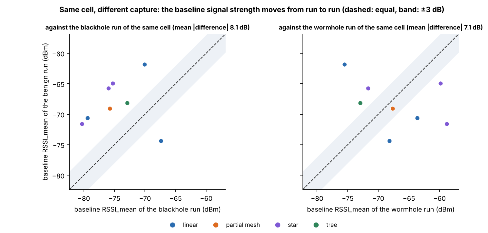
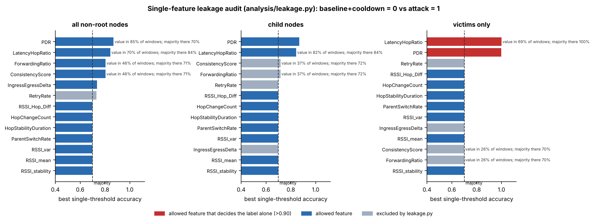
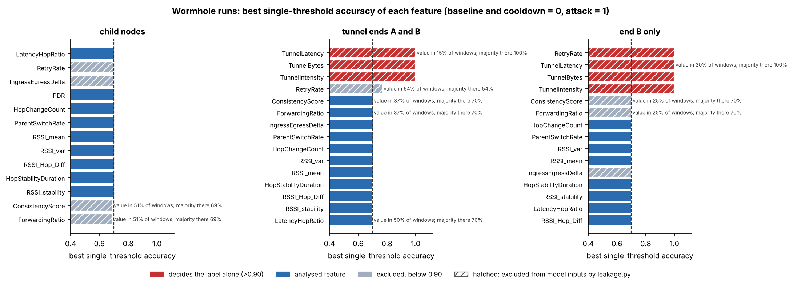
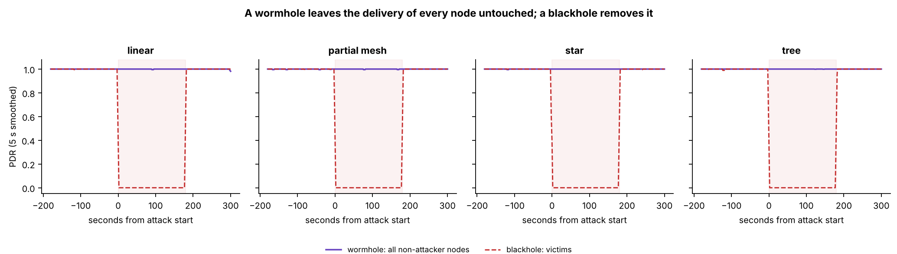
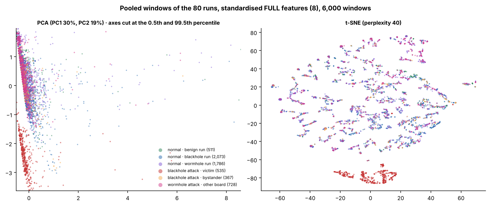
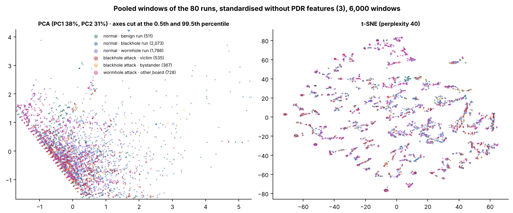

# THESIS3 Study Guide: Section 6C (Benign Runs and Both Attacks) and Section 7 (Conclusion), Made Simple

- **What this covers:** deck section **6C** (`Paper/THESIS3-Defense.pdf`, pages 46 to 53) and section **7** (pages 54 to 58). Backup slides are not covered, except Figure 6.14 (benign burst), which has a Q&A in section 6.
- **Cross-checked against the paper:** `Plan/Paper-Editing/1-Working-Copy/NIS16-Full_Thesis_Document.docx`, Sections 6.2.3, 6.2.6, 6.3, 6.4.7, 6.5 and all of Chapter 7. Every number comes from there. Anything the slides leave out but the paper says is under **"Also in the paper"**. Lines marked *(our reading)* are explanations the paper does not state.
- **Slide numbers:** "page" means the PDF page. The numbers printed in the slide footers are different (page 47 prints 20, page 50 prints 33), so always go by the PDF page.

---

## Contents

1. [The whole section on one page](#1-the-whole-section-on-one-page)
2. [The words you need](#2-the-words-you-need)
3. [Section 6C, slide by slide](#3-section-6c-slide-by-slide)
4. [Section 7, slide by slide](#4-section-7-slide-by-slide)
5. [Traps: where the slides and the paper need care](#5-traps-where-the-slides-and-the-paper-need-care)
6. [Panel questions with spoken answers](#6-panel-questions-with-spoken-answers)
7. [Numbers to memorise](#7-numbers-to-memorise)

---

## 1. The whole section on one page

**Section 6C answers: does the normal network look normal, and what do the two attacks look like side by side?**

| | Blackhole | Wormhole | Benign (no attack) |
|---|---|---|---|
| **Direct record** | Attacker forwards 0.000 to 0.007 (was 1.000 to 1.004); victims' PDR 0.998 → 0.000 | B's probes reach the root twice (99.86%, none in baseline) | 0 of 21 signature checks passed; PDR 0.9994 to 1.0000 |
| **Cross-layer features that change** | Victims' PDR only (d = −29.7); all others \|d\| < 0.1 | None (\|d\| ≤ 0.07; hop and parent unchanged) | Cooldown within 0.5 SD of baseline in 24 of 24 comparisons |
| **Clustering** | ARI 0.514 (ceiling 0.515); about 0 without PDR | About 0 without a tunnel feature | 0 of 22,481 windows in the victim cluster |

**The main reading:** Chapter 4 expected evidence across several layers. Instead, the evidence sits in the **data plane**: **delivery** for the blackhole and **duplication** for the wormhole. Radio, MAC and routing features stay where they were.

**Why:** both attacks are emulated at the **application layer** (D-20). They act on our probes, not on routing.

**Section 7 answers: did we do what we set out to do?**
- **Objective 1 (testbed):** achieved.
- **Objective 2 (dataset):** achieved.
- **Objective 3 (separability):** **achieved** on the newest slide (nov. 5). The answer differs by attack: blackhole through PDR only; wormhole through the duplicates at the root, **not** through the cross-layer features. (The older deck and paper 7.4 say "differs by attack"; see the trap in section 5.)
- **Not finding the expected cross-layer evidence is reported as a finding, not a failure.**

*Updated nov. 5, 2026: the Figure 6.30/6.31 reading, how k and eps are chosen, what is inside a K-Means cluster, the six limitations, the newest slide wording for objective 3, the tree-run story, and Figure 6.14 (benign burst) were added. Recommendations are no longer on the slide (page 56) but stay in the paper (7.6).*

---

## 2. The words you need

| Word | Plain meaning |
|---|---|
| **Run** | One recording of a mesh in one topology, site and scenario |
| **Window** | One second of one board's data. Every count in the chapter counts windows |
| **Phases** | Baseline 300 s, attack 180 s, cooldown 120 s (a benign run has no attack phase) |
| **Normal** | Baseline + cooldown windows |
| **Benign run** | A run with no attack, used as the normal reference |
| **Cell** | One combination of topology, site and scenario |
| **Child board / non-attacker node** | Any board but the root / a child that is not the attacker or a tunnel end |
| **Victim / bystander** | Blackhole non-attacker whose path passes through the attacker / does not. Bystanders are unaffected but still labelled "attack" |
| **End A / end B** | Wormhole exit (shallower) / entry (deeper). Only B's probes are tunnelled |
| **PDR** | Share of a board's probes that reached the root (0 to 1) |
| **RSSI_mean** | Average signal strength to the parent (dBm) |
| **RSSI_Hop_Diff** | Signal minus the usual signal at that depth (dB) |
| **LatencyHopRatio** | Delay of a probe divided by its hops (ms per hop) |
| **Signature check** | A 3-sigma test of an attack's fingerprint |
| **3-sigma test** | Is the value at least 3 baseline standard deviations from the baseline mean, in the expected direction? |
| **Cohen's d** | How far a mean moved, in units of spread. Below 0.2 negligible, 0.5 medium, 0.8+ large. It is a size, **not** a significance test |
| **Majority rate** | Accuracy of always guessing "normal": about 70%. A feature at 70% tells you nothing |
| **ARI** | Agreement between clusters and labels. 1 = exact, 0 = no better than chance |
| **Purity** | Share of windows carrying their cluster's majority label |
| **Data plane** | The traffic itself (probes delivered or duplicated), as opposed to the radio and the routing |

---

## 3. Section 6C, slide by slide

### Page 47: Benign runs, no attack signature

**How do you test a run with no attack?** Use the same tests, **pointed the other way**: compare the cooldown (where an attack would have run) with the baseline.

A benign run must meet four conditions:
1. **No attack signature may pass.**
2. **Delivery stays healthy in both phases** (PDR at least 0.90).
3. **Every relay forwards at least 90%** of what it receives.
4. **Every board has windows for at least 95% of each phase**, and the scenario was applied.

**The three big numbers on the slide:**

| Number | Meaning |
|---|---|
| **8 of 8** | All benign runs rated BENIGN CONFIRMED, all graded strong |
| **0 of 21** | Of the 21 signature checks that could be evaluated, none passed. The other **43 checks** need a tunnel or an attacker, so they had no data, as expected |
| **24 of 24** | For RSSI_mean, RSSI_var and LatencyHopRatio (8 runs × 3 features), the cooldown mean is within 0.5 baseline SD of the baseline mean: no drift a detector could mistake for an attack |

**Delivery:** mean PDR per run is **0.9994 to 1.0000**. Only **4 of 54** child boards ever had a window below 1, all in linear/G402/highload (lowest 0.75).

**The 8 benign runs (Tables 6.3, 6.17, 6.20)**

| Topology | Site | Scenario | Boards | PDR baseline | PDR cooldown | Signature checks passed | RSSI_mean baseline (dBm) | Median LatencyHopRatio, baseline → cooldown (ms/hop) | Parent changes | Deepest hop |
|---|---|---|---|---|---|---|---|---|---|---|
| Linear | DLSU Library | stationary | 8 | 1.0000 | 1.0000 | 0 of 3 | −61.8 | 1.9 → 1.3 | 0 | 7 |
| Linear | G402 | highload | 8 | 0.9994 | 0.9997 | 0 of 3 | −70.6 | 3.6 → 2.4 | 0 | 7 |
| Linear | Yuchengco | stationary | 8 | 1.0000 | 1.0000 | 0 of 3 | −74.4 | 3.3 → 2.1 | 0 | 7 |
| Partial mesh | G402 | highload | 8 | 1.0000 | 1.0000 | 0 of 3 | −69.1 | 4.7 → 2.5 | 0 | 3 |
| Star | DLSU Library | stationary | 8 | 1.0000 | 1.0000 | 0 of 2 | −64.9 | 4.9 → 3.4 | 0 | 1 |
| Star | G402 | burst | 8 | 1.0000 | 1.0000 | 0 of 2 | −71.6 | 6.3 → 4.7 | 0 | 1 |
| Star | Yuchengco | highload | **6** | 1.0000 | 1.0000 | 0 of 2 | −65.7 | 6.7 → 4.8 | 0 | 1 |
| Tree | G402 | stationary | 8 | 1.0000 | 1.0000 | 0 of 3 | −68.2 | 5.9 → 3.3 | **1** | 2 |

**What to notice:**
- **The split is 4 stationary, 3 highload, 1 burst.** By topology: 3 linear, 3 star, 1 partial mesh, 1 tree.
- **The mesh is stable:** no hop change in any run, and one parent change across all 8.
- **Delay per hop falls in all 8 runs.** No attack happened, so this decline belongs to the course of a run. That is how we know the same decline in the blackhole bystanders is not the attack.
- **Signal varies a lot between runs** (−61.8 to −74.4 dBm, a 12.5 dB spread).

**What 8 runs can and cannot show (6.5.4):**
- **They can:** act as a control. The verifier raised no alarm on them, and none of their windows fell in the victim cluster.
- **They cannot:** give a false-alarm rate. That needs more runs, in every cell, with repeats. Most cells have no benign counterpart.

**Why the 0.75 is not alarming:** in highload a board sends about 4 probes per second, so one late or lost probe in a second gives 3 of 4 = 0.75. *(our reading)*

**Say:** "We tested the benign runs with the same checks, pointed the other way. None of the 21 signature checks passed, and delivery stayed between 0.9994 and 1.0000. Eight runs are enough as a control, but not enough to estimate a false-alarm rate."

### Also in the paper: benign runs against the normal windows of the attack runs (6.3.3)

These tables answer: **are the normal seconds of an attack run like the seconds of a benign run?** If not, "normal" would not mean the same thing across the dataset.

**Table 6.21: by scenario**

| Scenario | Runs of | Runs | Windows | Mean PDR | Windows with PDR < 1 | Median LatencyHopRatio | Mean RSSI_mean | Probes per board per second |
|---|---|---|---|---|---|---|---|---|
| Stationary | Benign | 4 | 11,739 | 1.0000 | 0.00% | 3.22 | −67.5 | 1.00 |
| Stationary | Attack | 24 | 55,229 | **0.9967** | 0.32% | 4.06 | −72.0 | 1.00 |
| Burst | Benign | 1 | 2,935 | 1.0000 | 0.00% | 5.78 | −71.7 | 1.10 |
| Burst | Attack | 24 | 55,096 | 0.9998 | 0.02% | 3.66 | −72.1 | 0.99 |
| Highload | Benign | 3 | 7,961 | 0.9998 | 0.08% | 3.94 | −69.1 | 3.87 |
| Highload | Attack | 24 | 54,860 | 0.9999 | 0.05% | 4.09 | −70.9 | 3.92 |

- **The probe rate matches**, so a scenario means the same thing in both kinds of run.
- **Why stationary attack runs have 0.9967:** one run, the partial-mesh blackhole run at Yuchengco, has an unstable baseline (mean PDR 0.931 over 2,513 windows). Without it the mean is 0.9999, and windows below 1 fall from 0.33% to 0.01%.

**Table 6.22: all normal windows compared**

| Feature | Benign mean | Blackhole runs, normal | d | Wormhole runs, normal | d |
|---|---|---|---|---|---|
| PDR | 0.9999 | 0.9979 | 0.06 | 0.9999 | 0.00 |
| **RSSI_mean (dBm)** | **−68.57** | **−73.78** | **0.69** | −69.15 | 0.07 |
| RSSI_var | 0.393 | 0.343 | 0.03 | 0.413 | −0.01 |
| RSSI_Hop_Diff (dB) | 3.50 | 3.61 | −0.02 | 2.67 | 0.23 |
| LatencyHopRatio | 11.28 | 9.45 | 0.03 | 10.33 | 0.02 |
| RSSI_stability | 0.894 | 0.895 | −0.03 | 0.894 | 0.01 |
| HopStabilityDuration | 0.9999 | 0.9998 | 0.03 | 0.9998 | 0.02 |
| ParentSwitchRate | 0.00009 | 0.00000 | 0.01 | 0.00000 | 0.01 |

Windows: benign 22,481, blackhole 89,140, wormhole 75,211. RetryRate and HopChangeCount are 0 in all of them.

- **The only large difference is signal strength against the blackhole runs (d = 0.69).** Everything else is below 0.1, except RSSI_Hop_Diff against the wormhole runs (0.23).

**Table 6.23: the same cell, recorded twice. This is the key test.** Each benign run is compared with the **baseline** of the attack run of the same topology, site and scenario, before any attack starts.

| Compared with | Feature | Mean difference | Mean absolute difference | Median d | Largest \|d\| |
|---|---|---|---|---|---|
| Blackhole | PDR | −0.0000 | 0.0001 | 0.00 | 0.03 |
| Blackhole | **RSSI_mean** | +6.34 | **8.08 dB** | 1.29 | 1.97 |
| Blackhole | RSSI_var | −0.092 | 0.359 | −0.14 | 0.51 |
| Blackhole | RSSI_Hop_Diff | 0.59 | 0.81 | 0.12 | 0.62 |
| Blackhole | LatencyHopRatio | 0.46 | 6.82 | 0.02 | 0.23 |
| Wormhole | PDR | −0.0000 | 0.0001 | −0.01 | 0.07 |
| Wormhole | **RSSI_mean** | −1.00 | **7.12 dB** | −0.61 | 3.29 |
| Wormhole | RSSI_var | −0.027 | 0.285 | 0.02 | 0.35 |
| Wormhole | RSSI_Hop_Diff | 1.79 | 1.94 | 0.65 | 1.27 |
| Wormhole | LatencyHopRatio | 0.24 | 8.03 | −0.04 | 0.30 |

- **How to read Figure 6.16:** each dot is one benign run. Across = the attack run's baseline signal, up = the benign run's. Dashed line = equal; grey band = within ±3 dB.
- **What it shows:** dots sit on both sides of the line and mostly outside the band.
- **Why:** each capture is a fresh set-up, and signal strength depends on where the boards stand and what surrounds them.
- **Why it matters:** **RSSI_mean separates runs by their set-up, not attack from normal.** So the d = 0.69 above is the capture, not the attack. This explains why clusters without PDR split by signal level and catch no attack.
- This figure has no slide in section 6C, so **be ready to explain it in words**.

---

### Page 48: Can one feature decide it? The single-feature audit (6.2.3)

**The question:** can one feature with one cut-off tell attack seconds from normal ones? If it can, clustering adds nothing, or the feature is an artefact of how the data were made (Arp et al. [80] call this spurious correlation).

**Why 70% is the reference line:** a run has 420 normal seconds out of 600 analysed (300 + 120 of 300 + 180 + 120). Always guessing "normal" already scores 70%, so **a feature at 70% carries no information**.

**Blackhole (Table 6.13)**

| Feature | All boards but the root | Non-attacker nodes | Victims only |
|---|---|---|---|
| **PDR** | 86.9% | **86.9%** | **99.9%** |
| LatencyHopRatio | 84.3%† | 84.3%† | 100.0%† |
| ForwardingRatio, ConsistencyScore | 80.4%† | 71.7%† | 70.0%† |
| IngressEgressDelta | 73.7% | 70.0% | 70.1% |
| RetryRate | 73.1% | 70.0% | 70.1% |
| Best of the RSSI, parent and hop features | 70.0% | 70.0% | 70.1% |
| Run clock: raw / aligned (not a feature) | 70.2 / 80.0% | 70.3 / 80.0% | 70.4 / 80.0% |
| **Majority rate** | 70.0% | 70.0% | 70.1% |

† = missing in more than 5% of windows, so judged only where it has a value.

**The four points on the slide:**
1. **PDR gets 99.9% on victims:** a full delivery collapse is separable by construction.
2. **Only 86.9% on all non-attacker nodes:** bystanders carry the attack label but behave normally, so no cut-off can catch them.
3. **LatencyHopRatio's 100% is a trap.** A dropped probe has no delay, so the value exists almost only in normal windows, and the cut-off itself tells you nothing. **The information is in the blank:** "is it missing?" predicts the label with **99.2%** on victims (missing in 100.0% of their attack windows). That gives the label away, so **it is not clustered**.
4. **Wormhole:** on non-attacker nodes, no feature beats 70% by more than 0.01 points.

**The aligned run clock (80%) is not a feature.** Every run follows the same schedule, so one cut can remove the end of the run. It cannot pick out a window in the middle. It shows how much the fixed schedule gives away.

**Reading the paper's Figure 6.7:** each bar is one feature's best accuracy; the dashed line is about 70%. Red = allowed features that decide the label alone, blue = other allowed features, grey = banned by the leakage guard in that group. Left = all boards but the root, middle = non-attacker nodes, right = victims.

**Wormhole (Table 6.14)**

| Feature | Non-attacker nodes | Ends A and B | End B only |
|---|---|---|---|
| TunnelIntensity, TunnelBytes | no value | **99.7%** | **99.7%** |
| TunnelLatency | no value | 100.0%† | 100.0%† |
| RetryRate | 70.0% | 76.9%† | **100.0%** |
| ForwardingRatio, ConsistencyScore | 68.7%† | 70.0%† | 70.0%† |
| IngressEgressDelta | 70.0% | 70.0% | 70.0% |
| PDR | 70.0% | no value | no value |
| LatencyHopRatio | 70.0% | 69.9%† | 69.9% |
| Best of the RSSI, parent and hop features | 70.0% | 70.0% | 70.0% |
| Run clock: raw / aligned | 70.0 / 80.0% | 72.1 / 80.0% | 73.1 / 80.0% |
| **Majority rate** | 70.0% | 70.0% | 70.0% |

- **Tunnel features decide the label on the ends:** the tunnel only carries messages in the attack.
- **TunnelLatency exists only on B and only in the attack,** so its mere presence is the label (100%).
- **RetryRate's 100% on B is an artefact:** on B, that counter holds the frames sent through the tunnel. It records the attack by construction.
- **All of these are banned as inputs** by the leakage guard.
- **On non-attacker nodes, nothing moves:** the wormhole leaves no trace a single threshold can use.

**Also in the paper, Table 6.15: "is the value missing?"**

| Runs | Boards | Feature | Best threshold | Windows with a value | Majority of those | "Is it missing?" rule |
|---|---|---|---|---|---|---|
| Blackhole | All but root | PDR | 86.9% | 85% | 70.0% | 64.0% |
| Blackhole | All but root | LatencyHopRatio | 84.3% | 70% | 84.3% | 78.4% |
| Blackhole | All but root | ForwardingRatio, ConsistencyScore | 80.4% | 46% | 71.1% | 50.5% |
| Blackhole | Non-attacker | LatencyHopRatio | 84.3% | 82% | 84.3% | **86.5%** |
| Blackhole | Non-attacker | ForwardingRatio, ConsistencyScore | 71.7% | 37% | 71.7% | 53.9% |
| Blackhole | Victims | LatencyHopRatio | 100.0% | 69% | 100.0% | **99.2%** |
| Blackhole | Victims | ForwardingRatio, ConsistencyScore | 70.0% | 26% | 70.0% | 59.6% |
| Wormhole | Non-attacker | ConsistencyScore / ForwardingRatio | 69.2 / 68.7% | 51% | 68.7% | 50.8% |
| Wormhole | Ends | TunnelLatency | 100.0% | 15% | 100.0% | 85.0% |
| Wormhole | Ends | RetryRate | 76.9% | 64% | 53.9% | 65.0% |
| Wormhole | Ends | ConsistencyScore / ForwardingRatio | 70.1 / 70.0% | 37% | 70.0% | 55.0% |
| Wormhole | Ends | LatencyHopRatio | 69.9% | 50% | 70.0% | 50.0% |
| Wormhole | End B | TunnelLatency | 100.0% | 30% | 100.0% | **100.0%** |
| Wormhole | End B | ConsistencyScore / ForwardingRatio | 70.2 / 70.0% | 25% | 70.1% | 60.0% |

**How to read it:** a threshold only carries information if it beats the majority rate **of the same windows**. PDR, the attacker's forwarding ratio and RetryRate on the ends do. LatencyHopRatio and TunnelLatency carry theirs in the blanks.

**The leakage guard:** the list in the code of columns that may not be model inputs.
- RetryRate: it counts failed sends, and on B it holds tunnelled frames.
- The 3 tunnel features: they exist only on the ends, so their presence identifies the kind of run.
- ForwardingRatio, IngressEgressDelta and ConsistencyScore: excluded unless more than one kind of node reports them.

**Say:** "Always guessing normal scores 70%, so that's the line to beat. PDR reaches 99.9% on victims, because a total delivery collapse is separable by construction. It's only 86.9% on all nodes because bystanders are labelled attack but behave normally. For the wormhole, no feature on the non-attacker boards beats 70%."

---

### Page 49: EDA, only the delivery of the victims moves (6.3.1, 6.3.2)

- **How to read it:** time left to right, shaded = attack, height = PDR (5 s moving average), one panel per topology. **Solid purple = non-attacker boards of the wormhole runs. Dashed red = blackhole victims.**
- **What it shows:** purple stays at 1 the whole run; red drops to 0 for the whole attack.
- **Why:** the blackhole throws probes away. The wormhole only **adds** copies of B's probes, and nothing is dropped on purpose, so the other boards' delivery is untouched.

**The numbers on the slide:**

| | Blackhole | Wormhole |
|---|---|---|
| **What moves** | Victims' PDR **0.998 → 0.000, d = −29.71** | On the ends, only tunnel features: TunnelIntensity **0 → 1.92 messages/s** (d = 1.83), TunnelBytes 0 → 57.5 |
| **What doesn't** | Every other feature of victims and bystanders: **\|d\| < 0.1** (largest: bystanders' RSSI_var, −0.09) | Non-attacker PDR **0.9999 → 0.9999**; largest \|d\| on them **0.06** (RSSI_var) |

**Why the slide says 0.06 here and page 50 says 0.07:** 0.06 is the largest on the **non-attacker boards**. 0.07 is the largest including **the ends** (RSSI_var of B). Both are correct.

**Also in the paper, things a panelist may point at:**
- **Bystanders' PDR rises 0.996 → 1.000 (d = 0.09).** They are not hurt by the attack.
- **Victims' signal is about 2.5 dB weaker than bystanders' (−74.7 vs −72.2 dBm), already in the baseline.** Victims sit deeper, so it is position, not the attack.
- **RSSI_var drops in both groups (−0.07, −0.09).** Bystanders are untouched, so a change this small can't be blamed on the attack.
- **Bystanders' LatencyHopRatio falls 4.26 → 3.15 → 2.46 ms/hop** and keeps falling after the attack. All 8 benign runs show the same decline, so it follows the course of the run.
- **Why d is only 1.83 for TunnelIntensity, though the separation is total:** the baseline never varies, but attack values spread from 1 to 4 per second by scenario, which caps d.
- **B's RetryRate 0.00 → 0.50 (d = 42.99)** is the largest number but is not a retry rate: the counter holds tunnelled frames.
- **B's RSSI_Hop_Diff is higher (5.4 dB vs about 2.7 elsewhere)**, but just as high before the attack, so it reflects where B sits.
- **TunnelLatency mean 21.1 ms vs median 3.9 ms:** a few very long gaps pull the mean up.

**Say:** "The wormhole doesn't stop delivery; the blackhole does. In the blackhole, the victims' PDR goes from 0.998 to 0 with a d of minus 29.71, and everything else stays below 0.1. In the wormhole, delivery stays at 0.9999, and only the tunnel counters on the two ends move."

---

### Page 50: Discussion, the attacks live in the data plane (6.5.1, Table 6.33)

The table is in [Part 1](#1-the-whole-section-on-one-page). **The two messages:**

1. **Main reading:** Chapter 4 expected cross-layer evidence. The evidence sits in delivery (blackhole) and duplication (wormhole). Physical, MAC and network features stay where they were.
2. **Honest qualifier:** PDR is also the verifier's check. So the clustering finds the effect the verifier already measured. **It is not independent evidence that cross-layer features detect the blackhole.** Say this before a panelist does.

**Also in the paper: what an emulation can and cannot show (6.5.3)**
- **Blackhole:** it receives probes and doesn't forward them, but still acknowledges every frame at the link layer. So signal, retries and parents aren't touched. The dataset records **forwarding suppression**, not how a node **attracts** traffic to itself (the route-attraction stage of a classical blackhole).
- **Wormhole:** of the Table 3.5 indicators, the **3 about the traffic** are observed (duplicates, arrival pattern, latency mismatch). The **4 about routing and radio** are not (hop count, parent-child validity, RSSI-hop relation, RSSI variance). The routing table isn't logged, and the ends' retransmissions can't be separated from tunnelled frames. That makes 9.
- Section 3.3.2.2 expected latency anomalies and RSSI-hop inconsistencies. **The first is observed, the second isn't.**

**Three consequences for anyone using the dataset:**
1. Results say what **this kind** of attack does, not what an attack inside the routing protocol would do.
2. A detector tested on our blackhole windows is tested on **loss of delivery**; on our wormhole windows, on **duplication**. Both signals are available **at the root, without cross-layer features**.
3. Whether cross-layer features add anything is **still open**. It needs attacks that act on routing.

**Also in the paper: which features can be clustered (objective 2, 6.5.1).** Of the 16 features, 8 can enter the clustering. The other 8 are kept out because the relay and tunnel features record the attack directly, RetryRate stays near zero and counts tunnelled frames on B, and a missing LatencyHopRatio reveals a victim's label.

**Say:** "The evidence of each attack sits in the data plane: delivery for the blackhole, duplication for the wormhole. One honest qualifier: PDR is also what the verifier checks, so the clustering finds the effect the verifier measured. It's not independent evidence that cross-layer features detect the blackhole."

---

### Pages 51 and 52: Pooled 80 runs (6.4.7)

**The question:** put the non-attacker boards of **all 80 runs** together (257,258 windows). Do three groups appear: normal (0), blackhole (1), wormhole (2)? It is run twice: on the 80 runs and on the 72 attack runs.

**Table 6.30: what goes in**

| Group | Label | Windows | Share |
|---|---|---|---|
| Normal, benign runs | 0 | 22,481 | 8.7% |
| Normal, blackhole runs | 0 | 89,140 | 34.7% |
| Normal, wormhole runs | 0 | 75,211 | 29.2% |
| **Blackhole attack, victims** | 1 | 21,733 | 8.4% |
| Blackhole attack, bystanders | 1 | 16,499 | 6.4% |
| Wormhole attack, other boards | 2 | 32,194 | 12.5% |

Totals: normal 186,832, blackhole 38,232, wormhole 32,194. **Attackers and tunnel ends are not included.** Majority rate: 0.730 (80 runs), 0.694 (72 runs).

#### Page 51, Figure 6.30: all 8 features

- **How to read it:** each dot = one second, 6,000 sampled. **Left, PCA:** the two directions with the most spread (30% and 19%), with extreme dots cut off at the 0.5th and 99.5th percentiles. **Right, t-SNE:** similar seconds sit close; **the axes have no units, only nearness counts**.
- **Colours:** green = benign normal, blue = blackhole normal, purple = wormhole normal, **red = victims**, orange = bystanders, pink = wormhole attack.
- **What it shows:** **only red stands apart**: lower-left in PCA, its own group at the bottom in t-SNE. The other five groups, **including wormhole attack**, are mixed.
- **Why:** only the victims differ, because their PDR is 0.

**Figures 6.30 and 6.31 in detail**

**1. What a dot is.** One window: one board's data for one second (10 samples). Only the **non-attacker boards** of all 80 runs are pooled (257,258 windows; the blackhole attacker and the two wormhole ends are left out). **6,000 are sampled** (about 2%) and **standardised** (each feature rescaled to the same spread, so no feature wins because of its units).

**2. The six colours, in the 6,000-window sample**

| Colour | Group | In the plot | Share of all windows | Behaves like |
|---|---|---|---|---|
| Green | normal · benign run | 511 | 8.7% | normal |
| Blue | normal · blackhole run | 2,073 | 34.7% | normal |
| Purple | normal · wormhole run | 1,786 | 29.2% | normal |
| **Red** | **blackhole attack · victim** | 535 | 8.4% | **PDR = 0** |
| Orange | blackhole attack · bystander | 367 | 6.4% | normal (but labelled attack) |
| Pink | wormhole attack · other board | 728 | 12.5% | normal (but labelled attack) |

Only red actually suffers. Orange and pink carry the attack label but look normal, which is why the best possible score is 0.334 and not 1.

**3. The features.** Figure 6.30 uses the **FULL set, 8 features** (the "used" side of the leakage-guard slide): Delivery: PDR · Signal strength: RSSI_mean, RSSI_var, RSSI_stability, RSSI_Hop_Diff · Routing: ParentSwitchRate, HopChangeCount, HopStabilityDuration (Table 6.24). **Four of them hardly vary:** the same value in 100% (ParentSwitchRate, HopChangeCount), 99.8% (HopStabilityDuration) and 98.5% (RSSI_stability) of windows. So the picture is really driven by **PDR, RSSI_mean, RSSI_var and RSSI_Hop_Diff** *(our reading, from those percentages)*. **Figure 6.31 uses only the three RSSI features** (RSSI_mean, RSSI_var, RSSI_Hop_Diff).

**Why these 8 of the 16 features (Section 6.4.1, Table 6.24)**
- **The slide "The leakage guard" (footer 26, newest deck) is the reference.** Its purpose line: *"keep out any feature that cannot be obtained on a real network, or that gives the answer away. Of the 16 features, 8 go to the model and 8 are kept out."*
- **USED, 8 (every node can measure these on a real network), grouped as on the slide:**
  - **Delivery:** PDR
  - **Signal strength:** RSSI_mean, RSSI_var, RSSI_stability, RSSI_Hop_Diff
  - **Routing:** ParentSwitchRate, HopChangeCount, HopStabilityDuration
- **KEPT OUT, 8 ("artifacts: they only help us verify the run"), by the slide's reasons:**
  - **ForwardingRatio, IngressEgressDelta, ConsistencyScore:** forwarding counters. They record the blackhole directly (forwarding is what it destroys), and two of the three are copies of the first. Used to verify the run, not to detect the attack.
  - **TunnelIntensity, TunnelBytes, TunnelLatency:** tunnel counters. They exist only on the two wormhole boards (our own wire between them), so no other node and no real network has them. Evidence the wormhole ran, nothing more.
  - **RetryRate:** on the wormhole entry end it counts frames sent through the tunnel, not real retries.
  - **LatencyHopRatio:** missing values. Whether it is missing predicts the label in **86%** of windows (a dropped probe has no delay).
- **The test on the slide's banner:** adding TunnelIntensity back lifts **DBSCAN from −0.003 to 0.827** on the wormhole entry end (Table 6.28 confirms both numbers). So **a good score means the attack shows in how the network behaves, not that the model was handed the answer.**
- **In the paper this is Section 6.2.3 (the leakage guard) and 6.4.1 (Table 6.24).**
- **So FULL = "the features that may enter the clustering of non-attacker nodes".** The aim is to ask whether *honest* features separate the attacks, not features that leak the answer.
- **REDUCED (4 features: PDR, RSSI_mean, RSSI_var, RSSI_Hop_Diff)** is FULL after the low-variance filter, which dropped ParentSwitchRate and HopChangeCount (100% the same value), HopStabilityDuration (99.8%) and RSSI_stability (98.5%). The correlation filter dropped nothing (largest |r| = 0.11). The sets were fixed on the blackhole windows and reused for the wormhole and pooled analyses.
- **PDR is kept in the pooled set even though the low-variance rule would remove it** there (91.5% of pooled windows have PDR = 1), so that all three analyses use the same features.
- **Spoken version:** "We used 8 of our 16 features. We left out the ones that would give the answer away, like the tunnel counters, and LatencyHopRatio, whose blanks alone reveal the label. Four of the eight hardly ever change, so the picture is really driven by PDR and three signal features."

**4. PCA vs t-SNE**
- **PCA** finds the two directions with the most spread and puts each window at its position along them. 30% + 19% = **about half** of the information is kept in Figure 6.30; 38% + 31% = **about two-thirds** in Figure 6.31. The axis numbers are the new directions, not features. A few windows with extreme RSSI variance stretch the plot to the right.
- **t-SNE** tries to keep alike windows close and unlike windows far apart. **Perplexity 40** is roughly how many neighbours each dot pays attention to. **Only closeness counts:** the gaps between islands and the axis values mean nothing. The small strings and islands are most likely one board's consecutive seconds *(our reading)*.
- **Why both:** PCA shows the overall spread and is easy to read; t-SNE shows local groups. If both show the same thing, it's more convincing.

**5. Figure 6.30, why red is apart.** A victim's PDR is 0 in the attack. **91.5% of all pooled windows have PDR = 1**, so 0 is a huge jump once standardised. Nothing else differs for victims, so PDR alone pulls them out.

**6. Why the other five overlap.** Wormhole windows: the wormhole leaves the other boards untouched. Bystanders: they behave normally. Benign windows: nothing changes. **The benign control:** the 22,481 benign windows spread over the normal clusters and **none fell in the victim cluster**, so red stands apart because of the delivery collapse, not the traffic.

**7. Figure 6.31 (PDR removed).** All six groups overlap in both pictures, red too. The matching scores: **ARI −0.023 to 0.005**. K-Means then splits the windows by **signal level (−77.2 vs −63.9 dBm)** and each cluster holds all six kinds of window, so it reflects **where the boards stood**, not the attack. The same cell recorded twice differs by about 7 to 8 dB (8.1 dB from the blackhole run, 7.1 dB from the wormhole run).

**8. A detail that may draw a question.** In the Figure 6.31 PCA, many dots line up along a **straight diagonal edge** at the lower left. I couldn't confirm the cause from the paper. A likely reason is that RSSI variance can't go below zero *(our reading, unverified)*. Safe answer: the paper reports that all six groups overlap and the victims are no longer apart; the edge isn't a group.

**9. Link to the clustering.** The paper says the detector figures (21,733 victims caught, 0 benign, 3 wormhole) "are shown in Figures 6.30 and 6.31 as projections". So the pictures and the numbers say the same thing: **with PDR only victims separate; without it nothing does.**

**10. Limits of the picture.** Squeezing 8 features into 2 loses information, so "mixed in 2-D" alone doesn't prove "inseparable". But the algorithms also ran on all the features and found nothing (ARI about 0), so both agree. And separating the victims isn't independent detection evidence: **PDR is also the verifier's own check**.

**Slide wording trap:** the legend says "normal · benign run" / "normal · blackhole run" / "normal · wormhole run". **Normal** = baseline + cooldown windows of any run; **benign** = only the 8 no-attack runs. Say "normal" for the mixed group, "benign" only for the 22,481 benign windows.

#### Page 52, Figure 6.31: PDR removed

- **Only the three RSSI features.** PCA holds 38% and 31% of the spread. Same colours.
- **What it shows:** **all six groups are mixed, red too.** Without PDR, the pooled data show no structure.

**The scores (Table 6.31):**
- **The ceiling is 0.334 (80 runs) and 0.317 (72 runs).** Only the victim windows look different, so a method reading only the features can do no better than finding exactly those.
- **K-Means, k = 2, REDUCED: 0.333 and 0.315. That is the ceiling:** it finds the victims and nothing else.
- **At k = 3 it scores lower** (K-Means 0.272 and 0.173), because the third cluster is a small set of extreme-RSSI-variance windows, not the wormhole.

| Set (k = 3) | Algorithm | Silhouette, 80 runs | Purity, 80 runs | ARI, 80 runs | Purity, 72 runs | ARI, 72 runs |
|---|---|---|---|---|---|---|
| REDUCED | K-Means | 0.511 | 0.812 | 0.272 | 0.787 | 0.173 |
| REDUCED | Ward | 0.595 | 0.811 | 0.320 | 0.785 | 0.269 |
| REDUCED | GMM | 0.405 | 0.812 | 0.225 | 0.778 | 0.235 |
| REDUCED | DBSCAN (own k) | 0.597 | 0.809 | 0.312 | 0.783 | 0.305 |
| REDUCED | Spectral | −0.176 | 0.759 | 0.115 | 0.756 | 0.171 |
| FULL | K-Means | 0.588 | 0.811 | 0.325 | 0.786 | 0.307 |
| FULL | Ward | 0.598 | 0.810 | 0.317 | 0.784 | 0.301 |
| FULL | GMM | 0.576 | 0.784 | 0.203 | 0.742 | 0.166 |
| FULL | DBSCAN (own k) | 0.536 | 0.809 | 0.303 | 0.784 | 0.296 |
| FULL | Spectral | −0.036 | 0.759 | 0.062 | 0.785 | 0.271 |
| Without PDR | All five | −0.285 to 0.663 | 0.730 | **−0.019 to −0.001** | 0.694 to 0.695 | **−0.007 to 0.004** |

- **On FULL, K-Means at k = 2 isolates a few extreme windows (ARI −0.004)** and recovers the victims at k = 3 (0.325).
- **Without PDR, across every algorithm and k: −0.023 to 0.005**, with or without the benign runs.
- **The benign runs don't change the conclusion:** the ARI differs by 0.017 between the two populations (K-Means, k = 2).
- **The wormhole windows never form their own cluster.** They are 12.5% of the sample and never exceed **16.3%** of any cluster of 100+ windows (k = 2 to 4, all three sets).

**Also in the paper: the clusters used as a detector (Table 6.32).** One K-Means model (k = 2, REDUCED) is fitted on 6,000 windows and applied to every window.

| Group | Windows | In the victim cluster |
|---|---|---|
| **Blackhole attack, victims** | 21,733 | **21,733 (100.00%)** |
| **Normal, benign runs** | 22,481 | **0 (0.00%)** |
| Normal, blackhole runs | 89,140 | 183 (0.21%) |
| Normal, wormhole runs | 75,211 | 5 (0.01%) |
| Blackhole attack, bystanders | 16,499 | 0 (0.00%) |
| **Wormhole attack, other boards** | 32,194 | **3 (0.01%)** |

The figures are the same in the 72-run fit (benign windows are not scored there).

**Why the benign result matters:** same testbed, same traffic scenarios, no attack, and none fall in the victim cluster. So the cluster picks up **the delivery collapse, not the traffic**.

**The limit:** this is "no alarm on these 8 runs", **not a false-alarm rate** (6.5.4).

**Also in the paper: what is inside the clusters (seed 42, sample of 6,000)**
- **At k = 2 with PDR:** one cluster of **537 windows holds only victim attack windows**, with mean PDR 0.000.
- **At k = 2 without PDR:** the two clusters differ in signal level (**−77.2 vs −63.9 dBm**), and each holds all six kinds of window.
- **At k = 3 with PDR:** the victims are still one cluster. The third is **38 noisy windows** (mean RSSI_var 18.9, RSSI_Hop_Diff 6.55 dB), not an attack.

**How k is chosen, and why 2 to 8 (Chapter 4, K-Means section)**
- **What k is:** the number of groups K-Means must make. It starts with k centres, puts each window in the group with the nearest centre, moves each centre to the middle of its group, and repeats until nothing moves. **You must choose k in advance.**
- **Why 2 to 8:** **2 is the smallest useful split** (normal vs anomalous). Up to **8** leaves room for forwarding suppression, topology distortion and in-between states. Ward, GMM and Spectral use the same range, so the algorithms can be compared.
- **How the final k is picked in general:** the **elbow** (where adding groups stops helping much), the **silhouette** peak (how tidy the groups are) and **whether the groups make sense** must agree.
- **Why k = 2 here:** we **scored every k from 2 to 8 against the true labels (ARI)**. K-Means at k = 2 on REDUCED scores **0.333, the ceiling is 0.334**, so no larger k can do better. At k = 3 it drops to 0.272, because the third cluster is 38 noisy windows, not the wormhole.
- **Two caveats:** (1) "best" is for **REDUCED**; on FULL, k = 2 scores −0.004 and k = 3 scores 0.325. (2) ARI needs the true labels, which a real user wouldn't have. The elbow and silhouette are for that case. **The paper doesn't print the pooled elbow curve, so don't say the elbow gave k = 2.**

**How DBSCAN's eps is chosen (the "elbow" is the knee of the k-distance graph; Figure 6.17, Chapter 4)**
- DBSCAN needs no k. A window with enough neighbours within **eps** is in a crowd; one with too few is **noise**.
- **min_samples** (neighbours needed) is tried from **D + 1 to 2D**, D = number of features. For FULL (8 features): 9 to 16.
- **Finding eps:** for every window, measure the distance to its min_samples-th nearest neighbour. Sort those distances and plot them. The curve stays low and flat, then shoots up. **eps = the distance at that bend (the knee).** Below it: crowded windows; above it: lonely windows, which become noise. Of the settings tried, **the one with the best silhouette is kept**.
- **Values printed** (blackhole runs, Figure 6.17): **0.79 FULL, 0.73 REDUCED, 0.56 without PDR.** The paper doesn't print the pooled eps. Pooled DBSCAN: 5 to 6 clusters with 1.6% noise (REDUCED), ARI 0.312.
- **Two different elbows:** K-Means' is on spread vs k; DBSCAN's is on sorted neighbour distances. Same idea, different graphs.

**Say:** "When we pool all 80 runs, only the blackhole victims stand apart. The wormhole seconds mix with the normal ones. K-Means scores 0.333 against a ceiling of 0.334, meaning it finds the victims and nothing else. Remove PDR and everything mixes."

---

### Page 53: Compared with published studies (6.5.2, Table 6.34)

**The key sentence:** platforms, scales and protocols differ, so **the comparison is about direction and rough size, not equal values.**

| Measure | This study | Published | Reading |
|---|---|---|---|
| **Baseline PDR** | 0.998 victims, 0.996 bystanders; 0.9994 to 1.0000 benign | > 0.97, Khan et al. [22] | Agree in size; counting differs |
| **PDR under blackhole** | 0.000 | 25 to 40% delivery (60 to 75% loss), Airehrour et al. [70] | Same direction; larger here, because our attacker is on the path by placement |
| **Parent changes under blackhole** | 0.00000 → 0.00009 per s (d = 0.01) | 16 to 246 rank changes per mote [70] | Differs: their attack acts on routing; ours doesn't (D-20) |
| **Wormhole hop count** | Constant in 36 of 36 runs | 4 → 3 hops, Zhukabayeva et al. [71] | Their tunnel is a route ZigBee chooses; ours is an app relay |
| **Wormhole delay** | Gap between copies: median 3.9 ms, p90 12.1 ms; B's LatencyHopRatio 12.0 → 11.2 ms/hop | 80 to 100 → 120 to 200 ms (about +40%) [71] | Different measure |
| **Others' delivery** (paper only) | 0.9999 → 0.9999 | Loss increased, no value given [71] | Only B is tunnelled here; nothing dropped on purpose |
| **Duplicate arrivals** | 99.86% of B's probes; 0 in baseline | Two source-routing packets per data packet, Ramírez Gómez et al. [72] | Same evidence, different layer |
| **RetryRate** (paper only) | 0.0000 → 0.0004 | No published value | ESP-IDF gives no MAC retry count (D-15) |
| **RSSI features** (paper only) | \|d\| < 0.1 | No comparable value in any of the four | Nothing to compare with |

**Also in the paper: who the four studies are**

| Study | Setup | Key detail |
|---|---|---|
| **Khan et al. [22]** | ESP-MESH on ESP32, 7 sensor nodes + root | One 64-byte package per node every 1 min (open area) or 2 min (campus), for 5 days. Over 97% on campus except node H (100 m away, across more than four buildings and walls, outdoors); over 98% in open area. They count packages over days, we count probes per second, so **not claimed equal** |
| **Airehrour et al. [70]** | RPL (MRHOF), 14 AS-XM1000 (Telos-B) motes, InstantContiki 3.0, lab of about 30 × 30 m (1 sink, 12 senders, 2 blackhole motes) | Loss depends on which motes **choose** a blackhole as parent. Ours is **placed** on the path, so every probe is lost |
| **Zhukabayeva et al. [71]** | ZigBee chain of Arduino nodes with XBee; two Raspberry Pis joined by GSM and a TCP/IP tunnel | ZigBee prefers the shortest route, so 4 hops become 3. Also 20 to 30% of readings modified; we have no counterpart, because we measure delivery and timing. **Uses the 3-sigma rule too** |
| **Ramírez Gómez et al. [72]** | XBee S2C with source routing, Raspberry Pi 3 + USB dongle running KillerBee, classic and reverse wormhole, 1 coordinator + 2 routers | **Qualitative: no delivery, loss or delay numbers.** First proposed signature: duplication. Others (beacon requests without a join, link-status and neighbour tables) **can't be tested**, because our firmware doesn't log them |

**Say:** "We compare direction and rough size, not equal values. Our baseline delivery agrees with Khan on the same platform. Our blackhole loss is larger than Airehrour's because our attacker is placed on the path. Our duplicate arrivals match the signature Ramírez Gómez proposed, at a different layer."

---

## 4. Section 7, slide by slide

### Also in the paper: 7.1 to 7.3 (no slide of their own)

**7.1 Summary of the study:** 8 ESP32 boards (1 root + 7 children), normal operation plus two attacks. Both attacks are at the application layer **because ESP-WIFI-MESH's routing can't be directly controlled**. 4 topologies, 3 locations, 3 scenarios. 80 runs. 300 s normal, 180 s attack, 120 s cooldown. One-second windows, **each needing at least 8 valid samples of 10**. 16 features. 5 unsupervised algorithms, compared with the labels afterwards.

**7.2 The dataset:**

| Fact | Value |
|---|---|
| Windows | 456,195 generated; **369,678 analysed** = 266,491 normal + 103,187 attack |
| Windows formed and removed | 457,568 formed; **1,372 (0.30%) removed** for too few samples. **No run lost more than 1%** (per run 0.16% to 0.89%, median 0.27%) |
| Samples per window | At least 8; average at least **9.97** |
| Telemetry files | **637, none empty** |
| Missing board | One board (B768) recorded nothing in one run, and it was a bystander |
| Blackhole boards | **123 victims, 92 bystanders** |
| Each window is linked to | Attack type, topology, location, scenario, board role, repeat, phase |

**7.3 Evidence the dataset is valid:** all 72 attack runs passed; **67 complete, 5 with minor gaps**. 8 of 8 benign confirmed.

| Blackhole | Wormhole |
|---|---|
| Forwarding 1.000 to 1.004 → 0.0% to 0.7% | Tunnel exit received 99% to 101% of messages |
| PDR 0.998 → 0.000 | **12,448 of 12,465 probes (99.86%)** reached the root twice |
| 121 of 123 victims lost delivery in the first second; 2 in the next | Duplicates in **6,468 of 6,469** attack windows (99.98%) |
| Recovered within 3 s (median 2 s) | **None** in baseline or cooldown; other boards show no such pattern |
| Bystanders 0.996 → 1.000 | Tunnel skipped 1 to 5 hops; recorded hop counts **stayed the same**, because the attack doesn't change routing |

**The paper's caution:** duplicates are a reliable indicator of **this** wormhole. That doesn't prove the experiment reproduced everything a routing-level wormhole does.

---

### Page 55: The three objectives, answered (7.4)

| Objective | Answer | Evidence | Qualifiers |
|---|---|---|---|
| **1. Build an ESP32 mesh testbed** with normal and attack traffic | **Achieved** | 80 of 80 runs; attacks confirmed in 72 of 72, benign in 8 of 8 | Attacks are emulated; partial mesh behaved as a branched tree |
| **2. Collect physical, MAC and network features** into a labelled dataset | **Achieved** | 16 features, labels from the schedule, every change documented (D-1 to D-37) | No MAC retry count (D-15); retransmissions come from application counters |
| **3. Evaluate separability** with EDA and clustering | **Achieved** (newest slide, nov. 5; paper 7.4 and the older deck say "differs by attack") | Blackhole: through PDR only (0.514 vs ceiling 0.515; −0.016 to 0.002 without PDR). Wormhole: through the **duplicate rate** (duplicates at the root); the **cross-layer features** score −0.012 to 0.009. Pooled: 0.333 vs ceiling 0.334 | The tunnel is visible only through its endpoints' counters and duplicates at the root |

**The closing line (say it exactly):** "The expected cross-layer evidence was not found, because both attacks left radio and routing unchanged. We report this as a finding, not a failure."

**If asked "how is objective 3 achieved if the wormhole doesn't separate?":** "The objective was to evaluate whether the attacks separate, not to make them separate. We evaluated both attacks, and 'the wormhole doesn't separate with cross-layer features' is the answer it gave."

**Slide trap (objective 3, wormhole line):** the slide reads "through Duplicate Rate (−0.012 to 0.009)". In the paper, **−0.012 to 0.009 is the ARI of the cross-layer features** (tunnel ends with the RSSI features), **not of Duplicate Rate**. DuplicateRate is the verifier's count, not one of the 16 features, and no clustering used it (checklist B-ch7wording, item 2). Say it as: "the wormhole shows through duplicates at the root; the cross-layer features themselves score about zero, −0.012 to 0.009." Suggested slide text: "Wormhole: not through cross-layer features (−0.012 to 0.009); seen as duplicate arrivals at the root." The paper's 7.4 never says "achieved" for objective 3 either (checklist B-obj3).

**The tree-run story (said in the objective 1 part of the script)**
- **Backed by the paper:** tree children keep their parent unless the link degrades a lot (ESP-MESH thresholds moved **6 dB lower**, weak-link watch **3× longer**; D-26, Chapter 4), **but the paper says this is "not yet confirmed on hardware"** and tree runs captured before it used the stock settings. The start is held until every child is in the root's table, the pre-run gates pass and the operator types START (D-22). 15 earlier captures of 11 cells were replaced by newer ones. Wormhole end B may not associate with the root directly in tree and partial mesh (D-30).
- **From the project logs, not the paper:** "the tree topology took most of the work", "children kept re-parenting mid-run", "a moved board could ruin a whole run". Say these as your own experience.
- **Don't claim the change worked** if asked: say it was added, and earlier tree runs used the stock settings.

---

### Page 56: Limitations (7.5; the recommendations are in 7.6 but no longer on the slide)

**The six limitations** (the newest slide shows all six, in this order; paper 7.5 lists the same six):

| # | Limitation | Why it matters |
|---|---|---|
| 1 | **Application-layer attacks only** | Limits the network behaviour that could be observed |
| 2 | **Only 8 boards, three campus locations** (one semi-outdoor: Yuchengco, the open area under the building; no longer on the slide) | May not represent larger meshes with more complex routing |
| 3 | **Only 8 benign runs** | Not enough for a reliable false-alarm rate |
| 4 | **No direct MAC retry count; sniffer on some runs only** | Retries can't be measured directly (the sniffer's retry rate exists for 7 of 36 blackhole runs and no others, 6.2.4) |
| 5 | **One run per condition** | Differences between sites can't be separated from run-to-run noise (6.5.4). Paper 7.5 words it softer ("did not repeat every condition enough times") |
| 6 | **Strong results rest on features tied to how the attacks were built** | No proof the same works against attacks that behave differently, or on a larger real network. Paper 7.5 says "strong *detection* results"; say "strong results" |

**Slide typos to fix (newest deck):** box 6 reads "Strong **rsults** rest on features tied to how the attacks **wer** built"; the boxes also look cropped on the right edge. The slide has no recommendations now, so **if asked what comes next, point to 7.6 and the closing line (routing-level attacks)**.

**Spoken version:** "We have six limitations. The attacks are application-layer only. We used only 8 boards, across three campus locations. We have only 8 benign runs. There's no direct MAC retry count, and the sniffer ran on only some runs. We ran each condition once. And our strongest results rest on features tied to how the attacks were built."

**Also in the paper, 6.5.4 (the fuller limits):**
- **Windows aren't independent.** The real sample is closer to the 80 runs than to 456,195 windows. The ARI's run-level 95% interval is **0.410 to 0.626**, against a seed spread of only 0.014.
- **Partial mesh behaved as plain trees**: each node had one parent in the labelled phases. So those cells test a branched tree with at most 2 children, and adaptive parent switching isn't claimed.
- **Mesh shape differs within a topology (Table 6.35).** The biggest case: attack star runs have **a hub one hop below the root** with 6 boards behind it, while the 3 benign star runs are **flat**.

| Topology | Kind of run | Runs | Children of the root | Most children of one board | Deepest hop |
|---|---|---|---|---|---|
| Linear | Blackhole / Wormhole / Benign | 9 / 9 / 3 | 1 | 1 | 7 |
| Star | Blackhole / Wormhole | 9 / 9 | 1 | 6 | 2 |
| Star | Benign | 3 | 5 to 7 | 7 | 1 |
| Tree | Blackhole | 9 | 2 to 5 | 5 | 2 to 3 |
| Tree | Wormhole | 9 | 2 to 5 | 5 | 3 to 4 |
| Tree | Benign | 1 | 5 | 5 | 2 |
| Partial mesh | Blackhole / Wormhole | 9 / 9 | 2 | 2 | 3 to 4 |
| Partial mesh | Benign | 1 | 2 | 2 | 3 |

- **The label caps the scores:** bystanders are labelled attack, which caps ARI at 0.515 (blackhole) and 0.334 / 0.317 (pooled).
- **The feature sets were fixed on the blackhole windows** and kept. On pooled windows the low-variance rule would remove PDR (91.5% of windows have PDR = 1); a different rule would give different sets.
- **Burst and highload** add controlled traffic variation, but they aren't a model of campus traffic.
- **One run under-delivered its scenario:** partial mesh/Yuchengco/highload had B and one other board at about 1 probe/s instead of 4.
- **Scope:** 8 ESP32 boards at three sites. Not claimed for bigger meshes, other devices, or other traffic.

**The five recommendations (7.6):**

| # | Recommendation | What it means | Why |
|---|---|---|---|
| 1 | **Attack routing directly** | A routing implementation that can be modified, or radio-level tools such as forged management frames | To see whether parent changes, hop counts, retransmissions and signal strength add evidence |
| 2 | **Collect more normal data** | Benign runs in every topology, location and traffic condition, **with repeats** | To estimate a false-alarm rate and check consistency |
| 3 | **Improve network measurement** | A sniffer on every run; compare the features of Tables 3.4 and 3.5 with what can really be measured | To verify retransmissions and duplicates, and see which features need new tools or firmware |
| 4 | **Test more wormhole scenarios** | Tunnel **other nodes'** traffic; other layouts and traffic | To see whether duplicates stay reliable when the attack affects more of the network |
| 5 | **Evaluate detectors fairly** | **Hold out whole runs** as test data; compare with simple baselines (**PDR** for blackhole, **duplicates** for wormhole); test with the main feature removed | A complex model only counts if it **beats the simple method**, and this shows whether it learns broader behaviour |

---

### Page 57: Findings and contributions (7.5)

**Four findings**
1. **Blackhole:** clear delivery loss among victims; PDR is the strongest indicator.
2. **Wormhole:** duplicate arrivals at the root, consistently and only during the attack.
3. **Retransmissions, parent changes, hop counts and signal-to-hop did not change** as expected. So the experiment couldn't fully demonstrate the cross-layer effects that may occur when an attacker manipulates routing.
4. **Clustering depends on the feature tied to the attack:** remove it and separation collapses.

**Three contributions**
1. **Testbed:** an ESP32 mesh for normal operation and two attacks under varied conditions.
2. **Dataset:** 80 runs with topology, site, scenario, role and phase on every row.
3. **Verification:** a process that separates real attack effects from missing data or broken runs.

**Also in the paper:** the firmware, verification tools and scripts are in the project repository [79].

---

### Page 58: Thank you, and the final conclusion (7.7)

**The paper's final conclusion, simply:**
- Both attacks produced **clear, measurable changes**: delivery dropped (blackhole), and duplicates arrived at the root (wormhole).
- Results **depended heavily on the features used**. Other cross-layer features didn't give enough evidence to separate the attacks from normal behaviour in this setup.
- We built a testbed, collected a dataset, and verified both attacks' effects.
- **Because the attacks are application-layer, this isn't proof for attacks that directly manipulate routing.**
- It is **a useful starting point**. Next: more realistic routing attacks, more normal data, better measurements, stronger model testing.

**Say:** "In our setup, finding these attacks depended on delivery and on duplication. The other cross-layer features did not separate them. Because the attacks were emulated at the application layer, these results are not proof about routing-level attacks. That's where the next study should go. Thank you, panel."

---

## 5. Traps: where the slides and the paper need care

**In the deck (`THESIS3-Defense.pdf`)**

| Page | What's there | What to do |
|---|---|---|
| 47 | The typo "suplementation". The line "Benign runs were done just for suplementation…" also undersells them, and the slide **doesn't state** that 8 runs can't give a false-alarm rate | **Say it aloud:** enough as a control, not enough for a false-alarm rate |
| 48 | The audit chart in the team's newest .pptx (Nov 1, v13) shows **1.0 to 6.0 on its vertical axis instead of feature names**, and its bar labels are rounded (0.9, 1.0). I could only read that .pptx, not the PDF's picture, so **check page 48**. If yours looks the same, the bars by their values are: 1 = PDR, 2 = LatencyHopRatio, 3 = ForwardingRatio/ConsistencyScore, 4 = RSSI, parent and hop features, 5 = aligned run clock, 6 = majority rate *(our reading, matched to Table 6.13)* | Know the key, or fix the labels |
| 48 | The slide shows blackhole bars only, but also makes a wormhole claim | The evidence is Table 6.14 / Figure 6.8 |
| 49, 50 | 0.06 vs 0.07 | Different groups; both correct (see page 49) |
| 55 | Objective 3 is now "Achieved", and the wormhole line says "through Duplicate Rate (−0.012 to 0.009)" | The range belongs to the cross-layer features, not to Duplicate Rate; see page 55. Paper 7.4 doesn't say "achieved" (checklist B-obj3) |
| 56 | Now six limitations, no recommendations; typos "rsults" and "wer"; cropped boxes | Fix the typos; the recommendations stay in paper 7.6 |
| 51, 52 | Legend says "normal · benign run" etc.; the clustering talk (K-Means, k, eps, 0.333) isn't on these two slides, only on the earlier results slide | Say "normal" for the mixed group, "benign" only for the 8 runs; bridge from the picture to the numbers in one sentence |
| 56, 57 | Footers print 38 then 37: Limits comes before Findings here, the reverse of the Nov 2 script. The script also has Figures 6.30 and 6.31 after the objectives and a separate signal-strength slide | Rehearse from the PDF's order |

**In the paper, wording to avoid repeating**

| Where | What it says | The problem | Say instead |
|---|---|---|---|
| 7.4 | "only the PDR of the victims changed **significantly**" | Section 6.3 says d is a size and **not** a significance test | "Only the victims' PDR changed" |
| 7.5, 7.7 | "duplicate-arrival measurements were important for wormhole **detection**" and "removing the main feature reduced the clustering" | Duplicates **were never a clustering input**: DuplicateRate is computed by the verifier and isn't a dataset feature (6.2.2). The clustering diagnostic used TunnelIntensity. "Removing it" really describes PDR and the blackhole | "Duplicates are the strongest wormhole indicator, in the verifier and at the root. No clustering on the allowed features finds the wormhole" |
| 7.1 | The 16 features "including measurements related to… duplicate packet arrivals" | The nearest feature is TunnelLatency, the gap between two copies | Mention TunnelLatency if pressed |
| 7.5, 7.7 | "detection performance", "detection results" | The thesis is exploratory and trains no detector. Only 6.4.7 uses the clusters "as a detector", and only as a check | "Separation" |
| 7.5 | "did not repeat every experimental condition enough times" | Softer than 6.5.4, which says **no cell has a repeat** | "One run per condition", as on the slide |
| 7.2, 4.x | 457,568 formed − 1,372 removed = **456,196**, but the paper says **456,195** | Off by one | Quote 456,195 and 0.30%; if noticed, it's a one-window rounding difference to check, not a result |
| 6.5.3 | Points to "Section 6.6" twice | No such section: recommendations are in **7.6** | Say 7.6 |
| 7.3, 7.6 | Typos: "he attack results", "directly\`" | Cosmetic | Only if someone has the page open |

---

## 6. Panel questions with spoken answers

**Benign runs**

- **Q: How do you test a run with no attack?** "With the same tests, pointed the other way. We compare the cooldown with the baseline. No attack signature may pass, delivery must stay healthy, and every relay must forward at least 90%. Zero of the 21 checks we could evaluate passed."
- **Q: Why only 21 checks?** "The other 43 need a tunnel or an attacker, which a benign run doesn't have, so they have no data, as expected."
- **Q: Are 8 benign runs enough?** "As a control, yes: none triggered the verifier and none fell in the victim cluster. For a false-alarm rate, no. That needs more runs, in every cell, with repeats. It's our second recommendation."
- **Q: One benign run dropped to 0.75. Isn't that a problem?** "That's four boards' single worst second, all in linear, G402, highload. The run's mean stayed at 0.9994 or better in both phases, and the other 50 boards never fell below 1."
- **Q: Blackhole runs have weaker signal than benign runs, d of 0.69. Is that the attack?** "No, those are windows with no attack in them. When we record the same cell twice, the baseline signal differs by 7 to 8 dB on average, in both directions. Each capture is a fresh set-up, so RSSI reflects where the boards stand."
- **Q: Do benign and attack runs have the same traffic?** "Yes. The probe rate matches by scenario: about 1 per second for stationary and burst, and about 3.9 for highload."
- **Q: Delay per hop falls during the run. Why?** "We don't claim a cause. All 8 benign runs show it too, so it follows the course of a run, not the attack."

**The audit**

- **Q: If PDR alone detects the blackhole, why cluster at all?** "That's exactly what the audit tests, and we report it. PDR is 99.9% on victims. Any future model has to beat a plain PDR threshold, which is our fifth recommendation."
- **Q: Why 70%?** "A run has 420 normal seconds out of 600, so always guessing normal already scores 70%."
- **Q: LatencyHopRatio has 100%. Why not use it?** "Its information is in the blanks. A dropped probe has no delay, so the blank itself reveals the label, 99.2% on victims. Using it would leak the answer."
- **Q: The run clock gets 80%. Isn't that leakage?** "It would be, so it isn't a model input. We tested it only to show how much the fixed schedule gives away. One cut can remove the end of the run, but it can't pick out a window in the middle."

**Side by side and discussion**

- **Q: So your cross-layer features failed?** "They didn't respond to these attacks, because these attacks never touch radio or routing. Whether they help against routing attacks is still open, and that's recommendation one."
- **Q: Isn't your clustering circular?** "For the blackhole, partly, and we say so. PDR is also the verifier's check, so the clustering finds what the verifier measured. It isn't independent evidence for the cross-layer features."
- **Q: Why does the wormhole not reduce delivery?** "It only adds a copy of B's probes. Nothing is dropped on purpose, and the other boards aren't touched, so their PDR stays at 0.9999."
- **Q: Could a simple check at the root find both attacks?** "Yes. Both signals, missing probes and duplicated probes, are available at the root without cross-layer features. The paper says this in 6.5.3."

**Pooled clustering**

- **Q: Why is 0.333 good?** "Because the ceiling is 0.334. Only victim windows look different, so finding exactly those is the best any method reading the features can do."
- **Q: Why doesn't k = 3 find the three attack types?** "Because the third cluster is a small set of noisy windows with extreme signal variance. The wormhole windows look normal, so no cluster can catch them."
- **Q: Are there false alarms?** "None of the 22,481 benign windows fell in the victim cluster, and 183 of 89,140 normal blackhole-run windows did, 0.21%. But that's 8 benign runs, so we don't call it a false-alarm rate."
- **Q: What is k, and why 2 to 8?** "k is how many groups K-Means must make. Two is the smallest split, normal versus abnormal, and up to eight leaves room for other behaviours. We choose using the elbow, the silhouette score and whether the groups make sense."
- **Q: How do you know k = 2 is the best?** "We scored every k from 2 to 8 against the true labels. At k = 2 the score is 0.333 and the maximum possible is 0.334, so it's at the ceiling. At k = 3 it drops to 0.272, because the extra group is just 38 noisy windows."
- **Q: Where does eps come from?** "From the k-distance graph. For every window we take the distance to its min_samples-th nearest neighbour, sort them, and plot. The curve stays flat and then shoots up. eps is set at that knee: below it are crowded windows, above it are noise."
- **Q: What is inside a K-Means cluster?** "At k = 2, one cluster of 537 windows holds only blackhole victims under attack, all with PDR 0. The other holds everything else, wormhole included. Applied to all the data, the victim cluster has all 21,733 victim windows, none of the 22,481 benign, and 3 of the 32,194 wormhole windows. Without PDR the two clusters split by signal level, about −77 and −64 dBm."
- **Q: Why does only red stand apart in Figure 6.30?** "Because victims are the only windows with PDR 0, and 91.5% of all windows have PDR 1. The others, bystanders and wormhole boards, look normal."
- **Q: Why both PCA and t-SNE?** "PCA shows the overall spread; t-SNE shows local groups. If both show the same, it's more convincing."
- **Q: Does 'mixed in 2-D' mean inseparable?** "Flattening loses information, but the algorithms also ran on all the features and found nothing, so both agree."
- **Q: Why only 6,000 dots?** "It's a sample of 257,258 windows (about 2%) for clarity. The cluster counts use all windows."

**Figure 6.14 (backup slide): why is the benign burst bar different?**
- **Q: Why is benign burst's delay per hop (5.78) higher than the attack runs' (3.66)?** "That green bar is one run, the flat star at G402, so the whole delay is divided by one hop. Star runs have the highest delay per hop of our benign runs (4.9 to 6.7 ms), and linear chains the lowest (1.9 to 3.6). The attack burst bar averages 24 runs of mixed layouts. Probe rate and delivery match, and signal level is similar (−71.7 vs −72.1 dBm). The paper treats these as a few ms per hop of run-to-run spread." *(The star/hop explanation is our reading; the paper only says "within the spread between runs".)*
- **Facts:** benign runs are 4 stationary, 3 highload, 1 burst (n = 1, 2,935 windows). Benign burst probe rate 1.10 vs 0.99; the extra is probably the burst landing in a normal window *(our reading)*.

**Conclusion and tree runs**
- **Q: Objective 3 is "achieved", but the wormhole doesn't separate?** "The objective was to evaluate whether the attacks separate, not to make them separate. We evaluated both, and 'the wormhole doesn't separate with cross-layer features' is what we found."
- **Q: Did the tree firmware change fix the re-parenting?** "It was added so children keep their parent unless the link degrades a lot. The paper says it isn't yet confirmed on hardware, and earlier tree runs used the stock settings."

**Published studies**

- **Q: Why 100% loss when Airehrour reports 60 to 75%?** "In their RPL network, loss depends on which motes choose the attacker as parent. Ours is placed on the path, so every victim probe passes through it. The direction agrees; the size comes from the design."
- **Q: Zhukabayeva's hop count dropped. Why not yours?** "Their tunnel is a shorter route that ZigBee chooses. Ours is an application relay the mesh never sees, so hop and parent stay constant in all 36 runs."
- **Q: Your duplicates match Ramírez Gómez?** "In kind, not in measure. They count duplicated routing packets inside ZigBee; we count duplicated data probes at the root."

**Conclusion**

- **Q: You didn't find cross-layer evidence. Did the thesis fail?** "No. The objectives were to build the testbed, build the dataset, and evaluate separability, and we did all three. The finding is that application-layer attacks leave radio and routing unchanged, which is itself useful to anyone using this kind of data."
- **Q: Do your results generalise?** "We make no claim beyond 8 ESP32 boards, three sites, three traffic scenarios and application-layer attacks."
- **Q: Why not attack the routing directly?** "ESP-WIFI-MESH's routing can't be directly controlled, so we emulated at the application layer (D-20). Attacking routing directly is our first recommendation."
- **Q: What is your biggest limitation?** "Application-layer attacks. They limit what the radio and routing features could ever show. After that, one run per condition and only 8 benign runs."
- **Q: What makes your verification a contribution?** "It separates a real attack effect from missing data or a broken run, so a run only counts after its signature, topology, dataset and scenario are all checked."

---

## 7. Numbers to memorise

| Number | What it is |
|---|---|
| **8 of 8, all strong** | Benign runs confirmed |
| **0 of 21 (43 no data)** | Signature checks passed in benign runs |
| **24 of 24** | Cooldown within 0.5 SD (8 runs × 3 features) |
| **0.9994 to 1.0000** | Mean PDR per benign run |
| **4 of 54, lowest 0.75** | Benign boards ever below 1 (all linear/G402/highload) |
| **4 / 3 / 1** | Benign runs: stationary / highload / burst |
| **8.1 and 7.1 dB** | Signal difference between captures of the same cell |
| **0.69** | d of RSSI_mean, benign vs blackhole normal windows |
| **70% (420 of 600)** | Majority rate |
| **99.9% / 86.9%** | PDR audit: victims / all non-attacker nodes |
| **99.2%** | "Is LatencyHopRatio missing?" on victims |
| **80%** | Aligned run clock (the schedule, not a feature) |
| **0.998 → 0.000, d = −29.71** | Victims' PDR |
| **< 0.1** | Every other blackhole feature's \|d\| |
| **0.9999 → 0.9999** | Wormhole non-attacker PDR |
| **0.06 / 0.07** | Largest wormhole \|d\|: non-attackers / including the ends |
| **0 → 1.92 messages/s** | TunnelIntensity on the ends |
| **99.86% (12,448 of 12,465)** | B's probes reaching the root twice |
| **0.514 / 0.515** | Blackhole ARI / ceiling |
| **−0.012 to 0.009** | Wormhole ARI without a tunnel feature |
| **257,258** | Pooled windows |
| **0.333 / 0.334 (0.315 / 0.317)** | Pooled ARI / ceiling, 80 runs (72 runs) |
| **−0.023 to 0.005** | Pooled ARI without PDR |
| **21,733 of 21,733 · 0 of 22,481 · 3 of 32,194** | Victim cluster holds: victims · benign · wormhole attack |
| **16.3%** | Most wormhole windows in any cluster of 100+ (12.5% of the sample) |
| **6,000** | Sampled windows per picture and per clustering fit (of 257,258) |
| **511 / 2,073 / 1,786 / 535 / 367 / 728** | Figure 6.30 legend: benign / blackhole normal / wormhole normal / victims / bystanders / wormhole attack |
| **30% + 19% · 38% + 31%** | PCA spread kept: Figure 6.30 · Figure 6.31 (t-SNE perplexity 40) |
| **91.5%** | Pooled windows with PDR = 1 (why PDR = 0 stands out) |
| **537 · 38** | K-Means k = 2 victim cluster · k = 3 noisy cluster (RSSI_var 18.9) |
| **−77.2 / −63.9 dBm** | Without PDR: the two K-Means clusters (signal level) |
| **0.79 / 0.73 / 0.56** | DBSCAN eps (blackhole): FULL / REDUCED / without PDR |
| **D+1 to 2D** | DBSCAN min_samples (9 to 16 for 8 features) |
| **0.272 · −0.004 · 0.325** | K-Means k = 3 (REDUCED) · k = 2 on FULL · k = 3 on FULL |
| **6 limitations** | Application-layer, 8 boards, 8 benign runs, no MAC retry/sniffer some runs, one run per condition, features tied to attacks |
| **5.78 vs 3.66 ms/hop** | Figure 6.14: benign burst (1 run, flat star) vs attack burst (24 runs) |
| **80 / 72 / 8** | Runs: total / attack confirmed / benign confirmed |
| **67 + 5** | Attack runs complete + minor gaps |
| **456,195 / 369,678** | Windows generated / analysed |
| **266,491 + 103,187** | Normal + attack windows |
| **1,372 (0.30%)** | Windows removed |
| **9.97, 637** | Average samples per window, telemetry files |
| **123 / 92** | Victims / bystanders |
| **3 / 5 / 4 / 3** | Objectives / recommendations / findings / contributions |
