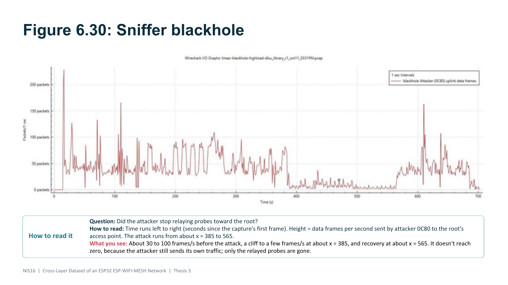
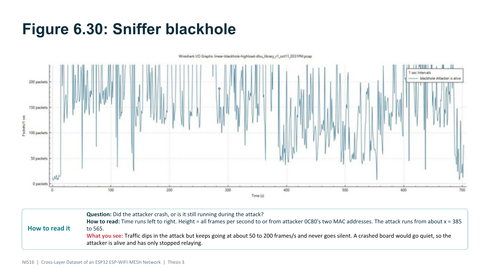
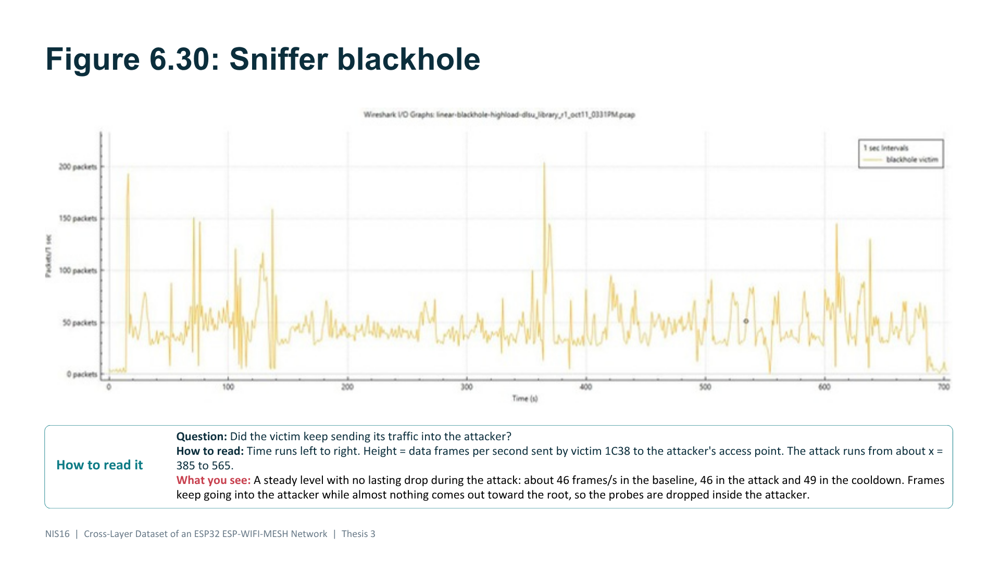
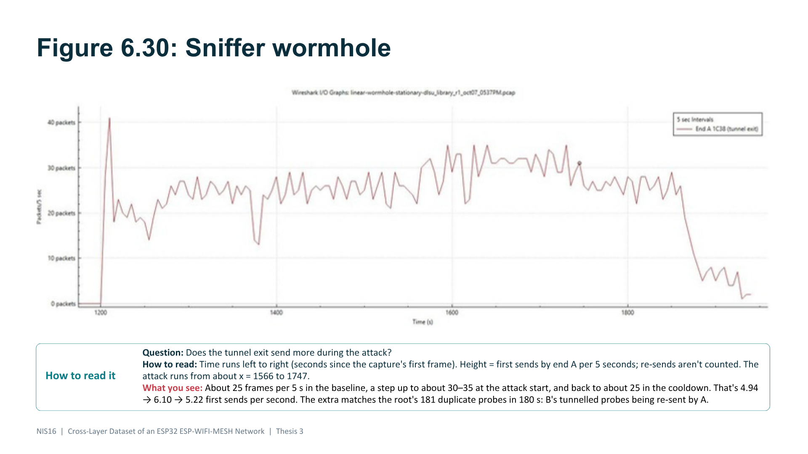
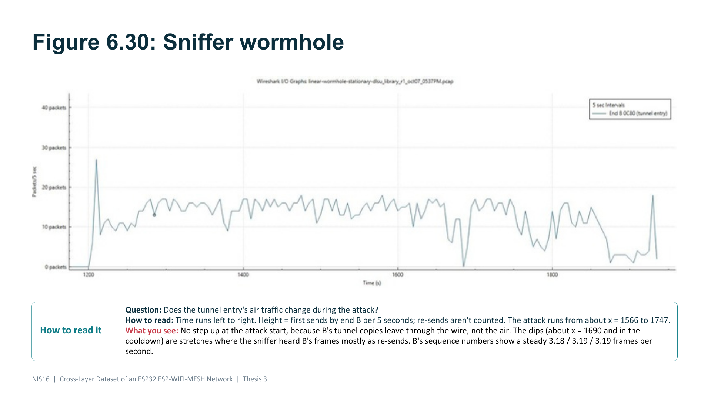
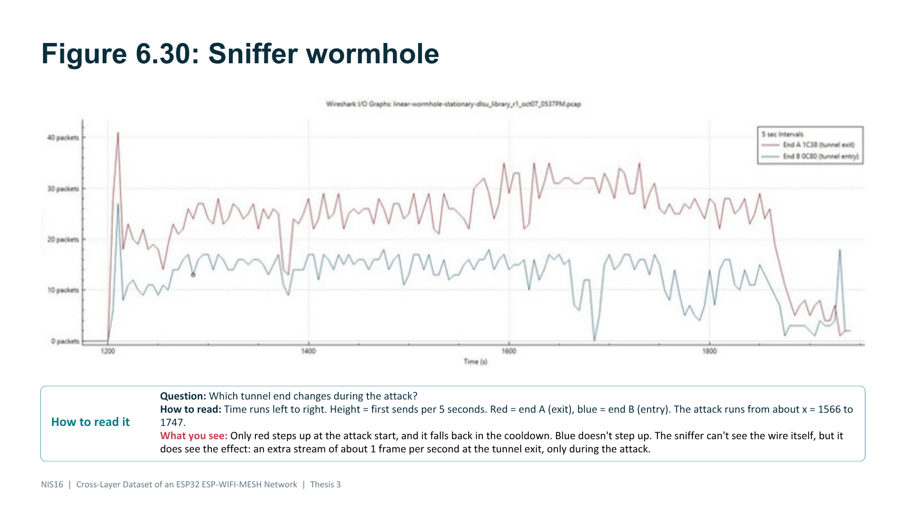

# THESIS3 Sniffer Graphs Study Guide (backup slides 85-92)

> [!note] What this guide covers
> - **Slides 85 to 92** of the Canva defense deck (THESIS3-Defense): the backup section with the **sniffer graphs**. 85 and 89 are dividers; 86, 87, 88 are the **blackhole** graphs; 90, 91, 92 are the **wormhole** graphs.
> - For each graph: **what question it answers, how to read it, why it looks the way it does, what it proves, what it does not prove, what to say, what not to say.**
> - **Sources:** study guide v11 Part 11 (Wireshark), repository verification #89 (blackhole capture) and #91 (wormhole capture), the team's own Wireshark counts (nov. 2), paper 4.2.3.3, 6.2.4, D-14, D-15, D-20.
> - **None of the numbers for these two captures are printed in the paper.** They come from the repository and our own Wireshark counts. Say "from the capture" or "from our verification log" if you quote them.
> - Lines marked **(our arithmetic)** are sanity checks we worked out ourselves, not results from the paper.

---

## 0. The whole section in one minute

| | Blackhole (slides 86 to 88) | Wormhole (slides 90 to 92) |
|---|---|---|
| **What the attack does** | The attacker receives its victims' probes and **drops** them instead of forwarding | End B copies its probes into a **UART wire**; end A puts the copies back on the air |
| **Can the sniffer see it?** | **Yes, clearly.** The attacker's traffic toward the root falls off a cliff | **Not the wire.** It sees only the effect: end A sends **about 1 extra frame per second**, only in the attack |
| **The key graph** | Attacker's uplink: about 30 to 100 frames/s, then **a few frames/s** for 180 s, then back | End A's first sends: about 25 per 5 s, then **30 to 35** for 180 s, then back to about 25 |
| **The control graph** | The victim keeps sending into the attacker at the same rate (46.0 → 45.7 → 49.3 frames/s) | End B does **not** step up (3.18 → 3.19 → 3.19 frames/s by sequence number) |
| **The proof, in one line** | Frames keep going **into** the attacker, almost nothing comes **out** toward the root, so the probes die **inside** the attacker | Only the tunnel exit changes, by exactly the tunnel's rate (181 duplicates in 180 s ≈ 1/s) |
| **In the paper?** | The paper's sniffer result is MacRetryRate in **7 of 36** blackhole runs (6.2.4). **This capture is not one of those 7** | **No.** No wormhole capture is in the paper's analysis. This one was lined up afterwards (verification #91) |

> [!tip] The one sentence to remember
> "The sniffer is a second witness from outside the mesh: for the blackhole it shows the attacker going quiet toward the root while its victim keeps talking to it; for the wormhole it can't see the wire, but it sees the tunnel exit sending one extra frame a second, only during the attack."

---

## 1. Before you read any of these graphs

### 1.1 What the sniffer is

- A **spare ESP32** with the project's sniffer firmware. It listens on the mesh channel (**channel 11, 2462 MHz, 20 MHz wide**) and streams every frame it hears over USB to a laptop. `tools/sniff.py` saves them as a **.pcap** file.
- **It never joins the mesh and never transmits.** Its own MAC address never appears in its own capture.
- **Wireshark is only the viewer.** The evidence is the .pcap file.
- **Why we have it:** without it, the only proof the blackhole dropped probes is the **attacker's own counter**, so the attacker would be grading itself. The sniffer is an independent witness (paper 4.2.3.3).
- **Analogy:** the boards' CSV logs are each person's own account. The sniffer is a **microphone in the middle of the room**.

### 1.2 What a capture can and cannot show

| ✅ Shows | ❌ Does not show |
|---|---|
| Who sent each frame (**transmitter**, `wlan.ta`) | **The probe contents.** The sniffer keeps only the first **64 bytes** of each data frame, and the probe starts at byte 62 |
| Who receives this **one hop** (**receiver**, `wlan.ra`) | **The wormhole wire.** It's a UART cable, not radio |
| When, to the microsecond | **Which phase** a frame is in. Phases come from the root's log |
| Whether a frame is a **re-send** (Retry bit) | Frames it never decoded (too far, collided) |
| Joins and leaves | Anything at 40 MHz (that's why every board was fixed to 20 MHz, D-14) |

> [!warning] Don't say "it's encrypted"
> The probe contents are missing because the sniffer keeps only 64 bytes per data frame. The mesh data frames are **not** 802.11-encrypted (Protected bit = 0). The paper says "encrypted" (1.6.1, 1.6.2, App. B); don't repeat that if someone has a capture open.

### 1.3 Words you need

| Word | Meaning |
|---|---|
| **Frame** | One transmission in the air. Wireshark labels the y-axis "packets"; read it as frames |
| **Data frame** | A frame that carries a payload (our probes, relayed probes, mesh data). Filter: `wlan.fc.type == 2` |
| **Re-send** (retry) | The same frame sent again because no ACK came back. The radio sets the **Retry bit** (`wlan.fc.retry == 1`) |
| **First send** | A frame sent for the first time (`wlan.fc.retry == 0`). Counts each new frame once |
| **Uplink** | Child → parent, toward the root. Probes flow up |
| **Two MACs per board** | Station MAC (sends to its parent) = base MAC, e.g. `…:0c:80`. Access point MAC (receives from its children) = base **+1**, e.g. `…:0c:81` |
| **I/O graph** | Wireshark's "frames over time" chart (Statistics → I/O Graph). Each point = number of frames matching the filter in one **interval** |
| **Interval** | The bin width: **1 s** on the blackhole graphs, **5 s** on the wormhole graphs |
| **x-axis** | **Seconds since the capture's first frame**, not since the run started |

### 1.4 The hop-wise rule (the reading rule that matters most)

- ESP-WIFI-MESH forwards **hop by hop**. Each frame names only **this hop's** sender and receiver, never the final destination.
- So "attacker → root" is written as **attacker's station MAC → its parent's access point MAC**. Here the attacker's parent **is** the root, so that's `wlan.ra == b0:cb:d8:f3:32:19` (the root's access point).
- A filter like `wlan.ta == <attacker> && wlan.da == <root>` is **always empty**, in every phase. On a graph that would look like a blackhole that never happened.
- **Check that a filter is right:** it must show traffic in the **baseline and the cooldown**. A wrong filter is empty everywhere; a real blackhole is traffic, then a gap for the attack, then traffic again.

### 1.5 The run schedule (same for every run)

| Phase | Length | Label |
|---|---|---|
| Baseline | 300 s | normal |
| **Attack** | **180 s** | attack |
| Cooldown | 120 s | normal |

That's 600 s per run, 420 of them normal (the 70% majority rate from the single-feature audit). On both captures the attack window is **about 180 s wide**.

---

## 2. The blackhole capture (slides 86, 87, 88)

### 2.1 Which capture and why

- **File:** `ESP32-Environment/datasets/PCAP/blackhole/linear/DLSU_Library/highload/linear-blackhole-highload-dlsu_library_r1_oct11_0331PM.pcap` (23.9 MB, 15:32:01 to 15:43:44, 344,666 frames). The file name is printed above each graph.
- **The run:** `verify_attack.py` → **BLACKHOLE CONFIRMED (2/2)**, confidence GOOD.
- **Set-up:** a **linear chain of 8**. The attacker sits at **hop 1**, right under the root, so **all 6 boards below it are its victims** (their PDR goes 1.0 → 0.0).
- **Scenario: highload** = every board sends a probe every **250 ms** (4 per second).
- **Why this one:** the clearest cliff of all our blackhole captures.
- ⚠️ **Not one of the paper's 7 sniffer runs** (6.2.4). Its dataset rows have no MacRetryRate. If asked: *"This is another confirmed blackhole run. We use it to show what the attack looks like from the air. The paper's retry result comes from the 7 runs in 6.2.4."*

| Role | Board | Station MAC (sends) | Access point MAC (receives) |
|---|---|---|---|
| Root | 3218 | `b0:cb:d8:f3:32:18` | `b0:cb:d8:f3:32:19` |
| **Attacker** (hop 1) | **0C80** | `20:50:0d:e7:0c:80` | `20:50:0d:e7:0c:81` |
| **Victim** (hop 2, the attacker's child) | **1C38** | `20:50:0d:e7:1c:38` | `20:50:0d:e7:1c:39` |

### 2.2 Where the phases sit on the x-axis

| Phase starts | Clock time | x | How we know |
|---|---|---|---|
| Baseline | 15:33:25.4 | ≈ 84 | Root's own timestamps |
| **Attack** | **15:38:26.0** | **≈ 385** | **Seen in the capture**: the attacker's uplink falls off a cliff |
| Cooldown | 15:41:26.7 | ≈ 565 | Root's timestamps (attack + 180.7 s) |
| End | 15:43:26.7 | ≈ 685 | Root's timestamps (+ 120 s) |

- **Only the attack start is observed in the traffic.** The other three are worked out from the gaps between the root's phase changes (root uptime 71.93, 372.53, 553.23 s).
- **Before x ≈ 84** is set-up (the mesh forming), not baseline. **After x ≈ 690** the boards stop.

> [!warning] The honest caveat: how the attack window was placed
> - The boards' clocks lag real time by the flashing time (about 40 s), so the root's timestamp alone can't place the phases on the sniffer's clock.
> - So `tools/pcap_retry.py` **finds the attack in the capture**: it looks for the **180 s stretch** (attack length from the root's log) where the attacker's uplink is lowest, and accepts it only if the rate is **half or less** of the 30 s on either side. It searches only from the earliest moment the root's log allows to 10 minutes later. **If no such drop exists, it refuses the capture.**
> - So "the attacker's line drops in the attack window" is **partly how the window was found**.
> - **What is independent of the fit:** the drop exists and lasts exactly as long as the root logged; the **victim's rate** (never used by the fit) stays steady; the **cooldown** comes back; the attacker's own counter shows the same step (forwarded probes → 0.00).

### 2.3 Slide 86: the attacker's uplink ("Did the attacker stop relaying?")



**The filter**
```
wlan.fc.type == 2 && wlan.ta == 20:50:0d:e7:0c:80 && wlan.ra == b0:cb:d8:f3:32:19
```
= data frames **sent by the attacker 0C80** to **its parent's access point** (the root's). Interval **1 s**.

**How to read it**
- x = seconds since the capture's first frame. y = data frames per second the attacker sent up to the root.
- Look for three things: **a level** before x ≈ 385, **a cliff** at x ≈ 385, **a recovery** at x ≈ 565.

**What you see, part by part**

| Part of the graph | x | What it is |
|---|---|---|
| Flat 0, then a tall spike (~230) | 0 to ~15 | The capture started before the mesh; the spike is **the mesh forming**. Ignore it |
| Busy, 30 to 100 frames/s | ~15 to 385 | Set-up (to x ≈ 84), then the **baseline**: the attacker relays all 6 victims' probes plus its own |
| **Cliff** | **≈ 385** | **The attack starts**: relaying stops |
| A few frames/s (about 0 to 20) | 385 to 565 | **The attack**: only the attacker's own traffic is left |
| Back to 30 to 60, with spikes | 565 to ~690 | **The cooldown**: relaying resumes |
| Falls to ~0 | ~690 to 700 | The run ends; boards stop |

**Why it looks like this**
- **Why the level is 30 to 100:** in highload every board sends **4 probes/s**. The attacker carries its 6 victims' probes plus its own: about **7 × 4 = 28 probes/s** going up. The graph counts **every** data frame, including **re-sends** and mesh upkeep, so it sits above 28 and jumps around with link quality. **(our arithmetic)**
- **Why the cliff:** in the attack the attacker **drops every relayed probe** (its forwarding ratio goes from 1.000 to 0.000-0.007). Only its own 4 probes/s plus re-sends and upkeep remain.
- **Why it doesn't reach zero:** the attacker is still a **working mesh member**. It keeps sending its own probes and mesh traffic. Only the **relayed** probes are gone.
- **Why it recovers at x ≈ 565:** the cooldown starts and the attacker forwards again.

> [!note] Things on this graph we have not analysed
> - The attack stretch is a little higher around x ≈ 400 to 490 than around 490 to 565.
> - The cooldown has a tall spike around x ≈ 610 (~165 frames/s).
> - We have **not** studied either. If asked: *"We didn't analyse individual spikes; we compare the phases as a whole, and the phase-level pattern, high, low for exactly 180 s, high again, is what we rely on."* **Do not invent** an explanation such as "a backlog being flushed".

**What it proves:** the attacker stopped sending relayed traffic toward the root for exactly the attack window. **What it does not prove on its own:** that the frames were **dropped**. That needs slide 88 (the victim kept sending into the attacker).

### 2.4 Slide 87: the attacker is alive ("Did it crash?")



**The filter**
```
wlan.addr in {20:50:0d:e7:0c:80, 20:50:0d:e7:0c:81}
```
= **every frame** with either of the attacker's two MACs in any address field. Interval 1 s.

**How to read it:** same x-axis. y = all frames to or from the attacker per second. Look at the attack window (385 to 565): **does the line go to zero?**

**What you see:** busy all run (about 50 to 200 frames/s). In the attack it **dips** (its uplink is part of this count) but **never goes silent**.

**Why it looks like this**
- This filter counts **every kind of frame**: beacons from the attacker's access point, the victim's data coming **in**, RTS/CTS, ACKs addressed to the attacker, and the attacker's own data going up. That's why it's busier and noisier than slide 86.
- In the attack, the victim's ~46 frames/s are still pouring **into** the attacker (slide 88), and the attacker's access point keeps sending beacons, so the line stays high.
- **A crashed or rebooting board goes quiet everywhere:** no beacons, no data, no ACKs. This line never does.

**What it proves:** the drop on slide 86 is **not a crash, reboot or dead battery**. The attacker is running and has only stopped relaying. This matters because the verifier exists to tell a real attack from a broken run.

> [!tip] If asked "why is this graph so noisy?"
> "It counts every frame type the attacker touches, including control frames and the victim's traffic coming in. We only use it for one yes/no question: did the board ever go silent? It didn't."

### 2.5 Slide 88: the victim keeps sending into the attacker



**The filter**
```
wlan.fc.type == 2 && wlan.ta == 20:50:0d:e7:1c:38 && wlan.ra == 20:50:0d:e7:0c:81
```
= data frames **sent by victim 1C38** to **the attacker's access point** (its parent). Interval 1 s.

**How to read it:** look at the attack window. **Is there a dip?**

**What you see:** a level line straight through x = 385 to 565. **No dip.**

**The counts** (Wireshark "Displayed: N" per phase window)

| Phase (x) | Victim → attacker frames | Per second | Of which re-sends | Retry rate |
|---|---|---|---|---|
| Baseline (84 to 385) | 13,841 | **46.0** | 5,226 | **37.8%** |
| Attack (385 to 565) | 8,220 | **45.7** | 3,191 | **38.8%** |
| Cooldown (565 to 685) | 5,917 | **49.3** | 2,484 | **42.0%** |

**Why it looks like this**
- **Why the victim never slows down:** at the radio level the attacker still **accepts and acknowledges (ACKs) every frame**. The drop happens one layer up, in the relay code. So the victim's radio sees nothing wrong and keeps sending (paper 3.3.1.2).
- **Why retries don't rise:** a re-send happens only when **no ACK** comes back. The attacker ACKs everything, so the attack causes no extra re-sends. The attack phase is one point above the baseline and the **cooldown is the highest** of the three: no attack effect. That matches the paper's 7 runs (6.2.4: up in 3 runs, down in 4, no consistent rise).
- **Why about 40% re-sends is normal here:** link quality on a multi-hop indoor chain. It's the same in every phase.
- **Why the victim doesn't switch to another parent:** nothing tells it the link is bad, since every frame is ACKed. That's why ParentSwitchRate barely moves (0.00000 → 0.00009 per s): our attack is emulated in the application and never touches routing (D-20).
- **Why about 46 frames/s:** the victim sends its own 4 probes/s plus relays its 5 boards below, about **6 × 4 = 24 probes/s**. With ~38% of frames being re-sends, that's about 24 ÷ 0.62 ≈ **39 frames/s**; the remaining few per second are other mesh data. Same order as the 46 measured. **(our arithmetic; a sanity check, not a result)**

### 2.6 The three blackhole graphs together

| Graph | In the attack | Means |
|---|---|---|
| 86 Attacker → root | **Falls** to a few frames/s | Nothing relayed comes **out** |
| 87 Attacker, all frames | Dips, **never silent** | The attacker is **alive** |
| 88 Victim → attacker | **Steady** (46/s) | Probes keep going **in** |

> [!tip] What to say (blackhole)
> "During the attack the victim kept sending to the attacker at the same rate, about 46 frames a second, and its retry rate stayed around 38 to 42 percent in every phase. So the victim's radio saw nothing wrong: the attacker accepted and acknowledged every frame, then dropped the probes instead of forwarding them. Meanwhile, the attacker's traffic toward the root fell off a cliff for exactly the 180 seconds of the attack, but the attacker itself never went silent. Frames go in, almost nothing comes out: the probes are dropped inside the attacker."

> [!warning] Do not say (blackhole)
> - "The pcap shows the packets being dropped." It shows the attacker going quiet toward the root while frames keep arriving. The drop itself is proven by the attacker's counter and the victims' PDR.
> - "All four phase boundaries are in the capture." Only the attack start is; the rest come from the root's timestamps.
> - "This is one of the paper's 7 sniffer runs." It isn't.
> - "It's encrypted."

### 2.7 The paper's sniffer result (what the 7 runs show), for context

- In **all 7** paper sniffer runs, the attacker's uplink falls in the attack, by **70% to 92%**; in 6 of 7 it comes back in the cooldown. The victims' uplink never falls. (repository, the MacFramesHeard column)
- **MacRetryRate** (real 802.11 retry rate, from the sniffer) for victims: **0.295** baseline, **0.364** attack, **0.323** cooldown. Per run the change runs from **-0.10 to +0.33**, up in 3, down in 4: **no consistent rise** (paper 6.2.4).
- It's a **supplementary column, not one of the 16 features**: the boards can't measure MAC retries (ESP-IDF has no counter for it, D-15).

---

## 3. The wormhole capture (slides 90, 91, 92)

### 3.1 First, why the wormhole is hard to see

- **The tunnel is a UART wire** between ends A and B (115200 baud). The sniffer listens to radio, so **it cannot see the wire at all**. The paper picked a wire partly because it **can't interfere with the radio channel** the mesh and the sniffer share (4.2.1.3).
- **How our wormhole works:** end **B** (the deeper end, the **tunnel entry**) sends its probes **normally over the air** and **also** writes a copy into the wire. End **A** (the shallower end, the **tunnel exit**) receives the copy and **puts it back on the air** toward the root. So the root gets B's probe **twice**: once by the normal path, once through the tunnel.
- **So the sniffer can see one thing:** end A sending **a little more**, only during the attack. Nothing is dropped, nobody changes parent, nobody joins or leaves.
- ⚠️ **Not in the paper.** No wormhole capture entered the paper's analysis: the alignment tool (2.2) finds the blackhole's traffic **drop**, and a wormhole has no drop. This capture was lined up afterwards with the root's beacon clock (verification #91). If asked: *"The paper's evidence for the wormhole is the root's duplicate arrivals (6.2.2). We show this capture as an extra, to show the attack from the air."*

### 3.2 Which capture and why

- **File:** `ESP32-Environment/datasets/PCAP/wormhole/linear/DLSU_Library/stationary/linear-wormhole-stationary-dlsu_library_r1_oct07_0537PM.pcap` (32 MB, 384,373 frames, **0 lost**, channel 11).
- **The run:** `verify_attack.py` → **WORMHOLE CONFIRMED** (2/2 primary: TunnelIntensity and DuplicateRate 0 → 1.000), confidence GOOD (not STRONG only because this oct. 7 run has no saved run log to check a forced start). B sent about 180 tunnel frames, A received about 180. **The root logged 181 duplicate probes, all in the attack** (0 in baseline, 0 in cooldown). Every plain child kept PDR 1.0.
- **Scenario: stationary** = each board sends **1 probe per second**.
- **Why this one:** all 71 wormhole captures were checked (#91). Here the sniffer hears **97 to 100% of end A's frames** in every phase, so the graph shows what A sent, not how well we heard it. It's stationary, so there's no burst spike. And A's step lands **2 s after** the attack marker from the root's clock.

**The chain:** ROOT 3218 → B768 → D7B4 → FE90 → **1C38 (A, hop 4)** → E618 → **0C80 (B, hop 6)** → ED80

| Role | Board | Hop | Station MAC (sends) | Sends to (its parent's access point) |
|---|---|---|---|---|
| Root | 3218 | 0 | `b0:cb:d8:f3:32:18` | (its own access point: `…:32:19`) |
| A's parent | FE90 | 3 | `b4:bf:e9:32:fe:90` | `28:05:a5:32:d7:b5` |
| **End A (tunnel exit)** | **1C38** | 4 | `20:50:0d:e7:1c:38` | `b4:bf:e9:32:fe:91` |
| Board below A | E618 | 5 | `f4:2d:c9:73:e6:18` | `20:50:0d:e7:1c:39` |
| **End B (tunnel entry)** | **0C80** | 6 | `20:50:0d:e7:0c:80` | `f4:2d:c9:73:e6:19` |

> [!warning] Same boards, different jobs
> **0C80** was the **attacker** in the blackhole capture and is **end B** here. **1C38** was the **victim** there and is **end A** here. Roles change from run to run; a panelist comparing slides may ask.

### 3.3 Where the phases sit on the x-axis (all four from the root's clock)

| Phase starts | Root uptime (root's log) | x | Window used |
|---|---|---|---|
| Baseline | 65.90 s | 1265.8 | 1266 to 1566 |
| **Attack** | **366.40 s** | **1566.3** | **1566 to 1747** |
| Cooldown | 547.00 s | 1746.9 | 1747 to 1867 |
| End | 667.50 s | 1867.4 | |

- **How:** the root's access point sends **beacons**, and each beacon carries a **timestamp (TSF)**: microseconds since the root's Wi-Fi started. The root's uptime runs about **1.5 s** ahead of it (measured 1.25 to 2.25 s), so uptime = TSF + 1.5 s. The root's log gives the uptime of each phase change; the beacons put that uptime on the capture's time axis.
- **Worked check:** beacon frame **#189272** at x = 1566.44 has TSF **365,053,428 µs** = 365.05 s, + 1.5 s = **366.55 s** uptime. The log says the attack began at **366.40 s**, 0.15 s earlier, so the marker is x = **1566.3**.
- **Independent check:** end A's traffic steps up at **x = 1568.3**, 2 s after the marker. The markers were not fitted to A's line; they come from the root's clock, and A's step confirms them.
- **Why the axis starts at ~1200:** at frame #12612 the time jumps from x = 13.1 to 1170.5. The sniffer **paused saving for 19 minutes before the run**; its .json record lists the pause. The run (x = 1266 to 1867) is fully recorded with 0 frames lost.
- This is **stronger** than the blackhole capture's alignment: nothing here was fitted to the traffic.

### 3.4 Slide 90: end A, the tunnel exit ("Does the exit send more?")



**The filter**
```
wlan.fc.type == 2 && wlan.ta == 20:50:0d:e7:1c:38 && wlan.fc.retry == 0
```
= data frames **sent by end A**, **first sends only**. Interval **5 s**.

**How to read it:** y = first sends per 5 s. Look for **a step up** at x ≈ 1566 and **a step down** at x ≈ 1747.

**What you see**

| Part | x | Level |
|---|---|---|
| Spike | ≈ 1210 | End of the set-up phase. Ignore |
| Baseline | 1266 to 1566 | About **25 per 5 s** |
| Short dip | ≈ 1380 | The sniffer missed A's first sends there for a moment. Outside the attack |
| **Attack** | **1566 to 1747** | **Steps up to about 30 to 35 per 5 s** |
| Cooldown | 1747 to 1867 | Back to about 25 |
| Falls away | after ≈ 1867 | The run ends |

**Per phase:** 1,482 first sends in 300 s = **4.94/s** → 1,105 in 181 s = **6.10/s** → 626 in 120 s = **5.22/s**. About **+1.2/s** in the attack, back down after.

**Why it looks like this**
- **Why the step is only ~1 frame per second:** in a stationary run each board sends 1 probe/s, and only **B's** probes go into the tunnel. A puts each copy back on the air once: **+1 frame/s**. The root logged **181 duplicates in 180 s**, about 1 per second. The two match.
- **Why A sends ~5/s to begin with:** A sends its own probe (1/s) and relays the 3 boards below it (E618, B, ED80), so about **4 probes/s**, plus about 1/s of mesh upkeep. In the attack, add B's tunnel copy: about 6/s. **(our arithmetic)**
- **Why first sends only (`retry == 0`):** the effect is small. Re-sends depend on link quality, not on how much A has to send, and would bury a +1/s step in noise. Counting first sends counts each new frame once.
- **Why 5-second bins:** at ~5 frames/s, 1-second bins jump around too much to see a +1 step. Five-second bins average it out. (The blackhole's cliff is big enough for 1 s bins.)

### 3.5 Slide 91: end B, the tunnel entry ("Does the entry change?")



**The filter:** the same as slide 90 with B's MAC (`20:50:0d:e7:0c:80`). Interval 5 s.

**What you see:** about 10 to 17 per 5 s throughout, **no step up at x ≈ 1566**. Dips around **x ≈ 1690** and in the **cooldown**.

**Why it looks like this**
- **Why no step:** B sends its own probes over the air **as usual** and writes the copy into the **wire**. The copy never touches the radio, so B's air traffic doesn't change.
- **Why the dips:** in those stretches the sniffer heard B's frames **almost only as re-sends**, which `retry == 0` hides. B did **not** stop sending. B's frames were also going out at slower, more robust rates (e.g. 13 Mb/s) by the cooldown.
- **How we know B didn't change:** by **sequence numbers** (3.7), B sent **3.18 → 3.19 → 3.19** frames/s. Flat.
- First-send counts for B drift down (901 = 3.00/s → 506 = 2.80/s → 261 = 2.17/s), but not in step with the attack. That's the sniffer **hearing** B a little worse over time, not B sending less.
- **Why B sends ~3/s:** its own probe (1/s) plus the one board below it (ED80), so 2 probes/s, plus upkeep. **(our arithmetic)**

### 3.6 Slide 92: both ends together ("Which end changes?")



- **Red = end A (exit), blue = end B (entry)**, both first sends per 5 s.
- **Only red steps up at the attack start, and falls back in the cooldown. Blue doesn't step up.**
- This is the wormhole's fingerprint from the air: **one board, the tunnel exit, sends an extra stream of ~1 frame/s, only during the attack.** The sniffer can't see the wire, but it sees where the wire comes out.

### 3.7 The sequence-number check (the answer to "maybe the sniffer just heard A better")

- Every frame carries a **sequence number** that goes up by one per new frame (12 bits: 0 to 4095, then wraps). **Last minus first = how many frames the board really sent, whether the sniffer heard them or not.**

| Board | Baseline | Attack | Cooldown |
|---|---|---|---|
| **End A** | 1,579 ÷ 299.9 s = **5.27/s** | 1,151 ÷ 180.5 s = **6.38/s** | 631 ÷ 119.5 s = **5.28/s** |
| End B | **3.18/s** | **3.19/s** | **3.19/s** |
| Board below A (E618) | **4.78/s** | **4.78/s** | **4.80/s** |

- **Only end A changes: +1.1 frames/s, in the attack only.** B and the board feeding into A don't move at all.
- The numbers run on without a gap between phases (A: baseline ends at seq 1861, attack starts at 1862), so nothing hides between windows.

### 3.8 What else the capture shows (nothing else changed)

- End A sent **0** frames to anyone other than its parent FE90 during the run: **A never changed parent.**
- **0** joins, re-joins, leaves or kick-offs among our 8 boards during the run: **the topology didn't change.** (Without the MAC list the filter shows 83 frames, all from other Wi-Fi devices in the library.)
- That matches the paper's wormhole result: hop and parent unchanged, others' PDR 0.9999 → 0.9999.

> [!tip] What to say (wormhole)
> "The tunnel is a wire, so the sniffer can't see it. It can see the effect. During the attack, and only then, end A, the tunnel exit, sends about one extra frame a second. That matches the 181 probes the root received twice. End B and the board below A don't change, A keeps its parent, and no board joins or leaves. We counted with sequence numbers, so this is what A sent, not just what the sniffer happened to hear."

> [!warning] Do not say (wormhole)
> - "The pcap shows the tunnel" or "shows the duplicates". The copy travels by wire, and the probe contents aren't in the capture.
> - "End A became eight times busier." That was an earlier capture (#90, Yuchengco burst) and it was **wrong**: the sniffer decoded ~1 in 10 of A's frames in the baseline and ~1 in 2 in the attack, so the jump was in what we **heard**. A really sent about 20% more.
> - "This capture is part of the paper's analysis." It isn't.
> - "It's encrypted."

---

## 4. Blackhole vs wormhole graphs: why they look so different

| | Blackhole | Wormhole |
|---|---|---|
| Effect on air traffic | **Removes** a big stream (all relayed probes) | **Adds** a small stream (~1/s) |
| Size | Huge: 30-100 → a few frames/s | Small: ~5 → ~6 frames/s (+20%) |
| Scenario of the capture | Highload (4 probes/s per board) | Stationary (1 probe/s per board) |
| Filter | All data frames (re-sends included) | **First sends only** |
| Interval | 1 s | 5 s |
| How the phases were placed | Attack start **fitted** to the drop; the rest from the root's timestamps | All four from the **root's beacon clock**; A's step confirms it |
| Control line | Victim → attacker stays steady | End B (and E618) stay steady |
| In the paper | Sniffer result = 7 other blackhole runs (6.2.4) | No wormhole capture in the paper |

---

## 5. Problems on slides 85 to 92 (fix before the defense)

| Slide | Problem | Fix |
|---|---|---|
| **86, 87, 88, 90, 91, 92** | **All six are titled "Figure 6.30".** In the paper, **Figure 6.30 is the pooled PCA/t-SNE plot**. These sniffer graphs are not paper figures at all | Retitle, e.g. "Sniffer: blackhole, attacker uplink" / "Sniffer: wormhole, end A", without a figure number |
| **86 to 92** | **Speaker notes are copied from the Figure 6.29 slide** ("n = 537, 5,425 and 38 windows; C2 mixes every group…"). Wrong slide | Replace with this guide's key facts (file, roles, phases, counts) |
| **85, 89** | The badge circle says **"B3"** but the title says **"Backup B4"** | Make them match |
| 86 to 92 | The graphs have **no phase markers**; the attack window is only in the caption | Optional: add vertical lines at 84 / 385 / 565 / 685 (blackhole) and 1266 / 1566 / 1747 / 1867 (wormhole). Wireshark can't draw them; add them in Canva |
| 87 | Caption says 50 to 200 frames/s in the attack; v11 guide says 50 to 150 | Minor. Either is fine read off the graph; the point is "never zero" |

Per the deck rule, any change to these slides gets a yellow CHANGED tag.

---

## 6. Panel questions and spoken answers

**General**

- **"What is the sniffer, and did it affect the network?"**
  *"A spare ESP32 that only listens on the mesh channel and saves every frame it hears. It never joins and never transmits; its own MAC never appears in its own capture."*
- **"Why didn't you use a laptop with Wireshark?"**
  *"A normal Windows laptop's Wi-Fi card can't listen in monitor mode, so it only sees its own traffic. The ESP32 hears every frame on the channel. Wireshark is only the viewer."*
- **"Are these graphs in your paper?"**
  *"No. The paper's sniffer result is the retry rate in 7 blackhole runs, Section 6.2.4. These two captures are extras from our verification log, to show what each attack looks like from the air."* (And make sure the slide titles no longer say "Figure 6.30".)
- **"Can you read the probes in the capture?"**
  *"No. The sniffer keeps the first 64 bytes of each data frame: headers, timing, signal strength. The probe starts at byte 62, so its contents aren't in the file. We count frames, not probes."*
- **"Why 20 MHz?"**
  *"The sniffer decodes 20 MHz only. At the ESP32's default 40 MHz it heard 0 data frames from the root. Every board was fixed to 20 MHz before the 80 runs (D-14)."*

**Blackhole**

- **"Why doesn't the attacker's line drop to zero?"**
  *"Because the attacker is still a working mesh member: it sends its own probes and mesh traffic. Only the relayed probes are gone."*
- **"How do you know it didn't just crash?"**
  *"Slide 87: every frame to or from the attacker. A crashed board goes silent; this one dips but keeps going at 50 to 200 frames a second the whole time."*
- **"How do you know the probes were dropped, not just lost in the air?"**
  *"Slide 88: the victim kept sending into the attacker at the same rate, 46 frames a second, and every frame was acknowledged, so its retry rate didn't rise. Frames go in, almost nothing comes out toward the root. Combined with the attacker's own counter, forwarding at 0.000, that's a drop inside the attacker."*
- **"Why didn't the victim retry more, or switch parent?"**
  *"The attacker still acknowledges every frame at the radio level. A retry only happens when no ACK comes back, and nothing tells the victim the link is bad. Our attack is in the application layer; the radio and routing never see it."*
- **"You found the attack window from the drop. Isn't that circular?"**
  *"The window's position is fitted, yes. But the fit must find a drop of exactly the logged attack length, to half or less, inside the time the root's log allows; otherwise the capture is refused. And the victim's traffic, which the fit never uses, shows it kept sending."*
- **"Your filter attacker → root shows nothing. Isn't that suspicious?"**
  *"That filter is always empty, in every phase, because each frame names only this hop's receiver. The right filter is the attacker's frames to its parent's access point, and that one shows traffic in the baseline and cooldown and the gap in the attack."*
- **"What's the spike at x ≈ 610?"**
  *"We didn't analyse individual spikes. We compare the phases as a whole: high in the baseline, low for exactly 180 seconds, high again in the cooldown."*

**Wormhole**

- **"Your paper says the sniffer can't see the wormhole. So what is this?"**
  *"It can't see the wire. It can see the effect: the tunnel exit sends about one extra frame a second, only during the attack. This capture was lined up after the paper using the root's beacon clock; the paper's wormhole evidence is the root's duplicate arrivals."*
- **"Why is the increase so small?"**
  *"Because that's how much the tunnel carries. In a stationary run each board sends one probe a second, and only end B's probes go into the tunnel. A puts each copy back on the air once, so about one extra frame a second, matching the 181 duplicates the root logged in 180 seconds."*
- **"Why doesn't end B's traffic change? It's sending into the tunnel."**
  *"B sends its own probes over the air as usual and also writes a copy into the wire. The copy never touches the radio."*
- **"Why does B's line drop at times?"**
  *"In those stretches the sniffer heard B's frames only as re-sends, which this filter leaves out. B's sequence numbers show it sent 3.18, 3.19 and 3.19 frames a second in the three phases."*
- **"Maybe the sniffer just heard A better during the attack?"**
  *"That's why we checked sequence numbers. They count every frame A sent, heard or not: 5.27, 6.38, 5.28 per second. Only A changes, only in the attack. In this capture the sniffer heard 97 to 100 percent of A's frames anyway."*
- **"How do you know where the attack starts on this graph?"**
  *"From the root's own clock. Its beacons carry a timestamp we can match to the root's log, which records when each phase began. A's traffic steps up two seconds after that point, so the marker wasn't fitted to A's line."*
- **"What's the empty stretch before x = 1200?"**
  *"The sniffer paused saving for 19 minutes before the run; its record lists the pause. The run itself is fully recorded, no lost frames."*
- **"Why are 0C80 and 1C38 in both captures with different roles?"**
  *"Roles are assigned per run. In the blackhole run 0C80 was the attacker and 1C38 its victim; in the wormhole run 1C38 is the tunnel exit and 0C80 the entry."*

---

## 7. Numbers to memorise

| Number | What it is |
|---|---|
| **385 / 565** | Blackhole attack window on the x-axis (attack start fitted; cooldown from the root) |
| **30-100 → a few → 30-60** | Attacker's uplink, frames/s: baseline → attack → cooldown |
| **46.0 / 45.7 / 49.3** | Victim → attacker frames/s per phase |
| **37.8% / 38.8% / 42.0%** | Victim's retry rate per phase: no attack effect |
| **70-92%** | How much the attacker's uplink fell in the paper's 7 sniffer runs |
| **1566 / 1747** | Wormhole attack window on the x-axis (root's beacon clock) |
| **4.94 / 6.10 / 5.22** | End A first sends per second |
| **5.27 / 6.38 / 5.28** | End A frames sent per second (sequence numbers) |
| **3.18 / 3.19 / 3.19** | End B frames sent per second (sequence numbers) |
| **181 in 180 s** | Duplicate probes at the root ≈ 1 per second = A's extra stream |
| **97-100%** | Share of end A's frames the sniffer heard |
| **64 bytes** | What the sniffer keeps per data frame (why probe contents aren't visible) |

---

## Check-in

- **Q:** A panelist looks at slide 92 and says: "End A only went up by one frame a second. That's tiny. How do you know it's the wormhole and not noise, or the sniffer just hearing A better?"
- **Your answer:** *(pending)*

> [!question]- Answer (click to reveal)
> Three things. **Size:** one extra frame a second is exactly what the tunnel should add: B sends one probe a second in a stationary run, and the root logged 181 duplicate probes in the 180-second attack. **Timing:** the step starts 2 s after the attack marker taken from the root's beacon clock (not fitted to A's line) and ends at the cooldown. **It's what A sent, not what we heard:** by sequence numbers A sent 5.27 → 6.38 → 5.28 frames per second, while end B (3.18 → 3.19 → 3.19) and the board below A (4.78 → 4.78 → 4.80) didn't move; and the sniffer heard 97 to 100% of A's frames in every phase.
>
> 📖 **Review it:** sections 3.4, 3.7 and 3.3 of this guide; v11 guide 11.8.
