# THESIS3 Defense Study Guide: Cross-Layer Dataset Design and Exploratory Analysis of an ESP32-Based ESP-WIFI-MESH Network

- **Source:** the final paper, [NIS16-Full_Thesis_Document.docx](../../Plan/Paper-Editing/1-Working-Copy/NIS16-Full_Thesis_Document.docx). Every number in this guide is taken from it, and the feature formulas were checked against `ESP32-Environment/analysis/features.py`.
- **Defense weight:** the adviser wants the focus on **Chapters 5 to 7**, with Chapter 4 possibly included. Chapters 1 to 3 should be brief. This guide follows that split: Parts 1 to 2 are short, Parts 3 to 8 are the deep ones.
- **How to use it:** read Part 0 first (the whole thesis in one page), then the part for the chapter you present. Every part ends with a self-test question whose answer is folded away. Part 9 is a bank of likely panel questions.

## Parts

1. [Part 0: The whole thesis on one page](#part-0-the-whole-thesis-on-one-page)
2. [Part 1: Chapters 1 to 3, brief](#part-1-chapters-1-to-3-brief)
3. [Part 2: How the testbed works (Chapter 4.1 to 4.2.3)](#part-2-how-the-testbed-works-chapter-41-to-423)
4. [Part 3: From raw rows to the dataset (Chapter 4.2.4)](#part-3-from-raw-rows-to-the-dataset-chapter-424)
5. [Part 4: How every run is validated (Chapter 4.2.7)](#part-4-how-every-run-is-validated-chapter-427)
6. [Part 5: Chapter 5, Methodological Deviations](#part-5-chapter-5-methodological-deviations)
7. [Part 6: Chapter 6, Results (dataset, attack validation, EDA)](#part-6-chapter-6-results-dataset-attack-validation-eda)
8. [Part 7: Chapter 6.4 to 6.5, Clustering and Discussion](#part-7-chapter-64-to-65-clustering-and-discussion)
9. [Part 8: Chapter 7, Conclusion](#part-8-chapter-7-conclusion)
10. [Part 9: Panel question bank](#part-9-panel-question-bank)
11. [Part 10: Weak spots in the submitted paper](#part-10-weak-spots-in-the-submitted-paper)
12. [Formula summary](#formula-summary)

## Coverage map

| Paper section | Covered in |
|---|---|
| Ch 1 Introduction (1.1 to 1.6) | Part 1 |
| Ch 2 Review of Related References (2.1 to 2.10) | Part 1 (only what the defense needs) |
| Ch 3 Theoretical Framework (3.1 to 3.5), Tables 3.4, 3.5, 3.7 | Part 1 |
| 4.1 Architectural Design, Figure 4.1 | Part 2 |
| 4.2.1 Attack implementation, Figures 4.2 to 4.15, Tables 4.1 to 4.5 | Part 2 |
| 4.2.2 Topologies, sites, scenarios, Figures 4.16 to 4.23, Tables 4.6, 4.7 | Part 2 |
| 4.2.3 Data collection, Tables 4.8 to 4.15 | Part 2 |
| 4.2.4 Feature extraction, Equations 4.1 to 4.18, Tables 4.16 to 4.18 | Part 3 |
| 4.2.5 Clustering algorithms and metrics, Figures 4.29 to 4.47, Equations 4.21 to 4.24 | Part 7 |
| 4.2.6 EDA plan | Part 6 |
| 4.2.7 Attack validation, Figures 4.55 to 4.59, Table 4.24 | Part 4 |
| 4.3 Theoretical Analysis, 4.4 Cluster Visualization | Parts 3 and 7 (summarized) |
| 5.1 to 5.7 Methodological Deviations, Tables 5.1 to 5.7 | Part 5 |
| 6.1 Dataset Collected, Tables 6.1 to 6.8 | Part 6 |
| 6.2 Attack Validation Results, Tables 6.9 to 6.17, Figures 6.1 to 6.8 | Part 6 |
| 6.3 Exploratory Data Analysis, Tables 6.18 to 6.23, Figures 6.9 to 6.16 | Part 6 |
| 6.4 Clustering Results, Tables 6.24 to 6.32, Figures 6.17 to 6.31 | Part 7 |
| 6.5 Discussion, Tables 6.33 to 6.35 | Part 7 |
| 7.1 to 7.7 Conclusion and Recommendations | Part 8 |
| Appendix C Deviations Log | Part 5 (through Table 5.2) |

---

## Part 0: The whole thesis on one page

### The elevator pitch

- We built a small Wi-Fi mesh network out of 8 cheap ESP32 boards, attacked it on purpose in two ways, and recorded everything every board saw, second by second.
- The result is a labelled dataset (normal vs. attack) taken from **real hardware**, which is rare because most attack datasets come from simulators.
- Then we asked: can the data tell normal from attack on its own, without being told the answer?

### The story in seven sentences

1. **Problem:** attack datasets for mesh networks are almost all simulated or come from ordinary IP networks, so nobody knows what a blackhole or wormhole looks like on real ESP32 mesh hardware.
2. **What we built:** an ESP32 ESP-WIFI-MESH testbed (1 root + 7 child boards), at 3 DLSU sites, in 4 topologies, under 3 traffic scenarios.
3. **Two attacks, emulated at the application layer:** a **blackhole** (a relay board silently drops the probes it should forward) and a **wormhole** (two boards joined by a UART wire, so one board's probes reach the root twice).
4. **Data:** every board logs at 10 Hz to flash and a microSD card; the logs become one-second windows with 16 features and a label.
5. **Result 1 (validation):** both attacks did exactly what they were designed to do in **all 72 attack runs**, and the **8 benign runs** showed no attack signature.
6. **Result 2 (separability):** the blackhole is visible almost only through **PDR** (delivery collapses), and the wormhole almost only through **duplicate arrivals at the root**. The radio and routing (cross-layer) features did **not** change.
7. **Conclusion:** the attacks live in the **data plane**, not across layers, because an application-layer emulation never touches the radio or the routing. The paper reports this as a finding, not a failure.

> [!tip] Takeaway
> If you remember one sentence: *"Both attacks left a clear, verified mark on the traffic, delivery loss for the blackhole and duplicate probes for the wormhole, but not on the radio or routing features, because the attacks were emulated at the application layer."*

### The 25 numbers to know cold

| Number | What it is | Where |
|---|---|---|
| **8** | boards per run: 1 root + 7 children | Table 6.1 |
| **80** | runs in total: 36 blackhole + 36 wormhole + 8 benign | Table 6.1 |
| **72** | attack runs = 4 topologies x 2 attacks x 3 sites x 3 scenarios | 6.1 |
| **4 / 3 / 3** | topologies (linear, star, tree, partial mesh) / sites (G402, DLSU Library, Yuchengco) / scenarios (stationary, burst, highload) | 4.2.2 |
| **60 / 300 / 180 / 120 s** | formation / baseline / attack / cooldown | Table 4.1 |
| **10 Hz** | sampling rate of every board (1 sample per 0.1 s) | D-1 |
| **1 s windows, 8 of 10** | window length, and the minimum samples to keep a window | D-9 |
| **456,195** | one-second windows recorded in total | Table 6.2 |
| **369,678** | windows analysed (266,491 normal + 103,187 attack) | Table 6.2 |
| **0.30%** | windows discarded for too few samples (1,372 of 457,568) | 4.2.3.7 |
| **637** | telemetry files, none empty | 4.2.3.7 |
| **16** | features defined; **8** may enter the clustering | Tables 4.17, 6.24 |
| **123 / 92** | blackhole victim boards / bystander boards | Table 6.4 |
| **1.000 to 1.004 -> 0.000 to 0.007** | attacker ForwardingRatio, baseline -> attack | Table 6.9 |
| **0.998 -> 0.000** | victim PDR, baseline -> attack (Cohen's d = -29.71) | Table 6.18 |
| **121 of 123** | victims whose PDR fell below 0.5 in the first second; median recovery 2 s | Table 6.10 |
| **12,448 of 12,465 (99.86%)** | probes of wormhole end B that reached the root twice | 6.2.2 |
| **6,468 of 6,469 (99.98%)** | attack windows of end B with a duplicate; 0 in baseline/cooldown | 6.2.2 |
| **1 to 5 hops** | hops skipped by the tunnel (linear 2 to 5, star 1, tree and partial 1 to 2) | Table 6.12 |
| **3.9 ms** | median spread between the two copies of a probe | 6.2.2 |
| **~70%** | majority rate: always guessing "normal" (420 normal s of 600 s) | 6.2.3 |
| **0.514 vs 0.515** | K-Means ARI with PDR vs the best possible on all non-attacker nodes | Table 6.25 |
| **0.996** | same, on victims only | Table 6.25 |
| **-0.016 to 0.002** | ARI of every algorithm without PDR (blackhole) | 6.4.2 |
| **0.333 vs 0.334** | pooled 80 runs, 3 labels: K-Means ARI vs best possible | 6.4.7 |

### The three research objectives and their answers

| Objective (Section 1.3.2) | Answer (Section 7.4) |
|---|---|
| 1. Build an ESP32 mesh testbed with multi-hop traffic under normal and controlled attack conditions | **Achieved.** 80 of 80 runs captured; verifier confirmed both attacks in all 72 attack runs and normal operation in all 8 benign runs. Qualifiers: attacks are application-layer emulations; partial-mesh runs behaved as branched trees. |
| 2. Collect PHY, MAC and network features into a labelled, documented dataset | **Achieved.** 16 features with units, labels recorded during capture, every change documented (D-1 to D-37). Qualifier: no MAC retry count on the boards (D-15). |
| 3. Evaluate the dataset with EDA and unsupervised methods: are normal and attack separable? | **Mixed.** Blackhole: separable, but only through PDR (ARI 0.514 vs ceiling 0.515). Wormhole: not separable with cross-layer features (ARI -0.012 to 0.009); visible only through the tunnel counters and duplicate arrivals. |

---

## Part 1: Chapters 1 to 3, brief

> [!note] Keep this short on stage
> The adviser asked for Chapters 1 to 3 to be brief. You need to be able to say each idea in one or two sentences, and to know where it reappears later (especially Tables 3.4 and 3.5, which Chapter 6 tests).

### 1.1 The problem (Chapter 1)

- **Wireless mesh networks (WMNs)** are networks where every node is both a host and a router, so data hops node to node until it reaches the destination.
  - Why they matter: no central infrastructure is needed, so they suit IoT monitoring, smart campuses and disaster areas.
  - Why they are vulnerable: every node forwards for others, so a misbehaving node can quietly break delivery for everyone behind it.
- **ESP32** is a cheap microcontroller with built-in Wi-Fi, and **ESP-WIFI-MESH** is Espressif's mesh protocol for it.
- **The gap:** almost all intrusion-detection datasets come from simulators or IP networks (KDD, NSL-KDD and similar). Ring et al. [31] surveyed such datasets and they are packet- or flow-based, not cross-layer and not microcontroller mesh.
  - So nobody had recorded what a blackhole or wormhole actually looks like on real ESP32 mesh hardware, across the radio, link and network layers at once.
- **The scenario:** a smart campus (indoor environmental monitoring at DLSU), following Khan et al. [22], who deployed ESP-MESH on a campus with delivery above 97%.

### 1.2 Objectives and scope (Chapter 1)

- **General objective:** design, generate and analyse a cross-layer dataset from an ESP32 mesh, to explore how normal operation differs from controlled attacks.
- **Specific objectives:** see the table in Part 0 (testbed, dataset, evaluation with EDA and clustering).
- **Scope, as stated in 1.4:**
  - Two attacks only: blackhole and wormhole, both **emulated at the application layer** on real hardware.
  - 8 boards, 3 indoor sites, isolated mesh (never connected to the campus network).
  - The product is a **dataset and its exploratory analysis**, not an intrusion detection system.
  - Limits stated up front: small testbed, two attacks, indoor only, exploratory (no detection accuracy claims).

### 1.3 What the literature said (Chapter 2)

- **Attacks:** blackhole and wormhole detection is mature in simulation, weaker on real systems.
- **Datasets:** existing ones lack ESP-WIFI-MESH behaviour, cross-layer metrics, real-hardware attacks and several topologies.
- **Platform:** ESP32 mesh is proven in the field (Khan et al. [22], delivery above 97%).
- **Method:** labelled attack data is scarce in IoT, which motivates **EDA and unsupervised clustering** (methods that do not need labels to find structure).

### 1.4 The theory the dataset rests on (Chapter 3)

#### Normal behaviour = relationships that hold

Table 3.7 lists relationships that should hold in a healthy mesh:

| Relationship | Normal expectation |
|---|---|
| Reception and forwarding | Packets received ≈ packets forwarded (ratio ≈ 1.0) |
| Hop count and RSSI | Signal tends to weaken as hop count grows |
| Parent and child layer | Parent layer < child layer |
| Physical and logical topology | The tree reflects who can hear whom |
| Transmission and acknowledgment | Sent frames get acknowledged |

#### An attack = a broken relationship

- **Blackhole** breaks *reception -> forwarding*: the node receives but does not forward.
- **Wormhole** breaks *physical placement -> logical topology*: a tunnel makes far nodes look close.
- The features in Chapter 4 are designed to **measure each break**.

#### The predictions (Tables 3.4 and 3.5), written before any data

- **Table 3.4 (blackhole):** ForwardingRatio < 1 at the attacker; IngressEgressDelta > 0; PDR falls for victims; **retransmissions rise for victims**; RSSI stable at the attacker.
- **Table 3.5 (wormhole):** unexpectedly low hop counts, impossible parent-child links, odd routing entries, high RSSI from far nodes, abnormal RSSI variance, duplicate or out-of-order frames, more retransmissions near the ends, **duplicate arrivals at the root**, **latency mismatch between the two copies**.

> [!warning] Why these two tables matter at the defense
> Chapter 6 tests every row. The **retransmission** prediction (blackhole) and **all topology and RSSI** predictions (wormhole) were **not observed**. Only the traffic-level rows (duplicates, latency mismatch) were. The tables were deliberately kept as written at proposal time, so the panel can see what was predicted vs. found. Saying "we kept the predictions unchanged and report which failed" is a strength, not a weakness.

#### Why emulation (Section 3.5.3)

- The ESP32 Wi-Fi stack is closed source. ESP-WIFI-MESH lets an app **read** its routing table but documents **no way to write** one.
- So a "real" blackhole (advertise a false short route to attract traffic) or a "real" wormhole (make the routing protocol adopt a false shortcut) cannot be built with standard APIs.
- The study therefore reproduces the **observable effects** of each attack on traffic:
  - blackhole -> a placed relay drops what it should forward;
  - wormhole -> a wire carries copies of one node's probes to a node near the root.
- Cost of that choice: route attraction and false neighbours are not in the data. This is deviation **D-20**, the most important limitation in the whole thesis.

### Check-in (Part 1)

- **Q:** In one sentence each, what relationship does each attack break, and which Chapter 3 prediction for the blackhole was *not* observed?
- **Your answer:** *(pending)*

> [!question]- Answer (click to reveal)
> - **Blackhole:** breaks reception -> forwarding (receives but does not forward).
> - **Wormhole:** breaks physical placement -> logical topology (a tunnel makes distant nodes look adjacent).
> - **Not observed:** victims retransmitting more (Table 3.4). The attacker still acknowledges every frame at the link layer, so a victim's radio never sees a failure.
>
> 📖 **Review it:** Sections 3.4.4 and 3.5.2, and Section 6.2.4 in the [paper](../../Plan/Paper-Editing/1-Working-Copy/NIS16-Full_Thesis_Document.docx)

---

## Part 2: How the testbed works (Chapter 4.1 to 4.2.3)

### 2.1 The big picture (Figure 4.1)

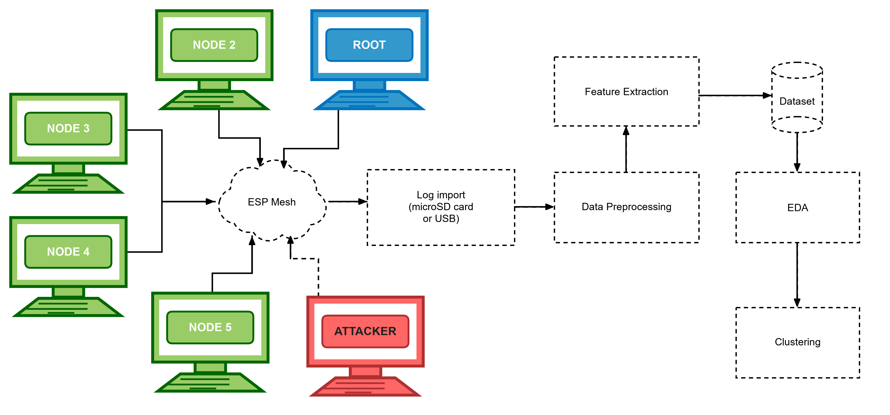

*Read it left to right: boards -> logs -> import -> preprocessing -> features -> dataset -> EDA and clustering. Note that the "Data Collector" is a file import after the run, not live streaming.*

- **Boards:** 8 ESP32s form one ESP-WIFI-MESH network: 1 **root** + 7 **children**. Some children play attack roles.
- **Logging:** every board samples at **10 Hz** and writes each row to its own **internal flash** and a **microSD card**.
- **Import:** after the run, the cards are pulled and read on a laptop (main route), or logs are streamed over USB.
- **Sniffer (optional):** a separate laptop listens to the Wi-Fi channel. It is outside the mesh, so it is an **independent witness**.
- **Pipeline:** preprocessing (align, window), feature extraction, then the dataset, then EDA and clustering.

> [!tip] Takeaway
> Nothing is streamed over the mesh during a run. That is deliberate: an attack that drops packets cannot also destroy its own evidence.

### 2.2 Who is who in a run

| Role | What it does | How many |
|---|---|---|
| **Root** | Receives every probe, logs every arrival, drives the phases. It is the **referee**. | 1 |
| **Child** | Sends its own probes up to its parent and relays the probes of the boards below it. | 7 (minus attack roles) |
| **Blackhole attacker** | A child that relays normally, then drops everything during the attack phase. | 1 in a blackhole run |
| **Wormhole end A (exit)** | The **shallower** end. Receives tunnelled probes from the wire and re-injects them toward the root. | 1 in a wormhole run |
| **Wormhole end B (entry)** | The **deeper** end. Sends its own probes normally and also writes copies into the wire. | 1 in a wormhole run |

- **Victim** (blackhole only): a non-attacker board whose path to the root **passes through the attacker**.
- **Bystander:** a non-attacker board whose path does **not** pass through the attacker.
- In a **wormhole** run there are **no victims**: only B's own probes are tunnelled, so the other 5 boards are untouched.
- **Hop vs. layer:** ESP-WIFI-MESH numbers the root as **layer 1**. The thesis uses **hop = layer - 1**, so the root is hop 0 and its direct child is hop 1 (D-11).

### 2.3 The run timeline (Table 4.1)

| Phase ID | Label | Duration | Name | What happens |
|---|---|---|---|---|
| 254 | 255 | at least 60 s | Formation | Mesh forms; rows logged without a label; **excluded** |
| 0 | 0 | 300 s | Baseline | Normal operation |
| 1 | 1 | 180 s | Blackhole | Forwarding suppression on |
| 2 | 2 | 180 s | Wormhole | Tunnel on |
| 3 | 0 | 120 s | Cooldown | Attack off, network recovers |
| 4 | none | — | Terminate | Logs ready |

- A run uses **either** phase 1 **or** phase 2, never both.
- **Labels never come from a feature threshold.** They come from the phase the root announced. That is why the labels are honest ground truth.
- Formation lasts until the **pre-run gates** pass and the operator types **START** (D-22): every child joined; in a tree blackhole run the attacker has a child; in a wormhole run there is exactly one A and one B, the UART works both ways, and A is shallower than B.

#### How the root tells everyone the phase (Figures 4.2 and 4.3)

- The root sends each phase change as an **individual peer-to-peer message** to every node in its routing table.
- It sends it in **5 rounds, 100 ms apart**, all with the **same sequence number**, so a node that gets several copies applies it once.
- It **repeats the current phase every 10 s**, so a board that rejoins mid-run catches up.
- A **session ID** drawn at root boot lets a node tell a restarted root (new run) from a repeated message.
- Each node keeps `current_phase` and `ground_truth_label` and stamps them on **every row it logs**.

### 2.4 Probes and the relay: the traffic everything is measured on

- A **probe** is a tiny application packet a board sends toward the root: magic value, **sequence number**, send timestamp, source MAC.
  - Every **1000 ms** (stationary, burst) or every **250 ms** (highload).
- **Every node relays** (D-12): it sends its own probes to its **parent**, and when it receives a probe from below it passes it **one hop up**.
  - It counts **received**, **forwarded** and **dropped**, with the rule received = forwarded + dropped.
  - Why this matters: before D-12, the mesh stack relayed traffic invisibly and only the attacker could count transit packets. So the relay features existed **only on the attacker**, and an empty column gave the label away. D-12 put the counters on **every** node.
- The **root** logs one row per arriving probe: sender, sequence number, send time, arrival time, phase. Delivery is computed by **joining on the sequence number**, never on time, because the boards share no clock.

### 2.5 The blackhole: forwarding suppression (4.2.1.2)

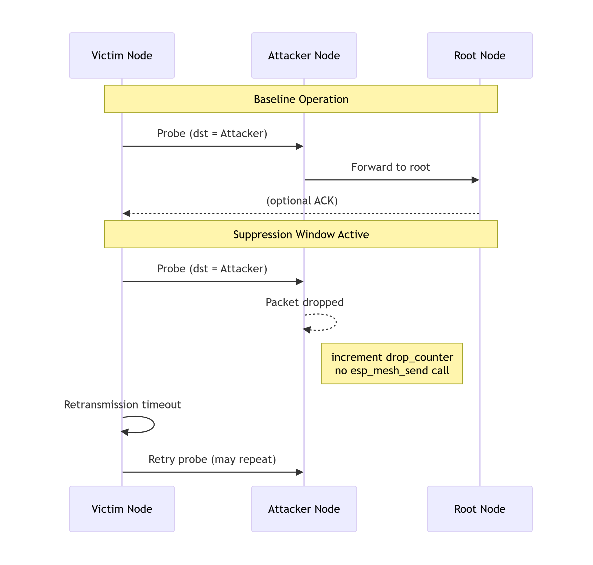

*Top: baseline, probes flow Victim -> Attacker -> Root. Bottom: attack, the attacker receives but never sends on. Look at the link-layer ACK: it still goes back to the victim.*

- The attacker runs **the same relay code** as everyone. The only difference is one decision hook: during phase 1, `forward_decision()` returns false, so the probe is **dropped by omission** (no `esp_mesh_send()` call).
- It stays a fully legitimate mesh node: keeps its parent, answers control messages, keeps logging.
- **Why the victims see nothing wrong:** the attacker's radio still **acknowledges every frame at the link layer**. The victim's Wi-Fi thinks delivery succeeded, so it never retries and never changes parent. This one fact explains the "retransmissions not observed" result in Chapter 6.
- **How traffic reaches the attacker:** by **placement** in the tree, not by a false route. In the **star**, the attacker is the **hub** and the root sits one hop behind it (D-16), because the root cannot be the attacker: it is the destination *and* the referee.

| Counter | Meaning |
|---|---|
| `recv_counter` | probes received for relay |
| `forward_counter` | probes forwarded to the parent |
| `drop_counter` | probes dropped (on purpose, or a failed send) |
| `self_packet_counter` / `retry_count` | failed `esp_mesh_send()` calls |

**Conformance check (Table 4.4, against Airehrour et al. [70]):** on the forwarding path ✓, receives then drops ✓, stays protocol-compliant ✓, delivery collapses while the node stays reachable ✓, **attracts traffic with a false route ✗**.

### 2.6 The wormhole: tunnel replay (4.2.1.3)

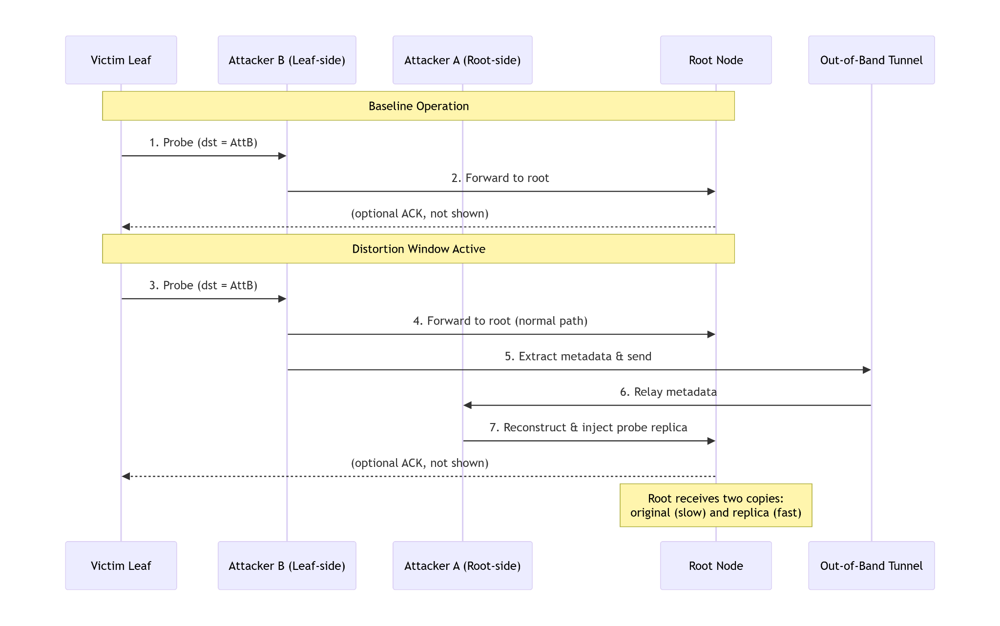

*Top: baseline, B's probes climb the mesh normally. Bottom: attack, each probe also goes through the wire to A, and A sends a copy from higher up. The root ends up with two copies of every B probe.*

- **The tunnel** is a physical **UART wire** at **115200 baud** (TX GPIO 17 of one board to RX GPIO 16 of the other). This plays the role of the GSM link in Zhukabayeva et al. [71].
- **Tunnel frame (Figure 4.9), 30 bytes:** tunnel magic "TNL1" (4 B) + the probe copied verbatim (22 B: magic, sequence number, send timestamp, source MAC) + **CRC32** (4 B).
- **Node B (entry, deeper):** every phase, sends each own probe to its parent (the normal copy). In phase 2, it **also writes the same probe into the wire**.
- **Node A (exit, shallower):** reads the wire, checks magic and CRC (and resyncs byte by byte on a bad frame), changes the magic to **"PROW"** and sends the probe toward the root. It keeps B's **sequence number, timestamp and source MAC**.
  - Why change the magic: so the root logs it as a second arrival instead of discarding a duplicate. Every relay between A and the root also forwards "PROW".
- **Who is A and who is B is decided at run time** (D-17): the two boards exchange a **HELLO** frame over the wire every second carrying their mesh layer. The **deeper** board becomes B, the shallower A (tie: lower MAC is A). Roles **lock at the first phase** and are written in every row.
  - Why: the mesh decides who lands near the root. A fixed assignment once gave B at hop 1 and A at hop 6, so the "shortcut" went the wrong way.
- **Extra rules for depth** (D-30, D-36): in tree and partial-mesh builds, B never takes the root as parent and must sit deeper than A, and both ends join as **leaf nodes** (nobody can attach below them).
- **Star wormhole** (D-28): in a flat star both ends are at hop 1 and nothing would be skipped, so **A is made the hub**, the root sits behind it, and B joins A. Normal copy: B -> A -> root (2 hops). Tunnel copy: B -> wire -> A -> root (1 hop). A one-hop shortcut.

**What the wormhole creates:** two copies of every B probe at the root, with **different delays**. **What it does not create:** a false neighbour or a route change, because the mesh never routes over the wire (D-20).

**Conformance check (Table 4.5, against Hu, Perrig and Johnson [46]):** two colluding endpoints ✓, out-of-band channel ✓, captured at one end and replayed at the other ✓, no keys or hosts compromised ✓, **creates a false neighbour ✗**.

> [!warning] Exam trap: "victims" in a wormhole run
> A wormhole run has **no victims**. Only B's own probes are tunnelled, and the other 5 boards' traffic is untouched. If a panelist asks "what happened to the victims in the wormhole?", the answer is "there are none by design; the attack is the duplication of B's probes."

### 2.7 The four topologies (4.2.2)

- ESP-WIFI-MESH **always builds a tree by itself**: each node picks the shallowest parent it can hear, then the one with fewest children.
- So a "topology" here = **board placement + an ESP-IDF topology option** (depth cap, children limit). The structure that actually formed is **checked after every run** from the logged parent addresses.

| Topology | How it is built | What formed (Table 6.35) |
|---|---|---|
| **Linear** | Chain option, 1 child per node, boards 3 to 5 m apart | Chain, deepest hop 7 |
| **Star** | Depth capped. In attack runs the **attacker or end A is the hub** with the root behind it (D-16, D-28) | Attack runs: root has 1 child, the hub has 6. Benign: flat, 5 to 7 boards on the root |
| **Tree** | Default self-organisation, with "sticky" parents (thresholds 6 dB lower, 3x longer watch; D-26) and a per-build children limit (D-37) | Root has 2 to 5 children; deepest hop 2 to 4 |
| **Partial mesh** | Boards placed to hear several parents; **at most 2 children** per node (D-29) | Behaved as a **plain branched tree**: no board ever used a second parent |

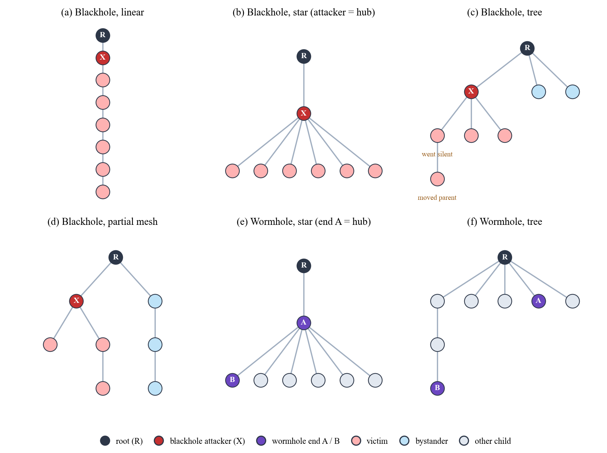

*This is the best single picture of the topologies as they really formed. X = blackhole attacker, A/B = wormhole ends, red = victims, blue = bystanders, grey = untouched boards. Notice the star has no bystanders (every board is behind the hub), and in (f) B sits deeper than A.*

### 2.8 Sites and scenarios (4.2.2.5)

| Site | Description |
|---|---|
| Room G402 (GCCS) | Controlled classroom |
| DLSU Library | Small part of a busy library, heavy Wi-Fi |
| Yuchengco Building | Area within the building |

| Scenario | What changes | Why |
|---|---|---|
| **Stationary** | Each child probes once per second | The reference |
| **Burst** | One child sends 300 probes back to back, 60 s into the attack window | Tests that a legitimate burst is not mistaken for an attack |
| **Highload** | Every child probes every 250 ms (4 per second) for the whole run | Pushes the testbed to its limit |

- **Design:** 4 topologies x 2 attacks x 3 sites x 3 scenarios = **72 attack runs**, one per cell, plus **8 benign runs** = **80**.
- **No repeats:** each cell is run once, so the three sites act as the repeats. Site differences and run-to-run noise cannot be separated (a stated limit).
- The scenarios exist so that **traffic volume alone cannot reveal an attack**.

### 2.9 What each board records (4.2.3)

| Layer | Field | Notes |
|---|---|---|
| PHY | `rssi` (10 Hz) | Signal strength of the link to the parent, from `esp_wifi_sta_get_rssi()` |
| MAC | `retry_count`, `tx_count` | **Application counters** (failed sends, frames accepted), **not** MAC retransmissions (D-15) |
| MAC | MacRetryRate | Real 802.11 retry bit, **from the sniffer only** (7 of 36 blackhole runs) |
| Network | `layer`, `parent_mac` | From `esp_mesh_get_layer()`, `esp_mesh_get_parent_bssid()` |
| Network | `probes_count`, `recv_count`, `forward_count`, `drop_count` | Relay counters |
| Tunnel | tunnel frames sent (B), received and re-injected (A), `role` | Wormhole runs only |
| Labels | `phase_id`, `gt_label` | On every row |

- **Storage:** CSV on internal flash (SPIFFS) and mirrored to a microSD card (FAT). The card is **fsync'ed about every 5 s** and at phase changes (D-13), so a crash loses only the last few seconds instead of leaving a 0-row file.
- **Radio fixed at 20 MHz (HT20)** (D-14): the sniffer can only decode 20 MHz frames. At the ESP32 default of 40 MHz it heard 3 of 1,848 data frames from one child.
- **Highload root fix:** the root writes arrivals to the card only, in 4 KB batches, because the double write once lost 3,151 rows.
- **Completeness checks:** expected samples (300 s x 10 Hz = 3,000 in baseline, 95% floor), row count vs. the card's `runs.csv` manifest, run inventory vs. the plan, `validate_integrity.py` and `verify_topology.py` on every capture.

### Check-in (Part 2)

- **Q:** A panelist asks: "Why didn't the blackhole victims switch to another parent or retry, if their packets were being dropped?" Answer in two sentences.
- **Your answer:** *(pending)*

> [!question]- Answer (click to reveal)
> The attacker still acknowledges every frame at the link layer, so from the victim's radio every send succeeded and there was no failure to retry or react to. The drop happens one layer up, in the application relay, which the victim cannot see. That is why the delivery loss is only visible at the root (PDR) and at the attacker's own counters (ForwardingRatio).
>
> 📖 **Review it:** Section 4.2.1.2 (G. Explanation of Key Behaviors) and Section 6.2.4

---

## Part 3: From raw rows to the dataset (Chapter 4.2.4)

### 3.1 Preprocessing, step by step

1. **Align time.** Boards share no clock (each counts from its own boot). So each board's timeline is anchored to **its own first exit from phase 0**, the one event every board sees through the root's broadcast. The last 300 s before that anchor = baseline.
2. **Put samples on a 10 Hz grid.** Each sample takes the **earliest free 0.1 s tick**, at most 300 ms late, never early (D-25).
   - Why: the logger sometimes writes late samples back to back (gaps like 258 ms, 1 ms, 41 ms). The old "nearest tick" rule made two samples fight for one tick and threw away healthy windows.
3. **Cut into one-second windows.** Non-overlapping. A window needs **at least 8 of its 10 samples**, otherwise it is discarded (D-9).
4. **Fill tiny gaps.** Gaps of 1 to 2 samples inside a kept window: RSSI is linearly interpolated, counters are forward-filled.
5. **Turn counters into deltas.** Counters only grow, so each window uses (value at end) - (value at start).
6. **Join delivery on the sequence number.** PDR and latency join the root's arrival log to each node's probes by sequence number, never by time.

- **One row = one board x one second.** That is the unit of the whole dataset (the "node-window").
  - Why node-level and not network-level: the attacker's forwarding falls while the nodes behind it lose delivery. A network average would blur both.
- Result: 457,568 windows formed, **1,372 discarded (0.30%)**, no run lost more than 1%, mean samples per window at least 9.97 in every run.

> [!note] Why 1 s windows of 10 samples and not 5 s windows of 5 (D-1, D-9)
> With 5 samples, one lost sample costs 20% of a window. The panel also asked for about 10,000 rows per run. At 10 Hz with 1 s windows, a window holds 10 samples, the 80% rule (8 of 10) is kept, and a clean baseline went from 577 to 2,894 rows. Side effect: a probe is sent about once a second, so one window's PDR is close to 0 or 1. PDR is read as a mean over many windows.

### 3.2 The 16 features

**Forwarding group (network layer)**

- **ForwardingRatio** = Δforwarded / Δreceived, defined only when the node received something in the window.
  - ≈ 1 normal relay; ≈ 0 blackhole.
  - It is the **direct record of the blackhole at the attacker**.
- **IngressEgressDelta** = |Δreceived - Δforwarded| (packets absorbed in the window).
- **ConsistencyScore** = |ForwardingRatio - 1| (distance from perfect forwarding; 0 = perfect, near 1 = full suppression).

**Link reliability**

- **RetryRate** = Δretry / (Δtx + Δretry), from **application counters** (failed sends). Kept as a column only; not a model input (D-15).
  - ⚠️ On wormhole end **B**, `retry_count` holds the **frames sent into the tunnel**, so on B this "RetryRate" records the attack, not retries.
- **PDR** (packet delivery ratio) = probes from this node that reached the root / probes this node sent, per window.
  - Gets a value (even 0) only if the node **sent** in the window, was **attached** to the mesh, and the root was **logging** (D-8).

**Topology stability**

- **ParentSwitchRate** = parent changes in the window / 1 s.
- **HopChangeCount** = number of hop (depth) changes in the window.
- **HopStabilityDuration** = longest stretch in the window with the same layer and parent (seconds).

**Physical layer**

- **RSSI_mean** = mean signal strength to the parent in the window (dBm).
- **RSSI_var** = variance of the RSSI samples (dBm²).
- **RSSI_stability** = longest stretch in the window with RSSI within ±3 dBm of the window mean (seconds).

**Cross-layer**

- **RSSI_Hop_Diff** = |observed RSSI - baseline median RSSI at the node's layer, same run| (dB).
  - The "expected" RSSI is learned from the run's own baseline, so it adapts to each room.
  - Idea: above 10 dB = a node hears a signal that does not fit its depth (the wormhole mismatch).
- **LatencyHopRatio** = relative one-way delay / hop count (ms per hop) (D-2).
  - **Relative** because clocks are not synced: raw delay = true delay + a large constant offset (once −194 s). Subtracting the sender's **fastest** delay in the run cancels the constant.
  - Consequence: only the **shape** can be compared, not absolute values across nodes or runs.

**Tunnel (wormhole ends only)**

- **TunnelIntensity** = tunnel messages in the window / 1 s.
- **TunnelBytes** = messages x 30 bytes.
- **TunnelLatency** = latest minus earliest arrival of the two copies of one probe at the root (D-3). Both copies share one sender clock and one root clock, so the offset cancels **exactly**. It belongs to end B (whose probes were duplicated).

> [!warning] Small wording gap between paper and code
> The paper text describes IngressEgressDelta as "received minus forwarded" and RSSI_Hop_Diff as "observed minus baseline median". The code (`features.py`) takes the **absolute value** of both. If asked "can RSSI_Hop_Diff be negative?", the honest answer is no: it is an absolute difference in the dataset.

### 3.3 The 16 features at a glance (Table 6.7)

| Feature | Unit | Used how in Chapter 6 |
|---|---|---|
| ForwardingRatio | ratio 0 to 1 | Direct record of the blackhole at the attacker; **not clustered** (leakage guard) |
| IngressEgressDelta | packets/window | Support check; not clustered |
| ConsistencyScore | ratio | Support check; not clustered |
| RetryRate | ratio | Means reported only; not clustered |
| PDR | ratio | Primary blackhole check; **in FULL and REDUCED sets** |
| ParentSwitchRate | changes/s | FULL only (constant, dropped from REDUCED) |
| HopChangeCount | count/window | FULL only |
| HopStabilityDuration | s | FULL only |
| RSSI_mean | dBm | Every feature set |
| RSSI_var | dBm² | Every feature set |
| RSSI_stability | s | FULL only |
| RSSI_Hop_Diff | dB | Every feature set |
| LatencyHopRatio | ms/hop | Not clustered (its *missing* values give the label away) |
| TunnelIntensity | msg/s | Primary wormhole check; ends only |
| TunnelBytes | bytes/window | Support check; ends only |
| TunnelLatency | ms | End B only; reported, not scored |

- Plus identifiers on every row (D-7, D-10): node_id, node_role, run_repeat, attack, topology, location, scenario, window_start, label.
- MacRetryRate and MacFramesHeard (sniffer) are extra columns, only for the 7 sniffer-covered blackhole runs.

### 3.4 Worked example: computing ForwardingRatio and PDR

**Problem (Table 4.4 evidence run, G402 linear stationary):** during the 180 s attack the attacker received 1,077 probes and forwarded 1. What is its ForwardingRatio over the attack?

**0. Given.**

- Δreceived = 1,077 probes
- Δforwarded = 1 probe
- Find: ForwardingRatio (ratio, 0 to 1)

**1. Write the definition.** ForwardingRatio compares what left with what came in.

$$\text{ForwardingRatio} = \frac{\Delta\text{forwarded}}{\Delta\text{received}}$$

**2. Substitute.**

$$\text{ForwardingRatio} = \frac{1}{1077}$$

$$\text{ForwardingRatio} \approx 0.00093$$

**3. Verify.** 0.00093 x 1,077 ≈ 1 forwarded probe, which matches. Rounded to three decimals it is 0.001, the value the paper reports.

**Answer:** about 0.001, down from 1.000 in the baseline.

**PDR in one window (illustrative):** in a highload window, a victim sends 4 probes. Before the attack the root logs all 4 (PDR = 4/4 = 1.0). During the attack the root logs 0 (PDR = 0/4 = 0.0). A window in which the node sent **nothing** gets **no** PDR (blank), never 0, because 0/0 would invent a fake blackhole (D-8).

### Check-in (Part 3)

- **Q:** Why is LatencyHopRatio computed from a *relative* delay, and what does that stop you from doing with it?
- **Your answer:** *(pending)*

> [!question]- Answer (click to reveal)
> The boards' clocks are not synchronised, so the raw delay is the true one-way delay plus a big constant offset between the sender's and the root's boot times. Subtracting the sender's fastest delay in the run cancels that constant. The price is that values can only be compared **within** one node and run (their shape), not in absolute terms between nodes or runs.
>
> 📖 **Review it:** Section 5.3 (D-2) and Section 4.2.4.2.5

---

## Part 4: How every run is validated (Chapter 4.2.7)

### 4.1 The verifier in one picture (Figure 4.55)

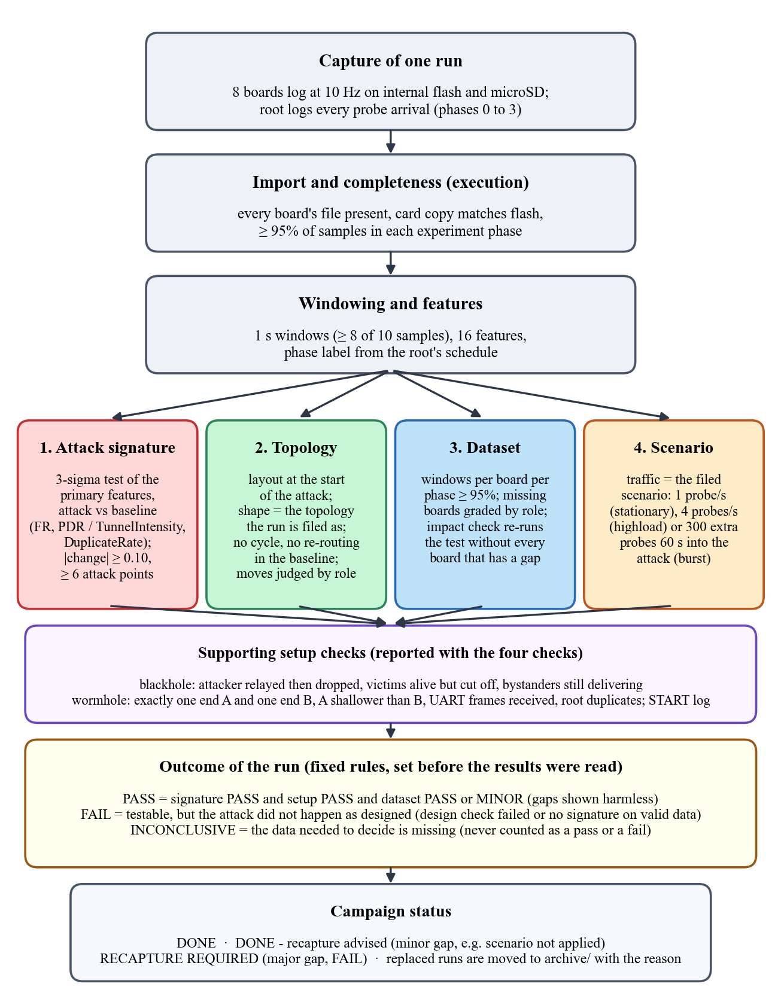

*Read top to bottom: import and window the run, apply four checks to the same windows (signature, topology, dataset, scenario), confirm the roles (setup check), combine by fixed rules, then decide keep or recapture.*

The **verifier** (`verify_attack.py`) answers four questions for every run, always in the same order:

1. **Attack signature:** did the attack feature really move?
2. **Topology:** did the boards form the topology the run is filed under?
3. **Dataset:** did every board record enough of each phase?
4. **Scenario:** did the traffic match the scenario (1/s, 4/s, burst at the right time)?

Plus a **setup check** (blackhole: attacker relayed then dropped, victims alive but cut off; wormhole: exactly one A and one B, A shallower, the wire delivered B's frames).

> [!tip] Key defense line
> "The verdict rules were fixed in the verifier **before** any result was read." The panel cannot accuse you of tuning the test to pass.

### 4.2 The 3-sigma test (Zhukabayeva et al. [71])

- Pool every **5 one-second windows** into one point. The 180 s attack gives 180 / 5 = **36 points**.
- Compute the **baseline mean** and **baseline standard deviation** of the feature.
- A primary feature **passes** when all of these hold:
  - the attack mean is at least **3 baseline SDs** from the baseline mean, **in the expected direction**;
  - the absolute change is at least **0.10**;
  - there are at least **6 attack points**.
- If the baseline never varied (SD = 0), z is undefined/infinite and **any move in the expected direction is accepted**.
- A primary whose **baseline is broken** (mean below 0.90, or SD above 0.15 of the mean) is **excluded**, not failed.

**Worked example (illustrative numbers):** baseline ForwardingRatio mean = 1.000, SD = 0.002; attack mean = 0.003.

**0. Given.**

- $\mu_b$ = 1.000 (baseline mean)
- $\sigma_b$ = 0.002 (baseline SD)
- $\bar{x}_a$ = 0.003 (attack mean)
- Find: z, and whether it passes

**1. Write the z-score.** It measures how many baseline SDs the attack sits away from normal.

$$z = \frac{\bar{x}_a - \mu_b}{\sigma_b}$$

**2. Substitute.**

$$z = \frac{0.003 - 1.000}{0.002}$$

$$z = -498.5$$

**3. Check the three rules.** |z| = 498.5 ≥ 3 and the direction is down (expected for a blackhole) ✓. Change = 0.997 ≥ 0.10 ✓. 36 points ≥ 6 ✓.

**Answer:** passes. (Real runs: where z was finite in 21 blackhole runs, the attacker's ForwardingRatio sat at least 22.9 SDs away, median 111; in the other 15 runs the baseline never varied.)

### 4.3 Primary and support checks

| Attack | Primary (decide the verdict) | Support (reported only) |
|---|---|---|
| Blackhole | Attacker **ForwardingRatio**; **PDR** of non-attacker nodes | ConsistencyScore, IngressEgressDelta, NeighbourForwardingRatio (attacker's ratio as seen by its neighbours) |
| Wormhole | **TunnelIntensity** (counted by the ends); **DuplicateRate** (measured **at the root**) (D-21) | TunnelBytes |

- A run is **confirmed** when at least one primary passes.
- **Why two primaries for the wormhole (D-21):** TunnelIntensity is the attackers counting themselves (weak evidence). DuplicateRate is the root's independent view.
- **TunnelLatency and LatencyHopRatio are "reported, not scored":** TunnelLatency has no baseline (no tunnel exists then), and LatencyHopRatio's baseline is so spread out that |z| could never exceed 0.64. A test that can never pass is not evidence.

### 4.4 The other three checks (Figures 4.56 to 4.59)

- **Topology (Figure 4.57):** rebuilds the tree from logged parent addresses. Rules for moves:
  - Re-route **during the baseline** fails the topology gate (D-27).
  - A board changing parent **during the attack** is tolerated if it **keeps its class** (victim stays victim, bystander stays bystander). Flipping class for 3 s or more fails the run (D-23).
  - The **attacker** changing its own parent is tolerated only if no board changes class, at least one victim remains, and the attacker was without an uplink for at most 10% of the attack (D-31).
  - The rule reads only parent addresses, never PDR or ForwardingRatio, so it is **outcome-blind**.

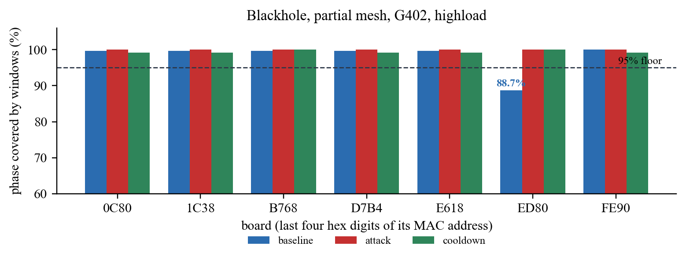

*Each board's coverage of each phase vs. the dashed 95% floor. Victim ED80 covered only 266 of 300 s of baseline (88.7%). The impact check reran the test without ED80, the attack was still confirmed, so the run is kept with a minor gap.*

- **Dataset:** every board must cover at least **95%** of each phase. Missing boards are graded **by role** (D-32): missing attacker or tunnel end = major; missing victim or bystander = minor while other boards of that role remain; unplaceable board = undetermined. An **impact check** reruns the test without the gappy boards.
- **Scenario:** stationary ≈ 1 probe/s per child; highload ≈ 4/s; burst = one spike of about 300 probes about 60 s into the attack. A scenario that was not applied = **minor gap** (D-34).

### 4.5 Outcome and grade (Table 4.24)

| Result | Meaning | What happens |
|---|---|---|
| **PASS** | signature + setup pass, data complete or minor gaps | Kept |
| **FAIL** | testable, but the attack did not happen as designed | Archived, recaptured |
| **INCONCLUSIVE** | data needed to decide are missing | Archived, recaptured |
| **STRONG / GOOD** | full data; GOOD = a note was added (e.g. plain tree, no run log) | Kept |
| **MINOR GAPS** | a gap the impact check shows does not change the result | Kept, footnoted |
| **MAJOR GAPS** | gap on data the result depends on | Not validated, recaptured |

- **Missing data never becomes a pass or a fail.**
- **Benign runs** are tested the other way round: the cooldown is tested against the baseline for both signatures, and **neither may move**. Delivery must stay healthy (PDR at least 0.90, every relay forwards at least 90%).
- **Robustness of the verifier itself:** moving every threshold by about ±50% changed **no verdict** in 53 runs over 14 settings. An absurd setting (1,000 SDs) changed 18 verdicts, which proves the test *can* fail. A **placebo** test (relabel the second half of each baseline as "attack") gave **0 false confirmations in 106 tests**.

### Check-in (Part 4)

- **Q:** Why does the wormhole need DuplicateRate as a primary check when TunnelIntensity already shows the tunnel working?
- **Your answer:** *(pending)*

> [!question]- Answer (click to reveal)
> TunnelIntensity is counted by the attacking boards themselves, so on its own it is self-reported evidence. DuplicateRate is measured at the root, which is independent of the attackers. Two independent primaries make the confirmation stronger (D-21). Both passed in all 36 wormhole runs.
>
> 📖 **Review it:** Sections 4.2.7.1, 5.6 (D-21) and Table 6.11

---

## Part 5: Chapter 5, Methodological Deviations

### 5.1 The big idea

- Chapter 5 lists **every change from the approved proposal**: 37 entries, **D-1 to D-37**, each with what the proposal said, what is done instead, why, and what it costs (full text in Appendix C).
- **Modified** = replaces something the proposal specified (17 entries). **New** = adds a rule or procedure the proposal did not have (20 entries).
- The changes were **not planned in advance**: each was made when a capture or a review showed the plan could not be followed as written, or that following it would give untrustworthy data.

> [!tip] How to frame Chapter 5 on stage
> "Every deviation exists for one of three reasons: the platform could not measure what was planned, the plan would have leaked the label or failed to produce the attack, or a run needed a rule to count as one valid experiment." Then give one example of each (below).

### 5.2 The three recurring reasons, with one example each

| Reason | Example |
|---|---|
| **1. The platform could not measure it** | No MAC retry count exists in ESP-IDF (D-15); probes have no reply, so no round-trip time (D-2, D-3) |
| **2. The plan would have leaked the label or failed to make the attack** | Relay counters existed only on the attacker, so an empty column revealed it (D-12); wormhole ends at the same depth skip no hop (D-17, D-28, D-30) |
| **3. A run needed rules to be one valid experiment** | Pre-run gates and START (D-22), parent changes during the attack (D-23), missing boards graded by role (D-32) |

### 5.3 The five groups (Table 5.1)

| Group | Entries | Main change |
|---|---|---|
| Data collection and sampling | D-1, D-9, D-13, D-14, D-25 | 10 Hz logging, 1 s windows of 10 samples (was 5 s of 5); radio fixed at 20 MHz; card fsync |
| Feature definitions | D-2, D-3, D-7, D-8, D-10, D-11, D-15 | One-way latency; retry rate from app counters; run identifiers on every row |
| Implementation of the attacks | D-12, D-16, D-17, D-20, D-28, D-30, D-36 | Both attacks emulated at the application layer; every node relays; wormhole ends as leaves |
| Experimental design | D-5, D-6, D-18, D-19, D-26, D-29, D-33, D-35, D-37 | Baseline = phase 0 of each run; 8 benign runs added (80 total); 3 sites, 3 scenarios; tree rules |
| Run control and validation | D-4, D-21, D-22, D-23, D-24, D-27, D-31, D-32, D-34 | Pre-run gates, START lock, verifier grading of gaps, missing boards, unapplied scenarios |

### 5.4 All 37 in plain words (Table 5.2)

| ID | Topic | In plain words |
|---|---|---|
| D-1 | Sampling rate | Boards record 10 samples per second |
| D-2 | LatencyHopRatio | One-way delay per hop, not round trip |
| D-3 | TunnelLatency | Gap between a probe and its tunnelled copy at the root |
| D-4 | Topology check | Parent changes in the first 60 s count as formation |
| D-5 | Baseline control | First 300 s of each attack run is the baseline |
| D-6 | Repeats and parents | Topology type is fixed; which board sits where is left to the mesh |
| D-7 | run_repeat column | Every row says which repeat it belongs to |
| D-8 | PDR attribution | A window gets a PDR (even 0) if the node sent, was attached, and the root was logging |
| D-9 | Grid and window | 1 s windows, at least 8 of 10 samples |
| D-10 | Run columns | Every row records attack, topology, site, scenario |
| D-11 | Hop, not layer | Hop = layer - 1; HopChangeCount |
| D-12 | Application-layer relay | Every node relays probes itself so forwarding can be counted |
| D-13 | microSD mirror | Card copy forced to disk with fsync |
| D-14 | Radio width | Wi-Fi fixed at 20 MHz |
| D-15 | Application counters | Retry counts come from software, not the Wi-Fi hardware |
| D-16 | Star and blackhole | In the star, the attacker is the hub; the root sits behind it |
| D-17 | Wormhole ends | Ends chosen at run time from mesh depth, then locked |
| D-18 | Matched benign runs | Benign runs added as a control (final plan: 8) |
| D-19 | Sites | G402, DLSU Library, Yuchengco |
| D-20 | Attack emulation | Both attacks act on the study's own probes, not on routing |
| D-21 | Wormhole verification | Two independent checks: attackers' count and root's view |
| D-22 | Pre-run gates and START | Run starts only when checks pass and the operator types START |
| D-23 | Parent changes in the attack | Tolerated if the board stays victim or stays bystander |
| D-24 | START lock | A failed check blocks START unless a typed reason is logged |
| D-25 | Tick alignment | Each sample takes the earliest free tick, at most 300 ms late |
| D-26 | Sticky tree parents | Tree boards switch parent less readily |
| D-27 | Topology gate | Pass if attached at baseline start and no re-route during it |
| D-28 | Star wormhole | In the star, wormhole end A is the hub |
| D-29 | Partial mesh | Defined by placement and at most 2 children per node |
| D-30 | Wormhole end depth | In tree and partial mesh, B sits deeper than A |
| D-31 | Attacker re-parenting | Attacker may move only if no board changes class and its uplink was down at most 10% |
| D-32 | Missing boards | Graded by role, not by a plain board count |
| D-33 | Jitter scenario | Left out; three scenarios remain |
| D-34 | Scenario not applied | Graded as minor gaps |
| D-35 | Benign run plan | Benign runs spread over sites and scenarios; 8 remain |
| D-36 | Wormhole ends as leaves | In tree and partial mesh, the ends accept no children |
| D-37 | Tree fan-out | Number of children a tree board accepts is set per build |

### 5.5 The deviations you must be able to explain in depth

#### D-20: attack emulation (the most important one)

- **Proposal:** classical attacks that act on the **control plane** (a blackhole advertises a false route; a wormhole makes the routing adopt a false shortcut).
- **What we did:** only the **data-plane** behaviour. Blackhole = a placed relay that drops. Wormhole = a real wire that copies probes.
- **Why:** ESP-WIFI-MESH is a self-organising tree with no route request/reply messages to fake. Its routing tables live in Espressif's closed-source library; the API can **read** but not **write** routes. False routes would need forged management frames or reverse engineering, which is outside an exploratory data study.
- **Cost:** no route attraction, no false neighbours, no attacker-caused parent changes in the data. **This is why the cross-layer features stayed flat in Chapter 6.**

#### D-12: every node relays

- **Before:** honest nodes sent with `esp_mesh_send()` and the mesh stack relayed below the application, so only the attacker ever saw transit packets.
- **Problem:** the three relay features existed **only on the attacker**, so an empty column identified the attacker and the label. This is exactly the Thesis 2 panel's objection ("if one feature decides it, machine learning is unnecessary").
- **Fix:** a shared relay on every node: send to your parent, relay one hop up, count received/forwarded/dropped. The attacker differs by one decision.
- **Bug found and fixed along the way:** the relay first forwarded only normal probes, so A's "PROW" copies would have been dropped and no wormhole signature would ever reach the root.

#### D-15: no MAC retry count

- The proposal wanted `retry_count` and `tx_count` from ESP-IDF Wi-Fi statistics.
- Checked: the only statistics call (`esp_wifi_statis_dump()`) **prints** to the log and returns only a status. No number reaches the application.
- So both columns are **application counters**: failed `esp_mesh_send()` calls. RetryRate is not a model input.
- Real retries come only from the **sniffer** (802.11 Retry bit), in 7 of 36 blackhole runs.

#### D-2 and D-3: latency without synchronised clocks

- No probe ever gets a reply, so no round trip exists. Clocks are not synced.
- **LatencyHopRatio:** subtract the sender's fastest delay in the run to cancel the clock offset, then divide by hops.
- **TunnelLatency:** both copies of one probe share the sender's timestamp and the root's clock, so their arrival difference is an exact measurement.

#### D-8: when a window gets a PDR

- The first code gave a node no PDR at all if the root never heard from it, which hid exactly the most affected victims (PDR = 0 appeared in none of 446 rows).
- It also divided by (0 + a tiny constant), so a window with nothing sent became 0.0, a fake blackhole.
- Now: PDR exists (even 0) only if the node **sent**, was **attached**, and the root was **logging**. On that capture, windows with PDR = 0 went from 0 to 201.

#### D-16 and D-28: the star built one hop down

- The root cannot be the blackhole: it is the destination (nothing to forward to) and the referee (it would be grading itself).
- So in star **attack** runs, the hub is the attacker (blackhole) or end A (wormhole), and the root sits one hop behind it.
- For the wormhole star: normal copy B -> A -> root = 2 hops, tunnel copy = 1 hop, a one-hop shortcut. A flat star would give duplicates with no shortcut, "a replay, not a wormhole".
- Side effect to disclose: A also relays B's normal copy, and control boards are 2 hops from the root.

#### D-17, D-30, D-36: getting the wormhole ends right

- **D-17:** roles assigned at run time by depth through the HELLO handshake (deeper = B), locked at phase 0.
- **D-30:** in tree and partial mesh, the ends kept landing at the same depth because they hang off one short cable and the mesh joins the shallowest parent. So B is forced to a non-root parent (always hop 2 or deeper), and A takes the shallowest open parent.
- **D-36:** in tree and partial mesh, the ends join as **leaf nodes**. Reason: when end A restarted, its children re-parented during the attack and the run had to be recaptured; the telemetry stack was also nearly full (stack raised from 4096 to 6144 bytes).

#### D-5, D-18, D-33, D-35: baseline and benign runs

- **D-5:** the baseline is phase 0 of the same run, so firmware, roles, session and placement are identical; the attack is the only change. A separate baseline run would also change the number of probing boards (the attacker relays instead of probing).
- **D-18 -> D-33 -> D-35:** the benign plan went 12 -> 9 (jitter dropped) -> 12 (re-spread) -> **8** (4 never captured when the campaign ended were removed). Final: 4 stationary, 3 highload, 1 burst. G402 has 4, the Library 2, Yuchengco 2. Tree and partial mesh have one benign run each, both at G402.
- Cost: the benign runs are a **control**, not a counterpart for every cell; within a topology, benign scenario and site are confounded.

#### D-22 to D-34: making a run "one valid experiment"

- **D-22 / D-24:** the root holds phase 0 until gates pass and START is typed; a failed check **locks** START (override needs a typed reason of at least 15 characters plus the word OVERRIDE, logged and reported).
- **D-23 / D-31:** what matters is **whom the attack reaches** (class), not which address a board's parent has. Outcome-blind, symmetric, thresholds fixed in advance.
- **D-32:** two runs had a board the root heard but with no file (B768 tree/G402/highload blackhole, 2805 partial/G402/highload wormhole). Now found automatically and graded by role.

#### D-26, D-29, D-37: the tree and the partial mesh

- **D-26:** tree children re-parented on weak but working links (testbed links sat at -71 to -78 dBm). Thresholds made 6 dB weaker and the weak-link watch 3x longer, for keeping and switching only (first parent choice unchanged).
- **D-29:** no partial-mesh run ever showed a board under a second parent, so the partial mesh is reported as a **placement-defined branched tree with at most 2 children**, and adaptive switching is **not claimed**.
- **D-37:** with the stock limit of 10 children, a tree run came out flat like a star. The children limit is now a per-build setting, and the fan-out that formed is reported per run (Table 6.35: root has 2 to 5 children in tree runs).

### 5.6 What the changes mean for the results (Section 5.7)

Four changes **limit how Chapter 6 can be read**:

1. **D-20:** the data show the effect of emulated attacks on traffic, not traffic attraction by a routing protocol.
2. **D-15:** no MAC retry count; retransmissions come from app counters and, where available, the sniffer.
3. **D-18 as revised by D-35:** the 8 benign runs are a control, not a counterpart of every cell, and within one topology benign scenario and site are confounded.
4. **D-37:** tree runs do not share one fan-out (root has 2 to 5 children), which limits the tree vs. partial-mesh comparison in the wormhole runs.

### Check-in (Part 5)

- **Q:** A panelist says: "37 deviations sounds like you didn't follow your proposal." Give a two-part answer.
- **Your answer:** *(pending)*

> [!question]- Answer (click to reveal)
> 1. Each deviation was forced by evidence: the platform could not measure something (D-15, D-2), the plan would have leaked the label or failed to create the attack (D-12, D-17), or a run needed a rule to be a valid experiment (D-22, D-23, D-32). Several were scope decisions checked with the adviser (D-19, D-33, D-35).
> 2. Every one is documented with what the proposal said, what changed, why, and what it costs (Appendix C). Only four limit how the results are read (Section 5.7), and those four are stated openly as limits in Chapter 6.
>
> 📖 **Review it:** Sections 5.1 and 5.7

---

## Part 6: Chapter 6, Results (dataset, attack validation, EDA)

### 6.1 Terms used throughout Chapter 6

- **Window** = one second of one board (up to 10 samples). Every count is in windows.
- **Labels:** baseline and cooldown = **0 (normal)**; blackhole attack = **1**; wormhole attack = **2**.
- **The label is set for every board of the run**, including bystanders that the attack never touched. Remember this: it caps the clustering scores later.
- **Non-attacker nodes:** in a blackhole run, the 6 boards that are not the root or attacker (victims + bystanders). In a wormhole run, the 5 boards that are not the root or an end.

### 6.2 The dataset collected (Section 6.1)

- **80 of 80 runs captured** (Table 6.1): 36 blackhole, 36 wormhole, 8 benign. By topology: linear 21, partial mesh 19, star 21, tree 19. By site: G402 28, Library 26, Yuchengco 26.
- Every run has 8 boards except: benign star/Yuchengco/highload (6 boards) and blackhole tree/G402/highload (7, because B768 recorded nothing).

**Windows (Table 6.2)**

| Phase | Windows | Share |
|---|---|---|
| Before the baseline (not analysed) | 85,435 | 18.7% |
| Baseline (normal) | 190,423 | 41.7% |
| Attack | 103,187 | 22.6% |
| Cooldown (normal) | 76,068 | 16.7% |
| Phase boundary / no label (not analysed) | 1,082 | 0.2% |
| **All** | **456,195** | 100% |

- Analysed = 190,423 + 103,187 + 76,068 = **369,678** (266,491 normal + 103,187 attack).

**Boards by role (Table 6.4)**

| Topology | Blackhole victims | Blackhole bystanders | Wormhole non-attacker boards |
|---|---|---|---|
| Linear | 33 | 21 | 45 |
| Partial mesh | 18 | 36 | 45 |
| Star | **54** | **0** | 45 |
| Tree | 18 | 35 | 45 |
| **All** | **123** | **92** | **180** |

- **Star has no bystanders:** every board is behind the hub attacker.

**Replaced and noted runs (Tables 6.5, 6.6)**

- 15 earlier captures of 11 cells were **replaced** by newer ones and archived. Only the newest capture of a cell is analysed.
- 12 captures outside the plan (5 jitter, 7 at home) are **not** counted.
- 7 groups of runs carry a note but are **kept**. The ones to know:
  - linear/G402/burst blackhole: the burst fired **outside** the attack window (D-34, minor gap);
  - tree/G402/highload blackhole: B768 has no data but was a bystander (D-32);
  - all 9 partial-mesh runs of each attack: **plain trees**;
  - partial/Yuchengco/highload wormhole: end B and one child probed at 1/s instead of 4/s.

**Why some features are often blank (Table 6.8)**

- ForwardingRatio has a value in only 36.3% of non-attacker windows: it only exists when a node **received** something to relay, and leaves (end nodes) never do.
- PDR is 0% on the attacker and the tunnel ends: they are **not scored** on delivery.
- LatencyHopRatio is 0% on the blackhole attacker and end A, and is **missing for victims during the attack** (a dropped probe has no delay).
- Tunnel features exist only on the two ends.

### 6.3 Blackhole: did the attack work? (Section 6.2.1)

**Verifier checks (Table 6.9)**

| Check | Role | Passed |
|---|---|---|
| Attacker ForwardingRatio | Primary | **36 of 36** (baseline 1.000 to 1.004; attack 0.000 to 0.007) |
| PDR of all non-attacker nodes | Primary | **35 of 36** (one run excluded: unstable baseline 0.930 ± 0.253, partial/Yuchengco/stationary) |
| ConsistencyScore | Support | 31 of 36 (misses z 1.4 to 2.7) |
| IngressEgressDelta | Support | 31 of 36 (misses z 0.4 to 2.9) |
| NeighbourForwardingRatio | Support | 32 of 36 (4 runs had no attack values; none failed) |

- **Confirmed in all 36 runs.** Grades: 4 strong, 27 good, 5 minor gaps.
- **Speed:** 121 of 123 victims fell below PDR 0.5 in the **first second** of the attack, the other 2 within 1 s. Recovery to above 0.5: within **3 s**, median **2 s** (122 boards; one went silent).
- Victim PDR: **0.998 -> 0.000** in every run; **every one of the 123 victims** has an attack-phase mean of exactly 0. Bystanders: 0.996 -> **1.000**.

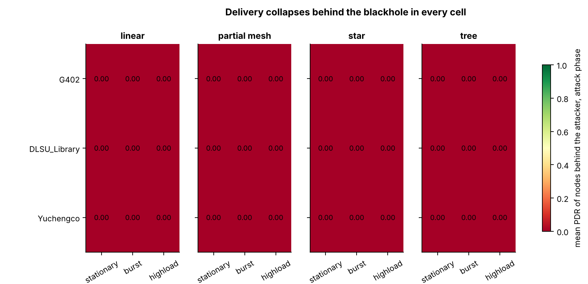

*Each rectangle is one run (panels = topologies, rows = sites, columns = scenarios). Look at the numbers: every single cell is 0.00, so no victim's probe reached the root during the attack, in any run.*

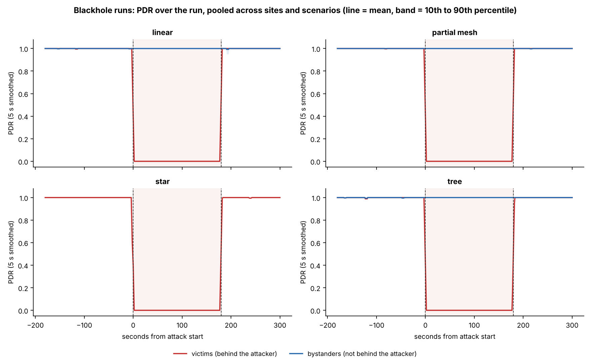

*x-axis: seconds from attack start (negative = baseline, shaded 0 to 180 = attack). Red = victims, blue = bystanders. The red line drops like a cliff at 0 and climbs back right after 180; the blue line never moves. The star panel has only a red line because it has no bystanders.*

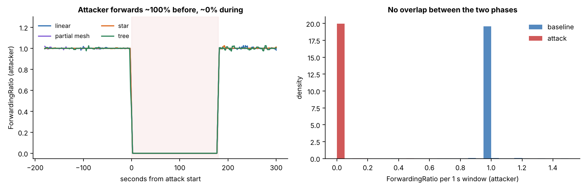

*Left: the attacker's ForwardingRatio over time, falling from about 1 to about 0 for exactly the attack window. Right: histograms of one-second windows; baseline and attack values do not overlap at all.*

### 6.4 Wormhole: did the attack work? (Section 6.2.2)

**Verifier checks (Table 6.11)**

| Check | Role | Passed |
|---|---|---|
| DuplicateRate of end B | Primary | **36 of 36** (baseline 0 in every run; attack 0.986 to 1.000, median 1.000) |
| TunnelIntensity of the ends | Primary | **36 of 36** (baseline at most 0.001 msg/s; attack 0.994 to 4.0 msg/s) |
| TunnelBytes | Support | 36 of 36 (attack median 30, max 120 bytes per window) |

- Grades: 21 strong, 15 good (9 partial-mesh plain-tree notes + 6 runs with no saved root run log).
- **In every run, B was deeper than A** and both ends kept the same hop for the whole run.
- **Hops skipped:** 1 to 5 overall. Linear 2 to 5 (median 4), partial mesh 1 to 2, **star 1** (A is the hub, D-28), tree 1 to 2.
- **The wire worked:** end A received 99% to 101% of what B sent, in all 36 runs.
- **Duplicates:** 12,448 of 12,465 B probes (**99.86%**) reached the root twice; 6,468 of 6,469 attack windows of B (**99.98%**) held a duplicate; **0** in baseline or cooldown; **0** probes of the other boards arrived twice.
- **Spread between the two copies (TunnelLatency):** median **3.9 ms**, 90th percentile 12.1 ms, 99th percentile 417 ms (long tail: 84 windows above 200 ms).
- **No link between spread and hops skipped:** Spearman 0.25 (p = 0.14), so no relation can be claimed from 36 runs.
- **Out-of-order arrivals:** rare, 232 of 24,913 (0.93%), concentrated in 3 highload runs.

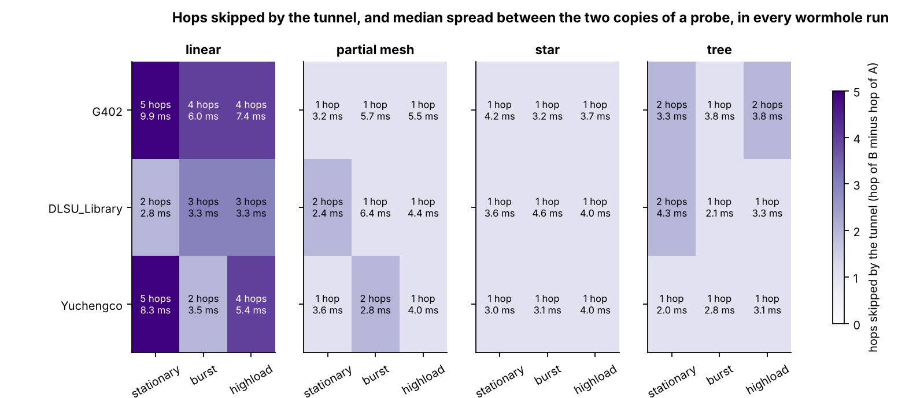

*Each cell is one run. Darker purple = more hops skipped. Linear is the only topology with deep shortcuts (2 to 5 hops); star is always 1. The second number in each cell is the median gap between the two copies in ms. Notice the gap is not bigger where more hops are skipped.*

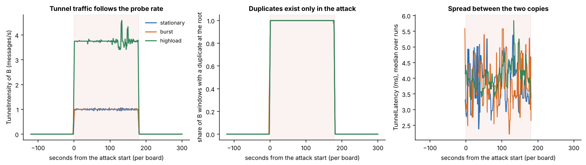

*Left: TunnelIntensity of B jumps from 0 to about 1 msg/s (4 in highload) only during the shaded attack. Middle: share of B's windows with a duplicate goes from 0 to 1 and back. Right: the spread between copies, only defined during the attack.*

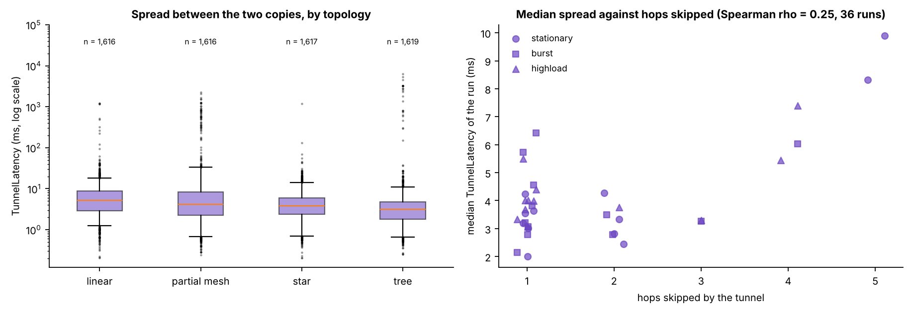

*Left: box plots on a log scale; the typical spread is a few ms in every topology. Right: one point per run; no upward trend with hops skipped.*

### 6.5 The single-feature audit (Section 6.2.3)

**The question:** if one feature alone already separates attack from normal, clustering adds nothing, or the feature is an artefact of how the data were made (Arp et al. [80], "spurious correlation"). So every feature is tested alone.

**Method:** pick the single best threshold on the feature (looking at the labels), count how many windows it labels correctly. Compare with the **majority rate** (always answer "normal").

**Worked example: why the majority rate is about 70%.**

**0. Given.**

- Normal time per run = baseline 300 s + cooldown 120 s = 420 s
- Attack time per run = 180 s
- Find: the accuracy of always answering "normal"

**1. Write the rule.** Always guessing the bigger class is right for every normal window.

$$\text{majority rate} = \frac{\text{normal seconds}}{\text{all labelled seconds}}$$

**2. Substitute.**

$$\text{majority rate} = \frac{420}{300 + 180 + 120} = \frac{420}{600}$$

$$\text{majority rate} = 0.70$$

**3. Verify.** The paper's measured majority rates are 70.0% and 70.1%, matching.

**Answer:** 70%. A feature at 70% knows nothing; a feature well above 70% separates the windows by itself.

**Blackhole results (Table 6.13)**

| Feature | All boards but root | Non-attacker nodes | Victims only |
|---|---|---|---|
| PDR | 86.9% | 86.9% | **99.9%** |
| LatencyHopRatio | 84.3%† | 84.3%† | 100.0%† |
| ForwardingRatio / ConsistencyScore | 80.4%† | 71.7%† | 70.0%† |
| RSSI and topology features (best of 7) | 70.0% | 70.0% | 70.1% |
| Aligned run clock | 80.0% | 80.0% | 80.0% |
| Majority rate | 70.0% | 70.0% | 70.1% |

† = missing in more than 5% of windows, so judged only where it has a value.

- **PDR on victims = 99.9%:** a complete delivery collapse is separable **by construction**. Expected for a blackhole.
- **PDR on all non-attacker nodes only 86.9%:** because **bystanders carry the attack label but behave normally**.
- **LatencyHopRatio's 100% is fake information:** it only has a value when a probe was delivered, which is almost always a normal window. The real information is in **whether it is missing**: that alone predicts a victim's label with 99.2% accuracy. Hence it is **excluded from clustering**.
- **The run clock gives 80%:** every run follows the same schedule, so "where in the run" partly gives away the phase. It is kept out of the model inputs.
- **Every RSSI and topology feature stays at the majority rate:** the blackhole leaves no trace on them.

**Wormhole results (Table 6.14)**

| Feature | Non-attacker nodes | Ends A and B | End B only |
|---|---|---|---|
| TunnelIntensity / TunnelBytes | no value | **99.7%** | **99.7%** |
| TunnelLatency | no value | 100.0%† | 100.0%† |
| RetryRate | 70.0% | 76.9%† | **100.0%** |
| Every other feature | ≤ 70.0% | ≤ 70.0% | ≤ 70.0% |
| Majority rate | 70.0% | 70.0% | 70.0% |

- Tunnel features decide the label on the ends because the tunnel carries messages **only** in the attack.
- RetryRate reaches 100% on B **only because on B that counter holds the tunnelled frames**. It records the attack by construction, not retries.
- **On the non-attacker nodes no feature beats the majority rate by more than 0.01 points:** the wormhole leaves the other boards completely untouched.

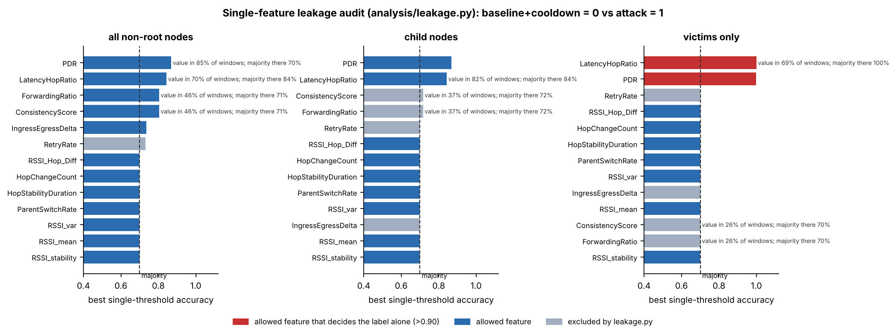

*Each bar = one feature's best accuracy; the dashed line = the ~70% majority rate. A bar ending at the line knows nothing. Red bars decide the label alone (above 90%), blue are other allowed features, grey are features the leakage guard excludes. Look at the right panel: only PDR shoots up.*

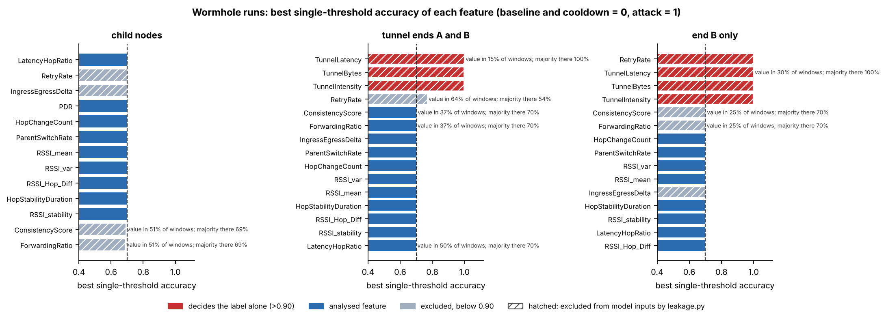

*Same layout. Left panel (non-attacker nodes): everything sits on the line. Middle and right (the ends): only tunnel features and B's RetryRate rise, and those are all excluded from model inputs.*

> [!note] The leakage guard
> A list in the analysis code of columns that may **never** be model inputs, with a reason for each: RetryRate (app counter, and the tunnel count on B), the three tunnel features (they exist only on the ends, so their presence reveals the run type), and the three relay features (excluded unless more than one kind of node reports them). LatencyHopRatio is also kept out because its missingness gives the label away.

### 6.6 Predictions tested and not observed (Section 6.2.4)

**Blackhole (Table 3.4):** victims were predicted to retransmit more.

- App-counter RetryRate of victims: 0.0000 -> **0.0004** -> 0.0000 (a failed send in only **9 of 21,742** attack windows).
- ParentSwitchRate of victims: 0.00000 -> 0.00009 (Cohen's d = 0.01).
- **Sniffer (real 802.11 retry bit)** in 7 runs: victims 0.295 -> 0.364 -> 0.323, but the change **differs in sign between runs** (3 up, 4 down). No consistent rise, though 7 runs are too few to rule out a small effect.
- **Why:** the attacker still ACKs every frame at the link layer.

**Wormhole (Table 3.5 vs. Table 6.16)**

| Indicator | Observed? | Measured |
|---|---|---|
| Hop count consistency | **No** | Hop of A and B constant; 0 windows with a hop change in any phase |
| Parent-child validity | **No** | 0 windows with a parent change |
| Routing table entries | Not measured | Firmware does not log the routing table |
| RSSI-hop correlation | **No** | RSSI_Hop_Diff A 2.79 -> 2.76 dB; B 5.41 -> 5.68 dB |
| RSSI variance | **No** | d = -0.03 (A), -0.07 (B) |
| Frame arrival pattern | **Yes** (duplicates); out-of-order rare | 99.86% duplicates; 0.93% out of order |
| Retransmission count | Not measurable on the ends | B's counter holds tunnel frames; others 0 |
| Duplicate arrivals | **Yes** | 6,468 of 6,469 attack windows |
| Latency mismatch | **Yes** | Median spread 3.9 ms |

- **Pattern:** the 3 indicators that belong to the **traffic** the tunnel creates are observed; the 4 that belong to **routing and radio** are not. Exactly what an application-layer tunnel implies.

### 6.7 Benign runs: no attack signature (Section 6.2.6)

- The benign run is tested with the same tests, pointed the other way: cooldown vs. baseline, and **no signature may pass**.
- All 8: **BENIGN CONFIRMED, strong**. 0 of 21 evaluable signature checks passed (43 others needed a tunnel or attacker, so had no data, as expected).
- Mean PDR per run 0.9994 to 1.0000. Only 4 of 54 child boards ever had a window below 1, all in linear/G402/highload (lowest 0.75).

### 6.8 Exploratory data analysis (Section 6.3)

#### Cohen's d, the effect size used everywhere

- **d** = (attack mean - baseline mean) / pooled standard deviation.
- Reading: |d| below 0.2 negligible, about 0.5 medium, 0.8 or more large. Negative = lower during the attack.
- **Not a significance test:** windows of one board follow each other and are not independent, so d only describes the **size** of a shift.

**Worked example: what d = -29.71 for victim PDR means.**

**0. Given.**

- Baseline mean PDR = 0.9977, attack mean = 0.0000, d = -29.71
- Find: the pooled SD this implies, and what the d says

**1. Rearrange the definition.**

$$s_{pooled} = \frac{\bar{x}_{attack} - \bar{x}_{baseline}}{d}$$

**2. Substitute.**

$$s_{pooled} = \frac{0.0000 - 0.9977}{-29.71}$$

$$s_{pooled} \approx 0.0336$$

**3. Interpret.** The means moved by almost 30 times the typical spread. For comparison, "large" starts at 0.8.

**Answer:** a gigantic shift. Every other feature of victims and bystanders moved by |d| < 0.1.

#### Blackhole EDA (Table 6.18)

- **Only victim PDR moves** (d = -29.71). Every other feature, for both groups: |d| < 0.1. Largest: RSSI_var of bystanders, d = -0.09.
- Victims' RSSI is about 2.5 dB weaker than bystanders' **already in the baseline** (-74.7 vs -72.2 dBm). That is because victims sit deeper, not because of the attack.
- LatencyHopRatio of bystanders falls 4.26 -> 3.15 -> 2.46 ms/hop through the run, and keeps falling **after** the attack; benign runs show the same decline. So it follows the **course of a run**, not the attack.

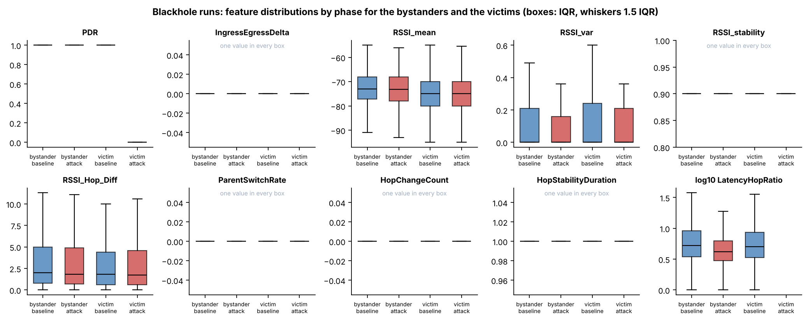

*One panel per feature; blue = baseline, red = attack. Only the PDR panel changes: the victims' attack box sits at 0. Every other panel overlaps between phases or holds one value only.*

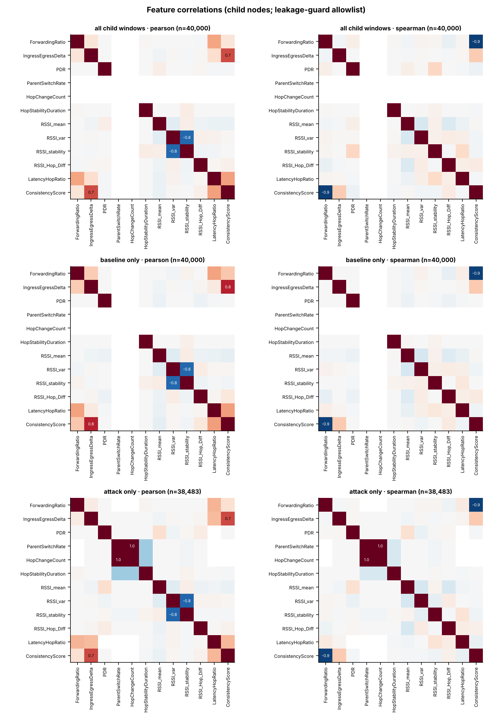

*Left column Pearson, right Spearman; rows = all, baseline, attack windows. The strong pairs are formula-linked (ForwardingRatio and ConsistencyScore, Spearman -0.94), not behaviour-linked. No other pair in the FULL set exceeds |0.4|.*

#### Wormhole EDA (Table 6.19)

- On the ends, **only tunnel features change**: TunnelIntensity 0 -> 1.92 msg/s (d = 1.83), TunnelBytes 0 -> 57.5 bytes (30 bytes x 1.92).
- RetryRate of B 0.00 -> 0.50 (d = 42.99), but that is the tunnel counter, not retries.
- Non-attacker nodes: PDR 0.9999 -> 0.9999; RSSI_var d = -0.06 (largest). **Nothing moves.**
- RSSI_Hop_Diff is higher on B (5.4 dB) than elsewhere (2.7 to 2.8), but it is equally high **before** the attack, so it reflects where B sits.

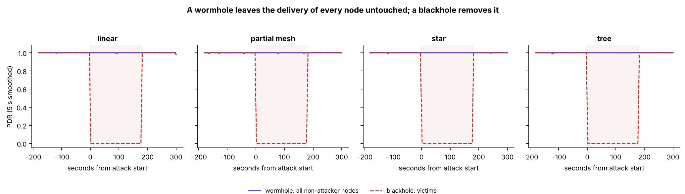

*Solid purple (wormhole boards) never leaves 1; dashed red (blackhole victims) falls to 0 for the whole attack. This is the one-picture contrast between the two attacks.*

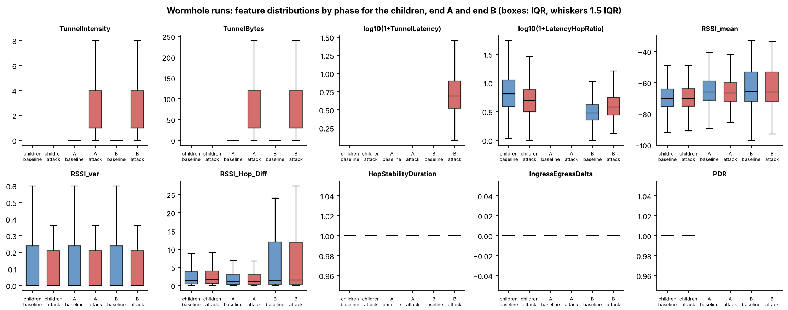

*Only the tunnel panels change, and only on the ends. RSSI boxes coincide between phases for every group.*

#### Benign runs and the "capture effect" (Section 6.3.3)

- Benign delivery is complete; no hop change in any run; 1 parent change in all 8 runs.
- The probe rate matches the scenario in both kinds of run (about 1.0, 1.1 and 3.9 per board per second).
- **The important finding (Tables 6.22 and 6.23):** the only big difference between benign and attack-run normal windows is **RSSI_mean** (d = 0.69 vs blackhole runs). Comparing each benign run with the baseline of the attack run **of the same cell**: RSSI_mean differs by about **8 dB** on average, in **both directions**.
  - Meaning: every capture is a fresh set-up of the boards, and signal strength depends on exactly where they stand. **RSSI_mean separates captures, not attacks.** This matters for clustering: it can split windows by set-up instead of by attack.
- The benign cooldown stays within 0.5 baseline SDs of its baseline in **24 of 24** comparisons: no drift a detector could mistake for an attack.

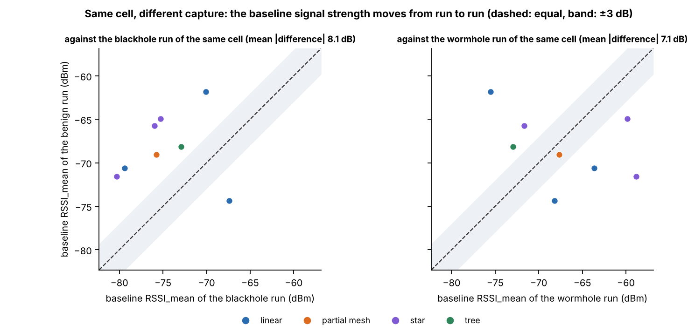

*Each point is one benign run; the dashed line means "equal" and the band is ±3 dB. Points fall on both sides and mostly outside the band: two captures of the same cell can differ by several dB with no attack involved.*

> [!note] The other benign figures
> Figure 6.13 (benign delivery over time: flat at 1, with tiny dips only in linear/G402/highload), Figure 6.14 (probe rate and PDR by scenario: same in benign and attack runs), Figure 6.15 (normal windows, benign vs. attack runs: only RSSI_mean differs). They are in `images/` as fig-6-13 to fig-6-15.

### Check-in (Part 6)

- **Q:** PDR separates victims at 99.9% but all non-attacker nodes at only 86.9%. Why the gap, and is it a flaw in the data?
- **Your answer:** *(pending)*

> [!question]- Answer (click to reveal)
> The label is set by phase for **every** board in the run, so bystanders' attack-phase windows carry label 1 even though nothing happened to their traffic (their PDR stays at 1.000). No feature of a bystander can reveal an attack that did not reach it, so any feature-based method misclassifies them. It is not a flaw in the data: it is how the labelling is defined, and the paper reports the victims-only figure next to the all-nodes figure for that reason.
>
> 📖 **Review it:** Section 6.2.3 and Section 6.4.3

---

## Part 7: Chapter 6.4 to 6.5, Clustering and Discussion

### 7.1 What clustering is asking

- **Clustering** groups windows **only by how similar their feature values are**. The algorithm is **never shown the label**.
- Afterwards, the label is used to **score** the groups: did the groups the algorithm found line up with normal vs. attack?
- Analogy: you dump 6,000 photos on a table and ask a friend who has never seen your albums to sort them into piles by look alone. Then you check whether the piles match your albums. The friend never saw the album names; you only use them to grade the piles.
  - Where the analogy breaks: the friend might sort by brightness (a property of the camera, not the subject). That is exactly what happens later with RSSI_mean, which sorts windows by **set-up**, not by attack.

### 7.2 The five algorithms in plain words

| Algorithm | How it groups | Needs k? |
|---|---|---|
| **K-Means** | Picks k centres, puts every window with its nearest centre, moves centres, repeats | Yes |
| **Ward (hierarchical)** | Starts with every window alone, keeps merging the two groups whose merge adds the least spread | Yes (where to cut the tree) |
| **GMM (Gaussian mixture)** | Assumes the data are k overlapping bell curves; each window gets a probability of belonging to each | Yes |
| **DBSCAN** (primary in the plan) | Groups windows in dense regions; isolated windows are labelled **noise** | No (needs eps and min_samples) |
| **Spectral** | Builds a similarity graph and splits it using its eigenvectors; good for odd shapes | Yes |

- **Setup (6.4.1):** standardised features; k from 2 to 8; three seeds (**42, 7, 123**), each drawing a fresh sample of **6,000 windows** and restarting the algorithm. Results are means over seeds, with k = 2 unless stated.
- **DBSCAN settings:** min_samples between D+1 and 2D (D = number of features); **eps** at the knee of the k-distance graph (Figure 6.17); the setting with the best silhouette is kept.

### 7.3 The four scores

| Score | Range | Better | What it measures | Uses the label? |
|---|---|---|---|---|
| **Silhouette** | -1 to 1 | higher | how close a window is to its own cluster vs. the nearest other | No |
| **Davies-Bouldin** | 0 and up | lower | how compact and far apart the clusters are | No |
| **Purity** | 0 to 1 | higher | share of windows carrying their cluster's majority label | Yes (afterwards) |
| **ARI** (adjusted Rand index) | -1 to 1 | higher | agreement between clusters and labels, **corrected for chance**: 1 = exact, 0 = chance | Yes (afterwards) |

- Silhouette and Davies-Bouldin describe the **shape** of clusters. Purity and ARI describe **agreement with the label**. A high silhouette does **not** mean the clusters match the attack (see 7.6).
- **Purity trap:** purity 0.702 is just the majority rate of the sample, i.e. **no separation at all**. Always read purity against the majority rate.

### 7.4 The three feature sets (Table 6.24)

| Set | Features | Count | Why |
|---|---|---|---|
| **FULL** | PDR, ParentSwitchRate, HopChangeCount, HopStabilityDuration, RSSI_mean, RSSI_var, RSSI_stability, RSSI_Hop_Diff | 8 | Everything allowed after the leakage guard |
| **REDUCED** | PDR, RSSI_mean, RSSI_var, RSSI_Hop_Diff | 4 | FULL after the **low-variance filter** (drop if more than 90% of windows share one value) and the **correlation filter** (drop if \|r\| > 0.85) |
| **REDUCED without PDR** | RSSI_mean, RSSI_var, RSSI_Hop_Diff | 3 | **Control:** does anything other than PDR separate the attack? |

- Why 16 features shrink to 8: the relay features, RetryRate and the tunnel features are blocked by the leakage guard, and LatencyHopRatio is blocked because its missingness alone predicts the label in 86% of windows.
- The low-variance filter removed ParentSwitchRate (100% one value), HopChangeCount (100%), HopStabilityDuration (99.8%) and RSSI_stability (98.5%). The correlation filter removed nothing (largest |r| was 0.11).
- **Two populations:** all non-attacker nodes (127,372 windows), and victims only (72,687 windows).

### 7.5 Blackhole clustering results (Table 6.25, means over 3 seeds, k = 2)

| Set | Algorithm | ARI, all non-attacker | ARI, victims only |
|---|---|---|---|
| REDUCED | **K-Means** | **0.514** | **0.996** |
| REDUCED | Ward | 0.503 | 0.891 |
| REDUCED | GMM | 0.514 | 0.659 |
| REDUCED | DBSCAN (5 to 9 clusters) | 0.485 | 0.940 |
| REDUCED | Spectral | -0.001 | 0.008 |
| FULL | K-Means | 0.172 | -0.001 |
| FULL | DBSCAN | 0.476 | 0.929 |
| Without PDR | **every algorithm, every k (2 to 8)** | **-0.016 to 0.002** | about 0 |

**How to read it in three sentences:**

1. **With PDR**, K-Means at k = 2 on REDUCED reaches **0.514 on all non-attacker nodes** and **0.996 on victims**.
2. **Without PDR**, nothing works: ARI between -0.016 and 0.002 for every algorithm and every k, on both populations.
3. So the whole separation is carried by **one feature, PDR**. The blackhole leaves no mark on signal strength or topology.

### 7.6 Why 0.514 is actually "perfect" (the ceiling of 0.515)

- 43.2% of the attack-labelled non-attacker windows (16,499 of 38,232) are **bystander** windows: labelled attack, behaving normally.
- No method that reads only a window's features can put those with the attack. So the **best possible** clustering is: victim attack windows in one group, everything else in the other. Its ARI is the **ceiling**.

**Worked example: computing the ceiling from the paper's own window counts.**

**0. Given.**

- Victim attack windows = 21,733 (label attack)
- Bystander attack windows = 16,499 (label attack)
- Normal windows = 89,140 (label normal)
- Best partition: cluster 1 = the 21,733 victim attack windows; cluster 2 = the other 105,639
- Find: the ARI of that partition

**1. Build the contingency table** (rows = clusters, columns = labels).

| | Label attack | Label normal | Row total |
|---|---|---|---|
| Cluster 1 | 21,733 | 0 | 21,733 |
| Cluster 2 | 16,499 | 89,140 | 105,639 |
| Column total | 38,232 | 89,140 | N = 127,372 |

**2. Write the ARI.** It counts pairs of windows that are together in both the clustering and the labels, minus what chance would give, scaled so a perfect match is 1. With C(x, 2) = x(x - 1)/2:

$$\text{ARI} = \frac{\sum_{ij} C(n_{ij},2) - E}{\tfrac{1}{2}\left[\sum_i C(a_i,2) + \sum_j C(b_j,2)\right] - E}, \quad E = \frac{\sum_i C(a_i,2)\,\sum_j C(b_j,2)}{C(N,2)}$$

**3. Compute the pieces** (rounded).

$$\sum_{ij} C(n_{ij},2) = 4.3452\times10^{9}$$

$$\sum_i C(a_i,2) = 5.8159\times10^{9}, \quad \sum_j C(b_j,2) = 4.7037\times10^{9}, \quad C(N,2) = 8.1117\times10^{9}$$

$$E = \frac{5.8159\times10^{9}\times4.7037\times10^{9}}{8.1117\times10^{9}} = 3.3725\times10^{9}$$

$$\text{max} = \tfrac{1}{2}(5.8159 + 4.7037)\times10^{9} = 5.2598\times10^{9}$$

**4. Divide.**

$$\text{ARI} = \frac{4.3452 - 3.3725}{5.2598 - 3.3725} = \frac{0.9727}{1.8873}$$

$$\text{ARI} \approx 0.515$$

**5. Verify.** This is exactly the paper's best possible value (0.515), and the purity of this partition is (21,733 + 89,140) / 127,372 = 0.870, which is K-Means' purity in Table 6.25.

**Answer:** the ceiling is 0.515. K-Means' 0.514 means it found **essentially exactly** the windows in which the attack is felt.

> [!tip] Takeaway
> When a panelist says "ARI 0.514 is only moderate", answer: the maximum any feature-based method can reach on these labels is 0.515, because 43% of the attack-labelled windows are bystanders that the attack never touched. On victims alone the same method scores 0.996.

### 7.7 Why the silhouette picks the wrong answer (6.4.3)

- On the FULL set, K-Means and Ward have their **highest silhouette at k = 2** (0.77 and 0.90), yet the split is **not** the attack:
  - K-Means ARI per seed = 0.515, 0.000, 0.000 (mean 0.172). On seed 7 the small cluster was 44 windows with extreme RSSI variance; on seed 123 it was **one** window where a board changed parent.
- Lesson: choose k with the elbow, the silhouette **and interpretability** together, as Chapter 4 planned, never silhouette alone. The attack is recovered at k = 4 (K-Means 0.505).
- **Spectral** finds the attack on one seed and not the others (huge spread), so it is reported but not relied on. **DBSCAN** agrees with K-Means.

**K-Means clusters at k = 2 on REDUCED (Table 6.26, seed 42)**

| Measure | Cluster A (no delivery loss) | Cluster B (delivery lost) |
|---|---|---|
| Windows | 4,990 | 1,010 |
| Attack-phase windows | 15.2% | **99.4%** |
| From victims | 48.2% | 99.7% |
| Mean PDR | 1.000 | **0.000** |
| Mean RSSI_mean | -73.6 dBm | -74.9 dBm |
| Mean RSSI_var | 0.315 | 0.322 |

- Cluster B is the victims under attack, separated **by PDR alone**. The RSSI columns barely differ.

**Robustness (6.4.4):** inside every site and every topology, K-Means stays within 0.03 of that subgroup's ceiling (star: 0.999, because the star has no bystanders), and stays at 0 without PDR. **Run-level check:** one model applied to all windows gives ARI 0.511 with a 95% interval of **0.41 to 0.63** when the 36 runs are resampled. That is much wider than the seed spread (SD 0.014), because the windows come from only 36 runs.

### 7.8 The key figures of clustering

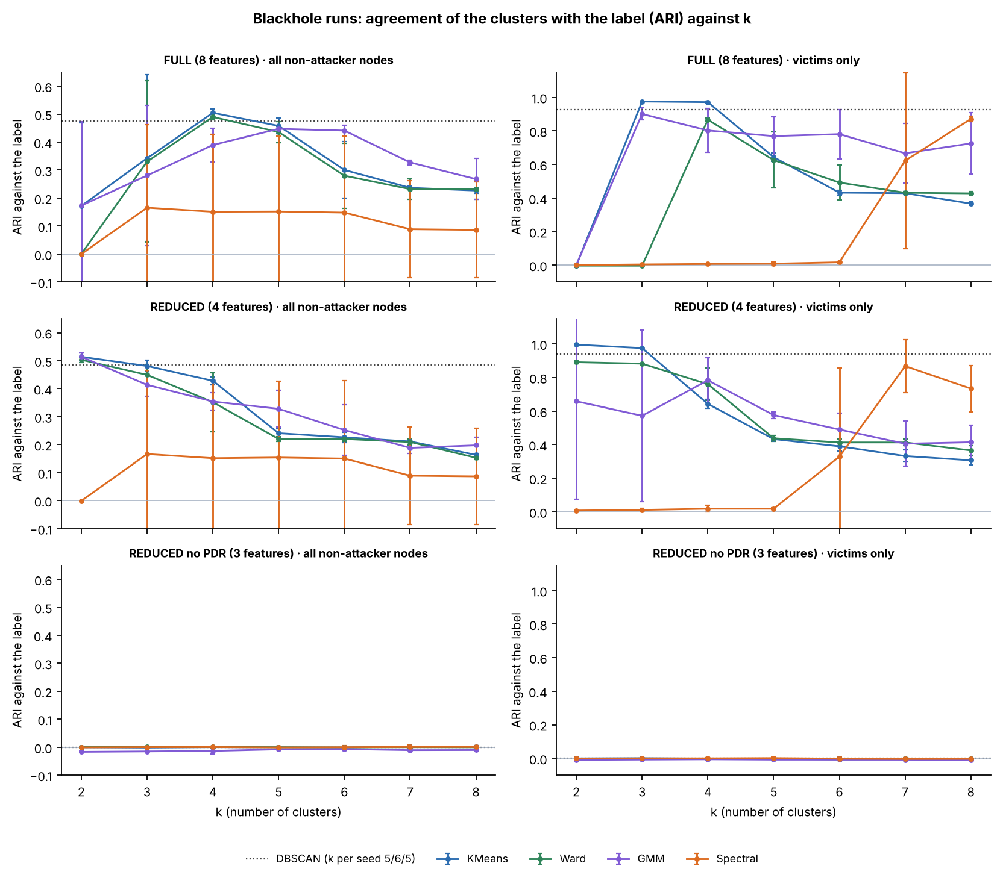

*Rows = feature sets (FULL, REDUCED, without PDR); left = all non-attacker nodes, right = victims only; each line = one algorithm with ±1 SD bars over seeds; dotted = DBSCAN. Look at the bottom row: flat at 0 for every algorithm and every k. That flat row is the whole argument that PDR carries the separation.*

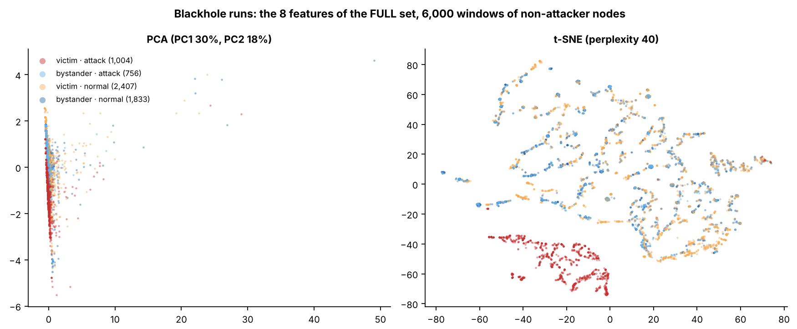

*Each dot = one window (6,000 sampled). Red = victim attack windows. In the t-SNE (right) the red windows form their own island at the bottom; the light-blue bystander attack windows sit among the normal ones. PCA (left) is squashed into a column because a few extreme RSSI-variance windows dominate the first component.*

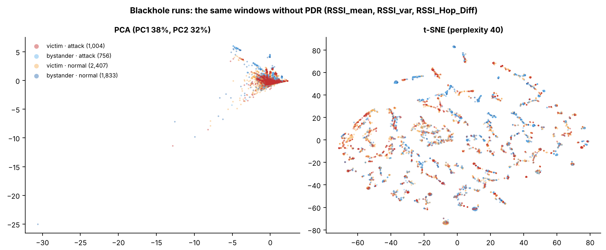

*Same plot with only the three RSSI features. All four colours sit on top of each other: without PDR there is no structure to find.*

> [!note] How to read PCA and t-SNE
> - **PCA** rotates the data so the first axis holds the most variance (here PC1 30%, PC2 18%). Axes are in standardised feature units.
> - **t-SNE** places windows with similar features near each other. Its **axes have no units**; only **nearness** means anything. Never read distances between far islands.
> - A "group" in a picture is not a cluster. A cluster is the output of an algorithm.

Other clustering figures in `images/`: Figure 6.17 (DBSCAN k-distance knees: eps 0.79, 0.73, 0.56), 6.19 (silhouette vs k), 6.20 (Davies-Bouldin vs k), 6.21 (cluster composition at k = 3: with PDR one cluster is entirely red).

### 7.9 Wormhole clustering (6.4.6, Table 6.28)

- **Non-attacker boards, all feature sets:** ARI -0.012 to 0.003 for every algorithm and k. Expected: the wormhole does not touch them.
- **The two ends with only the cross-layer RSSI features** (and LatencyHopRatio on B): ARI -0.012 to 0.009. **No separation.**
- **Diagnostic: add TunnelIntensity** (excluded from model inputs by the leakage guard, used only to ask "is there any tunnel signal a clusterer can find?"):
  - K-Means k = 2 on B: ARI **0.000**, because it splits by **signal level** (mean RSSI -67.6 vs -47.1 dBm, which varies between runs), not by tunnel activity.
  - K-Means k = 3: a third cluster of 540 windows, all wormhole, mean TunnelIntensity 4.04 (the highload runs); ARI 0.141.
  - **DBSCAN on B: ARI 0.827** (9 to 12 nearly pure clusters).
- Conclusion: a tunnel signal **exists** in the data, but it is carried by the attackers' **own counters**, not by the cross-layer features.

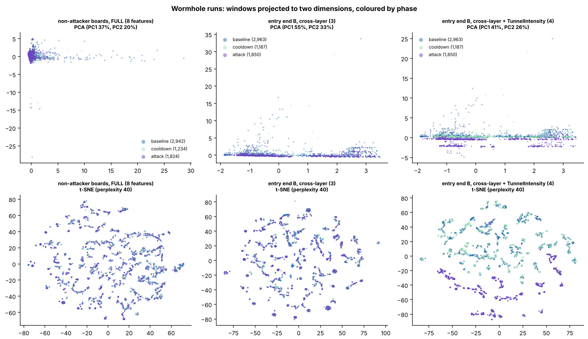

*Purple = attack. Left two columns (non-attacker boards; end B with cross-layer features): phases overlap completely. Right column (end B with TunnelIntensity added): the attack windows split off, because TunnelIntensity is exactly 0 in every normal window.*

### 7.10 Pooled: all 80 runs, three labels (6.4.7)

- Non-attacker boards of all 80 runs, **257,258 windows**, labels: normal 0, blackhole 1, wormhole 2.

| Group | Label | Windows |
|---|---|---|
| normal, benign run | 0 | 22,481 |
| normal, blackhole run | 0 | 89,140 |
| normal, wormhole run | 0 | 75,211 |
| blackhole attack, victim | 1 | 21,733 |
| blackhole attack, bystander | 1 | 16,499 |
| wormhole attack, other board | 2 | 32,194 |

- **Ceiling:** victim attack windows vs. everything else = **0.334** (80 runs) and **0.317** (72 attack runs), computed on the 6,000-window samples. (On all windows the same partition gives about 0.337 and 0.323; the small difference is sampling.)
- **K-Means k = 2, REDUCED: 0.333 (80 runs) and 0.315 (72 runs)**, equal to the ceiling. It finds the blackhole victims and **nothing else**.
- Without PDR: -0.023 to 0.005. Nothing.
- **Used as a detector** (one model fitted on 6,000 windows, applied to all, Table 6.32):

| Group | In the "victim" cluster |
|---|---|
| Victim attack windows | **21,733 of 21,733 (100%)** |
| Benign windows | **0 of 22,481** (no false alarm) |
| Normal windows of blackhole runs | 183 of 89,140 (0.21%) |
| Wormhole attack windows | 3 of 32,194 (0.01%) |
| Bystander attack windows | 0 |

- The benign runs raise **no alarm**, and the **wormhole is not detected at all** by the non-attacker features. Adding or removing the benign runs changes K-Means' ARI by only 0.017.

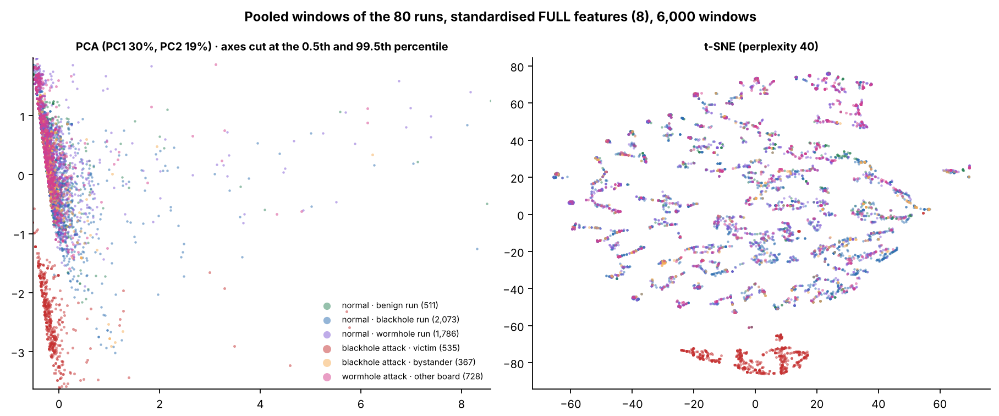

*Six colours = six groups of the table above. Only red (victim attack windows) stands apart; the other five overlap, including pink (wormhole attack).*

### 7.11 Discussion (6.5)

**What each kind of run leaves in the data (Table 6.33)**

| Kind | Direct record | Cross-layer features that change | Clustering |
|---|---|---|---|
| Blackhole | Attacker FR 1.000-1.004 -> 0.000-0.007; victim PDR 0.998 -> 0.000 | **PDR of victims only** (d = -29.7); all others \|d\| < 0.1 | 0.514 (ceiling 0.515); 0.996 victims; ~0 without PDR |
| Wormhole | B's probes reach the root twice (99.86%); TunnelIntensity 0 -> 1.92 | **None** (\|d\| ≤ 0.07; hop and parent unchanged) | ~0 without a tunnel feature; DBSCAN 0.827 on B with TunnelIntensity |
| Benign | 0 of 21 signature checks passed; PDR 0.9994 to 1.0000 | Cooldown within 0.5 SD of baseline in 24 of 24 | 0 of 22,481 in the victim cluster |

- **Main reading:** Chapter 4 expected a "confluence of cross-layer evidence". The data show the evidence sits in the **data plane**: delivery (blackhole) and duplication (wormhole). The PHY, MAC and network features stay where they were.
- **Honest qualifier the paper makes itself:** PDR is also what the verifier uses to confirm the blackhole, so the clustering's agreement shows it finds the effect the verifier measured. It is **not independent evidence** that cross-layer features detect the blackhole.

**Comparison with published studies (Table 6.34)**

| Feature | This study | Published | Reading |
|---|---|---|---|
| Baseline PDR | 0.998 (victims), 0.996 (bystanders), 0.9994 to 1.0000 (benign) | > 0.97, Khan et al. [22], same ESP32 platform | Agree in size; counting differs, so not claimed equal |
| PDR under blackhole | 0.000 | 25% to 40% delivery (60% to 75% loss), Airehrour et al. [70], RPL | Same direction; bigger here because our attacker sits on the victims' path by placement |
| Parent changes under blackhole | 0.00000 -> 0.00009 per s | 16 to 246 rank changes [70] | Differs: their attack acts on routing; ours does not (D-20) |
| Wormhole hop count | Constant | 4 hops -> 3 hops, Zhukabayeva et al. [71], ZigBee | Their tunnel is a route ZigBee adopts; ours is an app relay |
| Wormhole delay | Spread of 3.9 ms; LatencyHopRatio of B unchanged | 80-100 ms -> 120-200 ms (about +40%) [71] | Different measure |
| Duplicate arrivals | 99.86% of B's probes, 0 in baseline | Duplicated routing packets proposed as a signature, Ramírez Gómez et al. [72] | Same kind of evidence, different layer |

**What an emulation can and cannot show (6.5.3), three consequences:**

1. Results describe what **this kind** of attack does to traffic and features, not what a routing-protocol attack would do.
2. A detector tested on these blackhole windows is tested on **delivery loss**; on these wormhole windows, on **duplication**. Both are visible at the root without cross-layer features.
3. Whether cross-layer features add anything is **open**; it needs a dataset of attacks that act on routing.

**Limits (6.5.4):**

- One run per cell (no repeats); RSSI differs about 8 dB between captures of the same cell.
- Windows are not independent: the real sample size is closer to **80 runs** than to 456,195 windows.
- Partial mesh behaved as a plain tree (2-children limit), no adaptive parent switching.
- Tree fan-out differs between runs (root 2 to 5 children).
- The phase label marks bystanders as attack: ceilings 0.515 (blackhole) and 0.334 / 0.317 (pooled).
- Only 8 benign runs (54 child boards): they show no false alarm, but **cannot give a false-alarm rate**.
- No routing-table logging, no MAC retry count, sniffer on only 7 runs.
- Results are for 8 ESP32 boards at three indoor sites, not larger meshes.

### Check-in (Part 7)

- **Q:** Without PDR, every algorithm scores ARI ≈ 0 on the blackhole. Does that mean the cross-layer features are useless for detection? Answer the way the paper does.
- **Your answer:** *(pending)*

> [!question]- Answer (click to reveal)
> No, it means they are not affected by **these emulated** attacks. Both attacks act on the application-layer probes and leave the radio and the routing unchanged (D-20), so there is nothing for RSSI or topology features to detect. Whether cross-layer features help against attacks that **do** manipulate routing remains open and needs a different dataset (Section 6.5.3, and Recommendation 1 in Chapter 7).
>
> 📖 **Review it:** Sections 6.5.1 and 6.5.3

---

## Part 8: Chapter 7, Conclusion

### 8.1 Summary of the study (7.1, 7.2)

- 8 ESP32 boards (1 root, 7 children), normal operation plus two attacks emulated at the application layer, 4 topologies, 3 sites, 3 scenarios.
- **80 runs** (36 blackhole, 36 wormhole, 8 benign); each with 300 s baseline, 180 s attack (where applicable), 120 s cooldown.
- **456,195** windows generated, **369,678** analysed (266,491 normal, 103,187 attack); 16 features; 5 clustering algorithms.
- Quality: 1,372 windows (0.30%) dropped; no run lost more than 1%; 637 files, none empty; one board (B768, a bystander) with no data.

### 8.2 Evidence that the dataset is valid (7.3)

- **All 72 attack runs passed** the verifier (67 complete, 5 minor gaps); all 8 benign runs confirmed benign.
- **Blackhole:** ForwardingRatio 1.000-1.004 -> 0.000-0.007; PDR 0.998 -> 0.000; 121 of 123 victims cut off in the first second; recovery within 3 s (median 2 s); bystanders 1.000.
- **Wormhole:** exit end received 99% to 101% of tunnel messages; 12,448 of 12,465 probes (99.86%) arrived twice; duplicates in 6,468 of 6,469 attack windows (99.98%), none outside the attack; 1 to 5 hops skipped; hop counts unchanged.

### 8.3 Answers to the research objectives (7.4)

- **Objective 1, testbed: achieved** (qualifiers: emulated attacks; partial mesh = branched trees).
- **Objective 2, labelled cross-layer dataset: achieved** (qualifier: no MAC retry count, D-15).
- **Objective 3, separability: differs by attack.**
  - Blackhole: only victim PDR moved (0.998 -> 0.000). With PDR, K-Means ARI 0.514 vs best possible 0.515. Without PDR, -0.016 to 0.002.
  - Wormhole: cross-layer features ARI -0.012 to 0.009. Visible only through the ends' counters and duplicate arrivals.
  - Pooled 80 runs, 3 labels: 0.333 vs best 0.334.
- **The expected cross-layer evidence from Chapter 4 was not found**, because both attacks left the radio and routing unchanged. **The researchers consider this an important finding, not a failure.**

### 8.4 Main findings, contributions, limitations (7.5)

**Four findings**

1. Blackhole -> clear delivery loss among victims; PDR is the strongest indicator.
2. Wormhole -> duplicate arrivals at the root, consistently, only during the attack.
3. Other expected changes (retransmissions, parent changes, hop counts, signal-to-hop) were **not** observed.
4. Clustering depends heavily on the features used; removing the main attack feature collapses performance.

**Three contributions**

1. An ESP32 mesh **testbed** for normal behaviour and two attacks under varied conditions.
2. A **dataset** of 80 runs with topology, site, scenario, role and phase on every row.
3. A **verification process** that separates real attack effects from missing data or broken runs. Firmware and tools are in the project repository [79].

**Six limitations**

1. Application-layer attacks only.
2. Only 8 boards.
3. Only 8 benign runs (no reliable false-alarm rate).
4. No direct MAC retry measurement; sniffer on some runs only.
5. Not enough repeats per condition.
6. Strong results depend on features tied to the attack implementation.

### 8.5 Recommendations (7.6)

| Recommendation | What it means in practice |
|---|---|
| **Test attacks that directly affect routing** | A routing implementation that can be modified, or radio-level tools (forged management frames), to see if parent, hop, retry and RSSI features then react |
| **Collect more normal data** | More benign runs in every topology, site and scenario, with repeats, to estimate a false-alarm rate |
| **Improve network measurements** | Sniffer on every run; compare Tables 3.4 and 3.5 with what the testbed can actually measure |
| **Test more wormhole scenarios** | Tunnel other nodes' traffic, not only B's own probes; other layouts and traffic |
| **Improve the evaluation of detection models** | Hold out whole runs as test data; compare against simple baselines (PDR for blackhole, duplicates for wormhole); test with the main attack feature removed |

### 8.6 Final conclusion (7.7), the line to end on

- Both attacks produced clear, measurable changes; the blackhole through delivery, the wormhole through duplicate arrivals.
- Detection depended on those features; the other cross-layer features did not separate the attacks in this setup.
- Because the attacks were application-layer, the results are not proof for routing-level attacks.
- The study gives a validated testbed, a documented dataset and a verification process as a **starting point** for ESP32 mesh attack research.

### Check-in (Part 8)

- **Q:** Name the three contributions and the single most important limitation.
- **Your answer:** *(pending)*

> [!question]- Answer (click to reveal)
> - **Contributions:** (1) the ESP32 mesh testbed, (2) the 80-run labelled dataset, (3) the verification process that confirms every run.
> - **Most important limitation:** the attacks are emulated at the application layer (D-20), so they never change routing or the radio, which is why the cross-layer features did not respond.
>
> 📖 **Review it:** Section 7.5

---

## Part 9: Panel question bank

> [!note] How to use this bank
> The answers are **fact outlines**, not a script. Say them in your own words; the panel and the adviser want the team's own voice.

### About the attacks

- **"Your blackhole doesn't attract traffic. Is it really a blackhole?"**
  - It matches 4 of the 5 criteria of Airehrour et al. [70] (Table 4.4); it fails only "attracts traffic with a false route".
  - ESP-WIFI-MESH has no API to write routes or fake advertisements (D-20); we made the attacker's **position** the experimental variable instead.
  - We call it "forwarding suppression (blackhole emulation)" and state the gap as the first limitation.
- **"Is your wormhole a wormhole if the topology never changes?"**
  - It has two colluding ends, an out-of-band channel, and capture-and-replay (Table 4.5, Hu, Perrig and Johnson [46]). It does not create a false neighbour.
  - It reproduces the **packet-level** signature: duplicate arrivals (Ramírez Gómez et al. [72]) and a latency mismatch.
- **"Why not just make the root the attacker in the star?"**
  - The root is the destination (nothing to forward to) and the referee (it logs arrivals and drives phases). A dropping root would be grading itself (D-16).
- **"Why does the wormhole have no victims?"**
  - Only B's own probes are tunnelled; the other 5 boards' traffic is untouched by design. The attack is the duplication.

### About the data

- **"Why one-second windows?"**
  - 10 Hz sampling gives 10 samples per window; the 80% rule (8 of 10) is kept; the panel wanted about 10,000 rows per run (D-1, D-9).
- **"Your boards' clocks aren't synchronised. How do you compute delay or delivery?"**
  - Delivery joins the root log to each node on **sequence number**, never time.
  - Each board is aligned to its own exit from phase 0.
  - Delay is **relative** to the sender's fastest delivery (D-2); TunnelLatency cancels the offset exactly (D-3).
- **"Where is the MAC layer in your cross-layer dataset?"**
  - ESP-IDF exposes no MAC retry count (D-15); app counters are kept but not modelled.
  - Real retries were measured from the sniffer's Retry bit in 7 blackhole runs: no consistent rise (3 up, 4 down).
  - The MAC-side claim rests on RSSI and the link/parent state.
- **"Are 8 benign runs enough?"**
  - As a control, yes: none triggered the verifier, none of their 22,481 windows fell in the victim cluster.
  - For a false-alarm rate, no. The paper says so and recommends more benign runs.
- **"How do you know a run is valid and not just noise?"**
  - Every run passes the verifier: 3-sigma signature, topology, dataset, scenario, setup. Rules fixed before reading results.
  - Placebo test: 0 false confirmations in 106. Sensitivity: ±50% thresholds changed no verdict.

### About the results

- **"ARI 0.514 is mediocre."**
  - The ceiling is 0.515 because 43.2% of attack-labelled windows are bystanders the attack never reached; victims alone score 0.996.
- **"So your cross-layer features failed?"**
  - They did not respond to **these** attacks because these attacks never touch the radio or routing. That is a finding about the emulation, and the open question (do they help against routing attacks?) is our first recommendation.
- **"If PDR alone detects the blackhole, why cluster at all?"**
  - That is exactly what the single-feature audit tests, and we report it openly.
  - The clustering confirms the dataset carries one clear, separable signal for the blackhole and none in the cross-layer features. Recommendation 5 says any future model must beat a plain PDR threshold.
- **"Why does the run clock give 80%?"**
  - Every run follows the same schedule, so position in the run partly reveals the phase. It is kept out of model inputs.
- **"Why did silhouette say k = 2 is best on FULL when that split isn't the attack?"**
  - Silhouette measures shape, not agreement with the label. It picked a split of a few extreme windows (one parent change, high RSSI variance). We choose k with elbow, silhouette **and** interpretability.
- **"Why is RSSI so different between runs of the same cell?"**
  - Each capture is a fresh set-up; RSSI depends on exact board placement. About 8 dB between captures of the same cell, in both directions. It separates captures, not attacks.
- **"Do your results generalise?"**
  - No claim beyond 8 ESP32 boards, three indoor sites, three scenarios, and application-layer attacks (Section 6.5.4).

### About the topologies

- **"Is your partial mesh really a mesh?"**
  - No board ever used a second parent; we report it as a placement-defined branched tree with at most 2 children and claim no adaptive switching (D-29).
- **"Why does the tunnel skip only 1 hop in the star?"**
  - A flat star has every board at hop 1, so nothing could be skipped. Making end A the hub creates the smallest possible shortcut, 1 hop (D-28).

---

## Part 10: Weak spots in the submitted paper

> [!warning] Know these before the panel finds them
> These are sentences in the submitted paper that are out of date or inconsistent. If one comes up, acknowledge it calmly and give the correct fact from Chapter 6.

| Where | What the paper says | The correct fact |
|---|---|---|
| 4.2.2.1, under Figure 4.16 | "Figure 4.16 still shows the earlier flat star and is to be redrawn"; "the first hub-star captures are not yet usable"; "the hub-star design still needs the adviser's approval" | The figure **is** redrawn (A as hub), and all 9 star wormhole runs were captured and confirmed (Table 6.12) |
| 4.2.2.1, under Figure 4.17 | "Figure 4.17 must be redrawn with the attacker as the hub" | It already shows the attacker as the hub with the root behind it |
| 4.2.2.2 | Sticky tree parents "not yet confirmed on hardware" | Tree runs were captured; only 1 of 132 tree boards changed parent in the labelled phases (5.5) |
| 4.2.2.4 | Partial mesh "to be confirmed with the adviser" | Chapter 5 (D-29) states the final decision |
| Ch 4 intro | "While the remaining runs are captured..." | All 80 runs were captured |
| Table 4.4, row 1 | Evidence: "Victims address the attacker" | Since D-12, victims send to their own parent; the tree, not an address, routes them through the attacker |
| 4.2.7.1 vs 6.2 | 4.2.7.1: a zero-SD baseline gives an "undefined" z, "not reported as infinite". 6.2: "z is infinite" | Same situation, two words. Safe phrasing: "the baseline never varied, so any move in the expected direction passes" |
| 4.2.4.2 vs code | IngressEgressDelta "received minus forwarded"; RSSI_Hop_Diff "observed minus baseline median" | The code stores the **absolute** value of both |
| 4.2.3.7 vs Table 6.2 | 457,568 windows formed minus 1,372 discarded = 456,196, but Table 6.2 totals 456,195 | Off by one window; a known open item, not yet traced in the analysis output. If asked, acknowledge it as a one-window bookkeeping difference that has not been traced; it changes no percentage or result (0.30% either way) |
| 7.3 | "he attack results were checked" (missing "T") | Typo |
| 7.6 | "directly\`" (stray backtick) | Typo |
| Figures 6.1 to 6.31 | Each carries a small footer with a repository commit and a build date | Crop the footer before putting a figure on a slide (the copies in this guide are already cropped) |

---

## Formula summary

| Quantity | Formula | Unit / range |
|---|---|---|
| Hop | layer - 1 (root = hop 0) | count |
| Counter delta | value at window end - value at window start | count |
| ForwardingRatio | Δforwarded / Δreceived (blank if Δreceived = 0) | 0 to 1 |
| IngressEgressDelta | \|Δreceived - Δforwarded\| | packets/window |
| ConsistencyScore | \|ForwardingRatio - 1\| | 0 to 1 |
| RetryRate | Δretry / (Δtx + Δretry), app counters | 0 to 1 |
| PDR | probes delivered to the root / probes sent, in the window | 0 to 1 |
| ParentSwitchRate | parent changes / 1 s | per s |
| HopChangeCount | hop changes in the window | count |
| HopStabilityDuration | longest run with the same (layer, parent) | s |
| RSSI_mean, RSSI_var | mean, variance of RSSI samples | dBm, dBm² |
| RSSI_stability | longest run within ±3 dBm of the window mean | s |
| RSSI_Hop_Diff | \|RSSI - baseline median RSSI at that layer\| | dB |
| LatencyHopRatio | (arrival - send - sender's minimum) / hops | ms/hop |
| TunnelIntensity | tunnel messages / 1 s | msg/s |
| TunnelBytes | tunnel messages x 30 | bytes/window |
| TunnelLatency | max - min arrival delay of the two copies of one probe | ms |
| 3-sigma z | (attack mean - baseline mean) / baseline SD | pass if \|z\| ≥ 3 in the expected direction, change ≥ 0.10, ≥ 6 points |
| Cohen's d | (attack mean - baseline mean) / pooled SD | 0.2 small, 0.5 medium, 0.8 large |
| Majority rate | normal s / labelled s = 420 / 600 | 0.70 |
| Silhouette | (b - a) / max(a, b) per point, averaged | -1 to 1, higher better |
| Davies-Bouldin | mean over clusters of max (σi + σj) / d(ci, cj) | 0 and up, lower better |
| Purity | (1/N) Σ over clusters of the largest label count | 0 to 1 (compare with the majority rate) |
| ARI | (Σ C(nij,2) - E) / (½[Σ C(ai,2) + Σ C(bj,2)] - E) | -1 to 1; 1 exact, 0 chance |
